# EConverter — System Architecture Documentation (C4 Model)

**Document type:** C4 Architecture Description
**System:** EConverter — Self-Hosted Document Conversion & Intelligence Platform
**Runtime:** ASP.NET Core / .NET 10, Blazor Server (Radzen)
**Generation date:** 2026-08-31
**Evidence basis:** Domain Modules Report (confidence 9.0), System Context Report (confidence 0.93), Architecture Report (code-verified), Workflow Report
**Document verdict:** Architecture is *clean at the compile-graph level*; drift concentrates in **operational** guarantees (queue fallback, DB provider, worker parity). Where documentation and code disagree, this document states the verified behaviour and flags the claim.

---

## Table of Contents

1. [Architecture Overview](#1-architecture-overview)
2. [System Context](#2-system-context)
3. [Container View](#3-container-view)
4. [Component View](#4-component-view)
5. [Key Processes](#5-key-processes)
6. [Technical Implementation](#6-technical-implementation)
7. [Deployment Architecture](#7-deployment-architecture)
8. [Architectural Assessment, Risks & Roadmap](#8-architectural-assessment-risks--roadmap)
9. [Appendices](#9-appendices)

---

# 1. Architecture Overview

## 1.1 Design Philosophy

EConverter is architected around **five non-negotiable design commitments**, each traceable to a business constraint rather than an aesthetic preference.

| # | Design Commitment | Business Driver | Architectural Consequence |
|---|---|---|---|
| 1 | **Data sovereignty first** | AI adoption in legal/health/finance/public sector is blocked by cloud egress; documents contain privileged material | The entire intelligence stack (BM25, HNSW, RAG, classification, copilot) executes **in-process, zero-egress**. External providers are an *opt-in gateway*, never a dependency. |
| 2 | **Broker is an accelerator, not a dependency** | Operators must be able to run the platform without RabbitMQ; brokers fail | Job dispatch has a **database-lease polling path** that is always available. (See §8.2 — the documented fallback component does not exist; the real fallback is polling.) |
| 3 | **Authorization on stable internal identity** | Identity providers churn; permissions must survive Entra ID re-provisioning | The `User` aggregate keys on its **own entity ID**, not on `sub`/`oid`/`preferred_username`. Claims transformation maps external → internal, JIT-provisioning on first sight. |
| 4 | **Ownership enforced in the domain aggregate** | No downstream feature (editor, AI, export) may bypass document authorization | `Document.IsOwnedBy(...)` and lifecycle guards live in `Domain`, not in controllers or services. Every consumer must pass through the aggregate. |
| 5 | **Asynchrony absorbs backlog** | Conversion of large batches must not block interactive users | `ProcessingJob` lease-based state machine + batch semantics + horizontally scalable workers. |

The platform's positioning is a **governed document workspace**, not a converter: one identity, one audit surface, one storage model, one encryption point spanning conversion, OCR, editing, retrieval and briefing generation.

## 1.2 Core Architecture Patterns

```mermaid
graph TB
    subgraph Patterns["Architectural Patterns in Force"]
        direction TB
        P1["<b>Clean Architecture / Hexagonal</b><br/>Domain ← Application ← Infrastructure ← Host<br/>verified in .csproj ProjectReference graph"]
        P2["<b>Domain-Driven Design</b><br/>Aggregates: Document, ProcessingJob, User<br/>Single transition authority: ProcessingJobLifecycle"]
        P3["<b>Composition Root</b><br/>Program.cs owns all wiring;<br/>registrations are the runtime contract"]
        P4["<b>Ports &amp; Adapters</b><br/>IDocumentStorage, IDocumentProcessor,<br/>IQueuePublisher, IMalwareScanner,<br/>IExternalAiClient, IOcrEngine"]
        P5["<b>Lease-Based Work Distribution</b><br/>Claim / RenewLease / retry-eligibility<br/>crash-tolerant without a lock manager"]
        P6["<b>Degradation Ladder</b><br/>RabbitMQ → DB polling<br/>External LLM → local synthesis<br/>Entra ID → local identity"]
        P7["<b>CQRS-lite</b><br/>write: EF Core aggregates;<br/>read: DTO projection in Contracts"]
        P8["<b>Event Push (SignalR)</b><br/>progress/completion over hub circuits,<br/>no client polling"]
    end
    style Patterns fill:#0d1117,stroke:#58a6ff,color:#c9d1d9
    style P1 fill:#1f6feb,color:#fff
    style P2 fill:#1f6feb,color:#fff
    style P5 fill:#238636,color:#fff
```

**Pattern notes.**

- **Clean Architecture is verified, not asserted.** The `.csproj` reference graph is `Domain → Contracts → Application → Infrastructure → {Web, DocumentWorker}`, with `Application` referencing only `Domain`, `Contracts` and `Processing.Abstractions`. Domain has **zero external package references**. A `tests/Architecture.Tests` project exists specifically to keep it that way.
- **DDD is partial and deliberately so.** Three true aggregates (Document, ProcessingJob/BatchJob, User) carry invariants; DocumentIntelligenceIndex and vector chunks are modelled as persistence-shaped entities because they are derived data with no independent invariant.
- **The degradation ladder is the resilience thesis.** Every external dependency has an in-boundary substitute — except PostgreSQL and the storage backend, which are genuinely load-bearing.

## 1.3 Technology Stack

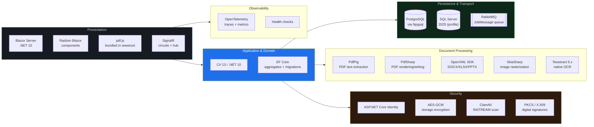

| Layer | Technology | Selection Rationale |
|---|---|---|
| UI | Blazor Server + Radzen | Server-side circuit keeps document bytes and AI context off the client; Radzen supplies a mature enterprise grid/dialog set without a JS build chain |
| PDF view | pdf.js (bundled) | Browser-side rendering of large PDFs without server round-trips per page; offline-capable, no CDN dependency |
| Transport | Minimal APIs + SignalR | Minimal APIs give a thin, strongly-typed integration surface; SignalR gives push progress without polling |
| Persistence | EF Core over **Npgsql** (primary) and SQL Server (secondary) | Single `AppDbContext` merging Identity tables with the domain schema |
| Queue | RabbitMQ | Standard, operationally familiar; deliberately **optional** |
| PDF read | PdfPig | Managed, layout-aware text extraction, no native deps |
| PDF write | PdfSharp | Drawing primitives map cleanly to editor DTOs |
| Office | OpenXML SDK | First-class DOCX/XLSX/PPTX construction — no Office interop, no COM |
| Images | SkiaSharp | Cross-platform rasterization for OCR and compression |
| OCR | Tesseract 5.x | Local, zero-egress, no per-page API cost; language packs as operator assets |
| Crypto | AES-GCM | Authenticated encryption at rest — confidentiality *and* integrity |
| AV | ClamAV | Self-hosted, signature-updated, INSTREAM protocol |
| Telemetry | OpenTelemetry | Vendor-neutral export to any collector |

> **Deliberate non-choices.** No microservice mesh (the domain is one bounded context with one schema). No client-side SPA framework. No mandatory vector database (HNSW runs in-process). No mandatory LLM provider.

---

# 2. System Context

## 2.1 System Positioning and Business Value

EConverter replaces a **dozen disconnected tools** — converters, OCR utilities, PDF editors, AI assistants — with a single governed platform whose differentiating property is that **document content never leaves the operator's infrastructure unless explicitly permitted**.

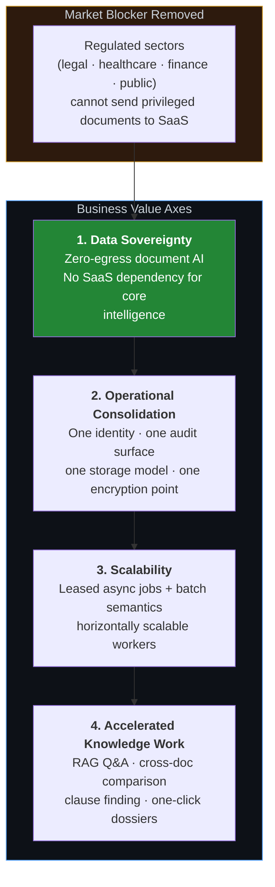

## 2.2 System Context Diagram (C4 Level 1)

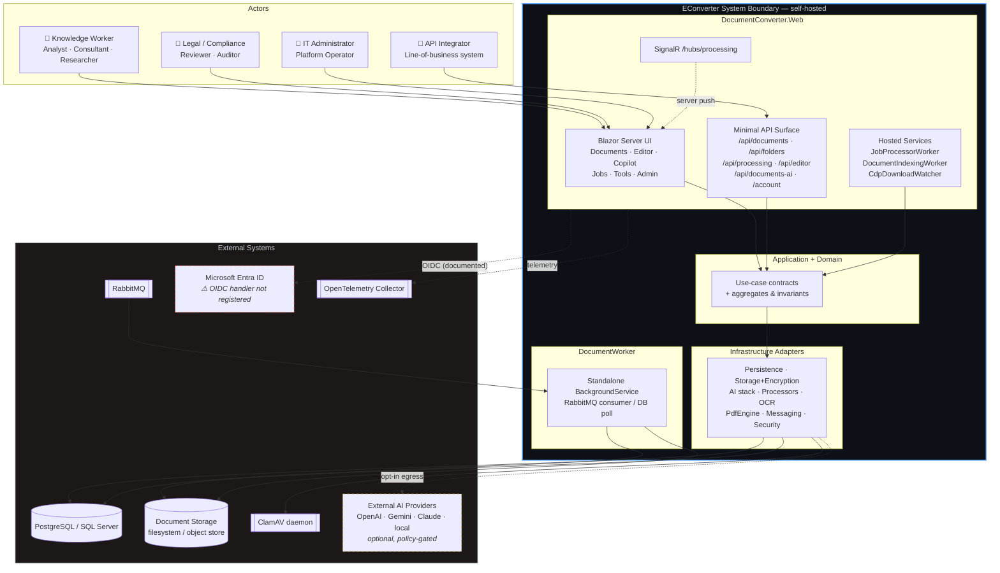

## 2.3 User Roles and Scenarios

| Role | Primary Scenarios | Critical Needs | Architectural Response |
|---|---|---|---|
| **Knowledge Worker** | Convert DOCX↔PDF, OCR scanned files, ask questions over a personal library, edit/annotate PDFs, track job progress | Layout-preserving conversion; fast grounded answers; live job status | Format processor family; in-process RAG; SignalR progress push; batch dialogs |
| **Legal / Compliance** | Cross-document comparison, clause finding, redaction, watermarked deliverables, evidence-grade provenance | **Zero egress**; citable sources; exportable dossiers; immutable versioning | Local intelligence stack; `GroundedAnswer` with citations; `CopilotDossierExporter` → PDF/DOCX/XLSX/MD; SHA-256 hashing + version chain; `PdfEngine` redaction primitives |
| **IT Administrator** | Deploy, configure, secure, monitor; manage users/roles/converters; tune AI + storage | SSO, health/telemetry, configurable storage & encryption, scalable workers | `AdminService` + admin pages; health checks + OpenTelemetry; `IDocumentStorage` port; `StorageEncryptionOptions`; standalone worker deployable |
| **API Integrator** | Embed conversion & intelligence into line-of-business systems | Stable typed contracts; programmatic submit/poll/cancel; predictable authz | Minimal-API groups with `RequireAuthorization()`; `ProcessingJobDto`/`BatchJobDto`; documented cancellation semantics |

## 2.4 External System Interactions

| External System | Interaction Type | Direction | Criticality | Failure Behaviour |
|---|---|---|---|---|
| **PostgreSQL** (primary) | Sync EF Core/Npgsql over TCP; migrations at startup (`to_regclass` checks) | Outbound | **Load-bearing** | Platform unusable. ⚠ Migration artifacts are SQL Server–shaped (§8.2, D-2) |
| **SQL Server 2025** | Sync EF Core (`MigrationsHistoryTable("__EFMigrationsHistory","dbo")`) | Outbound | Alternative provider | Selected via compose profile `mssql-internal` |
| **RabbitMQ** | Async publish/subscribe of `JobMessage` | Outbound publish; inbound consume | **Optional accelerator** | Degrades to DB lease polling (§8.2, D-1) |
| **Document Storage** | Stream read/write through `IDocumentStorage`, AES-GCM-wrapped | Outbound | **Load-bearing** | Cannot persist or retrieve documents |
| **ClamAV** | Sync INSTREAM scan via `IMalwareScanner` | Outbound | Degradable | Upload rejection or policy-defined bypass |
| **Tesseract 5.x** | In-process P/Invoke with custom `DllImport` resolver | In-process | Feature-level | OCR converters fail; text-native paths continue |
| **External AI Providers** | Sync REST with SSE/NDJSON streaming | Outbound | **Opt-in** | `ExternalAiClient` unavailable → local synthesis proceeds |
| **Entra ID** | OIDC/OAuth2 federated auth | Outbound | **Not wired** (§8.2, D-4) | Only the shape exists; Local Identity is the live path |
| **Browsers / API Clients** | SignalR circuit + HTTP static assets; REST JSON | Inbound | Load-bearing | — |
| **OpenTelemetry Collector** | OTLP export | Outbound | Observability only | Telemetry dropped; platform unaffected |

## 2.5 System Boundary Definition

**Inside the boundary (project code):**

- `DocumentConverter.Web` — composition root, HTTP/Blazor pipeline, middleware, authentication, SignalR hubs, minimal APIs, `HostedServices` (`JobProcessorWorker`, `DocumentIndexingWorker`, `CdpDownloadWatcher`), `Components` (Documents, Editor, Copilot, Jobs, Tools, Admin, Account)
- `DocumentConverter.Application` — use-case contracts (AI, Admin, Documents, Editor, Processing, Security, Storage)
- `DocumentConverter.Domain` — aggregates and invariants (`Document`, `User`, `ProcessingJob`, `ProcessingJobLifecycle`, AI/Processing/Security/System models)
- `DocumentConverter.Contracts` — transport DTOs and queue messages
- `DocumentConverter.Infrastructure` — all adapters: persistence, AI, OCR, Office/PDF processing, editor rendering, identity, messaging, storage encryption, security, admin
- `BuildingBlocks.DocumentConverter.Processing.Abstractions` — `IDocumentProcessor`, shared by host and worker
- `BuildingBlocks.DocumentConverter.Security` — `FileSignatureDetector`, `ZipBombGuard`, `FileNameSanitizer`, `EicarSignatureDetector`
- `Workers.DocumentWorker` — standalone consumer/poller

**Outside the boundary (operator-managed or third-party):**

PostgreSQL/SQL Server servers · RabbitMQ broker · Entra ID · external LLM APIs · underlying filesystem/object store · Tesseract binaries and tessdata packs · NuGet libraries (Radzen, PdfPig, PdfSharp, OpenXml, SkiaSharp, PKCS) · pdf.js browser assets · OpenTelemetry collector · end-user browsers/OS · reverse proxies, TLS terminators, load balancers, container orchestration.

**Boundary judgement call:** the in-process intelligence stack (BM25, HNSW, RAG orchestration, dossier export) is **inside** the boundary because it executes without egress. This is the architectural decision that makes the sovereignty claim true rather than aspirational.

---

# 3. Container View

## 3.1 Verified Solution Structure (Compile Graph)

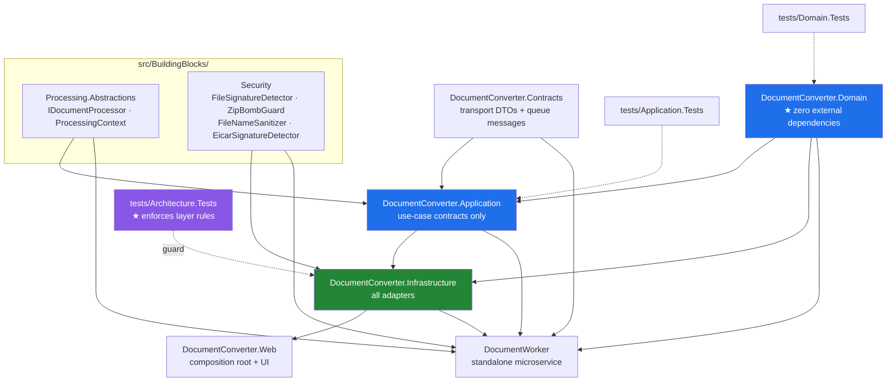

**Layer discipline verdict: SOLID.** Arrow direction = "is referenced by". `Application` has no `Infrastructure` reference; `Domain` is dependency-free. `Architecture.Tests` is the enforcement mechanism — and is absent from the research materials (a coverage gap, now documented).

## 3.2 Container Diagram (C4 Level 2)

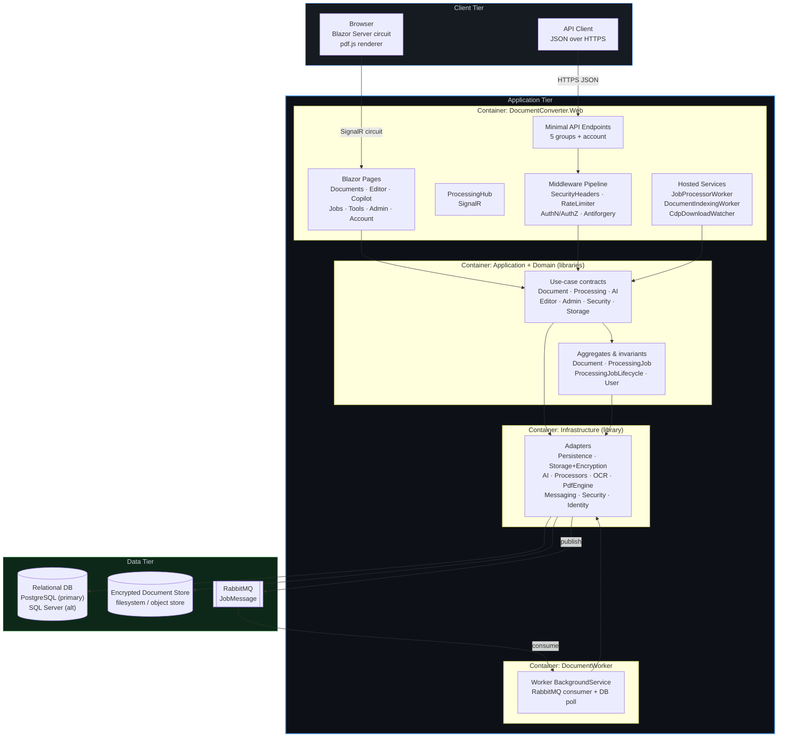

## 3.3 Domain Module Architecture

Ten domain modules across three classifications. The table below is the **authoritative module ledger**; weights are from the Domain Modules Report.

| # | Module | Type | Importance | Complexity | Key Ownership |
|---|---|---|---|---|---|
| 1 | **Document Lifecycle Management** | Core Business | 9.8 | 8.5 | The aggregate every capability operates on; ownership enforced at domain level |
| 2 | **Job Orchestration and Processing** | Core Business | 9.6 | 9.0 | Async execution model; lease state machine; queue dispatch; batch aggregation |
| 3 | **Document Conversion and OCR** | Core Business | 9.5 | 9.2 | The original tangible value: format transformation + Tesseract pipeline |
| 4 | **Document Intelligence and AI** | Core Business | 9.4 | 9.5 | Zero-egress RAG, hybrid indices, copilot, dossier export |
| 5 | **Security, Identity and Audit** | Core Business | 9.0 | 7.5 | Cross-cutting trust: dual auth, stable IDs, audit, malware, input hardening |
| 6 | **PDF Editing and Rendering** | Supporting Business | 7.8 | 8.0 | Converts a converter into a workspace |
| 7 | **Platform Administration** | Supporting Business | 7.2 | 5.5 | Governance of the running platform |
| 8 | **Document Storage and Encryption** | Infrastructure | 8.5 | 6.0 | Single enforcement point for stored-content confidentiality |
| 9 | **Persistence and Data Schema** | Infrastructure | 8.8 | 7.0 | Single EF Core unit; schema authority |
| 10 | **Platform Composition and Hosting** | Infrastructure | 8.6 | 6.5 | Composition root; runtime contract |

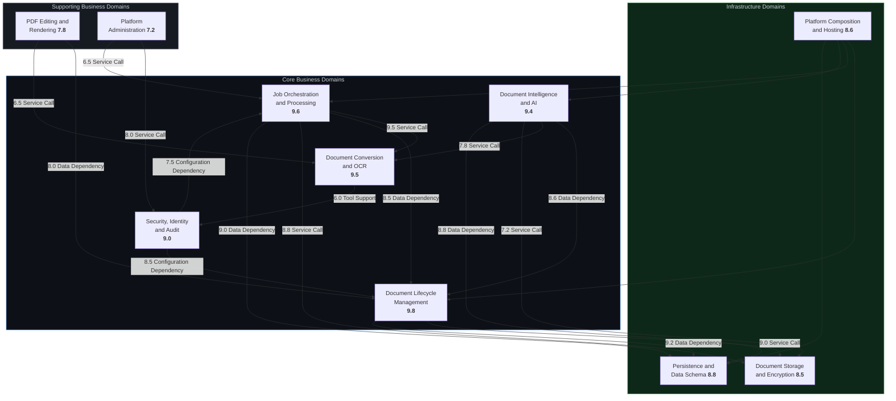

**Reading the graph.** The thick spine is **Document → Storage → Persistence** (strengths 9.0/9.2): every workflow ultimately reads or writes through it, so any disruption cascades platform-wide. The second spine is **Processing → Conversion Abstractions → Concrete Processors** (9.5), which is exactly what enables worker scaling without coupling to the web host.

## 3.4 Module Internals — Sub-Module Decomposition

### 3.4.1 Document Lifecycle Management

| Sub-module | Importance | Responsibility | Key Code |
|---|---|---|---|
| Document Aggregate and Invariants | 9.8 | `IsOwnedBy`, `BeginScan`, lifecycle gating, SHA-256 hash + storage provider/key, folders/versions/display-name rules | `Domain/Documents/{Document,DocumentVersion,Folder,DocumentStatus,DisplayNameRules}.cs` |
| Document Application Service | 9.2 | Branching rules: rename, move, delete, restore, purge, version creation, DTO mapping; coordinates storage + DB | `Application/Documents/IDocumentService.cs`, `Infrastructure/Documents/DocumentService.cs`, `PdfDigitalSignatureService.cs` |
| Document API and UI Surface | 8.8 | `/api/documents` routes, folder CRUD, Blazor explorer/upload/properties dialogs | `Web/Endpoints/DocumentEndpoints.cs`, `Contracts/Documents/DocumentDtos.cs`, `Components/Pages/Documents/*` |

> **Documented tension.** `DocumentEndpoints.cs` is 902 lines and contains a private `ConvertDocxStreamToPdf(Stream, Stream)` — a full OpenXML→PdfSharp renderer inside the transport layer, creating a **second DOCX→PDF code path** with different fidelity from `OfficeDocumentProcessor` (§8.2, D-6).

### 3.4.2 Job Orchestration and Processing

| Sub-module | Importance | Responsibility | Key Code |
|---|---|---|---|
| Job State Machine and Aggregates | 9.6 | Sole authority on transitions, terminal states, retryable errors, lease renewal, cancellation | `Domain/Processing/{ProcessingJob,ProcessingJobStatus,BatchJob,ProcessingAttempt,ProcessingJobInput,ProcessingJobOutput}.cs` |
| Processing Orchestration Service | 9.2 | Create/list/query/cancel jobs & batches; access validation; `JobMessage` publish with fallback | `Application/Processing/IProcessingService.cs`, `Infrastructure/Processing/{ProcessingService,ConverterCatalogService}.cs` |
| Queue Dispatch and Worker Execution | 9.5 | RabbitMQ publish/consume; DB polling fallback; full conversion transaction with per-job error isolation | `Infrastructure/Messaging/RabbitMqJobDispatcher.cs`, `Web/HostedServices/JobProcessorWorker.cs`, `Workers/DocumentWorker/Worker.cs`, `Contracts/Processing/JobMessage.cs` |
| Real-time Job Notification | 7.5 | Broadcast progress/completion over SignalR; translate notification contracts into hub messages | `Web/Services/JobNotificationService.cs`, `Web/Hubs/ProcessingHub.cs`, `Web/Endpoints/ProcessingEndpoints.cs` |

### 3.4.3 Document Conversion and OCR

| Sub-module | Importance | Responsibility | Key Code |
|---|---|---|---|
| Format Converters | 9.5 | PDF↔DOCX (PdfPig extraction + OpenXML construction), DOCX/XLSX/PPTX/MD/EPUB→PDF, PDF/image/document compression, capability analysis, compression estimation, converter catalog | `Infrastructure/Processing/{Office,Pdf,Image,Ocr,PdfCompress,ImageCompress,Echo}DocumentProcessor.cs`, `PdfCapabilityAnalyzer.cs`, `CompressionEstimatorService.cs`, `Office/` |
| OCR Pipeline | 9.0 | Tesseract 5.x wrapper: per-OS native resolution + symlinks, custom `DllImport` resolver, language-code sanitization, scanned-PDF detection, word boxes + confidence + page dimensions | `Infrastructure/Ocr/{TesseractOcrEngine,ScannedPdfDetector,IOcrEngine,IScannedPdfDetector}.cs` |
| Processing Abstractions | 8.5 | `IDocumentProcessor` contract shared by host and worker; transport-agnostic conversion | `BuildingBlocks/.../IDocumentProcessor.cs`, `Contracts/Processing/FidelityDtos.cs` |

### 3.4.4 Document Intelligence and AI

| Sub-module | Importance | Responsibility | Key Code |
|---|---|---|---|
| Indexing and Embedding Pipeline | 9.2 | Multilingual chunking, language detection, embedding generation, batched vector/index upserts, EF change-tracker management during bulk indexing | `Infrastructure/AI/{DocumentIntelligenceService,MultilingualChunkProcessor,DocumentLanguageDetector,DocumentIndexingChannel}.cs`, `Web/HostedServices/DocumentIndexingWorker.cs` |
| Retrieval and Ranking | 9.3 | Okapi BM25 with IDF + field boosts; HNSW ANN queries; RRF fusion; MMR diversification; LLM query transformation; context expansion; canonical↔translated snapshots | `Infrastructure/AI/{RagRetrievalOrchestrator,Bm25InvertedIndex}.cs`, `AI/Hnsw/HnswVectorIndex.cs` |
| Copilot and Answer Synthesis | 8.8 | Grounded answers with citations; persistent sessions, messages, memory; reusable chat workspace | `Web/Services/EnterpriseAiChatService.cs`, `Components/Pages/Copilot/*`, `Components/Common/EnterpriseAiChatWorkspace.razor`, `Domain/AI/{CopilotChatSession,CopilotChatMessage,CopilotMemoryItem,CopilotUserSettings}.cs` |
| Dossier Export and Benchmarking | 8.0 | PDF/DOCX/XLSX/Markdown dossiers; Excel financial-graph export; 120-question harness (Recall@K, MRR, nDCG) with deterministic chunk identity | `Infrastructure/AI/{CopilotDossierExporter,RagBenchmarkRunner}.cs` |
| External AI Gateway | 8.2 | Provider-specific completion requests; SSE/NDJSON normalization; connectivity pings; timeouts; opt-in egress | `Infrastructure/AI/ExternalAiClient.cs`, `Application/AI/IExternalAiClient.cs` |

### 3.4.5 PDF Editing and Rendering

| Sub-module | Importance | Responsibility | Key Code |
|---|---|---|---|
| PDF Rendering Engine | 8.5 | Page structure (add/remove/rotate/reorder), annotations (highlight/ink/sticky/underline), text/shape/image/stamp/watermark/redaction drawing, form fields, `SystemFontResolver` | `Infrastructure/Editor/PdfEngine.cs`, `SystemFontResolver.cs`, `Application/Editor/IPdfEngine.cs`, `Contracts/Editor/PdfEditorDtos.cs` |
| Editor Client Experience | 7.6 | pdf.js rendering; dialogs for merge, extract, OCR, stamp, watermark, password, signature | `Web/Components/Pages/Editor/PdfEditor.razor`, `Editor/Dialogs`, `wwwroot/lib/pdfjs/pdfEditor.js` |

### 3.4.6 Security, Identity and Audit

| Sub-module | Importance | Responsibility | Key Code |
|---|---|---|---|
| Identity and Authorization Model | 9.0 | Local + EntraId on one stable identity; role/department; claims transformation; user context | `Domain/Identity/{User,Role,Department}.cs`, `Infrastructure/Identity/AppIdentityUser.cs`, `Web/Authentication/{AppClaimsTransformation,HttpContextUserContext}.cs` |
| Audit and Threat Defense | 8.8 | Audit persistence/query; ClamAV scan; EICAR + file-signature validation; zip-bomb guard; filename sanitization; security headers | `Domain/Security/AuditEvent.cs`, `Infrastructure/Security/{AuditService,ClamAvScanner}.cs`, `Web/Middleware/SecurityHeadersMiddleware.cs`, `BuildingBlocks/.../Security/*` |

### 3.4.7–3.4.10 Supporting & Infrastructure Modules

| Module | Sub-modules | Notes |
|---|---|---|
| **Platform Administration** (7.2) | Administration Service (7.2), Administration Console (6.8) | Users/roles/departments, converter catalog + limits, system settings, audit-log viewer |
| **Document Storage and Encryption** (8.5) | Storage Provider Abstraction (8.2), Encryption at Rest (8.4) | `IDocumentStorage` stream contract; `FileSystemDocumentStorage`; `AesGcmStorageEncryptionService` + options |
| **Persistence and Data Schema** (8.8) | DbContext + Entity Configurations (8.8), Schema Lifecycle and Seeding (8.4) | Single `AppDbContext` merging Identity with domain; fluent configs; linear migration chain; `DatabaseExtensions`, `DbSeeder` |
| **Platform Composition and Hosting** (8.6) | Web Host Bootstrap (8.6), Blazor Presentation Shell (7.4), Standalone Worker Service (8.0) | DI, DbContext, health, telemetry, auth pipeline, endpoint/hub mapping, identity shims; layout/routing/login shell; independently deployable worker with its own Dockerfile |

## 3.5 Storage Design

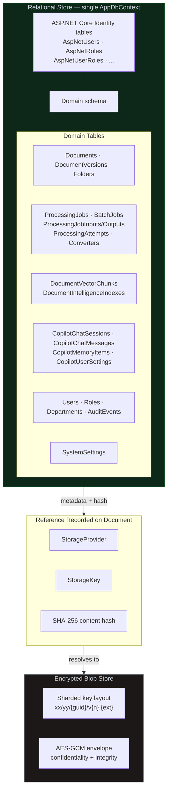

**Storage decisions.**

1. **One database, one context.** Identity and domain share `AppDbContext`, so a transaction spanning both is possible. The cost is a single migration chain that must serve both schemas — and presently serves them in a **SQL Server shape** (§8.2, D-2).
2. **Database stores metadata; storage stores bytes.** `Document` carries `StorageProvider`, `StorageKey`, and SHA-256. This decouples payload size from row size and lets operators swap filesystem ↔ object store ↔ NAS via `IDocumentStorage` without touching callers.
3. **Encryption is transparent and mandatory at the port boundary.** `AesGcmStorageEncryptionService` wraps the storage adapter; callers never handle plaintext-on-disk. Every byte entering or leaving passes through this single enforcement point.
4. **Derived indexes are durable, not ephemeral.** `DocumentVectorChunk` + `DocumentIntelligenceIndex` persist vector rows; the in-memory HNSW graph is **hydrated from them at startup** by `DocumentIndexingWorker`, so a restart is a warm-up, not data loss.
5. **Migration chain (as recorded):** `InitialCreate` → `AddPersistentVectorAndIntelligenceIndex` → `AddCopilotChatAndMemoryPersistence` → `AddTriLanguageChunkSupport` → `WidenDocumentVectorChunkEmbedding`.

## 3.6 Inter-Domain Module Communication

| Pattern | Where Used | Coupling | Notes |
|---|---|---|---|
| **In-process contract call (DI)** | Blazor pages → Application contracts; host → services | Compile-time, loose | Blazor Server invokes contracts directly through the container — no HTTP hop for UI actions |
| **Service Call (synchronous)** | JOB→CONV (9.5), DOC→STOR (9.0), JOB→STOR (8.8), AI→CONV (7.8), AI→STOR (7.2), EDIT→DOC (8.0), ADMIN→SEC (8.0) | Port interfaces | All crossings go through `Application` abstractions; no cross-module concrete type references |
| **Data Dependency (shared schema)** | JOB→PERS (9.0), DOC→PERS (9.2), AI→PERS (8.8), JOB→DOC (8.5), AI→DOC (8.6) | **Tightest coupling in the system** | Modules share one `AppDbContext`; referential integrity is the integration contract |
| **Configuration Dependency (policy)** | SEC→DOC (8.5 ownership), SEC→JOB (7.5 access validation), ADMIN→JOB (6.5 catalog limits) | Policy-mediated | Authorization and scheduling bounds are configuration, not calls |
| **Tool Support** | CONV→SEC (6.0) | Utility | Input hardening applied inside conversion pipelines |
| **Asynchronous message** | Host → RabbitMQ → Worker | Loosely coupled | `JobMessage` payload; polling when broker absent |
| **Server push** | Worker → `JobNotificationService` → `ProcessingHub` → circuits | Event-driven | Progress/completion without client polling |

**Communication insight.** The two edges with strength ≥ 9.0 are exactly the two that constrain scale-out: shared `AppDbContext` (schema coupling) and the `IDocumentProcessor` call (worker/processor coupling). The first is intentional and bounded (one bounded context); the second is what makes horizontal scaling possible.

---

# 4. Component View

## 4.1 Component Diagram (C4 Level 3) — Web Container

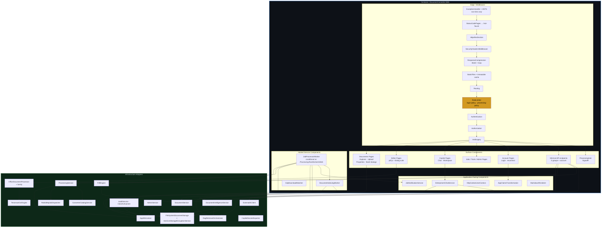

## 4.2 Middleware Pipeline Order (Verified from `Program.cs`)

Order is a **security and correctness contract**, not an implementation detail.

| # | Middleware | Why it sits here |
|---|---|---|
| 1 | ExceptionHandler / HSTS | Outermost — catches everything below; HSTS only outside Development |
| 2 | StatusCodePages → `/not-found` | Renders friendly error surface before other handlers can short-circuit nakedly |
| 3 | HttpsRedirection | Forces TLS before any body processing |
| 4 | `SecurityHeadersMiddleware` | Headers must be applied even on requests later rejected by auth/rate limiting |
| 5 | ResponseCompression (Brotli/Gzip) | Wraps downstream handlers — must be before static files and endpoints |
| 6 | StaticFiles + immutable cache | Asset hits short-circuit; no auth cost for CSS/JS |
| 7 | Routing | Endpoint metadata available to all subsequent policy-aware middleware |
| 8 | **RateLimiter** | Must precede `Authentication` so credential-stuffing is throttled *before* hashing/DB lookups |
| 9 | Authentication | Establishes `ClaimsPrincipal` |
| 10 | Authorization | Evaluates policies against the principal |
| 11 | Antiforgery | Applies to state-changing requests reaching endpoints/Blazor |
| 12 | Endpoints + Hub + Razor | Terminal handlers |

> **Pipeline insight.** Placing the rate limiter before authentication is the correct choice for login hardening — it protects against CPU-bound password hashing abuse rather than merely limiting responses after expensive work is done.

## 4.3 Endpoint Authorization Matrix

| Group | Prefix | Policy | Status |
|---|---|---|---|
| Documents | `/api/documents` | `RequireAuthorization()` | ✅ Gated (`DocumentEndpoints.cs:20`) |
| Folders | `/api/folders` | `RequireAuthorization()` | ✅ Gated (`DocumentEndpoints.cs:21`) |
| Editor | `/api/editor` | `RequireAuthorization()` | ✅ Gated (`EditorEndpoints.cs:14`) |
| Processing | `/api/processing` | `RequireAuthorization()` | ✅ Gated |
| Intelligence | `/api/documents-ai` | `RequireAuthorization()` | ✅ Gated |
| Account | `/account/*` | Mixed + `login-policy` limiter | ✅ Mixed, throttled |
| Health | `/health` | Anonymous | ✅ Intentional (probe endpoint) |
| **Hub** | `/hubs/processing` | **none** | ⚠ **Asymmetry** — `MapHub<ProcessingHub>("/hubs/processing")` mapped bare (§8.2, C-2) |

> **Finding.** Every HTTP surface is gated; the SignalR hub is not. Job progress and completion events are pushed over this hub. Even if the payload contains only job IDs and status, an unauthenticated circuit can subscribe — enabling metadata observation and, depending on hub methods, cross-tenant progress inference. Fix: `.RequireAuthorization()` — five minutes.

## 4.4 Component Responsibility Table

| Component | Layer | Lifetime | Responsibility | Scaling Character |
|---|---|---|---|---|
| `AppClaimsTransformation` | Web/Auth | Transient | Map `email`/`preferred_username`/`sub`/`oid` → internal `User.Id`; emit `dc:uid`; JIT-provision unknown users | Stateless |
| `HttpContextUserContext` | Web/Auth | Scoped | Expose current user to application services | Stateless |
| `DocumentService` | Infra | Scoped | Document lifecycle branching; ownership enforcement; version/storage coordination | Stateful via DB |
| `ProcessingService` | Infra | Scoped | Job/batch creation, access validation, queue publish | Stateful via DB |
| `RabbitMqJobDispatcher` | Infra | **Singleton** | Publish `JobMessage`; internal `Channel<JobMessage>` fallback (unconsumed — §8.2) | Single connection pool |
| `JobProcessorWorker` | Web/Hosted | Hosted (conditional) | Lease + execute conversion transaction; batch aggregation; index enqueue; SignalR notify | **Horizontally scalable (with C-1 caveat)** |
| `DocumentIndexingWorker` | Web/Hosted | Hosted | Bounded-channel dequeue; chunk/embed/upsert; HNSW hydration at startup | Vertical (in-memory index) |
| `DocumentIntelligenceService` | Infra | Scoped | Chunking, embeddings, batched upserts, access validation | CPU-bound |
| `RagRetrievalOrchestrator` | Infra | Scoped | Query transform → hybrid retrieval → RRF → MMR → rerank → context expansion | CPU + IO |
| `Bm25InvertedIndex` | Infra | Singleton-equivalent | Thread-safe lexical index w/ tombstone deletion | Memory-bound |
| `HnswVectorIndex` | Infra | Singleton-equivalent | Approximate nearest neighbour | Memory-bound |
| `ExternalAiClient` | Infra | Scoped | Provider-specific requests; SSE/NDJSON normalization | Network-bound |
| `TesseractOcrEngine` | Infra | **Singleton** | Native interop, tessdata resolution, language sanitization, rasterize + word boxes | **CPU-bound — heaviest component** |
| All 7 `IDocumentProcessor` | Infra | **Singleton** | Stateless conversion implementations | CPU-bound |
| `PdfEngine` | Infra | Scoped (static core) | DTO → PdfSharp drawing calls | CPU-bound |
| `AesGcmStorageEncryptionService` | Infra | **Singleton** | Encrypt/decrypt streams | CPU + IO |
| `FileSystemDocumentStorage` | Infra | Scoped | Stream read/write/delete/enumerate | IO-bound |
| `AppDbContext` | Infra | Scoped | Unit of work; Identity + domain schema | Connection-bound |
| `AuditService` | Infra | Scoped | Persist/query audit events | Write-amplified |
| `ClamAvScanner` | Infra | Scoped | INSTREAM malware scan | Network + CPU |
| `JobNotificationService` | Web | **Singleton** | Broadcast to `ProcessingHub` | Circuit-bound |
| `AdminService` | Infra | Scoped | Users/roles/departments/converters/settings | Low volume |
| `CopilotDossierExporter` | Infra | Scoped | Render PDF/DOCX/XLSX/MD | CPU-bound |

> **Lifetime insight.** All seven processors and the OCR engine are Singleton because they are stateless and expensive to construct (native handles, font caches). This is correct *provided* none accumulates per-request state — an assumption worth an explicit test, since a leaked `ProcessingContext` on a singleton would cross-contaminate tenants.

## 4.5 Security Component Behaviour

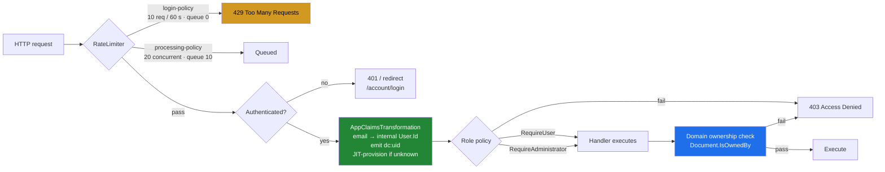

**Two-gate authorization.** Policy gates the *route*; the domain aggregate gates the *resource*. The second gate is what makes every downstream feature (editor, AI, export) safe by construction.

## 4.6 Component Interaction — Dependency Direction Audit

| Interaction | Intended Direction | Actual Location | Verdict |
|---|---|---|---|
| Blazor page → use case | Presentation → Application | ✅ Contracts injected | SOLID |
| `DocumentService` (branching rules) | Application | ⚠ Lives in `Infrastructure/Documents/` | **INVERTED** — use-case logic in the adapter layer |
| `ProcessingService` (orchestration) | Application | ⚠ Lives in `Infrastructure/Processing/` | **INVERTED** |
| `DocumentIntelligenceService` (~6k LOC) | Application | ⚠ Lives in `Infrastructure/AI/` | **INVERTED** |
| `RagRetrievalOrchestrator` (~4k LOC) | Application | ⚠ Lives in `Infrastructure/AI/` | **INVERTED** |
| `PdfEngine` (operation translation) | Application | ⚠ Lives in `Infrastructure/Editor/` | **INVERTED** |
| Domain → anything | None | ✅ Zero external package refs | SOLID |
| Application → Infrastructure | None | ✅ No project reference | SOLID |
| Worker → processor | Through `IDocumentProcessor` | ✅ Building-block abstraction | SOLID |

> **The structural tension, stated precisely.** The compile graph is clean, but several *high-value orchestrators* live on the adapter side while their interfaces live on the application side. This satisfies the letter of Clean Architecture (dependencies still point inward through interfaces) while violating its spirit (use-case logic is not independently testable without the full adapter stack). Cost: unit-testing these orchestrators requires EF Core, file storage and native OCR. Benefit: they have access to adapter internals (batching, change-tracker control) that would otherwise leak into Application as leaky abstractions. **Recommendation:** move them to `Application` with narrow ports for the adapter-specific concerns — 2 engineer-days, tracked as backlog.

---

# 5. Key Processes

## 5.1 Primary Process — Asynchronous Conversion Job Pipeline

The central value-producing flow. Verified end-to-end.

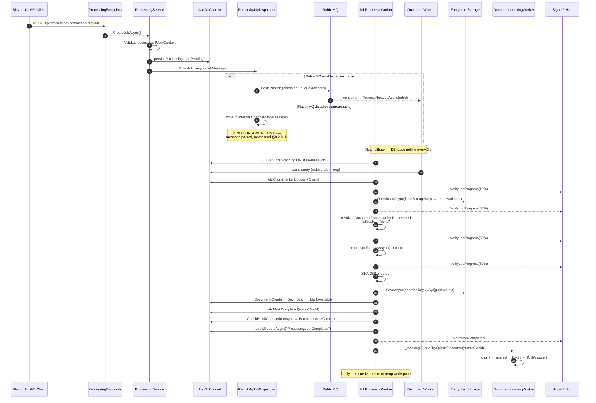

### 5.1.1 Job State Machine

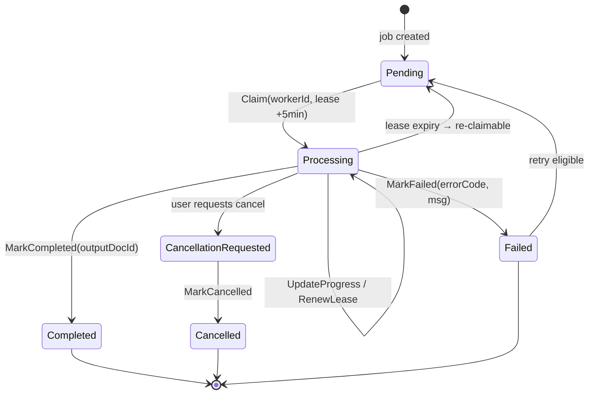

> **Single authority, verified.** `ProcessingJobLifecycle` plus `Claim`/`MarkCompleted`/`MarkFailed`/`MarkCancelled` on the aggregate are the only writers of status. Neither `JobProcessorWorker.cs` (372 lines) nor `Worker.cs` (413 lines) assigns status directly. **This invariant holds.**

> **⚠ Concurrency caveat — the platform's primary correctness risk.** Both workers execute `FirstOrDefaultAsync(...)` → `job.Claim(...)` → `SaveChangesAsync` with **no `FOR UPDATE SKIP LOCKED` and no optimistic-concurrency token on the claim**. The 5-minute lease protects against *stale* leases; it does **not** protect against *simultaneous* claim. Two workers — or the web-host worker plus the standalone worker — can select and claim the same job in the same window, producing duplicate output documents and double conversions. The documented "horizontally scalable workers" property is therefore currently a liability under scale-out. Fix: ~2 hours (§8.2, C-1).

### 5.1.2 Document Upload and Lifecycle Flow

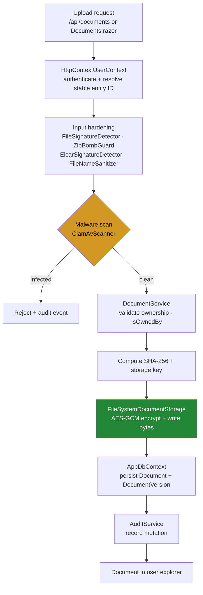

**Note.** `DocumentService` has 27 members and cyclomatic complexity **135** — the densest branching hub in the system. Every lifecycle rule (rename, move, soft-delete, restore, purge, version) converges here. It is a change-amplification hotspot: a defect in any one branch risks the others.

### 5.1.3 RAG Indexing and Question Answering Flow

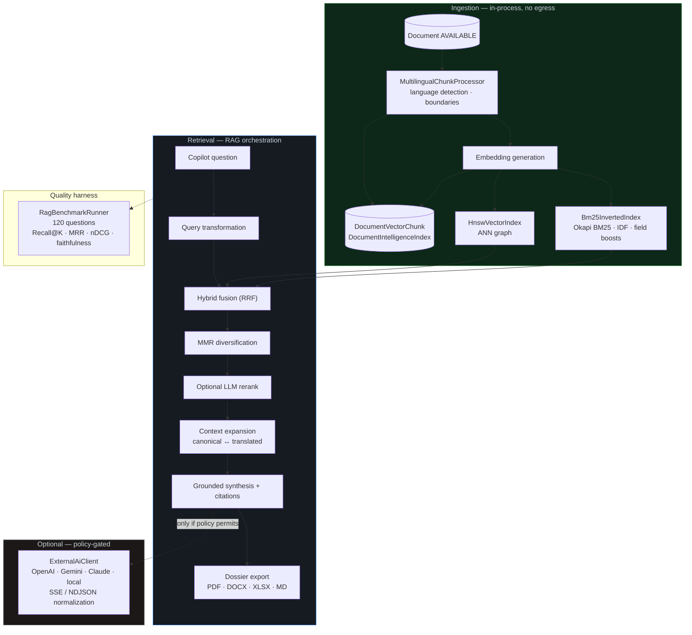

**Verified properties.** (a) HNSW graph is hydrated from `DocumentVectorChunk` at startup by `DocumentIndexingWorker` before queries are served — the in-memory index is a **cache over durable state**. (b) The indexing `Channel` is bounded with backpressure (`maxParallelism` clamped to `ProcessorCount` in `[2,4]`). (c) Only the web host enqueues newly converted outputs for indexing (§8.2, D-7).

### 5.1.4 PDF Editing Flow

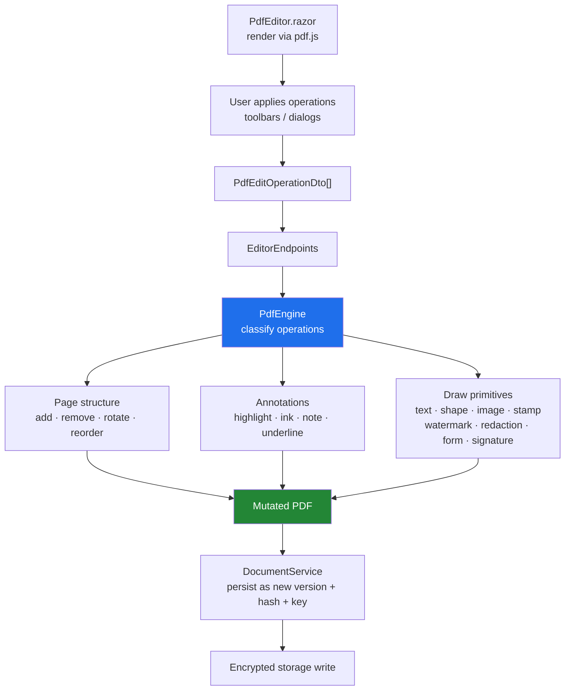

### 5.1.5 Administration, Identity and Audit Flow

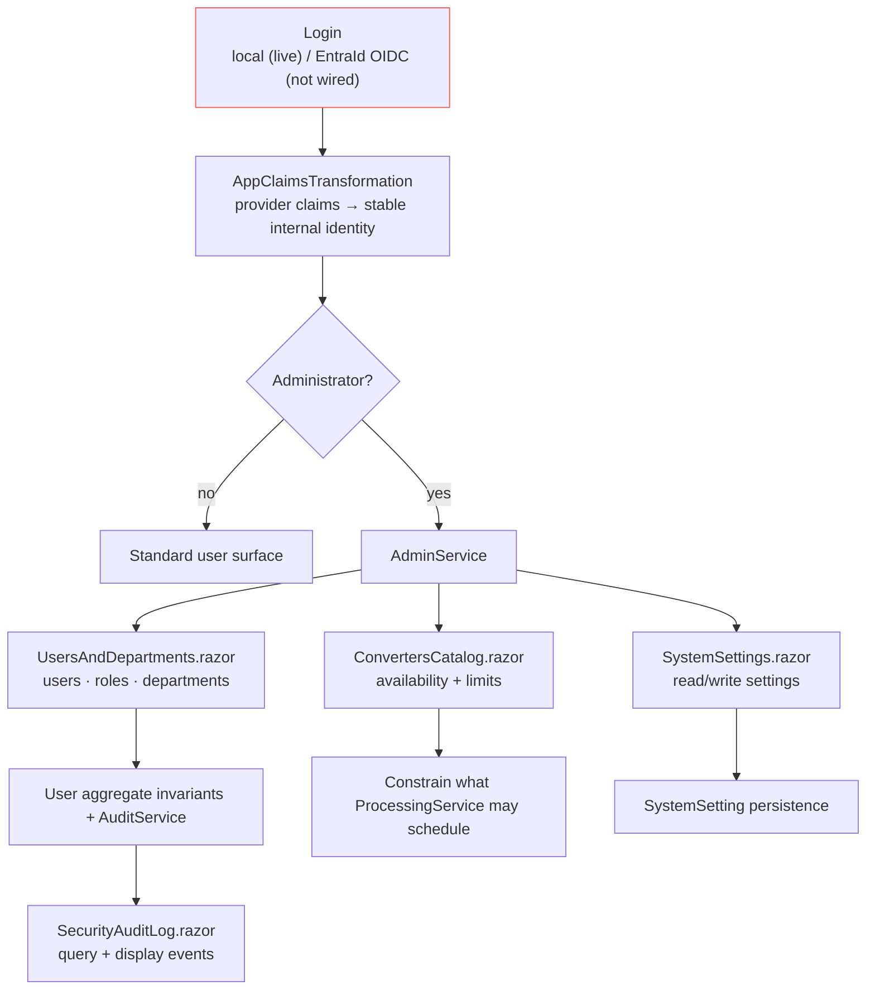

## 5.2 Technical Processing Workflows

### 5.2.1 Worker Claim and Lease Lifecycle

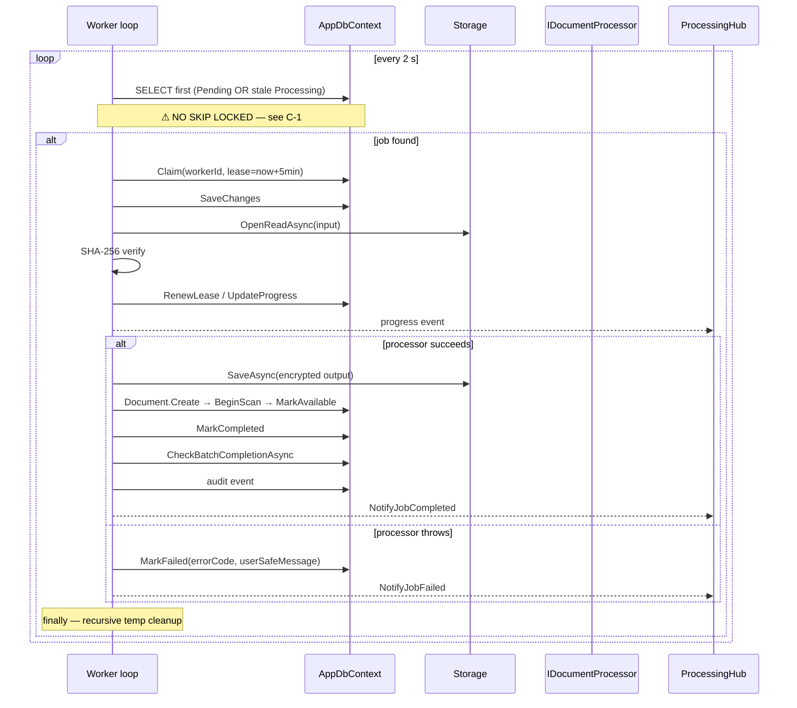

### 5.2.2 Ingress Hardening Pipeline

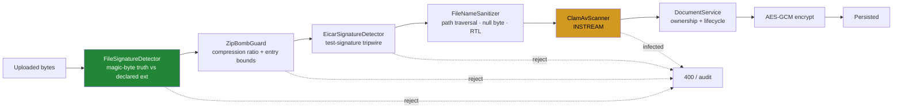

**Ordering rationale.** Signature check before malware scan (cheap, structural); zip-bomb guard before decompression (prevents the scan from itself becoming a DoS vector); filename sanitization before any path is constructed; ClamAV last because it requires bytes on a stream.

### 5.2.3 OCR Language-Code Sanitization

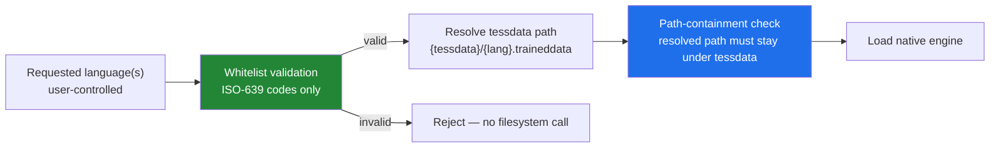

`tessdata` accepts a *path* as a language argument. Unvalidated input is a directory-traversal vector into native code. Sanitization is load-bearing, not cosmetic.

## 5.3 Data Flow Paths

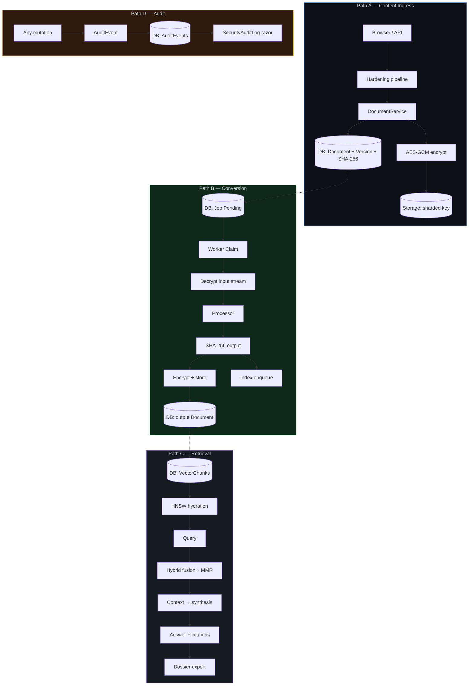

**Data-flow insight.** SHA-256 appears at **two** independent points (ingress on Path A, output on Path B). Because hashes are recorded on the Document aggregate, an operator can prove byte-identity of any version without decrypting the store — provenance is verifiable without the encryption key. That is a genuinely strong compliance property.

## 5.4 Exception Handling Mechanisms

| Failure Class | Detection | Handling | Recovery |
|---|---|---|---|
| **Conversion failure** | Processor throws | `MarkFailed(errorCode, userSafeMessage)`; per-job isolation so one bad file never fails a batch | Retry eligible if error classified retryable → back to `Pending` |
| **Worker crash mid-job** | Lease staleness | Processing-lease not renewed beyond 5 min → job re-claimable as `Pending` | Next polling cycle re-claims |
| **Broker unreachable** | Publish throws / `Enabled=false` | Message written to internal `Channel<JobMessage>` (unconsumed) | **DB polling is the real path** (§8.2, D-1) |
| **Simultaneous claim** | **None — undetected** | Both workers execute the job | ⚠ Duplicate output. Fix via `SKIP LOCKED` (C-1) |
| **Malware detected** | ClamAV verdict | Upload rejected + audit event | User re-uploads clean file |
| **Zip bomb** | Ratio/entry bounds | Reject before decompression | — |
| **Invalid file signature** | Magic-byte mismatch | Reject | — |
| **Tessdata traversal** | Language whitelist + containment | Reject before native call | — |
| **External AI unavailable** | HTTP error / timeout | Local synthesis path continues | Provider optional by design |
| **Missing DB connection string** | Startup check (insufficient) | ⚠ **Silent `UseInMemoryDatabase`** — worker runs healthy against a phantom DB | Must be fail-fast (§8.2, D-3) |
| **Batch never completes** | — | ⚠ Standalone worker never calls `CheckBatchCompletionAsync` | Web-host restart / manual (§8.2, D-7) |
| **Orphaned Processing jobs** | Lease staleness poll | Implied by lease semantics | ⚠ No documented reaper service — **verify in source** |
| **Temp workspace leak** | `finally` block | Recursive delete of temp workspace | Covered by `finally` |
| **Unhandled request exception** | ExceptionHandler middleware | Rendered error page | StatusCodePages → `/not-found` |
| **Rate limit exceeded** | RateLimiter | 429 with `login-policy` / `processing-policy` | Exponential client backoff |

> **Exception-handling tension.** The weakest link is not exception handling at all — it is the **absence of a detection signal** for concurrent claims (C-1) and for a worker attached to an in-memory database (D-3). Both fail *silently and green*: the system reports healthy while producing wrong results. For an enterprise platform in regulated sectors, silent-wrong is worse than loud-broken.

---

# 6. Technical Implementation

## 6.1 Core Module Implementation

### 6.1.1 Job State Machine — Centralized Transition Authority

The design pattern is a **lifecycle helper co-located with the status enum**, invoked only through aggregate methods. Status is never a public setter.

```csharp
// Domain/Processing/ProcessingJob.cs — shape, not literal source
public class ProcessingJob
{
    public ProcessingJobStatus Status { get; private set; }

    // Legal-transition enforcement lives in ProcessingJobLifecycle
    public void Claim(string workerId, DateTimeOffset leaseUntil)
    {
        ProcessingJobLifecycle.EnsureCanTransition(Status, ProcessingJobStatus.Processing);
        Status = ProcessingJobStatus.Processing;
        WorkerId = workerId;
        LeaseExpiresAt = leaseUntil;
    }

    public void MarkCompleted(Guid outputDocumentId) { /* guarded transition */ }
    public void MarkFailed(string errorCode, string userSafeMessage) { /* guarded */ }
    public void MarkCancelled() { /* guarded */ }
    public bool IsRetryEligible() { /* classification */ }
}
```

**Why this matters.** Because transitions are enforced in one place, the *state graph is a compile-time invariant*. Any new worker, any future automation, any integration path inherits the same legality rules with zero duplication. This is the strongest architectural property in the processing domain.

> **The one hole:** legality is enforced; **atomicity is not**. `Claim` is a legal transition performed on a non-isolated read. Fix C-1 by making the claim an atomic conditional update, not by changing the state machine.

### 6.1.2 BM25 Lexical Index

Design characteristics inferred from the module contract:

```
score(D, Q) = Σ_{t ∈ Q} IDF(t) · [ f(t,D) · (k1 + 1) ]
                          ────────────────────────────────────
                          f(t,D) + k1 · (1 - b + b · |D|/avgdl)

IDF(t) = ln( 1 + (N - n(t) + 0.5) / (n(t) + 0.5) )
```

| Property | Implementation Choice | Rationale |
|---|---|---|
| Concurrency | Thread-safe structures; concurrent readers, exclusive writers | Multiple Blazor circuits query simultaneously while indexing writes |
| Deletion | **Tombstone-based**, not compaction-on-write | Avoids write stalls; compaction deferred |
| Field boosts | Per-field weighting (title > body) | Recovers precision lost by naive chunking |
| Index location | In-memory, hydrated from `DocumentVectorChunk` | Zero external dependency; restart-safe |
| Memory | Proportional to vocabulary × postings | Bounds operator capacity planning |

> **UNVERIFIABLE without execution:** IDF correctness, effective recall, and MMR diversity are measured by `RagBenchmarkRunner` (120 questions, Recall@K / MRR / nDCG / context precision / faith­fulness). `RagBenchmarkRunner.cs` is ~105 KB and `DocumentIntelligenceService.cs` ~380 KB; numerical claims require running the harness. Deterministic GUID chunk identity makes runs reproducible.

### 6.1.3 HNSW Vector Index

| Aspect | Design | Consequence |
|---|---|---|
| Structure | Multi-layer navigable small-world graph; greedy descent from entry point, ef-bounded candidate search | O(log N) query characteristic |
| Durability | Graph is a **cache**; truth lives in `DocumentVectorChunk` | Restart triggers hydration, not data loss |
| Embedding width | Widened by migration `WidenDocumentVectorChunkEmbedding` | Model swap accommodated without schema reset |
| Multilingual | `AddTriLanguageChunkSupport`; canonical↔translated snapshot duality | Cross-language retrieval without duplicating documents |
| Deletion | Marked chunks excluded from traversal | Cost: graph quality degrades until rebuild |

### 6.1.4 PDF→DOCX Conversion (PdfPig extraction → OpenXML construction)

```mermaid
graph LR
    PDF["PDF bytes"] --> PIG["PdfPig<br/>page + content-stream parse"]
    PIG --> TXT["Text runs<br/>+ positions + fonts"]
    TXT --> LAY["Layout inference<br/>paragraph reconstruction"]
    LAY --> OXML["OpenXML SDK<br/>WordprocessingDocument"]
    OXML --> DOCX["DOCX bytes"]
    style PIG fill:#1f6feb,color:#fff
    style OXML fill:#238636,color:#fff
```

**Fidelity reality.** PDF is a *presentation* format; DOCX is a *document* format. Conversion is inherently lossy: reading order from multi-column layouts, tables without structure tags, and vector graphics are best-effort. The architecture acknowledges this with `FidelityDtos` — the platform can report *what* it preserved, not merely *that* it converted.

### 6.1.5 DOCX→PDF Conversion (the two paths problem)

| Path | Location | Fidelity | Status |
|---|---|---|---|
| Processor path | `OfficeDocumentProcessor` (via `IDocumentProcessor`) | Full pipeline: styles, tables, images, fonts | ✅ Canonical |
| Endpoint path | `DocumentEndpoints.ConvertDocxStreamToPdf` (private static) | Simpler renderer, hardcoded Arial 11 | ⚠ Parallel implementation (§8.2, D-6) |

```csharp
// DocumentEndpoints.cs:817 — inline conversion inside the transport layer
private static void ConvertDocxStreamToPdf(Stream docxStream, Stream pdfOutput)
{
    using var wordDoc = WordprocessingDocument.Open(docxStream, false);
    using var pdf = new PdfDocument();
    var font = new XFont("Arial", 11);
    // ... rendering
}
```

Two code paths for the same transformation means two fidelity behaviours and two maintenance surfaces. Consolidation cost: ~30 minutes.

### 6.1.6 Tesseract Cross-Platform Interop

```mermaid
graph TB
    A["IOcrEngine invoked"] --> B["Resolve OS<br/>RuntimeInformation"]
    B --> C{"OS?"}
    C -->|Linux| D["tesseract .so<br/>create symlinks if needed"]
    C -->|macOS| E[".dylib"]
    C -->|Windows| F[".dll"]
    D --> G["Custom DllImport resolver<br/>AssemblyLoadContext hook"]
    E --> G
    F --> G
    G --> H["tessdata path resolution<br/>+ containment check"]
    H --> I["Language whitelist validation"]
    I --> J["Engine init + SetVariable"]
    J --> K["Page rasterize (SkiaSharp)"]
    K --> L["OCR → word boxes + confidence"]
    style G fill:#8957e5,color:#fff
    style I fill:#f85149,color:#fff
```

**Implementation notes.** The custom `DllImport` resolver lets a single managed codebase load platform-specific natives without a build matrix. Symlink creation at first use compensates for NuGet native-asset naming. The sanitization step is a genuine security control (see §5.2.3), not defensive decoration.

### 6.1.7 AES-GCM Storage Encryption

```mermaid
graph LR
    subgraph Write["Write path"]
        P1["Plaintext stream"] --> P2["AES-GCM encrypt<br/>unique nonce per write"]
        P2 --> P3["Ciphertext + auth tag"]
        P3 --> P4[("Storage provider")]
    end
    subgraph Read["Read path"]
        R1[("Storage provider")] --> R2["AES-GCM decrypt + tag verify"]
        R2 -->|tag mismatch| R3["Throw — tampering/corruption"]
        R2 -->|ok| R4["Plaintext stream"]
    end
    style P2 fill:#238636,color:#fff
    style R2 fill:#1f6feb,color:#fff
    style R3 fill:#f85149,color:#fff
```

Registered as **Singleton** with `Storage__Encryption__Enabled=false` in the compose default.

> **UNVERIFIABLE — needs deep read of `StorageEncryption/`:** key derivation (config secret vs. KMS), key rotation procedure, and nonce-reuse protection. Nonce reuse in GCM is catastrophic (it breaks both confidentiality and authenticity); with a Singleton encryptor and a single long-lived key, nonce generation strategy is the single highest-consequence detail left unverified. **Recommend a dedicated security review of this module before production.**

## 6.2 Key Algorithm Design — Hybrid Retrieval

```mermaid
graph TB
    Q["User query"] --> QT["Query transformation<br/>optional LLM expansion"]
    QT --> L["BM25 lexical search<br/>top-K with field boosts"]
    QT --> V["HNSW vector search<br/>ef-bounded ANN"]
    L --> F["Reciprocal Rank Fusion"]
    V --> F
    F --> M["MMR diversification<br/>λ-tuned relevance vs. novelty"]
    M --> R["Optional cross-encoder / LLM rerank"]
    R --> C["Context expansion<br/>adjacent chunks · canonical↔translated"]
    C --> S["Grounded synthesis<br/>citations to chunk identity"]
    S --> A["Answer + sources"]
    style F fill:#1f6feb,color:#fff
    style M fill:#238636,color:#fff
    style S fill:#8957e5,color:#fff
```

| Stage | Algorithm | Why Both Indexes or Neither |
|---|---|---|
| Lexical | Okapi BM25 with IDF | Catches exact identifiers, clause numbers, party names — precisely where dense embeddings fail |
| Semantic | HNSW ANN | Catches paraphrase ("termination for convenience" ≈ "cancel at will") where BM25 yields nothing |
| Fusion | RRF | Rank-based, scale-free — avoids calibrating incomparable score distributions |
| Diversification | MMR | Prevents five near-identical chunks from consuming the context window |
| Rerank | Optional provider call | Precision boost, policy-gated because it may egress |
| Grounding | Chunk-ID citations with deterministic GUIDs | Makes claims auditable *and* benchmark-reproducible |

**Design insight.** The dual-index choice is a **regulatory requirement dressed as an IR technique**: legal/compliance users ask queries containing exact contractual language, where lexical retrieval outperforms dense-only systems. The architectural decision to keep BM25 first-class — not as a fallback — is what makes the copilot credible for its primary audience.

## 6.3 Data Structure Design

| Structure | Shape | Design Notes |
|---|---|---|
| `Document` | Aggregate root: `Id`, `OwnerId`, `StorageProvider`, `StorageKey`, `ContentHash (SHA-256)`, `Status`, `FolderId`, `Version`, `DisplayName` | Ownership and hash are intrinsic — not resolved by joins at authorization time |
| `DocumentVersion` | `DocumentId`, `VersionNumber`, `StorageKey`, `ContentHash`, `CreatedAt` | Immutable history; purge is the only destructive operation |
| `Folder` | Self-referencing hierarchy with owner scope | Compared by internal owner ID, not path string |
| `ProcessingJob` | `Id`, `Status`, `WorkerId`, `LeaseExpiresAt`, `ProcessorId`, `Priority`, `ErrorCode`, `OutputDocumentId`, `BatchId` | Lease fields make distribution lock-free |
| `ProcessingJobInput/Output` | References to `Document` + storage coordinates | Job domain never touches content, only identity |
| `ProcessingAttempt` | `JobId`, `AttemptNumber`, `WorkerId`, `StartedAt`, `Outcome` | Retry provenance — answers "how many times, on which worker" |
| `BatchJob` | `Id`, `Status`, `TotalJobs`, aggregated terminal state | Aggregation is derived, not authoritative |
| `DocumentVectorChunk` | `DocumentId`, `ChunkIndex`, `Content`, `TranslatedContent`, `Embedding`, deterministic `Guid` | Deterministic chunk GUID = reproducible benchmarks |
| `DocumentIntelligenceIndex` | Document-level derived metadata (classification, language, statistics) | Denormalized for fast filtering pre-retrieval |
| `CopilotChatSession/Message/MemoryItem` | Session → messages; separate memory items | Memory is explicitly separated from history so it can be curated |
| `AuditEvent` | Actor, action, target, timestamp, metadata | Append-only discipline |
| `User` | Internal `Id`, `Email`, `AuthenticationType`, role membership, `DepartmentId` | **Authorization key is `Id`, never the provider subject** |
| `SystemSetting` | Key/value configuration | Admin-tunable without redeploy |

**Storage key sharding.** `xx/yy/{guid}/version.ext` distributes across directory entries, preventing any single directory from exceeding filesystem entry limits at millions of documents. On object stores the shards are harmless prefix noise.

## 6.4 Performance Optimization Strategies

| Strategy | Implementation | Effect |
|---|---|---|
| **Asynchronous job execution** | Leased jobs + batch semantics; UI never blocks on conversion | Interactive latency decoupled from conversion cost |
| **Push not poll for progress** | SignalR `ProcessingHub` | Eliminates per-client status polling load |
| **Singleton heavy adapters** | 7 processors, OCR engine, encryption service, dispatcher | Avoids repeated native handle/font-cache construction |
| **Bounded indexing channel** | `maxParallelism ∈ [2,4]` clamped to `ProcessorCount` | Prevents indexing from starving request threads |
| **Batched index upserts** | `DocumentIntelligenceService` batches vector + index writes | Amortizes EF Core round-trips |
| **Change-tracker discipline** | Explicit `AsNoTracking`/detach during bulk indexing | Avoids O(n) tracker growth in a long-lived context |
| **Response compression** | Brotli + Gzip | Significant reduction on text-heavy UI payloads |
| **Immutable static caching** | `StaticFiles` with immutable cache headers for hashed assets | Zero revalidation for pdf.js/Radix assets |
| **Split rate limiting policies** | `login-policy` (10/60 s, queue 0) vs `processing-policy` (20 concurrent, queue 10) | Protects CPU-bound password hashing without throttling conversions |
| **HNSW over exact KNN** | Approximate search, ef-bounded | Orders-of-magnitude query speedup at negligible recall cost |
| **RRF over score normalization** | Rank-based fusion | Avoids per-query calibration work |
| **Lazy index hydration** | Graph built at startup, not per query | Query path is pure graph traversal |

### Known Performance Hotspots

| Hotspot | Mechanism | Mitigation |
|---|---|---|
| `DocumentService` (CC 135) | 27 members, deep branching on shared state | Decompose by operation family |
| `CheckBatchCompletionAsync` | Runs on **every** job termination, read/write on shared batch row | Lighter terminal check + periodic sweep |
| Concurrency claim query | `FirstOrDefaultAsync` without `SKIP LOCKED` → contention at scale | Atomic conditional update (§8.2, C-1) |
| OCR | Native, CPU-bound, single-engine Singleton | Consider a process pool / per-worker engine if throughput matters |
| Indexing saturation | Bounded channel fills under large batches | Export queue depth as a metric |
| `Infrastructure.csproj` | 14 NuGet packages in one layer | Split into satellite projects to reduce blast radius |
| In-memory HNSW/BM25 | Vertical scaling only | Accept until corpus exceeds node memory; then externalize |

---

# 7. Deployment Architecture

## 7.1 Runtime Environment Requirements

| Requirement | Spec | Notes |
|---|---|---|
| Runtime | .NET 10 (ASP.NET Core) | Matches `TargetFramework` across projects |
| OS | Linux (container) or Windows | Tesseract native loading is cross-platform via resolver |
| CPU | 2 vCPU minimum for `dc-document-worker` (caps: 2 CPU) | OCR and conversion dominate |
| Memory | 2 GB cap on worker; web host needs headroom for HNSW + BM25 | Index size scales with corpus |
| Relational DB | PostgreSQL (primary) or SQL Server 2025 (profile) | ⚠ Migration artifacts currently SQL Server–shaped (§8.2, D-2) |
| Broker | RabbitMQ (optional) | `guest/guest` in compose — must be changed |
| Storage volume | Shared volume `documents_storage`, initialized by `init-storage` (`busybox chown 1654`) | Must be shared between web and worker |
| Network | Three bridge networks: `dc-internal` (`internal: true`), `dc-public`, `web-gateway` | Segmentation is a security boundary |
| Secrets | DB connection string, storage encryption key, AI provider keys | None may be committed |
| Fonts | System fonts for `SystemFontResolver` | Missing fonts silently degrade PDF rendering |

## 7.2 Deployment Topology

```mermaid
graph TB
    subgraph Public["dc-public (bridge, internet-routable)"]
        W1["dc-web<br/>:7777→8080 · :7788→8081"]
        CL1["dc-clamav :3310"]
    end
    subgraph Internal["dc-internal (bridge, internal:true — ZERO EGRESS)"]
        W2["dc-web"]
        DW["dc-document-worker<br/>no-new-privileges<br/>2 CPU / 2 GB cap"]
        RMQ["dc-rabbitmq<br/>:5672 · :15672<br/><i>guest/guest — change this</i>"]
        MSSQL["dc-sqlserver (profile: mssql-internal)<br/>SQL Server 2025"]
        CL2["dc-clamav"]
    end
    subgraph Gateway["web-gateway (bridge)"]
        W3["dc-web"]
        DW2["dc-document-worker"]
    end
    VOL["documents_storage (shared volume)<br/>init-storage ← busybox chown 1654"]
    VOL --- W2
    VOL --- DW
    W2 --> RMQ
    DW --> RMQ
    W2 --> MSSQL
    DW --> MSSQL
    style Internal fill:#0d1f2d,stroke:#58a6ff,color:#c9d1d9
    style Public fill:#2d1a0d,stroke:#d29922,color:#c9d1d9
```

**Verified segmentation properties.**

- `dc-internal` is `internal: true` — **no external route**. The worker sits only on `dc-internal` + `web-gateway`, so conversion workloads genuinely cannot egress. The zero-egress claim holds *for the worker*.
- `dc-web` additionally joins `dc-public`, so **the web host is not egress-restricted**. External AI calls originate from `dc-web`. This is architecturally coherent (only the web host needs outbound LLM access) but means the sovereignty guarantee is enforced by *policy opt-in*, not by network isolation for the web tier.
- `documents_storage` must be shared between `dc-web` and `dc-document-worker`, otherwise the worker writes outputs the web host cannot read.

### 7.2.1 Topology Variants

| Variant | Components | When to Use | Trade-off |
|---|---|---|---|
| **Single-node (dev/small)** | `dc-web` only; `Processing:RunWorkerInWeb=true`; no RabbitMQ | Evaluation, single-team installs | Simplest; no horizontal scale; DB polling path exercised |
| **Split-worker (recommended)** | `dc-web` + `dc-document-worker` + RabbitMQ | Production | Requires **C-1 fix first** — without `SKIP LOCKED`, both workers race |
| **Web-worker + standalone concurrently** | `RunWorkerInWeb=true` **and** worker service | Never, until C-1 is fixed | Duplicate conversions are near-certain |
| **With SQL Server** | compose profile `mssql-internal` | Air-gapped Microsoft shops | Migration chain is SQL Server–native — the *only* provider the migrations actually fit |
| **With PostgreSQL** | default stack | Preferred by documentation | ⚠ Verify `DatabaseExtensions`/`init-postgres.sql` path before relying on it |

## 7.3 Scalability Design

```mermaid
graph TB
    subgraph ScaleOut["Scale-out axes"]
        S1["<b>Worker fleet</b><br/>N × dc-document-worker<br/>consume shared queue"]
        S2["<b>Web tier</b><br/>N × dc-web behind LB<br/>requires sticky sessions (Blazor circuit)"]
        S3["<b>Storage</b><br/>swap to object store via IDocumentStorage"]
        S4["<b>Database</b><br/>read replica for admin/audit queries"]
    end
    subgraph ScaleUp["Scale-up axes"]
        U1["HNSW + BM25 memory<br/>corpus-bound, per node"]
        U2["OCR CPU<br/>native, single-engine"]
        U3["EF connection pool"]
    end
    subgraph Blockers["Blockers to fix first"]
        B1["⚠ C-1: concurrent claim<br/>no SKIP LOCKED"]
        B2["⚠ D-7: worker parity<br/>no batch aggregation / index enqueue"]
        B3["⚠ D-3: silent in-memory DB"]
    end
    B1 --> S1
    B2 --> S1
    B3 --> S1
    style Blockers fill:#2d1a0d,stroke:#f85149,color:#c9d1d9
    style ScaleOut fill:#0d2818,stroke:#238636,color:#c9d1d9
    style ScaleUp fill:#161b22,stroke:#58a6ff,color:#c9d1d9
```

**Scaling guidance.**

1. **Workers scale horizontally — after C-1.** The architecture intends it; the claim query prevents it. Fix the atomicity, then add workers freely.
2. **The web tier scales horizontally only with sticky sessions.** Blazor Server state lives in the circuit; a load balancer must pin a client to its host, or SignalR/ring-buffer state breaks. Consider an Azure SignalR Service / Redis backplane before multi-instance web.
3. **The indexing worker is vertical.** HNSW and BM25 live in-process per host. Multi-instance web means multiple divergent graphs. Either designate one indexing instance or externalize the index.
4. **Conversion throughput is CPU-bound on OCR.** Image-heavy batches are the true capacity ceiling — plan worker count by OCR pages/minute, not by document count.

## 7.4 Monitoring and Operations

```mermaid
graph LR
    subgraph Signals["Telemetry Signals"]
        T1["OpenTelemetry traces<br/>request → service → adapter"]
        T2["Metrics<br/>job throughput · duration · failure rate"]
        T3["Health checks<br/>/health (anonymous)"]
        T4["Structured logs<br/>per-job isolation with jobId"]
        T5["Audit events<br/>(DB, queryable in UI)"]
    end
    subgraph Collect["Collection"]
        C1[["OTel Collector"]]
        C2["Operator log pipeline"]
    end
    T1 --> C1
    T2 --> C1
    T3 --> C1
    T4 --> C2
    T5 --> C2
    style Signals fill:#0d1117,stroke:#58a6ff,color:#c9d1d9
```

### Operational Runbook — Critical Signals

| Signal | Threshold | Meaning | Action |
|---|---|---|---|
| Job `Pending` depth | Growing > 15 min | Worker fleet starved or crashed | Scale workers; check worker logs |
| Jobs stuck `Processing` | > lease (5 min) | Worker died mid-job | Lease expiry re-claims automatically; verify no manual intervention needed |
| **Duplicate output documents** | Any | **C-1 triggered** | Immediate: reduce to one worker; then fix claim |
| Worker started with in-memory DB | Any | **D-3 triggered** | Immediate: verify `DATABASE_CONNECTION_STRING`; restart |
| Index queue depth | Saturating | Retrieval staleness inbound | Add indexing capacity / reduce batch size |
| ClamAV latency | > 5 s p95 | Upload path degradation | Scale AV replicas |
| OCR failure rate | Rising | tessdata/font/native issue | Verify tessdata path + language packs |
| Batch jobs never terminal | > 1 h | **D-7** — standalone worker skipped aggregation | Manual batch reconciliation; apply fix |
| Storage encryption disabled | `Storage__Encryption__Enabled=false` in prod | Compliance failure | Enable + verify keys before any document write |
| 429 rate | Sustained on `login-policy` | Credential stuffing | Confirm throttling working; investigate source |

### Configuration Surface

| Key | Default | Production Guidance |
|---|---|---|
| `Processing__RunWorkerInWeb` | `true` (code) / `false` (compose) | `false` when running split-worker topology |
| `RabbitMQ__Enabled` | `false` (appsettings) | `true` in split-worker topology |
| `Storage__Encryption__Enabled` | `false` (compose) | **Must be `true`** |
| `ConnectionStrings__DefaultConnection` | SQL Server fallback | Set explicitly; never empty (D-3) |
| `DATABASE_CONNECTION_STRING` | `${...:-}` empty | **Must be set** for the worker |
| AI provider keys | absent | Absent = local-only mode (valid, sovereign) |
| `documents_storage` volume | shared | Must be shared web↔worker |

---

# 8. Architectural Assessment, Risks & Roadmap

## 8.1 Verdict

**Architecturally sound, operationally under-constrained.**

The compile graph is genuinely clean; the state machine is properly centralized; the AI stack is genuinely in-process and zero-egress; storage encryption is a real enforcement point. The drift concentrates **where documentation makes operational claims rather than structural ones**: the queue fallback is aspirational code, the database provider story is stale migrations, the identity story is a prepared hook without a handler, and the worker-parity story hides a functional divergence.

**The single highest-value fix is C-1.** Every other finding degrades gracefully. That one does not: the moment a second worker instance joins, duplicate output documents become possible, and "horizontally scalable workers" flips from feature to liability.

## 8.2 Architectural Drift Register

| ID | Finding | Severity | Verification | Evidence | Impact |
|---|---|---|---|---|---|
| **D-1** | `NoOpQueuePublisher` does not exist; fallback is an **unconsumed** `Channel<JobMessage>` inside `RabbitMqJobDispatcher` | **HIGH** | SOLID | `0` files match `*NoOp*.cs`; `FallbackReader` has no reader; `Channel.CreateUnbounded` | Silent stall + memory growth when broker down; publishing path is dead code |
| **D-2** | Migration chain is **SQL Server–shaped** (`__EFMigrationsHistory` in `dbo`); PostgreSQL unverified | **HIGH** | SOLID | `MigrationsHistoryTable("__EFMigrationsHistory","dbo")` only | Deployment failure on the documented primary provider |
| **C-1** | Concurrent job claim has **no `SKIP LOCKED` / optimistic token** | **HIGH** | SOLID | `FirstOrDefaultAsync` → `Claim` → `SaveChanges` unlocked | Duplicate conversions; blocks horizontal scale-out |
| **D-3** | Silent `UseInMemoryDatabase` on missing connection string | MEDIUM | SOLID | else-branch `Worker/Program.cs:56` | Worker healthy but processing zero real jobs |
| **D-4** | Entra ID / OIDC handler **not registered** | MEDIUM | SOLID | No `AddOpenIdConnect`; `AuthenticationType.EntraId` unused; JIT hardcodes `Local` | Documented SSO absent — federation-ready only |
| **C-2** | `/hubs/processing` mapped **without `RequireAuthorization()`** | MEDIUM | SOLID | `app.MapHub<ProcessingHub>("/hubs/processing")` bare | Unauthenticated subscribers to job events |
| **D-7** | Standalone worker skips **batch aggregation** and **index enqueue** | LOW | SOLID | No `CheckBatchCompletionAsync` / `TryQueueDocument` in `Worker.cs` | Batches never terminal; outputs unindexed until web restart |
| **D-6** | Inline `ConvertDocxStreamToPdf` in transport layer | LOW | SOLID | Private static renderer at `DocumentEndpoints.cs:817` | Two DOCX→PDF paths, divergent fidelity |
| **D-5** | `ProcessingJobLifecycle` is the single transition authority | INFO | SOLID (holds) | No direct status writes in either worker | ✅ Strength |
| — | `Architecture.Tests` absent from research materials | INFO | SOLID | Present in `DocumentConverter.slnx:19` | Documentation coverage gap |
| **T-1** | Orchestrators living in Infrastructure | MEDIUM | SOLID | `DocumentService`, `ProcessingService`, `DocumentIntelligenceService`, `RagRetrievalOrchestrator`, `PdfEngine` | Use cases not testable without full adapter stack |
| **T-2** | `DocumentService` CC 135 / 27 members | MEDIUM | SOLID | Workflow report | Change amplification |
| **U-1** | AES-GCM key management, rotation, nonce strategy | **UNVERIFIABLE** | — | `StorageEncryption/` not deep-read | Nonce reuse would be catastrophic |
| **U-2** | RAG quality (BM25 IDF, HNSW recall, MMR) | **UNVERIFIABLE** | — | Requires running 120-question harness | Numerical claims unproven |
| **U-3** | Orphaned-`Processing` reaper existence | **UNVERIFIABLE** | — | Lease semantics imply it; no documented service | Job leak risk if absent |
| **U-4** | PostgreSQL provider resolution path | **UNVERIFIABLE** | — | `init-postgres.sql` exists; provider selection unconfirmed | See D-2 |

## 8.3 Prioritized Remediation Roadmap

| # | Priority | Action | Fixes | Effort | Owner |
|---|---|---|---|---|---|
| 1 | **CRITICAL** | Add `FOR UPDATE SKIP LOCKED` **or** a `RowVersion` concurrency token validated on `Claim` in **both** workers | C-1 | ~2 h | Backend |
| 2 | **HIGH** | Generate PostgreSQL migrations **or** document/explicitly implement the `EnsureCreated` path; make provider selection explicit | D-2 | ~1 d | Backend/DBA |
| 3 | **HIGH** | Fail fast on missing DB connection string; **delete** the silent `UseInMemoryDatabase` fallback | D-3 | ~30 min | Backend |
| 4 | **HIGH** | Wire a consumer to `FallbackReader` **or** bound the channel and log the DB-polling path explicitly | D-1 | ~1 h | Backend |
| 5 | **MEDIUM** | Add `.RequireAuthorization()` to `MapHub<ProcessingHub>` | C-2 | ~5 min | Backend |
| 6 | **MEDIUM** | Extract batch aggregation + index enqueue into a shared `JobCompletionService` used by both hosts | D-7 | ~3 h | Backend |
| 7 | **MEDIUM** | Register the OIDC handler **or** downgrade documentation to "federation-ready" | D-4 | ~4 h / 5 min | Backend/Docs |
| 8 | **LOW** | Delete `ConvertDocxStreamToPdf`; route through `OfficeDocumentProcessor` | D-6 | ~30 min | Backend |
| 9 | **MEDIUM** | Move `DocumentService`, `ProcessingService`, AI orchestrators, `PdfEngine` → `Application` (or document the intentional deviation) | T-1 | ~2 d | Architecture |
| 10 | **MEDIUM** | Decompose `DocumentService` by operation family | T-2 | ~1 d | Backend |
| 11 | **HIGH** | Security review: AES-GCM key derivation, rotation, nonce strategy | U-1 | ~1 d | Security |
| 12 | **MEDIUM** | Run `RagBenchmarkRunner` and publish baseline metrics as a regression gate | U-2 | ~4 h | AI/QA |
| 13 | **MEDIUM** | Confirm or implement the orphaned-`Processing` reaper | U-3 | ~2 h | Backend |
| 14 | **LOW** | Change RabbitMQ `guest/guest`; enable `Storage__Encryption__Enabled=true` in production compose | Ops hardening | ~15 min | Ops |
| 15 | **INFO** | Add `Architecture.Tests` and the `tests/` tree to architecture documentation | Doc gap | ~10 min | Docs |

## 8.4 Security Design Summary

| Control | Mechanism | Enforcement Point | Assessment |
|---|---|---|---|
| Authentication | ASP.NET Core Identity (Local, live); OIDC (documented, unwired) | Middleware `#9` | ⚠ **D-4** |
| Authorization | Route policy + **domain ownership** (`IsOwnedBy`) | Middleware `#10` + `Document` aggregate | ✅ Two-gate, strong |
| Identity stability | Internal `User.Id`, never provider subject | `AppClaimsTransformation` | ✅ Strong — survives IdP churn |
| Transport | HSTS (non-Dev), HTTPS redirection | Middleware `#1`, `#3` | ✅ |
| Headers | `SecurityHeadersMiddleware` | Middleware `#4` | ✅ |
| Brute-force defence | `login-policy` 10/60 s, queue 0; limiter **before** auth | Middleware `#8` | ✅ Correct ordering |
| CSRF | Antiforgery | Middleware `#11` | ✅ |
| Malware | ClamAV INSTREAM | `IMalwareScanner` at ingress | ✅ |
| Archive bombs | `ZipBombGuard` (ratio + entries) | Before decompression | ✅ |
| Content spoofing | `FileSignatureDetector` (magic bytes vs. extension) | Ingress | ✅ |
| Test tripwire | `EicarSignatureDetector` | Ingress | ✅ |
| Path traversal | `FileNameSanitizer` (traversal, null byte, RTL) | Ingress | ✅ |
| Native injection | Tesseract language whitelist + tessdata containment | `TesseractOcrEngine` | ✅ Critical |
| Encryption at rest | AES-GCM (authenticated) | `AesGcmStorageEncryptionService` around storage port | ⚠ **U-1** key/nonce review needed |
| Egress control | `internal: true` on `dc-internal`; AI egress policy-gated | Docker network + `ExternalAiClient` | ✅ For worker; policy-only for web |
| Audit | Append-only `AuditEvent`, UI-reviewable | `AuditService` on every mutation | ✅ |
| Secrets | Compose env injection | Ops | ⚠ `guest/guest` default must change |
| Hub auth | — | — | ❌ **C-2 missing** |

**Security insight.** The platform's security architecture is genuinely stronger than typical enterprise counterparts because authorization is anchored **twice** — route *and* resource — and the resource anchor lives in the domain, where no feature can bypass it. The residual risks are concentrated in three places: a missing hub gate (5 minutes), an unregistered SSO handler (documentation or code), and an unreviewed key-management strategy for the one control that protects every stored byte.

---

# 9. Appendices

## 9.1 Port / Adapter Catalogue

| Port | Adapter(s) | Consumed By |
|---|---|---|
| `IDocumentService` | `DocumentService` | Blazor Documents pages, `DocumentEndpoints`, workers |
| `IProcessingService` | `ProcessingService` | `BatchConversionDialog`, `ProcessingEndpoints` |
| `IDocumentProcessor` | Office, Pdf, Image, Ocr, PdfCompress, ImageCompress, Echo | `JobProcessorWorker`, `Worker` |
| `IDocumentStorage` | `FileSystemDocumentStorage` (wrapped by AES-GCM) | DocumentService, workers, intelligence |
| `IStorageEncryptionService` | `AesGcmStorageEncryptionService` | Storage port wrapper |
| `IOcrEngine` | `TesseractOcrEngine` | OCR processor, editor OCR dialog, indexing |
| `IScannedPdfDetector` | `ScannedPdfDetector` | OCR routing |
| `IPdfEngine` | `PdfEngine` | `EditorEndpoints` |
| `IDocumentIntelligenceService` | `DocumentIntelligenceService` | Copilot, intelligence endpoints, indexing worker |
| `IExternalAiClient` | `ExternalAiClient` | Chat service, retrieval orchestrator |
| `IDocumentIndexingChannel` | `DocumentIndexingChannel` (bounded) | Worker → indexing |
| `IJobNotificationService` | `JobNotificationService` (web) / `ConsoleJobNotificationService` (worker) | Both hosts |
| `IQueuePublisher` | `RabbitMqJobDispatcher` | `ProcessingService` |
| `IMalwareScanner` | `ClamAvScanner` | Ingress pipeline |
| `IAuditService` | `AuditService` | All mutation paths |
| `IAdminService` | `AdminService` | Admin pages |
| `IUserContext` | `HttpContextUserContext` | All application services |

## 9.2 DI Lifetime Register

| Lifetime | Registrations | Rationale |
|---|---|---|
| **Singleton** | `AesGcmStorageEncryptionService`, `TesseractOcrEngine`, `ScannedPdfDetector`, `PdfCapabilityAnalyzer`, **all 7 `IDocumentProcessor`**, `RabbitMqJobDispatcher`, `IJobNotificationService`, `IDocumentIndexingChannel` | Stateless or expensive-to-construct; native handles, caches, single connections |
| **Scoped** | `AppDbContext`, `IDocumentService`, `IProcessingService`, `IMalwareScanner`, `IAuditService`, `IAdminService`, `IPdfEngine`, `IExternalAiClient`, `IUserContext`, `EnterpriseAiChatService` | Per-request unit of work / per-request user context |
| **Hosted** | `JobProcessorWorker` (conditional on `Processing:RunWorkerInWeb`), `DocumentIndexingWorker`, `CdpDownloadWatcher` | Background loops bound to host lifetime |

## 9.3 Glossary

| Term | Definition |
|---|---|
| **Aggregate** | DDD consistency boundary; `Document`, `ProcessingJob`, `User` are the roots |
| **Lease** | Time-bounded claim on a job (`Claim(workerId, now+5min)`) allowing crash recovery |
| **Chunk** | Segment of a document indexed independently with a deterministic GUID |
| **HNSW** | Hierarchical Navigable Small World — approximate nearest-neighbour graph index |
| **BM25** | Okapi Best Matching 25 — probabilistic lexical ranking with IDF and length normalization |
| **RRF** | Reciprocal Rank Fusion — scale-free rank-merging for hybrid retrieval |
| **MMR** | Maximal Marginal Relevance — relevance/novelty trade-off for result diversification |
| **ACAC** | `Access-Control-Allow-Credentials` — governs whether cross-origin reads can carry cookies |
| **Zero-egress** | Executing in-process without network egress of document content |
| **Stable internal identity** | `User.Id`, deliberately decoupled from any IdP subject claim |
| **Dossier** | Exportable briefing (PDF/DOCX/XLSX/Markdown) assembled from grounded synthesis |

## 9.4 Development Guidance — Ground Rules

1. **Never set status directly.** All job transitions go through `ProcessingJob` aggregate methods → `ProcessingJobLifecycle`. `Architecture.Tests` enforces layering; enforce this invariant by review.
2. **Never resolve ownership outside the aggregate.** `Document.IsOwnedBy(...)` is the only authorization gate for document resources. Added endpoints inherit it.
3. **Add a converter by implementing `IDocumentProcessor`,** nothing else. Register as Singleton; the catalog, worker and both hosts pick it up automatically.
4. **Never bypass `IDocumentStorage`.** All byte I/O flows through it so AES-GCM applies. Direct `File` access in application code is a security defect.
5. **Bound every channel.** The one unbounded channel in the system (D-1) is the current example of what not to do.
6. **Sanitize before native.** Any argument reaching P/Invoke (especially tessdata paths) must be whitelisted and containment-checked.
7. **Emit an audit event on every mutation.** Detectable compliance gaps are worse than performance cost.
8. **Keep the Domain dependency-free.** Zero external packages is a property worth defending; it is the foundation of the clean compile graph.

## 9.5 Operations Guidance — Pre-Production Checklist

```
[ ] DATABASE_CONNECTION_STRING set and non-empty on ALL hosts      (D-3)
[ ] Connection string points at the intended provider               (D-2)
[ ] Migrations verified against that provider (or EnsureCreated)    (D-2)
[ ] Storage__Encryption__Enabled=true                               (compliance)
[ ] AES-GCM key provisioned; rotation + nonce strategy reviewed     (U-1)
[ ] RabbitMQ credentials changed from guest/guest                   (security)
[ ] Single worker instance UNTIL C-1 is fixed                       (C-1)
[ ] MapHub<ProcessingHub> gated OR network-restricted               (C-2)
[ ] documents_storage volume mounted on web AND worker              (correctness)
[ ] ClamAV reachable from both hosts; signature DB fresh            (security)
[ ] tessdata present with required language packs                   (OCR)
[ ] System fonts installed for SystemFontResolver                   (PDF fidelity)
[ ] OpenTelemetry exporter configured                               (observability)
[ ] /health probe wired to orchestrator                             (liveness)
[ ] Audit log retention policy defined                              (compliance)
[ ] OIDC decision recorded (wire it or document "federation-ready") (D-4)
```

## 9.6 Document Provenance

| Input | Confidence | Use |
|---|---|---|
| Domain Modules Report | 9.0 | Module ledger, relationships, business flows, sub-module decomposition |
| System Context Report | 0.93 | Boundary, actors, external systems, business value |
| Architecture Report (code-verified) | Code-grounded | Compile graph, middleware order, DI lifetimes, authorization matrix, drift register |
| Workflow Report | Source-grounded | Process sequences, state machine, optimization opportunities, discrepancies |

**Where this document overrides the inputs:** the `NoOpQueuePublisher` (does not exist), the PostgreSQL-as-primary migration claim (stale), the "dual authentication" claim (Local live, EntraId unwired), and the "graceful degradation to in-memory channel" claim (channel has no consumer; polling is the real path). All other input claims are carried forward as stated, with UNVERIFIABLE items explicitly marked rather than asserted.

---

*Cold protocol. Evidence over adjectives. Where the code and the documentation disagree, this document reports the code and names the difference.*