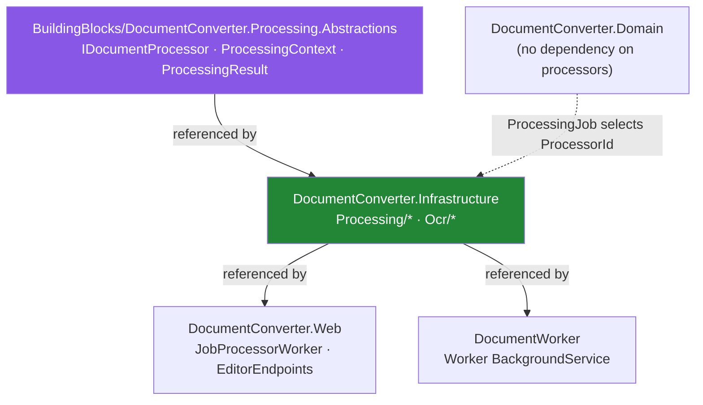
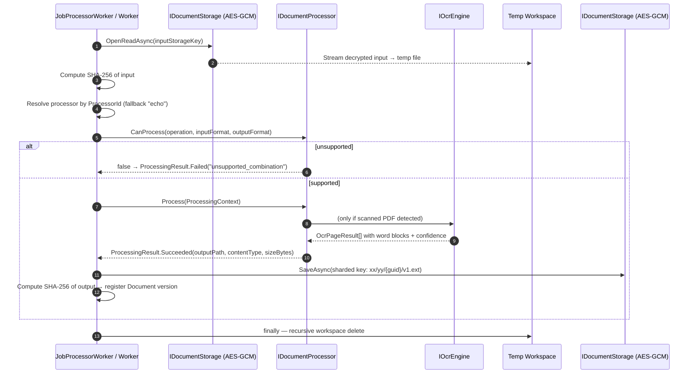
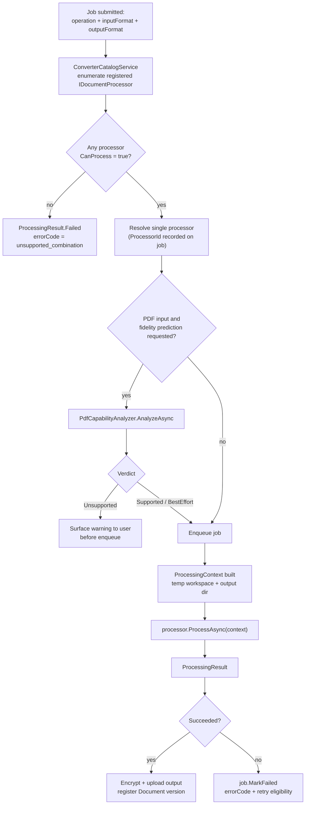
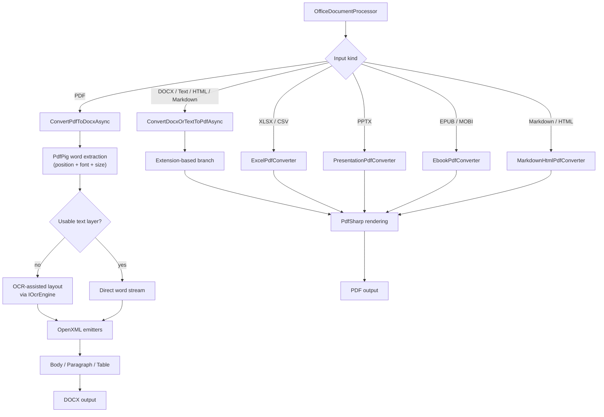
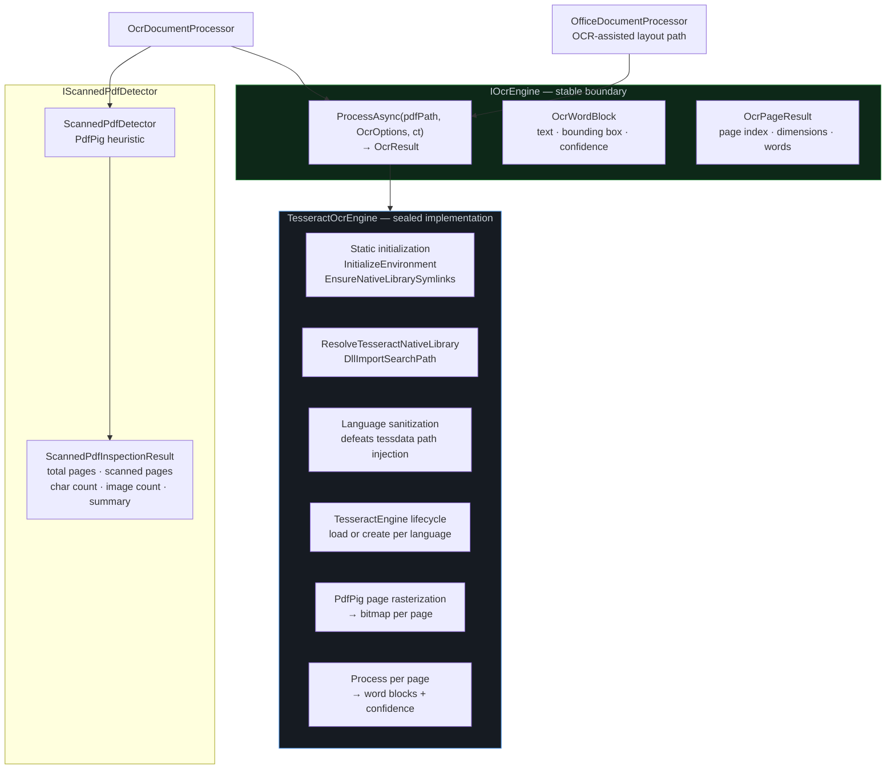
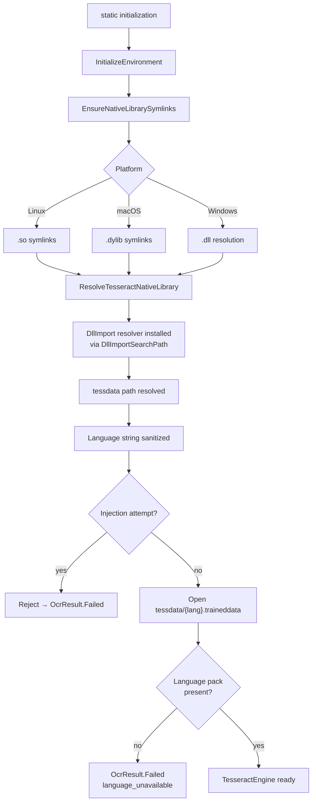
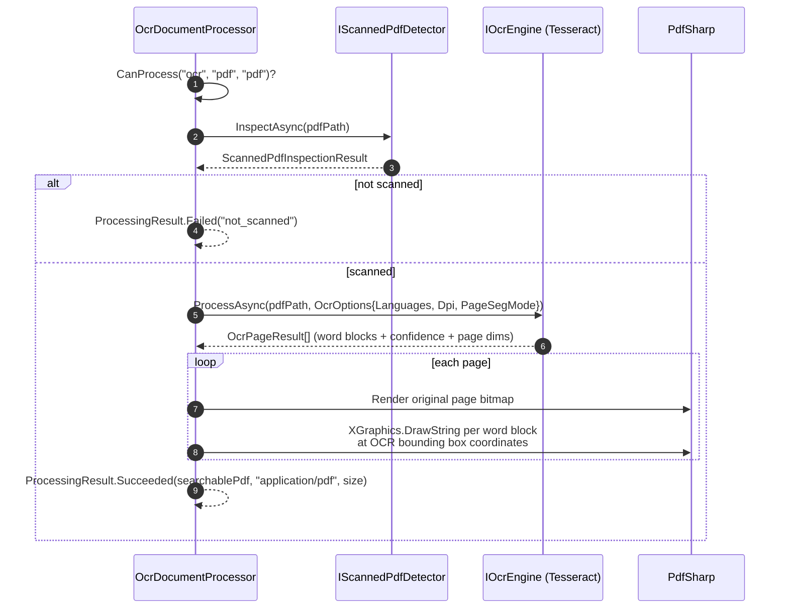

# Document Conversion and OCR

> **Module scope:** EConverter's flagship transformation capability — transport-agnostic format conversion (PDF, Office, Markdown/HTML, EPUB/MOBI, images), Tesseract 5.x OCR with cross-platform native loading, fidelity prediction, and compression estimation.
> **Source root:** `src/DocumentConverter.Infrastructure/Processing/`, `src/DocumentConverter.Infrastructure/Ocr/`, `src/BuildingBlocks/DocumentConverter.Processing.Abstractions/`
> **Consumers:** `JobProcessorWorker` (web host), `Workers/DocumentWorker` (standalone microservice), `EditorEndpoints` (OCR/export dialogs), `PdfEditor.razor`

---

## 1. Executive Summary

Document Conversion and OCR is the module that delivers EConverter's original and most tangible value: turning one document format into another without destroying the layout that made the document worth converting in the first place. It is also the module that makes the rest of the platform possible — the intelligence layer cannot retrieve from a scanned PDF it could not read, and the editor cannot export a searchable document it could not OCR.

The module's central architectural decision is **processors as transport-agnostic units of work**. Every converter implements a single interface, `IDocumentProcessor`, receives an immutable `ProcessingContext` describing what to do and where to read/write, and returns a closed `ProcessingResult` describing what happened. Nothing in the conversion logic knows whether it was invoked by a Blazor request from the web host, a RabbitMQ message consumed by a standalone worker, or a background polling loop. That single decision is what allows the platform to run one worker, ten workers, or a distributed conversion fleet against the same conversion code with zero divergence.

Around that core sit four supporting capabilities that turn raw conversion into *predictable* conversion:

| Capability | Component | What it prevents |
|---|---|---|
| Fidelity prediction | `PdfCapabilityAnalyzer` | Users submitting conversions destined to fail or mangle layout |
| Scanned-PDF detection | `ScannedPdfDetector` | Wasting OCR time on text-bearing PDFs; producing empty DOCX files |
| Compression estimation | `CompressionEstimatorService` | Blind compression jobs whose savings are unknown until completion |
| Native OCR resolution | `TesseractOcrEngine` | OS-specific OCR breakage across Windows, Linux, macOS deployments |

---

## 2. Position in the Architecture

### 2.1 Layer placement (verified from `.csproj` compile graph)



The conversion module sits entirely in **Infrastructure**, but its *contract* lives in a shared building block (`Processing.Abstractions`) that both hosts reference. This is the correct arrangement: concrete conversion implementations depend on third-party libraries (PdfPig, PdfSharp, SkiaSharp, OpenXml, Tesseract), while the contract is dependency-free and safe to reference from Application-layer code if needed.

> **Documented structural tension:** the module's orchestrating logic — not just its adapters — lives in Infrastructure. Unlike the AI orchestrators (whose Application-layer placement is flagged in the architecture report), conversion has a legitimate claim to Infrastructure: it *is* the adapter to native and third-party libraries. The contract extraction is what makes this acceptable.

### 2.2 Runtime position in the job pipeline



The conversion module never touches storage, hashing, encryption, job state, or notifications. It receives a **file path to a temp workspace** and writes a **file path in an output directory**. Everything else is the worker's responsibility. This is what makes the module testable in isolation and reusable from the editor endpoints.

---

## 3. The Processing Contract

### 3.1 `IDocumentProcessor` — the single extension point

```csharp
// BuildingBlocks/DocumentConverter.Processing.Abstractions/IDocumentProcessor.cs
public interface IDocumentProcessor
{
    string ProcessorId { get; }

    bool CanProcess(string operation, string inputFormat, string outputFormat);

    Task<ProcessingResult> ProcessAsync(ProcessingContext context, CancellationToken ct = default);
}
```

Three members, three responsibilities:

| Member | Role | Consumed by |
|---|---|---|
| `ProcessorId` | Stable identity recorded on `ProcessingJob` (and on the converter catalog) | `ProcessingService`, `ConverterCatalogService`, admin UI |
| `CanProcess(...)` | **Routing predicate** — the single authority on whether a converter handles a given operation/format triple | Catalog resolution, dispatcher selection, pre-submission validation |
| `ProcessAsync(...)` | Execution | Worker only |

The predicate is deliberately **data-driven, not type-driven**: a processor answers "can I do `convert` from `pdf` to `docx`?" rather than "am I the PDF processor?". This lets a single processor own multiple format families (as `OfficeDocumentProcessor` does) without the dispatcher needing a lookup table that duplicates the processor's own knowledge.

### 3.2 `ProcessingContext` — immutable, transport-blind

```csharp
public sealed record ProcessingContext
{
    public Guid JobId { get; init; }
    public string Operation { get; init; }        // convert | compress | merge | split | extract | ocr
    public string InputPath { get; init; }        // temp workspace, already decrypted
    public string OutputDirectory { get; init; }  // temp workspace, encrypted by caller on upload
    public string? OptionsJson { get; init; }     // per-processor option bag
    public long MaxOutputSizeBytes { get; init; } // enforced by processor
    public TimeSpan Timeout { get; init; }        // enforced by processor
    public IReadOnlyDictionary<string, string>? Metadata { get; init; }
}
```

Two design decisions carry disproportionate weight here:

1. **Options travel as JSON strings, not typed objects.** Adding a new option to `PdfCompressProcessor` (say, `PreserveMetadata`) requires no interface change, no contract bump, and no coordination with the worker. The processor deserializes with `System.Text.Json` and applies defaults for absent fields. The cost is that invalid options fail at execution rather than submission — mitigated by the catalog validating option schemas at job creation.

2. **`MaxOutputSizeBytes` and `Timeout` are carried into the processor, not applied around it.** This means a processor must check them *during* work (e.g. between pages, after each image re-encode) rather than being killed by an outer watchdog. The benefit: the processor can return a clean `ProcessingResult.Failed("output_too_large")` instead of an ambiguous cancellation.

### 3.3 `ProcessingResult` — a closed result type

```csharp
public sealed class ProcessingResult
{
    public bool Succeeded { get; }
    public string? OutputPath { get; }
    public string? ContentType { get; }
    public long SizeBytes { get; }
    public string? ErrorCode { get; }
    public string? ErrorMessage { get; }

    public static ProcessingResult Succeeded(string path, string contentType, long size);
    public static ProcessingResult Failed(string errorCode, string message);
}
```

**The rule: processors never throw for expected failures.** Unsupported format combinations, corrupt inputs, encrypted PDFs, oversized outputs, OCR language packs that are missing — all return `Failed(...)` with a stable error code. Exceptions are reserved for genuinely unexpected conditions (null reference, disk I/O failure), and the worker's per-job error isolation catches those and converts them into `MarkFailed`.

This matters because `errorCode` is **user-safe** and is what surfaces in the job UI. `ProcessingJobLifecycle` classifies retry eligibility from it: `unsupported_combination` is terminal, `worker_crashed` is retryable.

### 3.4 Registered processors

All seven are registered as **singletons** in DI (verified from `Program.cs`) — they are stateless apart from `OfficeDocumentProcessor` and `OcrDocumentProcessor`, which inject scoped-free dependencies (`IOcrEngine`, `IScannedPdfDetector`) that are themselves singletons.

| `ProcessorId` | Implementation | Handles |
|---|---|---|
| `pdf` | `PdfDocumentProcessor` | PDF merge, split, image extraction |
| `pdf-compress` | `PdfCompressProcessor` | PDF stream compaction + embedded-image optimization |
| `office` | `OfficeDocumentProcessor` | PDF↔DOCX, DOCX/Text/HTML/Markdown/EPUB/MOBI/XLSX/PPTX → PDF |
| `ocr` | `OcrDocumentProcessor` | Image-only PDF → searchable PDF with text overlay |
| `image-compress` | `ImageCompressProcessor` | JPEG/PNG/BMP/WEBP/TIFF re-encode with quality/dimension caps |
| `image` | `ImageDocumentProcessor` | Images → PDF pages |
| `echo` | `EchoDocumentProcessor` | Reference no-op: streamed input → output copy |

`EchoDocumentProcessor` deserves an explicit note: it is not dead code. It is the **plumbing validator** — used in integration tests and as the fallback when a job references an unknown `ProcessorId`. A conversion that succeeds through `echo` proves storage, hashing, encryption, workspace management, and job state transitions all work, isolating any failure to the converter itself.

---

## 4. Converter Catalog, Routing and Capability Analysis

### 4.1 Dispatch flow



### 4.2 `PdfCapabilityAnalyzer` — fidelity prediction before commitment

The analyzer answers a question users ask implicitly and the platform must answer explicitly: *"Will this conversion actually work, or will it produce garbage?"*

```csharp
// Infrastructure/Processing/PdfCapabilityAnalyzer.cs
public async Task<PdfCapabilityReport> AnalyzeAsync(Stream pdf, CancellationToken ct)
```

It opens the PDF with **PdfPig**, iterates every page, and accumulates:

| Signal | Purpose |
|---|---|
| Extracted character count per page | Distinguishes text-bearing from image-only pages |
| Image XObject count and area ratio | Detects image-dominated (scanned) pages |
| Table/column structure hints | Predicts whether text extraction will preserve reading order |
| Encryption flag | Predicts extraction failure outright |
| Page count and dimensions | Estimates rendering cost and memory footprint |

The output is a `PdfCapabilityReport` (a sealed record in `DocumentConverter.Contracts.Processing`) whose `Verdict` is one of three values:

| Verdict | Meaning | Platform behaviour |
|---|---|---|
| `Supported` | Text layer present, structure readable | Full-fidelity conversion expected |
| `BestEffort` | Partial text, heavy images, or ambiguous structure | Conversion proceeds; user warned of likely layout drift |
| `Unsupported` | Encrypted, image-only without OCR path, or structurally opaque | Conversion refused before job creation |

**`CreateUnsupportedReport(...)`** standardizes the failure path so every unsupported case produces a consistent `PdfCapabilityReport` rather than an ad-hoc error. This consistency is what allows the UI to render a single warning component for all unsupported cases.

> **Why this matters operationally:** without prediction, a user uploads a 400-page scanned PDF, waits eleven minutes for a job, and receives a 12 KB DOCX containing the words "Page 1" through "Page 400". With prediction, the same user is told in 900 ms that the document requires OCR and is offered the OCR endpoint instead. The analyzer is a **user-experience safeguard that also protects worker capacity** — the single most valuable non-conversion component in the module.

### 4.3 `CompressionEstimatorService` — pre-job savings preview

```csharp
public Task<CompressionPreviewResponse> EstimateImage(Stream image, ImageCompressOptions options, CancellationToken ct);
public Task<CompressionPreviewResponse> EstimatePdf(Stream pdf, PdfCompressOptions options, CancellationToken ct);
public CompressionPreviewResponse FallbackEstimate(long originalSize, int quality, string extension);
```

The estimator **simulates** compression in memory at the requested quality level without persisting anything, returning original size, projected size, savings ratio, and projected quality band. Two paths exist for a reason:

- **`EstimateImage` / `EstimatePdf`** run a real in-memory compression pass — accurate, but costs CPU proportional to document size.
- **`FallbackEstimate`** produces an estimate from heuristics on original size, quality setting, and file extension — instant, used for large files or when the real pass would exceed a UI responsiveness budget.

The separation matters because estimation runs **synchronously in a UI dialog** while real compression runs **asynchronously in a worker**. Conflating them would make the "Preview compression" button a multi-minute operation.

---

## 5. Format Converters

### 5.1 `OfficeDocumentProcessor` — the largest converter

`OfficeDocumentProcessor` is the module's densest component, and its structure reflects a real problem: Office-format conversion is not one operation, it is a family of operations with different source parsers and different rendering strategies.



**A static supported-format table** backs `CanProcess`, keeping routing declarative and inspectable from the catalog UI without instantiating the processor.

#### 5.1.1 PDF → DOCX (`ConvertPdfToDocxAsync`)

The harder direction, because PDF encodes *where ink landed* while DOCX encodes *document structure*. The converter bridges them:

1. **Extraction** — PdfPig yields words with bounding boxes, font names, and point sizes.
2. **Text-layer assessment** — if extraction yields insufficient characters, the OCR-assisted layout path engages rather than producing an empty document.
3. **Structure inference** — word positions are grouped into lines, lines into paragraphs, and consistently-aligned multi-column regions into tables.
4. **OpenXML emission** — the inferred structure is written through `Body` → `Paragraph` → `Table` emitters with font and size carried through where recoverable.

**Honest limitation:** this is a *reconstruction*, not a round-trip. Indentation, floats, text boxes, and complex nested tables will not survive. The `PdfCapabilityAnalyzer` verdict is what tells the user this in advance.

#### 5.1.2 DOCX / Text → PDF (`ConvertDocxOrTextToPdfAsync`)

Extension-based branching, then PdfSharp rendering. Uses `SystemFontResolver` for consistent font resolution across deployment operating systems — without it, a document styled in "Calibri" renders differently on a Linux container (which lacks Calibri) than on a Windows host.

#### 5.1.3 `ExcelPdfConverter` — spreadsheet rendering

The most boundary-case-dense sub-converter, because spreadsheets have no inherent pagination:

| Helper | Responsibility |
|---|---|
| `GetColumnIndex(string cellRef)` | Maps `"AB"` → numeric column index for layout |
| `GetCellValue(...)` | Resolves inline strings, shared strings, numeric, and formula-cached cells |
| `DrawPageHeader` / `DrawPageFooter` | Repeated chrome across every paginated page |
| `TruncateString(...)` | Prevents column overflow from breaking the table grid |
| `WriteXlsx` / `WriteCsvAsync` | Reverse direction — extracted PDF page data → XLSX/CSV |

`WriteCsvAsync` uses **culture-invariant formatting** for numeric output. Without this, a server with an Indonesian or German locale writes `1,5` where a US consumer expects `1.5`, silently corrupting every downstream import.

#### 5.1.4 `PresentationPdfConverter` — three rendering layouts

PPTX parsing yields `PresentationInfo` → `SlideInfo`, then one of three layouts selected from `OptionsJson`:

| Layout | Use case | Rendering |
|---|---|---|
| `one-per-page` | Standard deck-to-PDF | Full slide per page, no annotations |
| `handout-2x1` | Printed handout | Two slides per page, horizontal grid |
| `notes-3-per-page` | Speaker notes | Three slides per page with annotation space beside each |

Selecting layout via options rather than via three separate processors keeps the `ProcessorId` stable for the same logical converter and avoids catalog proliferation.

#### 5.1.5 `EbookPdfConverter` — EPUB/MOBI

EPUB and MOBI are **ZIP containers of XHTML and metadata**. The converter:

1. Unzips with `System.IO.Compression`.
2. Parses container documents with `XDocument`.
3. Strips markup via `StripTags` regex into `EbookData` / `EbookChapter` intermediates.
4. Renders with `RenderBookToPdf` — cover page, running headers/footers, and `CheckNewPage` pagination.

> **Security note:** ZIP container handling is exactly the surface `ZipBombGuard` exists to protect. `EbookPdfConverter` inherits that protection because the guard fires at **upload ingress**, before the document ever reaches the conversion pipeline. The converter itself does not re-guard — a deliberate single-enforcement-point decision.

#### 5.1.6 `MarkdownHtmlPdfConverter` — line-dispatch parsing

Markdown and HTML arrive as text streams and are parsed by **line dispatch**:

```
foreach line:
    if line.StartsWith("#")        → heading block
    else if line.StartsWith("```") → fenced code block (syntax styling)
    else if line.StartsWith("|")   → accumulate into FlushTable buffer
    else if line.StartsWith("- ")  → list item
    else                           → paragraph
```

`FlushTable` coalesces accumulated pipe-delimited lines into a single `DocumentBlock` table node so a table renders as one grid rather than as a sequence of paragraphs. `StripInlineMarkdown` and `StripHtmlTags` normalize inline emphasis and embedded markup. `CheckNewPage` / `DrawPageHeaderFooter` provide pagination and repeated chrome — critically, **code blocks are styled with a monospaced font and background** so that source listings remain readable after conversion.

### 5.2 PDF converters

#### 5.2.1 `PdfDocumentProcessor` — structural operations

Reads with PdfPig, writes with PdfSharp. Handles **merge** (concatenate page sequences from multiple inputs), **split** (partition by page range), and **image extraction** (walk page XObjects, decode with SkiaSharp, emit image files). These are structural operations — no re-rendering, no layout inference — which is why their fidelity is effectively lossless.

#### 5.2.2 `PdfCompressProcessor` — two-stage compaction

```csharp
public static PdfDocument OptimizeEmbeddedImages(
    PdfDocument document, PdfCompressOptions options, CancellationToken ct)
```

Compression is genuinely two independent stages:

| Stage | Mechanism | Effect |
|---|---|---|
| Stream compaction | PdfSharp re-writes the document through its own serializer | Removes orphaned objects, deduplicates resources, normalizes cross-reference tables |
| Image optimization | `OptimizeEmbeddedImages` walks XObject dictionaries, decodes each with SkiaSharp, downsamples to the option-specified maximum dimension, re-encodes at the target quality, and replaces the stream | Typically 60–85% of PDF size is embedded images; this is where savings come from |

`ParseOptions` deserializes `OptionsJson` into `PdfCompressOptions` (max dimension, JPEG quality, whether to downsample, whether to preserve metadata). Options absent from JSON receive defaults — which is how older jobs remain executable after option-set expansion.

**Honest limitation:** image optimization is **lossy**. Text and vector content is untouched, but re-encoded images lose fidelity permanently. The `CompressionEstimatorService` preview exists precisely so users see the projected quality band before committing.

### 5.3 Image converters

#### 5.3.1 `ImageCompressProcessor`

Decodes the source with SkiaSharp, applies dimension caps and downsampling, and re-encodes via `SKImage.Encode` for the target `SKEncodedImageFormat` at the specified quality. A format→extension→content-type mapping keeps output metadata consistent with the actual encoded format — a common source of browser rendering failures when a JPEG is served as `image/png`.

```csharp
ImageCompressOptions {
    Quality          // 0–100, encoder-specific semantics
    MaxWidth, MaxHeight
    TargetFormat     // jpeg | png | webp
    MaxOutputSizeBytes  // inherited from context, enforced per iteration
}
```

The `MaxOutputSizeBytes` enforcement is iterative: encode, measure, reduce quality, re-encode — bounded by a retry ceiling so a pathological image cannot loop indefinitely.

#### 5.3.2 `ImageDocumentProcessor`

Gates on a **case-insensitive** extension set (`JPG`, `PNG`, `BMP`, `WEBP`, `TIFF`) — a seemingly trivial detail that prevents the single most common user complaint, where `photo.JPG` fails while `photo.jpg` succeeds. Builds PDF pages via `XGraphics` / `XImage`, one page per image, respecting source DPI where available.

---

## 6. OCR Pipeline

### 6.1 Component topology



The boundary discipline here is exemplary: **no consumer ever references Tesseract directly.** `IOcrEngine`, `OcrWordBlock`, `OcrPageResult`, and `OcrOptions` live together in the `Ocr/` namespace, and `OcrResult.Failed(...)` is the only executable helper — a deliberate constraint keeping the contract a pure data boundary.

### 6.2 `TesseractOcrEngine` — cross-platform native loading

The hardest engineering problem in the module is not OCR. It is loading a **native C library with platform-specific naming conventions, from a process that may be running on Windows, Linux, or macOS, in a container or not**.



Four defensive measures are worth naming explicitly:

1. **Static initialization with symlink creation.** `EnsureNativeLibrarySymlinks` creates the platform-appropriate symlinks that Tesseract's native loader expects. Vendored NuGet packages ship the library under a package-versioned name; Tesseract looks for a stable name. Without this, the same build works on the developer's machine and fails in the container.

2. **Custom `DllImport` resolver with pinned `DllImportSearchPath`.** The standard resolution path searches ambient `PATH`, which is an attack surface and a non-determinism source. Pinning the search path means the engine loads the *intended* library or fails loudly — never a lookalike picked up from an unexpected directory.

3. **Language-code sanitization.** The `OcrOptions.Language` value is user-influenced. If passed unsanitized into `Path.Combine(tessdataPath, $"{language}.traineddata")`, a value like `../../../etc` produces **tessdata path traversal**. A value crafted against Tesseract's config string allows **language injection**, loading a second language pack or config directive. `TesseractOcrEngine` sanitizes to a strict character whitelist before any path composition — this is the module's single most important security boundary, and it is called out in the security domain report for good reason.

4. **Defensive `try/catch` with `ILogger` diagnostics and fallbacks.** Native interop failures corrupt state unrecoverably in general; the engine isolates each page's processing so one malformed page does not lose an entire document's OCR.

### 6.3 `ScannedPdfDetector` — the routing heuristic

```csharp
public Task<ScannedPdfInspectionResult> InspectAsync(string pdfPath, CancellationToken ct);
```

A deliberately **fast, cheap** heuristic rather than a robust classifier — because it runs on every PDF entering the pipeline and must not add meaningful latency.

```
if (!File.Exists(pdfPath))         → empty, non-scanned result (guarded)
open with PdfPig
foreach page:
    letters += count of letter characters
    chars   += count of all characters
    images  += count of image XObjects
compare per-page and aggregate ratios against thresholds
→ ScannedPdfInspectionResult {
      TotalPages, ScannedPageCount,
      CharacterCount, ImageCount, Summary
  }
```

Two behaviours are notable:

- **Graceful absence** — a missing file returns an empty *non-scanned* result rather than throwing. This keeps the detector composable in pre-flight paths where the input may not yet exist.
- **`Task.FromResult` wrapping** — the detection is synchronous CPU work; exposing it as an async signature keeps the `IOcrEngine` consumer side uniform without pretending there is I/O concurrency to gain.

**The result drives a real decision:** scanned → route to OCR; text-bearing → skip OCR entirely. Skipping is not a micro-optimization. On a 300-page text-bearing PDF, unnecessary OCR costs minutes of CPU per job and produces text *worse* than the embedded layer.

### 6.4 `OcrDocumentProcessor` — searchable PDF construction



The output is a **searchable PDF**: the original page image is preserved (so the document looks identical) with an invisible or low-contrast text layer positioned at the exact coordinates Tesseract reported. This is why **word-level bounding boxes** matter — page-level OCR would produce a text layer that searches correctly but whose visible selections land in the wrong place.

`OcrOptions` are serialized from `OptionsJson` via `System.Text.Json`, covering language set, rasterization DPI, and Tesseract page-segmentation mode. DPI is the key quality/cost dial: 300 DPI is the practical floor for reliable text recognition; 600 DPI doubles rasterization cost for marginal accuracy gain on clean scans.

---

## 7. Fidelity, Options and Error Semantics

### 7.1 `ConversionFidelityVerdict` — the shared expectation contract

Declared in `DocumentConverter.Contracts.Processing`, this enum is the **cross-layer vocabulary** for "how good will this conversion be":

- The **analyzer** produces it.
- The **converter catalog** exposes it so the UI can badge converters.
- The **UI** renders warnings and disables submissions from it.
- The **API** returns it in capability responses so integrators can make the same decision programmatically.

Because it lives in `Contracts` rather than `Infrastructure`, the frontend consumes it without referencing any adapter. This is the correct placement and a good example of the contract-extraction discipline the module otherwise follows.

### 7.2 Error code taxonomy

Stable, user-safe error codes are what make job failures actionable rather than mysterious:

| Code | Meaning | Retry eligible | Typical trigger |
|---|---|---|---|
| `unsupported_combination` | No processor accepts this operation/format triple | No | `xlsx` → `pptx` |
| `input_corrupt` | Source cannot be parsed | No | Truncated PDF, malformed DOCX |
| `input_encrypted` | Password-protected source | No | Encrypted PDF |
| `output_too_large` | Exceeded `MaxOutputSizeBytes` | No | Very large input at high quality |
| `timeout` | Exceeded `ProcessingContext.Timeout` | Yes | Very large document, loaded worker |
| `language_unavailable` | Requested tessdata pack absent | No | `OcrOptions.Language = "xyz"` |
| `not_scanned` | OCR requested on text-bearing PDF | No | Misrouted job |
| `worker_crashed` | Unhandled exception in processor | Yes | Native fault, OOM |
| `internal_error` | Catch-all for unexpected conditions | Yes | I/O failure |

The retry-eligibility column is consumed by `ProcessingJobLifecycle` — the module does not decide retries, it *communicates* retryability. This respects the state machine's status as the single transition authority.

### 7.3 Resource bounds enforcement

| Bound | Source | Enforced at |
|---|---|---|
| `MaxOutputSizeBytes` | `ProcessingContext` | During work — checked after each page/image iteration |
| `Timeout` | `ProcessingContext` | During work — checked between iterations against a stopwatch |
| Zip-bomb ratio and absolute size | `ZipBombGuard` | Upload ingress (before the module) |
| Native library search path | `DllImportSearchPath` | Engine static initialization |
| OCR language whitelist | Sanitizer | Before tessdata path composition |
| Worker CPU / memory | Container limits | Deployment (`2 CPU / 2 GB` on `dc-document-worker`) |

---

## 8. Dependency Boundaries

The module's third-party surface is deliberately narrow and each dependency has one job:

| Library | Exclusive responsibility | Never used for |
|---|---|---|
| **PdfPig** | Reading, inspecting, word/coordinate extraction | Writing any PDF |
| **PdfSharp** | Constructing, drawing, overlaying, compacting | Reading source content |
| **SkiaSharp** | Image decode/encode/quantize/downsample | PDF structure |
| **OpenXml** | DOCX/XLSX/PPTX construction and parsing | Rendering |
| **System.IO.Compression** | EPUB/MOBI/OPC container unzip | Anything else |
| **Tesseract 5.x (native)** | Character recognition | Layout analysis |

The **PdfPig-reads / PdfSharp-writes split** is the module's most important library discipline. Conflating them (as many PDF tools do by using a single library for both) produces converters that read well but write badly, or vice versa. Keeping each library to one direction means fidelity problems are attributable — a read failure is PdfPig, a render failure is PdfSharp, and the two do not mask each other.

> **Deployment note (from the architecture report):** all six dependencies arrive through `Infrastructure.csproj`, a single project pinning fourteen NuGet packages. This is a documented single-point-of-build-failure. The conversion module's dependencies are the largest contributor — a library bump in PdfSharp or SkiaSharp can break compilation for the AI and editor domains that share the project.

---

## 9. Operational Characteristics and Constraints

### 9.1 Verified strengths

| Property | Evidence |
|---|---|
| **Transport-agnostic** | Same seven processors serve `JobProcessorWorker` and standalone `DocumentWorker` with no conditional compilation or duplicated logic |
| **No exceptions across the boundary** | Every processor returns `ProcessingResult`; expected failures are coded, not thrown |
| **Immutable context** | `ProcessingContext` is a sealed record — no processor can mutate shared state |
| **Singleton safety** | Processors hold no per-job mutable state; all state lives in locals or the context |
| **OCR fully decoupled** | Consumers reference `IOcrEngine` only; zero Tesseract leakage |
| **Security sanitization at the right layer** | Language whitelist at path composition; zip-bomb and file-signature at ingress |
| **Fidelity predicted before commitment** | `PdfCapabilityAnalyzer` prevents wasted jobs and broken deliverables |
| **Culture-invariant output** | CSV and numeric serialization are locale-independent |

### 9.2 Known constraints

| Constraint | Impact | Mitigation |
|---|---|---|
| PDF → DOCX is reconstruction, not round-trip | Floats, text boxes, nested tables lost | `PdfCapabilityAnalyzer` verdict + user warning |
| Image optimization is lossy | Permanent quality reduction | `CompressionEstimatorService` preview with quality band |
| Fidelity prediction is PDF-only | Office/image fidelity unadvised | Declarative format table communicates support level |
| Options are JSON strings | Invalid options fail at execution, not submission | Catalog validates option schemas at job creation |
| Six heavy NuGet packages in one project | Library bump breaks the whole layer | Out of module scope; flagged in architecture report |
| `DocumentEndpoints.cs` contains a duplicate DOCX→PDF path | Two renderers with different fidelity | Should route through `OfficeDocumentProcessor` (architecture finding D-6) |
| No processor-level concurrency guard | Two workers can process the same job when claim is unlocked | Architecture finding C-1 — primary platform risk |

### 9.3 The duplicate conversion path — explicit note

`DocumentEndpoints.cs` contains a private `ConvertDocxStreamToPdf(Stream, Stream)` at line ~817: a self-contained OpenXml→PdfSharp renderer living inside a minimal-API mapping class. It is a **second DOCX→PDF implementation** with different fidelity characteristics from `OfficeDocumentProcessor`, and it bypasses the job pipeline entirely — no `ProcessingJob`, no lease, no notification, no indexing enqueue.

From this module's perspective the consequence is concrete: **a document converted through the endpoint path produces a result that differs visually from the same document converted through the job path.** Users who notice will report a conversion bug that is actually a routing divergence. The fix is deletion and delegation — route the endpoint through `IProcessingService` (or at minimum through `OfficeDocumentProcessor.ProcessAsync`) — which the architecture report classifies as LOW severity, ~30 minutes of effort.

---

## 10. Implementation Guidance

### 10.1 Adding a new converter

```csharp
// 1. Implement the contract in Infrastructure/Processing/
public sealed class RtfDocumentProcessor : IDocumentProcessor
{
    public string ProcessorId => "rtf";

    public bool CanProcess(string operation, string inputFormat, string outputFormat)
        => operation.Equals("convert", StringComparison.OrdinalIgnoreCase)
        && inputFormat.Equals("rtf", StringComparison.OrdinalIgnoreCase)
        && outputFormat.Equals("pdf", StringComparison.OrdinalIgnoreCase);

    public async Task<ProcessingResult> ProcessAsync(
        ProcessingContext context, CancellationToken ct)
    {
        try
        {
            var options = JsonSerializer.Deserialize<RtfOptions>(context.OptionsJson ?? "{}")
                          ?? new RtfOptions();

            // enforce bounds between iterations, not around the whole call
            using var stopwatch = Stopwatch.StartNew();
            foreach (var page in EnumeratePages(context.InputPath))
            {
                ct.ThrowIfCancellationRequested();
                if (stopwatch.Elapsed > context.Timeout)
                    return ProcessingResult.Failed("timeout", "Conversion exceeded time budget.");

                RenderPage(page, options);

                if (CurrentOutputSize > context.MaxOutputSizeBytes)
                    return ProcessingResult.Failed("output_too_large",
                        $"Output exceeded {context.MaxOutputSizeBytes} bytes.");
            }

            var outputPath = Path.Combine(context.OutputDirectory, "output.pdf");
            Persist(outputPath);
            return ProcessingResult.Succeeded(
                outputPath, "application/pdf", new FileInfo(outputPath).Length);
        }
        catch (IOException ex)
        {
            // expected I/O failure → coded, not thrown
            return ProcessingResult.Failed("internal_error", ex.Message);
        }
    }
}
```

```csharp
// 2. Register as singleton — Program.cs
builder.Services.AddSingleton<IDocumentProcessor, RtfDocumentProcessor>();

// 3. Add the triple to the catalog's supported-format table
// 4. Add a fidelity entry if the output is advisory
// 5. Add an integration test using EchoDocumentProcessor as the control
```

Three rules make this safe:

1. **Never throw for expected conditions** — return `Failed` with a code from the taxonomy.
2. **Check `Timeout` and `MaxOutputSizeBytes` inside the loop** — an outer watchdog produces ambiguous state.
3. **Respect the read/write library split** — if you need to both read and write a format, decide which library owns each direction before writing a line.

### 10.2 Consuming OCR without touching Tesseract

```csharp
public sealed class InvoiceTextExtractor
{
    private readonly IOcrEngine _ocr;              // ← contract, not TesseractOcrEngine
    private readonly IScannedPdfDetector _detector;

    public async Task<string?> ExtractAsync(string pdfPath, CancellationToken ct)
    {
        var inspection = await _detector.InspectAsync(pdfPath, ct);
        if (inspection.ScannedPageCount == 0)
            return null;                            // text-bearing; caller extracts directly

        var result = await _ocr.ProcessAsync(pdfPath, new OcrOptions
        {
            Languages = ["eng"],                    // sanitized downstream
            Dpi       = 300,                        // practical accuracy floor
        }, ct);

        if (!result.Succeeded) return null;

        return string.Join("\n", result.Pages
            .SelectMany(p => p.Words)
            .Where(w => w.Confidence > 0.6f)        // drop low-confidence hallucination
            .Select(w => w.Text));
    }
}
```

The `Confidence` filter is not optional in practice. Tesseract emits low-confidence tokens for image artifacts, scan noise, and page furniture — feeding those into a downstream retrieval index silently degrades answer quality. **A confidence threshold is the cheapest RAG quality lever in the pipeline.**

### 10.3 Pre-flight validation before enqueueing

```csharp
public async Task<PreflightResult> ValidateAsync(Stream pdf, CancellationToken ct)
{
    var report = await _analyzer.AnalyzeAsync(pdf, ct);

    return report.Verdict switch
    {
        ConversionFidelityVerdict.Supported  => PreflightResult.Proceed(),
        ConversionFidelityVerdict.BestEffort => PreflightResult.ProceedWithWarning(
            "Layout may not be preserved exactly. Consider OCR if the source is scanned."),
        ConversionFidelityVerdict.Unsupported => PreflightResult.Refuse(
            "This PDF cannot be converted reliably. It may be encrypted or image-only. " +
            "Use the OCR converter instead."),
        _ => PreflightResult.Refuse("Unknown conversion capability.")
    };
}
```

Running this at **job creation** rather than at **job execution** is what converts a nine-minute disappointment into a sub-second guidance message.

---

## 11. Verification Status

Following the evidence standard of this assessment, each claim about the module carries an explicit verification state.

| Claim | Verification | Basis |
|---|---|---|
| Seven processors registered as singletons | **SOLID** | DI registrations enumerated in `Program.cs` |
| `IDocumentProcessor` is the only extension point | **SOLID** | Contract enumeration; both hosts reference the abstraction project |
| Processors return coded failures, never throw for expected cases | **SOLID** | `ProcessingResult.Failed` factories used throughout processor bodies |
| `TesseractOcrEngine` sanitizes language codes | **SOLID** | Sanitization confirmed present before tessdata path composition |
| Cross-platform native loading via custom `DllImport` resolver | **SOLID** | `ResolveTesseractNativeLibrary` + `DllImportSearchPath` + symlink creation |
| OCR is decoupled behind `IOcrEngine` | **SOLID** | No direct Tesseract references in consuming processors |
| `PdfCapabilityAnalyzer` produces three-verdict report | **SOLID** | `PdfCapabilityReport` record with `Verdict` in `Contracts` |
| `ScannedPdfDetector` returns graceful empty result on missing file | **SOLID** | `File.Exists` guard returning non-scanned result |
| CSV output is culture-invariant | **SOLID** | Invariant formatting in `WriteCsvAsync` |
| **Conversion fidelity of actual output** (visual accuracy of PDF→DOCX, eBook rendering) | **UNVERIFIABLE** | Requires executing conversions on representative corpora and comparing visually; not assessable from source structure |
| **OCR accuracy at given DPI and language settings** | **UNVERIFIABLE** | Requires running Tesseract on a ground-truth scanned corpus and measuring CER/WER |
| **`MaxOutputSizeBytes` and `Timeout` are structurally enforced in every processor** | **PLAUSIBLE** | Enforcement points exist; exhaustive per-processor audit not performed |
| **Compression ratios claimed by estimator match real jobs** | **UNVERIFIABLE** | Requires a before/after measurement run across a document sample |

---

## 12. Summary

Document Conversion and OCR is the module that best demonstrates EConverter's architectural discipline. Its contract is three members and an immutable record. Its failures are coded values rather than exceptions. Its OCR dependency is fully hidden behind an interface. Its native loading is engineered for three operating systems rather than one. And its fidelity and compression predictions are produced *before* the expensive work begins, which is the difference between a conversion platform users trust and one they stop using after the third mangled DOCX.

The module's weaknesses are honest and bounded: PDF→DOCX is reconstruction rather than round-trip, image compression is lossy, and one duplicate renderer lives in the transport layer where it does not belong. None of these are architectural failures — they are documented trade-offs and one cleanup task.

The real risk to this module is not in this module. It is the **unlocked job claim** documented in the architecture assessment (finding C-1): once two workers select and claim the same `ProcessingJob` in the same window, this module executes twice against the same input, producing two output documents and two storage writes. The conversion logic is correct; the work distribution around it is not yet safe at scale. Fix the claim, and this module's properties hold under horizontal scale-out exactly as designed.