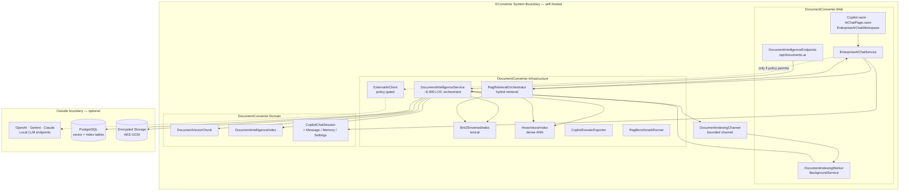
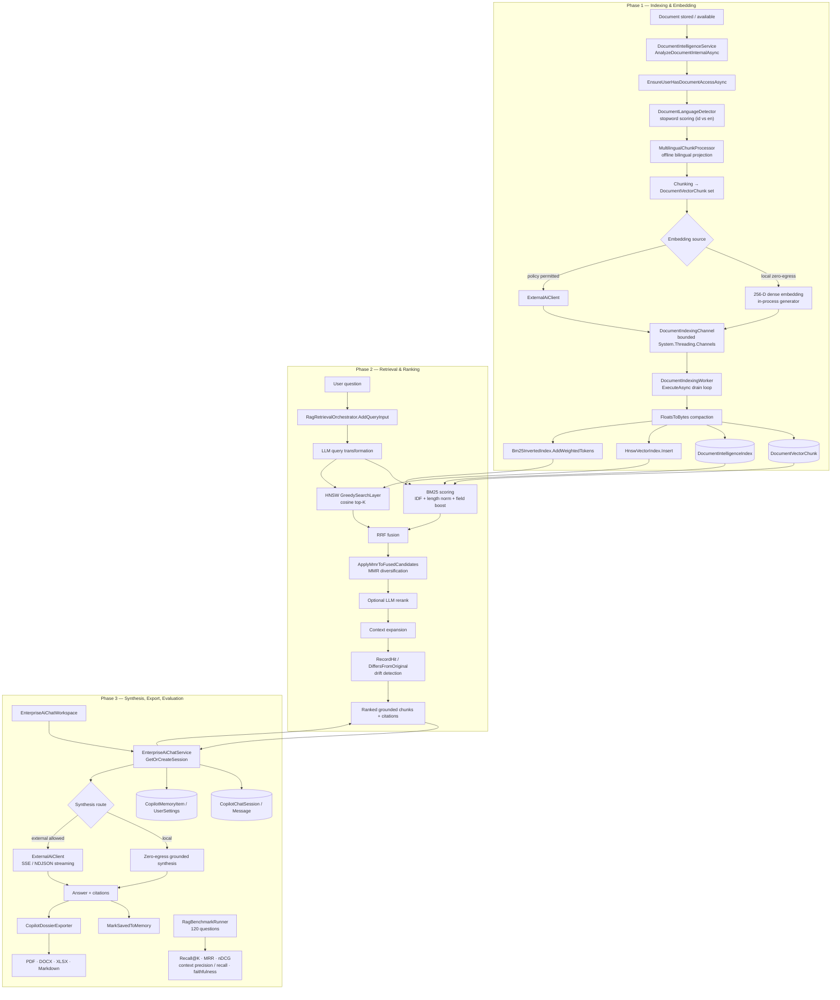
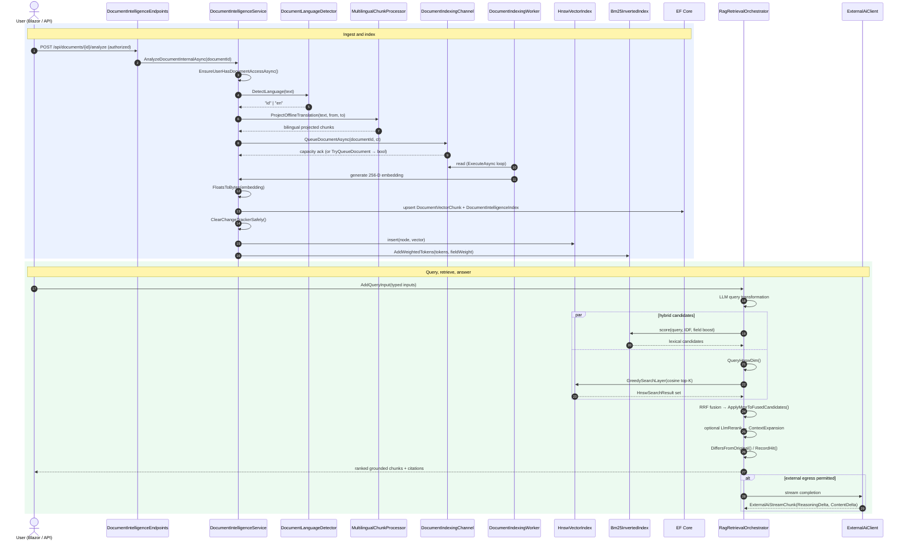

# Document Intelligence and AI
### EConverter Platform — Module Architecture & Implementation Reference

---

## 1. Executive Overview

The **Document Intelligence and AI** module is the differentiating capability of EConverter. Where the rest of the platform converts, stores and edits files, this module makes the corpus *queryable*: it transforms a static archive of documents into a grounded, citation-backed knowledge base that answers natural-language questions, classifies content automatically, compares clauses across contracts, and exports publication-ready executive dossiers.

Its defining architectural decision is **zero-egress by default**. The core intelligence stack — chunking, language detection, embedding generation, lexical (BM25) and vector (HNSW) indexing, retrieval fusion, diversification, classification and answer synthesis — executes entirely in-process, inside the operator's own infrastructure. Documents containing privileged material never leave the deployment. External frontier models (OpenAI, Gemini, Claude, local LLM endpoints) remain available behind an explicit, policy-controlled gateway for the cases where egress is permitted.

The module occupies a **Core Business Domain** in the EConverter architecture (importance 9.4, complexity 9.5) and is implemented across three layers:

| Layer | Responsibility | Representative Types |
|---|---|---|
| **Application** (contracts) | Use-case surface consumed by UI and API | `IDocumentIntelligenceService`, `IExternalAiClient`, `IDocumentIndexingChannel` |
| **Infrastructure** (adapters) | The actual RAG engine, indexes, gateway, exporter, benchmark | `DocumentIntelligenceService`, `RagRetrievalOrchestrator`, `Bm25InvertedIndex`, `HnswVectorIndex`, `ExternalAiClient`, `CopilotDossierExporter`, `RagBenchmarkRunner` |
| **Web / Host** | HTTP endpoints, copilot UI, indexing background worker | `DocumentIntelligenceEndpoints`, `Copilot.razor`, `EnterpriseAiChatWorkspace.razor`, `EnterpriseAiChatService`, `DocumentIndexingWorker` |
| **Domain** | Persistent aggregates and value objects | `DocumentVectorChunk`, `DocumentIntelligenceIndex`, `CopilotChatSession`, `CopilotChatMessage`, `CopilotMemoryItem`, `CopilotUserSettings` |

---

## 2. Why the Module Exists — Business Drivers

The intelligence layer answers the dominant blocker in regulated AI adoption: *can confidential material be analysed by AI without being transmitted to a third party?* EConverter's answer is structural rather than contractual — the intelligence executes locally, so there is no egress to govern.

Four value axes follow from that:

1. **Data sovereignty and compliance.** Sovereign document AI with no mandatory SaaS dependency. Legal, healthcare, finance and public-sector deployments can adopt AI review without exporting client material.
2. **Operational consolidation.** Conversion, OCR, editing, retrieval and briefing generation share one identity model, one audit surface and one storage layer — instead of a dozen disconnected tools with separate data custody.
3. **Scalability.** Asynchronous, leased jobs and bounded indexing channels absorb large backlogs without blocking interactive users.
4. **Accelerated knowledge work.** RAG-grounded Q&A, cross-document comparison, clause finding and one-click dossiers convert static files into queryable institutional knowledge.

The pluggable external gateway preserves the freedom to use frontier models where policy permits, **without re-architecting** the platform.

---

## 3. Position Within the System Boundary

The intelligence stack is *inside* the EConverter system boundary at C4 Level 1 precisely because it executes in-process. It is not an external service call.



**Dependency posture.** The module depends on Document Lifecycle (access validation and content reads), Document Conversion and OCR (text extraction fidelity), Document Storage and Encryption (stream access preserving at-rest semantics), and Persistence (vector chunk and chat tables with dedicated migrations).

---

## 4. The Intelligence Pipeline — End to End

The module is best understood as three sequential phases that share one data model.



---

## 5. Component Deep Dive

### 5.1 Indexing and Embedding Pipeline

**Owner:** `DocumentIntelligenceService` — the orchestrator of analysis (~6,000 LOC, the densest component in the module).

**Responsibilities**

- Enforces document access (`EnsureUserHasDocumentAccessAsync`) before any content is read — authorization precedes intelligence work at both the API and service boundary.
- Supports two analysis shapes: **batch** (`AnalyzeDocumentInternalAsync`) and **streaming** (`AnalyzeDocumentStreamInternalAsync`), the latter surfaced to callers as `IAsyncEnumerable` for token-by-token consumption.
- Compacts embeddings with `FloatsToBytes` so vectors persist as byte blobs rather than heavyweight numeric columns — meaningful at corpus scale and the reason a later migration widens the embedding column.
- Guards bulk EF Core work with `ClearChangeTrackerSafely` plus `SemaphoreReleaser` / `NoopDisposable` primitives, keeping the change tracker from ballooning during batch upserts while bounding concurrency.

**Language handling — deliberately dependency-free**

`DocumentLanguageDetector` scores text against `static readonly HashSet<string>` stopword sets for Indonesian and English. Detection completes in under a millisecond, requires no model file, and makes no network call.

`MultilingualChunkProcessor.ProjectOfflineTranslation` then deterministically maps text between representations (a bilingual projection), so English and Indonesian content share **one vector space**. Retrieval across a mixed-language corpus therefore works without translation infrastructure. Optional neural batch translation is available when a provider is permitted, but it is never required.

**Persisted artifacts**

| Entity | Purpose | Key fields |
|---|---|---|
| `DocumentVectorChunk` | The retrievable unit | `DocumentId`, `ChunkIndex`, `PageNumber`, `Content`, `Language`, `IsEnriched`, `VectorSource`, `ExtractionMethod`, `CreatedAt` |
| `DocumentIntelligenceIndex` | Cold-start metadata so retrieval avoids re-parsing | category, confidence, summary, serialized entity/topic JSON, counts, `AnalyzedAtUtc` |

**Queueing and backpressure**

`DocumentIndexingChannel` implements `IDocumentIndexingChannel` over a **bounded** `System.Threading.Channels` channel:

```csharp
public interface IDocumentIndexingChannel
{
    bool TryQueueDocument(Guid documentId);                              // non-blocking, fire-and-forget
    ValueTask QueueDocumentAsync(Guid documentId, CancellationToken ct); // awaits capacity
    int QueuedCount { get; }                                            // backlog visibility
}
```

`TryQueueDocument` returns `false` when the channel is full (declining rather than blocking); `QueueDocumentAsync` awaits write capacity with cancellation. `QueuedCount` is the natural metric to export — saturation manifests as retrieval staleness long before it manifests as errors.

`DocumentIndexingWorker` (a `BackgroundService`) drains the channel, resolves scoped services per item, extracts semantic content, computes 256-dimensional embeddings through the Application AI layer, and persists via EF Core with per-document logging. At startup it rehydrates the in-memory HNSW graph from `DocumentVectorChunk` before serving queries — the vector index is a **cache over durable state**, not a data-loss vector on restart. Its parallelism is clamped to `ProcessorCount` in the range `[2, 4]`.

---

### 5.2 Hybrid Indexes

Two complementary indexes are maintained in parallel. Neither is a wrapper around a third-party library; both are hand-written, which is the source of the module's dependency-minimal posture.

#### BM25 Lexical Index — `Bm25InvertedIndex`

A sealed partial class implementing **Okapi BM25**:

- **IDF weighting** and **document-length normalization** for standard relevance behaviour.
- **Per-field boosts** via `AddWeightedTokens`, which builds a term-frequency map with a field weight — allowing title or heading terms to outrank body text.
- **Regex-based `StemToken` normalization** so morphological variants collide in the index.
- **Lock-protected bulk mutators** (`RemoveDocument`, `RemoveDocumentUnlocked`), **tombstone-based deletion marking**, plus `Clear` and `Dispose` lifecycle.

Thread safety matters here: the index is registered as a **singleton** and mutated by the indexing worker while being read by retrieval on request threads.

#### HNSW Vector Index — `HnswVectorIndex`

A **from-scratch** Hierarchical Navigable Small World implementation:

- Constructor parameters `(M, efConstruction)` control graph connectivity and build-time search breadth.
- `GenerateRandomLevel` assigns nodes to layers with the geometric distribution HNSW requires.
- `GreedySearchLayer` performs multi-layer greedy descent; `InsertSortedDescending` maintains sorted neighbour lists; `ShrinkNeighbors` prunes to `M` connections.
- **Cosine similarity** via a static `CosineSimilarity` over raw `float[]` — no per-query allocation of normalized copies.
- Lifecycle: `RemoveDocument`, `ContainsDocument`, `Clear`, `Dispose`.

`HnswNode` carries `InternalId`, `ChunkId`, `DocumentId`, `PageNumber`, `Content`. `HnswSearchResult` is a sealed record carrying chunk/document IDs, page, section title, content, similarity, enrichment flag, vector source and extraction method — everything the synthesis stage needs to build a citation without a second database round-trip.

---

### 5.3 Retrieval Orchestration — the A–H Component Chain

`RagRetrievalOrchestrator` is the ranking brain. Its documented internal chain runs from A to H:

| Stage | Mechanism | Purpose |
|---|---|---|
| **A** — Query accumulation | `AddQueryInput` on typed inputs | Multi-query retrieval from one user utterance |
| **B** — Query transformation | LLM-assisted rewriting | Bridges vocabulary mismatch between question and document |
| **C** — Vector probe | `QueryHnswDim` dimension check | Guards against embedding-dimension drift before ANN search |
| **D** — Snapshot caching | `DiffersFromOriginal` | Detects translation drift between indexed and current representations |
| **E** — Hit recording | `RecordHit(doc, chunk, similarity)` | Binds evidence to the cached document snapshot |
| **F** — Fusion | **RRF** (Reciprocal Rank Fusion) | Merges lexical and dense candidate sets without score calibration |
| **G** — Diversification | `ApplyMmrToFusedCandidates` | **Maximal Marginal Relevance** — trades redundancy for coverage |
| **H** — Rerank + expansion | Optional LLM rerank, then context expansion | Restores precision after recall-oriented fusion; widens window around top hits |

Validation is gated on `SchemaAccepted` and `IsValidExplicitRejection`, so malformed retrieval outputs cannot reach synthesis. The orchestrator leans on `Concurrent` collections, `Regex`, `System.Text.Json` and `Diagnostics` for throughput and observability.

**Why RRF rather than weighted score blending:** BM25 scores are unbounded and corpus-dependent; cosine similarities live in `[-1, 1]`. Rank-based fusion sidesteps normalisation entirely — a decision that makes the hybrid robust to corpus changes without retuning.

---

### 5.4 Copilot and Answer Synthesis

**`EnterpriseAiChatService`** is the sealed UI-facing service that owns conversation state:

- Session lifecycle: `GetOrCreateSession`, `SyncSessionMessages`, `Rename`, title tracking, `CreatedAt` / `LastUpdated`.
- Scoping: folder and document scope, exposed through `HasExplicitScope` and scope setters — answers can be constrained to a matter, a folder, or a single document.
- Reasoning mode: a hybrid reasoning toggle with a `ConcurrentDictionary` reasoning cache keyed by message ID.
- Aliases Radzen chat message types and `Microsoft.Extensions.AI` types to keep the component layer thin.

**Persistent domain model**

| Entity | Role | Notable behaviour |
|---|---|---|
| `CopilotChatSession` | Aggregate root | Ownership, title, pin, folder scope; `AddMessage` / `Touch` |
| `CopilotChatMessage` | Child entity | Role, content, timestamp, model provenance, `SavedToMemory` / `MarkSavedToMemory` |
| `CopilotMemoryItem` | Long-term memory | Fact / category / active flag — survives across sessions |
| `CopilotUserSettings` | Personalization | `MemoryEnabled` (default `true`), `ResponsePersona` (default `"Executive Analyst"`), `CustomInstructions` |

This is what separates the module from a stateless chatbot: a reviewer can pin a session, scope it to a folder, rely on remembered facts, and get answers rendered in a persistent executive-analyst persona.

**UI surface**

- `EnterpriseAiChatWorkspace.razor` — the reusable workspace component, consumed by both copilot and invoice dialogs.
- `Copilot.razor` (`/copilot`, `[Authorize]`, `IDisposable`) — injects `IDocumentIntelligenceService`, `IDocumentService`, `DialogService`; hosts the full copilot experience.
- `AiChatPage.razor` (`/ai-chat`, `[Authorize]`) — thin host for the workspace, no code-behind.

---

### 5.5 External AI Gateway — `ExternalAiClient`

A sealed `HttpClient`-based adapter covering **OpenAI, Gemini, Claude and local/cloud endpoints**, normalizing all vendors into one chunk contract:

```csharp
public sealed record ExternalAiStreamChunk(string? ReasoningDelta, string? ContentDelta);
```

The separation of `ReasoningDelta` from `ContentDelta` is the key design point: chain-of-thought tokens are kept distinct from user-visible answer text rather than concatenated into one stream. Internally the client implements:

- `TryParseOpenAiChunk`, `ExtractOpenAiAssistantText` / `ExtractOpenAiChoiceText`
- `TryExtractOpenAiReasoningFromPayload` / `ExtractOpenAiChoiceReasoning`
- `TryParseClaudeSseChunk`, `AppendGeminiElementChunks`

It also provides connectivity pings and timeout management, so an operator can verify provider reachability without running a completion.

**Policy posture.** `IExternalAiClient` is an *opt-in capability*. `IDocumentIntelligenceService`'s XML contracts encode the zero-egress constraint for core analysis, vector search, classification and RAG; the gateway is invoked only when the deployment's policy permits. In the reference container topology this is reinforced by network segmentation: the worker sits on an `internal: true` network with zero egress, while `dc-web` additionally joins a routable bridge — external AI calls originate from the web host, not the conversion worker.

---

### 5.6 Dossier Export and Benchmarking

**`CopilotDossierExporter`** — a static class built on OpenXml `Packaging` / `Spreadsheet` / `Wordprocessing`, with globalization-aware formatting:

- `BuildDossierMarkdown` — chief entry point producing the grounded briefing narrative.
- `ExportFinancialGraphToExcel` — emits the enterprise financial graph as a spreadsheet.
- Private helpers `AppendWordHeading`, `AppendWordParagraph`, `AppendWordTableRow`, `AppendExcelRow` compose the DOCX and XLSX artifacts.
- Output formats: **PDF, DOCX, XLSX, Markdown**.

This is what makes the intelligence layer deliverable rather than merely consultable — findings become a document a legal team can file.

**`RagBenchmarkRunner`** — a static partial runner providing a reproducible evaluation harness:

- A `BenchmarkStageMode` enum plus eight nested types assemble per-stage DTOs: `MultiQueryRetrievalOptionsDto`, `RrfFusionOptionsDto`, `LlmRerankOptionsDto`, `ContextExpansionOptionsDto`.
- `CreateDeterministicGuid` derives stable chunk identities, so two runs over the same corpus are directly comparable.
- A fixed **120-question** corpus measures **Recall@K, MRR, nDCG, context precision, context recall and faithfulness**.

Because retrieval quality is the module's product, this harness is the regression gate: a change to chunking, embeddings, BM25 weights or MMR lambda that degrades retrieval shows up as a metric delta rather than as a vague sense that answers got worse.

---

### 5.7 Contract Surface and HTTP Endpoints

**DTO catalog** — `DocumentIntelligenceDtos.cs` (~838 lines, six mostly declarative classes) supplies the enumerated vocabulary of the domain:

| Type | Contents |
|---|---|
| `VectorSourceTypes` | `ActualDocument`, `EnrichmentProcess`, `All` + `AllFilterOptions` |
| `AiProviders` | `GetDefaultModel` / `GetDefaultEndpoint` resolvers |
| `CopilotPersonas` | Response persona presets (default Executive Analyst) |
| `RetrievalStrategySources` | Which index contributed a hit |
| `QueryInputTypes` | Typed query input classification |
| `RetrievalQualityActions` | Quality-gate outcomes |

**Endpoints** — `MapDocumentIntelligenceEndpoints` creates `MapGroup("/api/documents").RequireAuthorization()` and registers `MapGet` / `MapPost` handlers for:

- automated **categorization**
- **summary generation**
- **key-entity extraction**

Authorization runs **before** handler execution, so the intelligence surface is gated before any model or index work begins.



---

## 6. Data Model and Persistence Evolution

The intelligence domain introduced its own migration lineage on top of the baseline schema — evidence that vector and copilot state are first-class persistence concerns, not cache:

| Migration | Purpose |
|---|---|
| `20261028164624_AddPersistentVectorAndIntelligenceIndex` | Introduces `DocumentVectorChunk` and `DocumentIntelligenceIndex` |
| `20261029141045_AddCopilotChatAndMemoryPersistence` | Introduces `CopilotChatSession`, `CopilotChatMessage`, `CopilotMemoryItem`, `CopilotUserSettings` |
| `20261102170000_AddTriLanguageChunkSupport` | Adds language-tagged chunk variants enabling the bilingual projection |
| `20261113025122_WidenDocumentVectorChunkEmbedding` | Widens the embedding column to accommodate larger vectors |

Configuration lives in `CopilotConfigurations.cs` (and document configurations for chunk/intelligence entities), registered on the single `AppDbContext` that merges ASP.NET Core Identity tables with the domain schema.

**Operational note.** Embedding dimension is a persisted, versioned property. Widening it is a migration, not a configuration toggle — which is exactly why `RagRetrievalOrchestrator.QueryHnswDim` probes dimensions before ANN search rather than assuming them.

---

## 7. Architectural Assessment — Strengths and Tensions

### Verified strengths

| Property | Evidence |
|---|---|
| **Genuinely zero-egress** | Core analysis, chunking, embedding, BM25, HNSW, classification and RAG all execute in-process; `ExternalAiClient` is opt-in and policy-gated |
| **Dependency-minimal** | BM25 and HNSW are hand-written; language detection is stopword-based; no third-party vector store or search engine |
| **Durable-then-cached indexing** | HNSW graph hydrates from `DocumentVectorChunk` at startup — the in-memory index is a cache, not the source of truth |
| **Bounded backpressure** | `DocumentIndexingChannel` is a bounded `Channel` with two enqueue semantics and a `QueuedCount` gauge |
| **Centralized job authority reused here** | Outputs of completed conversions are enqueued for indexing by `JobProcessorWorker`; indexing itself is a leased, isolated pipeline |
| **Reproducible evaluation** | 120-question harness with deterministic chunk GUIDs and six metrics |
| **Authorization precedent** | Both API group and service call site enforce access before content is read |

### Tensions and risks

1. **Layer inversion — orchestrators live in Infrastructure.** `DocumentIntelligenceService` (~6,000 LOC), `RagRetrievalOrchestrator` (~4,040 LOC) and `PdfEngine` are use-case logic implemented inside the adapter layer, inverting Clean Architecture's dependency direction. Consequence: unit-testing the RAG chain requires the full adapter stack; `RagBenchmarkRunner` partially compensates by providing a harness, but the compile-time dependency is still inverted.

2. **Standalone worker parity gap.** Only the web host's `JobProcessorWorker` calls `_indexingQueue.TryQueueDocument(...)` on completion. When the conversion topology runs the standalone `DocumentWorker` exclusively, converted outputs are **not enqueued for indexing** — they remain unindexed until the next web-host restart rehydrates `Available` documents. This is a functional divergence, not merely a notification difference (the worker's `ConsoleJobNotificationService` is log-only by design). Fix: extract enqueue plus batch aggregation into a shared `JobCompletionService` used by both hosts.

3. **Monolithic orchestrator concentration.** At ~6,000 lines with batch, streaming, embedding, upsert, access and change-tracker responsibilities, `DocumentIntelligenceService` is a change-amplification risk. Splitting by responsibility (chunking policy, embedding provider, persistence coordination) would reduce blast radius.

4. **Backlog observability.** `QueuedCount` exists but is not described as an exported metric. Saturation currently surfaces as answer staleness — the least diagnosable symptom. Exporting queue depth and indexing latency closes this.

5. **Persistence provider ambiguity affecting the vector schema.** The infrastructure layer's migration chain is reported as SQL Server–shaped (`MigrationsHistoryTable("__EFMigrationsHistory", "dbo")`) while PostgreSQL is the documented primary provider. Because the vector, tri-language and embedding-widening migrations are part of that same chain, **the correctness of the intelligence schema on PostgreSQL depends on resolving this ambiguity** — either via a provider-specific migration set or a confirmed `EnsureCreated`/raw-DDL path. Treat the vector storage schema as needing explicit verification in any deployment.

6. **Embedding model coupling.** The 256-dimensional in-process embedding generator defines the vector space. Changing it invalidates every persisted chunk and HNSW graph node. This must be treated as a **breaking schema change** with a full re-index, and versioned accordingly — the `VectorSource` and `ExtractionMethod` fields support provenance but do not themselves encode model version.

---

## 8. Configuration and Operational Guidance

| Concern | Guidance |
|---|---|
| **Channel capacity** | Size against peak indexing throughput, not average. With `TryQueueDocument` returning `false` on overflow, a caller that ignores the return value silently drops an index request — always check the boolean in paths that must not lose work, or use the awaiting overload. |
| **Worker parallelism** | Clamped to `[2, 4]` by `ProcessorCount`. Raising it increases embedding throughput but also EF Core change-tracker pressure — the `ClearChangeTrackerSafely` discipline exists for this reason. |
| **Memory budget** | Both indexes are in-memory singletons. HNSW memory scales with `nodes × (M × sizeof(float) × dim)`; BM25 with vocabulary and postings. Plan capacity from corpus size and chunk count before enabling indexing on large archives. |
| **Restart behaviour** | HNSW rebuilds at startup from `DocumentVectorChunk`. Cold start on a large corpus is measurable — monitor `DocumentIndexingWorker` startup hydration time. |
| **Egress policy** | Leave `ExternalAiClient` unreachable where sovereignty is required. In containerised deployments, network segmentation (`internal: true` network for workers) enforces this structurally rather than by convention. |
| **Quality gate** | Run `RagBenchmarkRunner` after any change to chunk size, embedding generator, BM25 weights, MMR lambda or fusion strategy. Treat metric regressions as build failures. |
| **Persona and memory** | `CopilotUserSettings.MemoryEnabled` defaults to `true`; `ResponsePersona` defaults to `"Executive Analyst"`. For legal-review deployments, consider whether long-term `CopilotMemoryItem` retention aligns with the retention policy applied to documents themselves. |

---

## 9. Summary

The Document Intelligence and AI module is the strongest architectural asset in EConverter and the clearest expression of its market position. It achieves genuine zero-egress document AI — not by policy statement, but by implementing the entire retrieval-augmented generation stack in-process: hand-written Okapi BM25 and HNSW indexes, dependency-free language detection, deterministic bilingual projection, bounded backpressure, RRF/MMR hybrid ranking, persisted copilot memory and persona, multi-format dossier export, and a reproducible 120-question evaluation harness with deterministic chunk identity.

Three things must be fixed or understood before scaling it: move the RAG orchestrators out of Infrastructure to restore testable layering; close the standalone-worker indexing gap so every conversion path enqueues for indexing; and resolve the persistence-provider ambiguity, because the vector schema rides on the same migration chain. A fourth, subtler risk deserves explicit ownership: the embedding generator defines the vector space, so changing it is a breaking, re-index-forcing schema change and must be versioned as such.

Everything else degrades gracefully. That is the mark of a system designed for sovereign deployment rather than demo conditions.