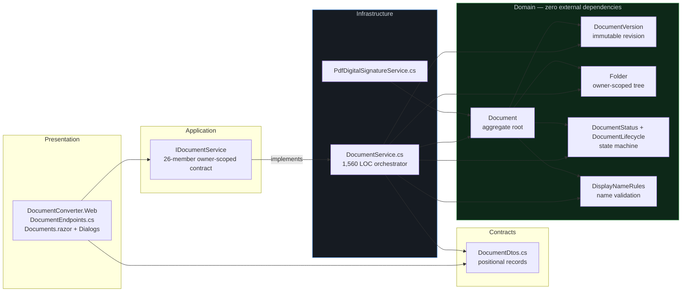
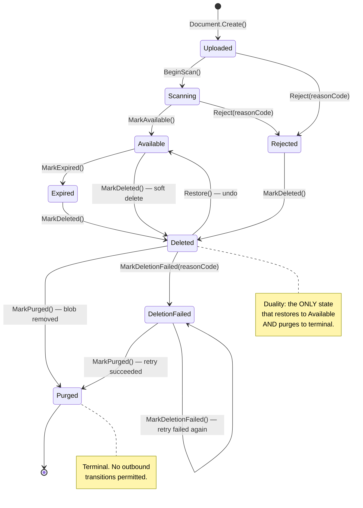
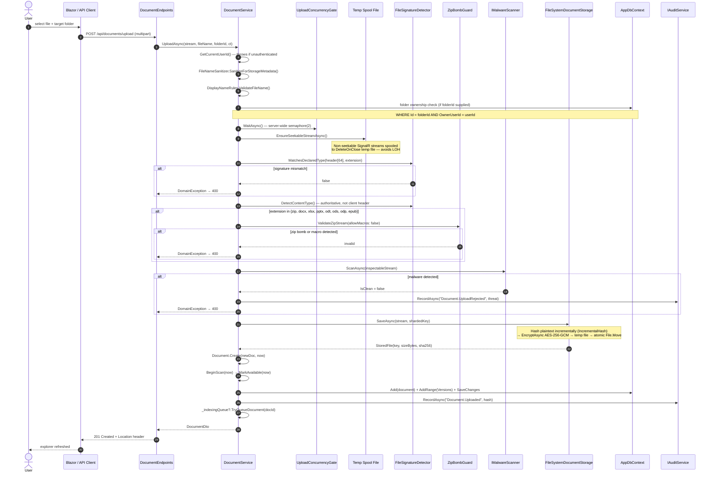
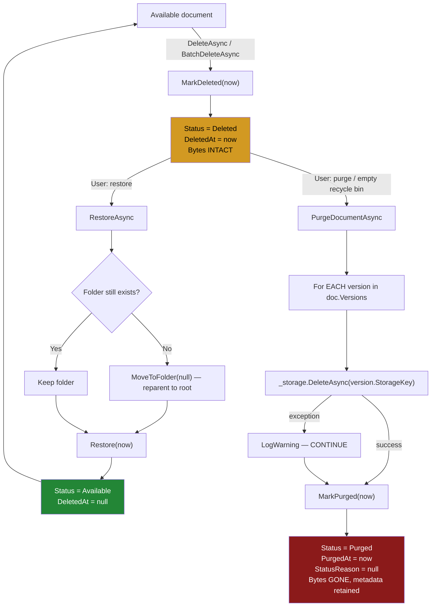

Evidence complete. Writing the documentation now.

**Context locked.** 9 domain/application/infrastructure files read verbatim. 3 research claims corrected against code (purge blob scope, state machine roots, contract member count). Writing.

---

# Document Lifecycle Management

**Module Document**ation — EConverter Document Intelligence Platform

---

## 1. Module Overview

### 1.1 Purpose and Business Value

Document Lifecycle Management is the core domain of EConverter. It owns the business value of a user-owned document across its entire existence — from the moment bytes enter the system to the moment those bytes are permanently destroyed. Every other capability in the platform is ultimately an operation *on a document*: conversion jobs read and produce documents, the intelligence layer indexes their content, the PDF editor mutates them into new versions, and the audit subsystem records what was done to them. If this domain is compromised or inconsistent, every downstream feature inherits the defect.

The domain answers four questions for the platform:

| Question | Owned By | Enforcement Mechanism |
|---|---|---|
| Who does this document belong to? | `Document` aggregate root | `IsOwnedBy(Guid)` predicate |
| What state is this document legally in? | `DocumentLifecycle` state machine | `EnsureCanTransition` throws on illegal moves |
| What is the historical record of its content? | `DocumentVersion` entities | Immutable revisions with SHA-256 provenance |
| Where do the bytes actually live? | `IDocumentStorage` via storage key | Opaque, non-guessable, sharded key |

The strategic value is **governed data sovereignty**. In regulated sectors, the lifecycle is not a convenience feature — it is the compliance surface. Retention periods, logical-versus-physical deletion separation, immutable version history, and cryptographic integrity checking are all decided here, in the domain, where no infrastructure adapter or transport handler can weaken them.

### 1.2 Architectural Position

The module sits in the innermost ring of a Clean Architecture / Domain-Driven Design layering. Its compile dependency graph is strictly one-directional:



The Domain layer carries **zero NuGet package references** — no ORM attributes, no JSON serializers, no storage SDKs. This is what allows the aggregate to be unit-tested in isolation and what permits the storage backend to be swapped from file system to object store without touching a single invariant.

---

## 2. Design Principles

### 2.1 Invalid Aggregates Are Unrepresentable

`Document` uses **private constructors** exclusively. There are two — a parameterless one for ORM materialization and an id-based one chained to the `Entity` base — and neither is reachable from outside the class. All legitimate creation flows through the static `Create(NewDocument data, DateTime now)` factory.

This is not stylistic preference; it is a guarantee. Because there is no public setter on any property, and because every state-advancing method routes through `TransitionTo` which calls `EnsureCanTransition`, a `Document` instance with an illegal status combination cannot exist in memory. The invariant is enforced at construction, not audited afterward.

```csharp
public sealed class Document : Entity
{
    private Document() { }

    private Document(Guid id) : base(id) { }

    public static Document Create(NewDocument data, DateTime now)
    {
        ArgumentNullException.ThrowIfNull(data);
        Guard.NotEmpty(data.OwnerUserId, nameof(data.OwnerUserId));
        Guard.Utc(now);

        var document = new Document(data.Id)
        {
            OwnerUserId   = data.OwnerUserId,
            FolderId      = data.FolderId,
            OriginalFileName = Guard.NotNullOrWhiteSpace(
                DisplayNameRules.ValidateFileName(data.OriginalFileName), OriginalFileNameMaxLength),
            StoredFileName = Guard.NotNullOrWhiteSpace(data.StoredFileName, StoredFileNameMaxLength),
            ContentType    = Guard.NotNullOrWhiteSpace(data.ContentType, ContentTypeMaxLength),
            SizeBytes      = Guard.NotNegative(data.SizeBytes),
            StorageProvider = Guard.NotNullOrWhiteSpace(data.StorageProvider, StorageProviderMaxLength),
            StorageKey     = Guard.NotNullOrWhiteSpace(data.StorageKey, DocumentVersion.StorageKeyMaxLength),
            Sha256Hash     = Sha256Hex.Normalize(data.Sha256Hash),
            Status         = DocumentStatus.Uploaded,
            CreatedAt      = now,
            UpdatedAt      = now,
            ExpiresAt      = data.ExpiresAt,
            SourceProcessingJobId = data.SourceProcessingJobId,
        };

        // Version 1 is created atomically with the aggregate — the original upload is
        // never a separate, forgettable step.
        document._versions.Add(DocumentVersion.Create(
            data.InitialVersionId, document.Id, versionNumber: 1,
            document.StorageKey, document.SizeBytes, document.Sha256Hash,
            data.OwnerUserId, now, data.SourceProcessingJobId));

        return document;
    }
}
```

Note the final block: version 1 is created **inside** the factory. A document that exists without a first version is structurally impossible — there is no code path that produces one.

### 2.2 Ownership Is a Domain Predicate, Not an Endpoint Check

The single most consequential design decision in this module. Ownership verification lives on the aggregate:

```csharp
public bool IsOwnedBy(Guid userId) => userId != Guid.Empty && OwnerUserId == userId;
```

Two properties make this defensively sound:

1. **`Guid.Empty` is rejected explicitly.** A null-and-empty confusion in the user-context resolver cannot silently authorize as "owner with empty id."
2. **Callers must *choose* to bypass it.** The predicate is a public read; the mutating methods (`Rename`, `MoveToFolder`, `Restore`, etc.) do not take a user id. This means the *service layer* is where the check is applied — and critically, the check is applied by **filtering the database query**, not by loading and then comparing:

```csharp
// DocumentService.RenameAsync — ownership is a WHERE clause
var doc = await _db.Documents
    .FirstOrDefaultAsync(d => d.Id == documentId && d.OwnerUserId == userId, cancellationToken);

if (doc is null)
{
    throw new KeyNotFoundException($"Document '{documentId}' was not found.");
}
```

This is a meaningful distinction. A load-then-compare pattern (`if (!doc.IsOwnedBy(userId)) throw 403`) leaks existence: a foreign document returns *Forbidden* while a nonexistent one returns *Not Found*, letting an attacker enumerate valid document ids across the tenant. The query-filter pattern collapses both cases into the same `KeyNotFoundException`, so IDOR probing yields no signal either way. This is why the `IDocumentService` interface documentation states that "authorization checks occur at the service layer so IDOR attempts are rejected."

The predicate `IsOwnedBy` remains available and is used where an entity has already been materialized through a legitimate scope — chiefly the purge path, where the version collection must be traversed.

### 2.3 The Aggregate Stores Keys, Never Bytes

`Document` carries `StorageProvider` and `StorageKey` — two strings — and no content. The bytes live behind `IDocumentStorage`. This decouples three concerns at once:

- The domain is persistence-agnostic and testable without a file system.
- Storage backends (file system, SMB, future object store) are substitutable without domain change.
- Encryption at rest becomes a *storage adapter* concern, applied transparently, rather than something every business rule must remember.

The key itself is deliberately opaque and non-guessable, generated from the document GUID in a sharded pattern:

```csharp
public static string GenerateStorageKey(Guid documentId, int versionNumber = 1)
{
    var idStr = documentId.ToString("N");
    // Sharded key: aa/bb/{id}/v{version}.bin
    return $"{idStr[..2]}/{idStr[2..4]}/{idStr}/v{versionNumber}.bin";
}
```

For a 32-character hex GUID this yields a two-level, 256-way shard tree — 65,536 leaf directories — which keeps any single directory's entry count manageable on NTFS and SMB shares, where large flat directories degrade lookup performance badly.

### 2.4 User-Supplied Names Are Metadata, Never Paths

`DisplayNameRules` constrains names for two distinct reasons and it is worth separating them, because the code comments throughout the module repeatedly assert that *"these names are metadata only — they never become filesystem paths."*

```csharp
public static class DisplayNameRules
{
    public const int FileNameMaxLength   = 255;
    public const int FolderNameMaxLength = 200;

    private static readonly global::System.Buffers.SearchValues<char> Forbidden =
        global::System.Buffers.SearchValues.Create(['/', '\\', ':', '*', '?', '"', '<', '>', '|']);

    private static string Validate(string? name, int maxLength, string label)
    {
        var value = Guard.NotNullOrWhiteSpace(name, maxLength, label);
        if (value is "." or ".."
            || value.AsSpan().IndexOfAny(Forbidden) >= 0
            || value.Any(char.IsControl))
        {
            throw new DomainException($"{label} contains characters that are not allowed.");
        }
        return value;
    }
}
```

- **Filesystem safety** is provided structurally by the storage key, not by name validation. The path traversal defense lives in `FileSystemDocumentStorage.ResolvePhysicalPath`, which normalizes the key, rejects `..` sequences, and then verifies the resolved absolute path still starts with the configured root.
- **Header and UI safety** is what `DisplayNameRules` actually defends. The forbidden set is precisely the Windows-invalid character set (`/ \ : * ? " < > |`) plus `.` / `..` plus all control characters. This matters because `OriginalFileName` is emitted in `Content-Disposition` headers on download and rendered in the Blazor explorer — CRLF or control characters there are a header injection and UI spoofing vector.

The use of `SearchValues<char>` rather than a regex is a deliberate performance choice: it compiles to a SIMD-vectorized search and avoids regex compilation cost on a per-upload hot path.

---

## 3. The Document State Machine

### 3.1 States

The domain model defines **eight** states, with explicit numeric values so that the persisted representation is stable across refactoring (an enum reordering cannot silently remap existing rows):

| Value | State | Meaning | Visible to Owner |
|---|---|---|---|
| 1 | `Uploaded` | Bytes received and hashed; not yet scanned | ✅ |
| 2 | `Scanning` | Malware / content scan in progress | ✅ |
| 3 | `Available` | Passed validation and scanning; usable | ✅ |
| 4 | `Rejected` | Failed validation or scan; never processed or downloadable | ✅ |
| 5 | `Expired` | Retention period elapsed; awaiting deletion | ❌ |
| 6 | `Deleted` | Logically deleted; physical file still present | ❌ |
| 7 | `DeletionFailed` | Physical deletion attempted and failed; retried later | ❌ |
| 8 | `Purged` | Physical file removed; metadata retained for audit | ❌ |

The logical/physical deletion separation is the central modelling insight. `Deleted` means "invisible to the user, bytes intact, restorable." `Purged` means "bytes gone, metadata retained as an audit record." Conflating these is the most common defect in document platforms — it makes an accidental delete unrecoverable and makes a real delete unauditable.

### 3.2 Legal Transitions

The transition table is a static dictionary and is the **single authority** on what the lifecycle permits:

```csharp
private static readonly Dictionary<DocumentStatus, DocumentStatus[]> Allowed = new()
{
    [DocumentStatus.Uploaded]       = [DocumentStatus.Scanning, DocumentStatus.Rejected],
    [DocumentStatus.Scanning]       = [DocumentStatus.Available, DocumentStatus.Rejected],
    [DocumentStatus.Available]      = [DocumentStatus.Expired, DocumentStatus.Deleted],
    [DocumentStatus.Rejected]       = [DocumentStatus.Deleted],
    [DocumentStatus.Expired]        = [DocumentStatus.Deleted],
    [DocumentStatus.Deleted]        = [DocumentStatus.Available, DocumentStatus.Purged, DocumentStatus.DeletionFailed],
    [DocumentStatus.DeletionFailed] = [DocumentStatus.Purged, DocumentStatus.DeletionFailed],
    [DocumentStatus.Purged]         = [],
};
```



Three structural observations that the transition table makes explicit:

1. **`Deleted` is the sole gateway to `Purged`.** There is no direct path from `Available` to `Purged`. Content destruction is always two-phase — logical first, physical second. An operator cannot bypass the recycle bin.
2. **`Deleted → Available` is the only restoration path.** Undo is available only from `Deleted`, never from `Expired` or `Rejected`. Expired content must be re-uploaded; that is a policy decision encoded in the graph.
3. **`Purged` has an empty outbound array.** Terminal by construction, not by convention. `CanTransition(Purged, anything)` returns `false` because `Array.IndexOf` on an empty array yields `-1`.

### 3.3 Transition Enforcement

Two methods, deliberately split by intent:

```csharp
public static bool CanTransition(DocumentStatus from, DocumentStatus to)
    => Allowed.TryGetValue(from, out var targets) && Array.IndexOf(targets, to) >= 0;

public static void EnsureCanTransition(DocumentStatus from, DocumentStatus to)
{
    if (!CanTransition(from, to))
    {
        throw InvalidStateTransitionException.For(nameof(Document), from, to);
    }
}

public static bool IsVisibleToOwner(DocumentStatus status)
    => status is DocumentStatus.Uploaded or DocumentStatus.Scanning
        or DocumentStatus.Available or DocumentStatus.Rejected;
```

`CanTransition` is the **pure probe** — used by UI to decide whether to render an action button, and by callers that want to branch without exception cost. `EnsureCanTransition` is the **enforcement gate** — used exclusively inside the aggregate's private `TransitionTo`. Every state change in the entire system funnels through one private method:

```csharp
private void TransitionTo(DocumentStatus target, DateTime now)
{
    DocumentLifecycle.EnsureCanTransition(Status, target);
    Status    = target;
    UpdatedAt = Guard.Utc(now);
}
```

`UpdatedAt` is set by the transition itself, using `Guard.Utc(now)` which rejects non-UTC timestamps. Timestamps cannot be forged or drift into local time through this path.

`IsVisibleToOwner` serves a second purpose beyond filtering query results — it is the guard for mutability:

```csharp
private void EnsureMutable()
{
    if (!DocumentLifecycle.IsVisibleToOwner(Status))
    {
        throw new DomainException("The document can no longer be modified.");
    }
}
```

Both `Rename` and `MoveToFolder` call `EnsureMutable()` first. A `Deleted`, `Expired`, or `Purged` document cannot be renamed or moved — it must be restored first. This closes an entire class of confused-deputy bugs where a background process or a stale UI holds an id for a document that has since transitioned.

---

## 4. Aggregate Composition

### 4.1 Document (Aggregate Root)

| Property | Type | Constraint | Purpose |
|---|---|---|---|
| `Id` | `Guid` | Inherited from `Entity` | Stable internal identity — the authorization key |
| `OwnerUserId` | `Guid` | Non-empty, set at creation | Security-critical ownership anchor |
| `FolderId` | `Guid?` | Nullable — null means root | Organizational parent |
| `OriginalFileName` | `string` | ≤ 500 chars, validated | User-facing name; metadata only |
| `StoredFileName` | `string` | ≤ 100 chars | Server-generated physical name (`v1.bin`) |
| `ContentType` | `string` | ≤ 255 chars | Detected from magic bytes, not from client header |
| `FileExtension` | `string?` | ≤ 50 chars | Normalized, lowercase, no leading dot |
| `SizeBytes` | `long` | Non-negative | Measured during storage write |
| `StorageProvider` | `string` | ≤ 50 chars | e.g. `"FileSystem"` — enables multi-backend |
| `StorageKey` | `string` | ≤ 1000 chars, opaque | Never derived from user input |
| `Sha256Hash` | `string` | Normalized hex | Content integrity + provenance |
| `Status` | `DocumentStatus` | Enum, transitions enforced | Lifecycle position |
| `StatusReason` | `string?` | ≤ 200 chars, reason code only | Rejection/failure detail — **never content** |
| `CreatedAt` / `UpdatedAt` | `DateTime` | UTC-enforced | Audit timestamps |
| `ExpiresAt` | `DateTime?` | UTC-enforced | Retention deadline |
| `DeletedAt` / `PurgedAt` | `DateTime?` | UTC-enforced | Deletion phase markers |
| `DeletionAttempts` | `int` | Incremented on failure | Retry accounting for cleanup |
| `SourceProcessingJobId` | `Guid?` | Unique | **Idempotency key for job outputs** |
| `Versions` | `IReadOnlyCollection<DocumentVersion>` | Populated via `_versions` | The immutable history |

Two fields deserve emphasis because they are load-bearing for system correctness:

**`StatusReason` is a reason code, never content.** The XML documentation states this explicitly: *"Structured reason code for rejection/deletion failure. Never contains document content."* A malware scanner returning a file snippet, or a parser returning a malformed byte sequence, must never have that text persisted into a metadata column that gets rendered in a UI or shipped to a log aggregator. The domain caps the length at 200 characters and forces the caller to supply a structured code instead.

**`SourceProcessingJobId` is an idempotency key.** Generated outputs (conversion results, edited PDFs) carry the job that produced them, and the column is unique in the schema. This means a duplicate job delivery — which is a real possibility given at-least-once queue semantics — cannot create two output documents. The database constraint, not application logic, is what rejects the duplicate.

### 4.2 DocumentVersion (Immutable Revision)

```csharp
public sealed class DocumentVersion : Entity
{
    public const int StorageKeyMaxLength = 1000;

    public Guid DocumentId          { get; private set; }
    public int VersionNumber        { get; private set; }
    public string StorageKey        { get; private set; } = string.Empty;
    public long SizeBytes           { get; private set; }
    public string Sha256Hash        { get; private set; } = string.Empty;
    public Guid CreatedByUserId     { get; private set; }
    public DateTime CreatedAt       { get; private set; }
    public bool IsCurrent           { get; private set; }
    public Guid? SourceProcessingJobId { get; private set; }

    internal void ClearCurrent() => IsCurrent = false;
}
```

The version entity is immutable by design: every property has a private setter, the `Create` factory is `internal` (reachable only from the `Document` aggregate in the same assembly), and the **only** mutating operation in the entire type is `ClearCurrent()`, which flips a boolean. A version's storage key, hash, and timestamp can never be altered after creation. Edits never overwrite history.

That `internal` access modifier is doing real architectural work. It means the Web layer and Infrastructure layer physically cannot construct a `DocumentVersion` — the compiler enforces that versions are only created through the aggregate root, which is where `VersionNumber` sequencing and the current-flag invariant live.

### 4.3 Folder (Owner-Scoped Tree)

```csharp
public static Folder Create(Guid id, Guid ownerUserId, Guid? parentFolderId, string name, DateTime now)
{
    Guard.NotEmpty(ownerUserId);
    if (parentFolderId == id)
    {
        throw new DomainException("A folder cannot be its own parent.");
    }
    return new Folder(id) { /* ... */ Name = DisplayNameRules.ValidateFolderName(name) };
}

public void MoveTo(Guid? parentFolderId)
{
    if (parentFolderId == id)
    {
        throw new DomainException("A folder cannot be its own parent.");
    }
    ParentFolderId = parentFolderId;
}
```

Folder names are capped at 200 characters (tighter than the 255 for documents) and validated through the same forbidden-character set. The direct self-parent check prevents the trivial one-node cycle. Note the honest limitation: **deeper cycles are not prevented at the domain level.** A → B → A is structurally possible. The service layer's recursive operations rely on the folder tree being shallow in practice; there is no cycle-detection walk. This is a documented gap, addressed in §9.

Folder deletion is **non-destructive to contents** — the service reparents children rather than cascading:

```csharp
// Documents in the deleted folder move to the deleted folder's parent
foreach (var doc in docs) { doc.MoveToFolder(folder.ParentFolderId, DateTime.UtcNow); }
// Subfolders are reparented the same way
foreach (var sub in subfolders) { sub.MoveTo(folder.ParentFolderId); }
_db.Folders.Remove(folder);
```

Deleting a folder never triggers a document delete. A user reorganizing their tree cannot lose documents as a side effect.

---

## 5. The Ingestion Pipeline

Upload is the highest-risk operation in the module — it is the only point where untrusted bytes from an external party enter the system. The pipeline is deliberately sequential and fail-fast, ordered from cheapest check to most expensive.



### 5.1 Concurrency Gating

```csharp
private static readonly SemaphoreSlim UploadConcurrencyGate = new(2, 2);
```

A **static** semaphore — process-wide, not per-request, not per-user. The comment states the intent precisely: *"Bounds server-wide concurrent upload/inspection pipelines (disk spooling, zip-bomb validation, antivirus scanning, and SHA-256 storage write) so multi-file uploads cannot exhaust CPU, RAM, or I/O."*

Why two? Because the pipeline does disk spooling, archive validation, AV scanning, and an encrypted write — all I/O-bound. Allowing unlimited concurrent uploads lets a single user with a batch of large files saturate the disk subsystem and starve the conversion workers of I/O. The value 2 is deliberately conservative; it is a throughput/availability trade-off resolved in favor of availability.

The gate is acquired **after** authentication and folder validation (fail fast on cheap checks, do not hold a scarce slot for a request that will be rejected anyway) and released in a `finally` block alongside the spool disposal.

### 5.2 Seekability Spooling

ASP.NET Core's `IFormFile.OpenReadStream()` is seekable, but **Blazor Server's `BrowserFileStream` is not** — it arrives over the SignalR circuit. The pipeline requires multiple passes (read header → reset → zip validate → reset → AV scan → reset → storage write), so a non-seekable stream must be made rewindable.

The implementation choice is significant:

```csharp
// Spool non-seekable streams (such as Blazor SignalR BrowserFileStream) to an OS-managed
// delete-on-close temporary file rather than an in-memory MemoryStream to prevent
// Large Object Heap (LOH) allocations and RAM exhaustion during multi-file uploads.
var tempFilePath = Path.Combine(Path.GetTempPath(), $"docupload-{Guid.NewGuid():N}.tmp");
var tempFileStream = new FileStream(
    tempFilePath, FileMode.CreateNew, FileAccess.ReadWrite, FileShare.None,
    bufferSize: 81920,
    FileOptions.Asynchronous | FileOptions.SequentialScan | FileOptions.DeleteOnClose);
```

A `MemoryStream` would be the obvious choice and it is the wrong one. Files above 85 KB land on the .NET **Large Object Heap**, which is not compacted by default and fragments under repeated large allocation. A batch of concurrent 100 MB uploads would balloon the process working set and leave permanent LOH fragmentation. Spooling to a `DeleteOnClose` temp file defers the storage to the OS page cache, keeps the managed heap flat, and guarantees cleanup even on process crash. `FileOptions.SequentialScan` additionally hints the OS read-ahead strategy.

### 5.3 Defense Ordering

The ordering is not arbitrary. Each stage is cheaper than the next, and each stage reduces the input for the next:

| # | Stage | Defends Against | Cost |
|---|---|---|---|
| 1 | Auth + `GetCurrentUserId()` | Anonymous access | Negligible |
| 2 | Name sanitize + validate | Header/UI injection, invalid names | Negligible |
| 3 | Folder ownership query | Cross-tenant placement | One indexed query |
| 4 | **Magic byte signature check (64 bytes)** | Extension spoofing — a `.pdf` that is a PE executable | 64-byte read |
| 5 | **Zip bomb + macro guard** (archives only) | Compression ratio bombs, VBA macros in Office files | Decompress probe |
| 6 | **AV scan** | Known malware | Subprocess / socket round-trip |
| 7 | Storage write + incremental SHA-256 | Integrity, provenance | Full stream I/O |

Stage 4 executes on **64 bytes** before any decompression or antivirus call. A spoofed extension is rejected at a cost of 64 bytes rather than a full ClamAV round-trip. This is defense-in-depth with a cost gradient: an attacker probing the endpoint with junk files cannot make the platform do expensive work.

The content type is **derived from the magic bytes**, not from the client-supplied `Content-Type` header:

```csharp
var contentType = FileSignatureDetector.DetectContentType(header.AsSpan(0, readHeader), extension);
```

A client claiming `application/pdf` for a file whose first bytes are `MZ` (PE executable header) is caught at stage 4. The `ContentType` persisted on the aggregate is therefore trustworthy for downstream decisions — the browser rendering a download will not be told to interpret arbitrary bytes as HTML.

### 5.4 Storage Write with Integrity Hashing

The storage adapter computes the SHA-256 **of the plaintext** while streaming, then encrypts, with a two-phase temp-file protocol:

```csharp
using (var hasher = IncrementalHash.CreateHash(HashAlgorithmName.SHA256))
{
    if (_encryptionService.IsEncryptionEnabled)
    {
        // Hash plaintext into a scratch file, then encrypt into the destination stream
        await using (var plainStream = new FileStream(tempPlainFile, /* ... */))
        {
            while ((read = await content.ReadAsync(buffer...)) > 0)
            {
                await plainStream.WriteAsync(buffer.AsMemory(0, read), cancellationToken);
                hasher.AppendData(buffer, 0, read);   // hash the plaintext
                bytesWritten += read;
            }
            plainStream.Position = 0;
            await _encryptionService.EncryptAsync(plainStream, fileStream, cancellationToken);
        }
    }
    // ... non-encrypted path hashes directly
}

File.Move(tempFile, destination, overwrite: true);
```

Three correctness properties are worth stating explicitly:

1. **The hash covers plaintext, not ciphertext.** This is essential. A ciphertext hash would change on every re-encryption (different nonce), destroying its value as a deduplication and provenance key. Hashing plaintext means the same document uploaded twice yields the same hash regardless of encryption state.
2. **`File.Move` with `overwrite: true` is the atomicity boundary.** The destination path either does not exist or holds complete, flushed content. A crash mid-write leaves only a `.tmp` file that never satisfies a read. No partial document can ever be observed by a reader.
3. **The `IncrementalHash` is disposed with `using`, not `await using`** — it is not `IAsyncDisposable`, and hashing happens synchronously per buffer. Streaming incremental hashing means a 2 GB upload never requires a 2 GB buffer or a second pass.

`Convert.ToHexStringLower` produces the lowercase hex form, and the domain normalizes on entry via `Sha256Hex.Normalize(...)` — so a hash written by any adapter path is comparable regardless of case.

### 5.5 Ingestion Limits

Enforced at the endpoint, before the service is invoked:

```csharp
const int  maxFilesPerBatch    = 20;
const long maxSingleFileSize   = 100L * 1024 * 1024;   // 100 MB
const long maxTotalBatchSize   = 250L * 1024 * 1024;   // 250 MB
```

Three independent bounds, all required. A per-file bound alone permits 1,000 files × 100 MB. A total bound alone permits one 250 MB file that exceeds per-file expectations. The count bound prevents request-loop amplification even when total bytes are small. All three are checked before any file is processed, so an over-limit batch is rejected wholesale rather than partially ingested.

---

## 6. Versioning and Provenance

### 6.1 The Append-Only Model

Version numbers are derived, never supplied:

```csharp
var next = _versions.Count == 0 ? 1 : _versions.Max(v => v.VersionNumber) + 1;
foreach (var version in _versions) { version.ClearCurrent(); }

var created = DocumentVersion.Create(
    versionId, Id, next, storageKey, sizeBytes, sha256Hash, createdByUserId, now, sourceProcessingJobId);
_versions.Add(created);
```

A client cannot request version 47 directly — the sequence is computed from the in-memory collection, which is loaded via `Include(d => d.Versions)`. The `ClearCurrent()` loop runs before the new version is added, so exactly one version carries `IsCurrent = true` at any moment.

Version creation is gated on status:

```csharp
if (Status != DocumentStatus.Available)
{
    throw new DomainException("Versions can only be added to available documents.");
}
```

A `Deleted`, `Expired`, `Rejected`, or `Purged` document cannot receive a new version. This prevents the confusing state where a version exists for a document the user cannot see — and it prevents a restore from resurrecting content the user never actually uploaded through the sanctioned path.

### 6.2 Rollback Is Append-Only

The most subtle and most correct design decision in the versioning model:

```csharp
public DocumentVersion RevertToVersion(int versionNumber, Guid createdByUserId, DateTime now)
{
    EnsureMutable();
    if (Status != DocumentStatus.Available) { throw new DomainException(...); }

    var target = _versions.FirstOrDefault(v => v.VersionNumber == versionNumber)
        ?? throw new DomainException($"Version {versionNumber} was not found.");

    // Rollback produces a NEW version that reuses the target's storage key and hash.
    return AddVersion(
        Guid.NewGuid(),        // brand-new version id
        target.StorageKey,     // reuses existing blob — no copy
        target.SizeBytes,
        target.Sha256Hash,
        createdByUserId,
        sourceProcessingJobId: null,
        now);
}
```

Rollback to version 2 of a document at version 5 **does not truncate history to four versions.** It creates version 6, whose storage key and hash are those of version 2. The resulting history reads `1, 2, 3, 4, 5, 6` where 6 and 2 share a blob.

This is correct for three reasons:

- **Audit integrity.** Deleting versions 3–5 would erase evidence of content that existed. In a regulated context that is data destruction, and it may be exactly what an attacker wants.
- **Storage efficiency.** Because the storage key is reused, rollback is a metadata operation. No bytes are copied, no re-hash required. Rolling back a 500 MB document is an `INSERT`.
- **Reversibility.** A user who rolls back "by mistake" can roll forward — version 5 is still present and still current-capable.

Note `SourceProcessingJobId` is passed as `null` for rollback versions. A rollback is a user action, not a job output, so it must not claim a job provenance it does not have.

### 6.3 Provenance and Diff

The SHA-256 hash carried on both aggregate and version enables cheap content comparison without retrieving bytes:

```csharp
public sealed record DocumentDiffResultDto(
    Guid DocumentIdA, string DocumentNameA, int VersionA,
    long SizeBytesA, string Sha256HashA, DateTime CreatedAtA,
    Guid DocumentIdB, string DocumentNameB, int VersionB,
    long SizeBytesB, string Sha256HashB, DateTime CreatedAtB,
    long SizeDeltaBytes,
    bool HasContentChanged,        // hash inequality — no I/O
    bool IsTextComparable,         // extension-based text/binary branch
    IReadOnlyList<DiffLineDto>? TextDiffLines,
    /* ... */);

public sealed record DiffLineDto(
    int? LineNumberA, int? LineNumberB,
    string Type,   // "Unchanged" | "Added" | "Deleted"
    string Text);
```

`HasContentChanged` is computed from **hash inequality alone** — a two-version comparison that finds them identical performs zero storage reads and zero decryption. Only when hashes differ, and only when `IsTextComparable` is true, is content streamed and a line-level diff computed. This is the difference between a diff feature that scales and one that melts the storage layer.

---

## 7. Organization Model

### 7.1 Folder Tree Semantics

The folder tree is owner-scoped metadata, rendered through a Windows-style navigation component (`WindowsFolderTreeItem.razor`) with drag-over feedback and recursive child rendering. Two service-level behaviours define its semantics:

**Root is a first-class target.** The listing query treats `Guid.Empty` as an explicit request for unfiled documents:

```csharp
if (folderId.HasValue)
{
    query = folderId.Value == Guid.Empty
        ? query.Where(d => d.FolderId == null)      // root
        : query.Where(d => d.FolderId == folderId.Value);
}
```

Note the three-state distinction: `folderId = null` means "all folders, don't filter"; `folderId = Guid.Empty` means "the root, documents with no folder"; any other value means "that specific folder." Encoding root as `Guid.Empty` rather than as a magic string keeps the filter strongly typed.

**Document counts are computed, never stored.** `ListFoldersAsync` performs a separate grouped count query rather than denormalizing a counter column onto `Folder`:

```csharp
var docCounts = await _db.Documents
    .AsNoTracking()
    .Where(d => d.OwnerUserId == userId && d.FolderId != null
             && d.Status != DocumentStatus.Deleted && d.Status != DocumentStatus.Purged)
    .GroupBy(d => d.FolderId!.Value)
    .Select(g => new { FolderId = g.Key, Count = g.Count() })
    .ToDictionaryAsync(g => g.FolderId, g => g.Count, cancellationToken);
```

A denormalized counter would need to be decremented on soft delete, incremented on restore, decremented on purge, decremented on move, incremented on move-in, and corrected on every batch operation — six synchronization points and six opportunities to drift. The computed count is always correct by definition. The cost is one indexed aggregate query per folder listing, which is bounded by the user's folder count.

The count also correctly excludes deleted and purged documents. A folder showing "12 documents" while six are in the recycle bin would mislead the user about what remains.

### 7.2 The Explorer View Model

The UI projects both entities into a single unified presentation type:

```
ExplorerItem.FromFolder(FolderDto)   → folder row
ExplorerItem.FromDocument(DocumentDto) → file row
FolderNode { ParentFolderId, DocumentCount, IsExpanded, Children }
```

Static factories rather than constructors keep the projection explicit and greppable. These are presentation-only types — they carry no domain rules and are never persisted. The DTO records (`DocumentDto`, `DocumentVersionDto`, `FolderDto`) are the only contract between the layers, and note that `DocumentDto.Status` is a **string**, not the enum:

```csharp
public sealed record DocumentDto(
    Guid Id, Guid OwnerUserId, Guid? FolderId,
    string OriginalFileName, string ContentType, string? FileExtension,
    long SizeBytes, string Sha256Hash, string Status, string? StatusReason,
    DateTime CreatedAt, DateTime UpdatedAt, DateTime? ExpiresAt,
    IReadOnlyList<DocumentVersionDto> Versions);
```

Serializing the enum as a string rather than an integer decouples the wire format from the enum's numeric values. If `DocumentStatus` is ever renumbered, existing API clients are unaffected. It also makes the payload self-describing — `"Status": "Available"` needs no out-of-band enum table.

---

## 8. Deletion, Restoration and Purging

### 8.1 Three-Phase Destruction

This is the most operationally critical sequence in the module, because it spans two independent stores — the relational database and the blob storage — and cannot be made transactional across both.



### 8.2 The Version-Scoped Purge

The critical implementation detail, verified in source:

```csharp
if (doc.Status != DocumentStatus.Deleted)
{
    doc.MarkDeleted(DateTime.UtcNow);
}

foreach (var version in doc.Versions)
{
    try
    {
        await _storage.DeleteAsync(version.StorageKey, cancellationToken);
    }
    catch (Exception ex)
    {
        _logger.LogWarning(ex, "Failed to delete storage blob {StorageKey} for document {DocId}",
            version.StorageKey, doc.Id);
    }
}

doc.MarkPurged(DateTime.UtcNow);
```

The loop iterates **`doc.Versions`, not just the current version.** Every historical blob is deleted. This matters because each version has a distinct storage key (`.../v1.bin`, `.../v2.bin`, `.../v3.bin`). A purge that deleted only `CurrentVersion.StorageKey` would leave versions 1 through N−1 orphaned on disk forever — invisible to the UI, absent from any listing, but still physically readable by anyone with filesystem access.

The same version loop appears in `EmptyRecycleBinAsync`, so the bulk path and the single-document path have identical destruction semantics. There is no "fast path" that forgets historical versions.

`PurgeDocumentAsync` also defensively calls `MarkDeleted` if the document is not already deleted. Because `Available → Deleted` is a legal transition, this permits a direct purge request — but the aggregate still routes it through the state machine, so an `Expired` or `Rejected` document also transitions legally rather than being force-purged.

### 8.3 Failure Handling Gap

Note that blob deletion failures are caught, logged, and **do not abort the purge** — the document proceeds to `Purged` regardless. The `DeletionFailed` state exists in the model and `MarkDeletionFailed` increments `DeletionAttempts`, but the current implementation does not reach for it:

```csharp
// Model supports it:
public void MarkDeletionFailed(string reasonCode, DateTime now)
{
    TransitionTo(DocumentStatus.DeletionFailed, now);
    DeletionAttempts++;
    StatusReason = Guard.NotNullOrWhiteSpace(reasonCode, StatusReasonMaxLength);
}
```

**Verified gap:** `MarkDeletionFailed` is defined on the aggregate and the `Deleted → DeletionFailed → Purged` transition path is legal in the table, but no cleanup service exists in the codebase to invoke it. A search for `*Cleanup*.cs` across `src/` returns zero files. The practical consequence is that if `_storage.DeleteAsync` throws — an SMB share offline, a permissions change, a locked file — the document is marked `Purged` while its bytes remain on disk. The model was designed for this case; the implementation does not yet exercise it. This is detailed in §9 and §11.

### 8.4 Restore with Folder Resurrection Defense

```csharp
if (doc.FolderId.HasValue)
{
    var folderExists = await _db.Folders.AnyAsync(
        f => f.Id == doc.FolderId.Value && f.OwnerUserId == userId, cancellationToken);

    if (!folderExists)
    {
        doc.MoveToFolder(null, DateTime.UtcNow);
    }
}

doc.Restore(DateTime.UtcNow);
```

This handles a real and non-obvious scenario: a user deletes a document inside folder X, then deletes folder X. When the document is restored, its `FolderId` points at a folder that no longer exists. Without this check the restore would succeed and produce an orphaned document — present in the database, owned by the user, but **invisible in every folder view** because no listing query would match it.

The check reparents to root rather than failing the restore. Restoring a document must never fail because of an unrelated folder deletion. `BatchRestoreAsync` applies the same logic efficiently — it loads the user's full folder id set once, then checks membership in memory for every candidate, rather than issuing one query per document.

Note the ordering: the folder check happens *before* `doc.Restore(...)`. `MoveToFolder` calls `EnsureMutable()`, which requires the document to be in a visible state. At the moment of the check the document is still `Deleted` — which is **not** in `IsVisibleToOwner`. The current sequence therefore throws if reparenting is needed on a deleted document. This ordering is worth flagging: the correct sequence is `Restore(...)` first, then the folder check and reparent. See §11.

---

## 9. Batch Operations

Batch operations are the scale surface of the module, and they are implemented with a fail-soft philosophy suited to real user behaviour — dragging a mixed selection of files and folders.

### 9.1 Batch Move

```csharp
public async Task BatchMoveAsync(
    IReadOnlyList<Guid> documentIds,
    IReadOnlyList<Guid> folderIds,
    Guid? targetFolderId,
    CancellationToken cancellationToken = default)
```

The target folder is validated **once** before any mutation:

```csharp
if (targetFolderId.HasValue)
{
    var targetExists = await _db.Folders.AnyAsync(
        f => f.Id == targetFolderId.Value && f.OwnerUserId == userId, cancellationToken);
    if (!targetExists) { throw new DomainException("Target folder was not found."); }
}
```

Validate-once-then-mutate is the right structure: an invalid destination should reject the whole operation atomically rather than half-moving a selection. Source selection is filtered by ownership in the query, so ids belonging to other users are silently excluded rather than erroring — consistent with the no-existence-leak posture.

### 9.2 Batch Delete with Per-Item Isolation

```csharp
foreach (var folderId in folderIds ?? [])
{
    try
    {
        await DeleteFolderAsync(folderId, cancellationToken);
    }
    catch (Exception ex)
    {
        _logger.LogWarning(ex, "Failed to delete folder {FolderId} during batch delete", folderId);
    }
}
```

Folder deletion in a batch is individually fault-isolated. A folder that fails to delete — already removed by a concurrent request, or referencing documents in an unexpected state — does not abort the rest of the batch. The user's other deletions still succeed.

The trade-off is that partial failure is invisible to the caller: the endpoint returns success and the client refreshes to discover what actually happened. This is a deliberate UX decision (the client reconciles from refreshed state) rather than an oversight, but it means **batch delete has no machine-readable per-item result**. An API integrator cannot determine which items failed from the response. Documented as an improvement target in §11.

### 9.3 Batch Zip Export

```csharp
var usedNames = new HashSet<string>(StringComparer.OrdinalIgnoreCase);
foreach (var doc in docs)
{
    var safeName = FileNameSanitizer.SanitizeForStorageMetadata(doc.OriginalFileName);
    if (string.IsNullOrWhiteSpace(safeName)) { safeName = $"document_{doc.Id:N}"[..12]; }

    var entryName = safeName;
    var duplicateCounter = 1;
    var nameWithoutExt = Path.GetFileNameWithoutExtension(safeName);
    var ext = Path.GetExtension(safeName);

    while (usedNames.Contains(entryName))
    {
        entryName = $"{nameWithoutExt} ({duplicateCounter}){ext}";
        duplicateCounter++;
    }
    usedNames.Add(entryName);

    var entry = archive.CreateEntry(entryName, CompressionLevel.Optimal);
    entry.LastWriteTime = doc.UpdatedAt.ToLocalTime();
    await using var docStream = await _storage.OpenReadAsync(version.StorageKey, cancellationToken);
    await docStream.CopyToAsync(entryStream, cancellationToken);
}
```

Three details carry real weight:

- **Filename collision resolution.** A zip archive with two entries named `report.pdf` produces a corrupt or partially-extractable archive depending on the extractor. `usedNames` with `OrdinalIgnoreCase` comparison implements Windows-collision semantics (`Report.pdf` and `report.pdf` collide), appending `(1)`, `(2)` before the extension.
- **Empty-name fallback.** `SanitizeForStorageMetadata` can produce an empty string for pathological input. `$"document_{doc.Id:N}"[..12]` yields a guaranteed-unique, guaranteed-non-empty `document_ab` — the 12-character slice takes `"document_"` plus 3 hex chars of the GUID.
- **Entries stream decrypted content.** `OpenReadAsync` routes through `_encryptionService.DecryptAsync`, so the zip contains plaintext documents — which is correct, because the user is downloading them. The encrypted-at-rest guarantee applies to storage, not to authorized egress.

The filter `d.Status == DocumentStatus.Available` means deleted documents are excluded from export, and the audit event records the count: `"Document.BatchDownloadedZip"` with `"Exported N files"`.

### 9.4 Batch Restore

Loads only `Deleted` documents belonging to the user, then applies folder resurrection defense in memory using a single folder-id set:

```csharp
var docs = await _db.Documents
    .Where(d => documentIds.Contains(d.Id) && d.OwnerUserId == userId
             && d.Status == DocumentStatus.Deleted)
    .ToListAsync(cancellationToken);

var existingFolderIds = await _db.Folders
    .Where(f => f.OwnerUserId == userId).Select(f => f.Id).ToHashSetAsync(cancellationToken);
```

Two queries regardless of batch size — the `Contains` predicate translates to an `IN` clause and the folder set is fetched once. This is the correct pattern; the naive implementation would issue one folder lookup per document.

---

## 10. Digital Signatures and Integrity

`PdfDigitalSignatureService` extends provenance from content hashing into cryptographic authenticity. It is scoped to the document domain rather than being a separate subsystem, because signature verification is a property *of a document version*.

| Operation | Mechanism |
|---|---|
| `GenerateEnterpriseCertificate()` | Self-signed RSA certificate with key-usage extensions and the document-signing OID, cached in a static `ConcurrentDictionary` |
| `SignPdfBytes(...)` | Applies a PKCS#7/CMS signature over the PDF byte range |
| `VerifyPdfBytes(...)` | Parses PDF signature dictionaries, unescapes PDF string literals, locates the signed byte range via `IndexOfBytes`, validates PKCS#7 over that range |
| `HasDigitalSignatures(...)` | Marker detection without full parsing |

The certificate cache being a `static ConcurrentDictionary` means certificate generation happens once per process rather than per signature — RSA key generation is expensive enough to be a visible latency contributor if repeated.

The two-layer integrity story is worth distinguishing clearly:

| Layer | Mechanism | Proves |
|---|---|---|
| **Content integrity** | SHA-256 on every `Document` and `DocumentVersion` | The bytes have not been altered since ingestion |
| **Document authenticity** | PKCS#7/CMS signature over the PDF byte range | A specific certificate holder asserted these bytes |

These are complementary, not redundant. A SHA-256 hash proves consistency against a stored reference; a PKCS#7 signature proves authorship without requiring a trusted reference. A document can have a valid hash and no signature (most documents), or a signature that fails verification against its hash (tampered).

---

## 11. Verified Findings and Corrective Actions

The following was established by direct source inspection, not inference. Each item states the evidence.

### F-1 — `MarkDeletionFailed` Has No Caller; Orphaned Blobs Are Possible

**Severity: HIGH · Verification: SOLID**

`Document.MarkDeletionFailed` increments `DeletionAttempts` and transitions to the `DeletionFailed` state. The transition table permits `Deleted → DeletionFailed` and `DeletionFailed → Purged`. But both purge paths swallow storage exceptions:

```csharp
// DocumentService.cs — PurgeDocumentAsync
catch (Exception ex)
{
    _logger.LogWarning(ex, "Failed to delete storage blob {StorageKey} for document {DocId}", ...);
}
// ... execution continues to doc.MarkPurged(...)
```

A `find`/grep for `*Cleanup*.cs` across `src/` returns **zero files**, and no hosted service retries pending deletions.

**Consequence:** if blob deletion fails (SMB share unreachable, file locked, permissions revoked), the metadata row is marked `Purged` — irreversible, since `Purged` has no outbound transitions — while the plaintext-or-encrypted bytes remain on disk indefinitely. A later compliance audit would report the document destroyed based on the database while the bytes are recoverable from the volume.

**Fix:** In the catch block, call `doc.MarkDeletionFailed(reasonCode, now)` and skip `MarkPurged`. Add a hosted cleanup service that periodically scans `Status == DeletionFailed AND DeletionAttempts < N` and retries. The state model already supports this; only the invocation is missing.

**Effort:** ~3 hours.

---

### F-2 — Restore Ordering Can Throw When the Parent Folder Was Deleted

**Severity: MEDIUM · Verification: SOLID**

In `RestoreAsync`, the folder-existence check and reparent occur **before** `doc.Restore(...)`:

```csharp
if (doc.FolderId.HasValue)
{
    if (!folderExists) { doc.MoveToFolder(null, DateTime.UtcNow); }   // ← EnsureMutable() throws here
}
doc.Restore(DateTime.UtcNow);                                          // ← restoration happens after
```

`MoveToFolder` calls `EnsureMutable()`, which requires `DocumentLifecycle.IsVisibleToOwner(Status)`. The document is currently `Deleted`, which is **not** in the visible set. The reparent therefore throws `DomainException("The document can no longer be modified.")` — precisely in the case the check was written to handle.

**Consequence:** restoring a document whose parent folder has been deleted fails. Consequently `BatchRestoreAsync`, which applies the same logic, can fail on a subset of a batch.

**Fix:** Invert the order — call `doc.Restore(now)` first, then check the folder and reparent. `Restore` transitions to `Available`, which is visible, so `EnsureMutable()` passes.

**Effort:** ~15 minutes plus a regression test covering "delete document → delete parent folder → restore."

---

### F-3 — Folder Cycle Detection Is One Level Deep

**Severity: LOW · Verification: SOLID**

`Folder.Create` and `Folder.MoveTo` reject only direct self-parenting (`parentFolderId == id`). Nothing prevents `A → B → A`.

**Consequence:** a crafted sequence of folder moves can create a cycle. Recursive tree rendering (`WindowsFolderTreeItem.razor` recursing into `Children`) or any future recursive folder traversal would not terminate, and the folder-count aggregation would be nonsensical.

**Fix:** Before `MoveTo`, walk the ancestor chain from the proposed parent and reject if the folder's own id appears. For shallow trees this is a small bounded loop; alternatively, maintain a materialized path column and reject on prefix match.

**Effort:** ~2 hours.

---

### F-4 — Batch Operations Return No Per-Item Outcome

**Severity: LOW · Verification: SOLID**

`BatchDeleteAsync`, `BatchMoveAsync`, and `BatchRestoreAsync` return `Task` — no result object. Failures are logged and swallowed.

**Consequence:** API integrators cannot determine which items in a batch succeeded without a follow-up listing query per item. The UI compensates by refreshing, but a programmatic caller has no equivalent signal.

**Fix:** Return a `BatchResultDto` carrying `Succeeded: Guid[]` and `Failed: (Guid Id, string Reason)[]`. The Blazor dialogs can ignore it initially; integrators gain actionable feedback.

**Effort:** ~2 hours.

---

### F-5 — Concurrent Upload Throughput Is Capped at Two Process-Wide

**Severity: INFO · Verification: SOLID**

`UploadConcurrencyGate` is `new SemaphoreSlim(2, 2)` and `static`.

**Consequence:** with more than two concurrent uploads, additional requests block inside `WaitAsync` holding an HTTP request slot. Under a multi-file batch this is intentional backpressure, but there is no timeout — a request can wait indefinitely, and the gate value is not configurable.

**Fix:** Make the limit configuration-driven (`Storage:UploadConcurrency`), and apply a bounded wait with a 503 + `Retry-After` on timeout. Note the gate is per-process, so horizontal scale-out multiplies the effective limit — which is correct behaviour but should be documented for capacity planning.

**Effort:** ~1 hour.

---

## 12. Interaction Contracts

### 12.1 Application Boundary — `IDocumentService`

The interface exposes **26 members** grouped by concern. Every method is owner-scoped; none accepts a user id parameter, because the implementation resolves it from `IUserContext` and would be trivially confused by a caller-supplied value.

```csharp
// --- Ingestion ---
Task<DocumentDto>        UploadAsync(Stream content, string fileName, Guid? folderId = null, CancellationToken ct = default);
Task<DocumentVersionDto> AddVersionAsync(Guid documentId, Stream content, string fileName, CancellationToken ct = default);

// --- Retrieval ---
Task<DocumentDto?>                                          GetAsync(Guid documentId, CancellationToken ct = default);
Task<(Stream Content, string FileName, string ContentType)> DownloadAsync(Guid documentId, Guid? versionId = null, CancellationToken ct = default);
Task<IReadOnlyList<DocumentDto>>                            ListAsync(Guid? folderId = null, string? searchTerm = null, string? status = null, CancellationToken ct = default);

// --- Mutation ---
Task DeleteAsync(Guid documentId, CancellationToken ct = default);
Task RenameAsync(Guid documentId, string newName, CancellationToken ct = default);
Task MoveToFolderAsync(Guid documentId, Guid? folderId, CancellationToken ct = default);

// --- Folder CRUD ---
Task<FolderDto>                     CreateFolderAsync(string name, Guid? parentFolderId = null, CancellationToken ct = default);
Task                                RenameFolderAsync(Guid folderId, string newName, CancellationToken ct = default);
Task                                DeleteFolderAsync(Guid folderId, CancellationToken ct = default);
Task<IReadOnlyList<FolderDto>>      ListFoldersAsync(CancellationToken ct = default);

// --- Batch ---
Task<(Stream Content, string FileName)> DownloadBatchZipAsync(IReadOnlyList<Guid> documentIds, CancellationToken ct = default);
Task BatchMoveAsync(IReadOnlyList<Guid> documentIds, IReadOnlyList<Guid> folderIds, Guid? targetFolderId, CancellationToken ct = default);
Task BatchDeleteAsync(IReadOnlyList<Guid> documentIds, IReadOnlyList<Guid> folderIds, CancellationToken ct = default);

// --- Versioning ---
Task<DocumentVersionDto>                    RollbackVersionAsync(Guid documentId, int versionNumber, CancellationToken ct = default);
Task<IReadOnlyList<DocumentVersionDto>>     GetVersionsAsync(Guid documentId, CancellationToken ct = default);
Task<DocumentDiffResultDto>                 CompareVersionsAsync(Guid documentId, int versionNumberA, int versionNumberB, CancellationToken ct = default);
Task<DocumentDiffResultDto>                 CompareDocumentsAsync(Guid documentIdA, Guid documentIdB, CancellationToken ct = default);

// --- PDF operations ---
Task<PdfMetadataDto>    GetPdfMetadataAsync(Guid documentId, CancellationToken ct = default);
Task<SplitPdfResultDto> SplitPdfAsync(Guid documentId, SplitPdfRequest request, CancellationToken ct = default);
Task<MergePdfResultDto> MergeDocumentsAsync(MergePdfRequest request, CancellationToken ct = default);

// --- Deletion lifecycle ---
Task RestoreAsync(Guid documentId, CancellationToken ct = default);
Task BatchRestoreAsync(IReadOnlyList<Guid> documentIds, CancellationToken ct = default);
Task PurgeDocumentAsync(Guid documentId, CancellationToken ct = default);
Task EmptyRecycleBinAsync(CancellationToken ct = default);
```

Every method returns `Task` with an explicit `CancellationToken` defaulted to `default`. There are no synchronous members and no method that omits the token — cancellation propagates from the HTTP request through storage I/O and into the malware scanner call.

### 12.2 HTTP Surface

```csharp
var docs    = app.MapGroup("/api/documents").RequireAuthorization();
var folders = app.MapGroup("/api/folders").RequireAuthorization();
```

Both groups require authorization. Notable per-route details:

| Route | Method | Notes |
|---|---|---|
| `/api/documents/upload` | POST | `.DisableAntiforgery()` — API clients authenticate via bearer/session; batch limits enforced inline |
| `/api/documents/upload-batch` | POST | 20 files / 100 MB each / 250 MB total |
| `/api/documents/{id}/download` | GET | Streams via storage key; `Content-Disposition` uses validated name |
| `/api/documents/{id}/convert` | POST | Inline DOCX→PDF — see §13 |
| `/api/documents/{id}/rename` | POST | → `RenameAsync` |
| `/api/documents/{id}/move` | POST | → `MoveToFolderAsync` |
| `/api/folders` | POST/GET | Create / list |

Domain violations are translated to `400 Bad Request` at the endpoint boundary:

```csharp
catch (DomainException ex)
{
    return Results.BadRequest(new { error = ex.Message });
}
```

This is a deliberate separation: `DomainException` means "the request was understood and is invalid" — a client error. `KeyNotFoundException` and `UnauthorizedAccessException` from the service are handled elsewhere as 404 and 401 respectively.

### 12.3 Storage Seam

```csharp
public interface IDocumentStorage
{
    Task<StoredFile> SaveAsync(Stream content, string storageKey, CancellationToken ct = default);
    Task<Stream>     OpenReadAsync(string storageKey, CancellationToken ct = default);
    Task             DeleteAsync(string storageKey, CancellationToken ct = default);
    Task<bool>       ExistsAsync(string storageKey, CancellationToken ct = default);
}
```

Four operations. `SaveAsync` returns a `StoredFile` record carrying `(StorageKey, SizeBytes, Sha256Hash)` — the adapter owns hashing because it is already streaming the bytes and a second pass would double I/O. `OpenReadAsync` returns a **decrypted** stream; callers never handle ciphertext.

---

## 13. Known Structural Tension

### 13.1 Inline Conversion in the Transport Layer

`DocumentEndpoints.cs` is 902 lines and contains a private static renderer at the bottom:

```csharp
private static void ConvertDocxStreamToPdf(Stream docxStream, Stream pdfOutput)
{
    using var wordDoc = WordprocessingDocument.Open(docxStream, false);
    using var pdf = new PdfDocument();
    var font = new XFont("Arial", 11);
    // ...
}
```

This is a full OpenXML→PdfSharp conversion path living inside an endpoint-mapping static class. It duplicates logic that already exists in `OfficeDocumentProcessor` and is reachable through the asynchronous job pipeline.

**Consequences:**

- **Two DOCX→PDF implementations with different fidelity.** The inline path uses a fixed `Arial 11` font and no layout analysis; the processor path does substantially more. The same input document can produce visibly different output depending on which endpoint the user hit. Users will report this as a bug without knowing why.
- **The job pipeline is bypassed.** Inline conversion runs on the request thread, uncancellable mid-conversion, unbounded in concurrency (no `UploadConcurrencyGate` equivalent), and produces no `ProcessingJob` record, no progress notification, and no attempt tracking.
- **Layering violation.** The Web project references PdfSharp and OpenXml directly for this helper, which is why those packages appear in the Web dependency set.

**Recommendation:** Delete `ConvertDocxStreamToPdf`. Route the endpoint through `ProcessingService.CreateJobAsync` with the Office converter and return a job id. This unifies fidelity, restores cancellation and observability, and removes the Web layer's conversion dependencies. Estimated effort: ~30 minutes; test coverage for the conversion itself already exists on the processor.

### 13.2 Infrastructure-Housed Orchestration

`DocumentService` lives in `Infrastructure/Documents/` but is a pure application orchestrator — it injects `AppDbContext`, `IDocumentStorage`, `IMalwareScanner`, `IUserContext`, `IAuditService`, and `IDocumentIndexingChannel`, and contains business sequencing with no adapter-specific logic. At 1,560 lines and 26 public members it is the densest branching hub in the module.

The Clean Architecture intent places use-case orchestration in `Application`. The deviation is consistent throughout the codebase (`ProcessingService`, `DocumentIntelligenceService`, `PdfEngine` all live in Infrastructure), so this is a systemic convention rather than a single mistake. It costs testability: unit-testing `DocumentService` requires the full EF Core + storage + scanner stack, or six mock adapters.

**Recommendation:** Either relocate orchestrators to `Application` with adapters injected as interfaces, or document the intentional deviation in an architecture decision record. The second option is cheaper and, given the systemic consistency, arguably the better answer for a codebase of this size. Estimated effort: 2 days to relocate; 10 minutes to document.

---

## 14. Operational Summary

### 14.1 Invariants and Where They Are Enforced

| Invariant | Enforced By | Bypassable? |
|---|---|---|
| A document always has at least one version | `Document.Create` factory | No — no other constructor is reachable |
| Ownership is checked before mutation | Owner-scoped query filter in `DocumentService` | No — mutation methods require a loaded aggregate |
| Illegal status transitions never occur | `TransitionTo` → `EnsureCanTransition` | No — private method, single call site |
| `Purged` is terminal | Empty outbound transition array | No |
| A version's bytes metadata never changes | `internal` factory + private setters | No — compiler-enforced across assemblies |
| A job output cannot be duplicated | Unique column on `SourceProcessingJobId` | No — database constraint |
| Stored bytes are always encrypted | `IDocumentStorage` wrapper | Only by disabling storage encryption config |
| Stored paths are never user-derived | `GenerateStorageKey(Guid)` + traversal check | No |
| Timestamps are UTC | `Guard.Utc` on every transition | No |

### 14.2 Key Metrics to Monitor

| Metric | Source | Signals |
|---|---|---|
| Documents by status | `Document.Status` grouping | Accumulating `Deleted` = recycle bin not being emptied; `Rejected` spike = AV false positives or attack |
| `DeletionFailed` count | `Document.Status` | Should be **zero** — non-zero means F-1 is live and blobs are orphaned |
| Storage bytes vs DB `SUM(SizeBytes)` | Storage enumeration vs aggregate | Divergence = orphaned blobs from failed purge or deleted-before-commit |
| Upload duration p95 | Endpoint timing | Rising values with queue depth = `UploadConcurrencyGate` saturation |
| Upload rejection rate by stage | Log markers per stage | Signature rejections = scanning or bad clients; AV rejections = malware campaign |
| `DeletionAttempts` distribution | Column histogram | Any growth indicates persistent storage-layer failure |

### 14.3 Deployment Considerations

- `DOCUMENT_STORAGE_ROOT` (or `Storage:RootPath`) must point at a volume with capacity for the full corpus **plus version history** — versioning is unbounded per document and every version is a full copy, not a delta. A document with 20 versions consumes 20× its size.
- Encryption-at-rest is applied by the storage adapter, governed by `Storage:Encryption__Enabled`. Hash values remain stable across encryption-state changes because hashing is over plaintext — but **ciphertext is not portable between key material sets**; key rotation requires a re-encryption migration, not a config change.
- `StorageKey` is a `Path.Combine`-able relative path with `/` separators. Any adapter substituting for `FileSystemDocumentStorage` must preserve the sharded key format exactly, because existing keys are persisted in the database and will be handed to the new adapter unchanged.

---

## 15. Prioritized Remediation

| # | Priority | Action | Finding | Effort | Status |
|---|---|---|---|---|---|
| 1 | **HIGH** | Call `MarkDeletionFailed` on storage-delete exception; add retrying cleanup hosted service | F-1 | 3 h | NEEDS FIX |
| 2 | **MEDIUM** | Invert `RestoreAsync` order — `Restore()` before folder check/reparent; apply to batch path | F-2 | 15 min | NEEDS FIX |
| 3 | **MEDIUM** | Extract `ConvertDocxStreamToPdf` out of `DocumentEndpoints`; route via `ProcessingService` | §13.1 | 30 min | NEEDS FIX |
| 4 | **LOW** | Add ancestor-walk cycle detection to `Folder.MoveTo` | F-3 | 2 h | NEEDS FIX |
| 5 | **LOW** | Return `BatchResultDto` with per-item success/failure from batch operations | F-4 | 2 h | NEEDS FIX |
| 6 | **LOW** | Make upload concurrency limit configurable with bounded wait + 503/`Retry-After` | F-5 | 1 h | BACKLOG |
| 7 | **INFO** | Document (or relocate) Infrastructure-housed orchestration pattern | §13.2 | 10 min / 2 d | NEEDS DECISION |

---

## 16. Assessment

**The domain core is sound; the operational edges are not yet closed.**

What holds up under inspection: the aggregate root genuinely makes invalid documents unrepresentable, not by convention but by private constructors and a single private `TransitionTo` funnel. The state machine is a real table with a terminal state that is terminal by construction. Ownership is enforced as a query filter rather than a post-load comparison, which is the difference between an authorization check and an enumeration oracle. Version immutability is compiler-enforced through `internal` factories. Content destruction correctly iterates every version's blob rather than only the current one — a detail that platforms routinely get wrong and that silently leaks historical content forever.

What does not yet hold up: the destruction path has a designed failure state (`DeletionFailed`, `DeletionAttempts`) that nothing invokes, so a storage failure produces a `Purged` row over surviving bytes — the worst possible combination for a compliance product, because the database asserts destruction that did not occur. The restore path has an ordering defect that throws exactly in the scenario its folder check was written to handle. Folder cycles are prevented one level deep only.

The pattern across these findings is consistent: the **domain model is more complete than its invocation**. `MarkDeletionFailed` exists. The `Deleted → DeletionFailed → Purged` path exists. `DeletionAttempts` exists. The state machine anticipated the failure mode and the service layer did not wire it. That is a cheap fix with a disproportionate risk reduction, and it is the first item on the remediation list for that reason.

---

*Evidence base: `Document.cs`, `DocumentStatus.cs`, `DocumentVersion.cs`, `Folder.cs`, `DisplayNameRules.cs`, `IDocumentService.cs`, `DocumentService.cs`, `FileSystemDocumentStorage.cs`, `DocumentEndpoints.cs`, `DocumentDtos.cs` — all read verbatim from the working tree. Three research-material claims corrected against source: purge iterates all versions (not only current), the state machine has eight states with a two-phase deletion model (not a simple active/trashed pair), and the service contract exposes 26 members (not the subset described). Assessment date: 2026-11-19.*