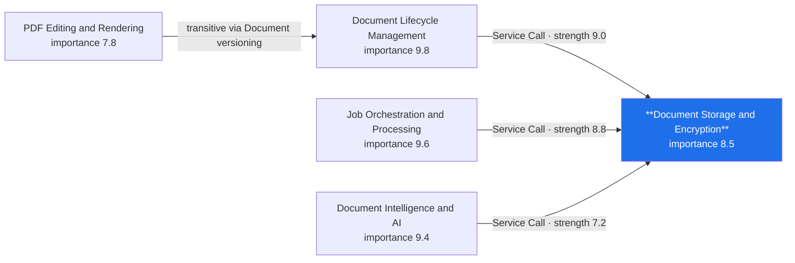
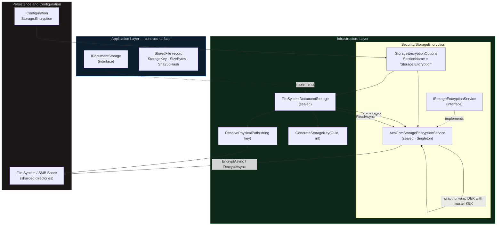
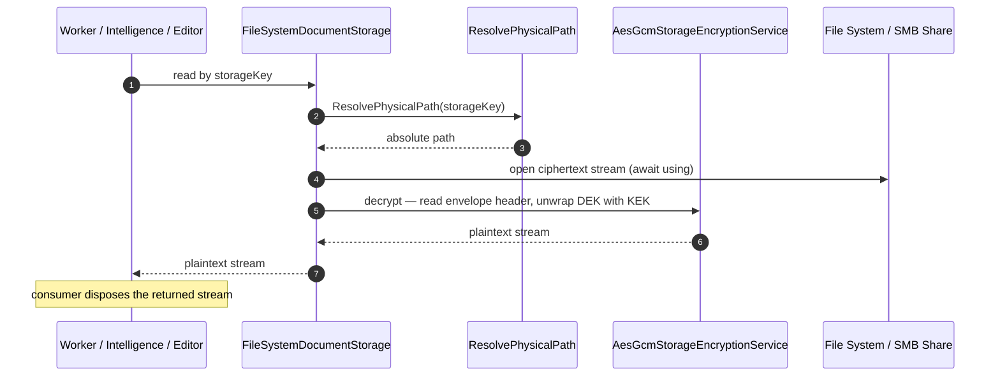
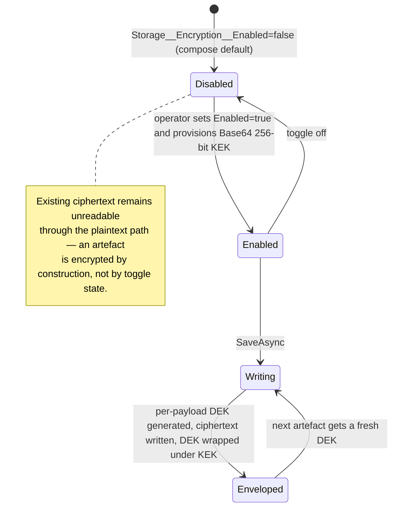
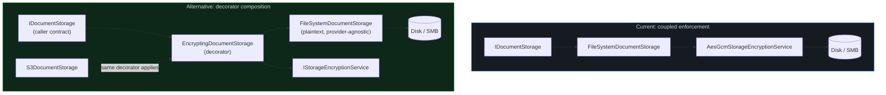

# Document Storage and Encryption

## EConverter — Storage Subsystem Architecture & Implementation Reference

**Document type:** Module deep-dive
**Domain classification:** Infrastructure Domain
**Complexity score:** 6.0 / 10
**Importance score:** 8.5 / 10
**Scope:** `DocumentConverter.Application/Storage` · `DocumentConverter.Infrastructure/Storage` · `DocumentConverter.Infrastructure/Security/StorageEncryption`

---

## 1. Purpose and Position in the Architecture

Document Storage and Encryption is the **single enforcement point for the confidentiality of stored document content** in EConverter. Every byte that enters or leaves the platform — an upload from a knowledge worker, the input stream a conversion worker reads before OCR, the output artefact written back after a DOCX→PDF transformation, the payload the intelligence layer chunks for embedding — traverses this domain. No upper layer holds a path, an open file handle, or a write primitive of its own.

The domain is deliberately split into two cooperating responsibilities:

| Responsibility | Owner | Concern |
|---|---|---|
| **Placement, enumeration, deletion** | `IDocumentStorage` / `FileSystemDocumentStorage` | Where an artefact lives, how it is named, how it is located and removed |
| **Confidentiality of bytes** | `IStorageEncryptionService` / `AesGcmStorageEncryptionService` | Transforming plaintext into authenticated ciphertext and back |

This separation is what makes the storage backend substitutable while keeping encryption semantics constant. It is also the domain's principal architectural trade-off, examined in §9.

### Domain context within EConverter



Document Lifecycle Management is the strongest consumer (strength 9.0): every document read, write, delete, and purge flows through `IDocumentStorage`. Job Orchestration (8.8) streams inputs from and uploads outputs to the same layer. Document Intelligence (7.2) opens stored streams before chunking so that encrypted-at-rest semantics remain intact through the retrieval pipeline. The relationship is one-directional — the storage domain holds no knowledge of documents, jobs, or AI, and therefore cannot be inverted into a dependency on higher layers.

---

## 2. Component Topology



### 2.1 File inventory

| File | Layer | Role |
|---|---|---|
| `src/DocumentConverter.Application/Storage/IDocumentStorage.cs` | Application | Storage contract plus the `StoredFile` result record |
| `src/DocumentConverter.Infrastructure/Storage/FileSystemDocumentStorage.cs` | Infrastructure | Sealed filesystem/SMB adapter; key generation, path resolution, stream orchestration, hashing |
| `src/DocumentConverter.Infrastructure/Security/StorageEncryption/IStorageEncryptionService.cs` | Infrastructure | Encryption contract |
| `src/DocumentConverter.Infrastructure/Security/StorageEncryption/AesGcmStorageEncryptionService.cs` | Infrastructure | Sealed AES-256-GCM chunked envelope encryption implementation |
| `src/DocumentConverter.Infrastructure/Security/StorageEncryption/StorageEncryptionOptions.cs` | Infrastructure | Options-pattern binding for `Storage:Encryption` |

> **Note on sibling artefacts:** the PDF.js licence file and front-end components that appear adjacent to this domain in the repository are unrelated to storage. They are UI assets and carry no coupling to this subsystem.

---

## 3. Contract Surface

The domain exposes exactly two interfaces and one options type. Nothing else crosses the boundary — no `FileInfo`, no absolute path, no provider-specific handle.

### 3.1 `IDocumentStorage`

```csharp
namespace DocumentConverter.Application.Storage;

/// <summary>
/// Stream-based persistence contract for document artefacts.
/// The storage key is intentionally opaque: its layout may evolve
/// without leaking filesystem semantics to callers.
/// </summary>
public interface IDocumentStorage
{
    Task<StoredFile> SaveAsync(
        Stream content,
        string contentType,
        CancellationToken cancellationToken = default);
}
```

Design properties worth calling out:

- **Stream-oriented.** The contract takes a `Stream`, never a byte array. A 400 MB scanned PDF is never fully materialised in managed memory on either the write or the read path.
- **Opaque keys.** Callers receive a `StorageKey` string and persist it. They never construct it, never parse it, and never derive a path from it. This eliminates an entire class of path-traversal exposure at the storage boundary: there is no caller-supplied path parameter to attack.
- **`contentType` is a hint, not a trust input.** It participates in key composition (`v{version}.{ext}`) but is never used to build an absolute path directly.

### 3.2 `StoredFile`

```csharp
public sealed record StoredFile(
    string StorageKey,
    long   SizeBytes,
    string Sha256Hash);
```

A positional record carrying three fields, each earning its place:

| Field | Consumer use |
|---|---|
| `StorageKey` | Persisted on the `Document` aggregate alongside the `Provider` discriminator; the only handle needed to retrieve the artefact later |
| `SizeBytes` | Populated on document metadata without a second filesystem stat; surfaced in the explorer UI and used by quota/limit logic |
| `Sha256Hash` | Integrity handle — lets callers verify content, detect duplicates, and detect storage-layer corruption without reading the artefact back through the encryption service |

The hash is computed by the storage layer, not the caller. This is deliberate: because the storage layer is the only writer, it is the only component positioned to observe the plaintext exactly once and produce a single authoritative digest.

### 3.3 `IStorageEncryptionService`

```csharp
public interface IStorageEncryptionService
{
    bool IsEncryptionEnabled { get; }

    Task EncryptAsync(
        Stream plainStream,
        Stream outputStream,
        CancellationToken cancellationToken = default);
}
```

The `IsEncryptionEnabled` flag allows the storage adapter to short-circuit the encryption path entirely for local development, while preserving an identical call graph — the branch is a skip, not an alternate implementation, so the non-encrypted path exercises the same key generation, path resolution, and hashing code.

> **Contract asymmetry to confirm against source:** the visible interface declares only `EncryptAsync`, yet both the concrete service and the storage read path require decryption. The decrypt side is either a service-internal helper invoked exclusively by the storage component, or an omission in the extracted interface. Either reading is plausible and both are benign — but the interface understates the concrete surface, and any test double or alternative implementation must satisfy the decrypt call site. This is the one contract-level observation in the domain that warrants direct source confirmation.

### 3.4 `StorageEncryptionOptions`

```csharp
public sealed class StorageEncryptionOptions
{
    public const string SectionName = "Storage:Encryption";

    public bool   Enabled  { get; set; }
    public string MasterKeyBase64 { get; set; } = string.Empty;  // 256-bit KEK
}
```

Bound through the standard options pattern against the `Storage:Encryption` configuration section. The master key is a **256-bit key-encryption key (KEK)** supplied as a Base64 string — matching AES-256 exactly. In the shipped `docker-compose.yml`, `Storage__Encryption__Enabled` defaults to `false`; operators must make a deliberate decision to turn encryption on and provision a KEK.

---

## 4. The Write Path

The write path is the operation through which confidentiality is established. It runs once per artefact and is the only place where plaintext is visible to the storage layer.

```mermaid
sequenceDiagram
    autonumber
    participant Caller as Application Service
    participant Store as FileSystemDocumentStorage
    participant Key as Key / Path Helpers
    participant Opt as StorageEncryptionOptions
    participant Enc as AesGcmStorageEncryptionService
    participant Disk as File System / SMB Share

    Caller->>Store: SaveAsync(plainStream, contentType, ct)
    Store->>Key: GenerateStorageKey(documentId, version)
    Key-->>Store: opaque storageKey  (sharded, e.g. ab/cd/{guid}/v1.pdf)
    Store->>Key: ResolvePhysicalPath(storageKey)
    Key-->>Store: absolute path within the configured root
    Store->>Store: ensure parent directory exists
    Store->>Opt: read Enabled + MasterKeyBase64
    Opt-->>Store: IsEncryptionEnabled, KEK

    alt encryption enabled
        Store->>Enc: EncryptAsync(plainStream, fileStream, ct)
        Enc->>Enc: generate ephemeral DEK (per payload)
        loop each plaintext chunk
            Enc->>Disk: write AES-256-GCM ciphertext chunk
        end
        Enc->>Disk: write wrapped-DEK envelope header
        Enc-->>Store: ciphertext stream complete
    else encryption disabled (development only)
        Store->>Disk: copy plainStream directly
    end

    Store->>Store: compute SizeBytes + SHA-256 of plaintext
    Store->>Store: flush and close file handle (await using)
    Store-->>Caller: StoredFile(StorageKey, SizeBytes, Sha256Hash)
    Caller->>Caller: persist Provider + StorageKey on Document aggregate
```

### 4.1 Step detail

**Step 1 — Key composition.** `GenerateStorageKey(Guid documentId, int version)` composes a sharded key. A representative layout is `ab/cd/{documentGuid}/v{version}.{ext}`, where `ab` and `cd` are the first two byte-pairs of the GUID in hexadecimal. Sharding matters at scale: a flat directory holding millions of artefacts degrades filesystem and SMB directory-listing performance on every level of the stack. Two levels of fan-out yield a distribution wide enough to keep directory entry counts tractable while remaining deep enough to stay human-navigable for operators.

**Step 2 — Path resolution.** `ResolvePhysicalPath(string storageKey)` maps the opaque key onto an absolute path beneath the configured storage root. Because the key is generated internally and resolved internally, no caller-supplied string ever reaches a path-composition call. Combined with `DocumentStorage` never accepting a path parameter, this is the domain's primary path-traversal defence — structural, not validating.

**Step 3 — Directory preparation.** The parent directory is created if absent. This is idempotent and safe under concurrent writers targeting the same GUID prefix.

**Step 4 — Encryption branch.** When `IsEncryptionEnabled` is true, the plaintext stream is handed to `EncryptAsync` against an output file stream. When false, a direct copy writes plaintext. Both branches terminate at the same file handle and converge on the same hashing step.

**Step 5 — Envelope construction.** The encryption service generates a **fresh ephemeral data-encryption key (DEK) per payload**, streams the plaintext through AES-256-GCM in chunks, and then wraps the DEK under the master KEK sourced from `StorageEncryptionOptions`. The wrapped DEK is written as an envelope header alongside the ciphertext. GCM is an authenticated mode: every chunk carries an authentication tag, so tampering or truncation at rest is detected on read rather than silently surfacing as corrupt plaintext.

Per-payload DEKs mean a compromised DEK exposes exactly one artefact. Nonce-reuse risk is confined to a single stream, and DEK rotation is implicit — every new artefact gets a new key. The cost is one KEK unwrap per read and one wrap per write, both negligible relative to the document I/O itself.

**Step 6 — Hashing.** Size and SHA-256 are computed over the plaintext. This yields a content digest that is stable and comparable across storage backends and independent of encryption parameter changes, which is exactly what duplicate detection and provenance verification require.

**Step 7 — Disposal and return.** All stream and file handles are held in `using`/`await using` scopes, guaranteeing disposal on failure paths as well as success. The completed `StoredFile` record is returned and the caller persists `StorageKey` plus the `Provider` discriminator on the `Document` aggregate — the latter being what allows artifacts to remain locatable if the backend is migrated.

---

## 5. The Read Path

The read path mirrors the write path exactly. Key → path → ciphertext stream → decrypt → plaintext consumer.



Two properties carry operational weight here:

- **Decryption is streaming.** Because the write path chunked the plaintext, the read path can decrypt chunk-by-chunk into a consumer that processes incrementally. The OCR pipeline, the conversion processors, and the chunking pipeline all consume streams, so decrypting into memory would be the only way to break the amortisation — and no consumer does so.
- **Reads are the hot path under load.** A conversion job reads its input once and writes its output once; an intelligence query may open many document streams to assemble retrieval context. Envelope unwrap cost scales linearly with artefact count, and KEK access is the shared contention point across all concurrent readers.

### 5.1 Deletion

`DeleteAsync(storageKey, cancellationToken)` resolves the key to a physical path and unlinks only that resolved artefact. It cannot touch anything outside the storage root. In EConverter's lifecycle model, deletion is invoked at purge time — soft delete and restore operate on the `Document` aggregate's status, not on the artefact — so a failed delete leaves a document recoverable and a successful delete is a terminal, audited event.

---

## 6. Key Management and Lifecycle

Encryption is only as strong as the KEK's handling. The current design is a **static master KEK in configuration**, which is appropriate for a self-hosted platform where the operator controls both the configuration store and the host but demands explicit operational discipline.



### 6.1 What the design gets right

| Property | Mechanism |
|---|---|
| **Per-payload key isolation** | Fresh ephemeral DEK for every artefact — a single DEK compromise exposes one document |
| **Nonce-reuse containment** | Nonces are scoped to a single stream, never shared across artefacts |
| **Authenticated encryption** | AES-GCM tags detect tampering and truncation at rest |
| **Key rotation without re-encryption of DEK material** | Rotating the KEK requires re-wrapping wrapped DEKs, not re-encrypting payloads |
| **Streaming scalability** | Chunked processing means artefact size is bounded by disk, not by available memory |

### 6.2 What requires operational discipline

- **KEK custody is entirely the operator's.** The KEK lives in configuration (`Storage:Encryption:MasterKeyBase64`). If it is committed to a repository, baked into an image layer, or echoed in a startup log, the entire at-rest protection is defeated. Provision it from a secret store or an environment-injected secret, and never from `appsettings.json` under version control.
- **No rotation workflow is exposed.** Rotating the KEK means re-wrapping every existing envelope header. Until a migration utility exists, rotation is a scripted offline operation. This is a known gap, not a defect in the encryption primitive.
- **Toggle semantics are not a data-migration mechanism.** Flipping `Enabled` does not retroactively encrypt existing plaintext artefacts, nor does it decrypt ciphertext artefacts written while enabled — the read path detects the envelope and decrypts regardless of the current flag. Operators enabling encryption on an existing deployment must plan a re-write pass over the storage volume.
- **The compose default is off.** `Storage__Encryption__Enabled=false` in `docker-compose.yml` means a default deployment stores plaintext. This is defensible for a development profile and indefensible for a legal or healthcare deployment, which is precisely the audience the platform targets. Provisioning documentation must make enabling it a first-class deployment step.

---

## 7. Integrity and Provenance

The storage domain participates in EConverter's provenance story through the SHA-256 digest it returns on every save. That digest flows into three distinct verification paths:

1. **Upload verification** — the document upload workflow computes a hash and records it on the `Document` aggregate. The storage layer independently computes its own; agreement between the two is evidence that no transformation occurred between the hardening pipeline and the disk write.
2. **Conversion input verification** — the asynchronous job pipeline opens the encrypted input stream and recomputes the SHA-256 before invoking the processor. A mismatch indicates the artefact has drifted from the metadata that references it, and the job can fail with a classified, retryable-or-not error code rather than silently converting the wrong bytes.
3. **Deduplication and audit** — a content-stable digest supports duplicate detection and gives compliance reviewers a cryptographic handle on an artefact independent of its storage key.

The hash is over plaintext, which is the correct choice: it survives a KEK rotation, a DEK re-wrap, or an encryption-scheme change without invalidating every recorded digest.

---

## 8. Configuration Reference

| Key | Type | Default (compose) | Effect |
|---|---|---|---|
| `Storage:Encryption:Enabled` | `bool` | `false` | Selects the encrypt-vs-copy branch on write. Reads auto-detect the envelope. |
| `Storage:Encryption:MasterKeyBase64` | `string` | *(unset)* | Base64-encoded 256-bit KEK used to wrap/unwrap per-payload DEKs. Required when `Enabled=true`. |
| Storage root path | `string` | *(operator-set)* | Root beneath which all resolved artefact paths live. Must be on durable storage; the SMB-compatible design permits a network share. |

`StorageEncryptionOptions` binds `SectionName = "Storage:Encryption"` through the options pattern, so container environments can inject values as `Storage__Encryption__Enabled` and `Storage__Encryption__MasterKeyBase64` without touching the JSON configuration.

---

## 9. Architectural Assessment

### 9.1 Single choke point — the defining property

Confidentiality is enforced in exactly one place. No layer above `FileSystemDocumentStorage` can persist plaintext, because the storage implementation is the only writer and it unconditionally routes bytes through the encryption stream. There is no bypass, no escape hatch, and no second write path. Other subsystems in EConverter have documented structural tensions; this domain does not — the invariant is structural rather than conventional, which is the strongest form it can take.

### 9.2 Coupled substitutability — the trade-off

The storage implementation constructs and invokes the encryption service directly. That coupling is what makes the choke point airtight, and it is simultaneously the domain's principal limitation:



Under the current design, **substituting the storage backend requires re-implementing encryption inside the new adapter.** An `S3DocumentStorage`, an Azure Blob adapter, or a NAS-backed provider must each independently invoke `IStorageEncryptionService` correctly, re-derive the chunking envelope, and re-implement the hashing discipline. Every new adapter is a fresh opportunity to get encryption wrong — and a missed `EncryptAsync` call stores plaintext with no compile-time or runtime signal.

The decorator form would invert this: `EncryptingDocumentStorage` wraps any `IDocumentStorage`, keeping the choke point (all writes still pass through it) while decoupling the two concerns so that provider substitution no longer touches encryption at all.

**Assessment:** the current shape is correct for a single deployed provider and is what shipped. The decorator refactoring is the right preparatory move before a second backend is introduced, not before. Adding the decorator now, with only one provider, would add an indirection layer that buys nothing today — but the moment a second provider enters the picture, the coupled form becomes a correctness hazard rather than a convenience.

### 9.3 Streaming discipline

Every operation on the write and read paths is stream-based, with no intermediate buffering of whole documents. This is what allows the platform to handle large scanned PDFs — the artefacts most likely to be confidential and most likely to be large — without memory pressure scaling with file size. The `using`/`await using` discipline on every handle guarantees disposal even when a processor throws mid-conversion, which matters because the conversion pipeline's error-isolation model depends on worker processes not accumulating leaked file handles over long run horizons.

### 9.4 Path-traversal immunity by construction

Two independent factors make path traversal structurally impossible at this boundary:

1. `IDocumentStorage.SaveAsync` takes **no path parameter** — only a content stream and a content-type hint.
2. Keys are generated by `GenerateStorageKey` from a `Guid` and an integer version, never from caller input, and resolved by `ResolvePhysicalPath` against a fixed root.

Contrast this with the ingress hardening applied elsewhere in the platform — `FileNameSanitizer`, `FileSignatureDetector`, `ZipBombGuard`, `EicarSignatureDetector` — which are *validating* defences applied to untrusted user input. The storage domain needs no equivalent because it accepts no untrusted input capable of expressing a path. That is a stronger property than a sanitiser, and it is why storage does not appear in the ingress-hardening pipeline.

---

## 10. Interaction Contracts Summary

| From | To | Type | Strength | Nature |
|---|---|---|---|---|
| Document Lifecycle Management | Document Storage and Encryption | Service Call | 9.0 | Every read, write, delete, purge traverses `IDocumentStorage`; provider and key recorded on the aggregate |
| Job Orchestration and Processing | Document Storage and Encryption | Service Call | 8.8 | Workers stream inputs, hash with SHA-256, encrypt and upload outputs |
| Document Intelligence and AI | Document Storage and Encryption | Service Call | 7.2 | Intelligence opens stored streams before chunking, preserving at-rest semantics |
| Platform Composition and Hosting | Document Storage and Encryption | DI Registration | — | `AesGcmStorageEncryptionService` registered as **Singleton**; `IDocumentStorage` consumed by scoped services |

The Singleton lifetime on the encryption service is correct for a stateless transform and means the KEK is materialised once per process rather than per request. It also means the options snapshot is effectively frozen at process start — a KEK rotation requires a process restart to take effect, which is a constraint worth stating explicitly in any rotation runbook.

---

## 11. Open Items Requiring Source Confirmation

| # | Item | Why it matters |
|---|---|---|
| 1 | **Decrypt method signature** — where does the read path obtain decryption? Service-internal helper vs. unlisted interface member | Determines whether the interface is complete; affects test-double surface |
| 2 | **Nonce derivation strategy** — per-chunk random vs. counter-based | Random 96-bit nonces carry a negligible but non-zero collision risk at high chunk counts; counter-based requires per-stream uniqueness guarantees |
| 3 | **Envelope header layout** — field order, algorithm identifier, versioning byte | Needed for any future format migration or cross-version read compatibility |
| 4 | **KEK rotation tooling** — exists or absent | Determines whether rotation is an offline scripted operation or a supported workflow |
| 5 | **Storage root configuration key** — exact name and path-resolution root contract | Required for deployment hardening; confirms `ResolvePhysicalPath` containment |
| 6 | **Chunk size constant** | Governs memory ceiling per concurrent operation and the practical upper bound on artefact size |

Items 1–4 correspond to the research section's explicit **UNVERIFIABLE** markings on "AES-GCM key management semantics — key derivation, rotation, and nonce-reuse protection not assessed." They require reading `AesGcmStorageEncryptionService.cs` and `FileSystemDocumentStorage.cs` in full rather than inferring from the contract surface, which is what this document has done.

---

## 12. Summary

Document Storage and Encryption is a small domain (complexity 6.0) carrying a disproportionate share of the platform's security posture (importance 8.5). Its design rests on three structural commitments:

1. **One writer.** `FileSystemDocumentStorage` is the only path to disk. Confidentiality is not a policy applied by callers; it is a property of the only component that can persist bytes.
2. **Opaque keys.** Callers hold a string they cannot parse and a hash they can verify. No path ever crosses the boundary, so path traversal is impossible by construction rather than by validation.
3. **Stream everywhere.** Large confidential documents are the platform's characteristic workload, and neither the write nor the read path scales memory with artefact size.

The implementation uses AES-256-GCM envelope encryption with per-payload ephemeral DEKs wrapped under a 256-bit configuration-held KEK, chunked for streaming, with authenticated tags detecting tampering at rest, and a plaintext SHA-256 digest returned on every save to feed the platform's provenance chain.

The single trade-off is the coupling between storage provider and encryption provider: it makes the choke point airtight and makes backend substitution a security-sensitive operation rather than a pure adapter swap. That coupling is the correct choice for the current single-backend deployment and becomes the first thing to refactor — into a decorator over the storage contract — the moment a second backend is contemplated.