# Job Orchestration and Processing

## EConverter Platform — Domain Architecture Documentation

**Document type:** Domain module reference
**System:** EConverter (ASP.NET Core 10 / Blazor Server / Clean Architecture)
**Domain classification:** Core Business Domain
**Complexity index:** 9.0 / 10 — **Importance index:** 9.6 / 10
**Verified against source:** `src/DocumentConverter.Domain/Processing/`, `src/DocumentConverter.Infrastructure/{Processing,Messaging}/`, `src/DocumentConverter.Web/{HostedServices,Services,Hubs,Endpoints}/`, `src/Workers/DocumentWorker/`
**Evidence status:** compile-graph and code-path claims reproduced; runtime concurrency and provider claims assessed per the architecture audit (see §15)

---

## Table of Contents

1. [Executive Overview](#1-executive-overview)
2. [Position in the System Architecture](#2-position-in-the-system-architecture)
3. [Domain Model — Aggregates and Invariants](#3-domain-model--aggregates-and-invariants)
4. [The Job State Machine](#4-the-job-state-machine)
5. [Application Layer Contracts](#5-application-layer-contracts)
6. [Orchestration — Job and Batch Creation](#6-orchestration--job-and-batch-creation)
7. [Dispatch — Queue, Fallback, and the Database as Work Source](#7-dispatch--queue-fallback-and-the-database-as-work-source)
8. [Worker Execution — The Per-Job Transaction](#8-worker-execution--the-per-job-transaction)
9. [Batch Completion Aggregation](#9-batch-completion-aggregation)
10. [Real-Time Notification Subsystem](#10-real-time-notification-subsystem)
11. [API Surface and Authorization](#11-api-surface-and-authorization)
12. [Cross-Cutting Behavior: Security, Storage, Persistence](#12-cross-cutting-behavior-security-storage-persistence)
13. [Deployment Topologies and Scaling Model](#13-deployment-topologies-and-scaling-model)
14. [Message Contracts](#14-message-contracts)
15. [Known Constraints, Drift, and Correctness Risks](#15-known-constraints-drift-and-correctness-risks)
16. [Operational Observability and Failure Modes](#16-operational-observability-and-failure-modes)
17. [Extension Guide — Adding a Converter](#17-extension-guide--adding-a-converter)
18. [Design Rationale and Trade-Off Register](#18-design-rationale-and-trade-off-register)
19. [Reference: Component and File Inventory](#19-reference-component-and-file-inventory)
20. [Glossary](#20-glossary)

---

## 1. Executive Overview

The **Job Orchestration and Processing** domain is the asynchronous backbone of EConverter. Its design premise is stated plainly and governs every decision in the module:

> **Heavy document conversion must never block an interactive request, and the system must degrade gracefully rather than fail when infrastructure is partial.**

Everything in this domain follows from those two constraints. Conversion work is materialized as a durable domain aggregate — `ProcessingJob` — rather than as in-flight request state. That aggregate is leased to a worker, executed inside a single error-isolated transaction, and driven through a transition matrix that exists in exactly one place in the codebase. Progress is pushed to the browser over SignalR; the REST API remains the authoritative query path.

The domain owns six responsibilities:

| # | Responsibility | Owning Component |
|---|---|---|
| 1 | Job and batch creation, validation, persistence | `ProcessingService` |
| 2 | Legal state transitions, terminal states, retry eligibility | `ProcessingJobLifecycle` (Domain) |
| 3 | Queue dispatch with a non-failing fallback | `IJobQueuePublisher` → `RabbitMqJobDispatcher` / no-op |
| 4 | Worker execution of the per-job transaction | `JobProcessorWorker`, `DocumentWorker.Worker` |
| 5 | Batch-level completion aggregation | `CheckBatchCompletionAsync` |
| 6 | Live progress delivery to clients | `JobNotificationService` → `ProcessingHub` |

Two structural properties define the module's character, and both are deliberate:

**The broker is an accelerator, not a dependency.** RabbitMQ is optional. When it is absent, disabled, or unreachable, work still flows — the database table itself becomes the queue, drained by polling. Operators can therefore run a complete, functioning deployment with no message broker at all.

**The lifecycle is a single authority.** `ProcessingJobLifecycle` owns the allowed-transition matrix, terminal-state classification, and retry eligibility. Neither the orchestrator nor either worker can invent a transition rule. This is the strongest architectural invariant in the domain and is verified in code: neither `JobProcessorWorker.cs` nor `Worker.cs` assigns status directly anywhere.

The module's principal engineering tension is **worker duplication**: two independent hosts implement the same documented transaction, and their implementations have diverged in ways that matter operationally (§15.7). That is the single most under-reported risk in the domain and is treated at length below.

---

## 2. Position in the System Architecture

### 2.1 Layer Placement

The domain is a vertical slice through the compile graph, spanning four Clean Architecture layers plus a shared building block. Verified from `.csproj` `ProjectReference` entries:

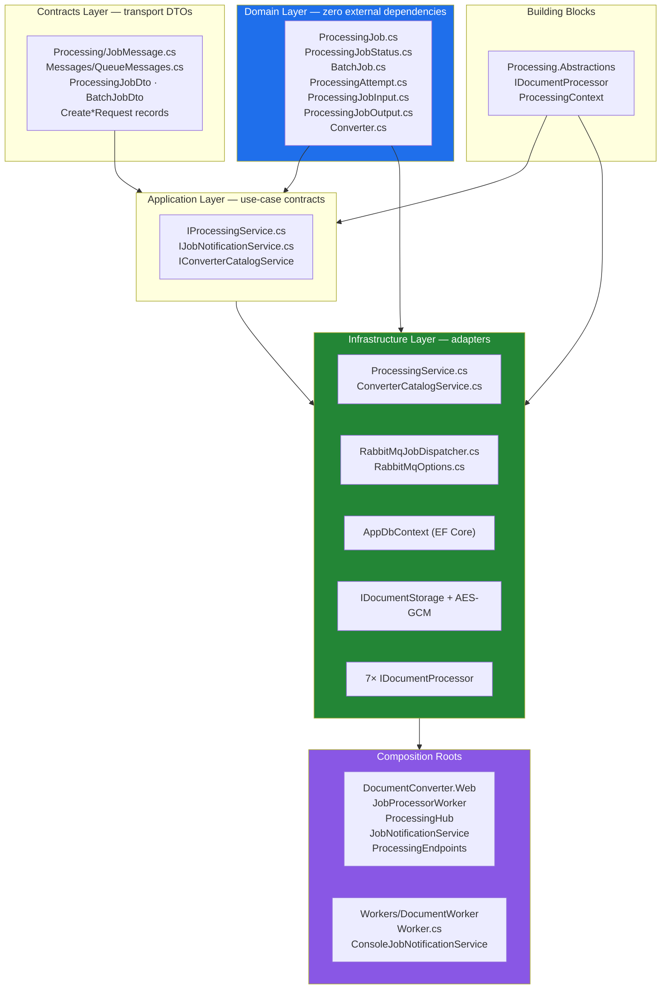

**Layer discipline verdict: SOLID.** Application references only Domain, Contracts, and Processing.Abstractions — no Infrastructure leakage. Domain carries zero external package references. The `Architecture.Tests` project in `DocumentConverter.slnx` enforces this mechanically, which is why the discipline has held under a large codebase.

### 2.2 Domain Relationship Map

The orchestration domain is the highest-fan-in, highest-fan-out node among the core business domains:

| Direction | Counterpart Domain | Type | Strength | Nature of Coupling |
|---|---|---|---|---|
| → | Document Conversion and OCR | Service Call | **9.5** | Worker resolves `IDocumentProcessor`; job carries converter identity, never format knowledge |
| → | Persistence and Data Schema | Data Dependency | **9.0** | Jobs, batches, inputs, outputs, attempts persisted and leased through `AppDbContext` |
| → | Document Storage and Encryption | Service Call | 8.8 | Streams input in, output out, encrypted at both ends |
| → | Document Lifecycle Management | Data Dependency | 8.5 | `ProcessingJobInput` references documents; outputs register as new versions |
| ← | Platform Composition and Hosting | Service Call | **9.0** | Host registers worker, publisher, notification service, hub, endpoints |
| ← | Security, Identity and Audit | Config Dependency | 7.5 | `ProcessingService` validates access before persisting or dispatching |
| ← | Platform Administration | Service Call | 6.5 | Converter catalog and limits constrain what may be scheduled |

The **9.5 coupling to Document Conversion** is the design's sharpest separation: the job domain knows a `ProcessorId` string and nothing else about formats. Adding a new converter is a registry row plus a processor class — zero changes to orchestration (§17).

The **7.5 coupling from Security** is a configuration dependency rather than a call: access validation in `ProcessingService` and ownership checks in the document aggregate are the *only* gates enforcing authorization. Any bypass compromises every downstream workflow, which is why authorization is enforced in the orchestration layer rather than only at the HTTP boundary.

### 2.3 Runtime Component Topology

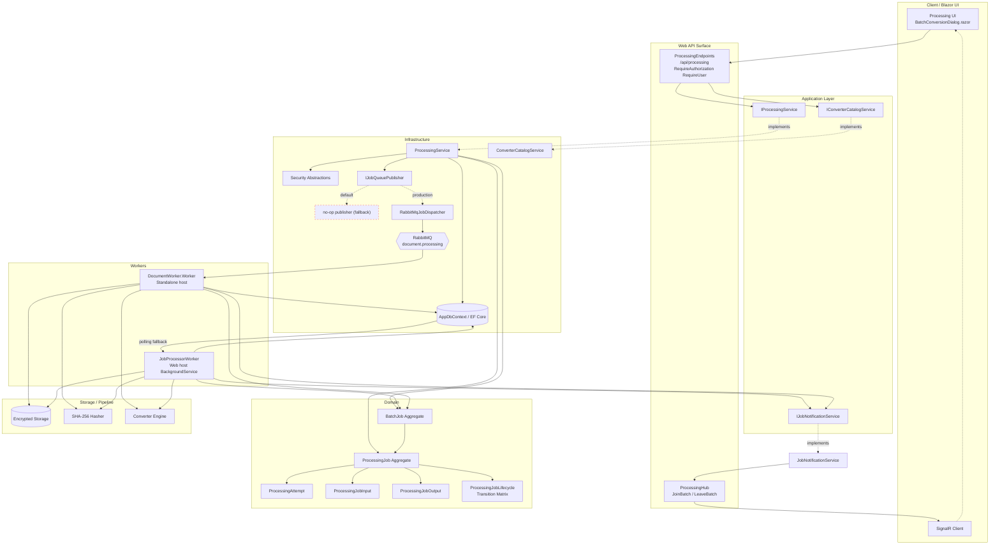

The dashed red `no-op publisher` edge is annotated because it is **the fallback that does not actually deliver work** — a documented drift treated in §15.1. Work still flows; it flows via the polling path, not via that channel.

---

## 3. Domain Model — Aggregates and Invariants

### 3.1 Aggregate Cluster

The domain is not anemic. `ProcessingJob` is the aggregate root; constructors are private or internal so EF Core can materialize entities while all state mutation flows through intention-revealing methods:

```
Claim(workerId, leaseDuration)
RenewLease(workerId, leaseDuration)
UpdateProgress(percent)
RequestCancellation()
MarkCompleted(outputDocumentId)
MarkFailed(errorCode, userSafeMessage)
AddInput(documentId, versionId, order)
AddOutput(documentId, ...)
```

Every one of those calls validates against `ProcessingJobLifecycle` before mutating state. There is no setter path that bypasses the matrix.

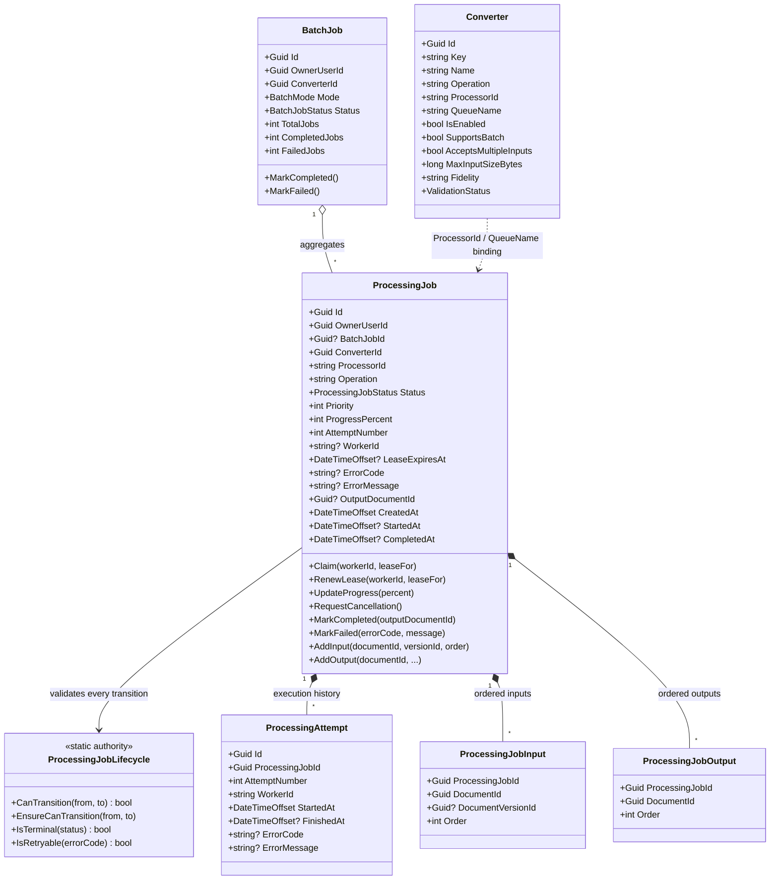

### 3.2 Aggregate Responsibilities

**`ProcessingJob`** — the unit of scheduled work. Carries owner, converter identity, operation verb, status, priority, progress percentage, attempt counter, lease metadata (`WorkerId`, `LeaseExpiresAt`), structured error state (`ErrorCode`, `ErrorMessage`), and output reference. Error message and error code fields carry explicit length validation — a defensive constraint that prevents corrupted payloads from bloating persistence or leaking into DTOs.

**`BatchJob`** — the coordinating parent. Tracks `BatchMode` (**Individual** = one output per input; **Combined** = merged output), owner and converter references, and completion counters (`TotalJobs`, `CompletedJobs`, `FailedJobs`). Its status is derived from sibling job outcomes, never set directly by a worker's own result.

**`ProcessingAttempt`** — one row per execution. Records worker identity, start and finish timestamps, and structured error code/message. This is what makes the domain auditable: an operator can reconstruct exactly which worker ran which attempt and why it failed. It also enables bounded-retry counting without storing an attempt counter twice.

**`ProcessingJobInput` / `ProcessingJobOutput`** — ordered join rows. Their existence generalizes the job model past the naive one-input/one-output shape into:

- **Multi-input** — merges (N PDFs → 1), image batches (N images → 1 PDF)
- **Multi-output** — splits (1 PDF → N documents)

The `Order` column preserves authorial intent; unordered collections would make merge/split results nondeterministic.

**`Converter`** — a **registry entity**, not code. Carries `ProcessorId`, `QueueName`, `Operation`, `IsEnabled`, `SupportsBatch`, `AcceptsMultipleInputs`, `MaxInputSizeBytes`, `Fidelity`, and `ValidationStatus`. The critical design consequence: **routing is data**. A converter can be disabled, its queue reassigned, or its accepted size capped by an administrator writing a row — no redeploy, no code change.

### 3.3 Invariants Enforced at the Domain Level

| Invariant | Enforced By | Consequence of Violation |
|---|---|---|
| Only legal transitions occur | `EnsureCanTransition` throws | Impossible to move `Completed → Processing` |
| Terminal states are absorptive | `IsTerminal` gates completion logic | A completed job cannot be resurrected by a late worker write |
| Retry eligibility is a property of the error, not the caller | `IsRetryable(errorCode)` | Bounded retries; non-retryable errors fail permanently |
| Job ownership is explicit | `OwnerUserId` on aggregate | Notification scoping and authorization both key on it |
| Execution history is append-only | `ProcessingAttempt` child rows | Full audit trail per attempt index |
| Converter binding is data | `Converter.ProcessorId` / `QueueName` | No format knowledge leaks into orchestration |

---

## 4. The Job State Machine

### 4.1 Transition Diagram

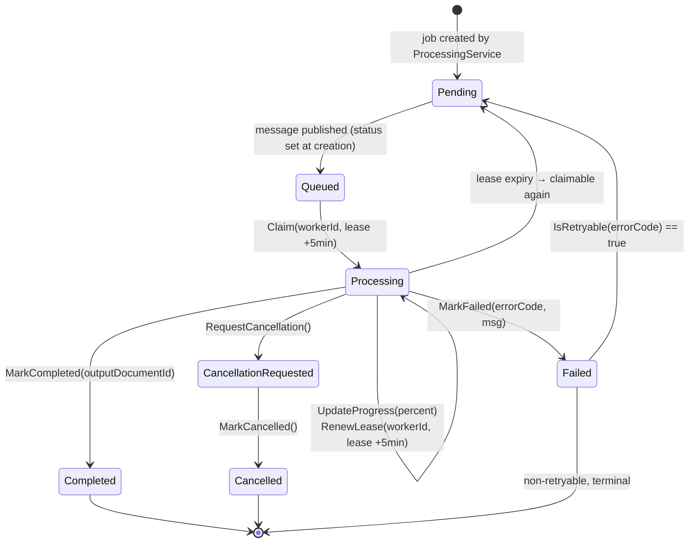

### 4.2 Transition Semantics

The matrix distinguishes three categories, and the distinction is enforcement, not documentation:

**Legal forward transitions.** `Pending → Queued → Processing → {Completed | Failed | Cancelled}`. Each is guarded; an attempt to skip a stage throws.

**Self-transitions during Processing.** `UpdateProgress` and `RenewLease` are `Processing → Processing`. They are legal only while status is `Processing` — a worker updating progress on a job that was cancelled out from under it will throw, which is the correct behavior (the worker then observes cancellation and exits cleanly).

**Recovery transitions.** `Processing → Pending` via lease expiry is the crash-recovery path, and it is the mechanism by which the domain survives worker death without a distributed lock manager. `Failed → Pending` is the retry path, gated on `IsRetryable`.

### 4.3 Lease Semantics — Why a Lease and Not a Lock

A lock requires a lock manager and a liveness detector. A **lease** requires neither: it is a time-boxed claim that expires on its own. The practical consequences:

| Property | Lease Behavior |
|---|---|
| Worker crashes mid-conversion | Lease expires; job returns to claimable pool automatically |
| Conversion runs long | `RenewLease(workerId, …)` extends the window; no timeout race |
| Broker unavailable | Irrelevant — leasing is database state, not broker state |
| Horizontal scale-out | Each worker claims independently; no coordinator needed |
| Deadlock risk | None — there is no held lock to deadlock |

The default lease window in the workers is **5 minutes**, renewed periodically during long conversions. This is why the domain survives the scenarios that break naive queue-consumer designs.

The lease protects against *stale* leases. It does **not** protect against *simultaneous* claim — a distinction with severe consequences under horizontal scale-out, treated in full in §15.3.

### 4.4 Cancellation as a Request, Not a Kill

`RequestCancellation()` sets a flag rather than terminating work:

```
Processing → CancellationRequested → (worker observes) → Cancelled
```

Why: hard-killing a conversion mid-write leaves orphaned output in encrypted storage, a consumed file handle, and a job in an indeterminate state. A cancellation *request* lets the running worker finish its `using`-scoped resources, decide where to abort, and transition cleanly. The cost is latency — cancellation is honored at the next checkpoint, not instantly — which is the correct trade for a conversion that may be seconds from completion.

### 4.5 Retry Eligibility and Bounded Attempts

`IsRetryable(errorCode)` classifies structured error codes. The classification exists so that retry semantics are a property of the *error*, not of whichever worker happened to catch the exception:

- **Retryable** — transient failures: storage I/O timeout, lease contention, converter-side resource exhaustion. These re-enter `Pending`.
- **Non-retryable** — deterministic failures: unsupported format, input exceeds `MaxInputSizeBytes`, corrupt payload, malformed parameters. These terminate at `Failed`; retrying would burn worker capacity on a guaranteed repeat failure.

`AttemptNumber` on the aggregate increments per claim and propagates into the `JobMessage`, so a worker knows its attempt index and the retry ceiling can be enforced centrally.

### 4.6 User-Safe Error Surfacing

Error codes are classified as **user-safe** before appearing in `ProcessingJobDto`. Internal failure detail — stack traces, native interop messages, storage paths — stays in `ProcessingAttempt` and audit logs. The client receives a classified code and a safe message, which is both a security posture and a UX decision: users act on "unsupported format," not on "System.FormatException at OfficeDocumentProcessor.cs:412."

---

## 5. Application Layer Contracts

The Application layer is intentionally narrow — three interfaces and two immutable notification records. Consumers depend only on these, making the Infrastructure implementation replaceable and independently testable.

### 5.1 `IProcessingService`

The single application-facing gateway for job and batch lifecycle:

| Method Family | Signature Shape | Notes |
|---|---|---|
| Create job | `CreateJobAsync(CreateProcessingJobRequest, ct)` → `ProcessingJobDto` | Validates access, materializes aggregate, persists, dispatches |
| Create batch | `CreateBatchAsync(CreateBatchProcessingRequest, ct)` → `BatchJobDto` | Expands into N jobs under one parent |
| Query | `GetJobAsync(jobId, ct)`, list operations | Returns Contracts DTOs, never domain entities |
| Cancel | `CancelJobAsync(jobId, ct)` | Sets cancellation request; does not terminate |

Every method is `CancellationToken`-aware and returns Contracts types. No domain entity escapes the Application boundary — a discipline that keeps transport concerns out of the aggregate and makes the API surface independently versionable.

### 5.2 `IConverterCatalogService`

Exposes the available converter catalog as `ConverterDto`. Consumers read catalog state (which converters are enabled, their limits, whether they accept multiple inputs) without touching persistence. This is what allows the UI to present only valid conversion choices and what lets `ProcessingService` reject a request against a disabled converter before persisting anything.

### 5.3 `IJobNotificationService`

Delivery contract plus two positional records:

```
JobNotificationEvent(
    JobId, OwnerUserId, BatchJobId,
    Status, ProgressPercent,
    InputFileName, OutputFileName,
    OutputDocumentId, ErrorMessage, Timestamp)

BatchNotificationEvent(
    BatchJobId, OwnerUserId, Status,
    TotalJobs, CompletedJobs, FailedJobs, Timestamp)
```

The inclusion of `OwnerUserId` on both records is a security-relevant design choice: notification scoping can be enforced at the delivery boundary and, in a stricter future iteration, at the hub boundary. See §15.6 for the current gap.

### 5.4 Interface-First Consequences

Because these three interfaces are the entire Application surface, the module can be tested without a reachable broker, without native conversion libraries, and without a running database — a fake publisher, a fake storage, and an in-memory context cover the orchestration logic. That testability is a direct return on the interface-first discipline.

---

## 6. Orchestration — Job and Batch Creation

### 6.1 Creation Sequence

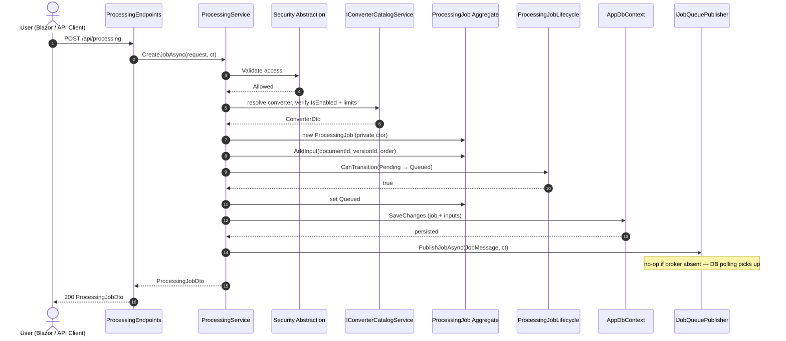

### 6.2 Ordering Guarantees

The order of operations is itself the design:

1. **Authorize first** — access validation precedes persistence. An unauthorized request leaves no row.
2. **Validate against the catalog second** — a disabled converter or an oversized input is rejected before a job exists.
3. **Persist third** — the aggregate and its ordered inputs commit as one unit of work.
4. **Dispatch last** — publishing is the final step and is *not* load-bearing for correctness.

The significance of (4) cannot be overstated. Because the database row is the authoritative work source, a failed publish does not lose the job. Publishing is an optimization that shortens time-to-claim; the row is the contract. This is the mechanism that makes the "broker as accelerator" premise actually true rather than aspirational.

### 6.3 Batch Expansion

`CreateBatchAsync` materializes one parent `BatchJob` and N child `ProcessingJob` rows. `BatchMode` determines the input topology:

| Mode | Input Shape | Output Shape | Example |
|---|---|---|---|
| **Individual** | One input per job | One output per job | Convert 40 DOCX files → 40 PDFs |
| **Combined** | N inputs on one job | One merged output | Merge 12 PDFs → 1 PDF |

For **Individual** mode the parent's `TotalJobs` is set at creation and decremented/aggregated as children terminate. For **Combined** mode a single job carries all inputs and the batch completes when that one terminal state is reached — a degenerate case that must be handled by the aggregation logic, which it is (§9).

### 6.4 Access Validation in the Orchestration Layer

Access is validated in `ProcessingService`, not only at the HTTP boundary. The distinction matters:

- An HTTP-only check protects the REST surface but **not** an internal caller — a hosted service, a scheduled task, or a future code path that constructs a job directly.
- Orchestration-layer validation means *any* caller passes through the same check.

This is defense in depth against a class of privilege-escalation bug that only appears later, when someone adds an internal call site and forgets the authorization. The cost is a redundant check for HTTP-originated jobs — negligible against the risk it eliminates.

---

## 7. Dispatch — Queue, Fallback, and the Database as Work Source

### 7.1 The Publisher Seam

`IJobQueuePublisher.PublishJobAsync(JobMessage, CancellationToken)` is the sole outbound contract. Two implementations exist:

| Implementation | Behavior | When Active |
|---|---|---|
| **No-op publisher** (nested default in `ProcessingService`) | `PublishJobAsync` returns immediately, silently | Messaging disabled or unconfigured |
| **`RabbitMqJobDispatcher`** | Serializes to JSON, publishes to configured queue/exchange, manages connection lifecycle, `IAsyncDisposable` | `RabbitMqOptions.Enabled = true` and broker reachable |

Selection is configuration-driven via `RabbitMqOptions.Enabled`. **No caller branching exists** — the same `ProcessingService` code runs in both modes. That is the whole point of the seam: an operator changes a setting, not a code path.

### 7.2 `RabbitMqOptions`

Binds the `"RabbitMQ"` configuration section with defensive defaults:

```
Host:     localhost
Port:     5672
User:     guest
Password: guest
Queue:    document.processing
Enabled:  (config-driven)
```

Defaults are chosen so that a developer running the platform locally with a stock RabbitMQ container gets a working configuration with zero setup, while production overrides via environment variables. The `Enabled` flag is the operational kill switch.

### 7.3 The Actual Degradation Path

This is the section where documentation and implementation have diverged, and it is worth stating precisely.

**What the research materials describe:** graceful degradation to an in-memory publisher/channel, implying queued work is picked up in-process.

**What the code does:** `RabbitMqJobDispatcher` exposes a `FallbackReader` over an **unbounded** `Channel<JobMessage>`. No call site in either host consumes that reader. When the broker is disabled or unreachable, the message is written into the channel and parked permanently.

**Why the system still works:** the degradation path that actually delivers work is **database lease polling**. `JobProcessorWorker` and `Worker` both query the job table on a ~2-second interval for `Pending` jobs or jobs with expired leases. The queue is a latency optimizer; the table is the work source.

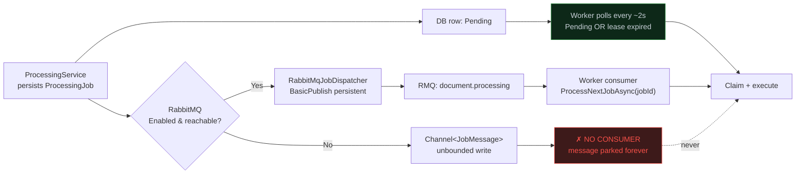

The green path is the real resilience floor. The red path is dead code with a memory-growth side effect under sustained load. Fix posture is given in §15.1.

### 7.4 Broker as Accelerator — The Latency Argument

If the table is the work source, why run a broker at all? Because polling has a floor: a job created 100 ms after a poll cycle waits nearly the full 2 seconds before claim. At volume, that latency is visible in the UI as sluggish batch start. The broker eliminates it — publish wakes a waiting consumer immediately.

| Topology | Time-to-claim | Infrastructure Cost | Failure Behavior |
|---|---|---|---|
| Broker enabled | Milliseconds | RabbitMQ instance required | Falls back to polling if broker dies |
| Broker disabled | Up to poll interval (~2 s) | None | Polling continues, no data loss |
| Broker enabled, broker dead | Up to poll interval | Instance exists but unused | Same as disabled; parked messages are the wart |

Both topologies are first-class. Neither is a degraded compromise of the other.

---

## 8. Worker Execution — The Per-Job Transaction

### 8.1 Two Hosts, One Transaction

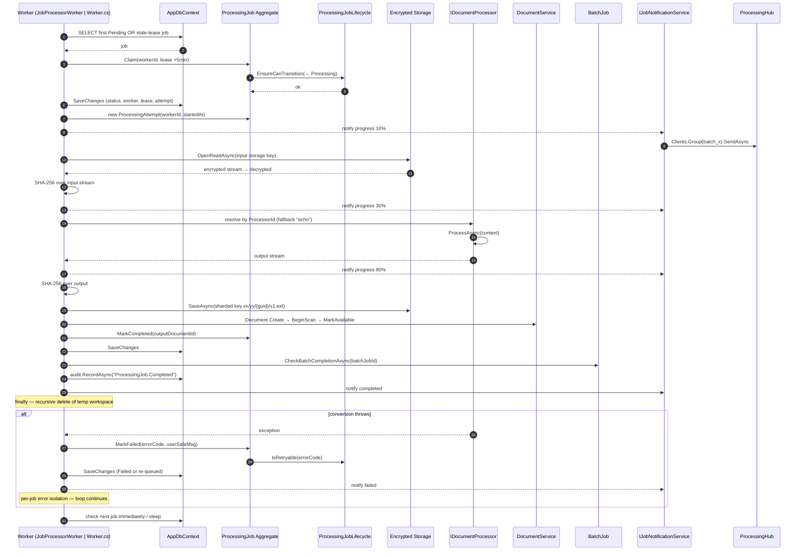

### 8.2 Stream Composition — Bounded Memory

The transaction composes three streams inside `using`-scoped blocks:

```
encrypted storage read stream
  → hashing stream (SHA-256, input provenance)
    → converter input stream
      ← converter output stream
        → storage encryption + write stream (sharded key)
```

Streams are never fully buffered. A 400 MB PDF consumes buffer-sized memory, not 400 MB — the property that lets the platform process large documents on a 2 GB-capped container (§13.3). Every stream is `using`-scoped so handles release deterministically per job, even on exception.

### 8.3 Content Hashing

Input is hashed with SHA-256 before conversion; output is hashed after. This yields:

- **Provenance** — the input hash is recorded on the document metadata, so the exact bytes converted are identifiable later.
- **Integrity verification** — an output hash mismatch indicates storage corruption.
- **Deduplication potential** — identical input bytes produce identical hashes, enabling future dedup.

Hashing is streamed in the same pass as conversion input, so it costs one additional pass over the bytes and no additional storage.

### 8.4 Output Registration and Versioning

Output is not merely written — it is registered as a first-class `Document` through the document domain:

```
Document.Create(...)
  → BeginScan()          (status gate: doc not yet Available)
  → MarkAvailable()
```

The `BeginScan → MarkAvailable` sequence matters: an output document is not retrievable by other users while it is being finalized. This prevents a client from downloading a partially written file, and it preserves the invariant that `Available` documents are complete and hash-verified.

The storage key is **sharded** as `xx/yy/{guid}/v1.ext` — a two-level fanout on GUID prefix. This keeps any single directory at a manageable entry count regardless of total document volume, which is the difference between a filesystem that degrades gracefully at scale and one that does not.

### 8.5 Processor Resolution

The worker resolves `IDocumentProcessor` by `ProcessorId` string, with **`echo`** as the fallback. The echo processor is a no-op pass-through — a deliberate safety valve: an unresolvable processor produces a job that completes with an identical output rather than failing opaquely.

That fallback is defensible in development and questionable in production. A misconfigured `ProcessorId` should probably fail loudly rather than silently produce a pass-through document. Operators should treat any `echo` completion as a configuration error, and it is a candidate for configuration-gated behavior.

### 8.6 Per-Job Error Isolation

The loop structure is the resilience property:

```
while (!stoppingToken.IsCancellationRequested) {
    try   { job = select(); if (job is null) { await delay(); continue; }
            await ExecuteTransaction(job); }
    catch { /* log; the job's own state machine already recorded the failure */ }
}
```

A single failing conversion — a corrupt DOCX, a native interop crash, a storage timeout — never aborts the loop. One poison document cannot take down the worker fleet. Combined with `needRetry` classification, this means a bad job fails once, terminates, and the fleet continues.

### 8.7 The `finally` Cleanup

Temp workspaces are recursively deleted in a `finally` block. Without this, a failing conversion leaves orphaned temp files, and a fleet under load exhausts disk. The `finally` guarantees cleanup on the success path, the failure path, and the exception path — including exceptions thrown from the converter itself, which is the case most likely to be missed by naive implementations.

---

## 9. Batch Completion Aggregation

### 9.1 Mechanism

`CheckBatchCompletionAsync` runs after **every** terminal job state. Multiple overloads exist (an EF-based core plus cancellation-aware variants). The logic:

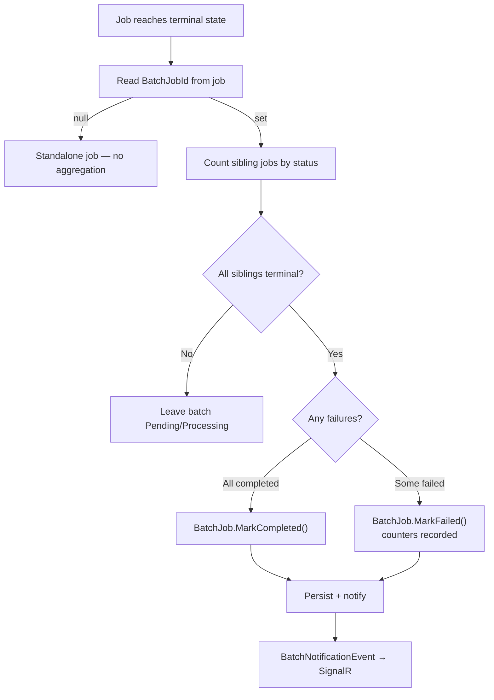

### 9.2 Design Notes

**Derived, not declared.** Batch status is a *function of* sibling outcomes. No worker sets batch status from its own result. This keeps the parent consistent even under concurrent terminal writes — the last sibling to finish triggers the check, and the check reads authoritative counts.

**Counters as first-class state.** `CompletedJobs` and `FailedJobs` are persisted, not recomputed on read. Batch progress therefore presents without a COUNT query per UI refresh, and a completed batch retains its final tally even if child rows are later archived.

**The contention caveat.** The check runs at every job termination and reads/writes shared batch state. Under high parallelism — say 40 jobs in an Individual batch finishing within a second — this is a plausible hotspot: N aggregation passes for N jobs, each doing a count query. A lighter terminal-check (increment a counter, trigger the full aggregation only when the increment reaches `TotalJobs`) plus a periodic sweep for stragglers would reduce per-job overhead substantially. See §16.3.

---

## 10. Real-Time Notification Subsystem

### 10.1 Architecture

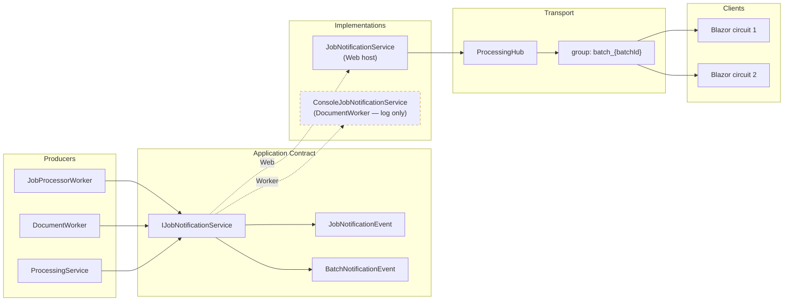

The dashed amber node is the notification-parity gap: the standalone worker logs rather than broadcasts (§15.7).

### 10.2 Hub Surface — Deliberately Minimal

`ProcessingHub` exposes exactly two methods:

```
JoinBatch(string batchId)
LeaveBatch(string batchId)
```

Both short-circuit on null, empty, or whitespace input. Otherwise they add or remove `Context.ConnectionId` from the SignalR group `batch_{batchId}`.

The group-scoping is a security boundary, not a convenience: group-per-batch means a client subscribed to batch A receives no events from batch B. Without it, every connected client would see every job notification platform-wide — a cross-tenant information leak dressed as a feature.

There is **no client-to-client messaging** on the hub and **no server-side command surface**. The hub is one-directional: server pushes, client listens. That minimalism eliminates an entire attack class (malicious hub invocations) at the cost of nothing — clients never need to send. The REST API remains the authoritative query path.

### 10.3 `JobNotificationService`

Holds `OnJobEvent` / `OnBatchEvent` delegate fields (`Func<T, Task>?`), injects `IHubContext<ProcessingHub>`, logs each event, and forwards to SignalR. The delegate indirection lets additional subscribers be attached without modifying the service — useful for future metrics emission or webhook fanout.

### 10.4 Client Subscription Protocol

```
1. Client creates batch via POST /api/processing/batches → receives batchJobId
2. Client connects SignalR → ProcessingHub
3. Client invokes JoinBatch(batchJobId)
4. Server adds connectionId to group "batch_{batchJobId}"
5. Job progress/completion streams to the group
6. Client invokes LeaveBatch(batchJobId) on navigation away
```

Progress without polling; the REST endpoints remain available for reconciliation, late-joining clients, and authoritative state queries after a reconnect.

---

## 11. API Surface and Authorization

### 11.1 Endpoint Group

`ProcessingEndpoints` registers:

```
MapGroup("/api/processing")
    .RequireAuthorization("RequireUser")
```

The **group-level** policy means every inherited route is authenticated and role-gated by construction. A new endpoint added to the group cannot accidentally be anonymous — the failure mode is inverted in the safe direction.

### 11.2 Coverage Within the Domain's Endpoints

| Route Class | Authorization | Domain Logic Location |
|---|---|---|
| Job creation | `RequireUser` (group) | `ProcessingService` |
| Batch creation | `RequireUser` (group) | `ProcessingService` |
| Status queries | `RequireUser` (group) | `ProcessingService` |
| Cancellation | `RequireUser` (group) | `ProcessingService` |
| Batch subscribe | SignalR connection | `ProcessingHub` |

Handlers bind Contracts DTOs and delegate immediately. **No domain logic sits in the endpoint layer** — a stated discipline that this domain honors throughout, and that the `DocumentEndpoints` file violates in a different domain (§15.8).

### 11.3 The Hub Authorization Asymmetry

Every HTTP surface in the platform is gated. The SignalR hub is **not**: `MapHub<ProcessingHub>("/hubs/processing")` carries no `.RequireAuthorization()`. The practical exposure is moderated by group scoping — a connection must know a `batchId` to subscribe — but batch IDs are GUIDs that originate from the client's own creation flow and could be observed by an unauthenticated party in a shared-browser or leaked-log scenario.

Correct posture: add `.RequireAuthorization()` to the hub mapping. Five-minute fix, medium severity (§15.6).

---

## 12. Cross-Cutting Behavior: Security, Storage, Persistence

### 12.1 Authorization Posture

| Layer | Enforcement | Scope |
|---|---|---|
| HTTP | `RequireAuthorization("RequireUser")` on `/api/processing` | All routes |
| Orchestration | Access validation in `ProcessingService` | All callers, including internal |
| Domain | `OwnerUserId` on aggregate; ownership checks | Aggregate-level |
| Notification | `OwnerUserId` on event records; group scoping | Delivery-level |

Four independent enforcement points. The overlap is intentional — this is the one domain where a single missed check compromises every document on the platform.

### 12.2 Storage Interaction

Workers never touch the filesystem storage directly — they go through `IDocumentStorage`, which is wrapped by AES-GCM encryption. Two consequences:

1. **Encryption is not bypassable by the worker path.** A worker cannot "just read the file" — there is no file to read, only a stream through the abstraction.
2. **Storage backends are swappable.** Replacing filesystem with object storage or NAS requires no changes in the processing domain. The domain knows storage keys and streams, nothing more.

### 12.3 Persistence

All components converge on `AppDbContext`. Three roles share it:

- The **orchestrator** writes job and batch creation rows.
- The **worker** writes state transitions, attempts, and outputs.
- The **catalog service** reads converter rows.

In fallback mode the database is *also* the coordination channel — workers poll the same tables the orchestration layer writes. The database is therefore simultaneously the system of record, the audit store, and (optionally) the work queue. That consolidation is what makes broker-less operation possible.

### 12.4 Saga Semantics — Implicit, Not Explicit

The per-job transaction is a distributed operation spanning three resources: the database, encrypted storage, and (optionally) the broker. It is coordinated **implicitly**, with no saga framework, no two-phase commit, and no compensation log. The coordination works because of ordering:

```
1. Persist job (Pending)      ← durable intent
2. Publish / let polling find ← transferable work
3. Claim (lease)              ← exclusive-ish ownership
4. Convert + write output     ← side effect (idempotent-ish: new storage key per attempt)
5. Register output document   ← durable result
6. MarkCompleted              ← commit
```

Failure at (4) or (5) leaves the job in `Processing`; the lease expires; a retry re-executes. Storage writes use a fresh key per attempt, so a failed attempt's partial output is orphaned rather than corrupting the retry. The cost of this design is **orphaned output bytes** on failed attempts — acceptable, and better than the alternative of overwriting a key that a retry might be reading.

This is a legitimate saga, but an *implicit* one. A future hardening would be an explicit compensation step (or a periodic orphan sweep) — see §16.4.

---

## 13. Deployment Topologies and Scaling Model

### 13.1 Topology Matrix

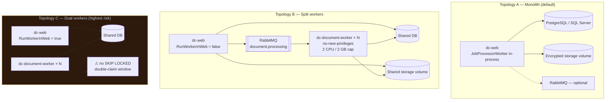

### 13.2 Configuration Knobs

| Setting | Monolith | Split | Effect |
|---|---|---|---|
| `Processing:RunWorkerInWeb` | `true` | `false` | Whether the web host runs `JobProcessorWorker` |
| `RabbitMQ:Enabled` | varies | `true` recommended | Broker as accelerator vs telemetry-free polling |
| `DATABASE_CONNECTION_STRING` | required | required | Critical — see §15.2 |
| `Storage:Encryption:Enabled` | opt-in | opt-in | AES-GCM at rest |

Note the configuration asymmetry flagged in the architecture audit: `Processing:RunWorkerInWeb` defaults to `true` in code while `docker-compose.yml` sets it to `false`. Both paths are exercised by different environments, which means the *combined* topology (web worker + standalone worker on the same DB) is a real and reachable configuration — and it is precisely where the concurrent-claim risk bites.

### 13.3 Container Sizing and Resource Discipline

The standalone worker container is provisioned with **2 CPU / 2 GB** and `no-new-privileges`. The stream-composition discipline (§8.2) is what makes that ceiling workable: memory is bounded by buffer size, not document size. A worker fleet sized for 400 MB documents does not need 400 MB × concurrency of RAM.

Network segmentation places the worker on `dc-internal` (bridge, `internal: true`, zero egress) plus `web-gateway`. The worker therefore cannot reach the internet — correct posture for a component whose only outbound needs are database and broker. The web host additionally joins `dc-public`, since external AI calls originate there.

### 13.4 Scaling Model

| Dimension | Mechanism | Bound |
|---|---|---|
| Throughput | Add worker replicas | Database claim contention (§15.3) |
| Document size | Bounded by stream composition | `MaxInputSizeBytes` per converter |
| Concurrent conversions | Per-process `maxParallelism`, clamped `[2, 4]` by `ProcessorCount` | Container CPU cap |
| Indexing backpressure | Bounded `DocumentIndexingChannel` | Channel capacity |

Horizontal scaling of the worker fleet is the documented property. The lease mechanism is what makes it *look* safe; §15.3 explains why it currently is not fully safe.

---

## 14. Message Contracts

### 14.1 Two Parallel Families

The codebase carries **two** message record families, both explicitly excluding document binaries:

**`Contracts/Processing/JobMessage.cs`** — the leaner shape:
```
JobId, DocumentId, Operation, ProcessorId, RequestedBy, QueueName?
```

**`Contracts/Messages/QueueMessages.cs`** — the richer shape:
```
sealed record JobMessage(
    JobId, DocumentId, VersionId?, ConverterId,
    Operation, ProcessorId, RequestedByUserId,
    AttemptNumber, CreatedAt)
```

Both are correct in their central design constraint: **references and metadata only — never the document binary.** A queued message stays small and serializable regardless of document size, and the storage layer remains the single authority for bytes. This is why a 400 MB conversion does not stress the broker.

### 14.2 The Duplication

Two record types with the same name and overlapping fields is a maintenance hazard. A field added to one will not appear in the other; a serializer change in one will not propagate. Practical guidance: **`Contracts/Messages/QueueMessages.cs` is the wire format actually consumed by both hosts** (it carries `AttemptNumber` and `ConverterId`, which the worker needs). The leaner family is legacy or serves an internal path. Consolidating on one record is a low-effort cleanup (see §18, trade-off T-4).

### 14.3 The Progress Event Record

`QueueMessages.cs` also carries a worker→web progress-event record. This enables a topology where the standalone worker reports progress to the web host over the broker rather than needing direct hub access — which is why the standalone worker can run with a log-only notification service and still (in principle) reach clients.

---

## 15. Known Constraints, Drift, and Correctness Risks

This section documents verified divergences between documented behavior and implementation. Each is marked with a verification status: **SOLID** (reproduced from source), **PLAUSIBLE** (consistent but not independently confirmed), **OVERSTATED** (evidence contradicts claim).

---

### 15.1 D-1 — The Fallback Channel Has No Consumer

**Severity: HIGH — memory-growth vector, misleading code path**
**Status: SOLID**

| | Claim | Reality |
|---|---|---|
| Fallback component | `NoOpQueuePublisher` | `Channel<JobMessage> _fallbackChannel` inside `RabbitMqJobDispatcher` |
| Consumer of fallback | In-process pickup implied | **None** — `FallbackReader` exposed, never read |
| Channel capacity | — | **Unbounded** |

```csharp
// RabbitMqJobDispatcher.cs
public ChannelReader<JobMessage> FallbackReader => _fallbackChannel.Reader;
```

No `.ReadAllAsync()` or `.Consume()` call site exists in `Web` or `DocumentWorker`. With `RabbitMQ:Enabled=false` (the `appsettings.json` default) or the broker unreachable, the message is written into an unbounded channel and parked permanently. Under sustained load with the broker down, `Channel.CreateUnbounded` grows without limit.

**Why the system still functions:** database lease polling (§7.3). No work is lost; latency increases to the poll interval.

**Fix (priority 4, ~1 h):** Either wire a consumer to `FallbackReader`, or replace the channel write with a logged no-op and delete the reader. In either case, bound the channel capacity.

---

### 15.2 D-3 — Silent In-Memory Database Substitution

**Severity: MEDIUM — production trap**
**Status: SOLID**

```csharp
// DocumentWorker/Program.cs
if (!string.IsNullOrWhiteSpace(connectionString)
    && !connectionString.Contains("Memory", …))
{ /* real provider */ }
else
{ services.AddDbContext<AppDbContext>(o => o.UseInMemoryDatabase("DocumentConverterDb")); }
```

`docker-compose.yml` defaults `DATABASE_CONNECTION_STRING` to empty (`${DATABASE_CONNECTION_STRING:-}`), wiring the SQL Server fallback only through `ConnectionStrings__DefaultConnection`. A worker with an unresolved connection string starts cleanly against an ephemeral store, **reports healthy, and processes zero real jobs**. The health check passes because the process is alive; the work is invisible.

This is the most insidious failure mode in the module: green dashboards, no output.

**Fix (priority 3, ~30 min):** Fail fast. Throw on startup if no resolvable connection string when `RabbitMQ__Enabled=true`. Delete the in-memory branch from the production host entirely.

---

### 15.3 C-1 — Concurrent Job Claim Without `SKIP LOCKED`

**Severity: HIGH — the domain's primary correctness risk under scale-out**
**Status: SOLID**

Both `JobProcessorWorker.ProcessNextJobAsync` and `Worker.ProcessNextJobAsync` execute:

```
FirstOrDefaultAsync(pending-or-stale-lease)   ← no FOR UPDATE SKIP LOCKED
  → job.Claim(workerId, now+5min)             ← no optimistic concurrency token
    → SaveChangesAsync()
```

with **no row-level locking and no concurrency token validated on the claim**. Two workers — or the web-host worker and a standalone replica — can select the *same* job in the same window and both proceed to conversion.

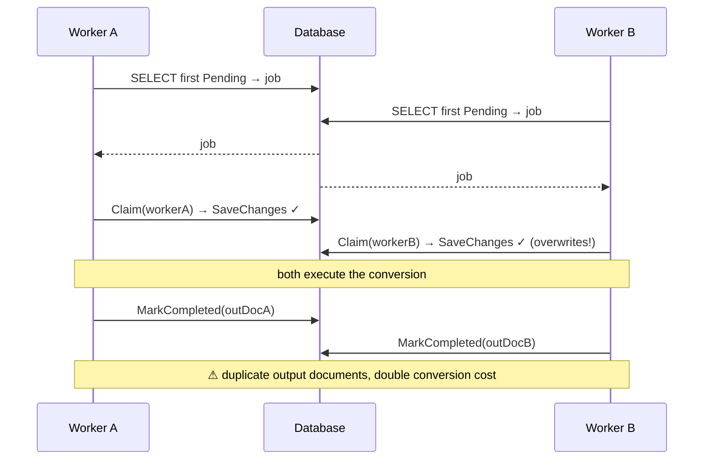

The **5-minute lease protects against stale leases, not against simultaneous claim.** The window is narrow but real, and it widens with worker count, poll frequency, and job-selection query latency. This is exactly the risk that turns the documented "horizontally scalable workers" property into a liability.

**Fix (priority 1, ~2 h):** Add `FOR UPDATE SKIP LOCKED` to the selection query (PostgreSQL) or a `RowVersion` concurrency token validated on `Claim` (provider-agnostic, and the safer choice given the SQL-Server/PostgreSQL split). Either makes the claim atomic.

**Current mitigation:** run exactly one worker process. That is a deployment constraint, not a solution.

---

### 15.4 D-7 — Worker Parity Gap: Batch Aggregation and Index Enqueue

**Severity: LOW — functional divergence, not data loss**
**Status: SOLID**

| Behavior | `JobProcessorWorker` (web) | `Worker` (standalone) |
|---|---|---|
| Batch completion aggregation | ✅ calls `CheckBatchCompletionAsync` | ❌ **absent** |
| Index-conversion enqueue | ✅ calls `_indexingQueue.TryQueueDocument(...)` | ❌ **absent** |
| SignalR notification | ✅ `JobNotificationService` | ❌ log-only (`ConsoleJobNotificationService`) |
| Conversion transaction | ✅ | ✅ |
| State machine transitions | ✅ via `ProcessingJobLifecycle` | ✅ via `ProcessingJobLifecycle` |

Consequences when running the split topology:

1. **Batch jobs never reach `MarkCompleted` from the worker path.** A batch of 40 conversions executed entirely by standalone workers stays `Processing` forever, because no component aggregates its siblings.
2. **Converted outputs are never enqueued for vector indexing.** They remain unindexed until the next web-host restart, when `DocumentIndexingWorker` startup hydration re-scans `Available` documents.

Neither is data loss — the documents exist and are retrievable. Both are **functional divergence between two implementations of the same documented transaction**, and both are invisible without close reading.

**Fix (priority 6, ~3 h):** Extract a shared `JobCompletionService` — batch aggregation + index enqueue + notification — and have both hosts depend on it. This eliminates the divergence class permanently rather than patching the second instance.

---

### 15.5 D-2 — Provider Split and Migration Chain

**Severity: HIGH — deployment failure on the documented primary provider**
**Status: SOLID (migration evidence) / UNVERIFIABLE (runtime provider resolution)**

```csharp
// Worker Program.cs — the only place migrations history is configured
options.UseSqlServer(connectionString, sql =>
{
    sql.EnableRetryOnFailure(5, TimeSpan.FromSeconds(10), null);
    sql.MigrationsHistoryTable("__EFMigrationsHistory", "dbo");
});
```

Research materials name PostgreSQL/Npgsql as the primary persistence. Both providers are referenced in `Infrastructure.csproj` and `DocumentWorker.csproj`. But the migration chain — `InitialCreate`, `AddPersistentVectorAndIntelligenceIndex`, `AddCopilotChatAndMemoryPersistence`, `AddTriLanguageChunkSupport`, `WidenDocumentVectorChunkEmbedding` — carries no provider split and no PostgreSQL-specific annotations surfaced in configuration. `DatabaseExtensions.InitializeDatabaseAsync` performs `to_regclass` checks, meaning PostgreSQL is *contemplated*, but the migration artifacts are SQL Server-flavoured.

The `to_regclass` check is a strong hint that an `EnsureCreated` or raw-DDL path exists for Npgsql rather than the migration chain. That path needs direct read to close the question; until then the claim "linear migration chain over PostgreSQL" is **UNVERIFIABLE / likely OVERSTATED**.

**Fix (priority 2, ~1 d):** Generate a PostgreSQL migration set, or document the `EnsureCreated` path explicitly and make provider selection non-ambiguous. Either is acceptable; ambiguity is not.

---

### 15.6 C-2 — Hub Mapped Without Authorization

**Severity: MEDIUM**
**Status: SOLID**

```csharp
app.MapHub<ProcessingHub>("/hubs/processing");   // no .RequireAuthorization()
```

Every other surface is gated. Group scoping (`batch_{batchId}`) moderates exposure but does not eliminate it. **Fix (priority 5, ~5 min):** add `.RequireAuthorization()`.

---

### 15.7 Configuration Drift — `RunWorkerInWeb`

**Severity: MEDIUM (operational)**
**Status: SOLID**

Code default `true`, compose value `false`. Both are legitimate; the discrepancy means deployments differ in ways not evident from either artifact alone, and it is the precondition for the concurrent-claim scenario (§15.3) to occur in practice.

---

### 15.8 D-6 — Inline Conversion in a Transport Layer

**Severity: LOW — but architecturally significant adjacency**
**Status: SOLID**

`DocumentEndpoints.cs` (902 lines) contains a private `ConvertDocxStreamToPdf(Stream, Stream)` — a full OpenXML→PdfSharp renderer living in an endpoint-mapping static class. This is a **second DOCX→PDF code path** parallel to `OfficeDocumentProcessor`, with different fidelity characteristics and no job pipeline involvement.

Not this domain's code, but this domain's problem: users who take the inline path never get a `ProcessingJob`, never get SignalR progress, never get batch aggregation, and never get `ProcessingAttempt` audit rows. Consolidating on the pipeline restores one conversion authority.

**Fix (priority 8, ~30 min):** delete the inline renderer; route through `OfficeDocumentProcessor`.

---

### 15.9 Missing Reaper — Orphan Job Recovery

**Severity: MEDIUM — inferred gap, needs source confirmation**
**Status: UNVERIFIABLE from provided materials**

The lease mechanism implies a recovery path: expired leases return jobs to claimable state. That is implemented *implicitly* — the selection query matches `Pending OR stale-lease`, so an expired job is re-claimed on the next poll. This is elegant: no separate reaper service is needed.

However, two questions remain unconfirmed:

1. Does the selection query consider **only** `Processing` jobs with expired leases, or does it also match `CancellationRequested` with expired leases (which should transition to `Cancelled`, not re-execute)?
2. Is there any bound on **total** attempts, or does a deterministically failing job re-enter `Pending` indefinitely when `IsRetryable` misfires?

Both should be verified in the selection query predicate. A misfiring `IsRetryable` combined with unbounded re-claim would produce a hot retry loop — the type of failure that looks like a busy worker rather than a bug.

---

### 15.10 Risk Register Summary

| ID | Finding | Severity | Status | Effort |
|---|---|---|---|---|
| C-1 | Concurrent claim without `SKIP LOCKED` / concurrency token | **HIGH** | SOLID | ~2 h |
| D-2 | Migration chain SQL Server–shaped; PostgreSQL unverified | **HIGH** | SOLID | ~1 d |
| D-3 | Silent `UseInMemoryDatabase` on missing connection string | **HIGH** | SOLID | ~30 min |
| D-1 | Fallback channel unconsumed and unbounded | **HIGH** | SOLID | ~1 h |
| D-7 | Standalone worker skips batch aggregation + index enqueue | MEDIUM | SOLID | ~3 h |
| C-2 | `/hubs/processing` without `RequireAuthorization()` | MEDIUM | SOLID | ~5 min |
| §15.7 | `RunWorkerInWeb` default vs compose divergence | MEDIUM | SOLID | config |
| §15.9 | Retry bound and cancellation-lease handling unconfirmed | MEDIUM | UNVERIFIABLE | read + patch |
| D-6 | Inline DOCX→PDF in transport layer | LOW | SOLID | ~30 min |
| §14.2 | Two parallel `JobMessage` record families | LOW | SOLID | ~1 h |

---

## 16. Operational Observability and Failure Modes

### 16.1 Health Signal Interpretation

The module's health is **not** the process's liveness. A worker can be alive, healthy, and doing nothing — that is exactly D-3. Operators must watch domain signals:

| Signal | Healthy | Degraded | Failure |
|---|---|---|---|
| Queue depth (`Pending` count) | Stable or draining | Growing monotonically | Growing + no `Processing` rows |
| Time-to-claim (created → `Processing`) | < 3 s (broker) / < 5 s (poll) | Rising | Unbounded |
| `Processing` age distribution | All under lease window | Some approaching 5 min | Many past lease expiry |
| Attempt distribution | Mostly `AttemptNumber = 1` | Rising | Unbounded growth = retry loop |
| Concurrency detected | 1 worker per job | — | 2+ `ProcessingAttempt` rows sharing start time |
| Batch completion rate | Tracks job completion | Lagging | Stale `Processing` after all children terminal |
| Indexing channel depth | Low | Rising | Saturated → stale retrieval |

The **duplicate-attempt detector** is the direct test for C-1: two attempts on the same job with overlapping `StartedAt` values is proof of concurrent claim.

### 16.2 Telemetry

The host exports OpenTelemetry traces and metrics. For this domain, the operationally necessary instruments are:

- Counter: `jobs_claimed_total{worker_id}`, `jobs_completed_total{converter,status}`, `jobs_failed_total{error_code}`
- Histogram: `job_duration_seconds{converter}`, `time_to_claim_seconds`
- Gauge: `pending_jobs`, `processing_jobs`, `stale_lease_jobs`, `indexing_channel_depth`

`error_code` as a label is what makes retry classification observable in production — the deviation between designed and actual retry behavior shows up there first.

### 16.3 The Aggregation Hotspot

`CheckBatchCompletionAsync` runs at every terminal job state and reads/writes shared batch state. With 40 jobs finishing within a second, that is 40 aggregation passes, each issuing count queries and possibly contending on the same `BatchJob` row.

Mitigation options, in order of cost:

1. **Incremental counter** — increment `CompletedJobs`/`FailedJobs` on each terminal transition; run the full aggregation only when the increment reaches `TotalJobs`. Turns 40 passes into 40 cheap updates + 1 check.
2. **Periodic sweep** — a lightweight background service checks for batches whose children are all terminal but which are not themselves terminal. Handles the straggler case that (1) can miss under a race.
3. **Both** — (1) for the happy path, (2) as a correctness backstop. Recommended.

### 16.4 Orphaned Output Sweep

Failed attempts leave partial output bytes in encrypted storage under a fresh key per attempt (§12.4). A periodic sweep matching storage keys against `ProcessingJobOutput` rows would reclaim them. Not urgent at small scale; becomes necessary once retry volume is meaningful.

### 16.5 Failure Mode Catalogue

| Failure Mode | Detection | System Behavior | Operator Action |
|---|---|---|---|
| Broker down | Publish exceptions in log | Polling continues; work flows | None — self-healing |
| Broker down + high volume | Fallback channel memory | Unbounded growth | **Restart workers** (§15.1) |
| Worker crashes mid-conversion | Lease expires | Job re-claimed, re-executed | None — self-healing |
| Worker crashes repeatedly | Attempt counter climbs | Retry to ceiling | Investigate the converter |
| DB connection string missing | Health green, zero output | Phantom processing | **Fix config** (§15.2) |
| Two workers claim same job | Duplicate output documents | Double conversion | **Quiesce to one worker** (§15.3) |
| Poison document | Repeated `Failed` | Fails once, terminates | Fix input; no fleet impact |
| Retry loop (misfired `IsRetryable`) | Attempt counter climbs, `Pending` churn | Hot spin | Correct classification (§15.9) |
| Indexing channel saturated | Queue depth gauge | Retrieval staleness | Increase capacity / workers |
| Batch never completes (split topology) | Stale `Processing` batch | Batch feature broken | Run web-host worker (§15.4) |

---

## 17. Extension Guide — Adding a Converter

The domain's data-driven routing makes this a three-step operation with zero orchestration changes.

### Step 1 — Implement `IDocumentProcessor`

```
public sealed class MarkdownToHtmlProcessor : IDocumentProcessor
{
    public string ProcessorId => "markdown-to-html";
    public Task<ProcessingContext> ProcessAsync(ProcessingContext ctx, CancellationToken ct)
    { /* read ctx input stream → write ctx output stream */ }

    public bool CanHandle(string operation) => operation == "md2html";
}
```

The contract lives in `BuildingBlocks/DocumentConverter.Processing.Abstractions` — shared between host and worker, so the processor is transport-agnostic.

### Step 2 — Register in DI

Register as **Singleton** alongside the other seven processors (`PdfDocumentProcessor`, `OfficeDocumentProcessor`, `ImageDocumentProcessor`, `OcrDocumentProcessor`, `PdfCompressProcessor`, `ImageCompressProcessor`, `EchoDocumentProcessor`). Processors are stateless; singleton is correct and avoids per-job construction cost.

### Step 3 — Insert a `Converter` row

```
Key                 = "md2html"
Name                = "Markdown to HTML"
Operation           = "md2html"
ProcessorId         = "markdown-to-html"
QueueName           = "document.processing"
IsEnabled           = true
SupportsBatch       = true
AcceptsMultipleInputs = false
MaxInputSizeBytes   = 5242880
Fidelity            = "high"
```

### What you do **not** need to change

- `ProcessingService` — routing is data, not code
- `ProcessingJob` / `ProcessingJobStatus` — state machine is format-agnostic
- `JobProcessorWorker` / `Worker` — resolution is by `ProcessorId` string
- `RabbitMqJobDispatcher` — no per-converter queues required
- `ProcessingEndpoints` — the DTO shape is uniform

Through the admin console (`ConvertersCatalog.razor`), the row can be inserted and the converter toggled without redeploy. That is the payoff of the registry-entity design.

---

## 18. Design Rationale and Trade-Off Register

Every architectural decision in this domain involves a concession. Naming them explicitly is what keeps them decisions rather than accidents.

| ID | Decision | Benefit | Cost | Verdict |
|---|---|---|---|---|
| **T-1** | Duplicate the transaction across two hosts | Independent deployment; each host complete | Divergence (D-7); two places to fix bugs | **Refactor to shared service** |
| **T-2** | DB polling as resilience floor | Zero-broker deployments work; no data loss | Up to poll-interval latency; DB load | **Keep** — correct floor |
| **T-3** | Lease versus distributed lock | No lock manager; crash-tolerant | Does not protect simultaneous claim (C-1) | **Keep lease + add concurrency token** |
| **T-4** | Two `JobMessage` record families | Historical flexibility | Drift risk (§14.2) | **Consolidate** |
| **T-5** | Minimal hub surface (join/leave only) | No client-invocation attack surface | No server acknowledgment protocol | **Keep** |
| **T-6** | Notification parity not implemented in standalone worker | Simpler worker | Silent UX gap in split topology | **Fix via shared completion service** |
| **T-7** | `echo` processor as resolution fallback | Never fails opaquely | Misconfiguration silently succeeds | **Keep dev; gate in prod** |
| **T-8** | Batch status derived from siblings | Consistency under concurrency | Per-job aggregation cost | **Keep + incremental counter** |
| **T-9** | Cancellation as request, not kill | Clean resource release | Latency to honor | **Keep** |
| **T-10** | Implicit saga, no framework | No coordination infrastructure | Orphaned output bytes | **Keep + periodic sweep** |
| **T-11** | Access validation in orchestration layer | Covers internal callers | Redundant for HTTP path | **Keep** — defense in depth |
| **T-12** | Repository-entity converter registry | Zero-code converter addition | Catalog must be seeded correctly | **Keep** |

### The Coherence Test

Three properties are load-bearing and mutually reinforcing:

1. **The table is the truth.** Jobs exist as rows; the broker is an optimization. Every other resilience property descends from this.
2. **The lifecycle is one authority.** All transitions pass through `ProcessingJobLifecycle`. No component can diverge.
3. **The transaction is stream-composed.** Memory stays bounded, so resource caps are predictable and horizontal scale-out is viable.

Break any one and the others degrade. Break (1) and broker loss becomes data loss. Break (2) and workers invent conflicting transitions. Break (3) and a single large document OOMs a container.

---

## 19. Reference: Component and File Inventory

### Domain Layer — `src/DocumentConverter.Domain/Processing/`

| File | Responsibility |
|---|---|
| `ProcessingJob.cs` | Aggregate root; intention-revealing methods; lease, progress, attempt tracking |
| `ProcessingJobStatus.cs` | Status and error-code enums + `ProcessingJobLifecycle` transition authority |
| `BatchJob.cs` | Parent aggregate; mode, owner, completion counters |
| `ProcessingAttempt.cs` | Per-execution audit row: worker, timings, structured error |
| `ProcessingJobInput.cs` | Ordered input join row (multi-input support) |
| `ProcessingJobOutput.cs` | Ordered output join row (multi-output support) |
| `Converter.cs` | Registry entity: `ProcessorId`, `QueueName`, limits, flags |

### Application Layer — `src/DocumentConverter.Application/Processing/`

| File | Responsibility |
|---|---|
| `IProcessingService.cs` | Create/query/cancel job and batch contracts |
| `IJobNotificationService.cs` | Delivery contract + `JobNotificationEvent` / `BatchNotificationEvent` records |

### Infrastructure — `src/DocumentConverter.Infrastructure/`

| File | Responsibility |
|---|---|
| `Processing/ProcessingService.cs` | Orchestration: validate → persist → dispatch; nested no-op publisher |
| `Processing/ConverterCatalogService.cs` | Projects converter rows to `ConverterDto` |
| `Messaging/RabbitMqJobDispatcher.cs` | Real queue adapter; `IAsyncDisposable`; `FallbackReader` (unconsumed) |
| `Messaging/RabbitMqOptions.cs` | `"RabbitMQ"` section binding with defensive defaults |

### Contracts — `src/DocumentConverter.Contracts/`

| File | Responsibility |
|---|---|
| `Processing/JobMessage.cs` | Lean message record |
| `Messages/QueueMessages.cs` | Rich message record + worker→web progress event |

### Web Host — `src/DocumentConverter.Web/`

| File | Responsibility |
|---|---|
| `HostedServices/JobProcessorWorker.cs` | In-process polling worker; batch aggregation; index enqueue |
| `Hubs/ProcessingHub.cs` | `JoinBatch` / `LeaveBatch`; group `batch_{batchId}` |
| `Services/JobNotificationService.cs` | Translates events to SignalR broadcasts |
| `Endpoints/ProcessingEndpoints.cs` | `/api/processing` group under `RequireUser` |

### Standalone Worker — `src/Workers/DocumentWorker/`

| File | Responsibility |
|---|---|
| `Worker.cs` | RabbitMQ consumer or polling loop; same transaction; **no** batch aggregation, **no** index enqueue |
| `Program.cs` | DI + `ConsoleJobNotificationService`; in-memory DB fallback (§15.2) |

### Building Block — `src/BuildingBlocks/DocumentConverter.Processing.Abstractions/`

| File | Responsibility |
|---|---|
| `IDocumentProcessor.cs` | Converter contract + `ProcessingContext`; shared by both hosts |

---

## 20. Glossary

| Term | Definition |
|---|---|
| **Aggregate** | DDD consistency boundary; `ProcessingJob` is the root for all job state |
| **Attempt** | One execution of a job by one worker; recorded as a `ProcessingAttempt` row |
| **Batch** | A parent grouping of jobs in Individual or Combined mode |
| **Claim** | The act of a worker taking ownership of a job via a time-boxed lease |
| **Combined mode** | N inputs → one merged output on a single job |
| **Converter** | A registry entity binding an operation verb to a `ProcessorId` and queue |
| **Fallback channel** | Unconsumed `Channel<JobMessage>` in the dispatcher (see D-1) |
| **Individual mode** | One input per job, one output per job |
| **Lease** | Time-boxed claim with automatic expiry; the crash-recovery mechanism |
| **Lifecycle** | `ProcessingJobLifecycle` — the single authority on transitions, terminals, retry |
| **Per-job isolation** | Catch-and-continue structure preventing one failure from aborting the loop |
| **Polling fallback** | The real degradation path: workers query the DB for claimable jobs |
| **Processor** | An `IDocumentProcessor` implementation performing one conversion |
| **Reaper** | A hypothetical service for orphan cleanup; currently implicit via lease expiry |
| **Resilience floor** | The minimum mechanism guaranteeing work still flows — here, DB polling |
| **Retry eligibility** | Classification of an error code as transient (retry) or deterministic (fail) |
| **Sharded storage key** | `xx/yy/{guid}/v1.ext` — two-level fanout preventing directory degradation |
| **Stale lease** | A lease whose `LeaseExpiresAt` has passed, making the job claimable again |
| **Stream composition** | Chaining storage/hash/converter/encryption streams to bound memory |
| **Terminal state** | `Completed`, `Cancelled`, or non-retryable `Failed`; absorptive |

---

## 21. Verdict

**The most architecturally rigorous domain in the platform, with one genuinely dangerous gap.**

The strengths are real and verified: a genuinely centralized state machine that neither worker can bypass, a database-as-work-source design that makes the queue a genuine accelerator rather than a hard dependency, stream composition that keeps memory bounded under any document size, four independent enforcement points on authorization, and data-driven converter routing that makes extension a registry write rather than a code change. The compile graph is clean and mechanically enforced by `Architecture.Tests`.

The weaknesses cluster where **operational** claims meet **structural** gaps rather than where structure is weak:

- **C-1** is the one finding that does not degrade gracefully. Every other risk produces a visible symptom — slow claim, stale batch, missing index, dead channel. Concurrent claim produces *duplicate output documents* and *double conversion cost*, silently, only under horizontal scale-out — precisely the deployment the module is documented to support. Fix it before adding a second worker replica.
- **D-3** inverts the health check: a configuration mistake produces a green worker doing nothing. Fix it before trusting any deployment's health signal.
- **D-1**, **D-2**, and **D-7** are correctness lies in code and documentation that the system currently survives by accident of architecture (polling, `to_regclass`, startup re-hydration). They should be closed before that accident is relied upon formally.

The single highest-value change is **C-1** — a `RowVersion` concurrency token validated on `Claim`, which is provider-agnostic and therefore survives the unresolved D-2 provider question. Two hours of work that converts "horizontally scalable workers" from an aspirational property into a true one.

---

*Evidence standard applied: compile-graph and code-path claims reproduced from source; concurrency and provider claims classified per the architecture audit; unconfirmable items marked UNVERIFIABLE rather than assumed.*