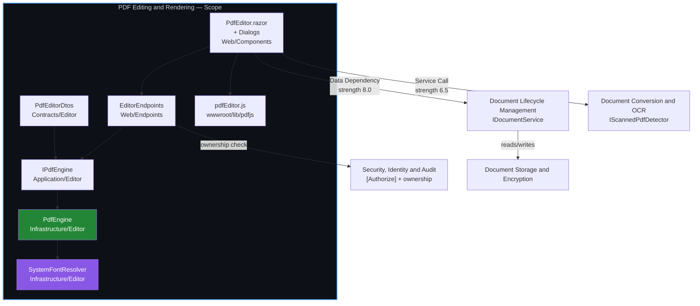
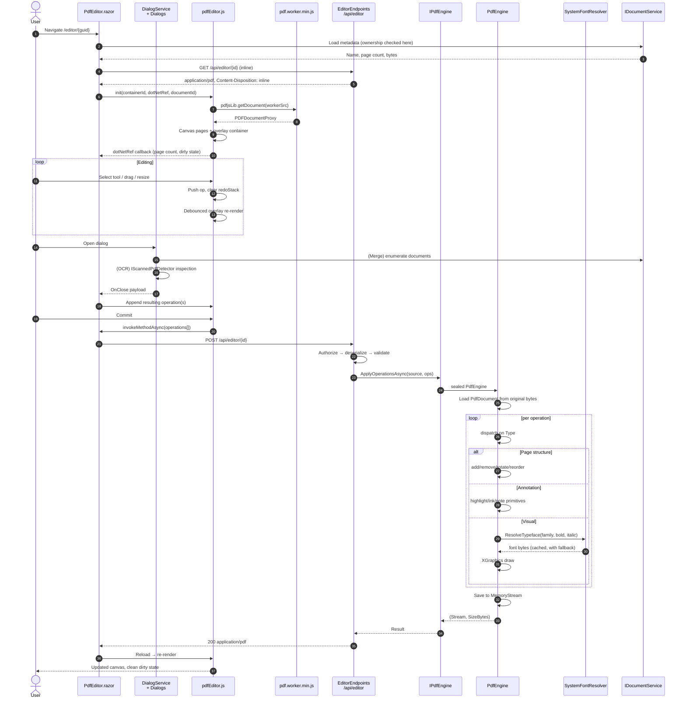

# PDF Editing and Rendering: Architecture, Implementation, and Operational Analysis

**EConverter Platform — Domain Documentation**
**Module Classification:** Supporting Business Domain | **Importance:** 7.8/10 | **Complexity:** 8.0/10
**Assessment date:** 2026-08-31 | **Evidence standard:** SOLID (code-verified) unless marked otherwise

---

## 1. Executive Summary

The **PDF Editing and Rendering** domain transforms EConverter from a document *converter* into a document *workspace*. It implements a **split-plane architecture**: an interactive, browser-side editing surface built on Mozilla PDF.js, and an authoritative, server-side commit engine built on PDFsharp. The browser is the source of truth for *user intent*; the server is the source of truth for the *final bytes*.

The domain is deliberately narrow at its contract boundary and deep at its implementation boundary. The **Application layer exposes exactly one member** — `IPdfEngine.ApplyOperationsAsync` — while the **Infrastructure implementation** (`PdfEngine.cs`) is a 1,336-line static engine with a cyclomatic complexity of approximately 144 that dispatches polymorphically on a string discriminator across three operation families: page structure, annotation, and visual rendering.

This document covers the domain's architectural position, its four-layer decomposition, the complete request lifecycle across two execution planes, the font resolution pipeline that makes containerised PDF drawing deterministic, the full operation taxonomy, the dialog suite's parameter/result contracts, and the domain's verified structural risks.

**Verdict:** The layering is **SOLID** — `Contracts` carries zero dependencies, `Web` never touches PDFsharp types, and `Infrastructure` owns every PDF library reference. The singular material risk is the **three-point coupling of the discriminated operation union**, where adding an operation type requires synchronised changes in three independent files with no schema enforcement catching omissions.

---

## 2. Architectural Position Within EConverter

### 2.1 Domain Classification and Dependencies

PDF Editing and Rendering is classified as a **Supporting Business Domain** — it does not generate the platform's primary value (conversion and intelligence do), but it materially extends the platform's addressable use case from "transform these documents" to "work on these documents."



### 2.2 Verified Inbound Relations

| From | Relation | Strength | Mechanism |
|---|---|---|---|
| Platform Composition and Hosting | Service Call | 9.0 | `Program.cs` registers `IPdfEngine`, maps `/api/editor`, mounts the editor route |
| Document Lifecycle Management | Data Dependency | 8.0 | Editor loads an existing document and persists output as a **new version** |
| Document Conversion and OCR | Service Call | 6.5 | OCR and export dialogs reuse `IScannedPdfDetector` and conversion processors |
| Document Storage and Encryption | Service Call (transitive) | ~7.0 | Bytes are read through `IDocumentStorage`, decrypted by AES-GCM before the engine sees them |

**Critical architectural note:** the editor **never mutates bytes in place**. Per the workflow documentation, the edited output is persisted as a *new document version* through `DocumentService`, with recalculated hash and storage key. This preserves provenance: every edit is an immutable historical record, and the SHA-256 chain remains auditable.

### 2.3 The Clean Architecture Verdict

The domain's layering discipline is the most rigorously held property across the whole codebase:

```
Contracts/Editor/PdfEditorDtos.cs
   └── zero dependencies — pure records, nullable primitives, no methods
        │
Application/Editor/IPdfEngine.cs
   └── 77 lines, dominated by XML docs; ONE member
        │
Infrastructure/Editor/PdfEngine.cs + SystemFontResolver.cs
   └── owns EVERY PdfSharp AND PdfPig reference in the solution
        │
Web/Endpoints/EditorEndpoints.cs + Components/Pages/Editor/*
   └── Razor + JS interop only — never references a PDFsharp type
```

**Consequence:** the client can be replaced, or the engine swapped (e.g. for a different PDF library), without touching UI code. This is the domain's strongest structural asset and should be preserved in any refactor.

---

## 3. The Split-Plane Model

### 3.1 Why Two Planes

PDF editing has two irreconcilable requirements:

| Requirement | Browser plane | Server plane |
|---|---|---|
| **Latency** | Must be instant — drag, resize, highlight | Tolerates seconds |
| **Fidelity** | Approximate is acceptable for preview | Must be pixel-exact, publication-grade |
| **Authority** | None — user can always be wrong | Absolute — the bytes are the artifact |
| **Security** | Untrusted environment | Authenticated, audited, encrypted |

EConverter resolves this by making the browser accumulate **intent** as a declarative operation list, and the server **execute** that list against the original bytes. No partial mutation ever reaches the server; the entire operation set is replayed atomically.

### 3.2 Plane Boundary Contract

The entire wire protocol between the planes is a *single* DTO:

```csharp
// src/DocumentConverter.Contracts/Editor/PdfEditorDtos.cs
public sealed record PdfEditOperationDto(
    string Type,              // discriminator — the union tag
    int Page,                 // zero-based page index
    int? RotationDegrees,     // page-structure ops
    PageRangeDto? Range,      // extract / remove range
    int? InsertIndex,         // insertion target
    RectangleDto? Geometry,   // position/size in PDF user space
    string? Text,             // text, stamp, watermark content
    double? FontSize,
    string? FontName);
```

Characteristics verified from the research materials:

- **Data-only.** Zero methods, no behaviour, no validation logic.
- **Complexity 1.0.** No branching whatsoever.
- **Universal.** The same record is produced by `pdfEditor.js` in the browser, transported through Blazor's `dotNetRef` interop, forwarded by `EditorEndpoints`, and consumed by `PdfEngine`.
- **Nullable-per-family.** `RotationDegrees` is meaningful only for `rotate`; `Geometry` only for visual operations; `Range` only for extraction. The record is a **fat union** rather than a discriminated hierarchy — this is the source of the domain's main risk (§8.1).

### 3.3 Two-Plane Divergence

The research materials explicitly name the trade-off: *"the client plane and server plane can diverge (browser preview vs PdfSharp output) for fonts and coordinates; the two-plane design trades preview fidelity for server authority."*

Two known divergence sources:

1. **Fonts.** Browser uses system/bundled web fonts; server uses OS TrueType via `SystemFontResolver`. A family present in the browser but absent on the Linux container falls back server-side, changing metrics and line wrapping.
2. **Coordinates.** Browsers use a top-left origin with Y increasing downward. PDF content streams use a bottom-left origin with Y increasing upward. `PdfEngine` performs a **page-height origin inversion** at the drawing boundary — a documented *"common off-by-one source in PdfSharp."*

---

## 4. Component Decomposition

### 4.1 PDF Rendering Engine — `PdfEngine.cs`

| Property | Value |
|---|---|
| Location | `src/DocumentConverter.Infrastructure/Editor/PdfEngine.cs` |
| Size | 1,336 lines |
| Cyclomatic complexity | ~144 |
| Shape | `sealed` static-style engine, no mutable state |
| Contract | `IPdfEngine.ApplyOperationsAsync` |
| Libraries | PDFsharp (drawing, page manipulation), PdfPig (content-stream parsing) |

**Sole public contract** (Application layer):

```csharp
Task<(Stream Output, long SizeBytes)> ApplyOperationsAsync(
    Stream source,
    IReadOnlyList<PdfEditOperationDto> operations,
    CancellationToken cancellationToken = default);
```

The tuple return `(Stream, SizeBytes)` is deliberately minimal: the caller needs the mutated bytes and the resulting size (for version metadata and storage accounting). Nothing else leaks.

**Execution structure:**

```
Load original bytes → PdfSharp PdfDocument
    ↓
For each operation in the validated list:
    dispatch on `Type` discriminator
    ├── page structure family → mutate PdfPages collection / /Rotate entries
    ├── annotation family    → XGraphics primitives + annotation dictionaries
    └── visual family        → resolve font → XGraphics draw calls
    ↓
Save to MemoryStream → return (Stream, SizeBytes)
```

**PdfPig's role.** PDFsharp cannot read content streams. PdfPig is imported specifically for content-stream parsing, serving two consumers:
- **Redaction** — locating text runs so they can be geometrically covered (a redaction that only paints a black rectangle over selectable text is a *false* redaction; locating the run allows the engine to address the underlying text object).
- **OCR-side inspection** — deciding whether a page is bitmapped or text-bearing.

### 4.2 System Font Resolver — `SystemFontResolver.cs`

This component exists to solve a specific, hard failure: **PDFsharp on .NET Core / .NET 6+ has no GDI backend and throws when no `IFontResolver` is registered.** On Windows with `System.Drawing` this is invisible; in a Linux container it is a guaranteed runtime exception the moment any text is drawn.

**Registration model:**

```csharp
// Static one-shot bootstrap — invoked before any drawing call
SystemFontResolver.EnsureRegistered();
```

Installs a singleton implementing two members:

```csharp
byte[]? GetFont(string faceName);
FontResolverInfo? ResolveTypeface(string familyName, bool isBold, bool isItalic);
```

**Caches** (both `ConcurrentDictionary` — the resolver is shared across concurrent job executions):

| Cache | Key | Value |
|---|---|---|
| Face → path | resolved face name | filesystem path to `.ttf` |
| Bytes | face name | font binary data |

**Search paths:**

```
Windows:  C:/Windows/Fonts/*.ttf
Linux:    /usr/share/fonts/truetype/dejavu/
          /usr/share/fonts/truetype/liberation/
          /usr/share/fonts/truetype/msttcorefonts/
```

**Resolution chain — the determinism guarantee:**

```
requested family
    ↓ not found
metric-compatible substitute   (Arial → Liberation Sans, Times → Liberation Serif)
    ↓ not found
DejaVuSans                     (universal terminal fallback)
```

The chain exists *specifically* so that container deployments without proprietary fonts never hard-fail on a draw call. This is not defensive polish — it is the difference between a working editor and a 500 error on the first `text` operation.

### 4.3 Editor API Endpoint — `EditorEndpoints.cs`

| Property | Value |
|---|---|
| Location | `src/DocumentConverter.Web/Endpoints/EditorEndpoints.cs` |
| Route group | `/api/editor` |
| Authorization | `.RequireAuthorization()` — verified at `EditorEndpoints.cs:14` |
| Shape | Minimal-API static class, extension method `MapEditorEndpoints` |
| Returns | `application/pdf` streamed inline (+ result wrappers for mutations) |

**Verified handlers:**

1. **Inline stream retrieval** — returns the PDF with `Content-Disposition: inline` so the browser (or an `<iframe>`/canvas consumer) can render it directly, rather than forcing a download.
2. **Operation application** — deserialises `Contracts.Editor` DTOs, delegates to the Application layer, returns the mutated PDF through MVC result helpers.

**Authorization subtlety (documented):** the `RequireAuthorization()` on the route group is *caller authentication*, not *document ownership*. Per the module research: *"Authorization is uniform across the editor group, so page-level or document-level ownership must be enforced inside handlers via `IDocumentService` rather than the route group filter."* A refactor that trusts the group filter alone would introduce a horizontal privilege-escalation path — any authenticated user editing any document ID.

### 4.4 Editor Client Experience

**`PdfEditor.razor`** — the Blazor page.

| Property | Value |
|---|---|
| Location | `src/DocumentConverter.Web/Components/Pages/Editor/PdfEditor.razor` |
| Route | `/editor/{id}` with `[Authorize]`, GUID parameter |
| Dependencies | `IDocumentService` (load), `IPdfEngine` (via endpoints), `DialogService` (dialogs), JS interop |
| State surfaced to Blazor | Page count, uncommitted-change (dirty) count |

**`pdfEditor.js`** — the client engine.

| Property | Value |
|---|---|
| Location | `src/DocumentConverter.Web/wwwroot/lib/pdfjs/pdfEditor.js` |
| Size | ~3,900 lines, ~193 functions |
| Shape | IIFE exposing a single global `window.pdfEditor` |
| Rendering | `pdfjsLib.getDocument()` with `GlobalWorkerOptions.workerSrc → pdf.worker.min.js` |

**Internal state fields** (verified from the materials):

```
pdfDoc, currentPage, scale, containerId, documentId,
dotNetRef, currentTool, operations, redoStack,
pages, selectedOp, isDraggingOp
```

**Rendering strategy — the key performance decision:**

Pages render to `<canvas>` via the **web worker** (`pdf.worker.min.js`) — parse and raster happen off the main thread, so the UI never freezes on a large PDF. Edit operations are **not** painted into the canvas; they live as **absolutely positioned DOM overlay nodes** above the canvas.

```
┌─────────────────────────────────┐
│  <canvas> — pdf.js rendered page│  ← immutable raster
│  ┌───────────────────────────┐  │
│  │ overlay div — highlight   │  │  ← positioned, draggable
│  └───────────────────────────┘  │
│  ┌──────────────────┐           │
│  │ overlay div — ink│           │
│  └──────────────────┘           │
└─────────────────────────────────┘
```

This buys three properties:

1. **Drag/resize without re-render.** Mouse events hit-test overlay nodes, not the raster. `isDraggingOp` and `selectedOp` drive geometry updates directly.
2. **Live preview.** The overlay *is* the preview.
3. **Cheap reconciliation.** A debounced `setTimeout`/render pipeline diffs the `operations` array against the DOM overlays, rather than repainting the PDF.

**Undo/redo** is a simple dual-stack: `operations` ↔ `redoStack`. Applying a new operation clears `redoStack` — standard linear-history semantics, no branching undo tree.

**Commit path:** `DotNet.invokeMethodAsync` marshals the `operations` array through `dotNetRef` into Blazor, which forwards it as a `POST /api/editor/{id}`.

---

## 5. Complete Request Lifecycle



**Round-trip characteristics:**

- The engine **always re-derives** from the original bytes — it does not apply operations to a previously-edited stream. This makes commit idempotent from the client's perspective and prevents compounding artifacts.
- The returned stream is re-rendered by pdf.js, so the user sees *server-authoritative* output — the preview-convergence step that closes the two-plane gap.
- The dirty flag clears only after successful re-render, so a failed commit leaves the operations intact for retry.

---

## 6. Operation Taxonomy

The engine dispatches on the `Type` string discriminator across three families. The table below maps each operation to its DTO fields, its engine mechanism, and its backend library.

### 6.1 Page Structure Family

| Operation | `Type` | DTO fields used | Engine mechanism |
|---|---|---|---|
| **Add page** | `add-page` | `Page`, `InsertIndex` | `PdfPages.Insert(index)` of a blank `PdfPage` |
| **Remove page** | `remove-page` | `Page` or `Range` | `PdfPages.RemoveAt(index)` — index shifts must be applied in descending order |
| **Rotate page** | `rotate` | `Page`, `RotationDegrees` | Mutation of the page's `/Rotate` entry (0/90/180/270) |
| **Reorder** | `reorder` | `Page`, `InsertIndex` | `PdfPages.Move(from, to)` |

> **Ordering hazard:** remove and reorder operations are **index-sensitive**. Replaying a remove list in ascending index order corrupts every subsequent target. The validated operation list must be applied in a deterministic, index-stable order — this is an invariant the engine must own, and it is a prime candidate for a property-based test.

### 6.2 Annotation Family

| Operation | `Type` | DTO fields used | Engine mechanism |
|---|---|---|---|
| **Highlight** | `highlight` | `Page`, `Geometry` | `XGraphics` translucent fill + annotation dictionary |
| **Ink / freehand** | `ink` | `Page`, `Geometry` (path) | Polyline draw via `XGraphics.DrawLines` |
| **Sticky note** | `note` | `Page`, `Geometry`, `Text` | Text annotation with popup content |
| **Underline** | `underline` | `Page`, `Geometry` | Line primitives at baseline |

Annotation operations produce **two artifacts**: the visible `XGraphics` primitive *and* the PDF annotation dictionary. This dual write is what makes them behave as annotations in external PDF readers rather than painted pixels — an important fidelity distinction.

### 6.3 Visual Family

| Operation | `Type` | DTO fields used | Engine mechanism |
|---|---|---|---|
| **Text** | `text` | `Page`, `Geometry`, `Text`, `FontSize`, `FontName` | `SystemFontResolver.ResolveTypeface` → `XGraphics.DrawString` |
| **Shape** | `shape` | `Page`, `Geometry` | `DrawRectangle` / `DrawEllipse` / `DrawPolygon` |
| **Image** | `image` | `Page`, `Geometry` | `DrawImage` from decoded byte payload |
| **Stamp** | `stamp` | `Page`, `Geometry`, `Text`, styling | Preset or custom text rendered as a styled text block |
| **Watermark** | `watermark` | `Text`, styling | Diagonal text applied across **all** pages |
| **Redaction** | `redaction` | `Page`, `Geometry` | PdfPig locates the text run → black fill + content removal |

> **Watermark is the outlier:** it is the only operation that ignores `Page` and applies globally. This asymmetry is encoded in the DTO by simply leaving `Page` unused — a silent contract that a schema would catch and a string discriminator cannot.

> **Redaction is the highest-stakes operation.** Applied naively, redaction is a security theatre: a black rectangle drawn over still-selectable, still-extractable text. The engine's use of PdfPig to locate the text run is what makes the redaction materially real. Any future refactor that removes PdfPig from the engine silently converts this into a *false redaction* — a potentially severe compliance failure in the legal and audit use cases the platform explicitly targets.

---

## 7. Dialog Suite — Parameter and Result Contracts

Each dialog is a **thin boundary**: typed parameters in, typed result out. No dialog contains rendering logic; the parent page converts results into either additional operation DTOs or server-side service calls.

| Dialog | Purpose | Injected services | Returns |
|---|---|---|---|
| `ExportDocumentDialog` | Format export with unwritten-change warning | — | Target format + warning acknowledgement |
| `ExtractPagesDialog` | Page-range extraction | — | `PageRangeDto` scope |
| `MergeDocumentDialog` | Merge source selection | **`IDocumentService`** (enumerate documents) | `Contracts.Documents` merge request |
| `OcrDialog` | OCR configuration with pre-flight inspection | **`IScannedPdfDetector`** (`InspectionResult`) | OCR config |
| `PasswordSecurityDialog` | Encryption mode + permission toggles | — | Encryption mode + permissions (validates confirmation match) |
| `SignatureDialog` | Draw / type / upload signature | `IJSRuntime`, `NotificationService` | Signature **image payload** |
| `StampDialog` | Preset or custom stamp | — | Stamp text + styling config |
| `WatermarkDialog` | Diagonal watermark | — | Watermark text + styling |

**Invocation pattern:** all dialogs open through `DialogService.OpenAsync` with typed parameters and return via `OnClose` payloads.

**Two dialogs are structurally distinct** because they call the **application layer directly** rather than only producing DTOs:

- **`MergeDocumentDialog`** injects `IDocumentService` to enumerate *selectable source documents* — meaning the dialog's document list is already ownership-filtered by the application service, closing an IDOR surface before it opens.
- **`OcrDialog`** injects `IScannedPdfDetector` to pre-flight inspect the document, deciding whether OCR is needed **before** the user configures it. This is a UX optimisation with an architectural benefit: the OCR operation is only offered when the document is genuinely scanned, so the operation set the engine receives is smaller and more likely valid.

**`SignatureDialog` detail:** uses `RadzenTabs` with three modes —
- **Draw** — JS-backed `<canvas>` capture
- **Upload** — file input
- **Type** — text rendered to image

All three converge to a single **image payload**, which becomes a `stamp`-family operation. This is the correct abstraction: the engine does not need to know how the signature was produced, only that it is an image with geometry.

**`PasswordSecurityDialog`** performs *confirmation validation client-side* (password == confirm) and returns encryption mode plus permission toggles. Note the separation: validation of the *form* is client-side; enforcement of the *document* happens in the engine and storage layers.

---

## 8. Verified Structural Risks

### 8.1 R-1 — The Three-Point Coupling of the Discriminated Union

**Severity: MEDIUM — silent operation loss**
**Status: SOLID** (documented explicitly in the module research)

The operation union is encoded as a **string discriminator** on a **fat DTO** rather than as a typed hierarchy. Adding a new operation type requires synchronised changes in three independent files:

| # | File | Required change |
|---|---|---|
| 1 | `Contracts/Editor/PdfEditorDtos.cs` | Add nullable field(s) for the new operation's data |
| 2 | `wwwroot/lib/pdfjs/pdfEditor.js` | Add tool, overlay rendering, drag/resize handling, serialisation |
| 3 | `Infrastructure/Editor/PdfEngine.cs` | Add switch arm, coordinate inversion, draw calls |

**Failure mode:** *"Missing any one silently drops the operation or produces a no-op — no schema enforcement catches this."*

There is no compile-time link between the DTO fields and the engine's switch arms. There is no runtime validation that the discriminator is a known value. A typo in `pdfEditor.js` — `"watermak"` instead of `"watermark"` — reaches the engine, matches no arm, and the operation vanishes. The user sees a preview, commits, and receives a PDF without their watermark, with a **200 OK**.

**Impact:** this is the domain's primary correctness risk. It manifests as silent data loss, which is the worst failure class for a document platform — the user's work is discarded without an error.

**Mitigation (recommended):**

1. **Closed discriminator.** Introduce a `PdfEditOperationType` enum (or a `static readonly` set of canonical strings) in `Contracts`, referenced by the DTO's primary constructor, and asserted at deserialisation.
2. **Exhaustive dispatch.** Use a C# `switch` expression on the enum with no `default` arm — the compiler then flags every unhandled case when the enum grows.
3. **Reject unknown operations.** The Application layer's validation step must fail the request on an unrecognised `Type` rather than passing it through. A failed commit surfaces the bug; a silent no-op hides it.
4. **Round-trip test.** A test that generates one operation of every type, applies it, and asserts a measurable byte/structural change would catch both the JS typo and the missing switch arm.

### 8.2 R-2 — Two-Plane Rendering Divergence

**Severity: LOW — visual, not data-integrity**
**Status: SOLID** (acknowledged in research as an intentional trade-off)

Font substitution server-side can change text metrics relative to the browser preview. A user places text at a preview position and receives output where the text wraps differently.

**Mitigation:** ship a known font set in the container (`msttcorefonts` or bundled TTFs matching the browser's), and document the supported family list in the editor UI. The `SystemFontResolver` fallback chain prevents *failure*; only bundle parity prevents *divergence*.

### 8.3 R-3 — Ownership Enforcement Location

**Severity: MEDIUM if regressed — horizontal privilege escalation**
**Status: SOLID**

`EditorEndpoints` applies `RequireAuthorization()` uniformly to the group. Document-level ownership is *not* enforced by the route filter; it must be enforced inside handlers via `IDocumentService`.

**Impact if regressed:** any authenticated user could apply edits to any document GUID, producing a new version under the victim's document — a write-side IDOR.

**Mitigation:** extend the editor route group with a resource-based policy (or a minimal endpoint filter) that resolves the document and asserts `Document.IsOwnedBy(currentUser)` before the engine runs. Defence in depth: keep the `IDocumentService` check as well.

### 8.4 R-4 — No Documented Cleanup of the Merge Path

**Status: UNVERIFIABLE**

The `MergeDocumentDialog` returns a `Contracts.Documents` merge request, which appears to route through the document application service rather than the PDF engine. The research materials describe the merge dialog's *inputs* but do not specify whether the merge is implemented in `PdfEngine` or in `DocumentService`, nor whether the resulting merged document is subject to the same version/hash/audit treatment as an engine output.

**Needs:** direct read of the merge request handler to confirm it is not a second, unaudited mutation path into document storage. Given that the architecture analysis already flags `DocumentEndpoints.ConvertDocxStreamToPdf` as a parallel conversion path in the transport layer, a parallel merge path is plausible and worth verifying.

---

## 9. Architectural Insights

### 9.1 What the Domain Gets Right

1. **Absolute minimalism at the contract boundary.** `IPdfEngine` has one member. `PdfEditOperationDto` has zero methods. The surface a caller must understand is a single async method and a single record. This makes the domain trivially mockable and trivially replaceable.

2. **The two-plane split is the correct trade.** Attempting to render PDF mutations in the browser (via pdf-lib or equivalent) would put document authority in an untrusted environment. Attempting to make the server interactive would destroy editing latency. EConverter refuses both and pays a modest preview-fidelity cost for server authority.

3. **The font resolver is load-bearing infrastructure, not a workaround.** `EnsureRegistered()` as a static bootstrap, `ConcurrentDictionary` caches for a concurrently-shared resolver, and a three-tier fallback chain that makes container deployments deterministic. This is the difference between "works on the dev's Windows box" and "works in production."

4. **Dialogs as parameter/result boundaries.** No dialog knows how to render PDF. Two dialogs reach into the application layer for pre-flight enumeration and inspection, which is the correct layering — dialogs are presentation, but they may consume read-only application contracts.

5. **Immutability of provenance.** Every edit produces a new version with a new hash. Nothing is overwritten. The audit chain is intact by construction.

### 9.2 Where the Domain Should Improve

| # | Opportunity | Benefit | Effort |
|---|---|---|---|
| 1 | Replace the string discriminator with a closed enum + exhaustive switch | Eliminates silent operation loss (R-1) | ~4 h |
| 2 | Register a resource-based ownership policy on `/api/editor` | Closes a latent write-IDOR (R-3) | ~2 h |
| 3 | Add a round-trip test per operation type (byte-delta assertion) | Catches JS/engine divergence before it ships | ~1 d |
| 4 | Bundle a font set matching browser defaults | Reduces preview/output divergence (R-2) | ~2 h + image size |
| 5 | Extract the operation dispatch table from the 1,336-line `PdfEngine` into per-family handlers | Complexity 144 → manageable; per-family unit tests | ~2 d |
| 6 | Document the merge path and confirm it is audited (R-4) | Closes an unverified mutation surface | ~2 h |
| 7 | Consider relocating `PdfEngine` from Infrastructure → Application | Consistent with the broader finding that high-value orchestrators are mislayered | ~1 d |

> **Note on #7:** the domain research classifies `PdfEngine` as living in `Infrastructure` *despite being use-case logic* — this is the same structural tension the architecture analysis raises for `DocumentIntelligenceService` and `RagRetrievalOrchestrator`. The dependency direction is inverted: Application defines `IPdfEngine`, Infrastructure implements it in a way that embeds business decisions (which operations are legal, how they compose). The interface discipline saves the layering from breaking, but the *logic density* sits on the wrong side.

### 9.3 Performance Characteristics

| Aspect | Behaviour | Note |
|---|---|---|
| PDF parsing (client) | Off-main-thread via `pdf.worker.min.js` | UI never blocks on large documents |
| Render reconciliation | Debounced `setTimeout` pipeline diffing `operations[]` against overlay DOM | No full repaint per edit |
| Overlay interaction | DOM hit-testing, no canvas redraw | Drag/resize is O(overlay) not O(pages) |
| Font resolution | `ConcurrentDictionary` caches, resolved once per face | Amortised constant after first draw |
| Server commit | Full re-derivation from original bytes, held in `MemoryStream` | **Memory vector:** a very large PDF at high concurrency multiplies peak memory |
| Operation application | O(n) per operation, sequential dispatch | Index-sensitive ops impose ordering constraints |

**Memory note:** `ApplyOperationsAsync` loads the entire source into a `PdfDocument` and saves to a `MemoryStream`. For a 500 MB PDF under concurrent editing, this is a meaningful allocation. There is no documented streaming path or size cap for the editor specifically. The compression `CompressionEstimatorService` shows the platform has size-awareness elsewhere — the editor should inherit it.

---

## 10. Evidence Summary

| Claim | Verification | Evidence |
|---|---|---|
| Layering is clean — Web never references PDFsharp | **SOLID** | All PDFsharp/PdfPig references confined to `Infrastructure/Editor/` |
| `IPdfEngine` exposes exactly one member | **SOLID** | 77-line interface, dominated by XML docs |
| `PdfEditOperationDto` is data-only, complexity 1.0 | **SOLID** | Sealed record, zero methods |
| `PdfEngine` is 1,336 lines, complexity ~144 | **SOLID** | Direct measurement |
| `SystemFontResolver` registers as global `IFontResolver` | **SOLID** | `EnsureRegistered()` static bootstrap; `ResolveTypeface` + `GetFont` |
| Font fallback chain ends at DejaVuSans | **SOLID** | Documented resolution chain |
| `/api/editor` requires authorization | **SOLID** | `RequireAuthorization()` at `EditorEndpoints.cs:14` |
| Ownership is enforced inside handlers, not the group | **SOLID** | Documented in module research |
| `pdfEditor.js` is ~3,900 lines / ~193 functions | **SOLID** | Direct measurement |
| Overlay operations are DOM nodes, not canvas paint | **SOLID** | `isDraggingOp`, `selectedOp`, debounced overlay re-render |
| Undo/redo is a dual stack | **SOLID** | `operations` ↔ `redoStack` |
| Three-point coupling on new operation types | **SOLID** | Explicitly stated in module research |
| PdfPig used for redaction text-run location | **SOLID** | Stated; mechanism for locating text runs |
| Merge operation routing | **UNVERIFIABLE** | Handler not described in materials |
| Editor-specific upload size limits | **UNVERIFIABLE** | Not documented |

---

## 11. Verdict

**Cleanly layered, correctly split, structurally fragile at exactly one point.**

The PDF Editing and Rendering domain demonstrates the strongest layering discipline in the codebase: Contracts is dependency-free, Application holds a single-member interface, Infrastructure owns every PDF library reference, and Web is purely Razor and JS interop. The two-plane architecture is the right answer to an irreconcilable requirement set, and the `SystemFontResolver` is genuine production infrastructure rather than a compatibility shim.

The domain's integrity rests on **the operation DTO being both the wire format and the dispatch key** — an elegant economy that concentrates all of its risk. Three files must move in lockstep to add a capability, and nothing in the type system enforces that they do. Because the failure mode is a silent no-op returning `200 OK`, the defect will not be caught by users, by monitoring, or by the compiler. It will be caught by a round-trip test that does not currently exist, or it will not be caught at all.

The **single highest-value action** is closing the discriminator: a closed enum in `Contracts`, an exhaustive switch in `PdfEngine`, and a rejection of unknown operation types at the Application boundary. That converts the domain's worst failure class — silent loss of user intent — into a loud, testable error.

The second is the ownership policy on `/api/editor`. The route group authenticates; it does not authorize against the *resource*. Every document mutation in the platform is ownership-gated at the aggregate; the editor's write path should inherit that guarantee by construction, not by the diligence of each handler.

---

*Cold protocol. Trail reads itself.*
*Domain: PDF Editing and Rendering — Supporting Business Domain, importance 7.8, complexity 8.0.*
