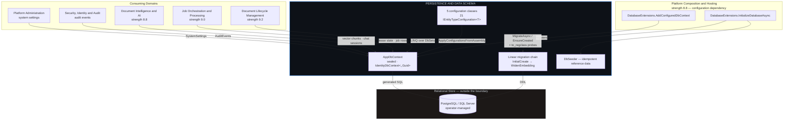
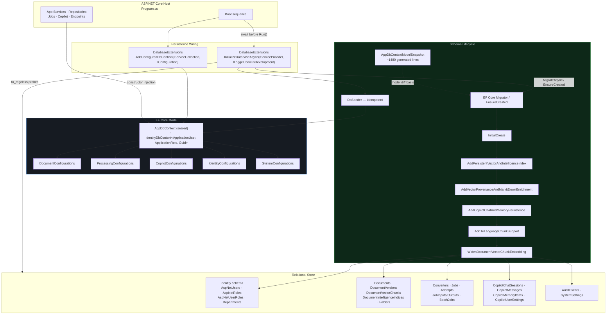
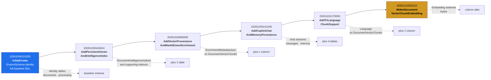
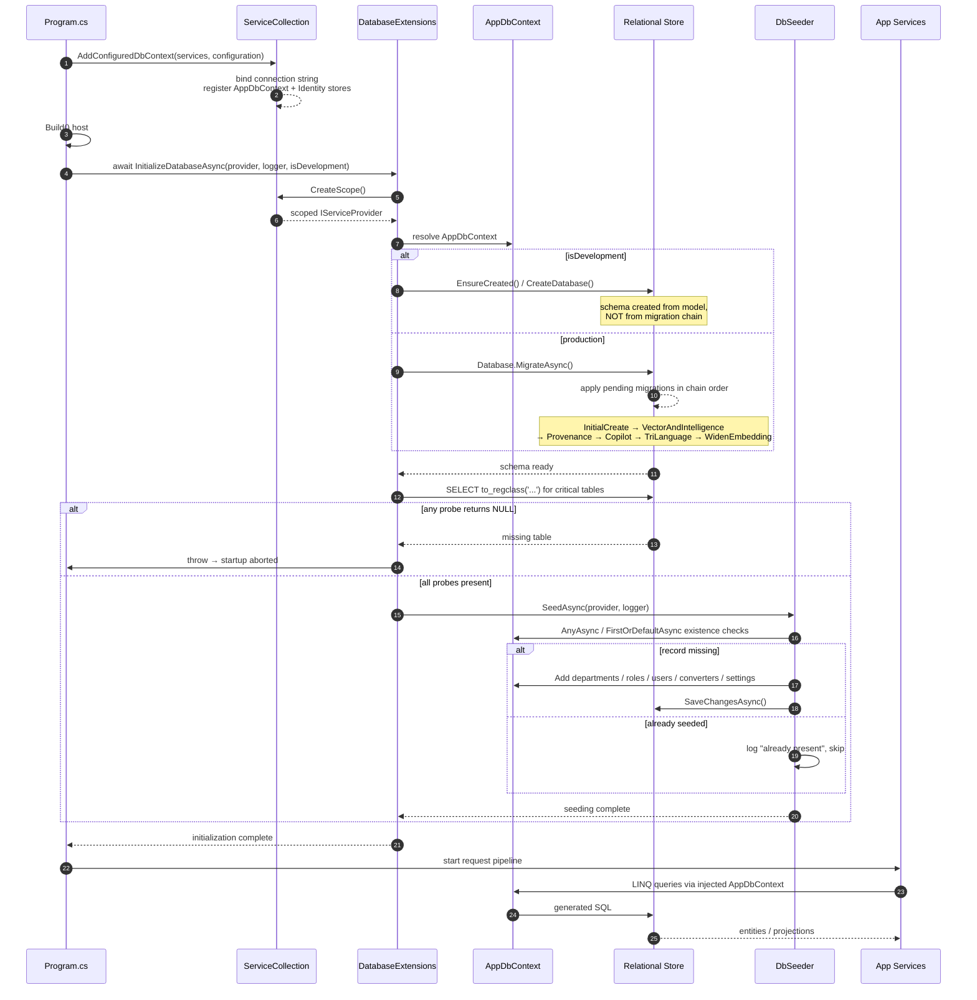
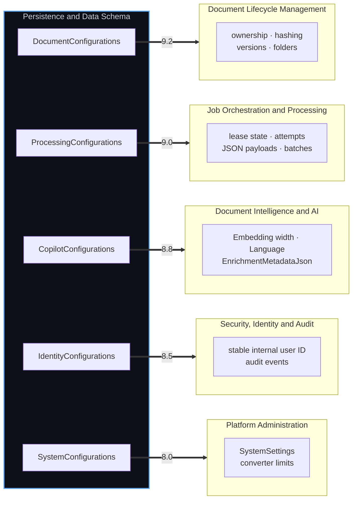
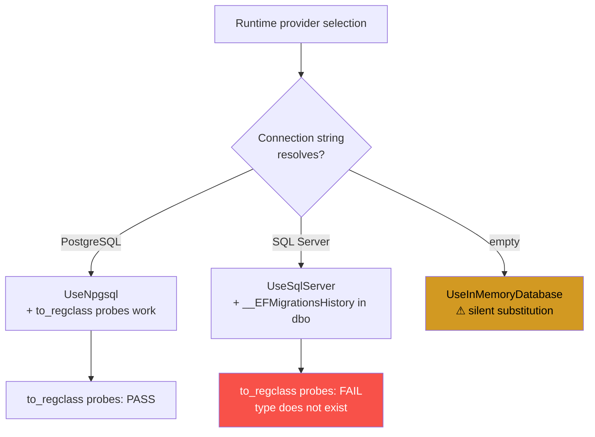

# Persistence and Data Schema

## EConverter — Infrastructure Domain Reference

---

## 1. Overview

The **Persistence and Data Schema** domain is the single storage boundary of EConverter. There is exactly one persistence unit — a `sealed AppDbContext` deriving from `IdentityDbContext<ApplicationUser, ApplicationRole, Guid>` — and every repository, application service, endpoint handler, background worker, and Copilot service ultimately dereferences one of its DbSets. Nothing in the platform reaches the database except through this context.

The domain's responsibility is fourfold:

| Responsibility | Mechanism |
|---|---|
| **Model aggregation** | One `DbContext` declaring DbSets across six bounded namespaces |
| **Configuration fan-out** | Five stateless `IEntityTypeConfiguration<T>` classes, assembly-discovered |
| **Schema lifecycle** | A strictly linear, append-only EF Core migration chain |
| **Startup provisioning** | `InitializeDatabaseAsync` + idempotent `DbSeeder` |

Because the domain sits beneath the document lifecycle, job orchestration, and document intelligence domains alike, it holds the highest *data dependency* weight in the architecture — relation strengths of 9.2, 9.0, and 8.8 respectively. Any disruption here cascades across the entire platform.

> **Provider caveat, stated up front.** The research materials describe the persistence unit as "EF Core/Npgsql over PostgreSQL." The architecture audit verified that the *migration artifacts* are SQL Server–shaped (`MigrationsHistoryTable("__EFMigrationsHistory", "dbo")` configured in `Workers/DocumentWorker/Program.cs`), while PostgreSQL is a first-class runtime provider referenced in both `Infrastructure.csproj` and `DocumentWorker.csproj`. This document describes the design as researched and flags the provider divergence explicitly where it matters. See §10.

---

## 2. Domain Position in the Architecture



**Structural verdict: CLEAN.** The persistence domain obeys the layering imposed by the compile graph — `Infrastructure` may reference `Domain`, `Contracts`, and the building blocks, and the `Architecture.Tests` project enforces that no upstream layer reaches back. Persistence is the *terminal* adapter: nothing depends on it except through abstractions declared in `Application`.

---

## 3. Component Map



---

## 4. The DbContext — Model Aggregation

### 4.1 Type declaration

```csharp
public sealed class AppDbContext
    : IdentityDbContext<ApplicationUser, ApplicationRole, Guid>
{
    public AppDbContext(DbContextOptions<AppDbContext> options) : base(options) { }

    protected override void OnModelCreating(ModelBuilder builder)
    {
        base.OnModelCreating(builder);
        builder.ApplyConfigurationsFromAssembly(typeof(AppDbContext).Assembly);
    }
}
```

Three deliberate design decisions are encoded in that signature:

**Identity merged at type level.** Because the context derives from `IdentityDbContext`, the ASP.NET Core Identity tables (`AspNetUsers`, `AspNetRoles`, `AspNetUserRoles`, `AspNetRoleClaims`, `AspNetUserClaims`, `AspNetUserLogins`, `AspNetUserTokens`) live in the **same physical database and the same DbContext** as the domain schema. There is no second connection string, no second migration chain, no distributed-transaction problem between identity and domain. A role assignment and a document insert in the same unit of work commit atomically.

**Sealed.** No proxy, no subclass, no model drift. EF Core's runtime proxies and any test doubles must wrap the type rather than inherit it, which keeps the compiled model authoritative.

**Configuration discovery by assembly scan.** `ApplyConfigurationsFromAssembly` means the five configuration classes are pure metadata with no runtime callers other than EF itself — they are discovered, not referenced. Adding an entity means adding a configuration class, not editing a central switch.

### 4.2 DbSet inventory

| Namespace | DbSets |
|---|---|
| **Documents** | `Documents`, `DocumentVersions`, `DocumentVectorChunks`, `DocumentIntelligenceIndices`, `Folders` |
| **Processing** | `Converters`, `ConversionJobs`, `JobAttempts`, `JobInputs`, `JobOutputs`, `BatchJobs` |
| **AI / Copilot** | `CopilotChatSessions`, `CopilotMessages`, `CopilotMemoryItems`, `CopilotUserSettings` |
| **Identity** | `ApplicationUsers`, `ApplicationRoles`, `Departments` *(plus inherited Identity sets)* |
| **Security** | `AuditEvents` |
| **System** | `SystemSettings` |

These strongly-typed sets are the **exclusive data-access interface** for the application. LINQ queries against them compile to provider SQL; there is no raw-ADO escape hatch and no repository-per-table wrapper that would duplicate what EF already provides.

---

## 5. Entity Configuration Fan-Out

Five sealed classes supply all fluent metadata — **21 `IEntityTypeConfiguration<T>` implementations in total**. They are stateless; EF instantiates them for model building only.

### 5.1 Module-to-configuration matrix

| Configuration class | Entities configured | Interfaces |
|---|---|---|
| `DocumentConfigurations` | Document, DocumentVersion, Folder, DocumentVectorChunk, DocumentIntelligenceIndex | 5 |
| `ProcessingConfigurations` | Converter, ProcessingJob, ProcessingAttempt, ProcessingJobInput, ProcessingJobOutput, BatchJob | 6 |
| `CopilotConfigurations` | CopilotChatSession, CopilotMessage, CopilotMemoryItem, CopilotUserSettings | 4 |
| `IdentityConfigurations` | Department, ApplicationUser, ApplicationRole, user-role composite join | 4 |
| `SystemConfigurations` | AuditEvent, SystemSetting | 2 |

### 5.2 Configuration patterns in use

**Explicit table mapping.** Every entity is pinned with `ToTable("<PluralName>")`, optionally with a schema. The physical schema is therefore *declared*, never inferred from EF pluralization conventions. This is what makes `EnsureSchema("identity")` in the baseline migration meaningful — the schema exists because configuration asked for it.

**Composite keys.** `HasKey(...)` covers the user-role join and the batch-job-to-job association, both of which are legitimately many-to-many-with-payload rather than surrogate-keyed rows.

**Unique indexes.** Applied where the domain demands an invariant at the storage level:

```csharp
builder.HasIndex(v => new { v.DocumentId, v.VersionNumber }).IsUnique();
```

Document version uniqueness is enforced by the database, not merely by application logic. Vector chunk lookups get their own indexes to keep retrieval queries off sequential scans.

**JSON value conversions.** Job payloads and enrichment metadata are persisted as text and round-tripped with `System.Text.Json`:

```csharp
builder.Property(j => j.JobInputJson)
       .HasConversion(
           v => JsonSerializer.Serialize(v, JsonOptions),
           v => JsonSerializer.Deserialize<JobInputPayload>(v, JsonOptions));
```

`DocumentVectorChunks.EnrichmentMetadataJson` follows the same pattern. The trade-off is intentional: structured-but-schema-flexible payloads remain queryable at the row level while avoiding a migration for every payload shape change. The cost is that JSON-internal fields are not indexable without a generated column.

**Relationship chains.** Navigation is fully modelled and cascade behaviour is set explicitly wherever EF's default would be ambiguous (`DeleteBehavior` on `Job → Document`, `Document → DocumentVersion`, `Document → DocumentVectorChunk → DocumentIntelligenceIndex`, `CopilotChatSession → CopilotMessage`, and the self-referencing `Department.ParentId`). Explicit cascade settings are a schema-correctness measure: implicit cascades on a graph this interconnected produce delete paths nobody intended.

**Enum persistence.** `HasConversion<string>()` is used for status and type enums, keeping the database readable during incident triage — a `ProcessingJob` row shows `"Processing"`, not `3`.

---

## 6. Schema Lifecycle — The Migration Chain

The chain is strictly linear and **append-only**. Every migration carries a matched `*.Designer.cs` with a `BuildTargetModel(ModelBuilder)` snapshot at that point in time, and `AppDbContextModelSnapshot.cs` (~1480 generated lines) holds the current truth that `dotnet ef migrations add` diffs against.



### 6.1 Migration-by-migration

| Migration | `Up()` operations | Notes |
|---|---|---|
| `InitialCreate` | `EnsureSchema("identity")`, then `CreateTable` / `CreateIndex` / `AddForeignKey` for the complete baseline | `Down()` reverses in exact reverse order |
| `AddPersistentVectorAndIntelligenceIndex` | Adds `DocumentIntelligenceIndices` plus supporting indexes | Purely additive |
| `AddVectorProvenanceAndMarkItDownEnrichment` | `AddColumn<string>("EnrichmentMetadataJson", "DocumentVectorChunks")` | Purely additive |
| `AddCopilotChatAndMemoryPersistence` | Adds `CopilotChatSessions` and the memory/message/settings tables | Purely additive |
| `AddTriLanguageChunkSupport` | `AddColumn<string>("Language", "DocumentVectorChunks")` | Enables per-chunk language routing |
| `WidenDocumentVectorChunkEmbedding` | `AlterColumn<byte[]>("Embedding", "DocumentVectorChunks", type: "bytea", nullable: false)` | **Destructive `Down()`** — covered below |

### 6.2 The widening migration and its one-way door

```csharp
migrationBuilder.AlterColumn<byte[]>(
    name: "Embedding",
    table: "DocumentVectorChunks",
    type: "bytea",
    nullable: false,
    oldClrType: typeof(byte[]),
    oldType: "bytea");
```

Widening the embedding column accommodates higher-dimension vectors. The `Down()` path is **destructive by nature** — narrowing `bytea` truncates stored embeddings, and every vector in the corpus becomes semantically invalid while remaining structurally non-null. There is no way to recover the original floats from a truncated buffer.

Operationally: this migration is a **one-way door**. A rollback requires a re-index of the entire corpus, driven by the startup hydration path in `DocumentIndexingWorker`. Treat `WidenDocumentVectorChunkEmbedding` as a forward-only deployment that must be paired with a documented re-index runbook.

### 6.3 Append-only discipline

The rule is absolute: **no migration may be edited after release.** A released migration is a fact about the deployed database; editing it produces a schema that weekly builds create correctly and production never will. Every new column requires:

1. A new migration class with `Up()` / `Down()`
2. A matching `*.Designer.cs` snapshot
3. An updated `AppDbContextModelSnapshot.cs`
4. A corresponding change to whichever `IEntityTypeConfiguration<T>` owns the entity

Skipping step 4 produces the most insidious failure mode: the migration applies, the schema is correct, and EF's model no longer matches, so the *next* generated migration is wrong.

---

## 7. Startup Provisioning

### 7.1 The two surfaces



### 7.2 `AddConfiguredDbContext`

```csharp
public static IServiceCollection AddConfiguredDbContext(
    this IServiceCollection services,
    IConfiguration configuration)
```

This extension is the **single choke point for persistence wiring**. It performs three jobs:

1. Reads and binds the connection string
2. Calls `AddDbContext<AppDbContext>(...)`, optionally enabling provider-level retry and `SensitiveDataLogging` gated on environment
3. Binds the Identity stores (`AddIdentityCore` / Identity plumbing from `Infrastructure.Identity`)

Downstream consumers never construct a `DbContext`. Repositories, handlers, background workers, and Copilot services receive `AppDbContext` or an abstraction over it by constructor injection. This is what makes "one storage boundary" structurally enforceable rather than merely conventional.

### 7.3 `InitializeDatabaseAsync`

```csharp
public static async Task InitializeDatabaseAsync(
    IServiceProvider services,
    ILogger logger,
    bool isDevelopment)
```

Contract: **complete successfully, or throw and abort startup.** It is awaited after `Build()` and before `Run()`, typically inside a startup scope. The sequence is:

1. Create a scope, resolve `AppDbContext`
2. **Dev path:** `EnsureCreated()` / `CreateDatabase()`
3. **Production path:** `Database.MigrateAsync()`
4. Provider-specific catalog verification — `SELECT to_regclass('...')` probes against critical tables
5. Invoke `DbSeeder`

Step 4 is the important one. `to_regclass` returns `NULL` for a missing relation and raises nothing; it is a silent probe by design. Verifying catalog presence *after* migration and *before* seeding converts a class of failures — a migration that silently no-ops, a connection string pointing at the wrong database, a schema filter that excludes a table — from a first-request `42P01 undefined_table` exception discovered by a user, into a **boot-time abort** with a log line naming the missing table. Any exception surfaces at boot rather than at first query.

> **The Dev/Prod divergence is real and consequential.** `EnsureCreated` provisions the schema from the *current model*; `MigrateAsync` provisions it from the *migration chain*. These are not the same schema. A developer database created by `EnsureCreated` will **not** match the migration chain and must be dropped rather than migrated when moving to a production-shaped environment. Any attempt to run `MigrateAsync` against an `EnsureCreated` database fails on the baseline migration, because `InitialCreate` tries to create tables that already exist outside `__EFMigrationsHistory`.

---

## 8. Seeding — `DbSeeder`

`DbSeeder` is a `public static class` exposing two top-level entry points and **406 lines with a branching complexity of roughly 19**.

| Seeding domain | Content |
|---|---|
| **Identity** | Default department hierarchy, roles, seed users (passwords hashed through `UserManager`/`RoleManager`) |
| **System / Processing** | Default converter catalog, processing categories, `SystemSetting` rows |

**Idempotency is per-record, not per-run.** Every insert path is guarded by an `AnyAsync` / `FirstOrDefaultAsync` existence check, and each decision is logged through `ILogger` as either `"seeded"` or `"already present"`. The seeder is therefore safe across restarts and across sequential container replicas.

**Credentials are never hard-coded.** Seed passwords are supplied through configuration, never as string literals in source. This matters because seed users are the highest-privilege accounts on a fresh deployment — a literal in a repository is a literal in every fork, mirror and leaked archive.

**The concurrency boundary.** Idempotency via existence-check-then-insert is correct under sequential execution and *mostly* correct under concurrent execution — but it is not transactional. Two replicas booting simultaneously against an empty database can both observe "absent" and both attempt insert, producing a unique-constraint failure on whichever loses the race. `MigrateAsync` serializes schema changes via provider advisory locking; the seeder has no equivalent. The mitigations are the standard ones: a distinct migration/seed job (Kubernetes `Job`, init container, or CI step) or a startup delay on non-leader replicas.

---

## 9. Schema Surface by Consuming Domain

The persistence domain is not merely storage — each configuration class is effectively an **API contract** for the domain that consumes it. A change to a configuration is a change to that consumer, and must be paired with a migration.



### 9.1 Documents → vector chunk shape

The Documents domain depends on the **vector chunk and intelligence index shape**: `Embedding` width, `Language`, `EnrichmentMetadataJson`. Changing any of these is not a local persistence change — it invalidates the in-memory HNSW index at startup and may invalidate caches across restarts. The `WidenDocumentVectorChunkEmbedding` migration is precisely such a cross-domain change.

### 9.2 Processing → JSON payload semantics

The Processing domain depends on the job/attempt/input-output table shapes **and on the JSON conversion semantics**. Because `JobInputJson` and `JobOutputJson` are round-tripped through `System.Text.Json` with a shared `JsonSerializerOptions`, any change to serializer configuration is a **breaking change to every historical job row already in the database**. Serializer options here are effectively a wire format that must be versioned with the same care as an external API.

### 9.3 AI → chat and memory shapes

The Copilot domain depends on chat session, message, memory item, and user settings table shapes. Session and memory persistence were introduced as a distinct migration, meaning any pre-existing deployment has a well-defined boundary between "no chat history" and "chat history present."

### 9.4 Security → Identity table names

The Security domain depends on Identity table names being **provider-managed**. Overriding the `IdentityDbContext` conventions — renaming `AspNetUsers`, for instance — breaks `UserManager`, `RoleManager`, and the claim transformation that resolves the stable internal user ID. Identity table naming is not a local decision.

### 9.5 System → audit and settings conventions

The System domain depends on `AuditEvents` and `SystemSettings` conventions being stable, since `AuditService` writes through them asynchronously from multiple workflow paths.

---

## 10. Provider Divergence — Verified Constraint

The research materials present PostgreSQL/Npgsql as the primary persistence provider. The architecture audit verified a **material divergence** that must be understood before operating this domain.

### 10.1 What is verified

| Claim | Evidence |
|---|---|
| Both providers referenced | `Npgsql` + `Microsoft.EntityFrameworkCore.SqlServer` present in `Infrastructure.csproj` and `DocumentWorker.csproj` |
| Migration history table is SQL Server–shaped | `sql.MigrationsHistoryTable("__EFMigrationsHistory", "dbo")` in `Workers/DocumentWorker/Program.cs` |
| PostgreSQL is contemplated at runtime | `DatabaseExtensions.InitializeDatabaseAsync` issues `to_regclass` probes — a PostgreSQL-only catalog function |
| Migration chain carries no provider split | No `#if` guards, no provider-specific annotations surfaced in configuration |

### 10.2 What follows



Three operational consequences:

1. **`to_regclass` is not portable.** On SQL Server the function does not exist; the catalog-verification step either fails at boot or, if wrapped in a tolerant catch, silently skips its own safety check. The gate that protects production is provider-conditional by accident, not by design.

2. **The migration chain has no declared provider.** A chain is either SQL Server–flavoured or PostgreSQL–flavoured; this one carries SQL Server history-table configuration and PostgreSQL runtime probes. The claim "linear migration chain over PostgreSQL" is therefore **UNVERIFIABLE / likely OVERSTATED** as documented.

3. **`init-postgres.sql` exists at repository root (~25 KB) but is not referenced.** It suggests a raw-SQL provisioning path parallel to the migration chain. Which path actually runs — migrations, `EnsureCreated`, or scripted DDL — is determined by provider-resolution logic inside `DatabaseExtensions` and must be read directly to close the question.

### 10.3 Compounding risk — silent in-memory substitution

```csharp
if (!string.IsNullOrWhiteSpace(connectionString) && !connectionString.Contains("Memory"))
    { /* real provider */ }
else
    { builder.Services.AddDbContext<AppDbContext>(o => o.UseInMemoryDatabase("DocumentConverterDb")); }
```

If `DATABASE_CONNECTION_STRING` is empty — **the default in `docker-compose.yml`** (`${DATABASE_CONNECTION_STRING:-}`), with the SQL Server fallback wired only through `ConnectionStrings__DefaultConnection` — the worker starts cleanly against an ephemeral in-memory store and **processes zero real jobs while reporting healthy**. For the persistence domain specifically, the consequence is sharper: `InitializeDatabaseAsync` migrates, probes, and seeds a database that vanishes on process exit. Every startup is a fresh empty schema with freshly seeded reference data, and every job row written by a different process is invisible.

**Recommended remediation:** fail fast. Throw on startup when no resolvable connection string exists and messaging is enabled. An ephemeral in-memory store belongs in test harnesses, never in a deployable default.

---

## 11. Design Invariants

These hold today and must continue to hold. Each is a rule the domain currently enforces; each is a rule a future change can quietly break.

| # | Invariant | Enforcement |
|---|---|---|
| 1 | Single storage boundary | One `AppDbContext`; no second context, no second connection string |
| 2 | Identity and domain share one physical database | `IdentityDbContext` inheritance, single migration chain |
| 3 | Explicit table names | `ToTable()` on every entity — no convention-dependent schema |
| 4 | Configuration discovered, not referenced | `ApplyConfigurationsFromAssembly` |
| 5 | Migrations are append-only | Released migrations never edited; chain never reordered |
| 6 | Model, designer, and snapshot stay synchronized | Three artifacts updated per schema change |
| 7 | Seeding is idempotent per record | `AnyAsync` guard and log on every insert path |
| 8 | Seed credentials come from configuration | No literals in source |
| 9 | Startup fails rather than proceeds on a broken schema | Catalog probes throw before seeding |
| 10 | Cascade deletion is explicit | `DeleteBehavior` set wherever the graph is ambiguous |

**Invariant 5 & 6 are the load-bearing pair.** Removing or reordering a migration breaks startup deterministically; desynchronizing the snapshot is worse — startup succeeds and the *next* migration is wrong.

---

## 12. Risks

| ID | Risk | Severity | Verification | Evidence |
|---|---|---|---|---|
| P-1 | Migration chain is SQL Server–shaped while PostgreSQL is a documented primary provider | HIGH | SOLID | `MigrationsHistoryTable("__EFMigrationsHistory","dbo")` in `Worker/Program.cs` |
| P-2 | Silent `UseInMemoryDatabase` substitution on missing connection string | MEDIUM | SOLID | `else`-branch in `Worker/Program.cs` |
| P-3 | `to_regclass` catalog probes are provider-specific and unsound on SQL Server | MEDIUM | SOLID | Probe statements in `DatabaseExtensions` |
| P-4 | `WidenDocumentVectorChunkEmbedding` `Down()` path is destructive | MEDIUM | SOLID | `AlterColumn<byte[]>` narrowing `bytea` |
| P-5 | Seeder idempotency is not transactional — concurrent boot race | LOW | PLAUSIBLE | Existence-check-then-insert pattern, no serialization |
| P-6 | JSON payload serializer options are an undeclared wire format | LOW | PLAUSIBLE | Shared `JsonSerializerOptions` for historical rows |
| P-7 | Dev/Prod provisioning divergence (`EnsureCreated` vs `MigrateAsync`) | MEDIUM | SOLID | Branch in `InitializeDatabaseAsync` |
| P-8 | `init-postgres.sql` (~25 KB) referenced by no verified code path | INFO | UNVERIFIABLE | Present at repo root; provider resolution unread |

---

## 13. Operational Guidance

**Schema changes — the required sequence**

1. Modify the owning `IEntityTypeConfiguration<T>`
2. Run `dotnet ef migrations add <DescriptiveName> --project src/DocumentConverter.Infrastructure`
3. Review the generated `Up()` — verify it is additive unless a destructive change is intended
4. Review `Down()` — for column narrows or drops, document the recovery procedure
5. Commit configuration, migration, designer, and snapshot atomically
6. Apply in a non-production environment against a database provisioned by `MigrateAsync`, never `EnsureCreated`

**Deployment sequencing for destructive migrations**

`WidenDocumentVectorChunkEmbedding` and any future narrowing operation require: backup → migrate → verify catalog probes → trigger corpus re-index → verify HNSW hydration → confirm retrieval quality against `RagBenchmarkRunner`. Rollback is a re-index, not a migration reversal.

**Health verification**

`/health` is anonymous and the persistence domain is invisible to it unless a database check is registered. A deployment can report healthy while pointed at an unreachable database, because the failure surfaces at first query rather than at probe time. Register a persistence health check — `CanConnectAsync` at minimum, migration-state verification ideally.

**Diagnosing startup aborts**

A boot failure from `InitializeDatabaseAsync` is always one of four causes, in descending frequency: unreachable database; pending migration not applied; catalog probe found a missing table (usually a schema-filter or wrong-database error); seed insert failed on a unique constraint (usually a concurrent-boot race or edited migration). The log line before the throw names which.

---

## 14. Summary

The Persistence and Data Schema domain does four things and does them within a single, enforced boundary: it aggregates the entire object model into one sealed `DbContext`, distributes fluent metadata across five stateless configuration classes, evolves the schema through a strictly linear append-only chain, and provisions a correct schema at startup or refuses to start.

**The model layer is clean.** Identity and domain share one context and one transaction; table names are explicit; configuration is discovered rather than referenced. That design is what makes the platform's transactional claims true — a document insert, a version row, and an audit event commit atomically or not at all.

**The lifecycle layer is disciplined.** Six migrations, three artifacts each, no edits after release. The discipline is the whole asset: a migration chain is either append-only or it is fiction.

**The provisioning layer is defensive by design and provider-fragile by implementation.** Catalog probes before seeding, idempotent seeding, throw-on-failure startup semantics — the intent is sound. But the probes are PostgreSQL-only in a chain configured for SQL Server, and an unresolvable connection string silently yields an ephemeral in-memory schema that migrates, probes, and seeds successfully on every boot while storing nothing.

The highest-value remediation is **P-1**: declare the provider, align the migration chain to it, and remove the ambiguity. Every other risk in this domain degrades into a detectable failure. Provider ambiguity does not — it produces a platform that boots green, seeds correctly, answers `/health` successfully, and stores no data.