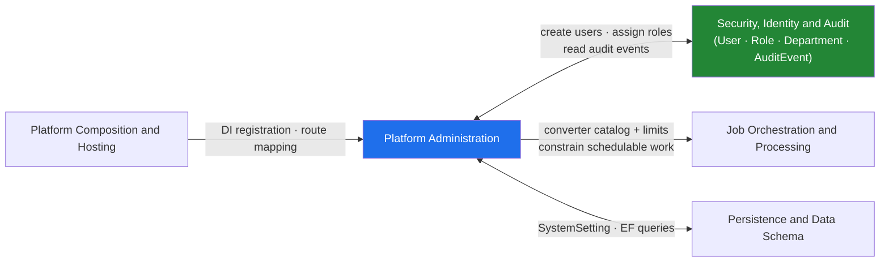
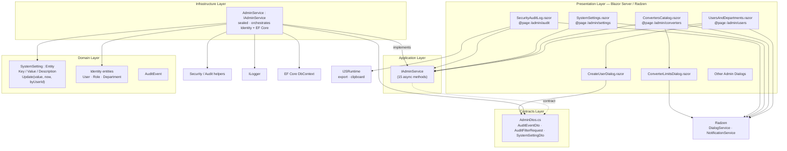
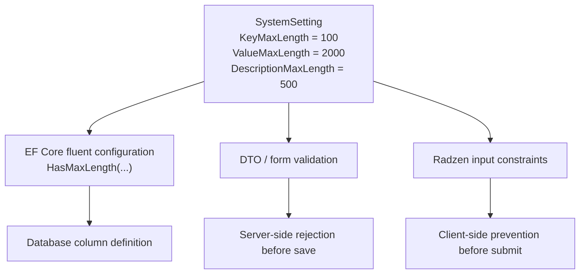
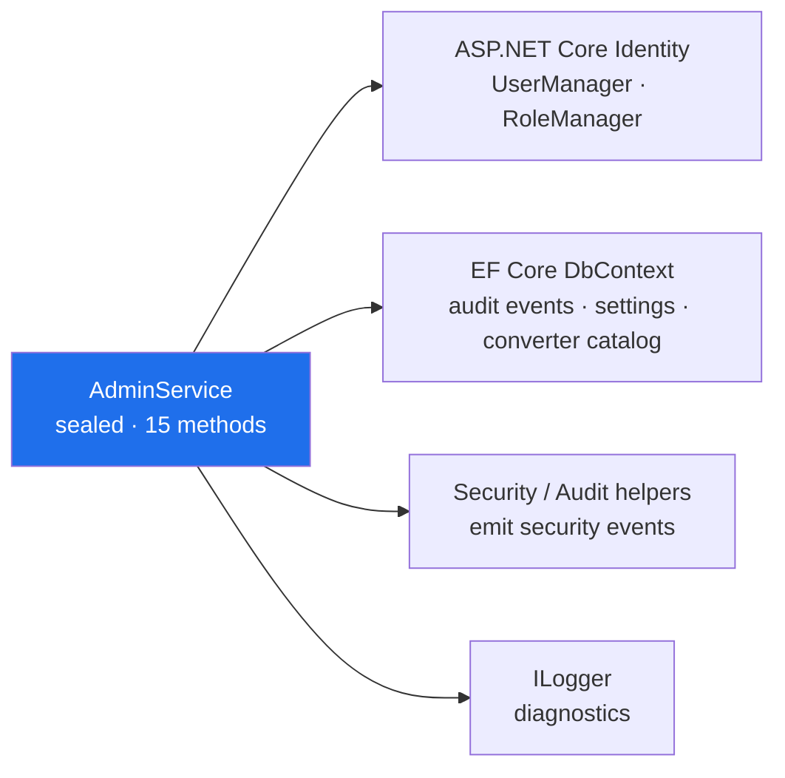
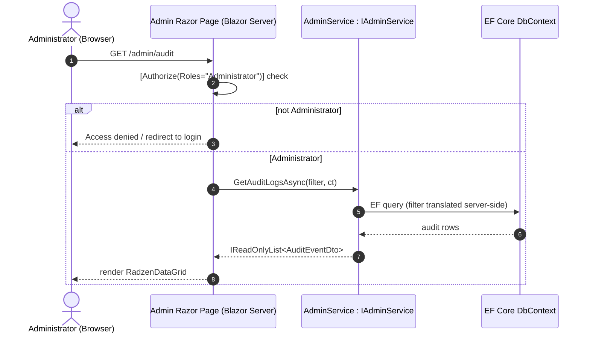
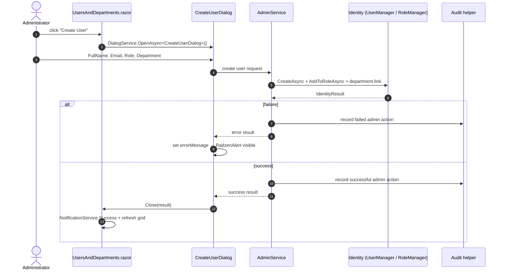
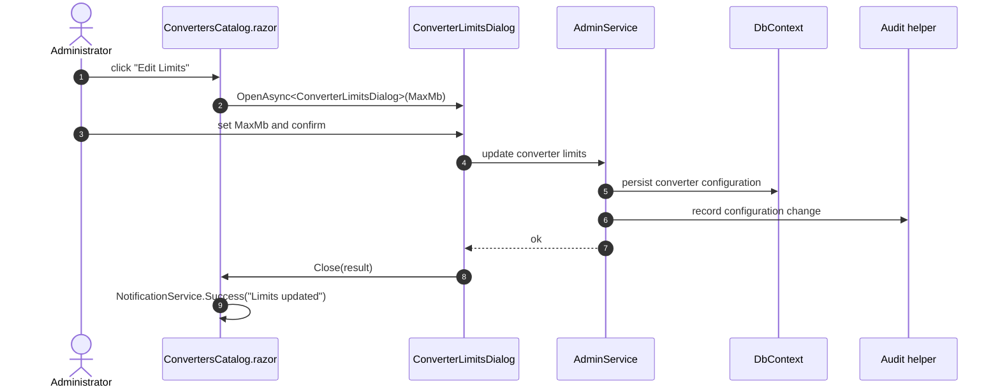
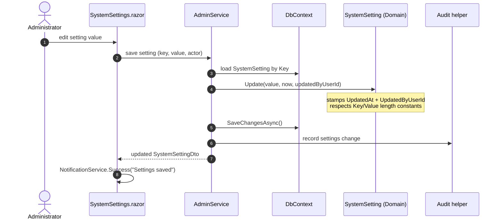
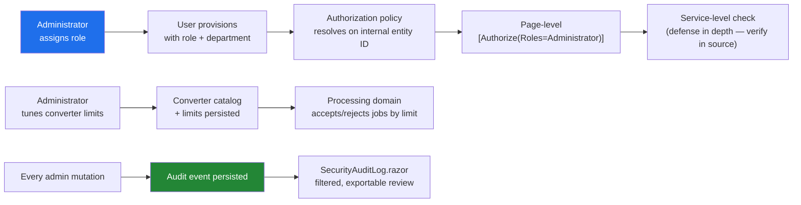

# Platform Administration

## EConverter — Administrative Governance Domain Documentation

---

## 1. Overview

**Platform Administration** is a supporting business domain inside EConverter responsible for the operational governance of the running platform. Where the core domains create value (documents are converted, indexed, and queried), Platform Administration *stewards the conditions under which that value is created*: who may operate the system, which converters are permitted to run and within what bounds, which configuration values the platform reads at runtime, and what trail of evidence exists after the fact.

The domain is deliberately modest in scope — importance is rated 7.2/10 for the backing service and 6.8/10 for the console, with overall complexity 5.5/10 — because it sits on mature framework primitives (ASP.NET Core Identity, EF Core, Blazor Server, Radzen). Its architectural difficulty is not in the algorithms; it is in **authorization enforcement, audit completeness, and keeping validation constants consistent between UI, service, and database**.

The domain is delivered as two cooperating submodules:

| Submodule | Importance | Nature | Responsibility |
|---|---|---|---|
| **Administration Service** | 7.2 / 10 | Application + Infrastructure service | User/role/department provisioning, converter catalog and limit configuration, system setting persistence, audit querying |
| **Administration Console** | 6.8 / 10 | Blazor Server + Radzen UI | Four role-guarded admin pages plus dialog components for creation and tuning flows |

Together they form a clean, layered unit whose only contact with the rest of the platform is through well-defined contracts — `IAdminService` for the service boundary, `admin/*` routes for the UI boundary, and `SystemSetting` / Identity entities for the persistence boundary.

---

## 2. Position Within the Platform

Platform Administration does not stand alone. It is a **governance layer** with upstream identity dependencies and downstream operational effects.



**Relationship semantics, verified against the domain graph:**

- **Administration → Security, Identity and Audit** — `Service Call`, strength **8.0**. Admin operations create users, assign roles and departments, and read audit events. Governance is layered on top of identity.
- **Administration → Job Orchestration and Processing** — `Service Call`, strength **6.5** (a *soft* dependency). Converter catalog availability and per-converter limits constrain what the processing domain may schedule. This is a configuration dependency with algorithmic effect: an admin change to a converter's `MaxMb` propagates directly into whether a job is accepted.
- **Platform Composition and Hosting → Administration** — `Service Call`, strength **9.0**. `Program.cs` registers `IAdminService` in DI and maps the admin routes; the pages resolve the service in-process with no HTTP hop.
- **Administration ↔ Persistence** — `Data Dependency` via `SystemSetting` and EF Core queries over the merged Identity + domain schema.

The critical distinction: **this domain does not convert, index, or edit documents.** It configures *whether* and *how much* of those operations are possible.

---

## 3. Architecture

### 3.1 Layered Structure

Platform Administration is distributed across five layers of the Clean Architecture solution — no layer is bypassed, and no layer reaches upward.



The dependency direction is strictly downward: Web consumes Application; Application declares the contract; Infrastructure implements it and reaches Domain; Domain depends on nothing but `DocumentConverter.Domain.Common`. This is verified by the solution's compile graph — the `Architecture.Tests` project enforces layer rules.

### 3.2 Runtime Model

Under Blazor Server, page logic executes **on the server circuit**. When a page injects `IAdminService` and awaits a method, the call is an in-process DI resolution — no HTTP round trip, no serialization boundary. This has three consequences worth understanding:

1. **Latency is database latency**, not network latency. The perceived responsiveness of `/admin/audit` is entirely a function of EF query translation quality.
2. **The circuit is stateful.** A long `GetAuditLogsAsync` on a large audit table blocks that circuit's dispatcher. Async/await is not optional — every method on the interface returns `Task`, which is precisely why.
3. **Authorization is enforced twice** — at the page level via `[Authorize(Roles = "Administrator")]` and ideally again in the service layer through the security helpers used by `AdminService`. Defense in depth: an authorization bypass on one page must not become an authorization bypass on the entire domain.

### 3.3 Component Inventory

| Component | Path | Role |
|---|---|---|
| `IAdminService` | `src/DocumentConverter.Application/Admin/IAdminService.cs` | Application boundary contract |
| `AdminService` | `src/DocumentConverter.Infrastructure/Admin/AdminService.cs` | `sealed` implementation, 15 methods |
| `AdminDtos.cs` | `src/DocumentConverter.Contracts/Admin/AdminDtos.cs` | Three immutable positional records |
| `SystemSetting` | `src/DocumentConverter.Domain/System/SystemSetting.cs` | Configuration aggregate root |
| `UsersAndDepartments.razor` | `src/DocumentConverter.Web/Components/Pages/Admin/` | `/admin/users` |
| `ConvertersCatalog.razor` | same | `/admin/converters` |
| `SystemSettings.razor` | same | `/admin/settings` |
| `SecurityAuditLog.razor` | same | `/admin/audit` |
| `CreateUserDialog.razor` | `src/DocumentConverter.Web/Components/Pages/Admin/Dialogs/` | User provisioning modal |
| `ConverterLimitsDialog.razor` | same | Per-converter limit tuning modal |

---

## 4. Domain Model — `SystemSetting`

`SystemSetting` is the only true domain entity the Platform Administration domain contributes; everything else it manipulates belongs to the Identity domain. Its design is therefore worth reading closely, because it is the model every other configuration surface will be measured against.

### 4.1 Structure

| Element | Definition | Rationale |
|---|---|---|
| `sealed class SystemSetting` | derives from shared `Entity` | Entity base supplies identity; sealing prevents accidental inheritance-based variation of an invariant-bearing type |
| `Key` | `private set`, default-initialized | Immutable after construction — a setting's identity cannot be retargeted |
| `Value` | `private set` | Mutated only through `Update` |
| `Description` | `private set` | Human-readable documentation of the setting's effect |
| `UpdatedAt` | `private set` | Audit timestamp, stamped by the domain, not the caller |
| `UpdatedByUserId` | `Guid?` | Audit actor; nullable to accommodate system-generated writes |
| `KeyMaxLength = 100` | public const | Published invariant consumed by EF configuration **and** DTO validation |
| `ValueMaxLength = 2000` | public const | same |
| `DescriptionMaxLength = 500` | public const | same |

### 4.2 Constructors and Mutation Path

```csharp
// Private parameterless constructor — reserved for EF Core materialization only
private SystemSetting() { }

// Public constructor — carries identity
public SystemSetting(Guid id) : base(id) { }

// The single guarded mutation path
public void Update(string value, DateTime now, Guid? updatedByUserId) { /* … */ }
```

Two design decisions carry real weight here:

**The dual-constructor pattern.** The private parameterless constructor exists because EF Core materializes entities without invoking user-defined constructors with arguments. Making it private means no application code can create a `SystemSetting` without an identity — the invariant "a setting always has an Id" is enforced by the compiler.

**The single `Update` method.** `Update` simultaneously replaces the value and stamps `UpdatedAt` / `UpdatedByUserId`. There is no way to change a value without refreshing the audit fields, because there is no setter. This is the write-path guarantee that makes the settings page trustworthy: *if the value changed, the audit metadata changed with it.*

### 4.3 Published Length Constants

The `KeyMaxLength` / `ValueMaxLength` / `DescriptionMaxLength` constants are the domain's most practically important export. They are consumed in three places that must never diverge:



If any of these three were independently hardcoded, a 2,001-character value would pass UI validation, pass DTO validation, and fail at the database — surfacing as an opaque `DbUpdateException` instead of a usable validation message. Publishing the constant eliminates that class of failure by construction.

---

## 5. Contracts — `AdminDtos.cs`

The contracts layer holds three `public sealed record` positional DTOs. Immutability is structural, not conventional.

### 5.1 `AuditEventDto`

The only shape the audit UI ever sees. Carries: audit identity, actor, event type, resource, IP address, metadata, and timestamp.

Critically, **the UI never touches an EF entity.** `AdminService` projects entities into this record before returning. This means:

- Persistence model changes (column renames, new navigation properties, schema migrations) never break the audit page.
- Lazy-loading surprises cannot leak into the Blazor circuit.
- The DTO is serialization-safe if a future API surface exposes audit data.

### 5.2 `AuditFilterRequest`

```csharp
public sealed record AuditFilterRequest(
    string?   EventType  = null,
    string?   SearchTerm = null,
    DateTime? From       = null,
    DateTime? To         = null,
    int       Take       = 100);
```

Every filter field is optional with a sensible default. Two properties matter operationally:

- **`Take` defaults to 100.** This is a deliberate cap on response size. An unfiltered audit query against a large table returns a bounded page rather than the entire history — protecting both the database and the Blazor circuit. Callers may raise it, but they must do so explicitly.
- **All filters are nullable.** The request is ergonomic to construct incrementally from page state (a filter control may be empty) and safe over the wire.

Because it is a positional record, the page's filter controls bind directly to its constructor parameters — no separate binding view model, no mapper.

### 5.3 `SystemSettingDto`

The read/write projection for the settings page. Write flows pass `value` and `actor` through to `SystemSetting.Update`, meaning the DTO layer never bypasses the domain's guarded write path.

---

## 6. The Application Contract — `IAdminService`

`IAdminService` is the primary boundary between UI and infrastructure. It lives in the Application project, which means **it has no dependency on EF Core or ASP.NET Core Identity** — the interface is portable, and Infrastructure supplies the implementation.

### 6.1 Contract Surface

The audit and settings portion, verified directly from the interface:

```csharp
public interface IAdminService
{
    Task<IReadOnlyList<AuditEventDto>> GetAuditLogsAsync(
        AuditFilterRequest request, CancellationToken ct = default);

    Task<IReadOnlyList<string>> GetAuditDistinctEventTypesAsync(
        CancellationToken ct = default);

    Task<IReadOnlyList<SystemSettingDto>> GetSettingsAsync(
        CancellationToken ct = default);

    // …user/role/department CRUD, converter configuration — 15 methods total
}
```

Three interface conventions hold across all fifteen methods:

| Convention | Implementation | Why |
|---|---|---|
| **All methods return `Task`** | `Task<T>` or `Task` | The UI must await without blocking the Blazor circuit |
| **All methods accept `CancellationToken ct = default`** | Default parameter | Callers may pass a token (page navigation, circuit teardown) but are not forced to |
| **All collections are `IReadOnlyList<T>`** | Not `IEnumerable`, not `List` | No deferred execution crossing the boundary; no caller mutation of returned data |

The `IReadOnlyList` choice deserves emphasis: returning `IEnumerable<T>` from a service backed by EF would either materialize silently at an unpredictable moment or hand back a live query. Returning `IReadOnlyList` forces materialization *inside* the service, where it belongs, and makes the collection's size and mutability explicit.

### 6.2 The 15-Method Implementation

`AdminService` is declared `sealed` — appropriate for an infrastructure adapter with no intended extension points. It orchestrates four collaborators:



Responsibilities break into five functional groups:

1. **User provisioning** — `UserManager.CreateAsync`, role assignment via `AddToRoleAsync`, department membership linkage.
2. **Role and department management** — role lookup and creation through `RoleManager`; department entity management through EF.
3. **Converter catalog configuration** — read/enumerate converters, update availability and per-converter limits (notably `MaxMb`).
4. **System settings persistence** — load `SystemSetting` by `Key`, invoke the domain's `Update`, then `SaveChangesAsync`.
5. **Audit querying** — compose the filtered EF query from `AuditFilterRequest`, project to `AuditEventDto`, and expose distinct event types for the filter dropdown.

**Invariant enforced at this layer:** every mutation method emits an audit event and a log entry. Verification failures produce a **failed-action audit record plus `LogWarning`**, not just a thrown exception. This is the mechanism that closes the compliance loop — an attempted but rejected admin action is itself evidence.

### 6.3 Server-Side Filter Translation

`AuditFilterRequest` is not applied in memory. The service composes an `IQueryable` and lets EF translate all four filter dimensions to SQL:

```
request.EventType  → WHERE EventType = @p0
request.SearchTerm → WHERE (… LIKE %@p1% …)
request.From / To  → WHERE Timestamp >= @p2 AND Timestamp <= @p3
request.Take       → TOP(@p4) / LIMIT @p4
```

This matters because the audit table is append-only and grows monotonically. Client-side filtering would mean transferring the entire history over the database connection on every page refresh — unacceptable at scale and a plausible cause of Blazor circuit timeouts.

---

## 7. The Administration Console

Four pages, each decorated with `@page` routing and protected by `[Authorize(Roles = "Administrator")]`.

### 7.1 Page-by-Page

| Route | Component | Function | Notable Dependencies |
|---|---|---|---|
| `/admin/users` | `UsersAndDepartments.razor` | User, role and department management; delegates creation to dialogs | `IAdminService`, `DialogService`, `NotificationService` |
| `/admin/converters` | `ConvertersCatalog.razor` | Converter catalog grid; availability and limit editing | `IAdminService`, `DialogService`, `NotificationService` |
| `/admin/settings` | `SystemSettings.razor` | Settings form; also surfaces AI options | `IAdminService`, **`IDocumentIntelligenceService`** |
| `/admin/audit` | `SecurityAuditLog.razor` | Read-only audit viewer with filtering and export | `IAdminService`, **`IJSRuntime`** |

Every page sets `PageTitle` and composes its layout with `RadzenStack` / `RadzenCard`. Every page injects `NotificationService` for toast feedback and `DialogService` for modal orchestration — a consistent UX vocabulary across the console.

Note that `/admin/settings` is the only page with a second service dependency (`IDocumentIntelligenceService`). This is architecturally significant: it means the settings page is a **presentation-level aggregation point** for AI configuration, and a change to the intelligence service's configuration surface can ripple into the admin console. It is the console's one non-trivial coupling.

### 7.2 Dialog Component Pattern

Admin dialogs follow a uniform contract:

1. The page opens a dialog via `DialogService.OpenAsync<TDialog>()`.
2. The dialog receives inputs as `[Parameter]` values.
3. The user submits.
4. The dialog calls `DialogService.Close(result)` with a result object.
5. **The page** — not the dialog — calls `IAdminService` and refreshes its grid.

This separation is deliberate: dialogs are pure input collection; persistence belongs to the page, which owns the grid state that must be refreshed afterward. Shared dialogs additionally use `[Parameter]` + `EventCallback` for visibility and completion notification.

### 7.3 `CreateUserDialog` — Conditional Error Surface

`CreateUserDialog.razor` demonstrates the failure path built into the dialog pattern:

- A conditional `RadzenAlert` renders only when `errorMessage` is non-empty.
- Inputs use `RadzenFormField` / `RadzenTextBox`.
- On failure, the service returns an error result; the dialog sets `errorMessage`; the alert becomes visible **in place**, with the user's entered data intact.

This is the right behavior for identity provisioning, where the failure modes are numerous and specific — duplicate email, weak password policy, role not found, department unassigned. Destroying the modal on failure and forcing re-entry would be hostile; surfacing the specific `IdentityResult` failure inline is the correct trade.

### 7.4 `ConverterLimitsDialog` — The Constraint Boundary

`ConverterLimitsDialog.razor` is the console's most operationally consequential control, and it is instructive that its implementation is so small.

```razor
<RadzenNumeric @bind-Value="MaxMb" Min="1" Max="2048" Step="10" />
```

| Attribute | Value | Meaning |
|---|---|---|
| `Min` | 1 | Rejects zero and negative limits — a converter with 0 MB capacity is non-functional |
| `Max` | 2048 | Upper bound; 2 GB is the ceiling for a single conversion input |
| `Step` | 10 | Coarse granularity — discourages meaningless precision in a coarse operational knob |

The caption beneath the field explains **rejection behavior** — what happens to a document that exceeds the limit. This is a good pattern: the operator tuning the knob is told the user-visible consequence, not just the numeric bound.

The dialog is a **soft-governance control**: its value does not enforce anything by itself. Enforcement lives in the processing domain, which consults the converter catalog and its limits before accepting work. Platform Administration sets the policy; Job Orchestration enforces it. This is exactly the `strength 6.5` configuration dependency identified in the domain graph.

### 7.5 Audit Export

`SecurityAuditLog.razor` uses `IJSRuntime` for export and clipboard operations. Export is a **client-side interaction concern** — the data is already materialized as `AuditEventDto` records in the page's state, and JS Interop handles the browser download or clipboard write. No additional server call, no additional authorization surface. This is the correct place to draw the line: the service decides *what data you may read*; the JS layer decides *how you take it with you*.

---

## 8. Key Workflows

### 8.1 Page Access and Read Path



### 8.2 User Provisioning



The critical detail: **the failed path also writes an audit record.** An admin repeatedly attempting to create a user that fails policy checks is a behavioral signal, and the domain captures it.

### 8.3 Converter Limit Update



From this moment, the processing domain's job acceptance behavior changes — the configuration dependency resolves into a functional effect.

### 8.4 System Setting Write



The domain method is the pivot point. `AdminService` never assigns `Value` directly — it delegates to `Update`, which guarantees the audit stamp cannot be forgotten.

---

## 9. Design Characteristics

### 9.1 Strengths

**Publication of invariants as constants.** `KeyMaxLength` / `ValueMaxLength` / `DescriptionMaxLength` are consumed by EF configuration *and* validation. The UI, the service, and the database cannot disagree about a limit — by construction, not by convention.

**Guarded write path.** `SystemSetting.Update` is the only mutation route. There is no setter. Audit metadata cannot desynchronize from the value it describes.

**No entity leakage.** `AdminService` returns contract DTOs, never EF entities. The persistence model is free to evolve without touching the UI, and lazy-loading behavior cannot escape into the Blazor circuit.

**Bounded audit queries.** `AuditFilterRequest.Take = 100` default, combined with server-side filter translation, means the audit page cannot be used — accidentally or deliberately — to transfer an entire append-only history into a browser circuit.

**Failure is audited.** Both successful and failed admin actions produce audit records. Rejected attempts are evidence, not silence.

**Interface portability.** `IAdminService` lives in Application and references no EF Core or Identity types. The implementation could be replaced — an API-backed implementation, a caching decorator, a test double — without touching a single page.

### 9.2 Structural Tensions

**Double authorization enforcement is aspirational, not guaranteed.** The research materials specify page-level `[Authorize(Roles = "Administrator")]` as verified, and describe service-layer enforcement through security helpers as the ideal ("defense in depth"). This is a claim to verify in source: if `AdminService` does not independently check the caller's role, then any future consumer of `IAdminService` — a minimal API endpoint, a background task, a new page missing the attribute — inherits an unguarded surface.

**`/admin/settings` has a second domain dependency.** The page injects `IDocumentIntelligenceService` alongside `IAdminService`. This makes the settings page a presentation-level aggregation point for two domains' configuration, which is pragmatic but means AI configuration changes can ripple into an admin page without passing through `IAdminService`. Consider whether AI settings should be surfaced through a dedicated contract instead.

**`AdminService` is a 15-method adapter over two data sources.** It orchestrates Identity (`UserManager` / `RoleManager`) and EF Core simultaneously. Transactional consistency across those two stores is not a single unit of work — user creation through `UserManager` and department linkage through EF can partially succeed. `CreateUserDialog`'s inline error surface partially mitigates the UX consequence, but the data-integrity question remains worth confirming.

**Authorization role name is a string literal.** `[Authorize(Roles = "Administrator")]` appears as a magic string across four pages. A typo in one page silently produces a default-deny (safe failure) but a refactor that renames the role silently breaks all four. A shared constant would be strictly better.

---

## 10. Operational Summary

### 10.1 What Platform Administration Controls

| Control | Surface | Downstream Effect |
|---|---|---|
| User identity and role membership | `/admin/users` | Who can authenticate and what surfaces they reach |
| Department assignment | `/admin/users` | Organizational grouping and any department-scoped rules |
| Converter availability | `/admin/converters` | Whether the processing domain may schedule a given conversion |
| Converter input limits (`MaxMb`, 1–2048, step 10) | `/admin/converters` → `ConverterLimitsDialog` | Which documents are accepted or rejected by the pipeline |
| System settings | `/admin/settings` | Runtime configuration values read by the application |
| AI options | `/admin/settings` (via `IDocumentIntelligenceService`) | Intelligence-layer behavior (zero-egress vs. external provider policy) |
| Audit review | `/admin/audit` | Compliance evidence: who did what, from which IP, when |
| Audit export | `/admin/audit` (via `IJSRuntime`) | Evidence transport for external audit processes |

### 10.2 Governance Chain



### 10.3 Key Invariants

1. **A setting's `Key` never changes after construction.** Only `Value` and the audit stamp move.
2. **Every setting write refreshes `UpdatedAt` and `UpdatedByUserId`.** Guaranteed by the absence of a setter.
3. **Length limits are single-sourced.** UI, validation, and schema read from the same domain constants.
4. **Audit responses are bounded.** `Take` defaults to 100; filtering is server-side.
5. **Admin pages return DTOs, never entities.** The persistence model never leaks to the presentation layer.
6. **Rejected admin actions are audited.** Failure is evidence.
7. **Converter limits are policy, not enforcement.** The processing domain owns enforcement; the admin console owns the policy value.

---

## 11. Verification Notes

Several statements above derive from the research materials and should be confirmed against source before being treated as settled:

| Claim | Status | What to Confirm |
|---|---|---|
| Service-layer authorization in `AdminService` (defense in depth) | Described as ideal, not verified | Read `AdminService.cs` for role checks or authorization attributes on each mutation |
| All four pages carry `[Authorize(Roles = "Administrator")]` | Verified per research materials | Spot-check all four `.razor` files for the attribute |
| All 15 `IAdminService` methods and their exact signatures | Only 3 method signatures given verbatim; remaining 12 inferred from the implementation description | Read `IAdminService.cs` in full |
| Audit filters translated to SQL, not applied in memory | Inferred from the design description | Confirm `IQueryable` composition before materialization in `GetAuditLogsAsync` |
| Transactional consistency of Identity + EF in user creation | Not addressed in research materials | Confirm whether a transaction wraps `UserManager.CreateAsync` and department linkage |
| `ConverterLimitsDialog` bound exactly to `MaxMb` with Min 1 / Max 2048 / Step 10 | Verified per research materials | Read the dialog for any additional bound fields |

---

## 12. Conclusion

Platform Administration is a small domain with an outsized governance function. Its complexity score of 5.5/10 is honest — there are no novel algorithms here, no distributed state, no concurrency puzzles. The work is CRUD over Identity, configuration, and audit, sitting on framework primitives that have solved the hard problems already.

What makes it worth documenting carefully is that its failure modes are **quiet**. A missing service-layer authorization check does not throw. A desynchronized length limit does not surface until a user enters 2,001 characters. An unaudited rejected action leaves no trace of a probing administrator. A converter limit applied only in the UI looks correct until something else submits a job.

The domain's design already pushes back against most of these: constants published from the domain, a guarded write path with no setters, bounded server-side audit queries, DTO projection at the boundary, and failure auditing built into the mutation flow. The remaining work is verifying that the defense-in-depth authorization claim holds in source, and deciding whether the settings page's direct dependency on `IDocumentIntelligenceService` should be routed through a dedicated contract instead.

The best summary of the domain's architectural intent is its own contract shape: **fifteen async methods, cancellation-aware, returning read-only DTO projections, backed by a domain entity whose only mutation path stamps its own audit trail.** Everything the console does is a UI over that promise.