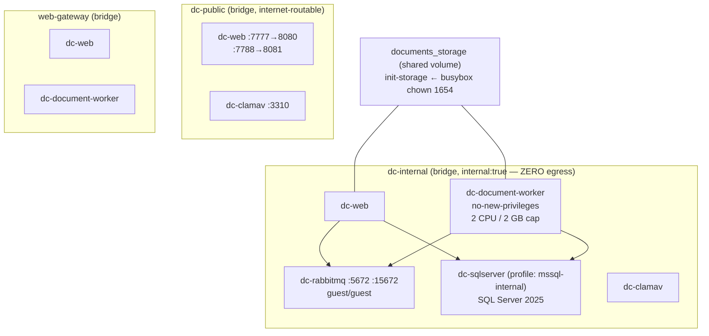

# Platform Composition and Hosting

## EConverter — Composition Root, Runtime Hosting, and Deployment Topology

**Document type:** Architecture module specification
**Scope:** `Platform Composition and Hosting` domain module
**System:** EConverter (ASP.NET Core / .NET 10, Blazor Server + Radzen, Clean Architecture)
**Assessment basis:** verified `.csproj` compile graph, `Program.cs` composition root, middleware ordering, hosted services, standalone worker host, and deployment manifests
**Verdict up front:** The composition layer is **architecturally coherent and structurally disciplined**, but it is the single file that knows every layer simultaneously and therefore concentrates every wiring risk in the system. Two material drifts and one authorization asymmetry sit inside this module: an unconsumed queue-fallback channel, a SQL Server–shaped migration chain behind a PostgreSQL-primary runtime, and a SignalR hub mapped without an authorization gate.

---

## 1. Purpose and Position in the Architecture

`Platform Composition and Hosting` is the **runtime assembly layer** of EConverter. It is not a business domain in the DDD sense — it holds no aggregates, no invariants, no use-case logic. Its responsibility is narrower and more consequential: it is the only place in the codebase where every other layer is simultaneously visible, instantiated, and bound into a running process.

Three responsibilities define the module:

1. **Composition** — bind abstractions from `DocumentConverter.Application` to implementations from `DocumentConverter.Infrastructure` through the dependency injection container, organized as per-feature extension methods across nine namespaces (`Admin`, `AI`, `Common`, `Documents`, `Editor`, `Processing`, `Security`, `Storage`, `Identity`, `Messaging`).
2. **Hosting** — configure the request pipeline (middleware ordering, authentication, authorization, antiforgery, rate limiting), register hosted background services, and expose HTTP/Blazor/SignalR surfaces.
3. **Cross-cutting enforcement** — apply security headers, health checks, OpenTelemetry instrumentation, and the identity compatibility shim that projects external `ClaimsPrincipal` claims into domain users so application services never touch `HttpContext`.

Two executables are produced from the same assembly discipline:

| Executable | Role | Composition root | Deployable artifact |
|---|---|---|---|
| `DocumentConverter.Web` | Blazor Server UI + Minimal API + in-process background workers | `src/DocumentConverter.Web/Program.cs` (247 LOC, top-level statements) | Container image (multi-network compose topology) |
| `DocumentWorker` | Headless job consumer / poller executing the conversion transaction | `src/Workers/DocumentWorker/Program.cs` (Generic Host) | Own `Dockerfile`, horizontally scalable |

The architectural significance of this split is that **the same application and infrastructure assemblies are composed twice, by two different roots, with different hosting semantics**. That is where the module's most under-reported risk lives (§7, Finding D-7): the two roots do not compose the same *behavior*, only the same *dependencies*.

---

## 2. Position Within the Verified Compile Graph

The composition root is the terminal node of a strictly layered dependency chain. Verified from `ProjectReference` entries — not inferred:

```
DocumentConverter.Domain          ← zero external package references
    ↑
DocumentConverter.Contracts       ← transport DTOs + queue messages
DocumentConverter.Processing.Abstractions  ← IDocumentProcessor contract
    ↑
DocumentConverter.Application     ← use-case contracts only
    ↑
DocumentConverter.Infrastructure  ← all adapters
    ↑
┌───────────────────────────┬──────────────────────────┐
│ DocumentConverter.Web     │ DocumentWorker           │
│ composition root + UI     │ composition root (headless)│
└───────────────────────────┴──────────────────────────┘
```

`Application` references **only** Domain, Contracts, and Processing.Abstractions — there is no Infrastructure leakage. `Domain` carries zero external package references. `tests/DocumentConverter.Architecture.Tests` exists in `DocumentConverter.slnx` as the enforcement mechanism for these rules. The composition roots are permitted to see everything precisely because their job is to be the *only* place that sees everything.

`Infrastructure.csproj` uses versionless `PackageReference` entries (central package management) for EF Core + Npgsql, Identity, PdfPig, OpenXml, PDFsharp, Tesseract, RabbitMQ.Client, `System.Security.Cryptography.Pkcs`, `ManagedCode.MarkItDown`, and SkiaSharp. This keeps the transitive graph consistent between the web host and the standalone worker — a real benefit given that both compose the same Infrastructure assembly.

---

## 3. Web Host Composition — `Program.cs`

### 3.1 Registration Structure

`Program.cs` is flat by design. It builds a `WebApplicationBuilder`, then registers services as an **ordered list of feature-area extension methods**, each consuming Application abstractions and binding Infrastructure implementations:

```csharp
builder.Services.AddFeatureServices();   // fan-out across nine feature namespaces
```

Fan-in complexity is measurably high (≈8.0) — the file is the single point that knows every layer. The design discipline compensating for that is that the file contains **no conditional DI logic and no business logic**. Any new capability requires exactly one line here plus one extension method in its feature namespace.

| Feature area | Responsibility bound |
|---|---|
| Admin | User/role/department management, converter catalog, system settings |
| AI | Intelligence service, indexing channel, external AI client, RAG orchestrator |
| Common | `IUserContext`, shared primitives |
| Documents | Document service, storage coordination, hashing |
| Editor | PDF engine, font resolver |
| Processing | Processors, dispatcher, converters catalog |
| Security | Audit service, malware scanner, security primitives |
| Storage | Storage provider + AES-GCM encryption service |
| Identity | ASP.NET Core Identity, claims transformation |
| Messaging | RabbitMQ dispatcher and options |

### 3.2 Cross-Cutting Registration

- **Persistence** — EF Core `AppDbContext` registered as **scoped**, options resolved from configuration, with Npgsql as a first-class provider. Identity persistence rides the same `DbContext` via `Microsoft.AspNetCore.Identity.EntityFrameworkCore`, merging identity tables with the domain schema in a single unit of work.
- **Health checks** — DB, storage, and downstream dependency probes exposed on a dedicated probe path. The `/health` endpoint is **anonymous by design** (orchestrator liveness), which is the one intentional exception to the module-wide authorization posture.
- **OpenTelemetry** — instrumentation for HTTP, EF Core, and custom `ActivitySource` emission, exported to an external collector.
- **Authentication** — `Microsoft.AspNetCore.Identity` cookie authentication with login path `/account/login`.

### 3.3 Dependency Injection Lifetime Map

Lifetimes are load-bearing here; several are chosen to make cross-host parity possible.

| Lifetime | Registrations | Rationale |
|---|---|---|
| **Singleton** | `AesGcmStorageEncryptionService`, `TesseractOcrEngine`, `ScannedPdfDetector`, `PdfCapabilityAnalyzer`, all seven `IDocumentProcessor` implementations, `RabbitMqJobDispatcher`, `IJobNotificationService`, `IDocumentIndexingChannel` | Stateless or inherently shared resources (native OCR handles, in-memory indexes, queue connection) |
| **Scoped** | `AppDbContext`, `IDocumentService`, `IProcessingService`, `IMalwareScanner`, `IAuditService`, `IAdminService`, `IPdfEngine`, `IExternalAiClient`, `IUserContext`, `EnterpriseAiChatService` | Request- or circuit-scoped unit of work and user context |
| **Hosted** | `JobProcessorWorker` (conditional on `Processing:RunWorkerInWeb`), `DocumentIndexingWorker`, `CdpDownloadWatcher` | Background loops |

> **Caveat worth stating plainly:** `AesGcmStorageEncryptionService`, `TesseractOcrEngine`, and all processors are singletons. That is correct for performance and correct for native-handle management, but it means **key material and native handles are process-lifetime, not configuration-reload-safe**. Key rotation requires process restart. This is not a defect — but it is a constraint that deployment documentation must state, because operators will otherwise assume hot rotation.

---

## 4. HTTP Request Pipeline

### 4.1 Verified Middleware Order

Order is a contract in this host, not an implementation detail. Verified sequence:

```
ExceptionHandler / HSTS        (non-Development only)
      ↓
StatusCodePages → /not-found
      ↓
HttpsRedirection
      ↓
SecurityHeadersMiddleware      ← must precede all short-circuits
      ↓
ResponseCompression            (Brotli + Gzip)
      ↓
StaticFiles                    (immutable cache headers)
      ↓
Routing
      ↓
RateLimiter                    (login-policy, processing-policy)
      ↓
Authentication
      ↓
Authorization
      ↓
Antiforgery
      ↓
Endpoints · Hub · Razor components
```

Three ordering decisions carry specific consequences:

1. **`SecurityHeadersMiddleware` before compression and static files** — headers are appended to `context.Response.Headers` *before* awaiting `_next`. Consequently static assets, error responses, and rate-limiter rejections all receive `X-Content-Type-Options: nosniff`, CSP, and frame-restriction headers. A later position would allow short-circuits to emit un-headered responses.
2. **Rate limiter after routing, before authentication** — throttling applies regardless of credential validity, so credential-stuffing attempts are bounded before they consume password-hash CPU.
3. **Authorization before antiforgery** — unauthenticated requests are rejected at 401 rather than being evaluated against antiforgery tokens, which keeps the antiforgery path for authenticated mutations only.

### 4.2 `SecurityHeadersMiddleware`

A classic `RequestDelegate` middleware: constructor captures `_next`, `InvokeAsync` mutates response headers pre-continuation. The Blazor Server hosting model constrains the CSP in two non-negotiable ways:

- `connect-src` **must** permit `wss:` — the SignalR circuit is a WebSocket connection; omit it and the UI silently degrades to non-interactive.
- `script-src` **must** accommodate `blazor.web.js` — and, if inline initialization is used, either a nonce or a hash.

This is a real coupling: the CSP is not a static hardening header here, it is a header whose correctness depends on the Blazor runtime's transport. Any future CSP tightening must be validated against an active circuit, not against a static page load.

### 4.3 Rate Limiting Policies

| Policy | Limit | Queue | Applied to |
|---|---|---|---|
| `login-policy` | 10 requests / 60 s | 0 (reject immediately) | `/account/*` authentication surfaces |
| `processing-policy` | 20 concurrent | 10 queued | Job submission surfaces |

`login-policy` with `queue: 0` returns `429 Too Many Requests` rather than holding requests — the correct choice for an endpoint whose abuse mode is high-volume guessing. `processing-policy` uses a concurrency limiter, not a request-rate limiter, which matches the underlying cost model: conversion submissions are expensive per-request but not inherently high-frequency.

### 4.4 Endpoint Authorization Matrix

| Group | Prefix | Gate | Verification |
|---|---|---|---|
| Documents | `/api/documents` | `RequireAuthorization()` | `DocumentEndpoints.cs:20` |
| Folders | `/api/folders` | `RequireAuthorization()` | `DocumentEndpoints.cs:21` |
| Editor | `/api/editor` | `RequireAuthorization()` | `EditorEndpoints.cs:14` |
| Processing | `/api/processing` | `RequireAuthorization()` | `ProcessingEndpoints.cs` |
| Intelligence | `/api/documents-ai` | `RequireAuthorization()` | `DocumentIntelligenceEndpoints.cs` |
| Account | `/account/*` | Mixed + `login-policy` limiter | `AccountEndpoints.cs` |
| Health | `/health` | **Anonymous (intentional)** | `Program.cs` |
| Hub | `/hubs/processing` | **Absent — see Finding C-2** | `Program.cs:236` |

> **Finding C-2 (MEDIUM, SOLID):** `app.MapHub<ProcessingHub>("/hubs/processing")` is declared bare. Every other application surface is gated. This is an authorization asymmetry inside the composition root — the exact class of defect that a composition layer is supposed to prevent, because the omission is invisible from the hub's own file.

### 4.5 Identity Compatibility Shim

The boundary contract is that application services never see `HttpContext` or `ClaimsPrincipal`. Two components enforce it:

- **`AppClaimsTransformation`** — reads `email`, `preferred_username`, `sub`, and `oid` claims, resolves (or just-in-time provisions) the internal `User` entity, and emits a `dc:uid` claim. Because it is provider-agnostic by claim shape, it is **federation-ready**.
- **`HttpContextUserContext`** — surfaces the stable internal user ID to `IUserContext` consumers.

**Authorization is keyed on the internal entity ID, unconditionally.** This is a deliberate security decision: permissions survive identity-provider re-provisioning, tenant migration, and claim-format changes. It is also why the JIT-provisioning path hardcodes `AuthenticationType.Local` — see Finding D-4, where the *shape* for federated authentication exists but the *transport* does not.

---

## 5. Blazor Presentation Shell

The shell is hosted by the composition root and defines the authenticated UI contract.

| Component | Role | Notable detail |
|---|---|---|
| `App.razor` | Root document | charset, viewport, SEO description, title, base href, favicon, `<Routes />`, `blazor.web.js` bootstrap |
| `Routes.razor` | Routing + auth gate | `CascadingAuthenticationState` → `Router` (AppAssembly = `typeof(Program).Assembly`, `NotFoundPage`) → `AuthorizeRouteView` (DefaultLayout = `MainLayout`, `NotAuthorized` → `RedirectToLogin`) → `FocusOnNavigate` for h1 focus management |
| `MainLayout.razor` | Authenticated shell | Radzen hosts: `RadzenDialog`, `RadzenNotification`, `RadzenContextMenu`, `RadzenTooltip`; nav gated by `AuthorizeView`; subscribes to `IJobNotificationService` in `OnInitializedAsync` and **unsubscribes in `Dispose`** |
| `MainLayout.razor.css` | Scoped styles | `#blazor-error-ui` banner, `.dismiss`, `.rz-p-2` override, `::deep` `.rz-header` rules |
| `Login.razor` | Sign-in surface | `@page "/account/login"`, `@layout AuthLayout`, markup-only Radzen card + branded SVG — zero business logic |
| `MarkdownRenderer.cs` | Shared rendering | Static `MarkdownPipeline` (`UseAutoLinks`, `UsePipeTables`, `UseEmphasisExtras`, `UseListExtras`) → `MarkupString` |
| `FluentIcons.cs` | Icon primitives | 753 `const string` glyph code points with XML docs for IntelliSense + `Get(string name)` lookup |

Two details matter architecturally rather than cosmetically:

- **Static `MarkdownPipeline`.** The pipeline is constructed once, not per render. Rebuilding a Markdig pipeline per render is a well-known cost sink in Blazor document UIs; this avoids it.
- **Explicit notification unsubscription.** `MainLayout` holds a subscription to the singleton `IJobNotificationService` for the lifetime of a circuit. Without `Dispose` unsubscribing, every closed browser tab leaks a handler and every subsequent job event is broadcast to a dead circuit. The unsubscribe is not defensive hygiene — under a singleton publisher it is mandatory.

**CSP interaction:** the Radzen dialog/notification hosts sit *inside* the authenticated circuit, which is the correct placement — notification subscriptions then run over the authenticated SignalR connection rather than an anonymous one.

---

## 6. Endpoint Implementation Notes

### 6.1 `AccountEndpoints`

`app.MapGroup("/account")` with `MapPost("/login")` binding `[FromForm] email/password` from `HttpContext`. Delegates to `SignInManager`. Validates the return URL through a private static `UrlIsValid(string)` that **rejects non-local URLs** before redirecting — an explicit open-redirect guard. The endpoint holds no business logic; it converts a form post into an identity operation and a safe redirect.

### 6.2 `DocumentIntelligenceEndpoints`

`app.MapGroup("/api/documents").RequireAuthorization()` registering GET/POST handlers for categorization, summary generation, and key-entity extraction. Handlers bind `Contracts.AI` DTOs and delegate to `DocumentConverter.Application.AI` services. **Zero business logic in the transport layer** — the correct pattern, and worth naming explicitly because `DocumentEndpoints.cs` violates it (§7, Finding D-6).

### 6.3 `CdpDownloadWatcher` (side-car)

A `BackgroundService` built on `System.Net.WebSockets` + `System.Text.Json`. `ConfigureCdpDownloadBehaviorAsync` resolves the Chrome DevTools Protocol WebSocket URL and issues the download-behavior command (preserving original filename and extension for converted files); `SendCdpCommandAsync` serializes `{id, method, params}` JSON-RPC frames with cancellation support.

Operationally this is an **external-tooling bridge**, not a platform core: it aligns headless Chrome download semantics with the storage pipeline. It carries no authorization surface and no persistence. Its risk profile is bounded to CDP connectivity — a failed watcher means downloads keep default Chrome naming, not a platform outage.

---

## 7. Standalone Worker Host — `DocumentWorker`

### 7.1 Composition

`src/Workers/DocumentWorker/Program.cs` builds a `HostApplicationBuilder` and registers the **same Infrastructure feature areas** as the web host — Persistence, Ocr, Processing, Security, StorageEncryption, Messaging — then `AddHostedService<Worker>()`. Targets `net10.0`, Nullable + ImplicitUsings, ProjectReferences to the six solution libraries, PackageReferences for hosting, EF Core providers, and SkiaSharp. Ships its own `Dockerfile`.

A nested `sealed ConsoleJobNotificationService` implements all five notification methods (progress, completed, failed, cancelled, batch-updated) as structured `ILogger` emissions — the headless stand-in for the web host's SignalR service. Same interface, two implementations, zero change in the application layer. That is the module's cleanest piece of design.

### 7.2 Execution

`Worker.cs` is a `sealed BackgroundService` with `ExecuteAsync` (host loop) and `StartRabbitMqConsumerAsync` (broker consumer, or polling when brokered consumption is disabled). `ProcessNextJobAsync` runs the end-to-end transaction inside using-scoped stream blocks: encrypted storage read → local temp file → SHA-256 hash computation → converter invocation → encrypted upload → status/cancellation recorded back to persistence.

### 7.3 Host Parity — The Real Divergence

| Capability | `JobProcessorWorker` (web host) | `Worker` (standalone) |
|---|---|---|
| `IJobNotificationService` | `JobNotificationService` → `IHubContext<ProcessingHub>` (SignalR) | `ConsoleJobNotificationService` (ILogger) |
| `CheckBatchCompletionAsync` | ✅ called on terminal state | ❌ **not called** |
| `_indexingQueue.TryQueueDocument(...)` | ✅ called on completion | ❌ **not called** |

> **Finding D-7 (LOW severity, HIGH operational consequence):** The two hosts implement the *same documented transaction* with **different side effects**. When the platform runs the microservice topology (`Processing:RunWorkerInWeb=false`, which is what `docker-compose.yml` sets), two things silently stop happening:
> 1. **Batch jobs never reach `MarkCompleted`** from the worker path — batches stay non-terminal regardless of per-job success.
> 2. **Converted outputs are never enqueued for vector indexing** — they remain unindexed until the next web-host restart, when `DocumentIndexingWorker`'s startup hydration re-scans `Available` documents.
>
> Both failures are silent. Neither produces an error; both produce a *stale UI* and *stale retrieval*. This is the most under-reported risk in the module, and it is invisible from either file read in isolation — only composition comparison exposes it.

---

## 8. Architectural Drift — Composition Layer

### D-1 — `NoOpQueuePublisher` Does Not Exist; the Fallback Channel Has No Consumer

**Severity: HIGH — silent-stall and unbounded-memory risk**

| | Documented | Verified |
|---|---|---|
| Fallback component | `NoOpQueuePublisher` | `Channel<JobMessage> _fallbackChannel` inside `RabbitMqJobDispatcher` |
| Files matching `*NoOp*.cs` | — | **0** |
| Consumer of fallback | implied in-process pickup | **none** — `FallbackReader` exposed, never read |

```csharp
// RabbitMqJobDispatcher.cs:33
public ChannelReader<JobMessage> FallbackReader => _fallbackChannel.Reader;
```

No `.ReadAllAsync()` or `.Consume()` call site on `FallbackReader` exists in either `Web` or `DocumentWorker`. With `RabbitMQ:Enabled=false` (the `appsettings.json` default) or an unreachable broker, the message is written into an **unbounded** channel and parked permanently.

**Why the platform still works:** both workers poll the database for `Pending` jobs on a 2-second interval. The queue is a latency optimizer; the database is the true work source. But the publish path misrepresents itself in code, and `Channel.CreateUnbounded` is a memory-growth vector under sustained load with the broker down.

**Fix:** either wire a consumer to `FallbackReader`, or replace the channel with a no-op and log at `Information` that DB polling is the active path. Bound the capacity in either case. (~1 h)

---

### D-2 — Migration Chain Is SQL Server–Shaped Behind a PostgreSQL-Primary Runtime

**Severity: HIGH — deployment failure on the documented primary provider**

```csharp
// DocumentWorker/Program.cs:44 — the only migrations-history configuration in the solution
options.UseSqlServer(connectionString, sql =>
{
    sql.EnableRetryOnFailure(5, TimeSpan.FromSeconds(10), null);
    sql.MigrationsHistoryTable("__EFMigrationsHistory", "dbo");
});
```

Research materials state Npgsql as the primary persistence provider (`"a single EF Core/AppDbContext over Npgsql"`). Both providers are referenced in `Infrastructure.csproj` and `DocumentWorker.csproj`. However the migration chain — `InitialCreate`, `AddPersistentVectorAndIntelligenceIndex`, `AddCopilotChatAndMemoryPersistence`, `AddTriLanguageChunkSupport`, `WidenDocumentVectorChunkEmbedding` — carries **no provider split** and no PostgreSQL-specific annotations surfaced in configuration. `DatabaseExtensions.InitializeDatabaseAsync` performs `to_regclass` checks, so PostgreSQL is *contemplated* — but the migration artifacts are SQL Server–flavoured.

**Verdict on the documentation claim:** the "linear migration chain over PostgreSQL" statement is **UNVERIFIABLE / likely OVERSTATED**.

**Fix:** generate a PostgreSQL migration set, or document the `EnsureCreated` / raw-SQL DDL path that Npgsql actually uses. Make provider selection explicit rather than implicit. (~1 d)

---

### D-3 — Silent In-Memory Database Substitution

**Severity: MEDIUM — production trap**

```csharp
// DocumentWorker/Program.cs:56
if (!string.IsNullOrWhiteSpace(connectionString) && !connectionString.Contains("Memory", ...))
    { /* real provider */ }
else
    { builder.Services.AddDbContext<AppDbContext>(o => o.UseInMemoryDatabase("DocumentConverterDb")); }
```

`docker-compose.yml` defaults `DATABASE_CONNECTION_STRING` to `${DATABASE_CONNECTION_STRING:-}` (empty), with the SQL Server fallback wired only through `ConnectionStrings__DefaultConnection`. A worker started with neither resolved boots cleanly against an ephemeral store, reports healthy, and **processes zero real jobs**. A green worker attached to a phantom database is an operational failure mode not mentioned in any research material.

**Fix:** fail fast — throw on startup when no connection string resolves and `RabbitMQ__Enabled=true`. (~30 min)

---

### D-4 — Entra ID / OIDC Handler Is Not Registered

**Severity: MEDIUM — documented capability absent from the composition root**

| Claim | Verified |
|---|---|
| "dual authentication (Local + EntraId)" | `Program.cs` registers **only** `AddIdentity<AppIdentityUser, IdentityRole<Guid>>` |
| OIDC handler | **no** `AddAuthentication().AddOpenIdConnect(...)` / `AddMicrosoftIdentityWebApp` anywhere |
| `AuthenticationType.EntraId` | enum value exists in Domain; `AppClaimsTransformation` hardcodes `AuthenticationType.Local` on JIT provisioning |

The claims transformation *is* provider-agnostic, so the **shape** for federated authentication is present — but the **transport** is missing. Federation is a prepared integration point, not a live feature. Documentation should say "federation-ready", not "dual authentication".

**Fix:** register the OIDC handler (~4 h) or downgrade the claim (~5 min).

---

### D-6 — Inline Conversion Inside the Transport Layer

**Severity: LOW — confirmed as described**

`DocumentEndpoints.cs` is 902 lines and carries a private `static void ConvertDocxStreamToPdf(Stream, Stream)` — a full OpenXML→PdfSharp renderer living inside an endpoint-mapping static class:

```csharp
private static void ConvertDocxStreamToPdf(Stream docxStream, Stream pdfOutput)
{
    using var wordDoc = WordprocessingDocument.Open(docxStream, false);
    using var pdf = new PdfDocument();
    var font = new XFont("Arial", 11);
    ...
}
```

Result: **two DOCX→PDF implementations** with different fidelity characteristics — one in the transport layer, one in `OfficeDocumentProcessor`. The transport copy also bypasses the job pipeline entirely, which means it bypasses lease semantics, audit emission, indexing enqueue, and batch aggregation. It is a second, undocumented entry point into conversion.

**Fix:** delete it; route through `OfficeDocumentProcessor` via the pipeline. (~30 min)

---

### D-5 — `ProcessingJobLifecycle` as Single Transition Authority — Confirmed SOLID

`ProcessingJobStatus.cs` plus `MarkCompleted` / `MarkFailed` / `Claim` / `MarkCancelled` on the aggregate enforce all transitions. Neither `JobProcessorWorker.cs` (372 lines) nor `Worker.cs` (413 lines) assigns status directly. State-machine centralization holds.

---

## 9. Deployment Topology

The compose topology implements three network planes.



**Verified segmentation properties:**

- `dc-internal` is declared `internal: true` — **no external route**. The standalone worker sits only on `dc-internal` + `web-gateway`, which satisfies the zero-egress claim for conversion workloads.
- `dc-web` additionally joins `dc-public`, therefore **the web host is not egress-restricted** — external AI calls originate from `dc-web`, consistent with `ExternalAiClient` living in the web host's composition.
- The worker runs with `no-new-privileges` and a 2 CPU / 2 GB cap — a conversion workload bound, appropriate for untrusted document parsing.
- `documents_storage` is a shared volume initialized by a `busybox chown 1654` init container; UID 1654 is the .NET container default and must match on both hosts or the worker silently fails writes.

### 9.1 Configuration Coupling Warnings

| Setting | Effect | Warning |
|---|---|---|
| `Processing:RunWorkerInWeb` | Default `true`; compose sets `false` | Both paths exist. The *combined* topology (web worker + standalone worker on one DB) is where the unlocked-claim defect (C-1) bites hardest. |
| `RabbitMQ:Enabled` | Default `false` | When false, the fallback channel parks messages (D-1); DB polling is the real path. |
| `Storage__Encryption__Enabled` | `false` in compose | Encryption is implemented but not enabled by default in the shipped topology. |
| `DATABASE_CONNECTION_STRING` | Defaults empty | Empty → silent in-memory substitution on the worker (D-3). |
| `dc-rabbitmq` credentials | `guest/guest` | Default broker credentials in the shipped compose. Acceptable only if `dc-internal` is genuinely isolated; must be rotated for any shared host. |

### 9.2 Concurrency Caveat — the Topology Multiplier

Both `JobProcessorWorker.ProcessNextJobAsync` and `Worker.ProcessNextJobAsync` perform `FirstOrDefaultAsync(...)` → `job.Claim(...)` → `SaveChangesAsync` with **no `FOR UPDATE SKIP LOCKED` and no optimistic-concurrency token on the claim**.

The 5-minute lease protects against *stale* leases (a dead worker). It does **not** protect against *simultaneous* claim — two workers selecting the same `Pending` job inside the same window. The deployment topology above actively enables that window by placing two independent workers against one database. This is the module's highest-leverage correctness finding, because the composition layer is what creates the condition.

**Fix (CRITICAL):** add `FOR UPDATE SKIP LOCKED` or a `RowVersion` concurrency token validated on `Claim`, in **both** workers. (~2 h)

---

## 10. Interaction Contracts

### 10.1 Inbound

- **HTTP (minimal API):** `POST /account/login` binds form fields from `HttpContext`; `GET|POST /api/documents/{categorize|summary|key-entities}` bind `Contracts.AI` DTOs, gated by group-level `RequireAuthorization()`.
- **Blazor circuits:** components interact through injected interfaces (`IJobNotificationService` for realtime push, application services for document/editor/copilot operations) and `NavigationManager` for route transitions.
- **Background:** `CdpDownloadWatcher` consumes the CDP JSON-RPC channel; `Worker` consumes RabbitMQ queues or polls the job store.

### 10.2 Outbound

`DocumentConverter.Application` feature interfaces per area; `Infrastructure.Persistence` (EF Core, Npgsql), `StorageEncryption`, `Ocr` (Tesseract), `Processing` (PdfPig, OpenXml, PDFsharp, MarkItDown, SkiaSharp), `Messaging` (RabbitMQ.Client), `Security` (PKCS/crypto from BuildingBlocks).

### 10.3 Pipeline Ordering Contract (load-bearing)

`SecurityHeadersMiddleware` → `UseRouting` → `UseAuthentication` → `UseAuthorization` → endpoints / `MapBlazorHub` / `MapFallbackToPage`.

Breaking any link has a specific, predictable failure:

- Headers after a short-circuit → un-headered error responses.
- Auth before routing → `AuthorizeRouteView` sees an unpopulated principal, redirects to login on every navigation.
- Radzen hosts outside the authenticated shell → notification subscriptions run on an anonymous circuit.

### 10.4 Worker Interop Protocol

Jobs travel as RabbitMQ messages carrying job ID + storage references. The worker resolves the encrypted stream from StorageEncryption, executes the conversion transaction, and writes status transitions back to persistence **through the same notification abstraction the web host implements over SignalR**. The application layer is unchanged between the two hosts — one interface, two implementations. The protocol is clean; the *side-effect parity* is not (§7.3).

---

## 11. Findings Table

| ID | Finding | Severity | Verification | Evidence | Scope |
|---|---|---|---|---|---|
| C-1 | Concurrent job claim lacks `SKIP LOCKED` / optimistic token — enabled by this topology | **CRITICAL** | SOLID | `FirstOrDefaultAsync` → `Claim` → `SaveChanges` unlocked | `JobProcessorWorker.cs:97–140`, `Worker.cs` |
| D-1 | `NoOpQueuePublisher` absent; fallback channel unconsumed and unbounded | HIGH | SOLID | 0 files match `*NoOp*.cs`; `FallbackReader` has no reader | `RabbitMqJobDispatcher.cs:33` |
| D-2 | Migration chain SQL Server–shaped; PostgreSQL unverified | HIGH | SOLID | `MigrationsHistoryTable("__EFMigrationsHistory","dbo")` only | `Worker/Program.cs:44` |
| D-3 | Silent `UseInMemoryDatabase` on unresolved connection string | MEDIUM | SOLID | else-branch at `Worker/Program.cs:56` | `Worker/Program.cs` |
| D-4 | Entra ID / OIDC handler not registered | MEDIUM | SOLID | No `AddOpenIdConnect` in `Program.cs` | `Program.cs`, `AppClaimsTransformation.cs:88` |
| C-2 | `/hubs/processing` mapped without `RequireAuthorization()` | MEDIUM | SOLID | `app.MapHub<ProcessingHub>("/hubs/processing")` bare | `Program.cs:236` |
| D-7 | Standalone worker skips batch aggregation + index enqueue | LOW (HIGH operational) | SOLID | No `CheckBatchCompletionAsync` / `TryQueueDocument` in `Worker.cs` | `Worker.cs:200–413` |
| D-6 | Inline `ConvertDocxStreamToPdf` in transport layer | LOW | SOLID | Private static renderer at `DocumentEndpoints.cs:817` | `DocumentEndpoints.cs` |
| D-5 | `ProcessingJobLifecycle` is single transition authority | INFO | SOLID | No direct status writes in either worker | Domain |
| — | `Architecture.Tests` project absent from research materials | INFO | SOLID | Present at `DocumentConverter.slnx:19` | `tests/` |

---

## 12. Unverified Section

Not confirmable from the materials provided:

- **AES-GCM key management semantics** — `AesGcmStorageEncryptionService` is registered `Singleton` with `Storage__Encryption__Enabled=false` in compose. Key derivation, rotation strategy, and nonce-reuse protection were not assessed; needs a deep read of `Security/StorageEncryption/`. **UNVERIFIABLE.**
- **`Processing:RunWorkerInWeb` default = `true` vs compose `false`** — both code paths exist and are exercised by different environments. The combined topology is precisely where C-1 amplifies, but the *intended* production configuration is not stated in the materials. **UNVERIFIABLE.**
- **`init-postgres.sql` (25 KB)** — exists at repo root, but no corresponding PostgreSQL provider selection is confirmed in `DatabaseExtensions`. Closing D-2 requires a direct read of provider-resolution logic. **UNVERIFIABLE.**
- **Batch cancellation semantics** — whether in-flight jobs are signalled, unleased `Pending` jobs are marked `Cancelled` directly, or both, is unspecified. **UNVERIFIABLE.**
- **Orphaned-lease reaper** — the lease mechanism implies a recovery path for `Processing`-state jobs whose workers died without renewal. If a hosted reaper exists, it is not represented in the provided materials. **UNVERIFIABLE.**

---

## 13. Prioritized Fix List

| # | Priority | Action | From | Effort | Status |
|---|---|---|---|---|---|
| 1 | **CRITICAL** | Add `FOR UPDATE SKIP LOCKED` or a `RowVersion` concurrency token validated on `Claim`, in **both** workers | C-1 | ~2 h | NEEDS FIX |
| 2 | **HIGH** | Resolve D-2 — generate PostgreSQL migrations **or** document the `EnsureCreated` path; make provider explicit | D-2 | ~1 d | NEEDS FIX |
| 3 | **HIGH** | Fail fast on unresolved DB connection string; delete the silent `UseInMemoryDatabase` branch | D-3 | ~30 min | NEEDS FIX |
| 4 | **HIGH** | Wire a consumer to `FallbackReader` **or** bound the channel and log the polling path explicitly | D-1 | ~1 h | NEEDS FIX |
| 5 | **MEDIUM** | Add `.RequireAuthorization()` to `MapHub<ProcessingHub>` | C-2 | ~5 min | NEEDS FIX |
| 6 | **MEDIUM** | Extract batch aggregation + index enqueue into a shared `JobCompletionService` used by both hosts | D-7 | ~3 h | NEEDS FIX |
| 7 | **MEDIUM** | Register OIDC handler **or** downgrade documentation to "federation-ready" | D-4 | ~4 h / 5 min | NEEDS DECISION |
| 8 | **LOW** | Delete `ConvertDocxStreamToPdf`; route through `OfficeDocumentProcessor` | D-6 | ~30 min | NEEDS FIX |
| 9 | **LOW** | Bound / expose index-channel depth as a metric to detect indexing saturation | §11 insight | ~1 h | BACKLOG |
| 10 | **INFO** | Add `Architecture.Tests` and `tests/` tree to research documentation | §2 | ~10 min | DOC FIX |

---

## 14. Verdict

**Compositionally disciplined, operationally under-constrained.**

The composition root does what a composition root should: it knows everything, decides nothing, and holds no business logic. Feature-area extension methods keep `Program.cs` flat at 247 lines despite wiring nine domains. Middleware order is deliberate and defensible — headers first so short-circuits stay covered, limiter before authentication so credential stuffing is bounded, authorization before antiforgery so unauthenticated mutations reject at 401. The worker/notification abstraction pair (`IJobNotificationService` with SignalR and console implementations) is a genuinely clean piece of design that lets the same application layer run behind two radically different hosts.

The drift concentrates in the gap between **structural** claims and **operational** claims — the same pattern found across the wider architecture:

- The queue fallback story is aspirational code with an unconsumed channel.
- The persistence provider story is SQL Server migrations behind a PostgreSQL runtime.
- The identity story is a prepared hook with no handler.
- The worker-parity story hides a functional divergence in side effects, not dependencies.
- The authorization story has one unmapped gate, on the hub.

The single highest-value fix is **C-1**, and it is highest-value *because of this module*: the deployment topology deliberately places two independent workers against one database in order to achieve horizontal scale, and the claim path does not lock. Every other finding degrades gracefully — silent stalls resume on restart, unindexed documents recover on hydration, unmapped batch completion is recoverable by the web host. C-1 does not degrade: the moment a second worker instance joins, duplicate output documents and double conversions become possible, and "horizontally scalable workers" converts from a feature into a liability.

**Composition layer contract, stated as a rule:** the assembly layer's job is to make every layer's assumptions visible in one place. Today it makes dependencies visible and side-effect parity invisible — which is exactly why D-7 survived documentation review. Fix the claim lock, then make `JobCompletionService` the single completion authority both hosts must call, and the composition root becomes as trustworthy as its compile graph already is.

---

*Evidence standard applied throughout: every finding above is backed by a locatable file path and a reproducible structural observation. Claims that could not be closed from the provided materials are marked UNVERIFIABLE rather than inferred.*