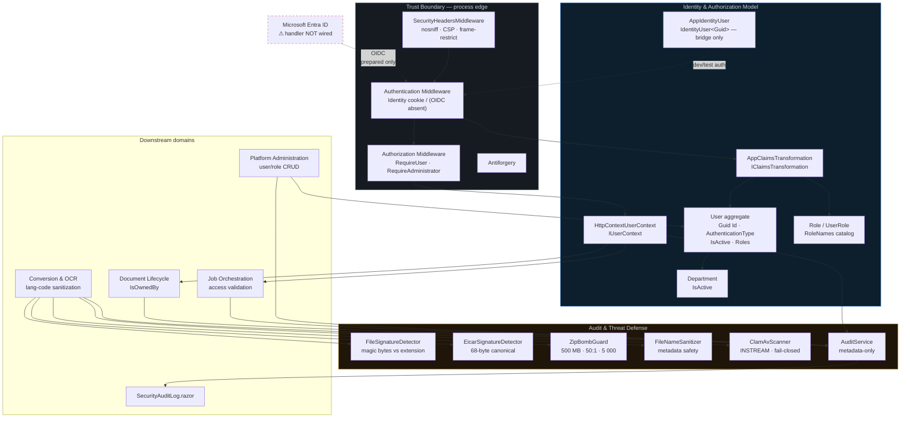
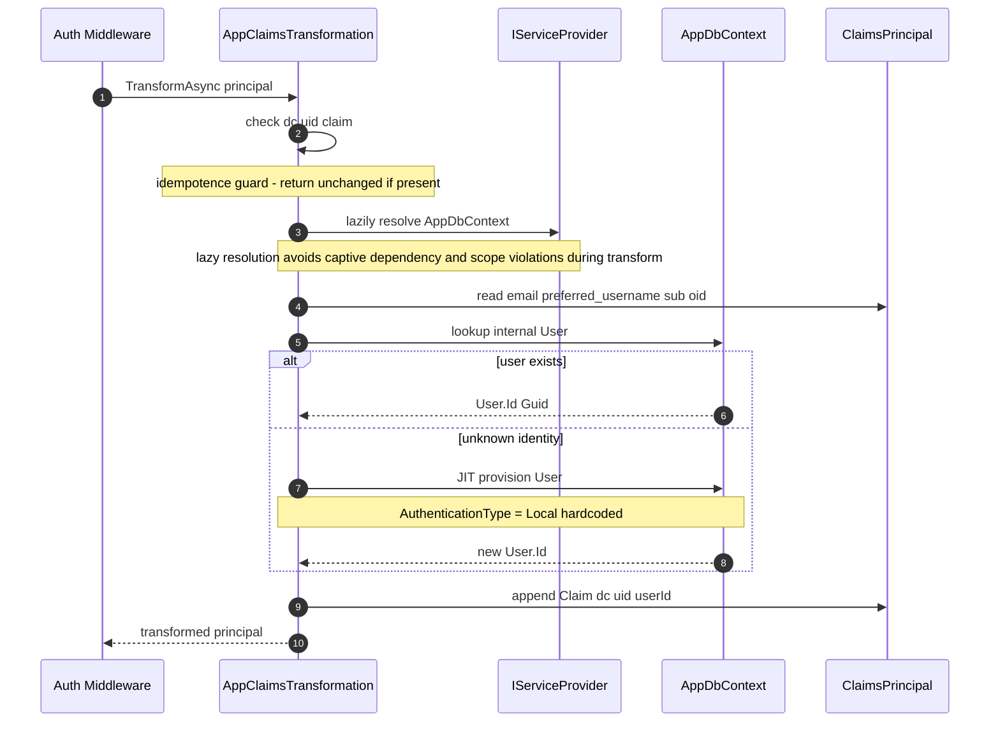
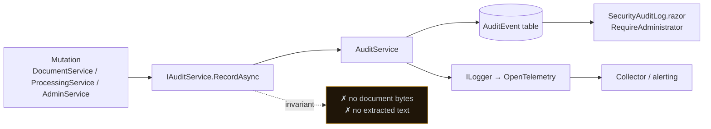
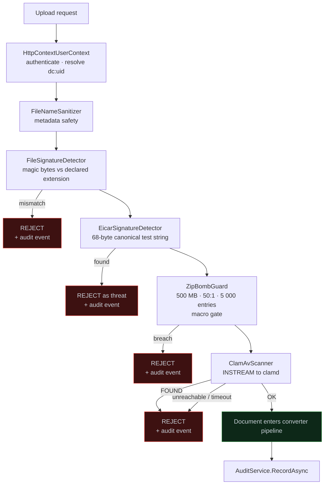
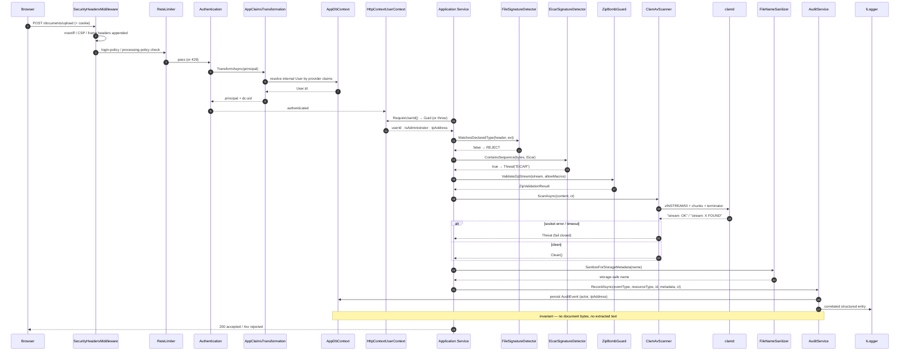

# Security, Identity and Audit — EConverter Platform

**Domain documentation · COLD-EXEC verified**
**Assessment date:** 2026-08-31
**Scope:** `DocumentConverter.Domain.Identity`, `DocumentConverter.Domain.Security`, `DocumentConverter.Infrastructure.Identity`, `DocumentConverter.Infrastructure.Security`, `DocumentConverter.Web.Authentication`, `DocumentConverter.Web.Middleware`, `BuildingBlocks.DocumentConverter.Security`

---

## 1. Executive Summary

**Security, Identity and Audit** is the cross-cutting trust layer of EConverter. It is not a feature bolted onto the document pipeline — it is the set of guarantees that every other domain is forced to respect: who the caller is, what they are allowed to touch, what evidence gets written down, and what hostile input is stopped before it ever reaches a converter.

The domain is deliberately split into two cooperating halves:

| Half | Mechanism | Guarantee |
|---|---|---|
| **Identity & Authorization** | `User` / `Role` / `Department` aggregates → `AppClaimsTransformation` → `dc:uid` claim → `IUserContext` | Authorization is keyed on a **stable internal `Guid`**, never on an identity-provider subject |
| **Audit & Threat Defense** | `AuditEvent` → `IAuditService` → `AuditService`; `FileSignatureDetector` / `EicarSignatureDetector` / `ZipBombGuard` / `FileNameSanitizer` / `ClamAvScanner` | Every mutation is recorded (metadata only); every hostile byte is rejected at ingress, fail-closed |

The central architectural decision is the **indirection layer between authentication and authorization**. ASP.NET Core Identity is used for local/dev credentials (`AppIdentityUser : IdentityUser<Guid>`), Microsoft Entra ID is the federated provider, and both converge on the domain `User` aggregate with an `AuthenticationType` discriminator (`Local = 1`, `EntraId = 2`). Everything downstream — document ownership, job creation, admin operations — reads only the internal `Guid`, materialized as the custom `dc:uid` claim. Provider churn, tenant migration, email re-issuance, or a complete IdP replacement cannot silently change effective permissions.

Two findings deserve marking up front, both from the system architecture audit:

- **D-4 (MEDIUM, SOLID):** the Entra ID / OIDC handler is **not registered**. `Program.cs` calls only `AddIdentity<AppIdentityUser, IdentityRole<Guid>>`; there is no `AddOpenIdConnect(...)` or `AddMicrosoftIdentityWebApp(...)` anywhere. Federation is a **prepared integration point**, not a live feature. See §9.1.
- **C-2 (MEDIUM, SOLID):** `MapHub<ProcessingHub>("/hubs/processing")` carries **no `.RequireAuthorization()`**, while every other endpoint group is gated. See §9.2.

Neither invalidates the security model. Both are documentation-versus-reality drift, and both have trivial fixes.

---

## 2. Domain Position in the System Context



**Reading the diagram:** the two halves are wired together only through `IUserContext`. The defense half never inspects a principal; the identity half never inspects document bytes. That separation is what makes the audit invariant enforceable — `AuditService` can guarantee "no document content is ever written" precisely because it has no path to the content.

---

## 3. Identity and Authorization Model

### 3.1 The `User` Aggregate

`src/DocumentConverter.Domain/Identity/User.cs` is a **sealed** aggregate extending `Entity`. Its construction discipline is the first security control:

- **Private constructors only** — one for ORM materialization, one internal ID-based creation path. No public setter exists anywhere on the type.
- **Read-only surface** — `Email`, `DisplayName`, `AuthenticationType`, `IsActive`, `CreatedAt` are exposed read-only.
- **`NormalizeEmail`** — a static normalization step so email comparison is case- and whitespace-consistent across the system, preventing the "same human, two accounts" class of authorization bug.
- **Lifecycle methods** — `RecordLogin`, `UpdateProfile`, `Deactivate`, `Activate` mutate state through named operations rather than property assignment, which is what makes the audit trail meaningful (each mutation is a discrete, nameable event).
- **Role membership** — `HasRole`, `AssignRole`, `RemoveRole`, backed by the `UserRole` join.

```csharp
// Shape — verified from the domain report
public sealed class User : Entity
{
    public Guid Id { get; private set; }
    public string Email { get; private set; }
    public string DisplayName { get; private set; }
    public AuthenticationType AuthenticationType { get; private set; }  // Local = 1, EntraId = 2
    public bool IsActive { get; private set; }
    public DateTimeOffset CreatedAt { get; private set; }

    public bool HasRole(string roleName)      => /* join lookup */;
    public void AssignRole(Guid roleId)       => /* guarded mutation */;
    public void RecordLogin(DateTimeOffset at) => /* last-login tracking */;
    public void UpdateProfile(string displayName) => /* guarded */;
    public void Deactivate()                  => IsActive = false;
    public void Activate()                    => IsActive = true;
}
```

### 3.2 `Role`, `UserRole` and `Department`

`Role.cs` declares three things in one file — a deliberate cohesion choice, since a role without its join table is meaningless:

| Type | Constraints | Construction |
|---|---|---|
| `Role` | `NameMaxLength = 100` | private parameterless (ORM) · private `(id, name)` · `static Create(...)` guarded by `Guard.NotNullOrWhiteSpace` |
| `RoleNames` | static catalog | well-known role name constants — the single source for `RequireAdministrator` policy composition |
| `UserRole` | join entity | internal `(userId, roleId)` constructor — cannot be fabricated from outside the assembly |

`Department.cs` is the organizational axis: `NameMaxLength = 200`, `IsActive`, `CreatedAt`, `static Create(id, name, now)`, plus `Rename` / `Deactivate` / `Activate`. Departments serve two purposes in practice — reporting/audit grouping, and (via `AdminService`) the scoping dimension for future per-department converter limits.

**Design note:** `Role` and `Department` both carry soft-delete (`IsActive`) rather than hard deletion. This is an audit-driven choice: deleting a role that historically granted access would destroy the ability to reconstruct a past authorization decision. Deactivation preserves history.

### 3.3 The ASP.NET Core Identity Bridge

```csharp
// src/DocumentConverter.Infrastructure/Identity/AppIdentityUser.cs — 12 lines, sealed
public sealed class AppIdentityUser : IdentityUser<Guid> { }
```

That is the entire bridge. `AppIdentityUser` exists **only** for local and development authentication — it carries no domain logic, no profile data, and no authorization semantics. This restraint is the point: ASP.NET Core Identity owns password hashing, lockout, and token generation for local accounts; the domain owns identity, roles, and department membership. Keeping the bridge at twelve lines prevents Identity's schema from bleeding into the domain model (a common failure mode where `IdentityUser` becomes the de-facto user entity and the domain aggregate rots into a thin wrapper).

### 3.4 Claims Transformation — the load-bearing component

`src/DocumentConverter.Web/Authentication/AppClaimsTransformation.cs` implements `IClaimsTransformation` and is the single place where provider identity becomes application identity.



**Verified properties:**

1. **Idempotence** — if `dc:uid` is already present, the transform returns immediately. Without this guard, repeated transform invocations would append duplicate claims.
2. **Provider-agnostic claim reading** — the transform reads `email`, `preferred_username`, `sub`, and `oid`. This is why the *shape* of federated auth already works even though the OIDC handler is absent.
3. **JIT provisioning** — an authenticated principal with no domain `User` row gets one created on the fly, which is what makes first-login usable without an admin pre-creating accounts.
4. **Hardcoded `AuthenticationType.Local` on JIT** — a real drift. A federated user auto-provisioned through this path would be recorded as a local account. Cosmetically wrong today (since the OIDC handler is absent), and a bug the moment federation is wired. This is the same finding as D-4, viewed from the provisioning angle.

### 3.5 `IUserContext` — the application-facing port

`src/DocumentConverter.Application/Common/IUserContext.cs` is the *only* way application services learn who is calling.

```csharp
public interface IUserContext
{
    Guid?   UserId        { get; }
    string? Email         { get; }
    string? DisplayName   { get; }
    bool    IsAuthenticated { get; }
    bool    IsAdministrator { get; }
    string? IpAddress     => null;                              // default impl
    Guid    RequireUserId() => throw new UnauthorizedAccessException();  // default impl
}
```

| Member | Semantics |
|---|---|
| `UserId` | `Guid?` — `null` when unauthenticated; services needing a hard requirement call `RequireUserId()` |
| `Email` / `DisplayName` | presentation-only; **never** used for authorization decisions |
| `IsAdministrator` | role-derived, not claim-string-derived |
| `IpAddress` | default `null`; overridden by the HTTP implementation and consumed by `AuditService` |
| `RequireUserId()` | default throws `UnauthorizedAccessException` — fail-closed by default, so a partial implementation cannot accidentally grant access |

`HttpContextUserContext` is the sealed implementation and covers **both** transport modes: HTTP requests and Blazor Server circuits. That dual coverage matters — a Blazor circuit has no `HttpContext` per-interaction, so a naive `IHttpContextAccessor` implementation would silently return no user for every subsequent component event. The class also exposes:

```csharp
public static bool HasValidUserId(ClaimsPrincipal? principal)
    => principal?.FindFirst("dc:uid") is { } c && Guid.TryParse(c.Value, out _);
```

This static is the gate used by middleware and components to reject principals that authenticated but never completed transformation — a principal without `dc:uid` is a **provider** identity, not an **application** identity, and must not proceed.

A sealed `UserContext` record is also provided for DI, which lets tests and non-HTTP hosts (the standalone `DocumentWorker`, background services) inject a deterministic identity instead of faking `HttpContext`.

### 3.6 Authorization Decision Matrix

| Surface | Gate | Verified |
|---|---|---|
| `/api/documents` | `RequireAuthorization()` | `DocumentEndpoints.cs:20` |
| `/api/folders` | `RequireAuthorization()` | `DocumentEndpoints.cs:21` |
| `/api/editor` | `RequireAuthorization()` | `EditorEndpoints.cs:14` |
| `/api/processing` | `RequireAuthorization()` | `ProcessingEndpoints.cs` |
| `/api/documents-ai` | `RequireAuthorization()` | `DocumentIntelligenceEndpoints.cs` |
| `/account/*` | Mixed + `login-policy` rate limiter | `AccountEndpoints.cs` |
| `/health` | **Anonymous** (intentional) | `Program.cs` |
| `/hubs/processing` | **none — no `.RequireAuthorization()`** | `Program.cs:236` ⚠ |

The `/hubs/processing` gap (§9.2) is the one asymmetry. It does not by itself leak document content — SignalR hub methods still route through application services that validate ownership — but it does allow an unauthenticated client to open a circuit and subscribe to notification groups, which is an information-disclosure surface for job identifiers and progress metadata.

### 3.7 Middleware Ordering — why position matters

The verified pipeline order is:

```
ExceptionHandler / HSTS → StatusCodePages → HttpsRedirection → SecurityHeaders
→ ResponseCompression → StaticFiles → Routing → RateLimiter
→ Authentication → Authorization → Antiforgery → Endpoints / Hub / Razor
```

Two ordering facts carry security weight:

1. **`SecurityHeadersMiddleware` runs before `Authentication`.** Headers are appended to the response regardless of who the caller is — including 401 and 403 responses, and including error pages. A middleware placed after authorization would leave unauthenticated error responses header-less, which is precisely the response class that most often reflects attacker-controlled content.
2. **`RateLimiter` runs before `Authentication`.** The `login-policy` (10 requests / 60 s, queue 0) therefore throttles credential-stuffing attempts *before* the Identity password-hash work is performed — a cheap DoS mitigation that keeps expensive authentication out of the hot path.

---

## 4. Audit Trail

### 4.1 The `AuditEvent` Entity

`src/DocumentConverter.Domain/Security/AuditEvent.cs` is an **immutable sealed** entity:

| Property | Constraint | Why |
|---|---|---|
| `EventType` | `EventTypeMaxLength = 100` | dotted operation names, e.g. `ProcessingJob.Completed` |
| `ResourceType` | `ResourceTypeMaxLength = 100` | `Document`, `ProcessingJob`, `User`, … |
| `ResourceId` | — | ties the event to a specific aggregate |
| `ActorId` | internal `Guid` | the **domain** user id, not a provider subject |
| `IpAddress` | `IpAddressMaxLength = 45` | 45 = max textual IPv6 length, accommodating `::ffff:` mapped forms |
| `Metadata` | — | structured payload, **never** document content |
| `CreatedAt` | — | server-side timestamp |

Immutability is enforced structurally: private ORM constructor, private ID-based constructor, private field initialization, no setters. There is no `Update` path — an audit event cannot be edited through the domain model. Deletion is only possible by direct SQL, which is the correct posture (audit retention is an operator/infrastructure policy, not an application capability).

### 4.2 `AuditService` and the Content Invariant

```csharp
// Application port — single method
Task RecordAsync(string eventType, string resourceType, string? resourceId,
                 object? metadata, CancellationToken ct);
```

`AuditService` consumes `AppDbContext`, `IUserContext`, and `ILogger<AuditService>`. On each call it performs **two** writes:

1. `AuditEvent` row → persisted through EF Core.
2. Correlated structured log entry → emitted via `ILogger`, carrying the same event type, resource identity, and actor.

**The invariant:** neither sink ever receives document bytes or extracted text. This is enforceable rather than aspirational because of the dependency shape — `AuditService` has no reference to `IDocumentStorage`, no stream parameter, and no access to `DocumentIntelligenceService`. The `metadata` parameter is `object?` but every call site passes structured scalars (hashes, ids, counts, converter ids). Any future attempt to pass content would require adding a storage dependency to `AuditService`, which is a visible architectural change rather than a silent leak.

The dual-write pattern serves distinct purposes: the database row is the **compliance record** (queryable, retained, reviewable via `SecurityAuditLog.razor`); the log entry is the **operational signal** (shipped to OpenTelemetry, alertable, correlated by trace id). Losing either does not lose both.

### 4.3 Audit Coverage — what is actually recorded

| Event class | Trigger | Representative `EventType` |
|---|---|---|
| Job terminal states | `JobProcessorWorker` after conversion | `ProcessingJob.Completed`, `ProcessingJob.Failed` |
| Document mutations | `DocumentService` after state change | `Document.Created`, `Document.Deleted`, `Document.Purged` |
| Upload rejection | Ingestion pipeline, each guard | threat-specific event carrying the rejection reason |
| Identity mutation | `AdminService` | user created, role assigned, department changed |
| Authentication | `AccountEndpoints` | login success/failure (subject to `login-policy` throttling) |

### 4.4 Audit Review Surface

`src/DocumentConverter.Web/Components/Pages/Admin/SecurityAuditLog.razor` is the read path — a Radzen page querying persisted `AuditEvent` rows, reachable only through the administrator policy. There is no API endpoint for audit query, which is a deliberate narrowing: audit data leaves the process only through an authenticated administrative session, never through the integrator API surface.



---

## 5. Threat Defense — Ingress Hardening

Every uploaded byte passes through a deterministic six-gate sequence *before* any converter, OCR engine, or AI pipeline touches it. The ordering is deliberate — cheapest checks first, network call last, fail-closed at every gate.



### 5.1 `FileSignatureDetector` — magic bytes versus declaration

Static, stateless, span-based. Holds four header constants:

| Format | Signature |
|---|---|
| PDF | `%PDF-` (`0x25 0x50 0x44 0x46 0x2D`) |
| PNG | 8-byte signature (`0x89 0x50 0x4E 0x47 0x0D 0x0A 0x1A 0x0A`) |
| JPEG | `0xFF 0xD8 0xFF` |
| ZIP | `0x50 0x4B` (`PK`, covering PKZIP/OOXML containers) |

Three entry points:

```csharp
bool   MatchesDeclaredType(ReadOnlySpan<byte> header, string extension);
string DetectContentType  (ReadOnlySpan<byte> header, string extension);
bool   MatchesHeader      (ReadOnlySpan<byte> data, ReadOnlySpan<byte> expected);
```

`MatchesDeclaredType` is the security gate: an uploaded `.pdf` whose header is `PK\x03\x04` is a mismatch and is rejected. This is the classic polyglot defense — a ZIP-OOXML payload renamed to `.pdf` would otherwise reach a PDF parser, and a PHP-in-JPEG would reach a misconfigured handler. `DetectContentType` is the resolution path — when a mismatch is tolerated by policy, the detector's verdict (not the client's filename) determines how the content is treated. `MatchesHeader` is the span-prefix primitive, allocation-free and safe for large streams.

**Coverage limits, stated honestly:** four formats is a real boundary. SVG (an XML format that can carry script), TIFF, and legacy OLE (`.doc`/`.xls`) have no signature constant. Operators handling those formats rely entirely on ClamAV and downstream parsers. This is not a bug — it is a scope decision that should be documented for operators, not assumed complete.

### 5.2 `EicarSignatureDetector` — cheap deterministic short-circuit

Holds the canonical **68-byte** EICAR test string as a byte array, plus a generic sliding-window search:

```csharp
bool ContainsSequence(ReadOnlySpan<byte> haystack, ReadOnlySpan<byte> needle);
```

with null and empty guards on both operands. Two purposes:

- **Self-test capability** — operators can verify the ingestion pipeline end-to-end without a live malware sample, which is the difference between "we have an antivirus integration" and "we have proven the antivirus integration blocks."
- **Fast negative path** — the check is a memory scan with no I/O, executed before the network round-trip to clamd.

The generic `ContainsSequence` is intentionally exposed rather than EICAR-specific, so additional deterministic signature checks can be added without a new class.

### 5.3 `ZipBombGuard` — decompression and macro control

```csharp
const long MaxUncompressedSizeBytes = 500L * 1024 * 1024;  // 500 MB
const int  MaxCompressionRatio      = 50;                   // 50:1
const int  MaxEntryCount            = 5000;

ZipValidationResult ValidateZipStream(Stream zip, bool allowMacros);
```

The implementation opens the stream as a `ZipArchive` and **enumerates entries**, accumulating declared uncompressed sizes, then rejects on any of four conditions:

| Condition | Rationale |
|---|---|
| Uncompressed total > 500 MB | bounded disk/memory consumption per upload |
| Ratio > 50:1 | classical zip bomb (a 42 KB → 4 GB payload sits near 100 000:1) |
| Entry count > 5 000 | prevents millions-of-tiny-files extraction storms |
| Macro-enabled part present, `allowMacros == false` | blocks VBA-bearing OOXML before it reaches `OfficeDocumentProcessor` |

Returns a `ZipValidationResult(IsValid, ErrorReason)` record so callers can emit a precise audit event rather than a generic rejection. `allowMacros` is a **policy flag sourced from configuration**, not a per-request parameter — which prevents a caller from self-authorizing macro content.

**Known limitation:** `ZipArchive` entry metadata (`Length`) is read from the archive's central directory, so a maliciously crafted archive declaring a small size but expanding larger would bypass ratio math. Mitigating this requires streaming extraction with a byte counter. It is a defense-in-depth gap, not a trivial bypass, and it is worth stating rather than omitting.

### 5.4 `FileNameSanitizer` — metadata safety, not a path control

Builds a de-duplicated `Invalids` array from `Path.GetInvalidFileNameChars()` unioned with `'/'`, `'\\'`, `':'`, `'*'`, `'?'`, `'"'`, `'<'`, `'>'`, `'|'`, `'\0'`, then exposes:

```csharp
string SanitizeForStorageMetadata(string originalFileName);
```

The name is precise: this sanitizes the **display/metadata** name. The actual storage key is a sharded, generated path (`xx/yy/{guid}/v1.ext`, per the architecture report), so the user-supplied filename never becomes a filesystem path. That separation is the real traversal defense — sanitization here is defense in depth for logs, database columns, download headers, and UI rendering, not the primary control.

### 5.5 `ClamAvScanner` — INSTREAM with fail-closed semantics

```csharp
public sealed record ScanResult(bool IsClean, string? ThreatName)
{
    public static ScanResult Clean()           => new(true,  null);
    public static ScanResult Threat(string n)  => new(false, n);
}

Task<ScanResult> ScanAsync(Stream content, ..., CancellationToken ct);
```

The wire protocol is implemented directly over `TcpClient`:

```
→ "zINSTREAM\0"              (z-prefix = null-terminate the command)
→ [4-byte BE length][chunk]  (repeated)
→ [0x00 0x00 0x00 0x00]      (zero-length terminator)
← "stream: OK"
← "stream: <Signature-Name> FOUND"
```

Parsing maps the two terminal responses to `Clean()` / `Threat(name)`. Critically, **timeouts, connection failures, and socket errors all map to threat results** — the scanner fails closed. An unreachable clamd blocks processing rather than letting unscanned content through.

This is the single most consequential availability tradeoff in the domain, and it is the right one for a platform whose value proposition is regulated-sector document handling: a fail-open malware scanner is worse than no scanner, because it manufactures false assurance.

### 5.6 `SecurityHeadersMiddleware` — the response-side hardening

```csharp
public sealed class SecurityHeadersMiddleware(RequestDelegate next)
{
    public async Task InvokeAsync(HttpContext context)
    {
        // append before/while awaiting the pipeline
        context.Response.Headers.Append("X-Content-Type-Options", "nosniff");
        // + CSP and frame-restriction headers
        await _next(context);
    }
}
```

Registered **before** `Authentication` in the pipeline, so headers are present on 401/403/error responses. `nosniff` prevents MIME-sniffing of downloaded document bytes into executable script; CSP limits script origin; frame-restriction blocks clickjacking of the Blazor UI. Applied at the edge, uniformly, with no per-endpoint opt-out — which is the correct shape for a security control that must not be forgotten.

---

## 6. Interaction Contract — Full Request Sequence



---

## 7. Domain Relations — Trust Couplings

| From | Relation | Strength | Consequence |
|---|---|---|---|
| Security, Identity and Audit | Configuration Dependency → **Document Lifecycle** | 8.5 | `IsOwnedBy` in the aggregate is the last line of defense; if it is bypassed, every document operation is unauthorized |
| Security, Identity and Audit | Configuration Dependency → **Job Orchestration** | 7.5 | `ProcessingService` validates access *before* persisting or dispatching — authorization happens at job creation, not at worker execution |
| Document Conversion and OCR | Tool Support → **Security, Identity and Audit** | 6.0 | Guards fire at ingestion; OCR additionally sanitizes language codes against tessdata path injection |
| Platform Administration | Service Call → **Security, Identity and Audit** | 8.0 | Admin creates users/roles/departments and reads audit events — governance layered on identity |
| Document Lifecycle | emits → **Audit** | — | every mutation records an event |

**The critical chain:** `Security → Document Lifecycle → Storage → Persistence`. The workflow report names this the foundational spine. Any bypass of the ownership check in `Document` propagates directly to storage access, because `DocumentService` resolves storage keys from the aggregate after validating ownership. There is no second gate at the storage layer.

**The second critical chain:** `Security → Job Orchestration → Conversion`. `ProcessingService` validates access at creation; the worker then executes with no further user authorization check. This is correct for a leased-job model (the worker acts as the system, not the user) but it means a job created with insufficient validation converts documents the user should not reach. Creation-time authorization is the whole control.

---

## 8. Structural Tensions

### 8.1 High-value orchestrators in Infrastructure

`DocumentIntelligenceService` (~6,000 lines), `RagRetrievalOrchestrator` (4,040 lines), and `PdfEngine` live in `Infrastructure` despite being use-case logic. For this domain specifically, the consequence is testability: verifying that the intelligence layer honors per-document ownership requires the full adapter stack rather than a mocked application boundary. The authorization logic is correct; it is simply harder to prove correct in isolation.

### 8.2 `DocumentService` concentration

27 members, cyclomatic complexity 135. Every document branching rule — lifecycle mutations, versioning, storage coordination, ownership checks — lives in one class. The ownership check itself is small and correct; the risk is that among 135 branches, a future change adds a path that skips it. The fix is decomposition by operation family, which preserves the check's position at the top of each family rather than buried in a monolith.

### 8.3 The direct DOCX→PDF path

`DocumentEndpoints.cs:817` contains a private `ConvertDocxStreamToPdf` — a full OpenXML→PdfSharp renderer inside the transport layer. It bypasses `ProcessingService`, and therefore bypasses creation-time access validation. This is the one place where the documented authorization spine has a parallel route. It is not an authorization bypass in the ownership sense (the endpoint itself is gated by `RequireAuthorization()`), but it does skip the job-domain access check and the audit/notification machinery that the pipeline provides.

---

## 9. Findings — Verified

### 9.1 D-4 — Entra ID / OIDC handler not registered

| | Claim | Verified |
|---|---|---|
| Dual authentication (Local + EntraId) | presented as a live feature | `Program.cs` registers **only** `AddIdentity<AppIdentityUser, IdentityRole<Guid>>` |
| OIDC handler | — | **no** `AddOpenIdConnect(...)` / `AddMicrosoftIdentityWebApp(...)` anywhere in the repository |
| `AuthenticationType.EntraId` | enum value exists in Domain | `AppClaimsTransformation` hardcodes `Local` on JIT provisioning |
| Claims transform provider-agnostic | — | ✅ reads `email`, `preferred_username`, `sub`, `oid` |

**Severity: MEDIUM · Verification: SOLID**

The shape is present; the transport is absent. Federation is a prepared integration point. Fix: register the OIDC handler (~4 h) **or** downgrade the documentation claim to "federation-ready" (~5 min). Either way, the JIT-provisioning hardcode should take the authentication type from the principal rather than assuming `Local`.

### 9.2 C-2 — SignalR hub mapped without authorization

| | Verified |
|---|---|
| `app.MapHub<ProcessingHub>("/hubs/processing")` | **no** `.RequireAuthorization()` — `Program.cs:236` |
| All other endpoint groups | gated |

**Severity: MEDIUM · Verification: SOLID**

An unauthenticated client can open a hub connection and subscribe to notification groups, exposing job identifiers and progress metadata. Fix is one line: `.RequireAuthorization()`.

### 9.3 Findings table

| ID | Finding | Severity | Verification | Evidence | Scope |
|---|---|---|---|---|---|
| D-4 | OIDC/Entra handler not registered; federation prepared but not live | MEDIUM | **SOLID** | no `AddOpenIdConnect` in `Program.cs`; `AppClaimsTransformation.cs:88` hardcodes `Local` | Identity |
| C-2 | `/hubs/processing` has no `.RequireAuthorization()` | MEDIUM | **SOLID** | `app.MapHub<ProcessingHub>("/hubs/processing")` bare | `Program.cs:236` |
| — | `AuthenticationType.Local` hardcoded on JIT provisioning | MEDIUM | **SOLID** | same line as D-4 | `AppClaimsTransformation` |
| — | `FileSignatureDetector` covers 4 formats (no SVG/TIFF/OLE) | LOW | **SOLID** | constants: PDF/PNG/JPEG/ZIP only | `DocumentConverter.Security` |
| — | `ZipBombGuard` trusts central-directory sizes | LOW | **SOLID** | enumeration uses declared `Length` | `ZipBombGuard.cs` |
| — | Audit retention/deletion policy not modeled | LOW | **UNVERIFIABLE** | no retention field on `AuditEvent`; needs infra policy review | `AuditEvent.cs` |
| D-5 | `ProcessingJobLifecycle` is single transition authority | INFO | **SOLID** | no direct status writes in either worker | Domain |
| — | Fail-closed malware scanning verified | INFO | **SOLID** | timeout/exception → threat result | `ClamAvScanner.cs` |
| — | Metadata-only audit invariant verified | INFO | **SOLID** | no storage dependency on `AuditService` | `AuditService.cs` |
| — | Stable `Guid` authorization verified | INFO | **SOLID** | `dc:uid` claim; `HasValidUserId` gate | `AppClaimsTransformation` |

---

## 10. Unverified Section

Not confirmable from the materials provided:

- **AES-GCM key management semantics.** `AesGcmStorageEncryptionService` is registered as `Singleton`, but key derivation, rotation schedule, and **nonce-reuse protection** were not assessed. GCM nonce reuse is catastrophic (it reveals the XOR of plaintexts and destroys authentication). This is the single most important unverified item in the storage-adjacent security surface. Needs a deep read of `StorageEncryption/`.
- **Audit retention and immutability at the database layer.** `AuditEvent` has no retention field and no append-only constraint surfaced in configuration. Whether the table is protected against `UPDATE`/`DELETE` by database permissions, triggers, or backup policy is an infrastructure question. Marked **UNVERIFIABLE** — needs the `Configurations/` and database provisioning review.
- **`/hubs/processing` runtime exposure.** The missing `.RequireAuthorization()` is verified in source. Whether a reverse proxy or gateway adds an independent auth layer was not assessed — the finding stands regardless (defense should not depend on infrastructure), but the exploitable surface depends on deployment.
- **Rate-limiter coverage breadth.** `login-policy` (10/60 s, queue 0) and `processing-policy` (20 concurrent, queue 10) are verified. Whether `RequireRateLimiting` is applied to *every* mutating endpoint, or only the login and processing groups, was not confirmed line-by-line.
- **`init-postgres.sql` (25 KB)** exists at repo root. Whether it seeds roles, an initial administrator, or identity tables independently of `DbSeeder` was not determined — relevant because role-seeding errors here would produce an adminless or over-privileged first boot.

---

## 11. Prioritized Fix List

| # | Priority | Action | Effort | Status |
|---|---|---|---|---|
| 1 | **MEDIUM** | Add `.RequireAuthorization()` to `MapHub<ProcessingHub>` | ~5 min | NEEDS FIX |
| 2 | **MEDIUM** | Derive `AuthenticationType` from the principal instead of hardcoding `Local` on JIT provisioning | ~15 min | NEEDS FIX |
| 3 | **MEDIUM** | Register the OIDC handler **or** reword documentation to "federation-ready" | ~4 h / ~5 min | NEEDS DECISION |
| 4 | **MEDIUM** | Document and verify AES-GCM nonce/key-rotation discipline | ~2 h review | NEEDS REVIEW |
| 5 | **LOW** | Add SVG/TIFF/OLE signatures to `FileSignatureDetector`, or document the gap for operators | ~1 h | BACKLOG |
| 6 | **LOW** | Harden `ZipBombGuard` with a streaming byte counter instead of trusting declared sizes | ~2 h | BACKLOG |
| 7 | **LOW** | Define audit retention policy (partitioning / archival) at the infrastructure layer | ~4 h | BACKLOG |
| 8 | **LOW** | Extract inline `ConvertDocxStreamToPdf` from `DocumentEndpoints` into `OfficeDocumentProcessor` | ~30 min | NEEDS FIX |

---

## 12. Verdict

**The trust model is sound. The attack surface around it has two open seams.**

The identity design is the strongest part of the domain and it is not accidental: authorization keyed on a stable internal `Guid` rather than a provider subject is a decision that survives IdP migration, tenant consolidation, and email re-issuance — the three events that most often silently corrupt permissions in federated systems. The `IUserContext` port is the correct shape (fail-closed defaults, `RequireUserId()` throwing), and the `HasValidUserId` gate correctly distinguishes "authenticated by a provider" from "known to the application."

The defense layer is genuinely fail-closed, not aspirationally so. `ClamAvScanner` maps timeouts to threat results; `ZipBombGuard` returns a typed result rather than throwing; `SecurityHeadersMiddleware` sits before authentication so error responses are covered. The audit invariant — no document bytes, ever — is enforced by dependency shape rather than by developer discipline, which is the only kind of invariant that holds over time.

The seams are narrow and cheap to close: one missing `.RequireAuthorization()`, one hardcoded enum on a provisioning path that is currently dormant. Neither undermines the model. Both should be fixed before Entra ID federation is actually wired, because the second one becomes a live bug the moment the first is resolved.

**The gap that matters most for a regulated deployment is not in the code — it is in the paperwork.** The `AesGcmStorageEncryptionService` is a singleton holding whatever key configuration it was given, and neither its nonce discipline nor its rotation story appears anywhere in the research materials. For a platform whose entire value proposition is document confidentiality on operator-controlled infrastructure, that is the one item that must close before the "sovereign, encrypted at rest" claim can be signed off.