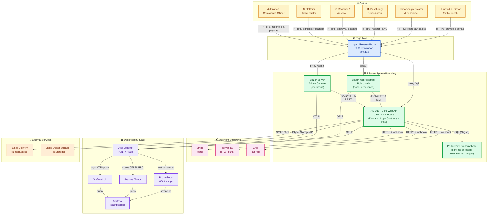
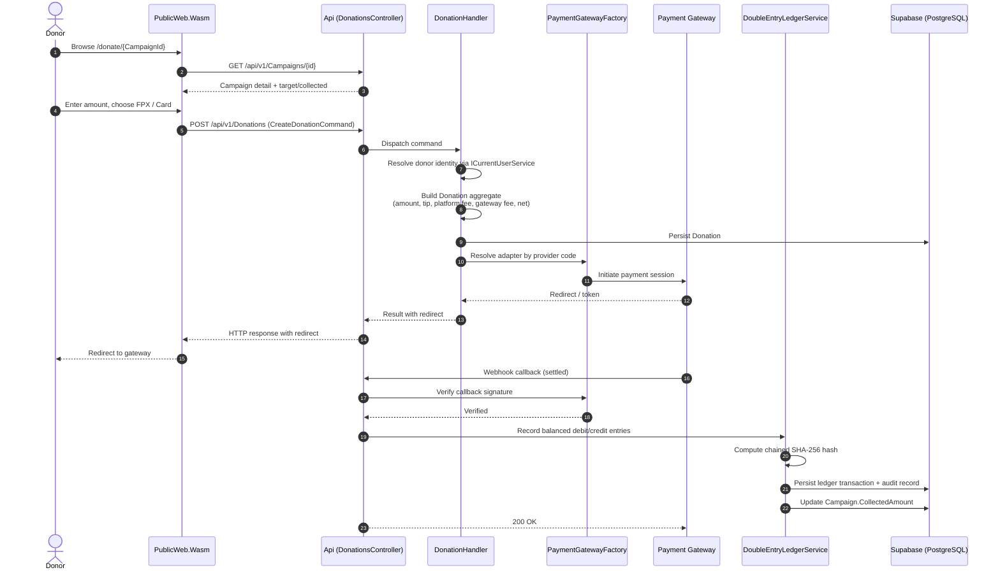
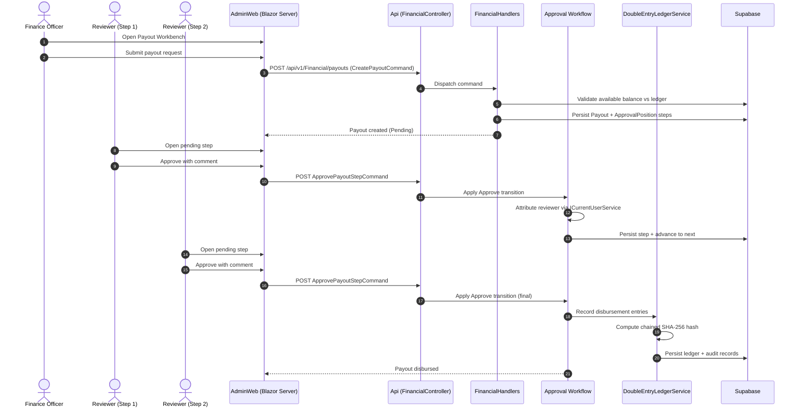
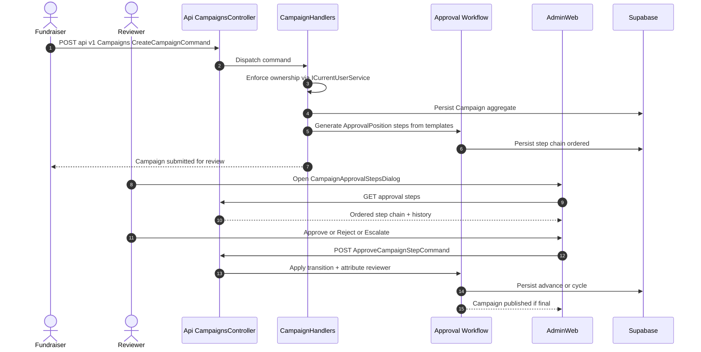
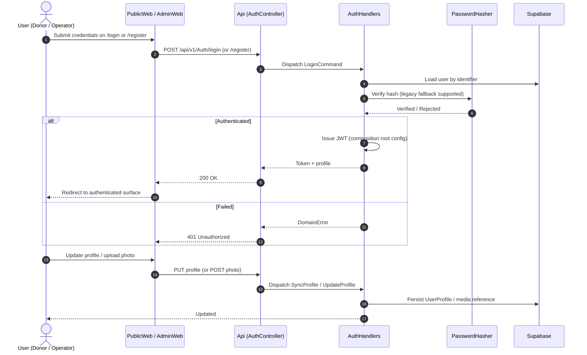
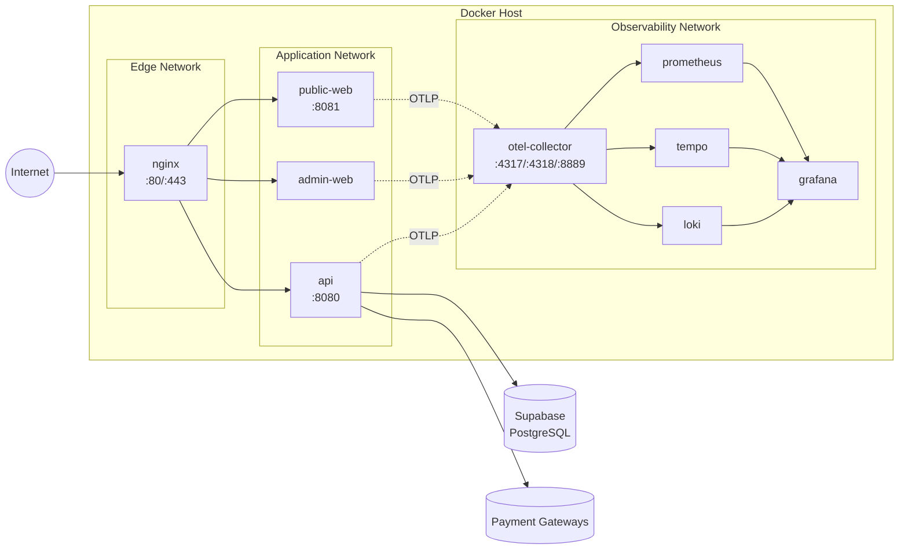

# ESalam — C4 Level 1: System Context Architecture

**Document Version:** 1.0
**Document Type:** C4 Model — Level 1 (System Context)
**System Under Analysis:** ESalam Charity & Donation Management Platform
**Generation Time:** 2026-11-10 03:01:02 (UTC)
**Timestamp:** 1794279662
**Confidence Score:** 0.93
**Analysis Basis:** Domain module decomposition (13 domains, 20 typed relations) + system context research report

---

## 1. Project Introduction

### 1.1 Project Name and Description

**ESalam** is a full-stack, enterprise-grade charity and donation management platform architected for the **Malaysian fundraising market**. It operationalizes the complete charitable giving lifecycle — from campaign discovery by a donor through verified, segregation-of-duties-governed fund disbursement to a beneficiary organization.

The system is implemented as a **.NET solution following Clean Architecture** with strict inward dependency direction:

```
Domain  ←  Application  ←  Infrastructure / Api
                  ↑
              Contracts (shared DTO boundary)
```

The platform is composed of **five backend layers** (`Domain`, `Application`, `Contracts`, `Infrastructure`, `Api`) and **two distinct front ends** consuming the same API surface:

| Front End | Runtime Model | Audience |
|---|---|---|
| `PublicWeb.Wasm.Client` | Blazor WebAssembly | Donors / public |
| `AdminWeb` | Blazor Server | Platform staff / operators |

### 1.2 Core Functionality and Value

ESalam's central value proposition is **institutional trust in money movement**. Four independent trust mechanisms underpin this:

1. **Immutable double-entry ledger** — every financial event produces balanced debit/credit entries with **chained SHA-256 hashes**, making retroactive tampering computationally detectable.
2. **Segregation of duties** — payout disbursement is gated by a **multi-step, cyclic, attributed approval workflow** (`ApprovalPosition` state machine: approve, reject, escalate, return-from-escalation, skip).
3. **KYB-style beneficiary verification** — a `Verify` / `Reject` / `Suspend` state machine ensures only vetted charitable organizations can receive funds.
4. **Vendor abstraction** — payment gateways (`ToyyibPay`, `Chip`, `Stripe`) are behind `IPaymentProvider` + a code-keyed `PaymentGatewayFactory`, de-risking lock-in in a fragmented payment market.

### 1.3 Technical Characteristics Overview

| Aspect | Characteristic |
|---|---|
| **Architecture pattern** | Clean Architecture + CQRS (`ICommandHandler` / `IQueryHandler`) |
| **Domain discipline** | Aggregate roots with encapsulated state transitions; no public setters on financial invariants |
| **Persistence** | PostgreSQL via Supabase, EF Core `ApplicationDbContext` as unit of work |
| **Identity** | JWT issuance/validation at the API composition root; Supabase-linked profile synchronization |
| **Money routing** | Pluggable provider adapters + double-entry ledger, two orthogonal integrity controls |
| **Deployment** | Containerized: nginx TLS edge → api / public-web / admin-web |
| **Observability** | OpenTelemetry → Collector → Prometheus (metrics) + Tempo (traces) + Loki (logs) → Grafana |
| **Error model** | `Result<T>` pattern and `DomainErrors` — no exception-driven control flow across layer boundaries |

---

## 2. Target Users

### 2.1 User Role Definition and Requirement Analysis

ESalam serves **six distinct actor roles**, each mapped to specific system surfaces and governed by the identity and approval domains.

#### 2.1.1 Individual Donor

| Attribute | Detail |
|---|---|
| **Description** | Member of the public browsing or linked to a campaign who completes a financial donation. May act **authenticated or as a guest** with localStorage-backed cart and giving history. |
| **Primary surface** | Blazor WebAssembly `PublicWeb.Wasm.Client` (`Home`, `Campaigns`, `CampaignDetails`, `Donate`, `Cart`, `MyDonations`) |
| **Key needs** | Campaign discovery; localized payment (Malaysian **FPX** or card); tax receipt; giving-history tracking; cart / saved campaigns; optional **anonymity flag** |
| **Trust inputs consumed** | Campaign target/collected figures, beneficiary verification status, capacity countdown timers |
| **Domain touchpoints** | Donor Donation Domain, Fundraising Campaign Domain, Financial Governance Domain (read), Identity & Access Domain |

#### 2.1.2 Campaign Creator / Fundraiser

| Attribute | Detail |
|---|---|
| **Description** | Individual or organization representative who drafts, submits, and maintains fundraising campaigns — story content, target amounts, media galleries, capacity tiers (**Qurban**, **Aqiqah**, **Waqf**). |
| **Primary surface** | Campaign editor (client + AdminWeb `CampaignEditor.razor`) |
| **Key needs** | Create/edit campaigns with slug identity; manage media and capacity tiers; submit for moderation; respond to reviewer feedback; monitor collected vs. target |
| **Ownership enforcement** | Applied in `CampaignHandlers` via `ICurrentUserService` |
| **Domain touchpoints** | Fundraising Campaign Domain, Approval Workflow Domain (moderation), Beneficiary Trust Domain (recipient linkage) |

#### 2.1.3 Beneficiary Organization

| Attribute | Detail |
|---|---|
| **Description** | Charitable entity that receives funds. Modeled as the **Beneficiary aggregate** with registration number, contact, banking details, media, and a KYB verification lifecycle. |
| **Primary surface** | Beneficiary registration + AdminWeb `BeneficiaryKycInspectionDialog.razor` (operator-mediated) |
| **Key needs** | Register with legal identity and banking details; pass verification; be associated with campaigns as designated beneficiary; receive payouts post-approval |
| **Gating rule** | Only beneficiaries that have passed the verification state machine may be attached as campaign recipients |
| **Domain touchpoints** | Beneficiary Trust Domain, Fundraising Campaign Domain, Financial Governance Domain (payout destination) |

#### 2.1.4 Reviewer / Approver

| Attribute | Detail |
|---|---|
| **Description** | Platform staff member occupying an **ApprovalPosition** in either the campaign moderation or payout disbursement workflow. Every action is attributed to the authenticated identity via `ICurrentUserService`. |
| **Primary surface** | AdminWeb shared dialogs: `ApprovalDecisionDialog.razor`, `ApprovalEscalateDialog.razor`, `CampaignApprovalStepsDialog.razor`, `PayoutApprovalStepsDialog.razor` |
| **Key needs** | View pending approval steps assigned to their position; approve / reject / escalate / skip with attributed comments; view full ordered and **cyclic** multi-round history; escalate beyond their authority |
| **Governance role** | Principal enforcement mechanism for **segregation of duties** |
| **Domain touchpoints** | Approval Workflow Domain, Operations Console Domain, Identity & Access Domain |

#### 2.1.5 Platform Administrator

| Attribute | Detail |
|---|---|
| **Description** | Operator of the Blazor Server console responsible for platform configuration, taxonomy, user/role management, and audit oversight. |
| **Primary surface** | AdminWeb: `RolesManagement`, `UsersManagement`, `CategoriesManagement`, `MenusManagement`, `PositionsManagement`, `PlatformSettings`, `AuditTrail` |
| **Key needs** | Manage users, roles, permissions; maintain campaign categories and navigation menus; inspect audit trails; monitor financial summaries and ledger integrity |
| **Domain touchpoints** | Operations Console Domain, Identity & Access Domain, Platform Content & Navigation Domain |

#### 2.1.6 Finance / Compliance Officer

| Attribute | Detail |
|---|---|
| **Description** | Staff member responsible for platform financial integrity — reconciling gateway movements against the double-entry ledger, auditing payout disbursements. |
| **Primary surface** | AdminWeb `Financial` section: `PayoutsManagement.razor`, `PayoutDetail.razor`, `LedgerExplorer.razor`, `CreatePayoutDialog.razor` |
| **Key needs** | Read per-campaign ledgers and aggregated summaries; verify debit/credit balance and **chained hash integrity**; initiate / approve / reject payouts under segregation-of-duties constraints; produce auditable records |
| **Domain touchpoints** | Financial Governance Domain, Approval Workflow Domain, Operations Console Domain |

### 2.2 User-to-Surface Mapping

| User Role | Primary Ingress | Authentication Path | Domain Authority |
|---|---|---|---|
| Individual Donor | `PublicWeb.Wasm.Client` | Public / guest / JWT | Donation, Campaign (read), Finance (read) |
| Campaign Creator / Fundraiser | Client + AdminWeb | JWT (authenticated) | Campaign (write), Approval (participant) |
| Beneficiary Organization | Registration workflow | JWT (authenticated) | Beneficiary (self), Campaign (linked) |
| Reviewer / Approver | AdminWeb dialogs | JWT + RBAC | Approval Workflow (transition) |
| Platform Administrator | AdminWeb console | JWT + RBAC (admin) | Identity, Platform Config, Audit |
| Finance / Compliance Officer | AdminWeb Financial | JWT + RBAC (finance) | Financial Governance, Ledger (read), Payout (write) |

---

## 3. System Boundaries

### 3.1 Scope Definition

The ESalam system boundary is defined by **ownership** — code and configuration authored and deployed by the ESalam team versus **services integrated across a network or HTTP boundary**. Concretely, the boundary encloses the `.NET` solution under `src/` plus the deployable runtime and operational assets under `deploy/`.

### 3.2 Included Core Components

| Layer / Component | Path | Responsibility |
|---|---|---|
| **Domain** | `src/CharityPlatform.Domain` | Aggregate roots (`Donation`, `Campaign`, `Beneficiary`, `ApprovalPosition`), enums, value objects — all business invariants |
| **Application** | `src/CharityPlatform.Application` | CQRS commands/queries/handlers; service contracts (`ICurrentUserService`, `IAuditService`, `IDateTimeProvider`, `IFileStorage`, `IEmailService`, `IPaymentProvider`, `IPaymentGatewayFactory`, `IDoubleEntryLedgerService`) |
| **Contracts** | `src/CharityPlatform.Contracts` | Shared DTOs and request/response shapes exchanged across the API boundary |
| **Infrastructure** | `src/CharityPlatform.Infrastructure` | EF Core persistence (`ApplicationDbContext`), `DoubleEntryLedgerService`, `PaymentAdapters`, background workers, telemetry wiring |
| **Api** | `src/CharityPlatform.Api` | ASP.NET Core host and HTTP pipeline; controllers for Auth, Beneficiaries, Campaigns, Donations, Financial, Navigation, Payments, Platform; JWT + middleware composition |
| **Public Web .NET Host** | `src/CharityPlatform.PublicWeb.Wasm` | Blazor WebAssembly host project serving donor-facing experience |
| **Public Web Client** | `src/CharityPlatform.PublicWeb.Wasm.Client` | Donor pages (`Home`, `Donate`, `Campaigns`, `Cart`, `MyDonations`, `DonationSuccess`), layout, API client services |
| **Admin Console** | `src/CharityPlatform.AdminWeb` | Blazor Server console: Audit, Auth, Beneficiaries, Campaigns, Dashboard, Financial, Menus, Platform, Roles, Users |
| **Database Schema** | `deploy/database` | Authoritative Supabase PostgreSQL schema and DDL migrations |
| **Container Topology** | `deploy/compose` | Production Docker Compose topology (nginx edge, api, public-web, admin-web) |
| **Container Images** | `deploy/docker` | Per-service Dockerfiles |
| **Edge Configuration** | `deploy/nginx` | Reverse proxy and TLS configuration |
| **Observability Provisioning** | `deploy/observability` | OTel Collector, Prometheus, Grafana provisioning for dashboards and datasources |

### 3.3 Excluded External Dependencies

| Excluded Component | Rationale |
|---|---|
| `graphify-out` | Generated code-analysis output — not a runtime or source component |
| `wwwroot/lib`, `wwwroot/bootstrap` | Vendored third-party front-end libraries (static assets, not authored code) |
| Supabase managed platform infrastructure | Vendor-operated; only ESalam's access + schema are in-scope |
| Stripe / ToyyibPay / Chip internal processing | External vendor systems behind integration contracts |
| Grafana / Prometheus / Tempo / Loki products | Only ESalam-specific configuration and provisioning are in-scope |
| External cloud object storage provider internals | Behind `IFileStorage` abstraction |
| Email delivery provider internals | Behind `IEmailService` abstraction |
| End-user browsers and devices | Client-side rendering environment |

### 3.4 Boundary Discipline — Inside vs. Across

The boundary is **strictly enforced by architectural layering**:

- **Inside the boundary:** Domain logic that enforces invariants; Application handlers that orchestrate use cases; Contracts that define the wire shape.
- **At the boundary:** `IPaymentProvider`, `IDoubleEntryLedgerService`, `IEmailService`, `IFileStorage`, `ICurrentUserService`, `IAuditService`, `IDateTimeProvider`, `IPaymentGatewayFactory` — the interface contracts declared in `Application` and fulfilled by `Infrastructure`.
- **Across the boundary:** HTTP/HTTPS to payment gateways and observability backends; SQL to Supabase; SMTP/API to the email provider; object storage API.

This separation means **no business logic may cross the boundary directly** — the boundary contracts are the entire permitted surface.

---

## 4. External System Interactions

### 4.1 External Systems Inventory

| # | External System | Category | Interaction Type | Integration Boundary |
|---|---|---|---|---|
| E1 | **Supabase (PostgreSQL)** | Database / Identity | SQL + REST/API over network | `ApplicationDbContext` → Npgsql |
| E2 | **Stripe** | Payment gateway (card) | Outbound HTTPS REST + inbound webhook | `StripeAdapter` : `IPaymentProvider` |
| E3 | **ToyyibPay** | Payment gateway (FPX / local bank) | Outbound HTTPS REST + inbound webhook | `ToyyibPayAdapter` : `IPaymentProvider` |
| E4 | **Chip** | Payment gateway (alternative rail) | Outbound HTTPS REST + inbound webhook | `ChipAdapter` : `IPaymentProvider` |
| E5 | **OpenTelemetry Collector** | Telemetry ingestion hub | Inbound OTLP (gRPC :4317, HTTP :4318) / outbound export | `OpenTelemetryExtensions` in API + both web hosts |
| E6 | **Prometheus** | Metrics store | HTTP scrape + query | Scrapes collector :8889 + services :8080/:8081/:metrics on 5s interval |
| E7 | **Grafana Tempo** | Distributed tracing backend | OTLP/gRPC span ingestion | Collector → Tempo exporter |
| E8 | **Grafana Loki** | Log aggregation backend | HTTP log push API | Collector → Loki exporter |
| E9 | **Grafana** | Visualization layer | Dashboard query of Prometheus / Tempo / Loki | Provisioned datasources + `esalam-overview.json` |
| E10 | **nginx Reverse Proxy** | TLS edge | Inbound HTTP/HTTPS reverse proxy | Binds 80/443 → api, public-web, admin-web |
| E11 | **Email Delivery Service** | Outbound notification | SMTP or transactional email API | `IEmailService` (concrete impl in Infrastructure) |
| E12 | **Cloud Object Storage** | Blob storage | Outbound object storage API | `IFileStorage` for campaign media, profile photos, KYC docs |

### 4.2 Interaction Method Descriptions

#### 4.2.1 Data Persistence and Identity — Supabase

Supabase serves a **dual role**: managed PostgreSQL host and identity provider for profile synchronization.

- **Schema scope:** identity + roles, categories, campaigns, beneficiaries, campaign_capacities, platform_settings, payment_attempts, cart.
- **Bootstrap extensions:** `uuid-ossp`, `pgcrypto`.
- **Access pattern:** `ApplicationDbContext` (EF Core) exposes DbSets for every aggregate via `IApplicationDbContext` in the Application layer — the Application layer never references Npgsql directly.
- **Initialization:** `ApplicationDbContextInitializer` seeds required reference data at startup.
- **Reconciliation:** `BackgroundSweeperWorker` performs scheduled maintenance sweeps.

#### 4.2.2 Payment Gateways — Stripe, ToyyibPay, Chip

All three gateways implement the same contract:

```
IPaymentProvider          — initiate payment, verify callback
IPaymentGatewayFactory    — resolve provider by code-key
```

| Provider | Geographic Focus | Channel | Typical Use |
|---|---|---|---|
| **Stripe** | International | Cards | Cross-border / international card donors |
| **ToyyibPay** | Malaysia | FPX, local bank channels | Domestic donor primary path |
| **Chip** | Malaysia / regional | Alternative rail | Vendor redundancy |

**Interaction is bidirectional:**

1. **Outbound:** ESalam POSTs payment session intent with amount, currency, reference, callback URL.
2. **Inbound:** Provider POSTs webhook callback with result; ESalam verifies signature, transitions the `Donation` state, and records the ledger entry.

#### 4.2.3 Telemetry Pipeline — OTel Collector → Prometheus / Tempo / Loki → Grafana

The observability chain is a **fan-out architecture**:

```
┌────────────┬──────────────┬──────────────┐
│    api     │  public-web  │  admin-web   │   ← OTLP exporters
└─────┬──────┴──────┬───────┴──────┬───────┘
      │             │              │
      └─────────────┴──────────────┘
                    ↓
        ┌───────────────────────┐
        │  OTel Collector       │  ← batch + memory_limiter processors
        │  OTLP :4317 / :4318   │
        └──┬─────────┬───────┬──┘
           ↓         ↓       ↓
      Prometheus   Tempo   Loki     ← fan-out exporters
      (:8889)      (gRPC)  (HTTP)
           │         │       │
           └─────────┴───────┘
                    ↓
              ┌──────────┐
              │ Grafana  │  ← provisioned datasources + dashboards
              └──────────┘
```

- **Metrics namespace:** `esalam` (exported via Collector on :8889)
- **Prometheus scrape targets:** collector :8889, api :8080, public-web :8081, admin-web `/metrics`
- **Scrape interval:** 5 seconds
- **Collector processors:** batch + memory limiter

#### 4.2.4 Edge Layer — nginx

- Binds host ports **80/443**.
- Terminates TLS.
- Proxies to three upstream services: `api`, `public-web`, `admin-web`.
- Configuration pinned via **read-only bind mount** (`deploy/nginx/nginx.conf`).
- Headers and request routing enforced at the edge.

#### 4.2.5 Outbound Integrations — Email and Object Storage

- **`IEmailService`** — used for donor receipts, verification notices, and workflow notifications. Concrete implementation in Infrastructure.
- **`IFileStorage`** — stores and resolves campaign media, profile photos, and KYC documents. Object URL resolution is transparent to the Application layer.

### 4.3 Dependency Relationship Analysis

Dependencies fall into four classes:

| Dependency Class | External Systems | Criticality | Failure Mode |
|---|---|---|---|
| **Revenue-blocking** | Stripe, ToyyibPay, Chip, Supabase | **CRITICAL** | Donations cannot complete; ledger writes fail |
| **Trust-generating** | Email (receipts), Object Storage (KYC docs) | **HIGH** | Compliance degradation; donor experience impact |
| **Operational** | nginx, OTel Collector | **HIGH** | Full platform outage (nginx); observability blindspot (Collector) |
| **Analytical** | Prometheus, Tempo, Loki, Grafana | **MEDIUM** | No user-facing impact; incident response slowed |

**Critical path dependency chain:**

```
Donor → nginx → public-web → api → Payment Provider (E2/E3/E4)
                                 ↓
                             Supabase (E1)
                                 ↓
                             Ledger Write (chained hash)
                                 ↓
                             Audit Record
```

Every dependency on this chain is a **single point of failure** and must be monitored. Prometheus alerts on gateway latency and Supabase connection pool saturation are the primary early-warning signals.

---

## 5. System Context Diagram

### 5.1 C4 Level 1 — System Context (Mermaid)



### 5.2 Key Interaction Flows

The following sequence diagrams illustrate the three highest-importance business flows (both rated **importance 10.0** in the domain analysis).

#### Flow A — Donation Checkout and Payment Settlement



#### Flow B — Payout Disbursement Approval



#### Flow C — Campaign Creation and Moderation



#### Flow D — Identity Lifecycle and Profile Synchronization



### 5.3 Architecture Decisions Reflected in This Diagram

| Decision | Rationale | Observable Consequence |
|---|---|---|
| **Single API shared by two front ends** | One authoritative contract; consistent business logic | Both `PublicWeb` and `AdminWeb` call the same REST endpoints |
| **Clean Architecture with inward dependencies** | Domain invariants cannot be bypassed by infrastructure choices | `Domain` has zero external package dependencies |
| **Pluggable payment adapters + factory** | De-risk vendor lock-in; support multiple Malaysian rails | New provider = new `IPaymentProvider` impl + factory entry; no business-logic change |
| **Double-entry ledger with chained SHA-256** | Tamper-evident accounting for external audit | Every ledger entry references the previous entry's hash |
| **Multi-step, cyclic approval applied to both campaigns and payouts** | Reuse the governance engine for both moderation and disbursement | Single `ApprovalPosition` state machine governs two distinct workflows |
| **Supabase as both DB and identity source** | Consolidation of managed Postgres + auth profile binding | `SyncProfileCommandHandler` binds Supabase profile to local user record |
| **Blazor WebAssembly for public, Blazor Server for admin** | Public needs offline-capable SPA; admin needs low-latency server-side rendering with privileged access | Different hosting models; both consume identical API |
| **OTel Collector as single telemetry ingress** | Backend-agnostic instrumentation; single point for processors | Instrumentation code doesn't know about Prometheus/Tempo/Loki |
| **nginx as sole ingress** | Centralized TLS termination and routing | No service is directly exposed to the internet |

---

## 6. Technical Architecture Overview

### 6.1 Main Technology Stack

| Layer | Technology | Purpose |
|---|---|---|
| **Backend runtime** | .NET (ASP.NET Core, minimal hosting model) | API host, DI composition, JWT auth, Swagger |
| **Domain modeling** | C# aggregates + value objects + domain events | Invariant enforcement |
| **Application logic** | CQRS (`ICommandHandler` / `IQueryHandler`) with `Result<T>` | Use-case orchestration without exceptions |
| **Persistence** | EF Core 8 + Npgsql → PostgreSQL (Supabase) | Unit of work via `ApplicationDbContext` |
| **Identity** | JWT issuance/validation + `IPasswordHasher` + Supabase profile sync | Trust boundary of the API |
| **Public front end** | Blazor WebAssembly (.NET) | Donor SPA |
| **Admin front end** | Blazor Server (.NET) | Low-latency operator console |
| **Logging** | Serilog | Structured logs into the OTel pipeline |
| **Observability** | OpenTelemetry SDK → OTel Collector | Traces, metrics, logs |
| **Metrics backend** | Prometheus (5s scrape) | Time-series metrics |
| **Tracing backend** | Grafana Tempo | Distributed traces |
| **Logging backend** | Grafana Loki | Log aggregation |
| **Visualization** | Grafana (provisioned datasources + dashboards) | Operational and compliance visibility |
| **Edge** | nginx (TLS termination, reverse proxy) | Single ingress on :80/:443 |
| **Containerization** | Docker + Docker Compose | Service topology, environment-driven secrets |
| **Shared DTO boundary** | `CharityPlatform.Contracts` | Wire-shape stability across layers |
| **Database schema of record** | `deploy/database/*.sql` (idempotent DDL) | Authoritative data contract |
| **Background processing** | `BackgroundSweeperWorker` (hosted service) | Scheduled maintenance sweeps |

### 6.2 Architecture Patterns

| Pattern | Application Within ESalam |
|---|---|
| **Clean Architecture** | Strict inward layer dependencies: Domain ← Application ← Infrastructure/Api |
| **CQRS** | `ICommandHandler` / `IQueryHandler` dispatch; thin controllers delegate downward |
| **Aggregate Root + Encapsulated Transitions** | `Donation`, `Campaign`, `Beneficiary`, `ApprovalPosition` — no public setters on financial fields |
| **Result Pattern** | `Result<T>` + `DomainErrors` eliminate exception-driven control flow across layers |
| **Repository via Unit of Work** | `IApplicationDbContext` abstracts EF Core; `SaveChanges` is the transaction boundary |
| **Strategy + Factory** | `IPaymentProvider` + `PaymentGatewayFactory` keyed on provider code |
| **Chain of Responsibility** | `ApprovalPosition` transitions: approve → reject → escalate → return-from-escalation → skip |
| **Immutable Ledger with Hash Chain** | Chained SHA-256 over entry payload for tamper evidence |
| **Contract Abstraction** | `IEmailService`, `IFileStorage`, `IAuditService`, `IDateTimeProvider` decouple Application from Infrastructure |
| **Single Ingress (Edge offload)** | nginx as sole public entry; opaque host networking |
| **Sidecar-style Telemetry** | OTel Collector aggregates OTLP from three services and fans out |

### 6.3 Key Design Decisions and Their Consequences

#### 6.3.1 Money Integrity Through Orthogonal Controls

Two independent mechanisms guard money:

1. **Pluggable payment adapters** — the correct gateway is selected by code; vendor differences are absorbed inside the adapter.
2. **Double-entry ledger with chained SHA-256** — every settled payment produces balanced entries bound to a hash chain.

**Consequence:** Neither control alone is sufficient. If a gateway is compromised, the ledger detects imbalance. If the ledger is compromised, hash chaining makes tampering detectable. Both must fail for undetected loss.

#### 6.3.2 Segregation of Duties as a First-Class Domain Object

`ApprovalPosition` is a **domain entity**, not a workflow engine configuration. The state machine executes *inside the domain*, with reviewer identity and comments captured structurally.

**Consequence:** Approval history is immutable by design and reused across two distinct workflows (campaign moderation, payout disbursement) with no duplication.

#### 6.3.3 Trust Boundary at the Identity Domain

The Identity & Access Domain is the API's **primary trust boundary**. Every other domain depends on `ICurrentUserService` for identity resolution.

**Consequence:** Compromise of the identity domain propagates trust decisions platform-wide. It is the most security-critical component.

#### 6.3.4 Database as Schema of Record

`deploy/database/01_esalam_supabase_schema.sql` et al. are **idempotent** and serve as the authoritative data contract.

**Consequence:** Database state is reproducible from source; EF Core entity configurations must stay consistent with this DDL.

#### 6.3.5 Observability as a First-Class Deployment Concern

Telemetry is shipped with the product (not bolted on). The three front ends are instrumented at startup; the Collector is deployed alongside the application.

**Consequence:** Every production deployment has full trace + metric + log correlation from day one, and the audit domain has an independent telemetry channel for compliance replay.

#### 6.3.6 Environment-Driven Secrets

Compose manifests parameterize secrets via environment interpolation; images are built without baked-in secrets.

**Consequence:** Rotation is a deployment operation, not a rebuild; secrets do not leak into image layers.

### 6.4 Runtime Topology (Deployment View)



### 6.5 Architectural Insights for Stakeholders

**For the business team:**

- **Trust as a differentiator.** The double-entry ledger and multi-step approval workflow are the product's competitive moat in Malaysian charity — they satisfy audit requirements that a simple checkout system cannot.
- **Malaysian-first payments.** Native FPX support via ToyyibPay, with Stripe and Chip as redundancy, removes donor friction in the domestic market.
- **Reduced vendor lock-in.** Every payment rail is swappable without touching business logic.

**For the technical team:**

- **Domain-first discipline.** Business rules live in `Domain`; anything else is orchestration. Never put financial invariants in handlers or controllers.
- **Two front ends, one contract.** Changes to `CharityPlatform.Contracts` are breaking changes for both `PublicWeb` and `AdminWeb`.
- **The ledger is append-only.** Never update or delete ledger entries; correct via compensating entries.
- **Approval workflow is reusable.** New governance scenarios should plug into `ApprovalPosition` rather than inventing parallel workflows.
- **Observation is free.** Every new service should wire `OpenTelemetryExtensions` from day one.

**For the security/compliance team:**

- **Identity domain is the crown jewel.** Focus hardening here.
- **Ledger integrity is verifiable offline.** The chained SHA-256 can be independently recomputed.
- **Every money-movement action is double-recorded** — both as a domain state transition and as an audit record.
- **The edge is the entire attack surface.** No service should bypass nginx.

### 6.6 Known Architectural Considerations

| Consideration | Notes |
|---|---|
| **Payment gateway callbacks are inbound over the internet** | Must always pass signature verification before state transition (`IPaymentProvider.VerifyCallback`) |
| **Supabase dual-role (DB + identity)** | Increases coupling; consider decoupling if the identity provider changes |
| **JWT authorization must be enforced per endpoint** | Controllers must not rely solely on route-level protection |
| **Chained hashes require sequential ledger writes** | Parallel ledger writes must respect the chain ordering |
| **Approval cycles can be multi-round** | UI must render the full cyclic history, not just the current step |
| **Blazor Server admin depends on persistent connections to the API** | Network partition between admin-web and api degrades operator workflows |

---

## Appendix A — Domain Reference Map

| # | Domain | Type | Importance |
|---|---|---|---|
| 1 | Fundraising Campaign Domain | Core | 10.0 |
| 2 | Donor Donation Domain | Core | 10.0 |
| 3 | Financial Governance Domain | Core | 10.0 |
| 4 | Approval Workflow Domain | Core | 9.5 |
| 5 | Identity and Access Domain | Core | 9.5 |
| 6 | Beneficiary Trust Domain | Core | 9.0 |
| 7 | Data and Application Foundation Domain | Infrastructure | 9.0 |
| 8 | Operations Console Domain | Supporting | 8.5 |
| 9 | Platform Observability Domain | Infrastructure | 7.5 |
| 10 | Deployment and Edge Domain | Infrastructure | 7.5 |
| 11 | Platform Content and Navigation Domain | Supporting | 7.0 |

## Appendix B — External System Reference Table

| System | Protocol | Direction | Boundary Contract | Failure Impact |
|---|---|---|---|---|
| Supabase | SQL / REST | Bidirectional | `IApplicationDbContext` | **CRITICAL** |
| Stripe | HTTPS + webhook | Bidirectional | `IPaymentProvider` | **CRITICAL** |
| ToyyibPay | HTTPS + webhook | Bidirectional | `IPaymentProvider` | **CRITICAL** |
| Chip | HTTPS + webhook | Bidirectional | `IPaymentProvider` | **CRITICAL** |
| OTel Collector | OTLP gRPC/HTTP | Inbound + fan-out | `OpenTelemetryExtensions` | MEDIUM |
| Prometheus | HTTP scrape (+5s) | Inbound | Collector exporter :8889 | MEDIUM |
| Tempo | OTLP gRPC | Inbound | Collector exporter | MEDIUM |
| Loki | HTTP push | Inbound | Collector exporter | MEDIUM |
| Grafana | HTTP query | Outbound | Provisioned datasources | LOW |
| nginx | HTTP/HTTPS | Inbound proxy | `deploy/nginx/nginx.conf` | **CRITICAL** |
| Email | SMTP / API | Outbound | `IEmailService` | HIGH |
| Object Storage | HTTPS | Outbound | `IFileStorage` | HIGH |

## Appendix C — Traceability Matrix

| C4 Element | Source Evidence |
|---|---|
| System name, project type | `project_name`, `project_type` from system context report |
| Business value statement | `business_value` narrative — trust, segregation of duties, tamper-evidence |
| Target users | `target_users[]` — 6 actors with descriptions and needs |
| System boundary | `system_boundary.included_components[]` + `excluded_components[]` |
| External systems | `external_systems[]` — 12 systems with interaction types |
| Business flows | `domain_modules[].business_flows[]` — 6 flows with step-by-step actor/action |
| Domain decomposition | `domain_modules[]` — 11 domains, sub-modules with code paths |
| Inter-domain relations | `domain_relations[]` — 20 typed relations with strength ratings |
| Technology stack | `code_paths` across all domains — framework choices observable in artifacts |
| Observability topology | Platform Observability Domain sub-modules + `deploy/observability/*` |

---

**End of Document**

*This C4 Level 1 System Context architecture document was synthesized from a domain decomposition covering 11 domains and 20 inter-domain relations (confidence 0.93) plus an independent system context research pass. All statements about technology, boundaries, users, and integrations trace to specific artifacts enumerated in Appendix C. No speculative components have been introduced.*