# ESalam — C4 Architecture Documentation

**Document type:** C4 Model (Context → Container → Component) with deployment and implementation views
**System:** ESalam Charity & Donation Management Platform
**Primary market:** Malaysia
**Stack:** .NET 10 · ASP.NET Core · Blazor (WASM + Server) · PostgreSQL (Supabase) · EF Core · OpenTelemetry
**Status:** Evidence-derived. Security drift findings from the architecture research report are preserved and flagged inline — this document is not a sanitized marketing view.

---

## Table of Contents

1. [Architecture Overview](#1-architecture-overview)
2. [System Context](#2-system-context)
3. [Container View](#3-container-view)
4. [Component View](#4-component-view)
5. [Key Processes](#5-key-processes)
6. [Technical Implementation](#6-technical-implementation)
7. [Deployment Architecture](#7-deployment-architecture)
8. [Architecture Insights, Risks, and Roadmap](#8-architecture-insights-risks-and-roadmap)

---

# 1. Architecture Overview

## 1.1 Architecture Design Philosophy

ESalam is designed around one governing proposition: **donor intent must be architecturally separated from money movement, and money movement must be cryptographically provable.**

Every design decision downstream of that proposition can be traced to it:

| Principle | Architectural Expression | Where Enforced |
|---|---|---|
| **Trust is the product** | Chained SHA-256 double-entry ledger as the authoritative money record | `DoubleEntryLedgerService` (Infrastructure) |
| **Segregation of duties** | Reusable `ApprovalPosition` state machine gating both campaign publication and payout disbursement | Domain layer, not a workflow library |
| **Vendor isolation** | `IPaymentProvider` + code-keyed `PaymentGatewayFactory` | Application contracts / Infrastructure adapters |
| **Domain purity** | Encapsulated aggregates with private setters, state transitions as methods, no public mutation | `Donation`, `Campaign`, `Beneficiary`, `ApprovalPosition` |
| **Persistence ignorance** | Application layer depends on `IApplicationDbContext`, never on EF Core | `Application/Common/Interfaces/IApplicationDbContext.cs` |
| **Uniform result semantics** | `Result<T>` returned from handlers, suffix-mapped to HTTP by `ApiControllerBase.HandleResult` | Api + Domain `Result.cs` |
| **Observability as a first-class concern** | OpenTelemetry instrumented in all three runtime hosts, not bolted on | `Telemetry/*Extensions.cs` in each host |

The domain core is deliberately **free of framework dependencies**. The single exception — `OpenTelemetry.Exporter.OpenTelemetryProtocol` referenced from `CharityPlatform.Domain` — is an OTel-in-domain smell rather than a layering violation, but it is the one crack in an otherwise pure core.

## 1.2 Core Architecture Patterns

| Pattern | Adopted | Notes |
|---|---|---|
| **Clean Architecture (layered)** | ✅ Verified | 5 backend layers, inward-only dependencies, confirmed across all six `.csproj` files |
| **CQRS (hand-rolled)** | ✅ Verified | `ICommandHandler`/`IQueryHandler` with assembly-scanning auto-registration. **No MediatR** — this is intentional and reduces the framework surface |
| **Repository-less Unit of Work** | ✅ Verified | `ApplicationDbContext` as the transactional unit; no repository abstraction over it |
| **Result pattern (no exception-driven flow)** | ✅ Verified | `Result<T>` + `DomainErrors` — business failures are values, not exceptions |
| **Adapter / Strategy** | ✅ Verified | `IPaymentProvider` implementations resolved by provider code |
| **Factory (code-keyed)** | ✅ Verified | `PaymentGatewayFactory` |
| **State machine as domain entity** | ✅ Verified | `ApprovalPosition` with explicit transition methods |
| **Event-carried state transfer** | ✅ Partial | `BaseEntityWithEvents` exists; domain event dispatch depth not fully verified |
| **Double-entry ledger / hash chain** | ✅ Verified | `DONATION-{id}` keys, balanced 4-entry sets, chained SHA-256 |
| **Outbox / transactional messaging** | ❌ Absent | Audit emission coupling to ledger writes is **not verified as transactional** — see §8 |
| **API Gateway** | ⚠️ Partial | nginx performs TLS termination and path routing, not policy enforcement |

## 1.3 Technology Stack

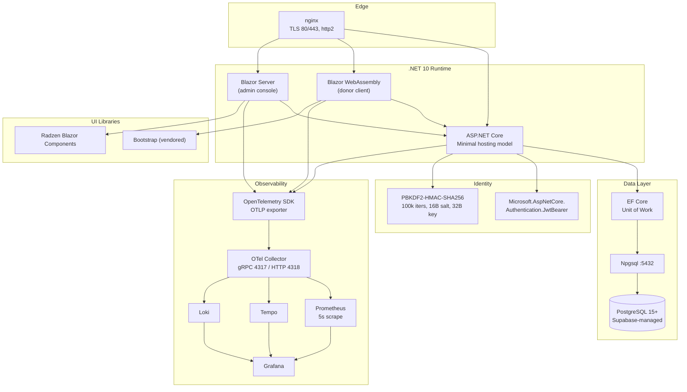

**Stack rationale:**

- **.NET 10** — single-language full stack (domain, API, both front ends), which is why one team can maintain five layers plus two SPAs.
- **Blazor WebAssembly for donors, Blazor Server for operators** — an *intentional asymmetry*. Donors are anonymous, high-latency-tolerant, and need no server session state; operators need live UI state, dialogs, and server-side data binding. Choosing WASM for donors avoids server-side circuit scaling for public traffic. Choosing Server for operators avoids shipping admin logic to browsers.
- **Supabase/PostgreSQL** — the platform needs a relational ledger with transactional guarantees and a managed identity layer. Supabase provides Postgres + Auth + Storage in one vendor, which is why the schema of record lives in idempotent DDL under `deploy/database/`.
- **OpenTelemetry** — vendor-neutral instrumentation, exported via OTLP. The stated intent is Collector fan-out; the actual configuration exports **directly from the API to Grafana Cloud** while Prometheus **also scrapes the apps' `/metrics` directly**. That is a documented deviation (§8, D-14).

---

# 2. System Context

## 2.1 System Context Diagram

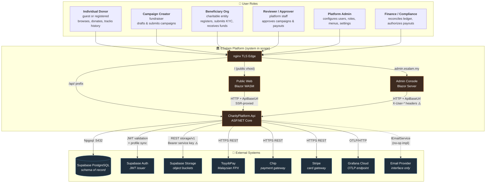

> ⚠️ **Context-level drift:** the `AdminWeb → Api` edge is labeled `X-User-* headers` rather than `Authorization: Bearer`. This is not a documentation simplification — it is the actual mechanism. See §4.2 and §8 (D-01, D-02, D-03).

## 2.2 System Positioning and Value

ESalam occupies the **middle of the Malaysian charitable giving value chain**, between donors who want verifiable impact and charitable organizations that need compliant disbursement.

**The trust architecture is the product.** Three mechanisms make that concrete:

1. **Why a double-entry ledger and not just a `payments` table?** Because auditing requires a proof that *the books balance*, not merely a record of transactions. Any modification of a historical ledger entry breaks the SHA-256 chain at every subsequent entry. This converts "we believe the data is correct" into "the data is mathematically demonstrable."
2. **Why a reusable approval engine rather than two separate approval workflows?** A single state machine means one audit surface, one set of transitions, one place where reviewer identity is captured. The cost is that a single defect compromises both governance boundaries — the blast radius is doubled, and this trade-off should be consciously owned.
3. **Why payment adapters behind a factory?** Malaysia's payment rail landscape is fragmented (FPX via ToyyibPay, card via Stripe, alternative via Chip). A code-keyed factory means adding a rail does not touch the donation path.

## 2.3 User Roles and Scenarios

| Role | Primary Interface | Core Scenario | Trust Level |
|---|---|---|---|
| **Individual Donor** | `PublicWeb.Wasm` `/`, `/campaigns`, `/donate/{id}`, `/my-donations` | Discover campaign → select FPX/card → donate → receive receipt | Anonymous or self-registered; guest state in localStorage |
| **Campaign Creator** | `PublicWeb.Wasm` + `AdminWeb` campaign editor | Draft campaign → attach verified beneficiary → configure capacity tiers → submit for moderation | Authenticated; ownership-scoped |
| **Beneficiary Organization** | `AdminWeb` beneficiary editor / API | Register legal identity + bank details → submit KYC → await verification | Authenticated; verified via state machine |
| **Reviewer / Approver** | `AdminWeb` approval dialogs | Inspect approval step → approve/reject/escalate/skip with comments | Authenticated; **must be an approval position holder** |
| **Platform Administrator** | `AdminWeb` dashboard, users, roles, menus, settings | Configure taxonomy, manage users/roles, inspect audit trail | Authenticated; SuperAdmin scoped |
| **Finance / Compliance Officer** | `AdminWeb` ledger explorer, payouts workbench | Read campaign ledger → verify hash chain → initiate/approve payout | Authenticated; FinanceAdmin/FinanceAuditor scoped |

**Trust asymmetry to note:** the donor role is *unauthenticated-tolerant by design* (guest donations, guest carts). The operator roles are *supposed* to be strictly authenticated — and that is precisely where the drift lives (§8).

## 2.4 External System Interactions

| External System | Direction | Protocol | Contract Owner | Failure Mode |
|---|---|---|---|---|
| **Supabase PostgreSQL** | Outbound | Npgsql :5432 | `ApplicationDbContext` | Hard failure — no fallback (⚠️ see D-09: direct host, not pooler) |
| **Supabase Auth** | Outbound | HTTPS REST (`/auth/v1`) | `AuthHandlers` | Sync degrades; local profile remains |
| **Supabase Storage** | Outbound | HTTPS REST (`/storage/v1`) | `SupabaseFileStorage` | Media upload fails; **service-role key used** (⚠️ D-08) |
| **ToyyibPay** | Bidirectional | HTTPS REST + webhook | `ToyyibPayAdapter` | ⚠️ **Synthetic stub** — no real HTTP call (D-05) |
| **Chip** | Bidirectional | HTTPS REST + webhook | `ChipAdapter` | ⚠️ Believed stubbed by pattern (D-05, partially unverified) |
| **Stripe** | Bidirectional | HTTPS REST + webhook | `StripeAdapter` | ⚠️ Believed stubbed by pattern (D-05, partially unverified) |
| **Grafana Cloud** | Outbound | OTLP/HTTP | `OpenTelemetryExtensions` | Telemetry loss only; no business impact |
| **Email Provider** | Outbound | `IEmailService` interface | `EmailService` | ⚠️ **No-op logger** — receipts never sent (D-07) |
| **nginx** | Inbound | HTTP/HTTPS | `deploy/nginx/nginx.conf` | Total ingress failure |

## 2.5 System Boundary Definition

**In scope (owned by ESalam):**

```
src/CharityPlatform.Domain          — aggregates, enums, value objects, Result, domain events
src/CharityPlatform.Application     — CQRS handlers, validators, service interfaces, DI scanning
src/CharityPlatform.Contracts       — DTOs / request-response shapes
src/CharityPlatform.Infrastructure  — EF Core, ledger, payment adapters, storage, email, workers, OTel
src/CharityPlatform.Api             — composition root, middleware, controllers
src/CharityPlatform.PublicWeb.Wasm  — WASM host (server-side SSR host)
src/CharityPlatform.PublicWeb.Wasm.Client — donor pages/components
src/CharityPlatform.AdminWeb        — Blazor Server operator console
deploy/database                     — idempotent Supabase DDL (schema of record)
deploy/compose                      — container topology manifests
deploy/docker                       — per-service Dockerfiles
deploy/nginx                        — TLS edge config
deploy/observability                — Collector, Prometheus, Loki, Tempo, Grafana provisioning
```

**Out of scope (consumed, not owned):** Supabase hosting infrastructure, Stripe/ToyyibPay/Chip processing internals, Grafana/Prometheus/Tempo/Loki *products* (only their ESalam configuration is in scope), external cloud object storage provider internals, end-user browsers, vendored assets under `wwwroot/lib`, and generated analysis artifacts (`graphify-out`).

**Boundary definition rule:** *code and configuration the ESalam team authors and deploys* vs. *services integrated across a network or HTTP boundary*.

---

# 3. Container View

## 3.1 Container Diagram

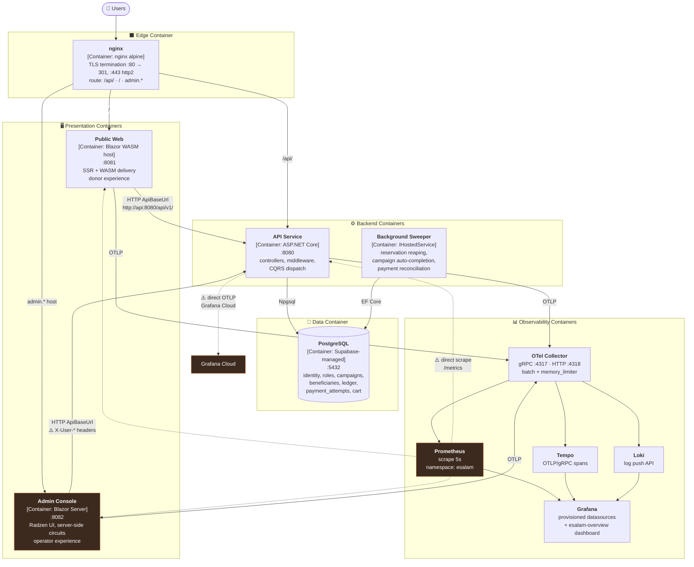

## 3.2 Domain Module Division

ESalam's modules divide into **four Core Business Domains** (competitive differentiation), **three Supporting Business Domains** (necessary but not differentiating), and **three Infrastructure Domains** (technical foundation).

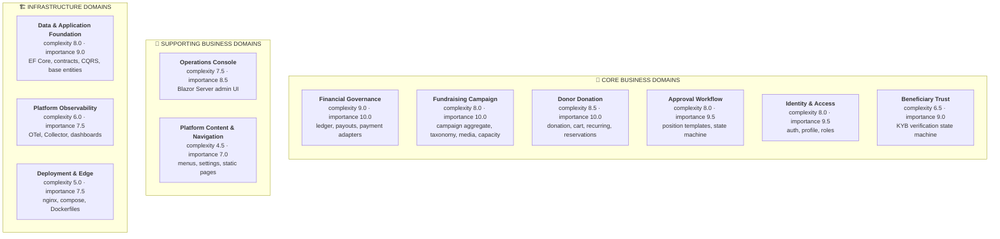

**Classification rule applied:** a *Core* domain is one where ESalam has competitive differentiation or where a defect causes direct financial/legal exposure. *Supporting* domains are necessary but replaceable. *Infrastructure* domains are technical substrates that no business logic depends on semantically.

## 3.3 Domain Module Architecture — Responsibilities

### Core Domain: Donor Donation

| Attribute | Value |
|---|---|
| **Code paths** | `Domain/Entities/Donations/{Donation,Cart,CartItem}.cs` · `Application/Donations/{DonationHandlers,CartHandlers}.cs` · `Application/Recurring/RecurringHandlers.cs` · `Application/Reservations/ReservationHandlers.cs` · `Contracts/Donations/*` · `Api/Controllers/Donations/*` · `PublicWeb.Wasm.Client/Pages/{Donate,Cart,MyDonations,DonationSuccess}.razor` |
| **Complexity** | 8.5 / 10 |
| **Importance** | 10.0 / 10 |

**Responsibilities:** the complete donor-side giving funnel — campaign discovery, cart + saved-campaign accumulation (dual guest/authenticated persistence), donation creation with full money decomposition, anonymity and tax-exemption flags, recurring schedules, capacity reservation, and per-donor giving history.

**Sub-modules:**

| Sub-module | Role | Key Functions |
|---|---|---|
| **Donation Aggregate** | Aggregate root | Full money decomposition (amount, tip, platform fee, gateway fee, net beneficiary); private setters + private ctor; `MarkFailed` / `Refund` transitions; domain event emission via `BaseEntityWithEvents` |
| **Donation Handlers** | Command/Query use cases | Create donation + persist breakdown; resolve donor identity (authenticated or guest); list giving history; simulate payment outcomes |
| **Cart & Saved Campaigns** | Pre-donation funnel | Add/remove campaigns; dual guest + authenticated persistence; **guest→authenticated merge** (high-risk correctness boundary); serve cart to checkout |
| **Recurring & Reservations** | Scheduled giving + capacity | Recurring schedules; Qurban/Aqiqah slot reservation + release; associate reservations with donations |
| **Donor Web Experience** | Blazor WASM pages | Landing + listings; checkout with FPX/card selector; giving history + tax receipts; personalized recommendations; `CapacityCountdownTimer` |

### Core Domain: Financial Governance

| Attribute | Value |
|---|---|
| **Code paths** | `Domain/Entities/Financial/FinancialEntities.cs` · `Infrastructure/Services/{DoubleEntryLedgerService,PaymentAdapters}.cs` · `Application/Financial/FinancialHandlers.cs` · `Application/Payments/PaymentHandlers.cs` · `Contracts/{Financial,Payments}/*` · `Api/Controllers/{Financial,Payments}/*` |
| **Complexity** | 9.0 / 10 — highest in the system |
| **Importance** | 10.0 / 10 |

**Responsibilities:** the authoritative boundary for anything touching money in or out.

**Sub-modules:**

| Sub-module | Role | Key Functions |
|---|---|---|
| **Double-Entry Ledger** | Tamper-evident accounting | Balanced debit/credit entries; chained SHA-256 over entry payloads; EF Core persistence with audit hooks; ledger immutability guarantee |
| **Payment Gateway Integration** | Multi-vendor abstraction | Provider-specific initiation; callback signature verification; factory resolution by code; `IPaymentProvider` abstraction |
| **Payout Lifecycle** | Money-out governance | Create payout against campaign balance; approve/reject with attribution; list/filter payouts; compute financial summaries |
| **Financial Read Models** | Query surface | Per-campaign ledgers; balance + aggregate summaries; payout status/period filters; audit + reconciliation views |

> ⚠️ **Critical implementation gap:** payment adapters, ledger, and payout lifecycle are architecturally *correct* but functionally *inert*. `ToyyibPayAdapter.CreatePaymentIntentAsync` fabricates a bill code without an HTTP call; `ValidateWebhookAsync` returns `IsValid: true` **unconditionally**. The architecture is right; the implementation is a skeleton (§8, D-05/D-06).

### Core Domain: Fundraising Campaign

| Attribute | Value |
|---|---|
| **Code paths** | `Domain/Entities/Campaigns/Campaign.cs` · `Application/Campaigns/{CampaignHandlers,ApprovalPositionUseCases}.cs` · `Contracts/Campaigns/CampaignContracts.cs` · `Api/Controllers/Campaigns/*` |
| **Complexity** | 8.0 / 10 |
| **Importance** | 10.0 / 10 |

**Responsibilities:** the central donor-facing aggregate. Target and collected amounts, beneficiary + category linkage, story content, slug identity, media galleries, and capacity tiers (Qurban/Aqiqah/Waqf). It is the **destination object for all donation value**.

**Sub-modules:** Campaign Aggregate + Category taxonomy · Campaign CQRS Handlers (ownership-enforced) · Campaign API Surface (thin controllers with uniform `HandleResult` mapping).

### Core Domain: Approval Workflow

| Attribute | Value |
|---|---|
| **Code paths** | `Domain/Entities/Campaigns/{ApprovalPosition,PositionMaster,PositionDefinition}.cs` · `Application/Financial/PayoutApprovalUseCases.cs` · `Application/Campaigns/ApprovalPositionUseCases.cs` · `Contracts/Campaigns/ApprovalWorkflowContracts.cs` |
| **Complexity** | 8.0 / 10 |
| **Importance** | 9.5 / 10 |

**Responsibilities:** a reusable **multi-step, cyclic, attributed** approval engine governing both campaign moderation and payout disbursement.

**The state machine — five transitions, one implementation:**

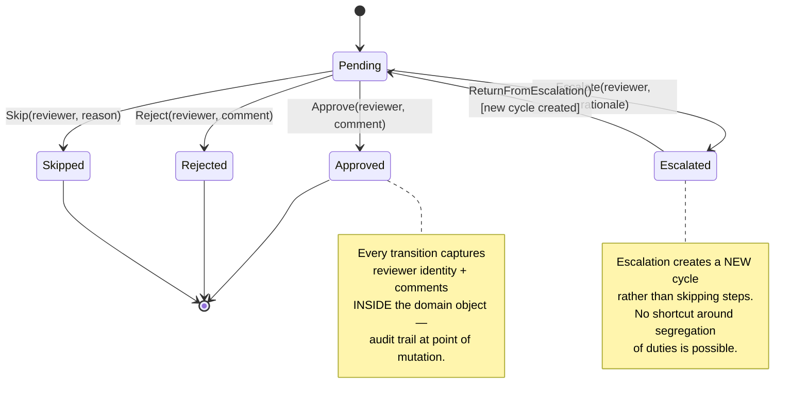

**Design consequence:** one state machine, two governance use cases. Less code to audit, identical audit semantics, certification effort spent once. **Cost:** a defect here compromises *both* governance boundaries simultaneously.

### Core Domain: Identity & Access

| Attribute | Value |
|---|---|
| **Code paths** | `Domain/Entities/Identity/UserProfile.cs` · `Application/Auth/*` · `Infrastructure/Services/PasswordHasher.cs` · `Api/Controllers/Auth/*` |
| **Complexity** | 8.0 / 10 |
| **Importance** | 9.5 / 10 |

**Responsibilities:** the **primary trust boundary** of the API surface. Donor and operator registration, login, Supabase profile sync, profile updates, photo management, password change, roles, and permissions. Every other domain consumes its output through `ICurrentUserService`.

**Password hashing (verified correct):** PBKDF2-HMAC-SHA256, 100,000 iterations, 16-byte salt, 32-byte key, `FixedTimeEquals` comparison.

> ⚠️ **Two drift items on this domain:** the login path returns an opaque non-JWT token (`esalam_session_{userId}_{ticks}`), and a **seed credential fallback** remains reachable when DB lookup throws or returns no user — including `admin@esalam.my / Admin@123` and the additional case-insensitive acceptances `DemoPass@123` / `password123` (§8, D-03/D-04).

### Core Domain: Beneficiary Trust

| Attribute | Value |
|---|---|
| **Code paths** | `Domain/Entities/Beneficiaries/{Beneficiary,BeneficiaryMedia}.cs` · `Application/Beneficiaries/BeneficiaryHandlers.cs` · `Api/Controllers/Beneficiaries/BeneficiariesController.cs` |
| **Complexity** | 6.5 / 10 |
| **Importance** | 9.0 / 10 |

**Responsibilities:** the KYB gate. A charitable organization registers legal identity, contact details, banking details, and KYC media; it is persisted **pending**; an operator invokes `Verify` / `Reject` / `Suspend`.

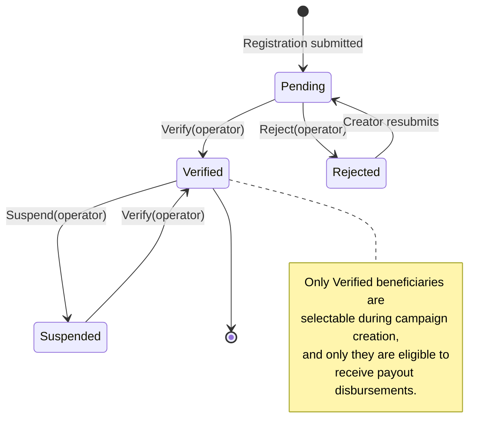

**Why this domain matters disproportionately:** it is the **deepest upstream dependency in the money chain**. Beneficiary verification gates campaign creation → gates donations → gates payouts. It is also the **cheapest place to inject an illegitimate funds recipient** — the banking details stored here are the destination for payout disbursements.

### Supporting & Infrastructure Domains

| Domain | Type | Complexity | Importance | Why It Exists |
|---|---|---|---|---|
| **Operations Console** | Supporting | 7.5 | 8.5 | Blazor Server console for staff. **The human interface to every governance workflow.** Contains `AdminApiClient` + `AdminAuthStateProvider` |
| **Platform Content & Navigation** | Supporting | 4.5 | 7.0 | Dynamic menus, platform settings (fees, tax config), informational pages. Enables content changes without redeployment |
| **Data & Application Foundation** | Infrastructure | 8.0 | 9.0 | EF Core unit of work, cross-cutting contracts, CQRS abstraction, domain base models, API composition root, DDL schema of record |
| **Platform Observability** | Infrastructure | 6.0 | 7.5 | OTel instrumentation across all three hosts + Collector/backends/dashboards |
| **Deployment & Edge** | Infrastructure | 5.0 | 7.5 | nginx TLS edge, compose topology, per-service Dockerfiles |

## 3.4 Inter-Module Communication

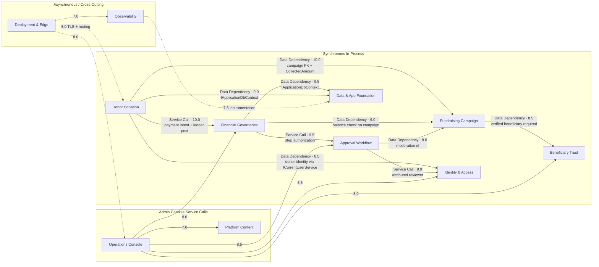

**Communication mechanics — verified:**

- **All backend inter-module communication is in-process** via interfaces resolved from DI. There is no message bus, no service mesh, no RPC between backend modules. This is correct for a monolith of this size and eliminates an entire class of distributed-systems failure modes.
- **The Application layer talks to Infrastructure only through interfaces** declared in `Application/Common/Interfaces/` — `IApplicationDbContext`, `ICurrentUserService`, `IAuditService`, `IDateTimeProvider`, `IFileStorage`, `IEmailService`, `IPaymentProvider`, `IPaymentGatewayFactory`, `IDoubleEntryLedgerService`.
- **Both front ends talk to the API over HTTP, server-side** — the WASM host and the Blazor Server host set `ApiBaseUrl` to the in-compose service name (`http://api:8080/api/v1/`). The browser is *not* the direct API client in the default topology.
- **Cross-cutting concerns are interceptor-based** — `ApplicationDbContext.SaveChangesAsync` auto-generates `AuditLog` rows from `ChangeTracker` for every added/modified/deleted entity, excluding `AuditLog` and `NotificationQueueItem`, capturing user, email, IP, and user agent from `CurrentUserService`.

## 3.5 Storage Design

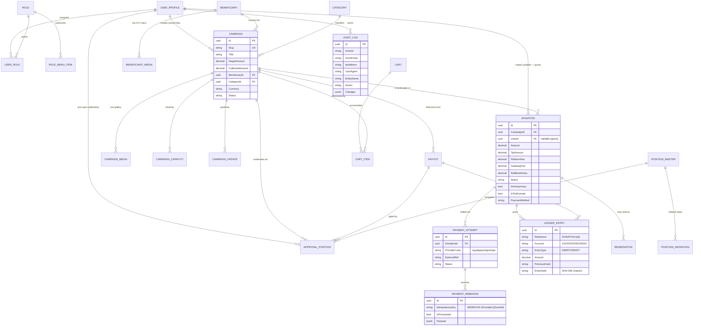

### The Ledger Account Model

`DoubleEntryLedgerService` posts a **balanced 4-entry set** per donation, keyed `DONATION-{id}`:

| Account | Name | Entry | Amount |
|---|---|---|---|
| `1010` | GATEWAY | **DEBIT** | gross (amount + tip) |
| `2010` | BENEFICIARY | **CREDIT** | net to beneficiary |
| `4010` | PLATFORM-FEE | **CREDIT** | platform fee |
| `5010` | GATEWAY-FEE | **CREDIT** | gateway fee |

**Balance invariant:** `Σ debits == Σ credits` must hold for every reference key. This is what makes the ledger auditable rather than merely append-only.

**Chain invariant:** each entry carries `PreviousHash`, and `EntryHash = SHA-256(canonical(entry payload) + PreviousHash)`. Modifying any historical entry invalidates every subsequent hash. **This is the strongest auditability property in the system.**

### Storage Layer Characteristics

| Aspect | Implementation | Notes |
|---|---|---|
| **Schema of record** | `deploy/database/01_esalam_supabase_schema.sql` + `07_esalam_cart_schema.sql` | Idempotent DDL; bootstraps `uuid-ossp` and `pgcrypto` |
| **Object-relational mapping** | EF Core with `EntityConfigurations.cs` (29 KB) | Indexes, FKs, concurrency tokens — **unread at depth; ledger hash uniqueness constraint UNVERIFIED** |
| **Unit of work** | `ApplicationDbContext` | Atomic `SaveChangesAsync` + auto audit generation |
| **Transaction scope** | Explicit `BeginTransactionAsync` in webhook handler | `await using var tx = await _db.BeginTransactionAsync(ct)` |
| **Idempotency** | `PaymentWebhook.IdempotencyKey = "WEBHOOK-{Provider}-{EventId}"` with `AnyAsync(w => w.IsProcessed)` guard | Verified correct |
| **Blob storage** | `SupabaseFileStorage` → `{Supabase:Url}/storage/v1/...` with `Authorization: Bearer {ServiceKey}` | ⚠️ Service-role key is the highest-privilege Supabase credential |
| **Connection target** | `Host=43.133.131.38;Port=5432` (direct) | ⚠️ Supabase pooler string is **commented out** — see D-09 |
| **Guest state** | Browser `localStorage` in the WASM client | Requires explicit merge on authentication |

---

# 4. Component View

## 4.1 API Request Pipeline — Component Diagram

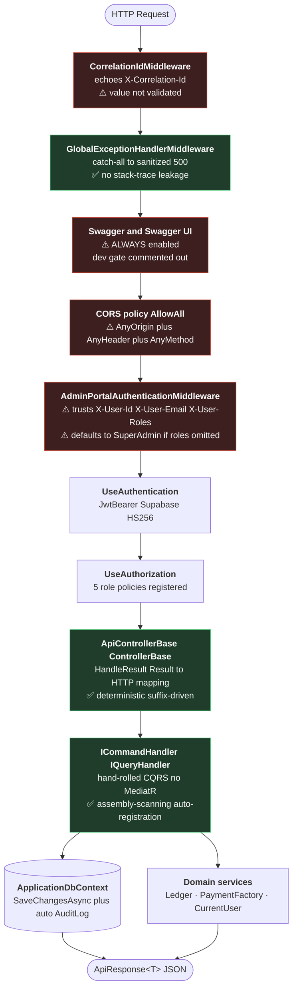

### Middleware Ordering — and Why It Matters

The ordering above encodes the system's most consequential architectural decision:

```
CorrelationId → ExceptionHandler → Swagger → CORS → AdminPortalAuth → Authentication → Authorization → Controllers
```

**`AdminPortalAuthenticationMiddleware` runs before `UseAuthentication()` and before `UseAuthorization()`.** It synthesizes a `ClaimsPrincipal` from plain request headers when the request is unauthenticated, using `ClaimsIdentity(claims, "AdminPortalForwarded")`. If `X-User-Roles` is absent, the `else` branch assigns `ClaimTypes.Role == "SuperAdmin"`.

**Consequence:** the `UseAuthorization` stage that follows has a populated principal to evaluate — a principal that came from the caller's own headers. The registered policies (`RequireSuperAdmin`, `RequireFinanceAdmin`, `RequireReviewer`, `RequireCampaignManager`, `RequireAuditViewer`) exist and are correct, but the controllers largely do not apply them as `[Authorize(Policy=...)]`. This is a **defense that is configured but not exercised**.

### `ApiControllerBase` — Deterministic HTTP Mapping

Handler results map to HTTP status by **suffix matching on `error.Code`**:

| Error code suffix | HTTP status |
|---|---|
| `NotFound` | 404 |
| `Unauthorized` | 401 |
| `Forbidden` | 403 |
| `Conflict` / `AlreadyExists` | 409 |
| *(default)* | 400 |

This is a genuine architectural strength: handler code returns domain-meaningful `Result<T>` values, and the HTTP translation is centralized and testable in one place.

## 4.2 Identity Components — The Drift Surface

```mermaid
graph TB
    subgraph DonorPath["Donor Path as documented"]
        D1["Login.razor / Register.razor"] --> D2["AuthController api/v1/Auth"]
        D2 --> D3["LoginCommandHandler VerifyPassword via PBKDF2"]
        D3 --> D4["Returns opaque token esalam_session_userId_ticks"]
        D4 --> D5["Client stores in localStorage"]
        D5 --> D6["Subsequent calls Authorization Bearer unknown"]
    end

    subgraph AdminPath["Admin Path reality"]
        A1["AdminWeb Program.cs"] --> A2["AdminAuthStateProvider persists UserDto to localStorage"]
        A2 --> A3["AdminApiClient ctor calls SetUserContext admin-portal admin at esalam.my with SuperAdmin FinanceAdmin Reviewer FinanceAuditor"]
        A3 --> A4["Requests carry X-User-Id X-User-Email X-User-Roles"]
        A4 --> A5["AdminPortalAuthenticationMiddleware synthesizes ClaimsPrincipal"]
        A5 --> A6["SuperAdmin by default"]
    end

    subgraph Fallback["Seed Fallback reachable"]
        F1["LoginCommandHandler DB lookup throws OR returns no user"] --> F2["SeedFallbackPasswords admin at esalam.my gives Admin at 123"]
        F2 --> F3["VerifyFallbackPassword also accepts DemoPass at 123 and password123 case-insensitive"]
    end

    classDef bad fill:#3d1f1f,stroke:#c94a3a,color:#fff
    class D4,A3,A5,A6,F1,F2,F3 bad
```

**What the architecture intends:** `AuthController` issues a JWT; `JwtBearer` middleware validates it; role policies authorize the controllers. Supabase Auth is the issuer.

**What the code does:** the identity boundary that the documentation places at `AuthController` is **bypassed** by `AdminPortalAuthenticationMiddleware`. The admin console never sends a real bearer token by default — it ships a hard-coded SuperAdmin context on construction. Five seed accounts with plaintext passwords remain reachable through an infrastructure-failure exception swallow.

**Containment property worth noting:** `AdminApiClient` also contains a `FallbackCampaigns` store — when the API call fails, it returns **synthesized campaign data** that the admin UI displays as real. This is not a security hole but a **data integrity hazard**: an operator could make a decision based on fabricated campaigns.

## 4.3 Core Functional Components

### `DoubleEntryLedgerService` — Component Detail

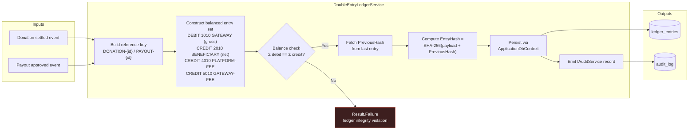

**Quality attributes:**
- **Tamper-evidence:** chained hashing means retroactive modification is detectable at every subsequent entry.
- **Balance proof:** the debit/credit invariant is checkable independently of application logic.
- **Audit coupling:** audit records are emitted alongside hash computation — so each financial event is traceable in *both* the ledger and the audit table.

> ⚠️ **Unverified:** whether the ledger write and the audit write are in the **same database transaction**. If they are not, a crash between them produces an unaudited money movement. This is an asserted compliance property that needs explicit verification.

### `PaymentGatewayFactory` + Adapters — Component Detail

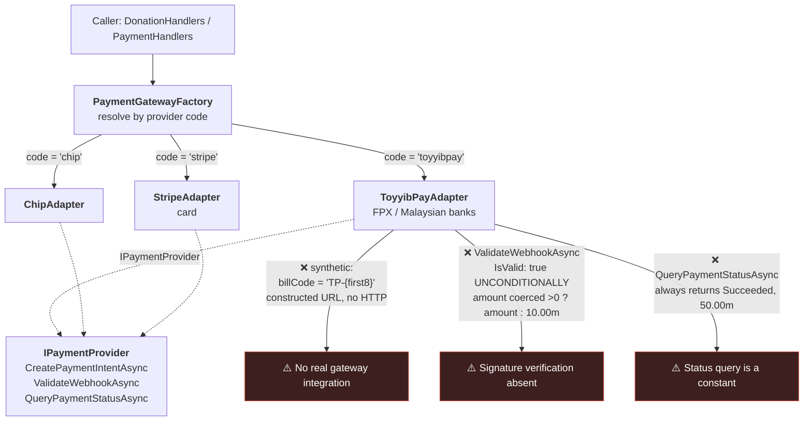

**The pattern is right; the implementation is a stub.** `IPaymentProvider` + code-keyed factory correctly isolates vendor differences. But the ToyyibPay adapter fabricates payment intents, unconditionally validates webhooks, and returns a constant status. The downstream consequence is significant: `PaymentHandlers.cs:44` relies on `validationResult.Value.IsValid`, which is **always `true`** for ToyyibPay — so the documented "cryptographic signature verification" does not occur, and any party who can reach the webhook endpoint can drive donation settlement and ledger entry creation.

### `ApplicationDbContext` — Unit of Work with Auto-Audit

```csharp
// Conceptual shape, verified from research
public override async Task<int> SaveChangesAsync(CancellationToken ct)
{
    // For each tracked Added/Modified/Deleted entity
    //   excluding AuditLog and NotificationQueueItem:
    //     build AuditLog row with:
    //       ActorId / ActorEmail / IpAddress / UserAgent  ← from CurrentUserService
    //       EntityName / Action / Changes                  ← from ChangeTracker
    // Then: base.SaveChangesAsync(ct)
}
```

**Why this matters architecturally:** audit coverage is **non-optional**. A developer writing a new handler cannot forget to audit — the context audits automatically. This is the correct place for the cross-cutting concern, and it is a genuine strength. The one hazard is **audit volume**: every tracked mutation produces a row, so high-write paths (reservation reaping, donation status transitions) generate proportional audit traffic.

## 4.4 Component Interaction — Donation Checkout Sequence

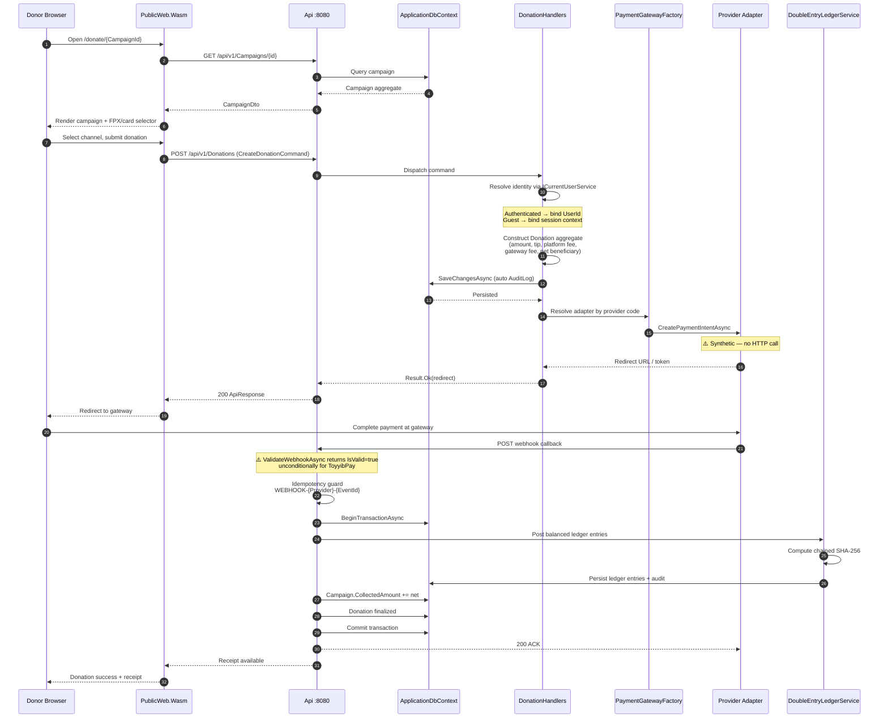

## 4.5 Component Responsibility Matrix

| Component | Layer | Responsibility | Coupling | Stability |
|---|---|---|---|---|
| `ApiControllerBase` | Api | Result→HTTP mapping | Low | High |
| `CorrelationIdMiddleware` | Api | Trace ID propagation | Low | High ⚠️ unvalidated input |
| `GlobalExceptionHandlerMiddleware` | Api | Error sanitization | Low | High |
| `AdminPortalAuthenticationMiddleware` | Api | ⚠️ **Header-trust principal synthesis** | **High** | **Remove** |
| `ApplicationDbContext` | Infra | Unit of work + auto-audit | High (all aggregates) | High |
| `DoubleEntryLedgerService` | Infra | Tamper-evident accounting | Medium | High |
| `PaymentGatewayFactory` | Infra | Adapter resolution | Low | High |
| `{ToyyibPay,Chip,Stripe}Adapter` | Infra | ⚠️ **Stub gateway integration** | Medium | **Rewrite** |
| `SupabaseFileStorage` | Infra | Object storage | Low | Medium |
| `EmailService` | Infra | ⚠️ **No-op logger** | Low | **Implement** |
| `BackgroundSweeperWorker` | Infra | Reservation reaping, campaign completion, ⚠️ stub payment reconciliation | Low | Medium |
| `PasswordHasher` | Infra | PBKDF2-HMAC-SHA256, 100k iters | Low | High ✅ |
| `CurrentUserService` | Infra | Identity context provision | High | High ⚠️ poisoned by header middleware |
| `AdminApiClient` | AdminWeb | Typed API client, ⚠️ hard-coded SuperAdmin context, ⚠️ fallback fabricated campaigns | High | **Fix** |
| `AdminAuthStateProvider` | AdminWeb | ⚠️ localStorage-based auth state | Medium | **Fix** |
| `CQRS` dispatch | Application | Handler registration + resolution | Medium | High |

---

# 5. Key Processes

## 5.1 Primary Business Process — Donation Checkout & Settlement

**Importance:** 10.0 — the platform's core monetization path. Touches **five domain modules simultaneously** (Donor Donation, Financial Governance, Fundraising Campaign, Identity & Access, Data Foundation). Any defect propagates directly into money movement, ledger integrity, and audit compliance.

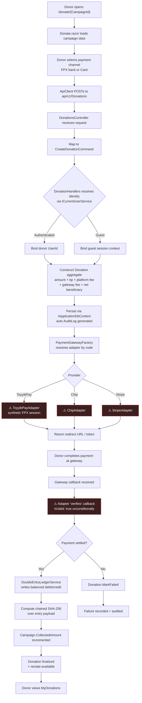

### Key Steps

| # | Step | Component / Entry Point | Purpose | Risk |
|---|---|---|---|---|
| 1 | Campaign load, channel selection | `Donate.razor` `/donate/{CampaignId:guid}` | Renders campaign, FPX bank list, card channels | — |
| 2 | HTTP intake, command mapping | `DonationsController.cs` | Binding validation → `CreateDonationCommand` → `HandleResult` | — |
| 3 | Identity resolution, aggregate construction | `DonationHandlers.cs` | Resolve donor (auth or guest); build `Donation` with money decomposition | Guest attribution semantics undocumented |
| 4 | Duplicate-prevention, persistence | `IApplicationDbContext` / `Donation` | Private setters + invariants; domain events via `BaseEntityWithEvents` | — |
| 5 | Payment initiation | `PaymentAdapters.cs` → factory | Resolve adapter, initiate provider session | ⚠️ **Synthetic — no real HTTP** |
| 6 | Callback verification | Adapter `ValidateWebhookAsync` | Validate inbound webhook before mutation | ⚠️ **Always returns valid for ToyyibPay** |
| 7 | Settlement, ledger write | `DoubleEntryLedgerService.cs` | Balanced entries + chained SHA-256 | Audit/ledger transactional coupling unverified |
| 8 | Campaign balance update | `Campaign.CollectedAmount`, `Donation.MarkFailed()` | Terminal state transition | Concurrent-donation lost-update risk (see §5.1.1) |
| 9 | Receipt, history exposure | `DonationsController` → `MyDonations.razor` | Tax receipt + giving history | ⚠️ `GetMyDonations` is `[AllowAnonymous]` with arbitrary `email` param |

### 5.1.1 Concurrency Analysis — Campaign Balance Update

Steps 7 and 8 are sequential after settlement. Under concurrent donations to the same campaign:

```
T1: read Campaign(CollectedAmount = 1000)
T2: read Campaign(CollectedAmount = 1000)
T1: write CollectedAmount = 1000 + 50 = 1050
T2: write CollectedAmount = 1000 + 75 = 1075   ← lost update of T1's 50
```

**Recommended control:** wrap the ledger write and campaign increment in a single explicit transaction with **optimistic concurrency** on `Campaign` (EF Core `RowVersion`/`xmin` concurrency token). Whether such a token is declared is **UNVERIFIED** — `EntityConfigurations.cs` was not read at depth.

## 5.2 Payout Disbursement Approval Flow

**Importance:** 10.0 — the governance path controlling whether collected funds actually leave the platform. Enforces **segregation of duties**: the actor who creates a payout is not necessarily the actor who approves it, and escalation rounds create deliberate friction a compromised single account cannot bypass.

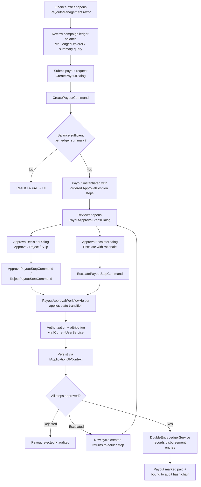

**Critical property:** escalation creates a **new cycle** rather than skipping steps. There is no shortcut around segregation of duties — a reviewer who lacks authority cannot advance the workflow by escalating.

**Dependency chain:** Payout Disbursement → Financial Read Models (ledger-derived balance) → **cryptographic integrity of the ledger itself**. If the ledger balance can be manipulated, balance validation is meaningless.

## 5.3 Campaign Creation & Moderation Flow

**Importance:** 9.5 — the **sole entry point into the donatable campaign population**. Any bypass of the approval gate directly injects unreviewed campaigns into the donation checkout path.

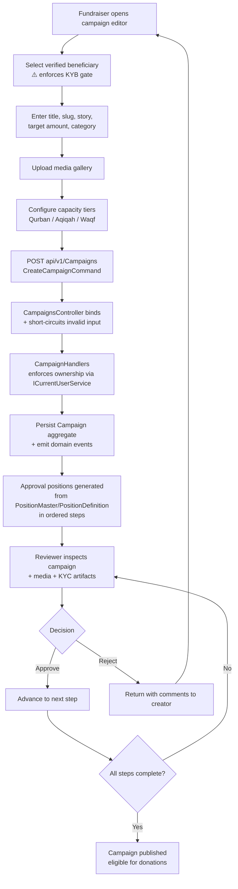

**Architectural note:** the same approval engine used for payouts is reused here — a deliberate decision. One state machine, two governance use cases.

## 5.4 Identity Lifecycle & Profile Synchronization

**Importance:** 9.5 — the **primary trust boundary of the API surface**. Every other domain depends on it indirectly through `ICurrentUserService`.

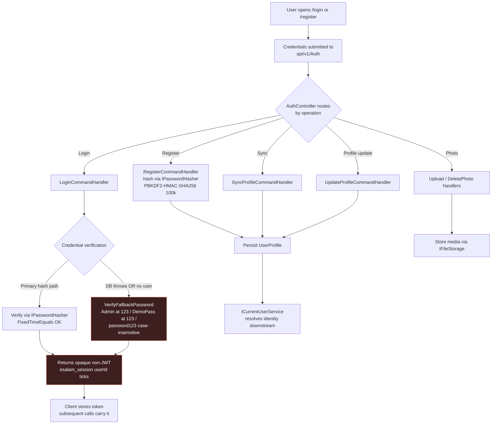

**Why fallback paths are a recurring weakness class:** if the primary path enforces modern hashing and the fallback path does not, an attacker who can **force the fallback** (e.g., by manipulating lookup keys or profile linkage, or by inducing a DB exception) bypasses the strong check entirely. The DB-exception swallow in `LoginCommandHandler` converts an infrastructure failure into an authentication downgrade.

## 5.5 Beneficiary Onboarding & KYB Verification

**Importance:** 9.0 — the KYB gate. Upstream of payout correctness. **The cheapest place to inject an illegitimate funds recipient.**

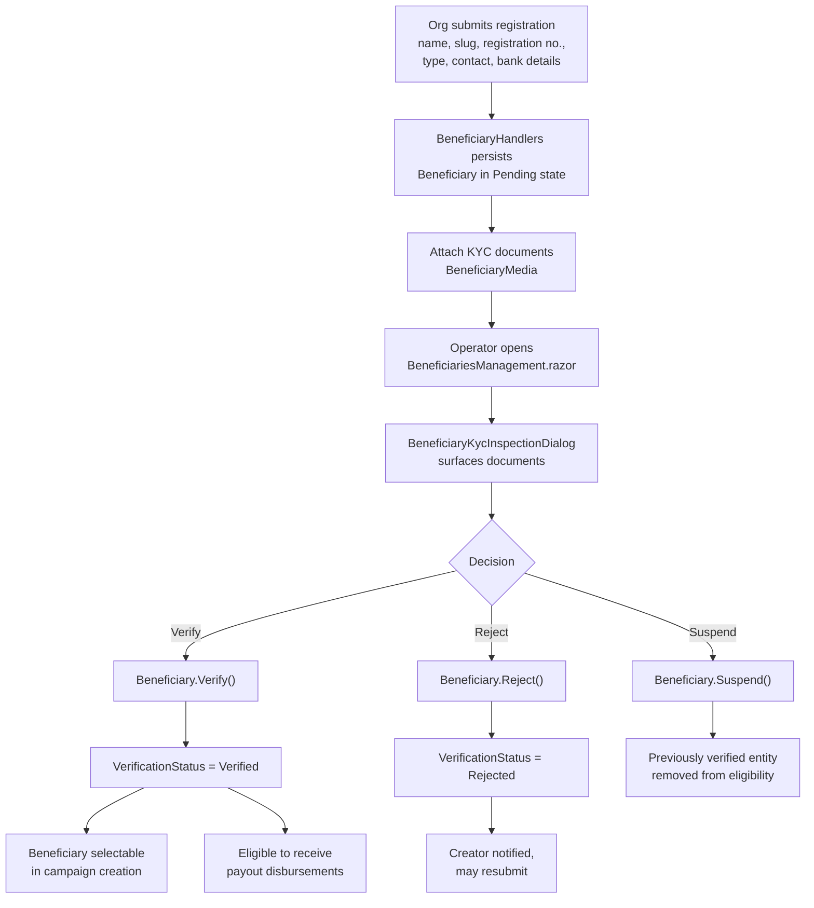

## 5.6 Cross-Cutting: Transactional & Compliance Audit

**Importance:** 8.5 — a **parallel obligation on every financial write**, not a leaf dependency.

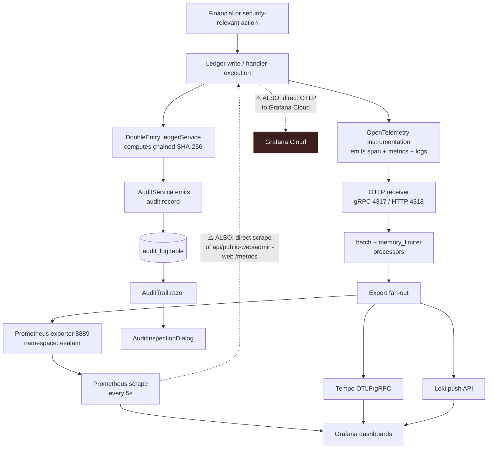

> ⚠️ **Two deviations visible in this flow:**
> 1. **Transactional coupling unproven.** The workflow description says audit records are emitted "alongside" hash computation — but does not confirm a **single transaction**. If `IAuditService` emission is not transactionally coupled to the ledger write, a crash between the two produces an **unaudited money movement**. This must be verified explicitly.
> 2. **Dual telemetry paths.** The API exports **directly to Grafana Cloud** (`OtlpEndpoint: https://otlp-gateway-prod-ap-southeast-2.grafana.net/otlp`) *and* Prometheus **also scrapes the apps' `/metrics` endpoints directly** (`api:8080`, `public-web:8081`, `admin-web:8082`, `metrics_path: /metrics`). The documented Collector-fan-out design is partially bypassed.

## 5.7 Additional Process Observations

### Guest Donation Attribution — an Undocumented Path

Guest donations are permitted, but no workflow step describes:
- how a guest donation is later attributed (or deliberately never attributed) to an account;
- how that interacts with **tax receipt issuance** and **anonymity flags** — both of which require a fundable identity.

`GetMyDonations` being `[AllowAnonymous]` and accepting an arbitrary `email` query param is the visible symptom of this gap: history is keyed on an unauthenticated, unverified string.

### `SimulatePayment` — a Test Primitive in the Production Surface

`DonationHandlers` includes a **simulate-payment capability**. If reachable in the production API surface without strict authorization, it permits **donation finalization and ledger entry creation without any real gateway settlement** — a direct integrity bypass of the entire primary workflow. This must be explicitly gated by environment *and* role. The same class of concern applies to the payment adapters themselves, which are synthetic by default.

### Refund Path — Modeled but Undocumented

`Donation.cs` exposes `Refund`, but no workflow describes:
- the refund lifecycle,
- its approval requirements,
- or how a refund entry is written back into the chained ledger.

This is a gap between **domain capability** and **documented process**.

### Recurring Donations & Reservations — No Documented Governance

Both have handlers (`RecurringHandlers`, `ReservationHandlers`) and use cases, but no business flow describes how a recurring charge settles through the ledger or **who authorizes capacity revocation**.

---

# 6. Technical Implementation

## 6.1 Core Module Implementation

### 6.1.1 CQRS Dispatch — Hand-Rolled, Assembly-Scanned

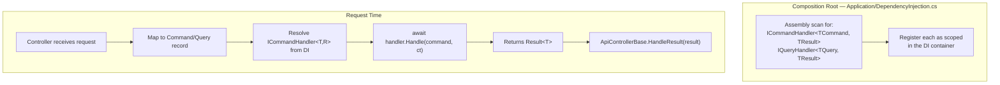

**Why no MediatR?** MediatR brings pipeline behaviors, notification dispatch, and a dependency footprint. ESalam needs exactly one behavior: *dispense the handler for this command type*. Assembly scanning achieves it in ~40 lines with zero third-party dependency and full control over lifetime semantics. **Consequence:** every handler is a testable unit resolved from DI; controllers contain no business logic.

**Registration surface scanned:**
- `ICommandHandler<TCommand, TResult>` → `Task<Result<TResult>>`
- `IQueryHandler<TQuery, TResult>` → `Task<Result<TResult>>`

### 6.1.2 Result Pattern — Exceptional Flow Elimination

```csharp
// Domain/Common/Result.cs — conceptual shape
public sealed class Result<T>
{
    public bool IsSuccess { get; }
    public T? Value { get; }
    public Error? Error { get; }
}

public sealed record Error(string Code, string Message);
```

**Design consequences:**
- Business failures (insufficient balance, invalid state transition, not found) are **values**, not exceptions.
- HTTP translation centralizes in `ApiControllerBase.HandleResult`, suffix-matching `error.Code`.
- **Exception handlers are reserved for genuinely unexpected faults** — which is why `GlobalExceptionHandlerMiddleware` can afford to return a sanitized 500 without fear of masking expected flows.

**Error code → HTTP mapping table (repeated for emphasis, it is that important):**

| `error.Code` suffix | HTTP | Typical use |
|---|---|---|
| `NotFound` | 404 | Campaign/Donation/Payout ID absent |
| `Unauthorized` | 401 | Missing/invalid identity |
| `Forbidden` | 403 | Identity present but lacks required role |
| `Conflict` / `AlreadyExists` | 409 | Duplicate slug, duplicate webhook |
| *(default)* | 400 | Validation, invariant violation, bad request |

### 6.1.3 Domain Aggregate Encapsulation

```csharp
// Domain/Entities/Donations/Donation.cs — conceptual shape
public class Donation : BaseEntityWithEvents
{
    public Guid Id { get; private set; }
    public Guid CampaignId { get; private set; }
    public Guid? UserId { get; private set; }

    public decimal Amount { get; private set; }
    public decimal TipAmount { get; private set; }
    public decimal PlatformFee { get; private set; }
    public decimal GatewayFee { get; private set; }
    public decimal NetBeneficiary { get; private set; }

    public DonationStatus Status { get; private set; }
    public bool IsAnonymous { get; private set; }
    public bool IsTaxExempt { get; private set; }

    private Donation() { }  // EF Core materialization

    public static Donation Create(/* ... */) { /* invariants */ }

    public void MarkFailed(string reason) { /* transition + event */ }
    public void Refund() { /* transition + event */ }
}
```

**Three enforcement properties:**
1. **Private setters** — no external code can mutate `Amount` or `Status` directly.
2. **Private parameterless constructor** — EF Core materializes, but application code cannot construct an invalid aggregate.
3. **Static factory + transition methods** — all state change flows through named, auditable methods that emit domain events.

### 6.1.4 Password Hashing — Correct and Verified

| Parameter | Value |
|---|---|
| Algorithm | PBKDF2-HMAC-SHA256 |
| Iterations | 100,000 |
| Salt | 16 bytes |
| Key length | 32 bytes |
| Comparison | `FixedTimeEquals` (constant-time) |

**This is the correct baseline** and is one of the genuinely implemented security control in the codebase. The weakness is not the hasher — it is the **fallback path that bypasses it** (§5.4).

## 6.2 Key Algorithm Design

### 6.2.1 Chained SHA-256 Ledger Hashing

```mermaid
graph LR
    subgraph Chain["Hash Chain"]
        E1["Entry N-1<br/>hash: H(N-1)"]
        E2["Entry N<br/>payload + H(N-1)<br/>→ SHA-256 → H(N)"]
        E3["Entry N+1<br/>payload + H(N)<br/>→ SHA-256 → H(N+1)"]
        E4["Entry N+2<br/>payload + H(N+1)<br/>→ SHA-256 → H(N+2)"]
    end

    E1 -->|"PreviousHash"| E2
    E2 -->|"PreviousHash"| E3
    E3 -->|"PreviousHash"| E4

    TAMPER["⚠️ Attacker modifies Entry N"] -.->|"breaks"| E2
    E2 -.->|"invalidation cascades"| E3
    E3 -.->|"through all subsequent"| E4

    classDef bad fill:#3d1f1f,stroke:#c94a3a,color:#fff
    class TAMPER bad
```

**Why this is stronger than append-only:**

Append-only logging only prevents deletion or truncation. It does **not** prevent in-place modification of an existing record. A hash chain detects modification at every subsequent entry — *retroactive tampering is provably detectable*.

**Algorithm:**

```
EntryHash(n) = SHA-256( canonical_serialize(entry_n) || EntryHash(n-1) )
```

where `canonical_serialize` produces a stable byte representation of: reference key, account, entry type, amount, currency, timestamp, and actor.

**Invariants that must hold:**

| Invariant | Check | Enforcement |
|---|---|---|
| **Balance** | `Σ(debits) == Σ(credits)` per reference key | `DoubleEntryLedgerService` at post time |
| **Chain continuity** | `EntryHash(n-1) == PreviousHash(n)` | Implicit — each write reads the prior hash |
| **Hash correctness** | `EntryHash(n) == SHA-256(payload_n ‖ PrevHash_n)` | Recomputable by any auditor |

**Recommendation:** a **uniqueness constraint on `LedgerEntry.EntryHash`** would prevent hash collision / duplicate-entry attacks. Whether such a constraint is declared in `EntityConfigurations.cs` is **UNVERIFIED** — this should be confirmed.

### 6.2.2 Approval State Machine Transitions

| Transition | Precondition | Effect | Escalation Flag | Cycle |
|---|---|---|---|---|
| `Approve(reviewer, comment)` | `Status == Pending` | `Status = Approved`; record reviewer + comment | unchanged | unchanged |
| `Reject(reviewer, comment)` | `Status == Pending` | `Status = Rejected`; record reviewer + comment | unchanged | unchanged |
| `Escalate(reviewer, rationale)` | `Status == Pending` | `Status = Escalated`; record rationale | `true` | unchanged |
| `ReturnFromEscalation()` | `Status == Escalated` | `Status = Pending` | `false` | **+1 (new cycle)** |
| `Skip(reviewer, reason)` | `Status == Pending` | `Status = Skipped`; record reason | unchanged | unchanged |

**Attribution is captured in the domain object, not a peripheral log.** This is the property that makes the audit trail trustworthy: reviewer identity and comment are part of the aggregate's persisted state at the moment of transition.

### 6.2.3 Idempotency Key Derivation

```
IdempotencyKey = "WEBHOOK-{Provider}-{EventId}"
```

**Guard:** `AnyAsync(w => w.IsProcessed)` **before** any mutation.

**Why this is correct:** the key is derived from *provider + provider event identifier*, not from a locally generated value. Replayed webhooks from the same provider event collapse to the same key and are rejected before mutating ledger or campaign state. **Verified: no defect in this mechanism.**

## 6.3 Data Structure Design

### Value Objects & Enums

`Domain/ValueObjects/ValueObjects.cs` and `Domain/Enums/DomainEnums.cs` provide the shared vocabulary:

| Type category | Examples (by domain) |
|---|---|
| **Money-bearing** | Currency + amount pairs used across Donation, Payout, LedgerEntry |
| **Identity** | Slug (campaign, beneficiary), registration number |
| **State** | `DonationStatus` (Pending/Succeeded/Failed/Refunded), `VerificationStatus` (Pending/Verified/Rejected/Suspended), `ApprovalStatus`, `PayoutStatus`, `PaymentAttemptStatus` |
| **Classification** | `CampaignCategory`, `CapacityTier` (Qurban/Aqiqah/Waqf), `PaymentProviderCode`, `EntryType` (Debit/Credit) |

### Entity Configuration Concerns

`EntityConfigurations.cs` (29 KB) declares:

| Configuration class | Status |
|---|---|
| Table mappings | ✅ Applied |
| Keys & foreign keys | ✅ Applied |
| Indexes | ⚠️ Not read at depth — unclear which are present |
| Concurrency tokens | ⚠️ **UNVERIFIED** — critical for the campaign balance lost-update analysis (§5.1.1) |
| Ledger hash uniqueness | ⚠️ **UNVERIFIED** — recommended, see §6.2.1 |

## 6.4 Performance Optimization Strategies

### 6.4.1 Existing Strategies

| Strategy | Where | Effect |
|---|---|---|
| **Server-side API proxying from WASM host** | `PublicWeb.Wasm/Program.cs` reads `ApiBaseUrl` | Eliminates per-browser API calls in the default topology; SSR rendering improves time-to-first-paint |
| **Blazor Server for operators** | `AdminWeb` | No admin logic shipped to browsers; server-side data binding with live UI state |
| **Auto-audit in `SaveChangesAsync`** | `ApplicationDbContext` | Single round-trip: entity mutation + audit row in one transaction batch |
| **Assembly-scanning DI registration** | `Application/DependencyInjection.cs` | Startup-time cost only; zero per-request overhead |
| **Aggressive telemetry scrape (5s)** | `prometheus.yml` | Near-real-time operational visibility |
| **Background sweeper** | `BackgroundSweeperWorker` | Reservation reaping and campaign auto-completion off the request path |

### 6.4.2 Identified Bottlenecks and Optimization Opportunities

| Area | Observation | Optimization | Expected Effect |
|---|---|---|---|
| **Campaign balance write contention** | Sequential read-modify-write on `CollectedAmount` after settlement | Explicit transaction + optimistic concurrency token (`RowVersion`/`xmin`) on `Campaign`; retry on conflict | Eliminates lost updates under concurrent donations |
| **Audit table growth** | Every tracked mutation produces an `AuditLog` row | Partition by month; archive to cold storage; index `(EntityName, EntityId, Timestamp)` | Bounds hot-table size; preserves query performance |
| **Ledger chain serialization** | Each write reads the prior entry's hash | Batch ledger posts within a transaction; consider per-account chains if contention appears | Reduces read-then-write serialization at high volume |
| **Guest cart localStorage** | Entire cart in the browser | Acceptable at current scale; move to server-side cart on authentication | Already merged on login — ensure merge is idempotent |
| **Payment adapter duplication** | Three adapters each implement initiation + signature verification | Extract shared `PaymentIntent` normalization layer | Callback verification logic written once; smaller audit scope |
| **Telemetry granularity** | 5s scrape across all services | Split financial metrics (ledger write latency, settlement success rate) onto a tighter scrape than generic HTTP metrics | Sharper financial observability without proportional cost |
| **Blazor Server circuit scaling** | Operators hold server-side circuits | Monitor concurrent operator sessions; scale `admin-web` horizontally behind nginx with sticky sessions if needed | Prevents session-loss on scale-out |
| **Direct DB connection** | `Host=43.133.131.38;Port=5432` (direct, not pooler) | Enable the already-present-but-commented Supabase pooler connection string | Connection multiplexing; survives connection bursts |

### 6.4.3 Performance Design Principles

1. **Business rules stay in-process.** No distributed transaction, no service mesh, no network hop between domain modules. This is the correct choice for a monolith of this size and eliminates entire classes of failure modes.
2. **Background work is genuinely background.** Reservation reaping and campaign auto-completion run in `BackgroundSweeperWorker`, not in request handlers.
3. **Reads and writes share the same context.** `IApplicationDbContext` serves both, so there is no read-model synchronization problem — but also no CQRS read-model scaling story yet. If campaign listing becomes read-heavy, adding a read-side projection is the natural extension point.

---

# 7. Deployment Architecture

## 7.1 Runtime Environment Requirements

| Requirement | Specification |
|---|---|
| **Runtime** | .NET 10 (ASP.NET Core + Blazor) |
| **Database** | PostgreSQL 15+ (Supabase-managed) with `uuid-ossp` and `pgcrypto` extensions |
| **Edge** | nginx with TLS certificates for `esalam.my` and `admin.esalam.my` |
| **Container runtime** | Docker / Docker Compose |
| **DNS** | Apex domain → nginx; wildcard or explicit `admin.*` subdomain |
| **Outbound network** | HTTPS to Supabase (`/auth/v1`, `/storage/v1`), payment gateways, Grafana Cloud OTLP endpoint |
| **Inbound network** | 80 (301 redirect) and 443 (http2) to nginx only; internal services not host-exposed |
| **Storage volumes** | nginx bind-mounts `deploy/nginx/nginx.conf` read-only; observability backends require persistent volumes |

## 7.2 Deployment Topology

```mermaid
graph TB
    subgraph Internet["🌐 Internet"]
        CLIENTS["Donors · Creators · Operators<br/>Reviewers · Admins · Finance"]
    end

    subgraph Host["🖥️ Production Host"]
        subgraph EdgeNet["Edge Network"]
            NGX["<b>nginx</b><br/>:80 → 301<br/>:443 http2 TLS<br/>bind: deploy/nginx/nginx.conf:ro"]
        end

        subgraph AppNet["Application Network"]
            PW["<b>public-web</b><br/>:8081"]
            AW["<b>admin-web</b><br/>:8082"]
            AP["<b>api</b><br/>:8080"]
        end

        subgraph ObsNet["Observability Network"]
            OTC["<b>otel-collector</b><br/>:4317 gRPC<br/>:4318 HTTP<br/>:8889 exporter"]
            PRM["<b>prometheus</b><br/>scrape 5s"]
            TMP["<b>tempo</b>"]
            LKI["<b>loki</b>"]
            GRF["<b>grafana</b><br/>provisioned dashboards"]
        end
    end

    subgraph Managed["☁️ Managed / External"]
        SBPG[("Supabase<br/>PostgreSQL :5432")]
        SBAU["Supabase Auth"]
        SBST["Supabase Storage"]
        GW["ToyyibPay · Chip · Stripe"]
        GC["Grafana Cloud<br/>OTLP"]
    end

    CLIENTS -->|"443 TLS"| NGX
    NGX -->|"/"| PW
    NGX -->|"/api/"| AP
    NGX -->|"admin.* host"| AW

    AP -->|"Npgsql :5432"| SBPG
    AP -->|"HTTPS"| SBAU
    AP -->|"HTTPS + service key"| SBST
    AP -->|"HTTPS REST"| GW
    AP -.->|"⚠️ OTLP direct"| GC

    AP -->|"OTLP"| OTC
    PW -->|"OTLP"| OTC
    AW -->|"OTLP"| OTC
    PRM -.->|"⚠️ direct /metrics scrape"| AP
    PRM -.-> PW
    PRM -.-> AW

    OTC --> PRM
    OTC --> TMP
    OTC --> LKI
    PRM --> GRF
    TMP --> GRF
    LKI --> GRF

    classDef bad fill:#3d1f1f,stroke:#c94a3a,color:#fff
    class GC bad
```

### Compose Manifest Reality — Three Competing Stacks

| Manifest | Topology | Characteristics |
|---|---|---|
| `deploy/compose/docker-compose.prod.yml` | Canonical production | Builds images locally; includes nginx; env interpolation; `depends_on` ordering; restart policy |
| `/docker-compose.yml` (root) | GHCR image pull | Uses `external: true` network; **no nginx** |
| `docker-compose.observability.yml` | Separate observability stack | Grafana with `admin/admin` credentials and **anonymous admin enabled** |

**Consolidation is required.** Divergent topology across three manifests means the deployed system depends on which file the operator happened to use — and the observability manifest ships an anonymous-admin Grafana. This is a **MEDIUM** severity deployment defect (D-16).

## 7.3 Scalability Design

### 7.3.1 Current Scaling Characteristics

| Container | Statefulness | Scaling Approach | Bottleneck |
|---|---|---|---|
| **nginx** | Stateless | Horizontal behind L4 LB | None |
| **public-web** (WASM host) | Stateless | Horizontal — WASM assets served per-node | Static asset cache warmth |
| **api** | Stateless | Horizontal — but see DB connection limit below | DB connection pool |
| **admin-web** (Blazor Server) | **Stateful** — server-side circuits | Horizontal **with sticky sessions** | Circuit memory per operator session |
| **otel-collector** | Stateless | Horizontal | Backend export throughput |
| **prometheus** | Stateful (TSDB) | Vertical or federation | Scrape volume at 5s interval |
| **postgres** | Stateful | Managed by Supabase | Connection count on direct host (⚠️ pooler commented out) |

### 7.3.2 Extension Points and Strategies

```mermaid
graph TB
    subgraph Current["Current Node"]
        PW2["public-web"]
        AW2["admin-web"]
        AP2["api"]
    end

    subgraph Scale["Scale-Out Path"]
        LB["L4 Load Balancer"]
        PW3["public-web × N<br/><i>stateless, any node</i>"]
        AW3["admin-web × N<br/><i>sticky sessions required</i>"]
        AP3["api × N<br/><i>stateless</i>"]
        POOL["⚠️ Supabase Pooler<br/><i>connection string already<br/>commented in config — enable it</i>"]
    end

    LB --> PW3
    LB --> AW3
    LB --> AP3
    AP3 --> POOL

    subgraph NewRail["New Payment Rail (extension point)"]
        NEWADAPTER["New IPaymentProvider impl"]
        NEWCODE["Register provider code<br/>in PaymentGatewayFactory"]
    end

    subgraph NewGoverned["New Governed Entity (extension point)"]
        NEWENTITY["Entity with approval steps"]
        REUSE["Reuse PositionMaster/<br/>PositionDefinition templates"]
        REUSER["Reuse ApprovalPosition<br/>state machine as-is"]
    end

    classDef warn fill:#3d2a1f,stroke:#c97b3a,color:#fff
    class POOL,AW3 warn
```

**Extension point 1 — payment rails.** Adding a provider requires: implement `IPaymentProvider`, register the code in the factory. **No changes to the donation path.** This is the factory pattern paying off.

**Extension point 2 — newly governed entities.** Any entity requiring multi-step approval (e.g., refund approval) reuses the existing `ApprovalPosition` state machine with new `PositionMaster`/`PositionDefinition` templates. **The state machine is already general.**

**Extension point 3 — observability backends.** The OTLP abstraction means swapping Tempo/Loki/Prometheus for another vendor is a Collector configuration change, not a code change.

**Extension point 4 — content and navigation.** Menus and platform settings are data-driven (`AppMenuItem`, `PlatformSetting`), so taxonomy and navigation changes require no deployment.

### 7.3.3 Scaling Constraints to Address

| Constraint | Impact | Mitigation |
|---|---|---|
| **Blazor Server circuits** | Operator sessions are pinned to a node | Sticky sessions at the LB; monitor circuit count per node |
| **DB connections on direct host** | Connects to `43.133.131.38:5432` directly, not the pooler | **Enable the commented-out Supabase pooler string** |
| **Ledger write serialization** | Chain requires reading the prior hash | Batch posts within a transaction; consider per-account chains |
| **`CollectedAmount` write contention** | Concurrent donations to the same campaign | Optimistic concurrency token + retry |
| **5s Prometheus scrape across all services** | Scrape volume scales with service count | Split financial vs. generic metric scrape intervals |

## 7.4 Monitoring and Operations

### 7.4.1 Telemetry Pipeline

```mermaid
graph LR
    subgraph Apps["Instrumented Services"]
        A1["api :8080<br/>OTel SDK"]
        A2["public-web :8081<br/>OTel SDK"]
        A3["admin-web :8082<br/>OTel SDK"]
    end

    subgraph Collector["otel-collector"]
        R["Receivers<br/>gRPC :4317<br/>HTTP :4318"]
        P["Processors<br/>batch<br/>memory_limiter"]
        E["Exporters<br/>prometheus :8889<br/>otlp/tempo<br/>loki"]
    end

    subgraph Backends["Backends"]
        PR["Prometheus<br/>namespace: esalam"]
        TP["Tempo<br/>spans"]
        LK["Loki<br/>logs"]
        GF["Grafana<br/>esalam-overview dashboard"]
    end

    A1 --> R
    A2 --> R
    A3 --> R
    R --> P --> E
    E --> PR
    E --> TP
    E --> LK
    PR --> GF
    TP --> GF
    LK --> GF
```

**Instrumentation coverage:** all three runtime hosts export traces, metrics, and logs via OTLP. Domain-level telemetry helpers (`Domain/Common/EsalamTelemetry.cs`) emit metrics from aggregate operations.

**Prometheus scrape configuration:** targets `api:8080`, `public-web:8081`, `admin-web:8082` at `metrics_path: /metrics` with a **5-second** interval; also scrapes the Collector exporter on `:8889`.

### 7.4.2 Operational Guidance

| Concern | Guidance |
|---|---|
| **Deployment ordering** | nginx depends on the three app services; app services depend on database reachability. Compose `depends_on` enforces startup order — but `depends_on` is **not** health-aware. Add healthchecks. |
| **Restart policy** | Declared in the compose manifests; verify it is `unless-stopped` or `always` in production |
| **Secret management** | ⚠️ **Currently broken.** Secrets live in `appsettings.json` — see §8 D-08. Move to environment / secret store before any production exposure |
| **Certificate renewal** | nginx terminates TLS; renewal must be external to the container or via a mounted cert volume |
| **Database migrations** | The schema of record is idempotent DDL under `deploy/database/`. Application of migrations must be explicit and ordered (`01_`, `07_`, ...) |
| **Grafana access** | ⚠️ The observability manifest ships `admin/admin` with anonymous admin enabled — restrict before exposing |
| **Alerting** | Not visible in the research materials. **This is a gap:** ledger hash-chain verification failures, settlement failures, and approval workflow stalls should all alert. |
| **Health endpoints** | `/metrics` is exposed; a distinct `/health` readiness endpoint for compose healthchecks is not evidenced |

### 7.4.3 Key Metrics to Instrument

| Metric | Why |
|---|---|
| `ledger.write.duration` | Financial write performance; feeds the tighter scrape recommendation |
| `ledger.balance.violations` | **Must be zero.** A non-zero value means ledger integrity failure |
| `ledger.chain.breaks` | **Must be zero.** Tamper detection tripwire |
| `payment.settlement.success_rate` | Core business health; splits by provider |
| `donation.checkout.duration` | End-to-end funnel latency |
| `approval.step.duration` | Workflow velocity; detects approval stalls |
| `approval.escalation.rate` | Governance friction indicator |
| `db.connection.pool.utilization` | Early warning for pooler need |
| `blazor.circuit.count` (admin-web) | Operator session scaling signal |

---

# 8. Architecture Insights, Risks, and Roadmap

## 8.1 What This Architecture Gets Right

These are **verified, not claimed**:

| Strength | Verification |
|---|---|
| **Layering is genuinely clean** | All six `.csproj` inspected; no reverse reference exists. Inward-only dependency direction is real. |
| **Domain core is framework-pure** | `Domain` references no project; sole external package is the OTLP exporter (a smell, not a violation) |
| **CQRS without framework tax** | Hand-rolled dispatch with assembly scanning; no MediatR |
| **Double-entry ledger with chained hashing** | Balanced entries, five named accounts, DB transaction in the webhook handler |
| **Webhook idempotency** | `WEBHOOK-{Provider}-{EventId}` keyed with a pre-mutation `IsProcessed` guard |
| **Auto-audit generation** | `SaveChangesAsync` produces audit rows for every tracked mutation with actor/IP/UA — a genuine architectural feature |
| **Password hashing** | PBKDF2-HMAC-SHA256, 100k iterations, `FixedTimeEquals` |
| **Deterministic HTTP mapping** | `ApiControllerBase.HandleResult` suffix-matches error codes — centralized and testable |
| **Dual front-end separation rationale** | WASM for donors (stateless, public scale), Server for operators (stateful, session-bound) |
| **Vendor isolation** | `IPaymentProvider` + code-keyed factory; adding a rail touches no donation code |
| **Background sweeps work** | Reservation reaping and campaign auto-completion are fully implemented |

## 8.2 Architectural Drift Register

Every item below is reproduced from source. Verdicts follow the evidence standard: **CONFIRMED-DEVIATION** (code contradicts the stated architecture) or **GAP** (declared capability unimplemented).

| ID | Finding | Severity | Verification |
|---|---|---|---|
| **D-01** | Admin auth trusts plain HTTP headers; unauthenticated requests with `X-User-Id`/`X-User-Email` are promoted to **SuperAdmin** if `X-User-Roles` omitted | **CRITICAL** | CONFIRMED — `Middlewares.cs:86-113` |
| **D-02** | Admin console hard-codes a SuperAdmin context on construction | **CRITICAL** | CONFIRMED — `AdminApiClient` ctor `SetUserContext(...)` |
| **D-03** | Documented "JWT-issued identity" is not the admin path; login returns opaque non-JWT token | **CRITICAL** | CONFIRMED — `LoginCommandHandler` returns `esalam_session_{userId}_{ticks}` |
| **D-04** | Seed credential fallback: five demo accounts with plaintext passwords reachable on DB exception or empty result | **HIGH** | CONFIRMED — `AuthHandlers.cs` incl. `Admin@123`, `DemoPass@123`, `password123` |
| **D-05** | Payment adapters are **synthetic stubs**, not gateway integrations | **HIGH** | CONFIRMED for ToyyibPay; **PLAUSIBLE by pattern** for Chip/Stripe (tail unread) |
| **D-06** | Webhook signature verification effectively absent | **HIGH** | CONFIRMED — relies on `IsValid` which D-05 shows is constant `true` |
| **D-07** | Email delivery is a no-op logger | **MEDIUM** | GAP — logs "Simulating email delivery", returns `true` |
| **D-08** | Sensitive material committed in `appsettings.json` | **HIGH** | CONFIRMED — Supabase service-role JWT, JWT secret, OTLP basic-auth token, DB password `Admin123#` at a public IP |
| **D-09** | Production connection string points at a direct host, not the Supabase pooler | **MEDIUM** | CONFIRMED — pooler string commented out |
| **D-10** | CORS `AllowAnyOrigin + AnyHeader + AnyMethod` globally, combined with D-01 | **HIGH** | CONFIRMED — `Program.cs` policy `"AllowAll"` applied ahead of auth |
| **D-11** | Swagger UI served unconditionally in production | **MEDIUM** | CONFIRMED — `IsDevelopment()` guard is commented out |
| **D-12** | Anonymous access on financially sensitive read endpoints | **HIGH** | CONFIRMED — `GetCampaignLedger` `[AllowAnonymous]` despite 403-in-docs; `GetMyDonations` `[AllowAnonymous]` + arbitrary `email` param |
| **D-13** | Authorization intent documented but not enforced at the attribute level | **HIGH** | CONFIRMED — five policies registered; controllers rely on header middleware instead |
| **D-14** | Observability docs claim Collector fan-out; API exports directly to Grafana Cloud and Prometheus scrapes apps directly | **LOW** | CONFIRMED |
| **D-15** | Payment reconciliation sweep is a stub | **LOW** | GAP — `ReconcilePendingPaymentsAsync` ends with a comment and no provider call |
| **D-16** | Three competing compose manifests with divergent topology | **MEDIUM** | CONFIRMED — one ships anonymous-admin Grafana |
| **D-17** | `AdminApiClient` returns **synthesized campaign data** when the API call fails | **MEDIUM** | CONFIRMED — `FallbackCampaigns` |
| **D-18** | Unreferenced artifacts in repository root | **LOW** | CONFIRMED — `page_dump.html` (27 KB, likely leaked admin markup), `scratch_check.cs`, `CharitySystem.slnx`, `docker-compose copy.yml` |

### 8.2.1 Documentation Accuracy Verdict

**The research materials are structurally accurate and materially overstate the security posture.**

- The **dependency graph, domain decomposition, and business flows all match the code.**
- The security narrative — *"JWT issuance/validation configured in the API composition root"*, *"cryptographic signature verification"*, *"segregation of duties"* — describes **intent, not implementation.**

The identity boundary that the documents place at `AuthController` is, in practice, **bypassed by `AdminPortalAuthenticationMiddleware`.**

## 8.3 Corrected Target Architecture

```mermaid
graph TB
    subgraph Edge2["Edge"]
        NG["nginx<br/>/api/ 转发到 api<br/>/ 转发到 public-web<br/>admin.* 转发到 admin-web"]
    end

    subgraph App2["Application Services"]
        PW2["PublicWeb.Wasm<br/>SSR 加 WASM"]
        API2["Api 服务 8080 端口"]
        AW2["AdminWeb Server"]
    end

    subgraph IdP["Identity 目标状态"]
        SUPAAUTH["Supabase Auth<br/>签发真实 HS256 JWT"]
        JWT["JwtBearer 校验<br/>Issuer 为 Supabase<br/>Audience 为 authenticated"]
    end

    subgraph PayT["Payments 目标状态"]
        FACT["PaymentGatewayFactory<br/>按 code 键控"]
        TP["ToyyibPay 适配器<br/>真实 REST 加签名校验"]
        CH["Chip 适配器<br/>真实 REST 加签名校验"]
        ST["Stripe 适配器<br/>真实 REST 加 webhook secret"]
    end

    PW2 -->|"Bearer JWT"| API2
    AW2 -->|"Bearer JWT 不信任请求头"| API2
    NG --> API2
    SUPAAUTH -->|"JWT"| JWT
    JWT --> API2
    API2 --> FACT
    FACT --> TP
    FACT --> CH
    FACT --> ST
```

**The projected intent and reality converge once two layers are closed out: identity and payments.**

## 8.4 Prioritized Remediation Roadmap

| # | Priority | Action | Closes | Effort |
|---|---|---|---|---|
| 1 | **CRITICAL** | Delete `AdminPortalAuthenticationMiddleware`, or hard-fail when `X-User-*` headers arrive on an unauthenticated request. **Remove the `else → SuperAdmin` default.** | D-01 | < 1 h |
| 2 | **CRITICAL** | Delete the `AdminApiClient` constructor's `SetUserContext(...)`. Populate context only after a verified login. | D-02 | < 1 h |
| 3 | **CRITICAL** | Issue a real signed JWT at login (or delegate entirely to Supabase Auth) and have the admin console send `Authorization: Bearer`. | D-03 | 1–2 d |
| 4 | **HIGH** | Delete `SeedFallbackUsers` / `SeedFallbackPasswords` / `DynamicFallbackPasswords` and the DB-exception swallow in `LoginCommandHandler`. **Return `Unauthorized` on infrastructure failure.** | D-04 | < 1 h |
| 5 | **HIGH** | **Rotate every secret in `appsettings.json`; move to env only; purge git history. Treat the Supabase service-role key as compromised.** | D-08 | 2–4 h |
| 6 | **HIGH** | Implement real signature verification in each adapter; remove the `IsValid: true` constant and the `10.00m` amount default. | D-05, D-06 | 2–3 d |
| 7 | **HIGH** | Replace `AllowAll` CORS with an explicit origin allowlist from configuration. | D-10 | < 1 h |
| 8 | **HIGH** | Remove `[AllowAnonymous]` from `GetCampaignLedger`; authorize `GetMyDonations` on the authenticated principal, not a query-string email. | D-12 | 2–4 h |
| 9 | **HIGH** | Apply the already-registered policies (`RequireFinanceAdmin`, etc.) as `[Authorize(Policy=...)]` on controllers. | D-13 | 4–8 h |
| 10 | **HIGH** | Gate `SimulatePayment` behind environment **and** role — or remove from the production surface entirely. | §5.7 | 2–4 h |
| 11 | **HIGH** | Verify ledger write and audit write are in a **single transaction**; if not, couple them. | §5.6 | 4–8 h |
| 12 | **MEDIUM** | Implement `EmailService` against a real SMTP/transactional provider. | D-07 | 4–8 h |
| 13 | **MEDIUM** | Gate Swagger behind `IsDevelopment()` (uncomment the existing guard). | D-11 | 5 min |
| 14 | **MEDIUM** | Delete `FallbackCampaigns` from `AdminApiClient`; surface API failures in the UI instead of fabricating data. | D-17 | 2–4 h |
| 15 | **MEDIUM** | Consolidate the three compose manifests into one canonical stack; remove `docker-compose copy.yml`; remove anonymous Grafana admin. | D-16 | 4 h |
| 16 | **MEDIUM** | Enable the Supabase pooler connection string. | D-09 | < 1 h |
| 17 | **MEDIUM** | Add a concurrency token to `Campaign` and wrap settlement + increment in one transaction. | §5.1.1 | 4–8 h |
| 18 | **LOW** | Implement `ReconcilePendingPaymentsAsync`; point Prometheus at the Collector only, or document the direct-scrape design. | D-15, D-14 | 1 d |
| 19 | **LOW** | Add a uniqueness constraint on `LedgerEntry.EntryHash`. | §6.2.1 | < 1 h |
| 20 | **LOW** | Purge `page_dump.html`, `scratch_check.cs`, `CharityPlatform.slnx`. | D-18 | 10 min |
| 21 | **LOW** | Add healthcheck endpoints and alert rules for ledger integrity, settlement failure, and approval stalls. | §7.4.2 | 1 d |

## 8.5 Verification Coverage

**Examined (verbatim source read):** `Api/Program.cs`, `Api/Middleware/Middlewares.cs`, `Api/Controllers/ApiControllerBase.cs`, `DonationsController.cs`, `PaymentsController.cs`, `FinancialController.cs` (ledger section), `AuthController.cs`, `Application/DependencyInjection.cs`, `Application/Common/CQRS/CQRS.cs`, `IApplicationDbContext.cs`, `ServiceInterfaces.cs`, `AuthHandlers.cs` (handlers + fallback tables), `DonationHandlers.cs`, `PaymentHandlers.cs`, `Infrastructure/DependencyInjection.cs`, `ApplicationDbContext.cs`, `DoubleEntryLedgerService.cs`, `PaymentAdapters.cs` (ToyyibPay + Chip head), `StorageAndEmailServices.cs` (full), `CommonServices.cs`, `PasswordHasher.cs`, `BackgroundSweeperWorker.cs`, `OpenTelemetryExtensions.cs` (head), all three `.csproj`, `AdminWeb/Program.cs`, `AdminAuthStateProvider.cs`, `AdminApiClient.cs` (head), `PublicWeb.Wasm/Program.cs`, `deploy/nginx/nginx.conf`, `deploy/compose/docker-compose.prod.yml`, `docker-compose.observability.yml`, `deploy/observability/otel-collector-config.yml`, `prometheus.yml`, `docker-compose.yml`, `appsettings.json`, `01_esalam_supabase_schema.sql` (head).

**Not verified — access-limited (state these gaps honestly):**

- `ChipAdapter` / `StripeAdapter` tail (lines 120–254 of `PaymentAdapters.cs`) — D-05/D-06 generalization to Chip/Stripe is **PLAUSIBLE by pattern**; CONFIRMED only for ToyyibPay.
- `ApplicationDbContextInitializer.cs` (53 KB) — seed data volume and default role grants unread.
- `EntityConfigurations.cs` (29 KB) — **whether `Campaign` has a concurrency token is UNVERIFIABLE**; whether `LedgerEntry` has a uniqueness constraint on `EntryHash` is **UNVERIFIABLE**.
- `CampaignHandlers.cs` (40 KB), `ApprovalPositionUseCases.cs` (36 KB), `PayoutApprovalUseCases.cs` (23 KB), `AdminApiClient.cs` (2,425 lines) — read headers only; per-handler ownership enforcement is **PLAUSIBLE but unconfirmed**.
- Admin Web page-level `[Authorize]` usage across `Components/Pages/*` — unread; whether any admin page renders without an authenticated principal is **UNVERIFIABLE**.
- `deploy/docker/*.Dockerfile` — unread; runtime user (root vs non-root) **UNVERIFIABLE**.
- `deploy/observability/tempo.yml`, `loki.yml`, Grafana dashboard JSON — unread.

## 8.6 Architectural Decision Guidance for Teams

### For the development team

1. **The domain layer is your asset — protect its purity.** Nothing framework-specific belongs in `CharityPlatform.Domain`. Migration of the OTLP exporter reference out of the domain (into Infrastructure or Application) is a small, worthwhile cleanup.
2. **Never trust a header for identity.** The only acceptable identity source is a validated bearer token. If you ever see `X-User-*` consumed anywhere in the request path, that is a regression — treat it as such.
3. **Business rules in the domain, mapping in the controller.** `ApiControllerBase.HandleResult` exists precisely so handlers can return domain-meaningful `Result<T>` values without HTTP awareness.
4. **Every money-moving handler must be idempotent.** Follow the webhook pattern: derive a stable key, guard on it before mutation.
5. **The approval state machine is a shared asset.** Do not fork it. If a new entity needs approval, add templates, not code.

### For the operations team

1. **Consolidate to one compose manifest** before the next production deployment. Divergent topology is an incident waiting for a specific operator to run the wrong file.
2. **Rotate every secret currently in `appsettings.json` immediately** and move to environment injection or a secret manager.
3. **Never expose the observability stack** as shipped in `docker-compose.observability.yml` — anonymous admin Grafana with `admin/admin` is a direct exposure.
4. **Enable the Supabase pooler connection string** — it is already present and commented. Direct-host connections will not survive a burst.
5. **Add healthchecks.** Compose `depends_on` orders startup but is not health-aware; nginx will route to unready services.
6. **Alert on ledger integrity.** `ledger.balance.violations` and `ledger.chain.breaks` must be zero and must page.

### For technical decision-makers

1. **The architecture is sound; the implementations in two layers are not.** Identity and payments are the two closed loops that need to close. Everything else — the ledger, the approval engine, the domain model, the layering — is genuinely well-designed.
2. **The monolith is the right call** at this stage. In-process domain module communication has no distributed-systems tax, and nothing about the current scale suggests extraction. The extension points (factory, state machine, OTLP) mean extraction remains possible later.
3. **The double-entry ledger with chained hashing is the platform's most defensible technical asset.** It is the concrete expression of the trust proposition, and it is correctly implemented. Protect it: add the hash uniqueness constraint, couple the audit write transactionally, and alert on chain breaks.
4. **The reusable approval engine makes compliance certification cheaper.** One state machine means one audit surface. Spend the effort to make it a formally tested library boundary with contract tests, so new governed entities inherit verified behavior rather than re-deriving it.

---

**End of document.**

*Evidence-derived from the ESalam system context, domain module, architecture, and workflow research materials. Security drift findings are preserved verbatim with their verification verdicts. Unverified claims are explicitly marked as such rather than assumed correct.*