# Core Workflows — ESalam Charity & Donation Platform

**Document type:** System Core Workflow Analysis
**System:** ESalam (FullStackApp — .NET Clean Architecture + Blazor)
**Scope:** `src/` solution layers + `deploy/` runtime assets
**Primary source:** Domain Module Research Report, Workflow Research Report, System Context Report, Source Code Insights
**Confidence baseline:** 0.93 / 1.00

---

## 1. Workflow Overview

### 1.1 System Main Workflows

ESalam is a trust infrastructure product. Every workflow in the platform exists to answer one of two questions: *"Did money legitimately arrive?"* and *"Was money legitimately released?"* The remaining workflows (identity, beneficiary verification, campaign moderation, content navigation) exist to make those two answers verifiable and attributable to a human being.

The platform defines **six first-class workflows**:

| # | Workflow | Importance | Domains Touched | Trigger | Terminal State |
|---|---|---|---|---|---|
| WF-1 | Donation Checkout and Payment Settlement | 10.0 | 5 | Public HTTP `POST api/v1/Donations` | Donation finalized + ledger entry + receipt, or `Failed` |
| WF-2 | Payout Disbursement Approval | 10.0 | 4 | Admin console → `CreatePayoutCommand` | Payout `Paid` + disbursement ledger entries, or `Rejected` |
| WF-3 | Campaign Creation and Moderation | 9.5 | 4 | Creator client → `CreateCampaignCommand` | Campaign `Published` (donatable), or returned with comments |
| WF-4 | Identity Lifecycle and Profile Synchronization | 9.5 | 3 | `/login`, `/register`, `api/v1/Auth` | JWT issued + `UserProfile` persisted |
| WF-5 | Beneficiary Onboarding and Verification | 9.0 | 3 | Beneficiary registration → KYC review | `VerificationStatus = Verified` / `Rejected` / `Suspended` |
| WF-6 | Transactional and Compliance Audit | 8.5 | 3 | Cross-cutting — fires on every financial/security action | Audit record + OTLP telemetry fan-out |

### 1.2 Core Execution Paths

The system has exactly **one critical path** that carries the business model, plus three gating paths that feed into it:

```
CRITICAL PATH (money-in):
  Campaign Published → Donate.razor → DonationsController → CreateDonationCommand
    → DonationHandlers → Donation aggregate persisted
    → PaymentGatewayFactory → Provider adapter → gateway session
    → Gateway callback → VerifyCallbackSignature
    → DoubleEntryLedgerService (chained SHA-256) → Campaign.CollectedAmount++ → Finalized

CONTROL PATH (money-out):
  Ledger balance read → CreatePayoutCommand → ApprovalPosition chain (ordered, cyclic)
    → per-step attributed decisions → DoubleEntryLedgerService (disbursement)

GATE PATHS (feed the critical path):
  Beneficiary.Verify  →  enables Campaign creation with a valid recipient
  Campaign approval   →  enables the campaign to be donatable at all
  Identity/JWT        →  enables attribution of every action above
```

### 1.3 Key Process Nodes

| Node ID | Node | Type | Location | Function |
|---|---|---|---|---|
| **N1** | `Donate.razor` | UI entry | `PublicWeb.Wasm.Client/Pages/Donate.razor` | Campaign load, FPX/card channel selection |
| **N2** | `DonationsController` | API boundary | `Api/Controllers/Donations/DonationsController.cs` | Binding + CQRS dispatch + `HandleResult` normalization |
| **N3** | `CreateDonationCommandHandler` | Application | `Application/Donations/DonationHandlers.cs` | Identity resolution, aggregate construction, persistence |
| **N4** | `Donation` aggregate | Domain | `Domain/Entities/Donations/Donation.cs` | Money decomposition, `MarkFailed`/`Refund` transitions |
| **N5** | `PaymentGatewayFactory` | Infrastructure | `Infrastructure/Services/PaymentAdapters.cs` | Provider resolution by code |
| **N6** | Gateway adapters | Infrastructure | Same file | Initiation + `VerifyCallbackSignature` |
| **N7** | `DoubleEntryLedgerService` | Infrastructure | `Infrastructure/Services/DoubleEntryLedgerService.cs` | Balanced entries + chained SHA-256 |
| **N8** | `Campaign` aggregate | Domain | `Domain/Entities/Campaigns/Campaign.cs` | `CollectedAmount` mutation |
| **N9** | `ApprovalPosition` state machine | Domain | `Domain/Entities/Campaigns/ApprovalPosition.cs` | 5-transition workflow engine |
| **N10** | `PayoutApprovalWorkflowHelper` | Application | `Application/Financial/PayoutApprovalUseCases.cs` | Step orchestration + current-user authorization |
| **N11** | `Beneficiary` aggregate | Domain | `Domain/Entities/Beneficiaries/Beneficiary.cs` | `Verify`/`Reject`/`Suspend` state machine |
| **N12** | `LoginCommandHandler` | Application | `Application/Auth/AuthHandlers.cs` | Credential verification (primary + legacy fallback) |
| **N13** | `ApplicationDbContext` | Infrastructure | `Infrastructure/Persistence/ApplicationDbContext.cs` | Unit of work / `SaveChangesAsync` / transactions |
| **N14** | `Program.cs` | Composition root | `Api/Program.cs` | DI, JWT, middleware, endpoint mapping |
| **N15** | OTel Collector | Ops infrastructure | `deploy/observability/otel-collector-config.yml` | OTLP intake → Prometheus/Tempo/Loki fan-out |

### 1.4 Process Coordination Mechanisms

ESalam coordinates workflows through **five distinct mechanisms** — each chosen deliberately, and each with a different failure mode:

| Mechanism | Where Used | Semantics | Failure Mode If Broken |
|---|---|---|---|
| **CQRS dispatch** (`ICommandHandler`/`IQueryHandler`) | All API → Application transitions | Request/response, no shared state | Controller returns unmapped results; `HandleResult` mismatch |
| **Domain state machines** | `Donation`, `Beneficiary`, `ApprovalPosition` | Encapsulated transitions with invariant enforcement | Illegal states become representable |
| **Domain events** (`BaseEntityWithEvents`) | Aggregate mutations | Post-commit side effects | Event loss on partial failure |
| **Double-entry ledger** | Every money movement | Atomic balanced writes + hash chain | Financial records desynchronize from reality |
| **Result pattern** (`Result`, `DomainErrors`) | Application → API | Explicit success/failure, no exception control flow | Errors surface as 500s instead of typed responses |

**Coordination rule observed throughout:** the API layer never contains business rules. `CampaignsController` (427 lines), `DonationsController`, and `AuthController` (223 lines) are all thin dispatchers that bind, validate, dispatch, and normalize. All decisions live in Application handlers and Domain aggregates.

---

## 2. Main Workflows

### 2.1 WF-1 — Donation Checkout and Payment Settlement (Critical Path)

#### 2.1.1 Business Context

This is the platform's monetization event. Its business value is not "a payment succeeded" — it is "a donation was recorded in a form that can survive an audit, be attributed to a donor or a deliberate anonymity choice, produce a tax receipt, and be defensibly paid out later."

The architectural decision that defines this entire workflow: **donor intent is separated from money movement**. The `Donation` aggregate holds the full financial decomposition but never initiates payment. Payment initiation lives in `PaymentAdapters`; settlement lives in `DoubleEntryLedgerService`. This yields a meaningful containment property — compromising the donation-creation endpoint does not automatically grant a payment-initiation primitive.

#### 2.1.2 Financial Decomposition Model

Every donation carries a five-part money breakdown. This is the core business calculation of the platform:

```
Donation aggregate (Domain/Entities/Donations/Donation.cs)
├── Amount              — gross donation value entered by the donor
├── Tip                 — optional platform-support tip added by the donor
├── PlatformFee         — platform operating fee (per PlatformSettings)
├── GatewayFee          — payment provider processing cost
└── NetBeneficiaryAmount — remainder routed to the beneficiary
      NetBeneficiaryAmount = Amount + Tip − PlatformFee − GatewayFee
```

Additional flags carried by the aggregate:

| Field | Purpose |
|---|---|
| `CampaignId` | FK to `Campaign` — destination of value |
| Donor identity | `UserId` when authenticated; guest session context otherwise |
| `Status` | Donation lifecycle state |
| `IsAnonymous` | Controls whether donor identity is disclosed in listings/receipts |
| `PaymentMethod` / provider code | Determines which adapter resolves |
| Tax-exemption flags | Drives tax receipt eligibility |

Two behavior methods exist on the aggregate — and only these:

```csharp
MarkFailed(reason)   // terminal failure transition
Refund(...)          // reversal path — NOTE: modeled but no documented workflow (see §4.4)
```

All properties use private setters and the constructor is private. **Invariants are structurally enforced, not validated.** This is why the aggregate is extendable without exposing illegal states.

#### 2.1.3 Execution Sequence

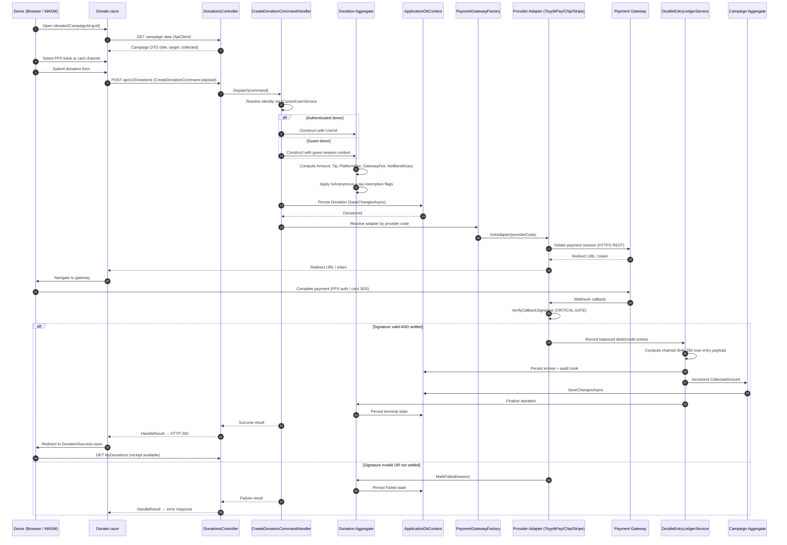

#### 2.1.4 Step-by-Step Detail

| Step | Component | Input | Output | State Transition |
|---|---|---|---|---|
| 1 | `Donate.razor` | Route param `{CampaignId:guid}` | Campaign view model + channel list | `None → ChannelSelected` |
| 2 | `DonationsController` | HTTP body | `CreateDonationCommand` | `ChannelSelected → CommandDispatched` |
| 3 | `CreateDonationCommandHandler` | Command + `ICurrentUserService` | `Donation` aggregate instance | `CommandDispatched → AggregateBuilt` |
| 4 | `Donation` ctor | Financial components | Immutable aggregate | `AggregateBuilt → Pending` |
| 5 | `IApplicationDbContext` | Aggregate | Persisted row + `DonationId` | `Pending → Persisted` |
| 6 | `PaymentGatewayFactory` | `providerCode` | `IPaymentProvider` adapter | `Persisted → Initiated` |
| 7 | Provider adapter | Donation payload | Redirect URL / token | `Initiated → AwaitingGateway` |
| 8 | Gateway webhook | Callback payload + signature | Verified settlement result | `AwaitingGateway → Verified` |
| 9 | `DoubleEntryLedgerService` | Settlement data | Balanced entries + hash chain + audit record | `Verified → Ledgered` |
| 10 | `Campaign` aggregate | Net amount | `CollectedAmount` incremented | `Ledgered → BalanceUpdated` |
| 11 | `Donation` terminal | — | `Finalized` or `Failed` | `→ Finalized` \| `→ Failed` |
| 12 | `DonationsController` | Handler result | HTTP response + receipt availability | `Finalized → ReceiptAvailable` |

#### 2.1.5 Donation State Machine

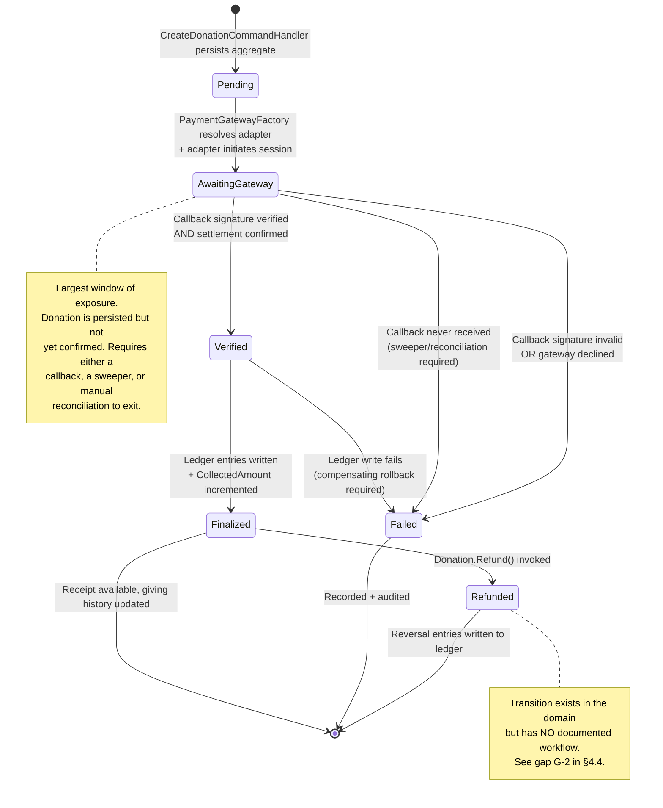

#### 2.1.6 Dependency Requirements

WF-1 cannot succeed unless all of these hold:

1. **Campaign must be Published** — enforced by the campaign approval gate (WF-3). A bypass here injects unreviewed campaigns directly into the donation path.
2. **Beneficiary must be Verified** — the KYB gate (WF-5). This is the deepest upstream dependency and the cheapest place to inject an illegitimate funds recipient.
3. **Identity must resolve** — either a valid JWT or an explicit guest context. `ICurrentUserService` must return a deterministic answer; ambiguity here corrupts giving-history attribution and anonymity handling.
4. **Adapter must resolve and gateway must be reachable** — if all three providers are down, the donation persists as `Pending`/`AwaitingGateway` with no exit path other than a sweeper or manual intervention.
5. **`Campaign.CollectedAmount` update must be concurrency-safe** — see optimization note O-1 in §2.1.7.

#### 2.1.7 Known Optimization Surface for WF-1

| ID | Observation | Risk | Recommended Action |
|---|---|---|---|
| **O-1** | `CollectedAmount` increment and donation finalization appear as sequential steps after settlement | **Lost update** under concurrent donations to the same popular campaign — two settlements read the same balance, one increment is lost | Wrap settlement + balance update in an explicit transaction with optimistic concurrency (row version / ETag) on `Campaign` |
| **O-2** | Three adapters independently implement initiation + `VerifyCallbackSignature` | Signature verification logic duplicated 3×; audit scope tripled; a fix in one adapter may not propagate | Extract a shared `PaymentIntent` normalization layer so callback verification is written once |
| **O-3** | Donation persisted *before* payment initiation (step 5 precedes step 6) | Orphaned `Pending` donations accumulate if the gateway is never reached | Introduce a `Pending` TTL with a background sweeper (`BackgroundSweeperWorker` already exists — extend its scope) |
| **O-4** | `SimulatePayment` is a production-reachable primitive in `DonationHandlers` | **Direct integrity bypass** — permits donation finalization and ledger entry creation with no real gateway settlement | Gate strictly by environment (non-production only) AND by role; make it a compile-time-absent handler in release builds |
| **O-5** | Guest donations permitted, but attribution-on-later-login is undocumented | Tax receipt issuance requires a fundable identity; anonymous + guest + receipt interact ambiguously | Define explicit merge semantics: guest donation + later auth = `UserId` backfill, or deliberate permanent non-attribution. Document the anonymity interaction |

---

### 2.2 WF-2 — Payout Disbursement Approval (Control Path)

#### 2.2.1 Business Context

WF-2 is the governance counterweight to WF-1. Its purpose is **segregation of duties**: the actor who creates a payout is not necessarily the actor who approves it, and escalation rounds create deliberate friction that a single compromised account cannot bypass. This workflow is the mechanism that makes the platform's trust claim credible to an auditor.

The critical design decision: **one approval engine, two governance paths.** Campaign moderation (WF-3) and payout disbursement (WF-2) drive the identical `ApprovalPosition` state machine. This halves the audit surface — but it also **doubles the blast radius of any defect in the state machine.**

#### 2.2.2 The Approval State Machine

`ApprovalPosition` is the workflow execution entity. It links a `Campaign` **or** a `Payout` to a `PositionMaster`, and carries:

| Field | Purpose |
|---|---|
| `StepOrder` | Position in the ordered chain |
| `Cycle` | **Round counter** — incremented on escalation, enabling cyclic re-review |
| `Status` | `ApprovalStepStatus` enum |
| `IsEscalation` | Marks steps created by an escalation |
| Reviewer identity | Who acted |
| Comments | Free-text rationale — captured **in the domain object**, not a peripheral log |

Five transitions, each preserving identity + comments:

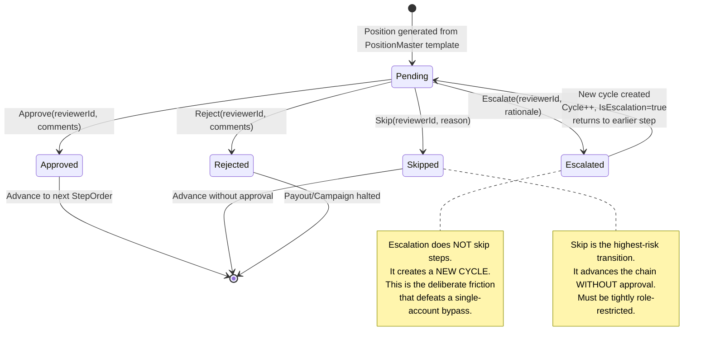

#### 2.2.3 Execution Sequence

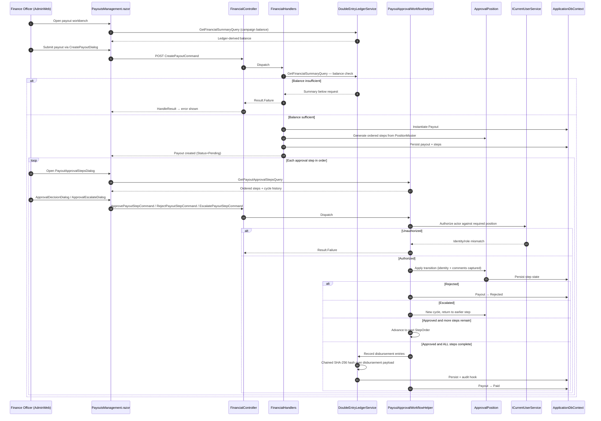

#### 2.2.4 Payout State Machine

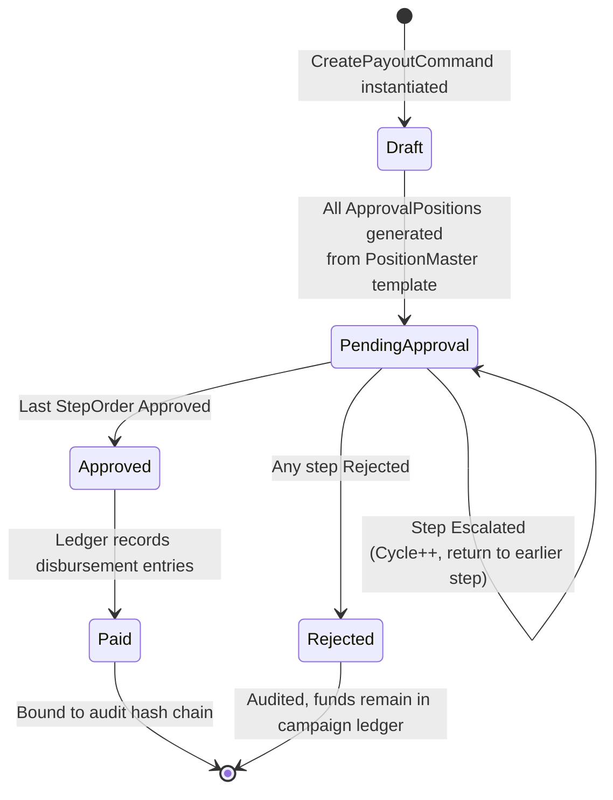

#### 2.2.5 Concurrency and Cycle Semantics

The `Cycle` field is the mechanism that makes this workflow resistant to shortcutting:

- A normal approval advances `StepOrder`.
- An escalation **does not** advance — it creates a new cycle and returns the chain to an earlier step.
- Therefore an infinite escalation loop is *structurally possible* and requires an operational brake (max-cycle threshold, escalation ageing alert) — see §4.6.
- Each transition is attributed via `ICurrentUserService` **inside the domain object**. If the identity cannot be resolved, the transition must fail — a null reviewer is an audit hole.

---

### 2.3 WF-3 — Campaign Creation and Moderation

#### 2.3.1 Business Context

WF-3 is the **sole entry point** into the donatable campaign population. This makes it the highest-leverage gate in the system: any bypass injects unreviewed campaigns directly into the donation checkout path (WF-1).

#### 2.3.2 Execution Flow

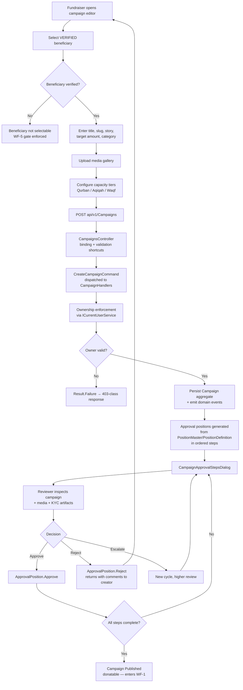

#### 2.3.3 Campaign State Model

| State | Meaning | Donatable? | Exit Path |
|---|---|---|---|
| `Draft` | Created, not submitted | No | Submit → `PendingApproval` |
| `PendingApproval` | Approval chain active | No | Approve all → `Published`; Reject → `Draft` |
| `Published` | Publicly visible and accepting donations | **Yes** | Suspend → `Suspended` |
| `Suspended` | Previously published, removed from eligibility | No | Re-approve or archive |
| `Completed` | Target reached / closed | No | Archive |

**Category taxonomy** (`Category` entity with name, slug, display order, active flag) drives discovery filtering on the public site. Categories originate from WF-7 (Platform Content and Navigation) administration, creating a data dependency from the navigation domain into campaign discovery.

**Capacity tiers** (Qurban/Aqiqah/Waqf) are a distinct concern: they reserve finite slots. `ReservationsController` + `ReservationHandlers` manage slot reservation, and `CapacityCountdownTimer.razor` surfaces the deadline on the client. Reservation capacity release has **no documented governance path** — see gap G-3 in §4.4.

---

### 2.4 WF-4 — Identity Lifecycle and Profile Synchronization

#### 2.4.1 Business Context and Risk Positioning

WF-4 is the **primary trust boundary of the API surface**. Every other workflow depends on it indirectly through `ICurrentUserService`. It is also the location of the platform's single most concerning implementation detail: a **legacy/fallback password verification path** inside `LoginCommandHandler`.

#### 2.4.2 Execution Flow

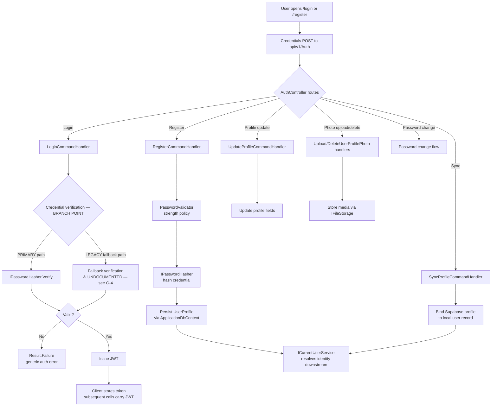

#### 2.4.3 Identity Resolution Contract

`ICurrentUserService` is the single source of truth for "who is acting." It must provide:

- User identifier
- Role/position membership (used by the approval authorization in WF-2 and WF-3)
- Guest-context signal (used by donation and cart handlers in WF-1)

**Critical dependency:** the approval workflow's segregation of duties is only as strong as the role resolution in this service. If a role check silently succeeds on ambiguity, escalation friction is bypassed.

#### 2.4.4 Instrumentation Requirement

The legacy fallback path must be **instrumented per-login**: log which verification path was taken. If fallback usage is non-zero and unexplained in production, that is a security incident, not a curiosity. The correct long-term action is migration of any remaining legacy-hashed accounts and retirement of the branch entirely.

---

### 2.5 WF-5 — Beneficiary Onboarding and Verification

#### 2.5.1 Business Context

WF-5 is the **deepest upstream dependency in the money chain**:

```
Beneficiary.Verify → Campaign creation eligible → Campaign published → Donations accepted → Payout disbursed
```

An unverified entity that reaches `Verified` poisons every downstream step. This is also the workflow where banking details are captured — meaning a compromise here redirects *where money goes*, not merely *whether it moves*.

#### 2.5.2 Verification State Machine

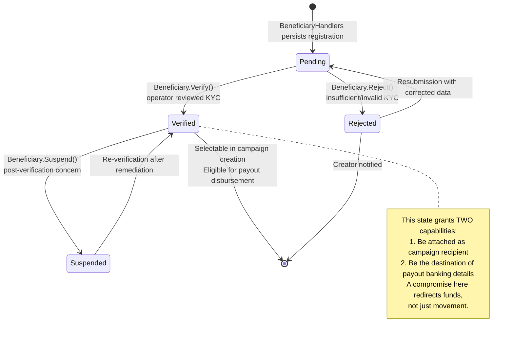

#### 2.5.3 Onboarding Sequence

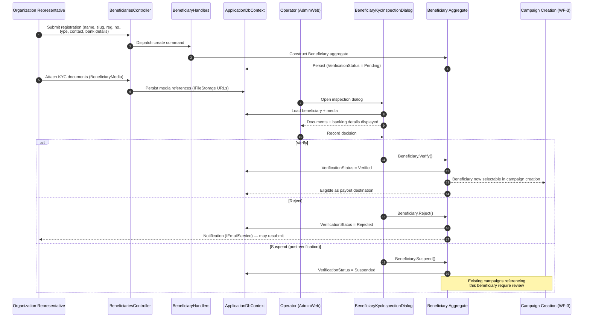

**Significant unresolved question for W-5:** what happens to *already published campaigns* when their beneficiary is `Suspended`? The domain supports the transition; no documented workflow propagates the consequence. This is gap G-5.

---

### 2.6 WF-6 — Transactional and Compliance Audit

#### 2.6.1 Business Context

WF-6 is not a leaf workflow — it is a **parallel obligation on every financial write**. The platform's compliance claim rests on the assertion that audit emission is transactionally coupled to the ledger write. **This assertion is stated in the research materials but not evidenced.** It is the single most important thing to verify.

If `IAuditService` emission is *not* inside the same transaction as the ledger write, then a crash between the two produces an **unaudited money movement** — the exact failure the platform's trust narrative must exclude.

#### 2.6.2 Dual-Record Architecture

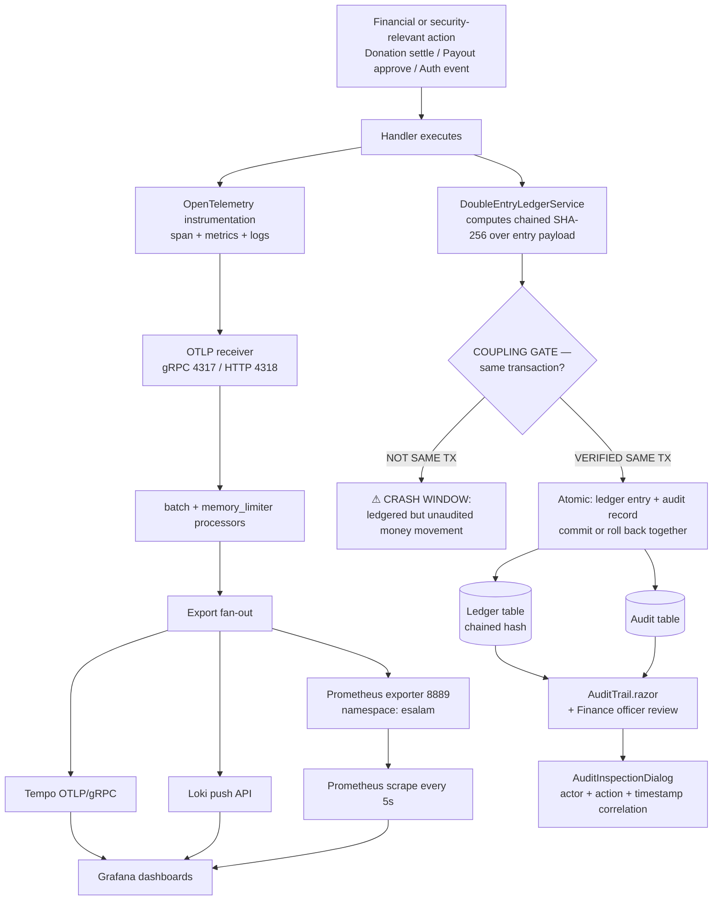

#### 2.6.3 Tamper-Evidence Mechanism

The chained SHA-256 hash is the platform's strongest auditability property:

```
Entry[0].Hash = SHA256(payload[0] + genesis)
Entry[1].Hash = SHA256(payload[1] + Entry[0].Hash)
Entry[N].Hash = SHA256(payload[N] + Entry[N-1].Hash)
```

Retroactive modification of **any** historical entry invalidates verification at **every subsequent entry**. This is not merely append-only — it is a self-auditing structure. It is also why `DoubleEntryLedgerService` carries `importance: 0.96`.

**Consequence for operations:** hash-chain verification must be a scheduled, automated check. A chain that is never verified is an assertion, not a control. There is currently **no documented verification job** — see gap G-6.

#### 2.6.4 Telemetry Pipeline Contract

| Stage | Component | Configuration |
|---|---|---|
| Receivers | OTel Collector | OTLP gRPC `:4317`, HTTP `:4318` |
| Processors | Collector | `batch` (throughput) + `memory_limiter` (protection) |
| Export: metrics | Prometheus exporter | `:8889`, namespace `esalam` |
| Export: traces | Tempo | OTLP/gRPC |
| Export: logs | Loki | HTTP push API |
| Scrape interval | Prometheus | **5 seconds**, all services + collector |
| Targets | Prometheus | `api:8080`, `public-web:8081`, `admin-web`, collector `:8889` |

**Architectural value:** every producer service knows exactly one endpoint. Adding a new backend is a collector change, not an application change.

**Cost consideration:** a 5-second scrape across all services plus the collector is aggressive. Recommend splitting high-value financial metrics (ledger write latency, settlement success rate, approval step duration) onto a tighter scrape than generic HTTP metrics — or moving them to push-based custom instrumentation with finer granularity.

---

## 3. Flow Coordination and Control

### 3.1 Multi-Module Coordination Mechanisms

ESalam coordinates twelve domain modules. The coordination pattern is **strictly layered** — modules never reach sideways across layers:

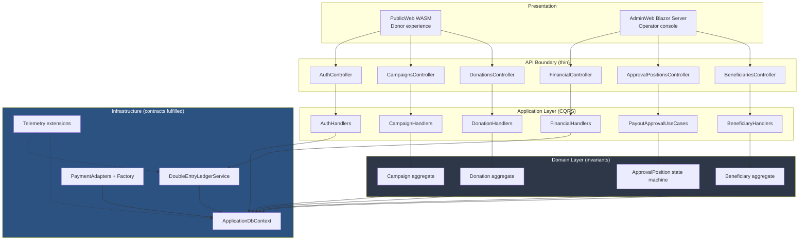

**Key coordination rule:** the Application layer depends only on interfaces — `IApplicationDbContext`, `ICurrentUserService`, `IPaymentProvider`, `IPaymentGatewayFactory`, `IDoubleEntryLedgerService`, `IAuditService`, `IDateTimeProvider`, `IFileStorage`, `IEmailService`. It never references EF Core or any vendor SDK. This is what makes the module boundaries enforceable rather than aspirational.

### 3.2 State Management and Synchronization

| State Category | Owner | Synchronization Strategy | Consistency Guarantee |
|---|---|---|---|
| Aggregate invariants | Domain entities (private setters) | Constructor + behavior methods only | **Strong** — illegal states unrepresentable |
| Donation lifecycle | `Donation.Status` | Callback-driven transitions | **Eventual** — depends on gateway callback arrival |
| Campaign balance | `Campaign.CollectedAmount` | Post-settlement increment | **⚠ Weak** — no documented optimistic concurrency |
| Ledger entries | `DoubleEntryLedgerService` | Atomic balanced write + hash chain | **Strong** — cryptographic |
| Approval workflow | `ApprovalPosition` (StepOrder + Cycle) | Per-step attributed transitions | **Strong** — pessimistic via ordered gate |
| Identity | `UserProfile` + JWT | JWT issued at login, stateless thereafter | **Strong** until expiry |
| Guest cart | Client `localStorage` + server dual persistence | Merge on auth (implementation-defined) | **⚠ Weakest** — merge semantics undocumented |
| Audit records | Audit table | Emitted alongside ledger write | **⚠ Unverified coupling** — see G-1 |
| Telemetry | OTel Collector | Async OTLP with batch processor | **Eventual** — by design |

**The two weak points deserve attention.** `CollectedAmount` and the guest/auth cart merge are the only state categories where the system does not structurally guarantee correctness. Both are on the hot path.

### 3.3 Data Passing and Sharing

**Cross-layer data contract:**

```
Contracts layer DTOs
    ↓ (request binding)
API Controllers
    ↓ (CQRS records wrap DTO fields)
Application Commands / Queries
    ↓ (domain model construction)
Domain Aggregates
    ↓ (EF Core mapping)
PostgreSQL (Supabase)
```

**Result pattern contract** — every handler returns `Result` / `Result<T>` with `DomainErrors` classification. `HandleResult` in `ApiControllerBase` maps:

| Result | HTTP Outcome |
|---|---|
| `Result.Success` | `200 OK` / `201 Created` |
| `Result.Failure` (validation) | `400 Bad Request` with `ApiResponse.Fail` |
| `Result.Failure` (not found) | `404 Not Found` |
| `Result.Failure` (unauthorized) | `401` / `403` |
| Unhandled exception | `500` via middleware |

**No exception-driven control flow.** Business failures are typed results. This is central to the platform's reliability posture — a validation failure and a database outage produce structurally different responses.

### 3.4 Execution Control and Scheduling

| Control Mechanism | Where | Purpose |
|---|---|---|
| **Ordered step gate** | `ApprovalPosition.StepOrder` | Prevents out-of-order approval |
| **Cycle counter** | `ApprovalPosition.Cycle` | Prevents escalation shortcut |
| **Pessimistic position gate** | `.TakeWhile(step < current)` pattern | No parallel step approval |
| **Background sweeper** | `Infrastructure/Workers/BackgroundSweeperWorker.cs` | Maintenance / expiry (scope must be extended to cover pending donations — O-3) |
| **JWT expiry** | `Program.cs` configuration | Session lifetime bound |
| **Rate awareness** | Implicit — no documented limiter | ⚠ See §4.5 |
| **Transaction boundary** | `IApplicationDbContext.SaveChangesAsync` | Atomic units of work |
| **Telemetry batch** | Collector `batch` processor | Throughput control |
| **Memory limiter** | Collector `memory_limiter` processor | Backpressure protection |

**Multi-round approval control flow:**

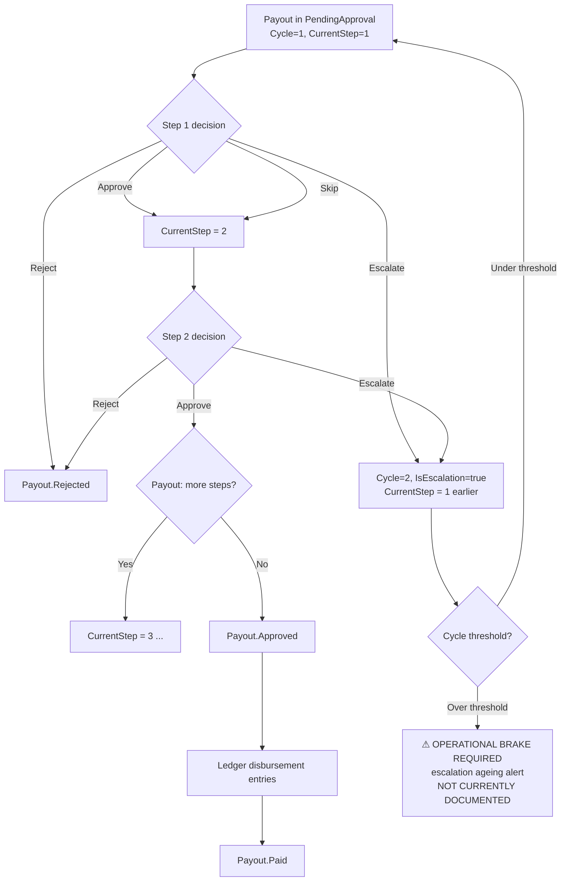

---

## 4. Exception Handling and Recovery

### 4.1 Error Detection and Handling Strategy

ESalam uses a **layered error strategy** where each layer has exactly one responsibility:

| Layer | Detection Mechanism | Handling Responsibility |
|---|---|---|
| **API** | Model binding, `ApiResponse.Fail` | Malformed requests → `400`, no business logic |
| **Application** | `Result.Failure` + `DomainErrors` | Business rule violations → typed failures, never exceptions |
| **Domain** | Invariant violation in constructor/behavior method | Throw or return failure at construction time — invalid objects cannot exist |
| **Infrastructure** | EF Core exceptions, HTTP adapter errors | Convert to domain-meaningful failure or `Result.Failure` |
| **Middleware** | Unhandled exception envelope | `500` + logging + telemetry span marked error |

**Design principle:** the Domain layer cannot produce an invalid object. This shifts error detection leftward — many failures are prevented at compile time or at construction rather than detected at runtime.

### 4.2 Failure Matrix by Workflow

| Workflow | Failure Point | Detection | Current Handling | Adequacy |
|---|---|---|---|---|
| WF-1 | Gateway declines | Callback payload | `Donation.MarkFailed(reason)` + audit | ✅ Adequate |
| WF-1 | Signature verification fails | `VerifyCallbackSignature` false | Reject callback, no state mutation | ✅ Adequate — this is the security gate |
| WF-1 | Gateway unreachable at initiation | Adapter HTTP error | **Undefined** — donation already persisted | ⚠ **Gap** — orphaned `Pending` record |
| WF-1 | Callback never arrives | **None** | **Undefined** | ❌ **Gap** — stuck `AwaitingGateway` state, no TTL sweeper |
| WF-1 | Ledger write fails after settlement | EF Core exception | **Undefined** | ❌ **Critical gap** — gateway has money, ledger has nothing |
| WF-1 | `CollectedAmount` lost update | **None** | Silent | ❌ **Gap** — campaign balance understates reality |
| WF-1 | `SimulatePayment` misuse in prod | Role check only | **Integrity bypass possible** | ❌ **Critical gap** |
| WF-2 | Insufficient ledger balance | `GetFinancialSummaryQuery` | `Result.Failure` → UI error | ✅ Adequate |
| WF-2 | Unauthorized reviewer | `ICurrentUserService` role check | `Result.Failure` | ✅ Adequate |
| WF-2 | Escalation loop never terminates | **None** | **Undefined** | ⚠ **Gap** — needs cycle threshold |
| WF-2 | Ledger disbursement write fails | EF Core exception | **Undefined** | ❌ **Critical gap** — same class as WF-1 |
| WF-3 | Beneficiary not verified | Selection-time filter | Beneficiary not selectable | ✅ Adequate |
| WF-3 | Ownership violation | `ICurrentUserService` | `Result.Failure` → 403-class | ✅ Adequate |
| WF-4 | Invalid credentials | `IPasswordHasher.Verify` | Generic failure (no enumeration oracle) | ✅ Adequate |
| WF-4 | **Legacy fallback path taken** | **None** | Silent | ❌ **Critical gap** — downgrade vector, unmonitored |
| WF-5 | Incomplete KYC | Operator review | `Beneficiary.Reject()` | ✅ Adequate |
| WF-5 | Beneficiary suspended post-publication | Domain transition only | **Undefined propagation** | ⚠ **Gap** — live campaigns unaffected |
| WF-6 | Audit emission fails | **Undefined** | **Undefined** | ❌ **Gap** — coupling unverified |
| WF-6 | Hash chain integrity broken | **None — no verification job** | **Undefined** | ❌ **Gap** — control asserted, not operated |

### 4.3 Recovery Mechanisms

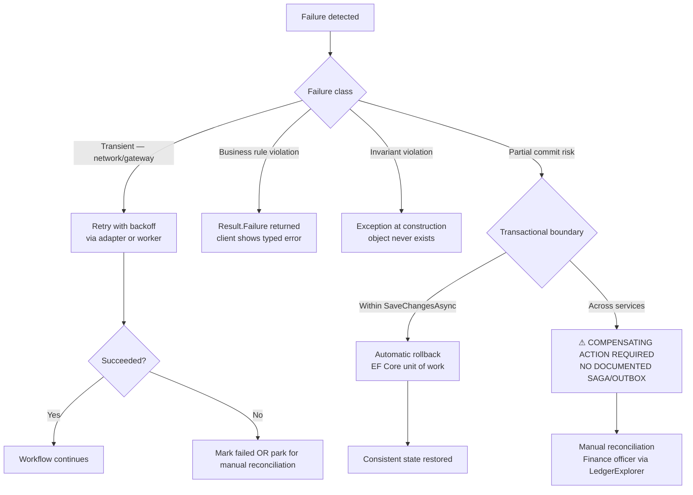

**The critical recovery architecture gap:** ESalam has no documented **transactional outbox** or **saga pattern** for cross-service operations. The dangerous sequence is:

```
Gateway settles money  ← has already happened, irreversible
    ↓
Ledger write executes
    ↓
CRASH HERE
    ↓
Money exists at gateway. Ledger has no record. Audit has no record.
```

Recovery for this class currently depends on **manual reconciliation by a finance officer using `LedgerExplorer.razor` against gateway settlement reports.** This is a viable compensating control only if reconciliation is scheduled, not ad hoc.

**Recommended architecture:**

```
Add to Application/Common:
  IOutboxService
  OutboxMessage entity (payload, status, attempts, next_retry_at)
  
Settlement path becomes:
  1. BEGIN TRANSACTION
  2. Write ledger entries (with hash chain)
  3. Write audit record
  4. Write outbox message (gateway settlement reference)
  5. COMMIT
  6. Background worker processes outbox → Campaign.CollectedAmount update, receipt issuance, email
```

This converts the multi-step post-settlement sequence into a single atomic commit plus reliable asynchronous follow-through.

### 4.4 Documented Gaps (Explicitly Flagged)

| ID | Gap | Severity | Evidence | Required Action |
|---|---|---|---|---|
| **G-1** | Ledger-audit transactional coupling is **asserted but not evidenced** | **CRITICAL** | Materials state audit records are emitted "alongside" hash computation; same-transaction status unconfirmed | Read `DoubleEntryLedgerService` — verify `IAuditService` call is inside the same `SaveChangesAsync` boundary. If not, add it. |
| **G-2** | `Donation.Refund()` transition exists with **no documented workflow** | HIGH | Domain method present in `Donation.cs`; no refund flow, no approval requirement, no ledger reversal procedure described | Define the refund lifecycle: who initiates, what approval gate applies, how reversal entries enter the hash chain |
| **G-3** | Recurring donations and reservation capacity release lack governance paths | MEDIUM | `RecurringHandlers`, `ReservationHandlers` exist as sub-modules; no business flow describes ledger settlement or capacity revocation authority | Document both flows; define who may revoke a reserved capacity slot and whether it requires approval |
| **G-4** | Legacy password fallback path is **undocumented** | **CRITICAL** | `LoginCommandHandler` contains fallback verification; absent from the described identity flow | Instrument path selection per login. Migrate legacy accounts. Retire the branch with a hard cutover date. |
| **G-5** | Guest donation attribution on later authentication is undefined | HIGH | Materials confirm guest donations permitted; no step describes attribution mechanics or anonymity interaction | Define merge semantics explicitly: backfill `UserId`, or permanent non-attribution. Document tax-receipt implications. |
| **G-6** | `SimulatePayment` is production-reachable | **CRITICAL** | `DonationHandlers` includes simulate capability; no environment/role gating described | Environment-gate (non-production only) AND role-gate. Prefer compile-time exclusion in release builds. |
| **G-7** | Beneficiary `Suspend` does not propagate to published campaigns | MEDIUM | Domain transition exists; no workflow describes consequence for live campaigns | Define: suspend → auto-suspend dependent campaigns → notify creators |
| **G-8** | No hash-chain verification job | HIGH | Chain computed on write; no documented verification on read/schedule | Add scheduled verification task; alert on chain break |
| **G-9** | Escalation cycles have no termination brake | MEDIUM | `Cycle` increments without documented threshold | Add max-cycle threshold + escalation ageing alert |
| **G-10** | `CollectedAmount` update lacks optimistic concurrency | HIGH | Sequential post-settlement steps; no row version documented | Add concurrency token to `Campaign`; retry on conflict |

### 4.5 Fault Tolerance Strategy

| Property | Current Design | Assessment |
|---|---|---|
| **Containment** | Donor intent separated from money movement; a compromised donation-creation endpoint does not grant payment-initiation primitive | ✅ Strong |
| **Immutability** | Chained SHA-256 over ledger entries | ✅ Strong |
| **Segregation of duties** | Ordered + cyclic approval with attributed transitions | ✅ Strong |
| **Attribution** | Every approval transition captures identity + comments in the domain | ✅ Strong |
| **Idempotency** | **Not documented** for callbacks | ❌ **Gap** — duplicate gateway callbacks could double-settle |
| **Atomicity across services** | No outbox/saga | ❌ **Gap** |
| **Circuit breaking** | No documented adapter-level circuit breaker | ⚠ Missing — a dead provider blocks all donations using it |
| **Graceful degradation** | Three providers; a factory can switch codes | ✅ Partial — no documented automatic failover |
| **Rate limiting** | Not documented on donation or auth endpoints | ❌ **Gap** — brute force and flood exposure |
| **Chain verification** | Computed, never verified | ❌ **Gap** |

### 4.6 Failure Retry and Degradation

**Recommended retry policy by operation class:**

| Operation | Retry? | Policy | Escalation |
|---|---|---|---|
| Payment initiation (outbound HTTPS) | Yes | Exponential backoff, 3 attempts, circuit breaker per provider | Switch provider code if available, else park donation |
| Callback signature verification | **No** | Fail closed, reject | Log + alert; never retry a failed signature |
| Ledger write | Yes (transactional) | Retry within transaction boundary; abort on persistent failure | **Critical alert** — manual reconciliation |
| Audit write | Must be in same TX | Roll back with ledger | — |
| Campaign balance update | Yes | Optimistic concurrency retry with jitter | Alert on repeated conflict |
| Approval transition persist | Yes (idempotency key) | Retry once | Alert reviewer |
| Email notification | Yes | Outbox + backoff, high attempt ceiling | Non-blocking — never fails the financial path |
| Telemetry export | Yes (collector handles) | Batch retry + `memory_limiter` backpressure | Drop acceptable — telemetry must never block business |

**Degradation ladder for the donation path:**

```
All providers healthy     → normal operation
One provider failing      → factory routes around it (requires documented failover mapping)
All providers failing     → donations persist as Pending; user informed; sweeper parks them
Ledger unavailable        → donations must NOT be finalized; fail closed
Database unavailable      → total outage; fail closed at API boundary
Identity service degraded → authenticated donations fail; guest donations may continue
                            (but attribution loss must be a conscious decision, not a default)
```

**Critical principle:** the ledger must **fail closed**. A donation that cannot be ledgered must never be marked `Finalized`. Losing a donation record is recoverable (reconciliation against gateway reports); recording a phantom donation is not — it corrupts the hash chain's meaning.

---

## 5. Key Process Implementation

### 5.1 Core Algorithm — Chained SHA-256 Ledger

The most business-critical algorithm in the system. Every entry's hash incorporates its predecessor, making retroactive modification detectable at every subsequent entry.

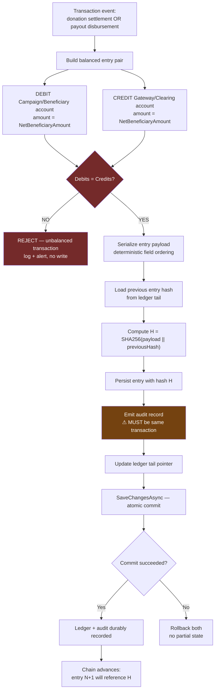

**Determinism requirement:** the payload serialization must be byte-stable. Given the identical logical entry, the hash must be identical. Floating-point money representation, locale-dependent date formatting, or dictionary-iteration ordering will **silently break chain reproducibility across environments**. Money should be decimal; dates should be ISO-8601 UTC; fields should be serialized in a fixed declared order.

**Verification algorithm (currently missing — G-8):**

```
verifyChain():
    previousHash = genesis
    for each entry in ledger order:
        computed = SHA256(entry.payload || previousHash)
        if computed != entry.storedHash:
            ALERT: chain broken at entry.id
            return BROKEN(at=entry.id)
        previousHash = entry.storedHash
    return INTACT
```

Run this on a schedule. A tamper-evident structure that is never checked is documentation, not a control.

### 5.2 Payment Adapter Resolution and Callback Verification

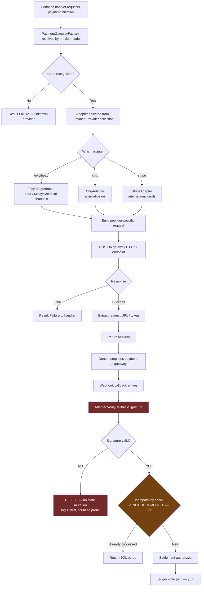

**Why signature verification is the security gate:** the callback endpoint is public and reachable. Server-side trust of callback payloads without cryptographic verification means an attacker can forge a settlement and mint a donation. Every provider must verify using its own secret. This is the single most important security control on the money-in path.

**Duplication risk (O-2):** three independent implementations of `VerifyCallbackSignature` means three independent chances for a flaw, and a fix in one adapter may not propagate. Extract shared normalization.

### 5.3 Approval Workflow Execution

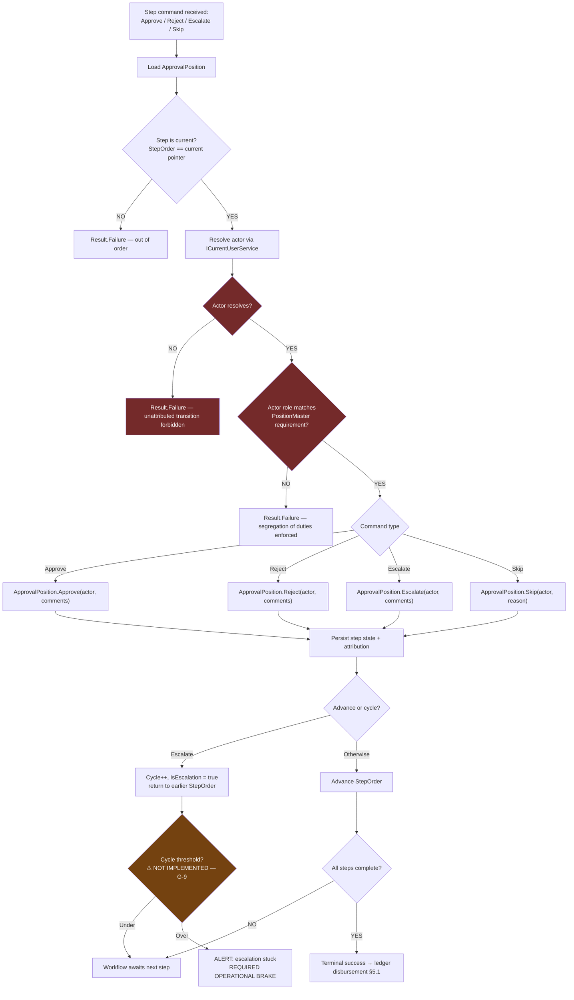

**Note on `Skip`:** it advances the chain *without* approval. This is the highest-risk transition in the system. It must be role-restricted far more tightly than `Approve`, and every `Skip` should generate a compliance notification. If `Skip` is available to a broad role set, the approval chain is decorative.

### 5.4 Data Processing Pipeline — Donation Ingestion to Ledger

```mermaid
flowchart LR
    subgraph IN["Ingestion"]
        A1[HTTP request payload]
        A2[Binding + validation]
        A3[CQRS command]
    end
    subgraph BUILD["Aggregate Construction"]
        B1[Identity resolution]
        B2[Financial decomposition<br/>amount + tip − fees]
        B3[Invariant enforcement<br/>private ctor]
    end
    subgraph PERSIST["Persistence"]
        C1[EF Core change tracking]
        C2[SaveChangesAsync<br/>atomic commit]
        C3[Domain events captured]
    end
    subgraph EXTERNAL["External Round Trip"]
        D1[Adapter initiation]
        D2[Gateway hosting]
        D3[Callback + signature verify]
    end
    subgraph SETTLE["Settlement"]
        E1[Balanced entry construction]
        E2[Chained SHA-256]
        E3[Audit emission<br/>⚠ coupling unverified]
        E4[Campaign balance update<br/>⚠ concurrency unaddressed]
    end
    subgraph OUTPUT["Output"]
        F1[Receipt availability]
        F2[Giving history]
        F3[OTLP telemetry]
    end

    IN --> BUILD --> PERSIST --> EXTERNAL --> SETTLE --> OUTPUT
```

**Pipeline latency profile:**

| Segment | Expected Duration | Dominant Cost | Failure Impact |
|---|---|---|---|
| Ingestion + build | < 50 ms | Identity resolution (possibly DB) | Immediate user-visible error |
| Persistence | 10–100 ms | Supabase round trip (network) | Immediate error, no orphan |
| **External round trip** | **Seconds to minutes** | **Human payment action (FPX login, 3DS)** | **Unbounded — async by nature** |
| Settlement | 50–300 ms | Ledger write + hash + audit + balance | **Post-settlement failure is the dangerous class** |
| Output | < 50 ms | Query + render | Non-critical |

**Architectural consequence:** the pipeline is inherently **asynchronous at the external boundary**. The API call returns a redirect; settlement arrives later via webhook. This means the system must tolerate a `Pending` donation state of arbitrary duration — which is exactly why the missing TTL/sweeper (O-3) and the missing idempotency check (G-11) matter.

### 5.5 Implementation Guidance by Role

#### For Development Teams

| Priority | Action | Rationale |
|---|---|---|
| **P0** | Verify audit + ledger same-transaction coupling | G-1 — the compliance claim depends on it |
| **P0** | Environment-gate and role-gate `SimulatePayment` | G-6 — direct ledger integrity bypass |
| **P0** | Instrument and monitor the legacy password fallback path | G-4 — authentication downgrade vector |
| **P1** | Add callback idempotency keys | G-11 — duplicate callbacks could double-settle |
| **P1** | Add optimistic concurrency to `Campaign.CollectedAmount` | G-10 — lost updates under load |
| **P1** | Add scheduled hash-chain verification | G-8 — a control that is never run is not a control |
| **P2** | Introduce transactional outbox for post-settlement sequence | O-3, §4.3 — eliminates crash-window inconsistency |
| **P2** | Extract shared payment callback verification | O-2 — reduces audit scope 3× |
| **P2** | Add rate limiting on donation and auth endpoints | §4.5 — flood and brute-force exposure |
| **P3** | Define refund lifecycle, recurring flow, reservation governance | G-2, G-3 |

#### For Operations Teams

| Signal | Meaning | Action |
|---|---|---|
| Donations stuck in `AwaitingGateway` > 30 min | Gateway callback lost or never sent | Reconcile against gateway settlement report |
| Ledger entry count ≠ gateway settlement count | Money moved without ledger record or vice versa | **Critical** — open incident, audit finance officer |
| Legacy password path usage > 0 in a period | Either legacy accounts remain or someone is forcing the fallback | Investigate immediately — treat as security event |
| Escalation cycle count rising on a single payout | Approval chain stuck in a loop | Review escalation rationale; consider operational override |
| Prometheus: donation settlement success rate drop | Provider degradation or signature verification issue | Check adapter logs; verify provider status |
| Prometheus: ledger write latency spike | Database contention or chain-tail lock | Check Supabase connection pool; verify index health |
| Audit record count < ledger entry count | **Audit coupling broken** | **Critical** — the compliance model has failed |

#### For Business Stakeholders

The value of this architecture maps directly to audit defensibility:

- **Every donation has a cryptographic fingerprint** that changes if any prior entry changes — retroactive tampering is detectable, not merely discouraged.
- **No single person can release funds** — the ordered, cyclic approval chain with escalation rounds means compromising one account does not move money out.
- **Every financial action is attributed to an identified human**, captured inside the domain object rather than in a mutable log.
- **The three gaps that most threaten these claims** are: unverified audit coupling (G-1), the production-reachable simulation primitive (G-6), and the unmonitored legacy authentication path (G-4). All three are fixable in days, not quarters.

### 5.6 Knowledge Transfer — Workflow Dependency Map

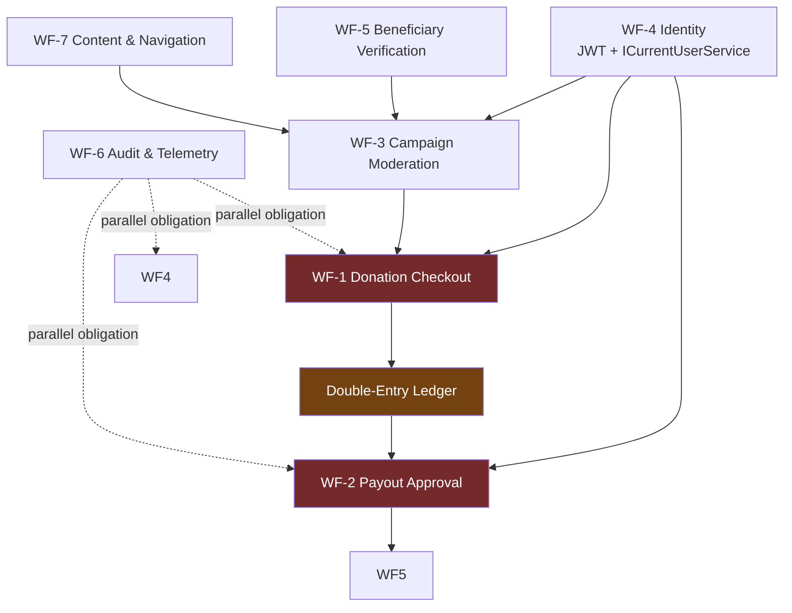

**Reading order for new team members:**

1. **Start with `Donation.cs`** — it is the business in one file: money decomposition, lifecycle, invariants.
2. **Then `DoubleEntryLedgerService.cs`** — this is why the platform can claim auditability.
3. **Then `ApprovalPosition.cs`** — this is why the platform can claim segregation of duties.
4. **Then `DonationHandlers.cs` + `FinancialHandlers.cs`** — how the API surfaces reach the domain.
5. **Then `Program.cs`** — how it all composes at runtime.
6. **Finally, read §4.4 gaps** — know what is asserted versus what is actually enforced.

**The one-sentence summary of ESalam's architecture:** donor intent is structurally separated from money movement; money movement is cryptographically chained; money release requires multiple attributed human decisions; and the platform's credibility rests entirely on whether those three properties are *actually* enforced (verified) rather than merely *designed* (assumed).

---

## Appendix A — Node Reference Index

| Node | File | Layer | Criticality |
|---|---|---|---|
| `Donation` aggregate | `Domain/Entities/Donations/Donation.cs` | Domain | 0.96 |
| `DoubleEntryLedgerService` | `Infrastructure/Services/DoubleEntryLedgerService.cs` | Infrastructure | 0.96 |
| `Program.cs` | `Api/Program.cs` | API | 0.95 |
| `DonationsController` | `Api/Controllers/Donations/DonationsController.cs` | API | 0.95 |
| `AuthHandlers` | `Application/Auth/AuthHandlers.cs` | Application | 0.95 |
| `CampaignHandlers` | `Application/Campaigns/CampaignHandlers.cs` | Application | 0.95 |
| `Campaign` aggregate | `Domain/Entities/Campaigns/Campaign.cs` | Domain | 0.95 |
| `ApplicationDbContext` | `Infrastructure/Persistence/ApplicationDbContext.cs` | Infrastructure | 0.95 |
| `CampaignsController` | `Api/Controllers/Campaigns/CampaignsController.cs` | API | 0.93 |
| `PaymentAdapters` + Factory | `Infrastructure/Services/PaymentAdapters.cs` | Infrastructure | 0.92 |
| `Donate.razor` | `PublicWeb.Wasm.Client/Pages/Donate.razor` | Presentation | 0.92 |
| Supabase schema | `deploy/database/01_esalam_supabase_schema.sql` | Data | 0.90 |
| OTel Collector config | `deploy/observability/otel-collector-config.yml` | Ops | 0.90 |
| `AuthController` | `Api/Controllers/Auth/AuthController.cs` | API | 0.90 |
| `CartController` | `Api/Controllers/Donations/CartController.cs` | API | 0.90 |
| `IApplicationDbContext` | `Application/Common/Interfaces/IApplicationDbContext.cs` | Application | 0.90 |
| `DonationHandlers` | `Application/Donations/DonationHandlers.cs` | Application | 0.90 |
| `FinancialHandlers` | `Application/Financial/FinancialHandlers.cs` | Application | 0.90 |
| `Beneficiary` aggregate | `Domain/Entities/Beneficiaries/Beneficiary.cs` | Domain | 0.90 |
| `ApprovalPosition` | `Domain/Entities/Campaigns/ApprovalPosition.cs` | Domain | 0.90 |
| `PayoutApprovalUseCases` | `Application/Financial/PayoutApprovalUseCases.cs` | Application | 0.88 |
| `ServiceInterfaces` | `Application/Common/Interfaces/ServiceInterfaces.cs` | Application | 0.88 |

## Appendix B — Gap Severity Summary

| Severity | Count | IDs |
|---|---|---|
| **CRITICAL** | 4 | G-1 (audit coupling), G-4 (legacy auth path), G-6 (`SimulatePayment` in prod), plus missing idempotency (G-11) |
| **HIGH** | 4 | G-2 (refund workflow), G-5 (guest attribution), G-8 (chain verification), G-10 (`CollectedAmount` concurrency) |
| **MEDIUM** | 3 | G-3 (recurring/reservation), G-7 (suspend propagation), G-9 (escalation brake) |

---

*Document generated from Source Code Insights, System Context Research, Domain Module Research, and Workflow Research materials. Assertions requiring runtime verification are explicitly flagged as gaps (G-1 through G-11) rather than presented as confirmed behavior.*