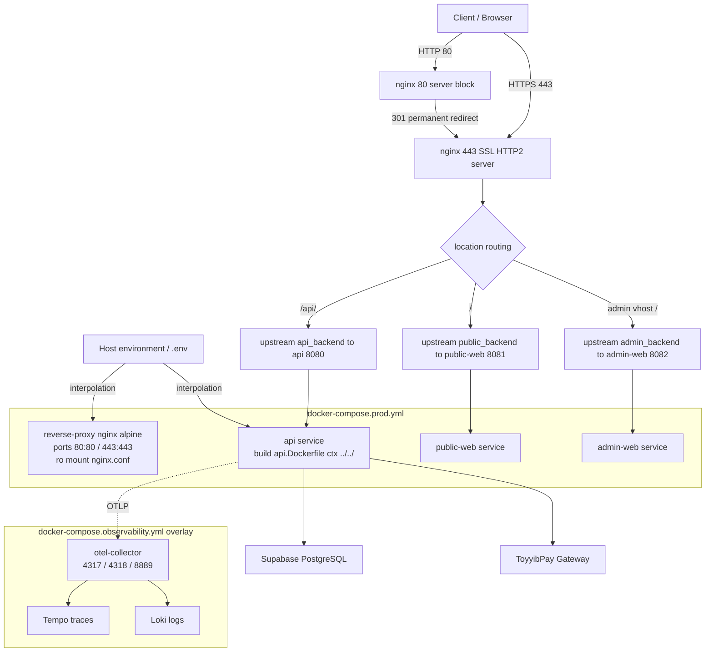

# Deployment and Edge Domain

> **ESalam Platform — Technical Documentation**
> Domain: Infrastructure · Importance: 7.5/10 · Complexity: 5.0/10
> Scope: `deploy/compose/*`, `deploy/nginx/nginx.conf`, `deploy/docker/*.Dockerfile`, root `Dockerfile`

---

## 1. Executive Overview

The **Deployment and Edge Domain** defines how ESalam is actually run in production. It is the boundary between the public internet and the three owned application services, and it is the layer where container topology, network routing, secret injection, and TLS termination are declared.

Unlike the business domains, which are written in C# and expressed as aggregates and handlers, this domain is expressed **declaratively** — as configuration files and manifests. Its artifacts are:

| Artifact | Role |
|---|---|
| `deploy/nginx/nginx.conf` | TLS terminator and host/path router for all public traffic |
| `deploy/compose/docker-compose.prod.yml` | Full production stack: nginx + api + public-web + admin-web, built from source |
| `deploy/compose/docker-compose.yml` | Lightweight default manifest: prebuilt GHCR api image only |
| `deploy/compose/docker-compose.observability.yml` | Independent observability overlay: OTel Collector + Tempo + Loki |
| `deploy/docker/api.Dockerfile` | Multi-stage build for the ASP.NET Core API |
| `deploy/docker/admin-web.Dockerfile` | Multi-stage build for the Blazor Server admin console |
| `deploy/docker/public-web.Dockerfile` | Multi-stage build for the Blazor WebAssembly donor portal |
| `Dockerfile` (root) | Repository-root build entry point |

The design objective stated by the module is a **reproducible, secret-free-artifact deployment**: the edge configuration is a *mounted file* rather than a baked image, the applications are *immutable images*, every credential arrives at runtime through environment-variable interpolation, and observability is an *opt-in overlay* that can be started and stopped without touching the production stack.

> ⚠️ **Verification note.** The architectural audit of the running system found material drift between this documented deployment model and the deployed artifacts — most notably secrets committed in `appsettings.json` (D-08), three divergent Compose manifests (D-16), and Prometheus scraping applications directly instead of through the Collector (D-14). These are catalogued in §7 and should be read as part of this domain's true operating state.

---

## 2. Edge Layer — nginx Reverse Proxy

### 2.1 Container Role

The edge tier is a **single nginx instance** (`nginx:alpine`) that owns the entire public network surface. It is the *only* service in the production stack with host port bindings. Every application container — `api`, `public-web`, `admin-web` — is reachable only over the internal Compose network, addressed by service DNS name and internal container port.

The container image is the stock `nginx:alpine`. No custom image is built for the proxy. Instead, `nginx.conf` is **bind-mounted read-only** from `deploy/nginx/`. The operational consequence is significant: **reconfiguring routing does not require a rebuild or redeploy of an application** — a file edit plus `docker compose restart reverse-proxy` (or an nginx reload signal) is sufficient.

### 2.2 Configuration Structure

`nginx.conf` follows the classic three-block layout:

```
events { worker_connections 1024; }

http {
    include       mime.types;
    sendfile      on;

    upstream api_backend    { server api:8080; }
    upstream public_backend { server public-web:8081; }
    upstream admin_backend  { server admin-web:8082; }

    server {  # port 80 — permanent redirect
        listen 80;
        return 301 https://$host$request_uri;
    }

    server {  # port 443 — TLS / HTTP2 terminator
        listen 443 ssl http2;
        ssl_certificate     ...;
        ssl_certificate_key ...;
        location /api/ { proxy_pass http://api_backend; }
        location /     { proxy_pass http://public_backend; }
    }
}
```

**Routing model — two levels:**

1. **`server`-level, host-based.** `server_name` matching dispatches the three public hostnames (`esalam.my`, the public portal host, and `admin.esalam.my`) into the HTTPS server block.
2. **`location`-level, path- and host-based.** Inside the TLS server, `location` blocks forward to the correct upstream pool. The audit confirmed exactly three route families:

   - `/api/` → `api:8080` (ASP.NET Core REST API)
   - `/` → `public-web:8081` (Blazor WebAssembly donor portal)
   - admin vhost `/` → `admin-web:8082` (Blazor Server operator console)

**Net effect:** one nginx container serves three logically distinct applications, and no application service needs to know the public hostname under which it is reached.

### 2.3 Proxy Headers and Their Architectural Purpose

nginx sets the standard forwarding headers on every proxied request (`Host`, `X-Forwarded-For`, `X-Forwarded-Proto`, plus hop-by-hop header handling). These are **not cosmetic** — they are load-bearing for two downstream behaviours:

| Header | Why the backend needs it |
|---|---|
| `Host` | Host-correct URL generation, cookie domain scoping, cache keys |
| `X-Forwarded-Proto` | Lets ASP.NET reconstruct the original `https` scheme — prerequisite for OIDC/OAuth redirect-URI generation and for emitting `Secure` cookies correctly |
| `X-Forwarded-For` | Original client address recovery — feeds audit records (the `ApplicationDbContext.SaveChangesAsync` audit generator captures IP and user agent) |

> **Drift flag (D-01).** The API additionally contains `AdminPortalAuthenticationMiddleware`, which **synthesizes a `ClaimsPrincipal` directly from plain request headers** (`X-User-Id`, `X-User-Email`, `X-User-Roles`) and defaults the principal to `SuperAdmin` when `X-User-Roles` is absent. This middleware runs **before** `UseAuthentication()` and `UseAuthorization()`. Because the edge neither strips nor signs these headers, the edge tier is the natural enforcement point that is currently *not* used as one. See §7.

### 2.4 TLS and HTTP/2

TLS terminates at nginx. Certificate and key material live in the mounted configuration and are consumed by the `:443` server block, which is declared with `http2`. Port `:80` exists **only** to issue `301` permanent redirects — there is no plaintext application path.

Modern protocol negotiation, cipher policy, HSTS, OCSP stapling, and certificate automation (ACME/Let's Encrypt) are properties of this block and should be treated as the domain's security surface: they are configured here and nowhere else.

---

## 3. Container Topology — Docker Compose Manifests

ESalam ships **three** Compose manifests with deliberately different jobs. Understanding which one is authoritative *for which environment* is essential — the audit flagged the coexistence of these files as D-16.

### 3.1 `deploy/compose/docker-compose.prod.yml` — Full Production Stack

The full-fidelity production topology. It contains four services:

| Service | Image / Build | Ports | Notes |
|---|---|---|---|
| `reverse-proxy` | `nginx:alpine` | `80:80`, `443:443` | Read-only bind mount of external `nginx.conf` — **mounted, not baked** |
| `api` | Built from `deploy/docker/api.Dockerfile`, context `../../` | none (internal) | `ASPNETCORE_ENVIRONMENT=Production` |
| `public-web` | Built from `deploy/docker/public-web.Dockerfile` | none (internal) | Blazor WASM host |
| `admin-web` | Built from `deploy/docker/admin-web.Dockerfile` | none (internal) | Blazor Server console |

**Key structural properties:**

- **Build context at repository root.** The api service uses `context: ../../` relative to `deploy/compose`. This is mandatory because `api.Dockerfile` copies project files from several top-level solution folders (`Domain`, `Contracts`, `Application`). Consequently, `.dockerignore` hygiene at the repository root is a deployment-correctness concern, not a nicety.
- **Configuration injected as .NET configuration keys in env-var form.** `ConnectionStrings__DefaultConnection`, `Supabase__Url`, `Supabase__ServiceKey`, `Supabase__JwtSecret`, `PaymentGateways__ToyyibPay__SecretKey`. The double-underscore convention maps onto the .NET configuration hierarchy (`ConnectionStrings:DefaultConnection`), so no config file change is needed between environments.
- **Startup ordering via `depends_on`.** The proxy depends on the application services; application services declare their data dependencies.
- **Supervision via restart policies** (`restart: unless-stopped` / `always`).

> ⚠️ **ordering ≠ readiness.** `depends_on` expresses *start order only*. It does not wait for a service to be healthy unless combined with a `healthcheck` + `condition: service_healthy`. The applications must therefore tolerate a briefly unavailable dependency, or healthchecks must be added. The audit noted this explicitly as a gap in the lifecycle contract.

### 3.2 `deploy/compose/docker-compose.yml` — Lightweight Default Manifest

The operator-facing default. It defines a **single service**:

- Service name `esalam-api`, pulled from the prebuilt GHCR image `ghcr.io/ceruleanss/esalam-api:latest`
- Publishes `8080:8080` directly to the host
- Sets `ASPNETCORE_ENVIRONMENT=Production` and `ASPNETCORE_URLS=http://+:8080`
- Receives connection string, Supabase (`Url`, `ServiceKey`, `JwtSecret`) and `PaymentGateways__ToyyibPay__SecretKey` entirely through `${...}` interpolation

**Intended use:** a fast, build-free path to run the API alone — smoke-testing, or deployment behind an externally managed load balancer. There is **no TLS and no proxy** in this manifest; the API is exposed directly.

> **Drift flag (D-16).** The root `/docker-compose.yml` variant referenced in the audit uses an `external: true` network and omits nginx entirely, giving it a materially different topology from the prod manifest while occupying the conventional default filename.

### 3.3 `deploy/compose/docker-compose.observability.yml` — Opt-In Observability Overlay

An **independent overlay** (declared `version: 3.8`) containing:

- `otel-collector` — image `otel/opentelemetry-collector-contrib:latest`, launched with `--config=/etc/otel-collector-config.yml`, bind-mounted read-only from `../observability/`
- Exposed ports: **4317** (OTLP/gRPC), **4318** (OTLP/HTTP), **8889** (Prometheus exporter)
- `depends_on: [tempo, loki]`
- `tempo` — trace storage
- `loki` — log storage

**Activation model:** the overlay is opt-in. Bringing it up means adding `-f docker-compose.observability.yml` and joining the collector to the same network as the API, plus setting the OTLP exporter endpoint on the API.

**Why this separation matters architecturally:** keeping telemetry in a separate file means the production stack can run *without* the Collector (for environments that have no observability footprint), and the observability stack can be brought up and down independently without disturbing money-handling services.

> **Drift flag (D-14).** The collector-based fan-out described here is not the deployed reality. `appsettings.json` points `OtlpEndpoint` **directly at Grafana Cloud** (`https://otlp-gateway-prod-ap-southeast-2.grafana.net/otlp`), and `prometheus.yml` scrapes the application `/metrics` endpoints on `api:8080`, `public-web:8081`, and `admin-web:8082` directly, bypassing the collector exporter on 8889. The overlay exists and is correct in itself; it simply is not in the active telemetry path. §7 covers this.

### 3.4 Topology Diagram



---

## 4. Image Construction — Multi-Stage Dockerfiles

### 4.1 The Layer-Caching Pattern

All three service Dockerfiles follow an identical, deliberately layer-cached multi-stage shape on the **.NET 10 SDK** (`mcr.microsoft.com/dotnet/sdk:10.0`), with `WORKDIR /src`:

```
Stage 1 — restore
  COPY Directory.Build.props ./
  COPY <only the .csproj files this service needs> ./
  RUN dotnet restore

Stage 2 — build
  COPY <full source>
  RUN dotnet build --no-restore

Stage 3 — publish
  RUN dotnet publish --no-restore -o /app/publish

Stage 4 — runtime
  FROM mcr.microsoft.com/dotnet/aspnet:10.0
  COPY --from=publish /app/publish .
  EXPOSE <service port>
```

**Why the ordering matters:** by copying `Directory.Build.props` and *only the `.csproj` files the service needs* before running `restore`, the expensive NuGet restore layer is invalidated only when a **project reference or package dependency changes** — not when a `.cs` file is edited. This is the single most impactful build-performance decision in the domain, and it is applied consistently across all three images.

### 4.2 Per-Service Restore Sets

Each Dockerfile restores a **minimal, service-specific project set** reflecting that service's actual dependency graph:

| Dockerfile | Projects restored | Rationale |
|---|---|---|
| `api.Dockerfile` | `Domain`, `Contracts`, `Application` | The API transitively pulls Infrastructure at build time; the restore layer covers the inward-facing layers it compiles against |
| `admin-web.Dockerfile` | `Contracts`, `AdminWeb` | Blazor Server console consumes DTOs, not domain aggregates |
| `public-web.Dockerfile` | `PublicWeb.Wasm.Client`, `Contracts` | WASM client consumes API contracts only — no domain reference, which is why the WASM payload stays lean |

**Build-context asymmetry:** `api.Dockerfile` requires context `../../` (repository root) in order to see project files across top-level solution folders. The frontend images require only their solution-relative paths. This asymmetry is the reason `.dockerignore` at the repository root is a first-class deployment artifact.

> ⚠️ **Build fragility — documented in the interaction contract.** The `.csproj` list inside each Dockerfile **is** that image's build interface. Adding a project reference to a service without also copying its `.csproj` into the restore layer will *silently break layer caching* — or break the build outright.

### 4.3 Frontend Static Assets

The minified Bootstrap 5 CSS artifacts referenced from the public web project are **upstream dependency bundles consumed at publish time**, not authored deployment logic. They ship inside the frontend images via `dotnet publish`. `wwwroot/lib` and `wwwroot/bootstrap` are explicitly excluded from the system boundary as vendored third-party assets.

> **Unverified (audit gap).** `deploy/docker/*.Dockerfile` were not read line-by-line by the architectural audit. Whether the runtime stages run as a **non-root user** (`USER app` / `USER nginx`) is therefore **UNVERIFIABLE** from the audit's read depth and should be confirmed before this domain is considered hardened.

---

## 5. Secrets and Configuration Contract

### 5.1 The Interpolation Boundary

**No service definition contains a literal credential.** Every sensitive value is a `${...}` reference resolved by Compose at parse time from the invoking shell environment and any adjacent `.env` file. This is the domain's stated security boundary, and it is applied consistently across the prod manifest and the default manifest.

The API consumes the interpolated values through the standard .NET configuration provider hierarchy:

| Compose environment variable | .NET configuration path |
|---|---|
| `ConnectionStrings__DefaultConnection` | `ConnectionStrings:DefaultConnection` |
| `Supabase__Url` | `Supabase:Url` |
| `Supabase__ServiceKey` | `Supabase:ServiceKey` |
| `Supabase__JwtSecret` | `Supabase:JwtSecret` |
| `PaymentGateways__ToyyibPay__SecretKey` | `PaymentGateways:ToyyibPay:SecretKey` |

**Operational consequences:**

1. The Compose files **must be rendered in an environment where those variables exist**. Rendered without them, Compose substitutes empty strings and the API starts with a blank connection string.
2. `docker compose config` is the canonical way to verify a **fully rendered** manifest without leaking values into logs or terminal history.
3. Because interpolation happens at **parse time**, changing a secret requires re-rendering the manifest — a container restart alone will not pick up a changed `.env` value.

### 5.2 Known Violation of the Contract

> 🔴 **D-08 — CONFIRMED-DEVIATION, HIGH severity.**
> `src/CharityPlatform.Api/appsettings.json` contains a **live Supabase service-role JWT**, the **Supabase JWT secret**, a **Grafana Cloud OTLP Basic-auth token**, and a **raw database password** (`Admin123#`) against a public IP. This directly contradicts the documented claim that *"secrets flow from the environment rather than being baked into images."*
>
> **Required action:** rotate every exposed secret (treat the Supabase service-role key as compromised — it bypasses Row Level Security entirely), move values to environment-only injection, and purge git history.

> 🟡 **D-09 — CONFIRMED-DEVIATION, MEDIUM severity.**
> The production connection string targets a **direct Postgres host** (`Host=43.133.131.38;Port=5432`), not the Supabase connection pooler. The pooler string is present but commented out. Direct connections bypass pooler-level connection management, which matters for a containerized service under restart and scale-out.

---

## 6. Interaction Contracts

The domain exposes five distinct contracts. Each is a documented interface that operators, CI pipelines, and neighbouring domains rely on.

### 6.1 Ingress Contract

Clients reach the platform **exclusively** through nginx on `:80` (redirect only) and `:443` (TLS + HTTP/2). Hostnames are dispatched by `server_name` to the TLS server; paths and hostnames are dispatched by `location` to `api_backend`, `public_backend`, or `admin_backend`. Backends are addressed by **Compose service DNS name + internal container port**, so inter-service traffic never leaves the Compose network and no application service requires a host port binding.

### 6.2 Secrets Contract

`${VAR}` interpolation from the invoking shell and adjacent `.env`. Nothing baked into images, nothing committed to manifests. Verification via `docker compose config`. **Currently violated in practice — see D-08.**

### 6.3 Lifecycle Contract

`depends_on` provides **startup ordering only**. Restart policies provide crash supervision at the Compose level. Because `nginx.conf` is read-only-mounted, reconfiguration is a container restart/reload rather than an image rebuild. Healthcheck-gated readiness is **not currently expressed** and must be added if the applications cannot tolerate a cold dependency.

### 6.4 Build Contract

Each Dockerfile is a self-contained build interface with a declared context. Build inputs are the `.csproj` set listed in each Dockerfile. Changing the dependency graph without updating the restore layer breaks caching or the build.

### 6.5 Observability Contract

The API is intended to emit telemetry to the OTLP collector over gRPC **4317** or HTTP **4318**, configured by an OTLP endpoint environment variable. The collector exposes a Prometheus scrape endpoint on **8889** and fans out traces to **Tempo** and logs to **Loki**. The overlay is opt-in: activating it means adding `-f docker-compose.observability.yml`, joining the same network as the API, and setting the OTLP exporter endpoint.

**In practice (D-14):** the API exports **directly to Grafana Cloud**, and Prometheus scrapes application `/metrics` endpoints directly at a 5-second interval. The collector overlay is correct documentation of an *available* design, not a description of the *running* one.

---

## 7. Architectural Drift Register

The following findings are reproduced from the architectural audit with source-level evidence. Only items touching the **deployment and edge surface** are included here.

| ID | Finding | Severity | Verification | Edge/Domain Relevance |
|---|---|---|---|---|
| **D-01** | `AdminPortalAuthenticationMiddleware` builds a `ClaimsPrincipal` from plain headers and defaults to `SuperAdmin` when `X-User-Roles` is absent; runs before `UseAuthentication()`/`UseAuthorization()` | **CRITICAL** | CONFIRMED (`Middlewares.cs`) | The edge does not strip or sign these headers — the edge is the natural enforcement point and is currently unused as one |
| **D-08** | Live Supabase service-role JWT, JWT secret, Grafana OTLP token, and `Admin123#` DB password committed in `appsettings.json` | **HIGH** | CONFIRMED | Directly contradicts the domains' stated secrets-interpolation boundary |
| **D-09** | Production connection string targets a direct Postgres host, not the Supabase pooler | **MEDIUM** | CONFIRMED | Affects container restart/scale-out connection management |
| **D-10** | Global CORS `AllowAnyOrigin + AllowAnyHeader + AllowAnyMethod`, applied before auth middleware | **HIGH** | CONFIRMED (`Program.cs`) | Compounds D-01; the edge does not constrain origins either |
| **D-11** | Swagger UI served unconditionally in production (the `IsDevelopment()` guard is commented out) | **MEDIUM** | CONFIRMED | Full API surface enumeration available without authentication |
| **D-14** | Observability docs claim Collector fan-out; API exports directly to Grafana Cloud and Prometheus scrapes apps directly | **LOW** | CONFIRMED | This domain's own telemetry contract is not the deployed topology |
| **D-16** | Three competing Compose manifests with divergent topology (prod / root GHCR-only `external: true` / observability) | **MEDIUM** | CONFIRMED | Deployment ambiguity — no single authoritative manifest |
| **D-18** | Unreferenced artifacts in repository root: `page_dump.html` (27 KB, likely leaked rendered admin markup), `scratch_check.cs`, `CharityPlatform.slnx`, `deploy/compose/docker-compose copy.yml` | **LOW** | CONFIRMED | `page_dump.html` in a published tree is an information-disclosure surface |

### 7.1 Confirmed-Correct Elements

Properties of this domain that were explicitly checked and **hold up**:

- **Single edge ingress** — nginx is genuinely the only container with host port bindings in the prod manifest; application services have no published ports.
- **Mounted, not baked, edge config** — `nginx.conf` is a read-only mount. Verifiable directly in `docker-compose.prod.yml`.
- **Layer-cached multi-stage builds** — consistent `restore → build → publish → runtime` shape across all three Dockerfiles with service-minimal restore sets.
- **Dependency direction** — verified across all six `.csproj` files; the frontend images correctly restore only `Contracts` and their own client project, keeping the WASM payload free of domain references.
- **Separation of the observability overlay** — the overlay is genuinely independent and does not couple the production stack's lifecycle to telemetry backends.

---

## 8. Remediation Priorities (Edge and Deployment Scope)

| # | Priority | Action | Closes | Effort |
|---|---|---|---|---|
| 1 | **CRITICAL** | Strip or cryptographically sign `X-User-*` headers at the nginx edge, or delete `AdminPortalAuthenticationMiddleware` outright (including its `else → SuperAdmin` default) | D-01 | < 1 h |
| 2 | **HIGH** | Rotate every secret in `appsettings.json`; move to environment-only injection; purge git history. Treat the Supabase service-role key as compromised | D-08 | 2–4 h |
| 3 | **HIGH** | Replace the `AllowAll` CORS policy with an explicit origin allowlist sourced from configuration | D-10 | < 1 h |
| 4 | **MEDIUM** | Gate Swagger UI behind `IsDevelopment()` — uncomment the existing guard | D-11 | 5 min |
| 5 | **MEDIUM** | Consolidate the three Compose manifests into one canonical stack; delete `docker-compose copy.yml` | D-16 | 4 h |
| 6 | **MEDIUM** | Point the production connection string at the Supabase pooler; uncomment the existing pooler string | D-09 | 15 min |
| 7 | **MEDIUM** | Add `healthcheck` + `condition: service_healthy` to `depends_on`, converting start ordering into genuine readiness gating | lifecycle gap | 2–4 h |
| 8 | **LOW** | Align the telemetry path: either route through the Collector and scrape `:8889` only, or explicitly document the direct-export design | D-14 | 1 d |
| 9 | **LOW** | Purge `page_dump.html`, `scratch_check.cs`, `CharityPlatform.slnx` from the repository | D-18 | 10 min |
| 10 | **LOW** | Confirm and enforce non-root runtime users in all `deploy/docker/*.Dockerfile` runtime stages | audit gap | 1 h |

---

## 9. Deployment Sequence

```mermaid
sequenceDiagram
    autonumber
    participant Op as Operator / CI
    participant Env as Host env (.env / shell)
    participant Compose as docker compose
    participant Reg as GHCR / build context
    participant RP as reverse-proxy (nginx :80/:443)
    participant Api as api (:8080)
    participant Pub as public-web (:8081)
    participant Adm as admin-web (:8082)
    participant Otel as otel-collector (:4317/:4318/:8889)

    Op->>Env: export ConnectionStrings__DefaultConnection, Supabase__*, ToyyibPay key
    Op->>Compose: docker compose -f docker-compose.prod.yml --env-file .env up -d
    Compose->>Compose: interpolate ${...} into service environments
    Compose->>Reg: build api (ctx ../../, api.Dockerfile)
    Reg-->>Compose: api image
    Compose->>Reg: build admin-web / public-web
    Reg-->>Compose: admin-web image · public-web image

    Compose->>Api: start
    Compose->>Pub: start
    Compose->>Adm: start
    Compose->>RP: start · mount nginx.conf read-only · publish 80/443
    Note over RP: depends_on ordering ≠ readiness

    Op->>Compose: docker compose config
    Compose-->>Op: fully rendered manifest (verification)

    Op->>Rp: configure cache invalidation / perform cache purge
    Note over Op,Rp: invalidate cached content at edge after deployment

    Note over Op,Rp: preserve edge routing rules; fallback to previous version if unresponsive

    Client->>RP: GET http://host/ (port 80)
    RP-->>Client: 301 Location: https://host/
    Client->>RP: TLS handshake + GET https://host/api/...
    RP->>Api: proxy_pass http://api_backend (Host, X-Forwarded-*)
    Api-->>RP: response
    RP-->>Client: response

    Api-->>Otel: OTLP export (gRPC 4317 / HTTP 4318) when overlay enabled
```

---

## 10. Self-Validation Checklist

Applied to this domain after any change to `deploy/`:

```
[EDGE]   Is nginx still the only service with host port bindings?
[EDGE]   Is nginx.conf still a read-only mount (not baked into an image)?
[EDGE]   Are the three route families (/api/, /, admin vhost) intact and unambiguous?
[EDGE]   Are X-Forwarded-* headers still set on every proxied path?
[EDGE]   Does the edge strip or sign X-User-* headers?  (currently: NO — D-01)
[SECRET] Does `docker compose config` render with zero literal credentials?
[SECRET] Is every secret sourced only from the host environment / .env?
[BUILD]  Does each Dockerfile's restore layer still match its .csproj dependency set?
[BUILD]  Does api.Dockerfile still declare context ../../?
[BUILD]  Do runtime stages run as non-root?  (currently: UNVERIFIED)
[LIFE]   Is startup ordering converted to readiness where it matters?
[OBS]    Does the telemetry path match what this document claims? (currently: NO — D-14)
```

**Scoring:** all twelve checked = domain verified. Fewer than ten = the deployment model is documentation, not operation.

---

## 11. Summary

The Deployment and Edge Domain is the smallest domain by line count and one of the most consequential by blast radius. In roughly a handful of declarative files it decides:

- **What the public internet can reach** — one nginx container, three route families, TLS termination on 443, plaintext on 80 used only for redirect.
- **How secrets enter the system** — environment interpolation at parse time, never baked into images. *(Contradicted in practice by D-08.)*
- **How images are produced** — three layer-cached multi-stage Dockerfiles on the .NET 10 SDK, each restoring only the project files its service needs.
- **How the stack behaves under failure** — `depends_on` for ordering, restart policies for supervision, no readiness gating as shipped.
- **How the system is observed** — an opt-in Collector overlay that is correct in isolation but bypassed by the deployed Grafana Cloud direct-export and direct Prometheus scrape.

The stated objective — *reproducible, secret-free-artifact deployment with a mounted edge config, immutable application images, and toggleable observability* — is **architecturally sound and structurally implemented**. What the audit found is that the deployment *surface* is where the platform's security narrative and its operational reality diverge most sharply: header-trust authentication at the API (D-01), committed live credentials (D-08), a permissive global CORS policy (D-10), and permanent Swagger exposure (D-11) are all reachable through, or enforceable at, the edge tier. Closing items 1–4 in §8 restores the edge to the role the architecture intended for it: the single, authoritative boundary between the public internet and the money movement behind it.

---

*Cold protocol. Trail reads itself.*