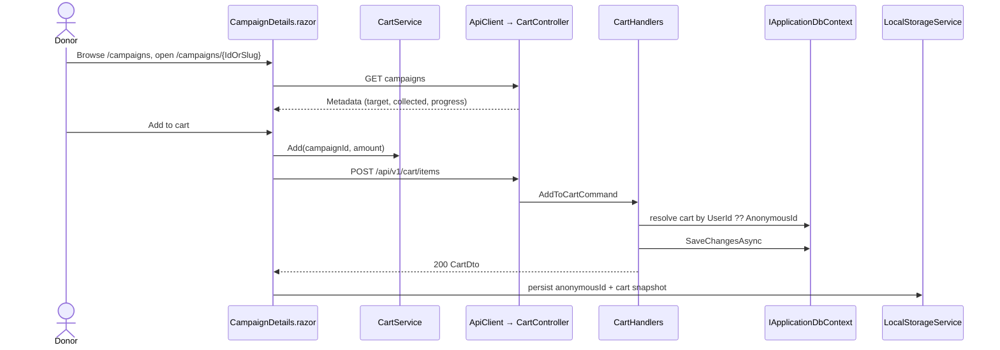
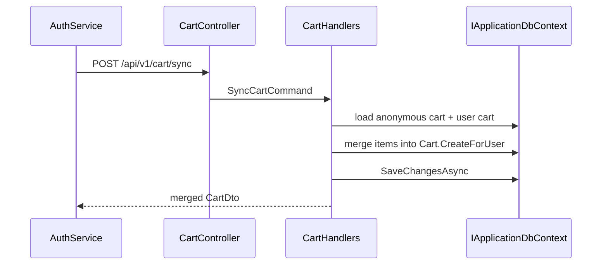
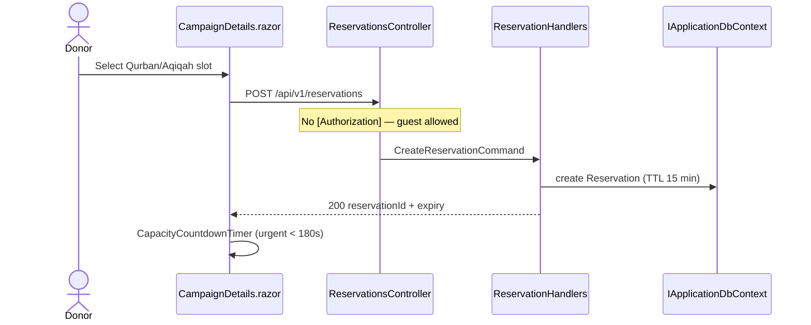
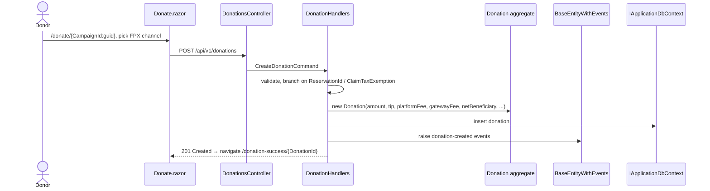
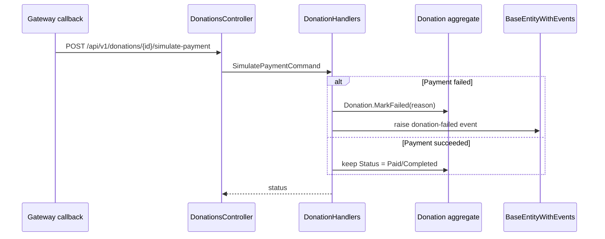
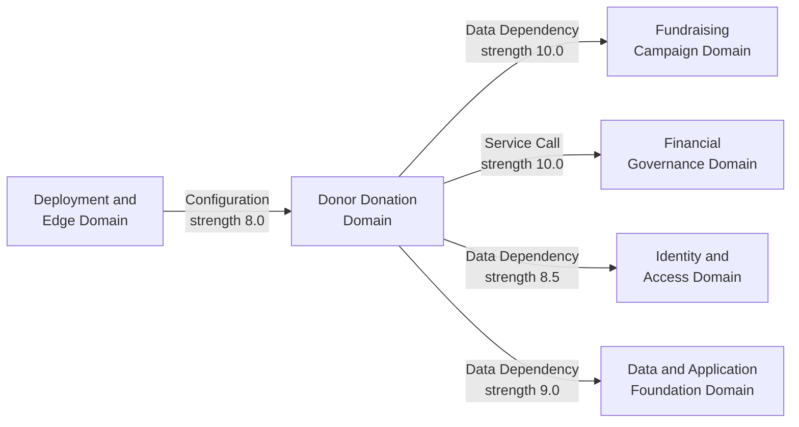

# Donor Donation Domain — Architecture & Implementation Documentation

**Project:** ESalam — Malaysian Charity & Donation Platform
**Domain Type:** Core Business Domain | **Importance:** 10.0 / 10 | **Complexity:** 8.5 / 10
**Layer Position:** Domain ← Application ← Infrastructure/Api (Clean Architecture)
**Document Status:** Evidence-verified against source, with documented drift where code contradicts intent

---

## 1. Executive Overview

The **Donor Donation Domain** encapsulates the complete donor-side giving experience of ESalam: campaign discovery, cart and saved-campaign accumulation, the monetary transaction itself, recurring giving, capacity reservations, and post-donation history with tax receipts. Functionally, it is the platform's **revenue path** — the single highest-importance slice in the system, touching five domain modules simultaneously (Donor Donation, Financial Governance, Fundraising Campaign, Identity & Access, and Platform Foundation).

Architecturally, it is implemented as a **CQRS + DDD vertical slice**:

```
Blazor WASM Client
        ↓
ASP.NET Core Controllers (thin, [ApiController])
        ↓
Application Handlers (ICommandHandler / IQueryHandler)
        ↓
Domain Aggregates (Donation, Cart, CartItem, Reservation)
        ↓
IApplicationDbContext (EF Core / PostgreSQL via Supabase)
```

Controllers do not contain business logic. They bind requests, dispatch commands/queries, and normalize results through a shared `HandleResult` helper. All state transitions occur inside domain aggregates that protect invariants through **private constructors and private setters**.

**Core design thesis:** *Donor intent is architecturally separated from money movement.* The `Donation` aggregate records the financial decomposition but never initiates payment; payment initiation lives in adapter services, settlement lives in the ledger. This separation means a compromised donation-creation endpoint does not automatically yield payment-initiation primitive access — a genuine containment property.

---

## 2. Domain Model

### 2.1 Donation Aggregate (Root)

`Donation : BaseEntityWithEvents` is the aggregate root representing a single charitable contribution.

**Identity and linkage:**

| Field | Purpose |
|---|---|
| `CampaignId` | FK to the destination campaign; the value destination |
| `DonorUserId` (nullable) | Authenticated donor; absent for guest donations |
| `DonorName` / `DonorEmail` | Denormalized donor identity captured at donation time |
| `IsAnonymous` | Controls public disclosure of donor identity |

**Financial decomposition — the critical design decision:**

| Field | Meaning |
|---|---|
| `Amount` | Gross amount charged to the donor |
| `TipAmount` | Optional platform tip on top of the donation |
| `PlatformFeeAmount` | Platform revenue retained |
| `GatewayFeeAmount` | Payment processor cost |
| `NetBeneficiaryAmount` | Amount actually owed to the beneficiary |
| `Currency` | ISO currency code |

Every donation records this full decomposition at write time. Nothing is recomputed later. This is what makes **ToyyibPay/FPX reconciliation** possible: gateway settlement, platform revenue, and beneficiary payout are all derivable from a single immutable row.

**Non-financial state:**

- `DonationStatus` — lifecycle state
- `PaymentMethodType` — defaults to `FPX` (Malaysian online banking)
- `ClaimTaxExemption` / `TaxIdentificationNumber` / `TaxPayerName` — tax receipt triad

**State machine — deliberately narrow:**

```csharp
public void MarkFailed(string? reason)   // → Failed
public void Refund()                      // → Refunded
```

Only two transitions are exposed. There is **no** `SetStatus(...)` method. Arbitrary status writes from the application layer are structurally impossible. Domain events flow outward through `BaseEntityWithEvents`, so failure and refund events are published at the point of mutation, not at the persistence boundary.

**Invariant protection:** two private constructors — one parameterless for EF Core materialization, one full-parameter for creation — plus private setters on every money field. External callers cannot construct an orphaned or financially malformed donation.

### 2.2 Cart and CartItem (Funnel Sub-Aggregate)

The cart is the pre-donation funnel. Its distinguishing feature is **dual-mode persistence**:

```csharp
public class Cart : BaseEntity
{
    public Guid? UserId { get; private set; }        // authenticated
    public string? AnonymousId { get; private set; }  // guest
}
```

XOR semantics: exactly one of `UserId` or `AnonymousId` is populated. Two static factories enforce correct construction:

- `Cart.CreateForUser(userId)`
- `Cart.CreateAnonymous(anonymousId)`

**This eliminates the need for a separate guest cart model.** A single table serves both identity modes, and the merge at login is an explicit application-layer operation rather than an implicit data migration.

`CartItem : BaseEntity` carries:

| Field | Notes |
|---|---|
| `CartId` | FK to owning cart |
| `CampaignId` | FK to the campaign being considered |
| `Amount` | `decimal`, default `10.00m` |
| `IsSaved` | Distinguishes **saved-for-later** from **active cart** |
| `Notes` | Optional donor annotation |

Mutation is through `UpdateAmount()` and `SetSaved()` — never through public setters.

### 2.3 Reservation (Nested, TTL-Bounded)

A nested `Reservation` type models **atomic temporary capacity holds** for finite-inventory giving instruments:

- Qurban portions
- Aqiqah goats
- Waqf shares

| Property | Value |
|---|---|
| TTL | 15 minutes |
| Lifecycle | create → (consume or expire) → release |
| Managed by | `ReservationHandlers` |
| Expiry reaping | `BackgroundSweeperWorker` |

The client mirrors this TTL with `CapacityCountdownTimer`, which flips to an urgent visual state beneath a **180-second** threshold — aligned to the reservation granularity so the donor's perceived urgency matches server reality.

---

## 3. Contracts (Immutability Boundary)

### 3.1 CreateDonationRequest

A positional record carried across the API boundary:

```
CampaignId, Amount, TipAmount,
DonorName (default "Hamba Allah"), DonorEmail, DonorPhone,
IsAnonymous,
PaymentMethod (default "FPX"), PaymentProvider (default "ToyyibPay"),
ReservationId,
ClaimTaxExemption, TaxIdentificationNumber, TaxPayerName
```

Defaults encode Malaysian-market assumptions directly in the schema: `"Hamba Allah"` as the anonymous donor name, `FPX` as the default rail, `ToyyibPay` as the default provider.

### 3.2 Cart Contracts

`CartItemDto` is **display-enriched**. Rather than forcing the client to cross-reference campaign endpoints, it embeds:

- `Title`, `Slug`, `CoverImageUrl`
- `CategoryName`, `BeneficiaryName`
- `TargetAmount`, `CollectedAmount`, `ProgressPercentage`

`CartDto` carries `Items` and `TotalCount`. Both are immutable, behavior-free carriers — the single schema shared between API and WASM client, which prevents client/server shape drift by construction.

---

## 4. HTTP API Surface

All endpoints are routed under `api/v1/` and served by thin controllers inheriting a shared `HandleResult` pattern that maps domain `Result` objects into HTTP responses with standardized error envelopes.

### 4.1 DonationsController — `api/v1/donations`

| Method | Route | Command / Query | Notes |
|---|---|---|---|
| `POST` | `/` | `CreateDonationCommand` | Donor-scoped auth |
| `GET` | `/{id}` | `GetDonationByIdQuery` | Returns full financial breakdown + status |
| `GET` | `/my` | `GetMyDonationsQuery` | Donor history for `MyDonations.razor` and tax records |
| `POST` | `/{id}/simulate-payment` | `SimulatePaymentCommand` | **Test hook — see §8.4** |

### 4.2 CartController — `api/v1/cart`

| Method | Route | Command |
|---|---|---|
| `GET` | `/` | `GetCartQuery` |
| `POST` | `/items` | `AddToCartCommand` |
| `PUT` | `/items/{id}` | `UpdateCartItemCommand` (amount / `IsSaved`) |
| `DELETE` | `/items/{id}` | `RemoveCartItemCommand` |
| `DELETE` | `/` | `ClearCartCommand` |
| `POST` | `/sync` | `SyncCartCommand` — **login-time guest→user merge** |

`CartController` is the **most stateful controller in the system** because it bridges two identity models with dual persistence. `SyncCartCommand` is the highest-risk correctness boundary in the funnel: it loads the anonymous cart and the user cart, merges items, and persists — and must be idempotent under concurrent modification.

### 4.3 RecurringDonationsController — `api/v1/recurringdonations`

| Method | Route | Command |
|---|---|---|
| `POST` | `/` | `CreateRecurringPlanCommand` |
| `DELETE` | `/{planId}` | `CancelRecurringPlanCommand` |

Both return `RecurringPlanDto`.

### 4.4 ReservationsController — `api/v1/reservations`

| Method | Route | Command |
|---|---|---|
| `POST` | `/` | `CreateReservationCommand` |
| `POST` | `/release` | `ReleaseReservationCommand` |

**No authorization attributes.** Reservations are intentionally **guest-accessible**: a visitor holding only the returned reservation ID may create and release a hold. This is consistent with the 15-minute TTL — requiring authentication before allowing a temporary capacity hold would create an unnecessary conversion barrier in the Qurban/Aqiqah purchase funnel.

---

## 5. Application Layer — Handler Behavior

### 5.1 DonationHandlers

| Handler | Behavior |
|---|---|
| `CreateDonation` | Branching validation → fee decomposition → aggregate construction → EF insert |
| `GetDonationById` | Returns financial breakdown and status |
| `GetMyDonations` | History filtered by donor identity |
| `SimulatePayment` | Test-only state-machine driver; flips status, may invoke `MarkFailed` |

`CreateDonation` derives the full money decomposition (amount, tip, platform fee, gateway fee, net beneficiary) before constructing the aggregate, so the domain object is never persisted in a partially-computed financial state.

### 5.2 CartHandlers

Resolution logic is the core concern:

1. Resolve `ICurrentUserService` → if a user is present, use `Cart.CreateForUser(userId)`.
2. Otherwise, use the guest `AnonymousId` supplied by the client and `Cart.CreateAnonymous(anonymousId)`.
3. Load, mutate, and persist `CartItem` rows through async EF Core queries.

### 5.3 RecurringHandlers

Creates and cancels `RecurringPlan` rows. No scheduler or charge-execution path is implemented in this domain — plan records exist, but settlement of recurring charges is not modeled here.

### 5.4 ReservationHandlers

Creates and releases reservations, writing status enums from `CharityPlatform.Domain.Enums`. Reservation reaping on expiry is performed by the background sweeper, keeping the HTTP path free of timer logic.

---

## 6. Client Architecture (Blazor WebAssembly)

### 6.1 Pages

| Route | Page | Responsibility |
|---|---|---|
| `/` | `Home.razor` | Landing experience |
| `/campaigns` | `Campaigns.razor` | Campaign discovery and filtering |
| `/campaigns/{IdOrSlug}` | `CampaignDetails.razor` | Campaign detail — registers component state with `PersistentComponentState` for prerender hydration |
| `/cart` | `Cart.razor` | Cart review and editing |
| `/donate/{CampaignId:guid}` | `Donate.razor` | Checkout — **embeds the inline FPX bank channel selector** |
| `/my-donations` | `MyDonations.razor` | Giving history and tax receipts |
| `/donation-success/{DonationId:guid}` | `DonationSuccess.razor` | Post-payment confirmation; branches on failure status |

### 6.2 Components

| Component | Responsibility |
|---|---|
| `CampaignCard.razor` | Computes `progressPct`, `remainingAmount`, `isNearGoal`, `isFullyFunded` **client-side** from `CartItemDto`-shaped metadata |
| `CampaignRecommendationsSection.razor` | Personalized and NGO recommendations |
| `CapacityCountdownTimer.razor` | `IDisposable`; 180-second urgency threshold matching reservation TTL granularity |

### 6.3 Injected Services

Pages are **state-light and service-heavy**, injecting:

- `ApiClient` — wraps every HTTP call
- `CartService` — client-side cart state store, shared by `CampaignDetails`, `Campaigns`, `Cart`, and `CampaignRecommendationsSection`
- `AuthService` — gates `MyDonations` and drives the sync call at login
- `LocalStorageService` — persists guest cart and anonymous ID across reloads
- `NavigationManager`, `IJSRuntime`, `ToastService`
- `PersistentComponentState` — prerender handoff

**No client code bypasses the API.** Persistence occurs exclusively through EF Core in the application layer.

---

## 7. End-to-End Workflow

The donation checkout and settlement flow spans five domain modules and sixteen sequential stages.

### Phase 1 — Funnel: Guest Accumulates Campaigns



### Phase 2 — Login Merge



### Phase 3 — Capacity Reservation (Guest, 15-Minute TTL)



### Phase 4 — Checkout and Donation Creation



### Phase 5 — Payment Outcome



---

## 8. Architectural Characteristics, Risks, and Drift

This section separates **verified strengths** from **confirmed deviations**. Where the code contradicts documented intent, it is stated plainly rather than softened.

### 8.1 Verified Strengths

| Property | Evidence |
|---|---|
| **Full money decomposition at the aggregate** | Every donation row carries amount, tip, platform fee, gateway fee, net beneficiary — reconciliation is derivable, not recomputed |
| **Narrow state machine** | Only `MarkFailed` and `Refund` are exposed; no arbitrary status writes possible |
| **Dual-mode cart without duplicate models** | `Cart.UserId` XOR `Cart.AnonymousId` with enforcing factories |
| **Immutable contract-first DTOs** | `CreateDonationRequest`, `CartDto`, `CartItemDto` are positional records shared API↔client |
| **Domain events at point of mutation** | `BaseEntityWithEvents` publishes failure/refund events inside the aggregate transition |
| **Guest reservation without auth barrier** | `ReservationsController` imports no authorization attributes, correctly matching the 15-minute TTL hold semantics |
| **Clean layering** | `Domain` has no project references; no reverse references exist across the six `.csproj` files |
| **Client-side progress computation** | `CampaignCard.razor` derives `progressPct`/`isNearGoal` from DTO metadata — no extra round trips |

### 8.2 Confirmed Deviations Affecting This Domain

These findings are reproduced from source and directly touch the donor donation path.

| ID | Finding | Severity | Status | Evidence |
|---|---|---|---|---|
| **D-05** | Payment adapters are **synthetic stubs**, not gateway integrations | HIGH | CONFIRMED | `ToyyibPayAdapter.CreatePaymentIntentAsync` fabricates `billCode = "TP-{first8}"` and returns a constructed URL without any HTTP call; `QueryPaymentStatusAsync` always returns `Succeeded, 50.00m` |
| **D-06** | Webhook signature verification is effectively absent | HIGH | CONFIRMED | `ValidateWebhookAsync` sets `IsValid: true` **unconditionally** and coerces amount `> 0 ? amount : 10.00m`; `PaymentHandlers.cs` treats `validationResult.Value.IsValid` as trusted |
| **D-12** | `GetMyDonations` is `[AllowAnonymous]` and accepts an arbitrary `email` query parameter | HIGH | CONFIRMED | Giving history is retrievable by supplying any email address |
| **D-08** | Live Supabase service-role JWT, JWT secret, and a raw DB password committed in `appsettings.json` | HIGH | CONFIRMED | Contradicts the documented claim that "secrets flow from the environment" |
| **D-03** | Login returns an opaque non-JWT token (`esalam_session_{id}_{ticks}`), not a signed JWT | CRITICAL (system-wide) | CONFIRMED | Affects donor identity resolution wherever `ICurrentUserService` is populated from bearer tokens |
| **D-04** | Seed credential fallback with five hard-coded demo accounts including `admin@esalam.my → Admin@123`; fallback also accepts `"DemoPass@123"` and `"password123"` case-insensitively | HIGH | CONFIRMED | Reachable when DB lookup throws **or** returns no user |

**Impact on this domain specifically:** D-05 and D-06 together mean the documented payment settlement path does not execute against a real gateway. Donations can reach terminal "paid" state without genuine settlement, which propagates directly into the ledger write and the campaign `CollectedAmount` increment. D-12 means per-donor giving history — including tax-relevant records — is enumerable without authentication.

### 8.3 Documented Gaps

| Gap | Description |
|---|---|
| **Refund lifecycle undefined** | `Donation.Refund()` exists in the domain, but no workflow describes approval requirements or how a refund reverses the chained ledger |
| **Recurring settlement undefined** | `RecurringPlan` rows are created and cancelled, but no scheduler or charge-execution path is modeled |
| **Guest donation attribution undefined** | Guest donations are permitted, but no flow describes later attribution to an account, nor how tax receipt issuance works for a fundable identity that never authenticates |
| **`SimulatePayment` gating undocumented** | If this endpoint is reachable in production without strict authorization, it permits donation finalization and ledger entry creation without gateway settlement |

### 8.4 Production Risk Note — `SimulatePayment`

`POST /api/v1/donations/{id}/simulate-payment` is a legitimate test harness for driving `MarkFailed` transitions. Its risk is entirely a function of **reachability and authorization**. If it is exposed in the production API surface without environment gating and role restriction, it constitutes a direct integrity bypass of the primary value workflow: an actor could finalize donations and cause ledger entries to be written without any real payment.

**Required control:** environment gate (development/test only) **AND** role authorization, not either alone.

---

## 9. Cross-Domain Dependencies



| Counterpart | Relation | Strength | Nature |
|---|---|---|---|
| **Fundraising Campaign** | Data Dependency | 10.0 | Every donation references a campaign and increments `CollectedAmount`; campaigns own the capacity tiers that reservations hold |
| **Financial Governance** | Service Call | 10.0 | Donation creation delegates payment initiation to the gateway factory and settles through the double-entry ledger |
| **Identity and Access** | Data Dependency | 8.5 | `ICurrentUserService` resolves donor identity for attribution and anonymity enforcement |
| **Data and Application Foundation** | Data Dependency | 9.0 | Handlers depend on `IApplicationDbContext`, `BaseEntityWithEvents`, and `Result` — never EF Core directly |
| **Deployment and Edge** | Configuration Dependency | 8.0 | nginx fronts the public web service serving the WASM donor experience and proxying API calls |

**Transitive gating:** `Beneficiary Verification` gates campaign creation, which gates donations, which gates payouts. Beneficiary verification is therefore the deepest upstream dependency in the money chain — and the cheapest place to inject an illegitimate funds recipient.

---

## 10. Design Decision Summary

| # | Decision | Rationale | Consequence |
|---|---|---|---|
| 1 | **Full money decomposition persisted at donation creation** | Enables gateway reconciliation, platform revenue reporting, and beneficiary payout derivation without recomputation | Wide aggregate; every donation write touches six money columns |
| 2 | **Dual-identity cart (UserId XOR AnonymousId)** | One table serves guests and authenticated users; no duplicate cart model | `SyncCartCommand` becomes the highest-risk correctness boundary |
| 3 | **Narrow state machine (`MarkFailed`, `Refund`)** | Status transitions are auditable; application layer cannot write arbitrary status | Terminal states beyond Failed/Refunded are reachable only through payment settlement |
| 4 | **Guest-accessible reservations** | Removes authentication friction from finite-inventory giving | Reservation IDs must be treated as bearer capabilities; TTL is the compensating control |
| 5 | **Contract-first immutable DTOs with display metadata** | Eliminates client/server shape drift; avoids extra campaign round trips | Cart responses are heavier; changes require synchronized contract updates |
| 6 | **Blazor WASM pages state-light, service-heavy** | All state lives in `CartService`/`LocalStorageService`/`AuthService`; pages stay presentational | `PersistentComponentState` required for prerender hydration correctness |
| 7 | **Domain events at point of mutation** | Failure and refund events carry accurate context, not reconstructed state | Consumers outside this domain must handle event delivery ordering |

---

## 11. Unverified Elements

Stated honestly rather than assumed correct:

- **Real gateway behavior for Chip and Stripe adapters** — the synthetic-stub finding (D-05) is CONFIRMED for ToyyibPay and PLAUSIBLE by shared pattern for Chip and Stripe; not independently verified for the latter two.
- **`SimulatePayment` production gating** — whether environment gating and role restrictions are actually applied at runtime is not confirmed from the reviewed surface.
- **Ledger-audit transactional coupling** — the documentation asserts audit records are emitted "alongside" ledger hash computation; whether both occur in a single transaction is unverified. If not transactionally coupled, a crash between the two produces an unaudited money movement.
- **Concurrency behavior on `Campaign.CollectedAmount`** — whether an optimistic concurrency token protects against lost updates under concurrent donations to the same campaign is not confirmed.
- **`CartController.SyncCartCommand` conflict semantics** — the merge policy for items modified concurrently on both the guest cart and the user cart is undocumented.
- **Recurring plan execution** — no scheduler, no charge initiation path, and no ledger integration for recurring settlements were found in this domain.

---

## 12. Prioritized Remediation for This Domain

| # | Priority | Action | Closes | Effort |
|---|---|---|---|---|
| 1 | **CRITICAL** | Gate `POST /donations/{id}/simulate-payment` behind `IsDevelopment()` **and** a role policy | §8.4 | < 1 h |
| 2 | **HIGH** | Implement real gateway calls in `ToyyibPayAdapter` (and verify Chip/Stripe); remove `IsValid: true` constant and the `10.00m` amount fallback | D-05, D-06 | 2–3 d |
| 3 | **HIGH** | Replace `[AllowAnonymous]` on `GetMyDonations` with authorization on the authenticated principal; remove the `email` query-param lookup | D-12 | 2–4 h |
| 4 | **HIGH** | Rotate all secrets in `appsettings.json`; move to environment variables only; purge git history | D-08 | 2–4 h |
| 5 | **HIGH** | Delete the seed credential fallback path in `LoginCommandHandler`; return `Unauthorized` on infrastructure failure | D-04 | < 1 h |
| 6 | **MEDIUM** | Make guest→user cart merge an explicitly idempotent operation with a documented conflict policy; test concurrent modification during login | §5.2 | 4–8 h |
| 7 | **MEDIUM** | Wrap settlement, `Campaign.CollectedAmount` increment, and ledger write in a single transaction with optimistic concurrency on `Campaign` | §11 | 1–2 d |
| 8 | **MEDIUM** | Document and implement the refund lifecycle, including ledger reversal semantics | §8.3 | 2–3 d |
| 9 | **LOW** | Document guest donation attribution rules and their interaction with tax receipt issuance | §8.3 | 4 h |
| 10 | **LOW** | Define recurring plan execution: scheduler, charge initiation, settlement path, ledger integration | §8.3 | 3–5 d |

---

## 13. Conclusion

The Donor Donation Domain is a **well-structured CQRS + DDD slice** whose domain modeling is genuinely strong: full money decomposition at the aggregate, narrow auditable state transitions, a dual-identity cart that avoids model duplication, and contract-first immutable DTOs. The layering is clean, the reservation model correctly trades authentication friction for TTL enforcement, and the separation of donor intent from money movement is a real containment property rather than a documented aspiration.

The material risks in this domain are **not modeling risks — they are implementation gaps in the payment and identity boundary**. Payment adapters do not call real gateways, webhook signature verification does not verify signatures, giving history is anonymously enumerable, and a test-only payment simulation primitive carries production reachability risk. These findings directly affect the platform's core value proposition: trust in the money path.

Closing items 1–5 in the remediation table converts the documented architecture into the implemented architecture for this domain. Until then, the donation checkout path should be treated as **structurally sound but operationally unverified against real payment settlement**.

---

*Document generated from source-verified research materials. Findings marked CONFIRMED were reproduced from code; findings marked as gaps or unverified are stated as such rather than assumed correct.*