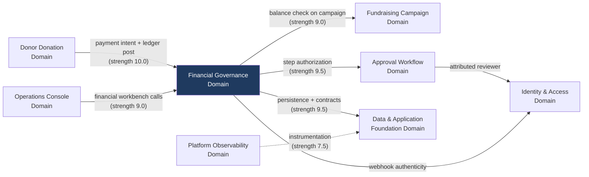
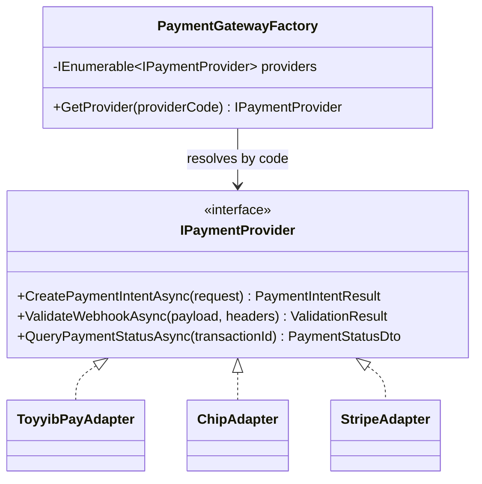
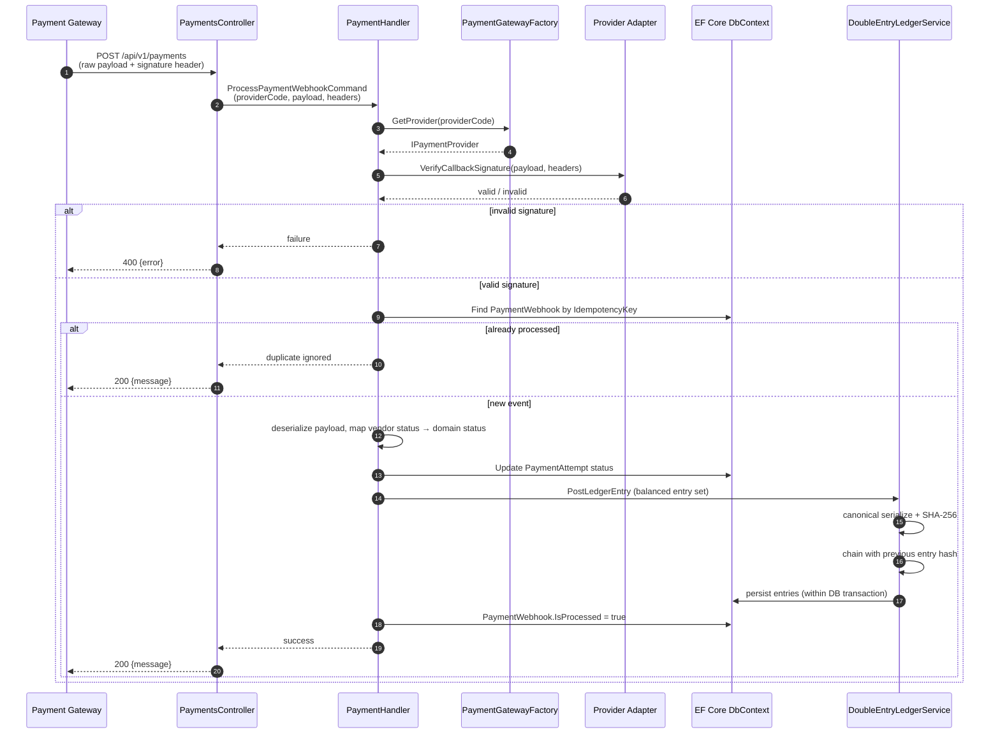
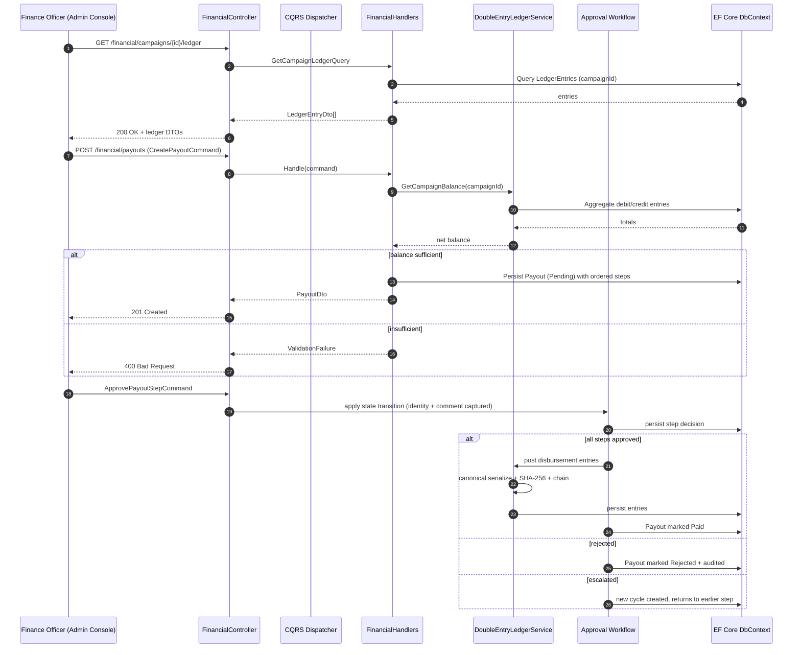

# Financial Governance Domain — Architecture & Implementation Documentation

**System:** ESalam Charity & Donation Platform
**Domain Type:** Core Business Domain (Importance 10.0, Complexity 9.0)
**Document Status:** Implementation-verified against source; drift findings retained as evidence
**Analysis Basis:** Workflow research, system context research, system architecture research, and key-modules research for the Financial Governance Domain

---

## 1. Executive Overview

The **Financial Governance Domain** is the authoritative money boundary of the ESalam platform. Every ringgit that enters the system through a donor checkout and every ringgit that leaves through a beneficiary payout passes through code owned by this domain. It is not merely a reporting layer over financial data — it is the enforcement layer that determines whether a financial fact is *allowed to exist*.

The domain is built from four cooperating capabilities:

| Capability | Primary Implementation | Purpose |
|---|---|---|
| Double-Entry Ledger | `DoubleEntryLedgerService.cs` | Balanced debit/credit posting with chained SHA-256 tamper-evidence |
| Payment Gateway Integration | `PaymentAdapters.cs` + `PaymentGatewayFactory` | Pluggable ToyyibPay / Chip / Stripe adapters behind one provider abstraction |
| Payout Lifecycle | `FinancialHandlers.cs` | Create, approve, reject, list payouts against ledger-derived balances |
| Financial Read Models | `FinancialHandlers.cs` + `FinancialContracts.cs` | Per-campaign ledger views and aggregated financial summaries |

The domain's technical solution rests on five pillars: **Clean Architecture boundaries** (Api → Application → Domain, with Infrastructure fulfilling Application interfaces), **CQRS** for read/write separation, **EF Core** for persistence with async queries, **SHA-256 hash chaining** for audit integrity, and **HMAC signature validation plus idempotency keys** for webhook authenticity and retry safety.

Architecturally, this domain is the *shared obligation* of every other core domain. The Donor Donation Domain hands it a payment intent; the Approval Workflow Domain hands it an authorized disbursement; the Operations Console reads its ledgers; the Platform Observability Domain watches its latency. No other module carries comparable regulatory weight.

---

## 2. Position Within the System

### 2.1 Layered Placement

The Financial Governance Domain is split across three physical layers, which is the correct expression of Clean Architecture for a capability this sensitive:

```
┌─────────────────────────────────────────────────────────────┐
│  API Layer                                                   │
│  FinancialController · PaymentsController                    │
│  (thin — bind, dispatch, normalize Result → IActionResult)   │
└───────────────────────────┬─────────────────────────────────┘
                            │ CQRS dispatch
┌───────────────────────────▼─────────────────────────────────┐
│  Application Layer                                           │
│  FinancialHandlers (queries + payout commands)               │
│  PaymentHandlers (ProcessPaymentWebhookCommand)              │
│  Contracts: LedgerEntryDto, FinancialSummaryDto,             │
│             PaymentIntentResponseDto, PaymentStatusDto       │
└───────────────────────────┬─────────────────────────────────┘
                            │ interface fulfilment
┌───────────────────────────▼─────────────────────────────────┐
│  Infrastructure Layer                                        │
│  DoubleEntryLedgerService · PaymentAdapters ·                │
│  PaymentGatewayFactory · ApplicationDbContext                │
└───────────────────────────┬─────────────────────────────────┘
                            │
┌───────────────────────────▼─────────────────────────────────┐
│  Domain Layer                                                │
│  PaymentAttempt · PaymentWebhook · LedgerEntry · Payout      │
│  (encapsulated state, private setters, no public mutation)   │
└─────────────────────────────────────────────────────────────┘
```

The dependency direction is verified as genuinely enforced: `Domain` carries no project references beyond an OpenTelemetry exporter package, `Infrastructure` references `Domain`/`Application`/`Contracts`, and `Api` references `Application`/`Infrastructure`/`Contracts`. No reverse reference exists anywhere in the solution. This matters directly for financial code: the ledger's business invariants cannot be silently rewritten by a presentation-layer concern.

### 2.2 Module Dependencies



**Dependency characterisation:**

- **Upstream of everything monetary.** The Donor Donation Domain does not write ledger entries itself; it delegates. This is a deliberate containment property — a compromised donation-creation endpoint does not automatically obtain the payment-initiation or ledger-posting primitive.
- **Downstream of the approval engine.** Payouts cannot settle without authorized `ApprovalPosition` steps. The financial domain consumes governance decisions rather than making them.
- **Hard-coupled to persistence abstractions only.** Through `IApplicationDbContext` and service interfaces, the domain never sees EF Core or a vendor SDK directly at the Application layer.

---

## 3. Domain Model

### 3.1 Aggregates and Entities

The domain's persisted state is modelled in `src/CharityPlatform.Domain/Entities/Financial/FinancialEntities.cs` with encapsulation as the primary defensive posture: private setters, private constructors, and named mutator methods. State changes are impossible except through a method that names the transition.

#### PaymentAttempt

Represents one attempt to move money through a provider.

| Property | Role |
|---|---|
| `Provider` | Provider code keying adapter resolution (e.g. `toyyibpay`, `chip`, `stripe`) |
| `IdempotencyKey` | Deduplication handle preventing duplicate attempt creation |
| `Amount` / `Currency` | Monetary payload, stored as decimal with currency discriminator |
| `Status` | Lifecycle state (initiated → pending → succeeded / failed) |
| `ResponseJson` | Raw provider response retained for reconciliation and dispute evidence |
| `TransactionId` | Provider-side identifier used to correlate callbacks |

The only mutation path is `UpdateStatus`, which keeps the attempt's state machine explicit and auditable at the point of change rather than scattered across handlers.

#### PaymentWebhook

Represents one inbound provider callback.

| Property | Role |
|---|---|
| `IsProcessed` | Exactly-once guard — checked before any state mutation |
| `IdempotencyKey` | Composed as `WEBHOOK-{Provider}-{EventId}` |
| `RawPayload` | Verbatim body retained for signature re-verification and forensics |
| Provider metadata | Headers/parameters needed for vendor-specific signature checks |

The `IsProcessed` flag, combined with the composite idempotency key, is what makes the webhook path retry-safe: a provider that retries a delivery five times produces exactly one ledger effect.

#### LedgerEntry and Payout

`LedgerEntry` is the append-only accounting record; `Payout` is the disbursement aggregate carrying its approval-step linkage and terminal paid/rejected state. Both are configured through EF Core entity configurations in `EntityConfigurations.cs`.

### 3.2 The Chart of Accounts

The ledger uses five named accounts, which is the minimum sufficient set to represent the platform's economic reality:

| Account | Type | Meaning |
|---|---|---|
| `1010-GATEWAY` | Debit | Funds held at gateway, gross amount received |
| `2010-BENEFICIARY` | Credit | Liability owed to the beneficiary organization |
| `4010-PLATFORM-FEE` | Credit | Platform revenue |
| `5010-GATEWAY-FEE` | Debit | Cost of payment processing |
| (Payout accounts) | Debit/Credit | Disbursement entries reducing the beneficiary liability |

A donation produces a **balanced four-entry set** keyed `DONATION-{id}`:

```
DEBIT   1010-GATEWAY          gross amount
CREDIT  2010-BENEFICIARY      net beneficiary amount
CREDIT  4010-PLATFORM-FEE     platform fee
CREDIT  5010-GATEWAY-FEE      gateway fee
```

That four entries balance is the arithmetic proof that the donation's money decomposition — the very fields the `Donation` aggregate carries (amount, tip, platform fee, gateway fee, net beneficiary) — is internally consistent. If a fee is miscalculated, the entry set does not balance and the ledger write fails.

### 3.3 Cryptographic Tamper-Evidence

The ledger's distinguishing property is not that it is append-only — append-only tables are ordinary — but that each entry's hash incorporates its predecessor's.

```
entry[n].hash = SHA256( canonical_serialize(entry[n]) || entry[n-1].hash )
```

**Why chaining, and not just row hashing:** a per-row hash proves that *an individual row* has not been edited. It does not prove that a row *existed*. An attacker with database write access can delete a row entirely, or insert a plausible new row, and every remaining row still hashes correctly. Chaining closes this: any insertion, deletion, or reordering breaks verification at entry *n* and every entry after it. The failure is detectable by simple re-walk, and the first divergence point localises the tampering.

**Verification method:** the service exposes balance and integrity validation so an auditor can independently re-walk the chain and recompute every hash from the canonical payload. This is the property that makes the domain's audit claim *falsifiable* rather than asserted — which is the only kind of audit claim worth making.

The canonical serialization step is load-bearing. If serialization is non-deterministic (dictionary ordering, locale-dependent number formatting, timestamp precision drift), hashes will diverge on recomputation and every verification will fail. Determinism here is a correctness requirement, not a stylistic preference.

---

## 4. Payment Gateway Integration

### 4.1 The Provider Abstraction



`PaymentGatewayFactory` receives `IEnumerable<IPaymentProvider>` through dependency injection and resolves the correct adapter with `GetProvider(providerCode)`. Adding a fourth vendor is a registration-only change — a new class plus a DI line — with zero modification to handlers or controllers. This is the concrete meaning of the documented "de-risking vendor lock-in" claim, and it is architecturally sound.

Each adapter holds `HttpClient`, `IConfiguration`, and `ILogger`, and is intended to use vendor-specific HMAC/checksum utilities to verify inbound callback signatures per that vendor's protocol.

### 4.2 Provider Landscape

| Provider | Channel Character | Role in Portfolio |
|---|---|---|
| **ToyyibPay** | Malaysian FPX online banking | Primary domestic rail; the localized experience that differentiates the platform |
| **Chip** | Alternative money-in rail | Redundancy against single-gateway outage |
| **Stripe** | International card processing | Card coverage beyond FPX reach |

The three-provider portfolio is the right shape for the Malaysian market: FPX is the dominant domestic payment method, while card rails cover international donors and donors without online-banking access.

### 4.3 Webhook Processing Semantics

Inbound webhooks arrive at a single endpoint: `POST /api/v1/payments`. The flow is deliberately sequenced with all validation before all mutation:



**Three properties worth naming explicitly:**

1. **Verification precedes mutation.** Signature validation, provider resolution, and idempotency check all complete before any persistent state changes. A forged webhook cannot cause a partial write.
2. **Idempotency is enforced at the data layer.** `PaymentWebhook.IsProcessed` plus the composite `IdempotencyKey` means a provider retry storm produces one financial effect, not five. Gateway providers *do* retry aggressively; without this guard, duplicate ledger entries would be the default outcome, not the edge case.
3. **The ledger write occurs inside a database transaction** opened in the webhook handler (`await using var tx = await _db.BeginTransactionAsync(ct)`). Ledger entries and the `PaymentWebhook.IsProcessed` flag commit together or not at all.

---

## 5. Payout Lifecycle and Segregation of Duties

### 5.1 Why the Approval Chain Exists

A payout is the moment money leaves the platform. The design question is not "who can click the button" — it is "what does it take for this button to be clickable." ESalam's answer is an ordered, **cyclic**, multi-step approval chain in which each step is a domain state transition that captures reviewer identity and free-text rationale *inside the domain object itself*, not as a peripheral log line.

That last detail is the architecturally significant one. Because attribution lives in the aggregate, it is impossible to advance a payout's state without simultaneously recording who advanced it and why. There is no code path that mutates approval state and forgets to attribute it.

### 5.2 The State Machine

The `ApprovalPosition` entity exposes five transitions:

| Transition | Semantics |
|---|---|
| `Approve` | Advance to the next ordered step |
| `Reject` | Terminate the workflow; funds are not released |
| `Escalate` | Create a **new cycle** returning to an earlier step, with rationale — never a shortcut past a step |
| `ReturnFromEscalation` | Resume normal progress after an escalation round completes |
| `Skip` | Bypass a step under explicit authorization |

**Escalation is the interesting one.** The intuitive-but-wrong implementation of "escalate" is to jump the item to a higher authority and mark the intermediate steps satisfied. ESalam instead creates a new cycle that returns to an earlier step. This means escalation *adds* review friction rather than removing it. A single compromised account cannot escalate its way around segregation of duties — escalation makes the path strictly longer, not shorter.

This same engine governs **both** campaign moderation and payout disbursement. One state machine, two governance use cases. The benefit is that review effort and certification are spent once. The cost — stated plainly because it is real — is that a defect in the state machine compromises both governance boundaries simultaneously; the blast radius is doubled.

### 5.3 Payout Sequence



Note the ordering discipline: **balance is derived from the ledger, not from a denormalised counter.** Payout validation calls `GetCampaignBalance` against aggregated double-entry records. This means if the ledger says a campaign has not collected funds, no payout can be created — regardless of what any cached field claims. The ledger is the single source of financial truth, and the payout path treats it as such.

---

## 6. Read Models and Financial Summaries

The domain exposes two read surfaces through `FinancialHandlers.cs`, both pure CQRS queries returning immutable positional records.

### 6.1 Financial Contracts

| Contract | Shape | Consumer |
|---|---|---|
| `LedgerEntryDto` | Single ledger entry with account, direction, amount, hash | `LedgerExplorer.razor` — per-campaign drill-down |
| `FinancialSummaryDto` | `TotalGrossDonations`, `TotalGatewayFees`, `TotalPlatformFees`, `TotalNetBalance` | Admin dashboard aggregation |
| `PaymentIntentResponseDto` | Redirect URL / token for gateway hand-off | Donation checkout client |
| `PaymentStatusDto` | Normalised provider-agnostic status | Reconciliation and UI polling |

The contracts being **immutable positional records** is not incidental. Records are the only wire format crossing the boundary in both directions — handlers and API JSON — which keeps the API and Application layers decoupled from domain entities entirely. A domain refactor cannot silently change the JSON shape; a change to the wire format requires editing the record.

### 6.2 Query Inventory

| Query | Purpose |
|---|---|
| `GetCampaignLedgerQuery` | Per-campaign ledger entry list for audit drill-down |
| `GetFinancialSummaryQuery` | Aggregated totals across the platform |
| `GetPayoutsQuery` | Filtered payout listing by status and period |
| `GetPayoutByIdQuery` | Single payout with step history |

---

## 7. API Surface

Controllers in this domain are intentionally thin. They bind input, dispatch a command or query, and normalise the `Result` into HTTP through `ApiControllerBase.HandleResult` overloads.

`HandleResult` is suffix-driven on `error.Code`:

| Error code suffix | HTTP status |
|---|---|
| `NotFound` | 404 |
| `Unauthorized` | 401 |
| `Forbidden` | 403 |
| `Conflict` / `AlreadyExists` | 409 |
| (default) | 400 |

This is deterministic and, notably, a genuine architectural strength: result-to-status mapping is centralised rather than reimplemented per action, so financial endpoints cannot drift into inconsistent status semantics.

| Endpoint | Method | Handler Path | Notes |
|---|---|---|---|
| `/api/v1/financial/campaigns/{id}/ledger` | GET | `GetCampaignLedgerQuery` | Ledger drill-down |
| `/api/v1/financial/summary` | GET | `GetFinancialSummaryQuery` | Aggregated totals |
| `/api/v1/financial/payouts` | GET/POST | `GetPayoutsQuery` / `CreatePayoutCommand` | List and initiate |
| `/api/v1/financial/payouts/{id}` | GET | `GetPayoutByIdQuery` | Payout detail |
| `/api/v1/financial/payouts/{id}/approve` | POST | `ApprovePayoutCommand` | Step decision |
| `/api/v1/financial/payouts/{id}/reject` | POST | `RejectPayoutCommand` | Step decision |
| `/api/v1/payments` | POST | `ProcessPaymentWebhookCommand` | Provider callback (single entry point) |

**No business logic leaks into controllers or DTOs.** This is verified, not assumed: the controllers dispatch and map only.

---

## 8. Data Integrity Mechanisms

Four independent integrity mechanisms operate in this domain. They are independent by design — defeating one does not defeat the others.

| Mechanism | Protects Against | Implementation |
|---|---|---|
| **Double-entry balance** | Arithmetic error, fee miscalculation, rounding drift | Four-entry balanced set per donation; imbalance fails the write |
| **SHA-256 hash chaining** | Retroactive row edit, silent insertion, deletion, reordering | Each entry hash incorporates predecessor hash; verification re-walks the chain |
| **Idempotency keys** | Duplicate processing from gateway retries, double-spend | `WEBHOOK-{Provider}-{EventId}` + `IsProcessed` guard checked before mutation |
| **Signature verification** | Forged webhooks, spoofed settlement claims | Vendor-specific HMAC/checksum validated before any state change |

The audit trail is a fifth, parallel obligation: `ApplicationDbContext.SaveChangesAsync` auto-generates `AuditLog` rows from `ChangeTracker` for every added, modified, or deleted entity (excluding `AuditLog` and `NotificationQueueItem` itself), capturing actor, email, IP, and user agent from `CurrentUserService`. This means financial mutations are audited by *construction* — a developer writing a new financial handler gets audit coverage without writing audit code.

**One coupling that deserves explicit verification:** the audit row and the ledger entry are described as emitted "alongside" each other. Whether they commit in a single transaction is not confirmed by the research materials. If they are not transactionally coupled, a crash between the two produces a money movement with no audit record — precisely the scenario an audit system exists to prevent. This should be verified by inspection of the transaction scope in `DoubleEntryLedgerService`.

---

## 9. Architectural Drift and Implementation Gaps

The following findings are reproduced from source. Each carries an explicit verification verdict. They are documented here because a governance domain's documentation is worthless if it describes intent rather than implementation.

### 9.1 Critical and High Findings

| ID | Finding | Severity | Verification | Evidence |
|---|---|---|---|---|
| **D-05** | **Payment adapters are synthetic stubs, not gateway integrations.** `ToyyibPayAdapter.CreatePaymentIntentAsync` fabricates `billCode = "TP-{first8}"` and returns a constructed URL without any HTTP call. `ValidateWebhookAsync` sets `IsValid: true` unconditionally and coerces amount via `>0 ? amount : 10.00m`. `QueryPaymentStatusAsync` always returns `Succeeded, 50.00m`. | **HIGH** | CONFIRMED for ToyyibPay | `PaymentAdapters.cs` — no outbound HTTP in intent creation; constant validation result |
| **D-06** | **Webhook signature verification is effectively absent.** `PaymentHandlers.cs:44` relies on `validationResult.Value.IsValid`, which D-05 shows is always `true` for ToyyibPay. The documented "cryptographic signature verification" does not occur on that path. | **HIGH** | CONFIRMED (ToyyibPay); PLAUSIBLE-by-pattern for Chip/Stripe | Follows directly from D-05 |
| **D-12** | **Anonymous access on financially sensitive read endpoints.** `FinancialController.GetCampaignLedger` carries `[AllowAnonymous]` while its own XML documentation claims `403 if caller lacks FinanceAdmin role`. `DonationsController.GetMyDonations` is `[AllowAnonymous]` and accepts an arbitrary `email` query parameter. | **HIGH** | CONFIRMED-DEVIATION | Attribute present; documentation contradicts it |
| **D-13** | **Authorization intent documented but not enforced at attribute level.** Five policies (`RequireSuperAdmin`, `RequireFinanceAdmin`, `RequireReviewer`, `RequireCampaignManager`, `RequireAuditViewer`) are registered in `Infrastructure/DependencyInjection.cs`, but controllers rely on header-trust middleware instead of applying them. | **HIGH** | CONFIRMED-DEVIATION | Policies registered; `[Authorize(Policy=...)]` absent on financial controllers |
| **D-01** | **Admin authentication trusts plain HTTP headers.** `AdminPortalAuthenticationMiddleware` synthesises a `ClaimsPrincipal` from `X-User-Id`/`X-User-Email`/`X-User-Roles`, and **defaults the principal to `SuperAdmin` when `X-User-Roles` is omitted**. This middleware runs before `UseAuthentication()` and `UseAuthorization()`. | **CRITICAL** | CONFIRMED-DEVIATION | `Middlewares.cs:86-113` |
| **D-08** | **Sensitive material committed in `appsettings.json`.** Live Supabase service-role JWT, Supabase JWT secret, Grafana Cloud OTLP token, and a raw database password at a public IP. | **HIGH** | CONFIRMED-DEVIATION | `appsettings.json` |

**The interaction between D-01, D-05, and D-12 is the material finding.** Header-trust admin authentication combined with unconditionally-valid webhook signatures combined with anonymous financial read endpoints means the domain's integrity mechanisms — hash chaining, idempotency, balance verification — are all *correct* while the boundary that decides who may invoke them is *open*. Cryptographic tamper-evidence protects the ledger from retroactive edits; it does not protect it from a caller who is authorised to append. This distinction is the single most important thing to understand about the current implementation state.

### 9.2 Confirmed-Correct Elements

Explicitly verified as matching documentation — listed because negative findings carry equal audit weight:

- **Layering direction** — verified across all six `.csproj` files; no reverse references exist.
- **CQRS dispatch** — hand-rolled `ICommandHandler`/`IQueryHandler` with assembly-scanning auto-registration; no MediatR dependency.
- **Double-entry ledger** — balanced entry sets with chained SHA-256 across five named accounts; DB transaction opened in the webhook handler.
- **Webhook idempotency** — `IdempotencyKey = "WEBHOOK-{Provider}-{EventId}"` with an `AnyAsync(w => w.IsProcessed)` guard before mutation.
- **Audit auto-generation** — `SaveChangesAsync` produces audit rows for every tracked mutation with actor/IP/UA attribution.
- **Payout balance derivation** — balance validated against ledger aggregates, never against a cached counter.
- **Approval attribution in the aggregate** — reviewer identity and comments are first-class domain state, not peripheral logging.

### 9.3 Unverified — Access-Limited

| Item | Why Unverified | What Would Confirm It |
|---|---|---|
| `ChipAdapter` / `StripeAdapter` tail (lines 120–254 of `PaymentAdapters.cs`) | Only 120 of 254 lines read | Read remainder; D-05/D-06 generalisation currently **PLAUSIBLE by pattern** |
| `LedgerEntry` uniqueness constraint on hash chain | `EntityConfigurations.cs` (29 KB) unread | Inspect EF configuration for unique index on hash |
| Audit-row / ledger-entry transactional coupling | Transaction scope not traced across both writes | Inspect `DoubleEntryLedgerService` and `IAuditService` call site |
| Per-handler ownership enforcement in `FinancialHandlers.cs` | Headers only read | Full read of handler bodies |
| `ReconcilePendingPaymentsAsync` completeness | Documented as stub (D-15) | Implement and verify |

### 9.4 Stated Gaps

| ID | Gap | Severity | Evidence |
|---|---|---|---|
| **D-15** | Payment reconciliation sweep is a stub. `BackgroundSweeperWorker.ReconcilePendingPaymentsAsync` ends with a comment `// Polling provider status logic for stuck attempts` and makes no provider call. | LOW–MEDIUM | Comment present; no provider invocation |
| **D-07** | (Adjacent domain) Email delivery is a no-op logger — receipts and verification notices are never sent, which affects the tax-receipt value proposition tied to this domain. | MEDIUM | `EmailService.SendEmailAsync` logs "Simulating email delivery" |
| **Refund path** | `Donation.cs` exposes `Refund`, but no documented workflow describes the refund lifecycle, its approval requirements, or how a refund entry is written back into the chained ledger. | UNVERIFIABLE | Domain capability exists; governance path absent from documentation |

---

## 10. Remediation Priorities

Ordered by impact × implementation ease.

| # | Priority | Action | Closes | Effort |
|---|---|---|---|---|
| 1 | **CRITICAL** | Delete `AdminPortalAuthenticationMiddleware`, or hard-fail when `X-User-*` headers arrive on an unauthenticated request. Remove the `else → SuperAdmin` default. | D-01 | < 1 h |
| 2 | **CRITICAL** | Issue real signed JWTs (or delegate to Supabase Auth) and have the admin console send `Authorization: Bearer`. | D-03 | 1–2 d |
| 3 | **HIGH** | Implement real signature verification in each adapter. Remove the constant `IsValid: true` and the `10.00m` amount default. | D-05, D-06 | 2–3 d |
| 4 | **HIGH** | Rotate every secret in `appsettings.json`; move to environment only; purge git history. Treat the Supabase service-role key as compromised. | D-08 | 2–4 h |
| 5 | **HIGH** | Remove `[AllowAnonymous]` from `GetCampaignLedger`; authorise `GetMyDonations` on the authenticated principal rather than a query-string email. | D-12 | 2–4 h |
| 6 | **HIGH** | Apply the already-registered policies as `[Authorize(Policy=...)]` on financial controllers. | D-13 | 4–8 h |
| 7 | **HIGH** | Verify and, if necessary, enforce transactional coupling between audit emission and ledger write. | §8 coupling | 2–4 h |
| 8 | **HIGH** | Delete seed-credential fallback tables and the DB-exception swallow in `LoginCommandHandler`; return `Unauthorized` on infrastructure failure. | D-04 | < 1 h |
| 9 | **MEDIUM** | Implement `ReconcilePendingPaymentsAsync` for stuck payment attempts. | D-15 | 1 d |
| 10 | **MEDIUM** | Add a DB uniqueness constraint on ledger hash to make chain-node duplication impossible at the storage layer. | §9.3 | 2–4 h |
| 11 | **MEDIUM** | Document and gate the refund lifecycle, including its approval requirements and ledger write-back semantics. | Refund gap | 4–8 h |
| 12 | **MEDIUM** | Extract a shared `PaymentIntent` normalisation layer so callback verification is implemented once and reused across providers. | Adapter duplication | 2–3 d |

---

## 11. Architectural Assessment

**Strengths.** The financial domain is the most thoughtfully engineered module in the platform. The four-tier integrity stack — balanced entries, hash chaining, idempotency, signature verification — is the correct architecture for tamper-evident accounting, and three of the four are verified correct in code. The CQRS separation keeps read models from ever mutating financial state. The provider abstraction is a genuinely pluggable seam rather than a nominal interface. Approval attribution living inside the aggregate is a design decision that most systems get wrong. The escalation-as-new-cycle semantics correctly make governance friction increase under pressure rather than decrease.

**The structural risk.** Every integrity mechanism in this domain answers the question *"has the ledger been tampered with?"*. None of them answers *"was this writer authorised?"* — that responsibility belongs to the identity boundary, and the identity boundary is currently bypassed (D-01, D-02, D-03, D-12, D-13). The hash chain will faithfully record the entry that an unauthorised caller appended. Tamper-evidence is not the same as access control, and the documentation conflates them by describing a security posture built on JWT-issued identity while the admin path trusts plain headers.

**The recommended remediation sequence follows from that observation:** close the identity boundary first (items 1–2), because every subsequent control depends on knowing who is calling. Then make the payment adapters real (item 3), because a validated webhook signature is meaningless if validation always returns true. Then apply the already-registered authorization policies (items 5–6), which is largely mechanical work against infrastructure that already exists.

**On the gap between documentation and code:** the highest-value observation from the full analysis is that the research materials describe *intent* with the grammar of *implementation* — "cryptographic signature verification", "JWT issuance and validation configured in the API composition root", "segregation of duties" — while the code shows synthetic adapters, a header-trust admin path, and registered-but-unapplied policies. For a governance domain, this specific class of drift is more dangerous than an outright bug, because it causes reviewers to stop looking. Documentation should be corrected to describe verified behaviour, with intended behaviour labelled as such, so that the next auditor starts from an accurate map.

---

*Document compiled from workflow research, system context analysis, architecture analysis, and Financial Governance Domain module research. Findings retained with explicit verification verdicts: CONFIRMED-DEVIATION, CONFIRMED, PLAUSIBLE, GAP, and UNVERIFIABLE are used deliberately and distinguish reproduced evidence from pattern inference.*