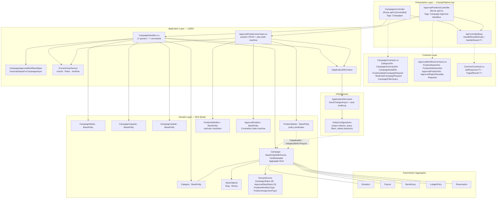
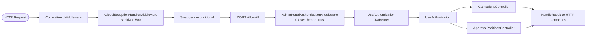
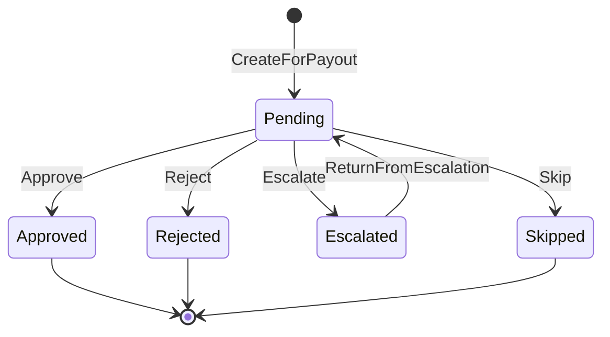
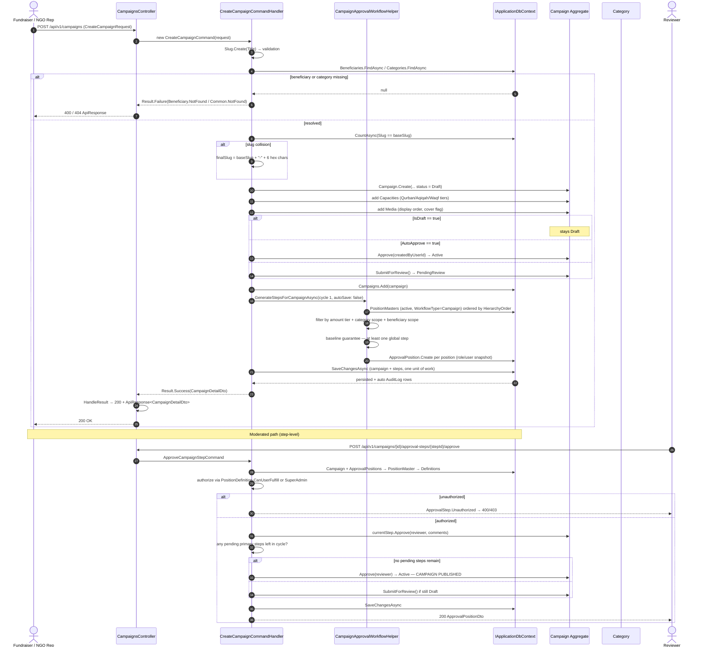
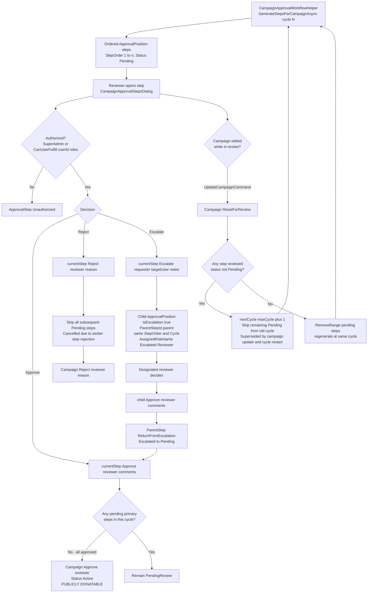

I have the full picture. Writing the documentation now.

# Fundraising Campaign Domain
## Core Module Technical Documentation — ESalam Charity Platform

---

## 1. Executive Summary

The **Fundraising Campaign Domain** is the central, donor-facing aggregate of the ESalam platform and the single object through which all charitable value flows. Rated `importance: 10.0` and `complexity: 8.0` in the domain inventory, it owns the complete fundraising lifecycle — public identity via URL slug, narrative content (title, short description, long-form story), financial targets (`TargetAmount` / `CollectedAmount` in MYR), beneficiary and category linkage, media galleries, milestone updates, capacity tiers for Qurban/Aqiqah/Waqf, and the multi-step moderation workflow that gates publication.

Architecturally, the domain is implemented as a **Clean Architecture DDD + CQRS slice** with four collaborating layers:

| Layer | Responsibility | Primary Artifacts |
|---|---|---|
| **Domain** | Encapsulated aggregate, invariants, policy predicates | `Campaign`, `Category`, `CampaignMedia`, `CampaignCapacity`, `CampaignUpdate`, `PositionMaster`, `PositionDefinition`, `ApprovalPosition` |
| **Application** | Use cases, ownership checks, projection, workflow orchestration | `CampaignHandlers.cs`, `ApprovalPositionUseCases.cs` |
| **API** | Thin HTTP binding, uniform result mapping | `CampaignsController`, `ApprovalPositionsController`, `ApiControllerBase` |
| **Contracts** | Wire-format records decoupled from persistence | `CampaignContracts.cs`, `ApprovalWorkflowContracts.cs` |

Two governance properties make this domain strategic rather than merely functional. First, **the Campaign aggregate is the sole entry point into the donatable campaign population** — any bypass of its moderation gate injects an unreviewed campaign directly into the donation checkout path. Second, **the campaign's approval engine is shared with the payout workflow** — `PositionMaster` / `PositionDefinition` / `ApprovalPosition` implement one state machine serving both campaign moderation and fund disbursement, meaning the audit language and segregation-of-duties semantics are identical across both money-in and money-out boundaries.

---

## 2. Architecture Overview

### 2.1 Layer Composition and Dependency Direction



**Dependency direction is strictly inward and verified:** `Domain` has no project references (only the OpenTelemetry exporter package), `Infrastructure` → `Domain` + `Application` + `Contracts`, `Api` → `Application` + `Infrastructure` + `Contracts`. No reverse reference exists.

### 2.2 Request Pipeline Placement



The campaign domain sits **downstream of the identity middleware chain**, which means both controllers inherit the platform's authentication posture. This is a material operational fact: `CampaignsController` declares `[AllowAnonymous]` on essentially its entire surface (create, update, media upload, delete, moderate, updates, categories), so the class-level `[Authorize]` intent referenced in earlier analyses is **not enforced at the controller level** in the current source. `ApprovalPositionsController` by contrast applies explicit `[Authorize]` and `[Authorize(Roles = ...)]` attributes — the sharpest authorization asymmetry in the domain.

---

## 3. Domain Layer — Aggregate Design

### 3.1 The Campaign Aggregate Root

`Campaign` derives from `BaseEntityWithEvents` (identity, audit timestamps, domain-event emission) and implements `ISoftDeletable` (`DeletedAt`). All properties carry `private set`, and the parameterless constructor is private — mutation occurs exclusively through intention-revealing behaviour methods.

**State surface**

| Group | Properties |
|---|---|
| Identity | `Id`, `Slug` (lowercased, trimmed; the public routing key), `Title` |
| Content | `ShortDescription`, `Story`, `CoverImageUrl` |
| Financial | `TargetAmount`, `CollectedAmount` (default `0m`), `Currency` (hard-set `"MYR"`), `PlatformFeePercent` |
| Linkage | `BeneficiaryId`/`Beneficiary`, `CategoryId`/`Category` |
| Schedule | `StartsAt`, `EndsAt?` (both normalised to UTC on write) |
| Lifecycle | `Status` (default `Draft`), `IsFeatured`, `AllowCustomAmount` |
| Audit | `CreatedByUserId`, `ReviewedByUserId`, `ReviewedAt`, `RejectionReason` |
| Navigations | `Media`, `Capacities`, `Updates`, `Donations`, `Reservations`, `LedgerEntries`, `ApprovalPositions` |

**Factory — `Campaign.Create(...)`**

Guarantees a valid birth state: fresh `Guid`, `CollectedAmount = 0m`, `Currency = "MYR"`, `Status = Draft`, slug lowercased/trimmed, and both `StartsAt`/`EndsAt` coerced to `DateTimeKind.Utc`. Aggregate construction is therefore never the source of a partially-initialised campaign.

**Behaviour methods and their invariants**

| Method | Transition | Guard |
|---|---|---|
| `UpdateDetails(...)` | Content + scope mutation | Only reachable while not `Active`/`Completed`/`Closed` (enforced by the handler, not the domain method). Optional `categoryId`/`beneficiaryId` only overwrite when non-null and non-`Guid.Empty`. |
| `SubmitForReview()` / `ResetForReview()` | → `PendingReview` | Clears `RejectionReason`; used both for first submission and for restarting after a revision. |
| `Approve(reviewerUserId)` | → `Active` | Stamps `ReviewedByUserId`, `ReviewedAt`; clears `RejectionReason`. |
| `Reject(reviewerUserId, reason)` | → `Rejected` | Stamps reviewer identity and reason. |
| `Pause()` | `Active` → `Paused` | **Conditional** — a no-op unless currently `Active`. |
| `Resume()` | `Paused` → `Active` | **Conditional** — a no-op unless currently `Paused`. |
| `Complete()` | → `Completed` | Unconditional. Invoked by flow (target reached) and by the background sweeper (end date passed). |
| `Close()` | → `Closed` | Unconditional. |
| `AddCollectedAmount(amount)` | `CollectedAmount += amount` | **Auto-completion rule:** if `CollectedAmount >= TargetAmount` **and** `TargetAmount > 0` **and** `Status == Active`, the campaign transitions to `Completed` in the same call. |
| `SetFeatured(bool)` / `SetCoverImageUrl(string?)` | Flag updates | Timestamp refresh only. |

The `AddCollectedAmount` auto-completion rule is the domain's most consequential implicit behaviour. It couples the money-settlement path (which increments the counter after gateway confirmation) directly to a lifecycle transition, without a separate moderation decision. This is deliberate — an over-funded campaign stops soliciting — but it means **the transition fires inside the same unit of work as the ledger write**, so the sequence `ledger → campaign counter → status` must be transactional for the two to remain consistent under concurrent donations to the same campaign.

**Enumeration coverage — `CampaignStatus` (8 values)**

`Draft(1)`, `PendingReview(2)`, `Approved(3)`, `Active(4)`, `Paused(5)`, `Completed(6)`, `Closed(7)`, `Rejected(8)`.

Note a latent inconsistency: `CampaignStatus.Approved` exists as a distinct value, but the `Approve()` behaviour method writes `Status = CampaignStatus.Active` directly and never produces `Approved`. The intermediate value is defined but unreachable through the aggregate's own API. Similarly, public listing filters on `Active || Completed`, so any campaign left in `Approved` would be invisible to donors.

### 3.2 Category — Taxonomy Lookup Entity

`Category : BaseEntity` is a deliberately small classification entity with `Name`, `Slug` (lowercased/trimmed, unique-indexed), `Description?`, `IconUrl?`, `DisplayOrder`, `IsActive`, and a `Campaigns` back-collection. It exposes `Create(...)`, `Update(...)`, and the toggle `SetActive(bool)`.

The taxonomy drives discovery: `GetCategoriesQuery` filters `IsActive`, orders by `DisplayOrder`, and projects a live `Campaigns.Count` into `CategoryDto.CampaignCount`; `GetAdminCategoriesQuery` returns all categories ordered by `DisplayOrder` then `Name`, including inactive entries, for administration. Category deletion follows a deactivation strategy in practice — the contract exposes both `DeleteCategoryCommand` and `ToggleCategoryActiveCommand`, and the `Campaign → Category` FK uses `DeleteBehavior.Restrict`, so a category with campaigns cannot be hard-deleted.

### 3.3 CampaignCapacity — Capacity Tiers for Qurban/Aqiqah/Waqf

`CampaignCapacity` models countable units of charitable fulfilment — `"1 Portion Cow"`, `"1 Waqf Lot"`, `"1 Food Basket"` — with `UnitName`, `UnitPrice`, `TotalCapacity`, and a **three-column capacity ledger**:

```
AvailableCapacity => Math.Max(0, TotalCapacity - (ReservedCapacity + ConfirmedCapacity))
```

Three operations move the counters:

- `Reserve(quantity)` → `Result`. Fails with `Capacity.InvalidQuantity` when `quantity <= 0`, fails with `DomainErrors.Capacity.InsufficientSlots` when `AvailableCapacity < quantity`, otherwise increments `ReservedCapacity`. This is the only method returning a `Result` rather than throwing — an explicit signal that slot exhaustion is an expected business outcome, not an exceptional condition.
- `ReleaseReservation(quantity)` → decrements `ReservedCapacity`, floored at zero (reservation expiry path, driven by the background sweeper).
- `ConfirmReservation(quantity)` → moves `quantity` from `ReservedCapacity` into `ConfirmedCapacity`, floored at zero on the reserve side.

The `Math.Max(0, ...)` floor on both `AvailableCapacity` and the mutators is a defensive invariant: counters can never go negative even if a compensating release arrives twice.

### 3.4 CampaignMedia and CampaignUpdate — Content Sub-Entities

`CampaignMedia` captures `MediaUrl`, `MediaType` (`"Image"` / `"Video"` / `"Document"`), `FileName?`, `FileFormat?` (extension or MIME subtype), `DisplayOrder`, and `IsCover`. Media is ordered by `DisplayOrder` on projection, and cover selection follows an explicit precedence in the handlers: an explicit `CoverImageUrl` wins; otherwise the first media item flagged `IsCover`; otherwise the first media item in the request list.

`CampaignUpdate` is the milestone / proof-of-impact entity with `Title`, `Content`, `ImageUrl?`, `AttachmentUrl?`, `PublishedAt` (defaulted to `DateTime.UtcNow` at creation) and `CreatedByUserId`. Updates are projected newest-first (`OrderByDescending(u => u.PublishedAt)`), which is the donor-visible "what happened with your money" feed.

### 3.5 The Approval Position Model — Three Entities, One Policy

This is the most architecturally significant sub-component in the domain, because it is **shared verbatim with the Payout Disbursement workflow**.

**`PositionMaster`** — the reusable approval-chain template.

| Property | Role |
|---|---|
| `Name`, `Code` (upper-cased, unique-indexed), `Description?` | Identity of the position |
| `WorkflowType` (`Campaign` \| `Payout`) | Which governance path this template serves |
| `ParentPositionId` / `ChildPositions` | Hierarchical nesting of positions |
| `HierarchyOrder` | **Tier ordering** — determines both sequencing and activation threshold |
| `MinTargetAmount`, `MaxTargetAmount?` | Amount band in which the position becomes required |
| `CategoryId?`, `BeneficiaryId?` | **Optional scoping** — `null` means "applies globally" |
| `IsActive` | Soft enable/disable |
| `Definitions` | Active role/user assignments for this position |

Three pure policy predicates carry the "who must approve what, and when" rules:

```csharp
public bool IsRequiredForTargetAmount(decimal targetAmount)
{
    if (!IsActive) return false;
    return targetAmount >= MinTargetAmount;
}

public bool IsApplicable(decimal targetAmount, Guid? campaignCategoryId, Guid? campaignBeneficiaryId)
{
    if (!IsActive) return false;
    if (WorkflowType != PositionWorkflowType.Campaign) return false;

    // Baseline Tier 1 applies to all amounts; higher tiers activate once targetAmount reaches MinTargetAmount
    if (HierarchyOrder > 1 && targetAmount < MinTargetAmount)
        return false;

    // Category matching: null applies to all categories, otherwise must match
    if (CategoryId.HasValue && CategoryId.Value != campaignCategoryId)
        return false;

    // Beneficiary matching: null applies to all beneficiaries, otherwise must match
    if (BeneficiaryId.HasValue && BeneficiaryId.Value != campaignBeneficiaryId)
        return false;

    return true;
}

public bool IsApplicableForPayout(decimal payoutAmount, Guid? beneficiaryId) { /* symmetric */ }
```

The **tier-1-always-applies rule** is the load-bearing detail: `HierarchyOrder == 1` bypasses the amount check entirely, guaranteeing a baseline review step for every campaign regardless of target size. Higher tiers activate progressively as the target amount crosses their `MinTargetAmount`.

**`PositionDefinition`** — the resolution of a template into concrete authority.

Two factory methods encode the assignment model: `CreateForRole(positionMasterId, roleName, validFrom, validTo?, isActive)` and `CreateForUser(positionMasterId, userId, validFrom, validTo?, isActive)`. The `AssignmentType` enum (`Role` | `User`) discriminates between them.

Two temporal/semantic predicates decide whether an assignment is live:

```csharp
public bool IsCurrentlyActive(DateTime? referenceDateUtc = null)
{
    if (!IsActive) return false;
    var date = referenceDateUtc ?? DateTime.UtcNow;
    if (date < ValidFrom) return false;
    if (ValidTo.HasValue && date > ValidTo.Value) return false;
    return true;
}

public bool CanUserFulfill(string userId, IEnumerable<string> userRoles, DateTime? referenceDateUtc = null)
{
    if (!IsCurrentlyActive(referenceDateUtc)) return false;

    if (AssignmentType == PositionAssignmentType.User)
        return string.Equals(UserId, userId, StringComparison.OrdinalIgnoreCase);

    if (AssignmentType == PositionAssignmentType.Role && !string.IsNullOrWhiteSpace(RoleName))
        return userRoles.Any(r => string.Equals(r, RoleName, StringComparison.OrdinalIgnoreCase));

    return false;
}
```

`CanUserFulfill` composes both the temporal window and the role/user binding into a single boolean — meaning a reviewer whose `ValidTo` has elapsed loses authority silently, at the predicate level, with no dependency on a job or a flag flip. Role comparisons are case-insensitive in both directions.

**`ApprovalPosition`** — the executed step instance.

`ApprovalPosition` is dual-typed: it carries **both** `CampaignId`/`Campaign` **and** `PayoutId`/`Payout`, both nullable, with two factory methods (`Create(...)` for campaigns, `CreateForPayout(...)` for payouts). It stores `StepOrder`, `Cycle`, `Status`, `AssignedRoleName?`, `AssignedUserId?`, the decision record (`ReviewedByUserId?`, `ReviewedAt?`, `Comments?`), and the escalation graph (`ParentStepId?` / `Escalations` / `IsEscalation` / `RequestNotes?`).

**The five-transition state machine:**



Behavioural contract of each transition:

- **`Approve(reviewerUserId, comments)`** — throws `InvalidOperationException` unless `Status == Pending`; throws `ArgumentException` when `comments` is null/whitespace. Sets `Approved`, stamps reviewer and UTC time, trims comments. **Escalation settlement side-effect:** if `IsEscalation && ParentStep != null`, it calls `ParentStep.ReturnFromEscalation()` — approval of an escalation child automatically reopens the parent step. This two-object mutation inside one method is the mechanism that closes the escalation loop without a separate "return" command from the UI.
- **`Reject(reviewerUserId, reason)`** — same status guard; `reason` mandatory. Terminal.
- **`Escalate(requestedByUserId, targetUserId, requestNotes)`** — status guard (`Pending` only) plus mandatory notes. Marks the current step `Escalated` and **returns a newly-constructed child** `ApprovalPosition` that inherits `CampaignId`, `PayoutId`, `PositionMasterId`, `StepOrder` and `Cycle`, sets `ParentStepId = this.Id`, `IsEscalation = true`, `AssignedUserId = targetUserId`, `AssignedRoleName = "Escalated Reviewer"`, and copies `RequestNotes`. The child is appended to the `Escalations` collection. The step order is *inherited, not incremented* — escalation is a lateral assistance request, not a new stage of the chain.
- **`ReturnFromEscalation()`** — conditional: only `Escalated → Pending`. Safe to call redundantly.
- **`Skip(reason)`** — conditional on `Pending`; writes the reason into `Comments` without reviewer attribution (no reviewer identity is captured on a skip — a deliberate distinction from approve/reject).

---

## 4. Application Layer — Use Cases

### 4.1 Campaign Query Surface

**`GetCampaignsQuery(CampaignFilterQuery)` → `PagedResult<CampaignSummaryDto>`**

`GetCampaignsQueryHandler` builds an EF Core query with `Include(Beneficiary, Category, Donations)` and `AsNoTracking()`, then applies conditional filters:

| Filter | Behaviour |
|---|---|
| `CategoryId` | Direct equality when supplied |
| `BeneficiaryId` | Direct equality when supplied |
| `IsFeatured` | Direct equality when supplied |
| `Status = "all"` | **Admin escape hatch** — returns every status without filtering |
| `Status = <enum name>` | Parsed case-insensitively to `CampaignStatus` |
| `Status` omitted | **Public default** — `Active || Completed` only |
| `SearchTerm` | Case-lowered `Contains` on `Title` **or** `ShortDescription` |

Sorting is driven by `SortBy` (`collectedamount`, `targetamount`, `endsat`), defaulting to `CreatedAt`. Projection is server-side into an anonymous type that computes `DonationCount = Donations.Count(d => d.Status == DonationStatus.Confirmed)` and pulls `BeneficiaryLogoUrl` from `Beneficiary.ProfilePhotoUrl`, then materialises `CampaignSummaryDto` with `ProgressPercentage = (double)Math.Round((CollectedAmount / TargetAmount) * 100, 1)`, guarded against a zero target.

**`GetCampaignByIdOrSlugQuery(IdOrSlug)` → `CampaignDetailDto`**

Resolution is dual-mode: `Guid.TryParse` decides whether to match on `Id` or on `Slug == IdOrSlug.ToLowerInvariant().Trim()`. The handler eagerly loads `Beneficiary`, `Category`, `Media`, `Capacities`, `Updates` and `Donations`, then emits the full detail projection with media ordered by `DisplayOrder`, updates ordered newest-first, and a confirmed-donation donor count. Missing → `DomainErrors.Campaign.NotFound`.

> **Design note:** the query is `FirstOrDefaultAsync` with no status predicate, so a `Draft` or `Rejected` campaign is retrievable by slug or GUID through the public read path. Campaign detail retrieval is not gated on `Status == Active`.

### 4.2 Campaign Command Surface

**`CreateCampaignCommand(CreateCampaignRequest)`**

Sequence of operations:

1. **Slug derivation** — `Slug.Create(req.Title)` applies the value-object pipeline: lowercase → strip non-`[a-z0-9\s-]` → collapse whitespace → truncate to 100 characters → spaces to hyphens. Failure propagates as a validation error.
2. **Referential verification** — `Beneficiaries.FindAsync` and `Categories.FindAsync`; missing beneficiary → `DomainErrors.Beneficiary.NotFound`, missing category → `DomainErrors.Common.NotFound`.
3. **Slug collision handling** — `CountAsync(c => c.Slug == finalSlug)`; on collision the slug becomes `{baseSlug}-{6 hex chars}` from a fresh GUID. This is a **read-then-write** uniqueness check, not a database-enforced atomic reservation, so the unique index on `campaigns.slug` is the actual concurrency backstop.
4. **Cover-image precedence** — explicit `CoverImageUrl` wins; else the first `IsCover` media item; else the first media item.
5. **UTC normalisation** of `StartsAt`/`EndsAt`.
6. **Aggregate construction** via `Campaign.Create(...)`, with `createdByUserId` resolved from `_currentUser.UserId ?? "admin-portal"`.
7. **Child collection population** — capacities and media are created and attached in-loop; media `FileFormat` is inferred from `Path.GetExtension` when not supplied.
8. **Terminal state selection** — three-way branch on the request flags:

   | `IsDraft` | `AutoApprove` | Resulting state |
   |---|---|---|
   | `true` | — | remains `Draft` |
   | `false` | `true` | `Approve(createdBy)` → `Active` |
   | `false` | `false` | `SubmitForReview()` → `PendingReview` |

9. **Workflow step generation** — `CampaignApprovalWorkflowHelper.GenerateStepsForCampaignAsync(...)` is invoked **before** `SaveChangesAsync`, with `cycle: 1` and `autoSave: false`, so campaign insert and step insert land in one transaction.

The `AutoApprove` branch is a notable authority-compression feature: a single request flag can self-approve a campaign at creation time, bypassing the moderation steps generated in the same call.

**`UpdateCampaignCommand(CampaignId, UpdateCampaignRequest)`**

1. **Status gate** — `Active`, `Completed`, or `Closed` campaigns are rejected with `Campaign.CannotEditApproved` (message authored in Bahasa Melayu: *"Kempen yang telah diluluskan atau ditutup tidak boleh disunting secara terus"*). This is the primary edit lock.
2. **Re-verification** of any changed `BeneficiaryId` / `CategoryId` against existence.
3. **`UpdateDetails(...)`** applied with UTC-normalised schedule fields.
4. **Capacity and media replacement** — when supplied, old rows are hard-removed (`RemoveRange`) and rebuilt from the request, using explicit `EntityState.Added` marking for the replacements.
5. **`ResetForReview()`** — status forced back to `PendingReview` and `RejectionReason` cleared.
6. **Approval restart with cycle semantics** — the branching logic is the domain's most subtle application-level behaviour:

   ```
   anyReviewed = ApprovalPositions.Any(s => s.Status != Pending)
   currentMaxCycle = max Cycle (or 0)

   if (anyReviewed)
       nextCycle = currentMaxCycle + 1
       → skip all still-Pending steps in the old cycle
           ("Superseded by campaign update and cycle restart.")
       → generate fresh steps at nextCycle
   else
       → hard-delete all still-Pending steps of the current cycle
       → generate fresh steps at the same cycle
   ```

   The design intent is **evidence preservation**: once *any* reviewer has acted, the approved/rejected record is never destroyed — instead the whole chain advances to a new `Cycle` value, retaining the historical decisions as an immutable audit layer while a fresh round of steps is created. Where no reviewer has acted yet, pending steps carry no evidentiary value and are physically replaced.

**`ModerateCampaignCommand(CampaignId, ModerateCampaignRequest)`**

A string-dispatch switch over `Request.Action` (case-insensitive), each branch mapping to one aggregate behaviour:

| Action | Aggregate call | Notes |
|---|---|---|
| `approve` | `Approve(reviewerId)` | `reviewerId = _currentUser.UserId ?? "admin-reviewer"` |
| `reject` | `Reject(reviewerId, reason)` | Reason defaults to `"Campaign rejected by reviewer."` if omitted |
| `pause` | `Pause()` | Conditional — no-op unless `Active` |
| `resume` | `Resume()` | Conditional — no-op unless `Paused` |
| `close` | `Close()` | Unconditional |
| `complete` | `Complete()` | Unconditional |
| `submit` | `SubmitForReview()` | Unconditional |
| default | — | `Campaign.InvalidAction` |

This command is entirely separate from the step-level approval workflow and writes state directly, without consulting `ApprovalPosition` or `PositionDefinition`. It is the fast-path moderation channel parallel to the governed workflow.

### 4.3 Category Use Cases

`GetCategoriesQuery` (active only, ordered by `DisplayOrder`, with live campaign counts), `GetAdminCategoriesQuery` (all, ordered by `DisplayOrder` then `Name`), `GetCategoryByIdQuery` (with `Campaigns` loaded for the count), `CreateCategoryCommand` (name mandatory; slug derived from explicit value or name; collision resolved by appending a 4-hex-character GUID suffix; optional `SetActive(false)` on creation), `UpdateCategoryCommand`, `DeleteCategoryCommand`, `ToggleCategoryActiveCommand`.

### 4.4 Approval Position Use Cases

**Position master CRUD** — `CreatePositionMasterCommand` enforces **code uniqueness** (`PositionMaster.CodeDuplicate`) on the upper-cased code before construction, then re-resolves `Category` and `Beneficiary` names for the response DTO. `UpdatePositionMasterCommand` and `DeletePositionMasterCommand` complete the template lifecycle; `GetPositionMastersQuery(WorkflowType?)` parses the workflow filter case-insensitively and orders by `HierarchyOrder`, projecting `DefinitionCount` as the count of *active* definitions only.

**Position definition CRUD** — `CreatePositionDefinitionCommand` branches on the `AssignmentType` string: `"User"` requires a non-empty `UserId` (`PositionDefinition.UserRequired`), otherwise a non-empty `RoleName` is required (`PositionDefinition.RoleRequired`). `ValidFrom` defaults to `DateTime.UtcNow` when absent. `GetPositionDefinitionsQuery(PositionMasterId?)` and `DeletePositionDefinitionCommand` complete the set.

**`GetCampaignApprovalStepsQuery(CampaignId)`** — projects the full step chain, filtering to primary steps (`!IsEscalation`) and embedding child escalations ordered by `CreatedAt`. Reviewer and assignee names are resolved through a **single batched `UserProfiles` lookup** into a dictionary rather than per-step queries — a deliberate N+1 avoidance. A human-readable `ScopeTag` is computed per step with this precedence:

```
Category: <name>   (when PositionMaster.CategoryId is set)
Beneficiary: <name> (else when BeneficiaryId is set)
> RM <n>            (else when MinTargetAmount > 0)
Global Tier         (otherwise)
```

**`ApproveCampaignStepCommand`** — the most exposure-sensitive handler in the domain:

1. `Comments` mandatory (`ApprovalStep.CommentsRequired`).
2. Campaign loaded with `ApprovalPositions → PositionMaster → Definitions` (three-level `ThenInclude`).
3. Step must exist on **that** campaign and be `Pending`, else `ApprovalStep.NotFound` / `ApprovalStep.NotPending`.
4. **Two distinct authorization paths:**
   - *Escalation step* → authorised when the caller is `SuperAdmin` **or** `AssignedUserId == reviewerUserId`.
   - *Primary step* → authorised when the caller is `SuperAdmin` **or** any active `PositionDefinition.CanUserFulfill(reviewerUserId, userRoles)` returns true.
   
   Failure returns `ApprovalStep.Unauthorized`.
5. **Primary-path side effects:** `currentStep.Approve(...)`, then

   ```csharp
   var remainingPending = campaign.ApprovalPositions.Any(
       s => s.Cycle == currentStep.Cycle && !s.IsEscalation && s.Status == ApprovalStepStatus.Pending);

   if (!remainingPending) campaign.Approve(reviewerUserId);   // → Active, campaign published
   else if (campaign.Status == CampaignStatus.Draft) campaign.SubmitForReview();
   ```

   **This is the publication trigger.** The campaign becomes `Active` and therefore donatable the instant the last primary step in the current cycle is approved.
6. **Escalation settlement:** approving an escalation child approves the child and calls `parentStep.ReturnFromEscalation()`, returning the parent to `Pending`.

**`RejectCampaignStepCommand`** — reason mandatory; same authorization logic; on rejection it performs a **cascade**: every subsequent still-`Pending` step in the same cycle is `Skip("Cancelled due to earlier step rejection.")`, then `campaign.Reject(reviewerUserId, reason)` sets the campaign to `Rejected`. This is fail-fast semantics — one reviewer's rejection terminates the entire chain rather than parking the campaign mid-flow.

**`EscalateCampaignStepCommand`** — requires `TargetUserId` and `Notes`. Loads the campaign with the same three-level include, validates the step is `Pending`, validates the caller's authority via `CanUserFulfill` (or `SuperAdmin`), then **resolves the target user** against `UserProfiles` by either primary key GUID or `SupabaseUserId`, excluding soft-deleted users (`DeletedAt == null`). Missing target → `ApprovalStep.TargetUserNotFound`. On success it calls `currentStep.Escalate(...)`, explicitly registers the returned child as `EntityState.Added`, and returns a DTO tagged `ScopeTag = "Escalated Review"`.

### 4.5 CampaignApprovalWorkflowHelper — Step Generation Algorithm

```csharp
public static async Task GenerateStepsForCampaignAsync(
    IApplicationDbContext db, Guid campaignId, decimal targetAmount,
    Guid? categoryId = null, Guid? beneficiaryId = null,
    int cycle = 1, bool autoSave = true, CancellationToken ct = default)
```

The algorithm in full:

1. Load all `PositionMasters` where `IsActive == true` **and** `WorkflowType == Campaign`, including `Definitions`, `Category`, `Beneficiary`; order by `HierarchyOrder`.
2. If none exist → return early (a campaign can be created with zero approval steps).
3. Apply the **three-factor applicability filter**:

   ```csharp
   (p.HierarchyOrder == 1 || targetAmount >= p.MinTargetAmount) &&
   (p.CategoryId == null || (categoryId.HasValue && p.CategoryId == categoryId.Value)) &&
   (p.BeneficiaryId == null || (beneficiaryId.HasValue && p.BeneficiaryId == beneficiaryId.Value))
   ```

   - **Amount:** Tier 1 is unconditional; higher tiers require `targetAmount >= MinTargetAmount`. (Note this is the inlined expression, marginally different from the `IsApplicable` domain predicate, which additionally short-circuits `HierarchyOrder > 1 && targetAmount < MinTargetAmount` — semantically equivalent for the tier rule.)
   - **Category:** `null` scope is global; a set scope must equal the campaign's category.
   - **Beneficiary:** `null` scope is global; a set scope must equal the campaign's beneficiary.
4. **Baseline guarantee** — if the filter yields nothing, fall back to the first globally-scoped position (`CategoryId == null && BeneficiaryId == null`), or failing that the first active position. A campaign always receives at least one review step.
5. **Step materialisation** — for each surviving position in `HierarchyOrder` sequence, take a **snapshot of the first currently-active `PositionDefinition`** (`IsCurrentlyActive(now)`) and copy its `RoleName`/`UserId` onto the new `ApprovalPosition`, defaulting the role name to `"Reviewer"`. `StepOrder` increments from 1. The `cycle` is passed straight through.
6. If `autoSave`, persist; otherwise the caller owns the transaction (which is what the create and update handlers do).

The "snapshot first active definition" step is what converts a **template** into an **assignment**: the created step carries the resolved role/user names directly, so it remains auditable even if the underlying `PositionDefinition` is later edited or expired.

---

## 5. Presentation Layer — API Surface

### 5.1 Uniform Result Mapping — `ApiControllerBase`

Every campaign endpoint terminates in one of two overloads, guaranteeing identical HTTP semantics across the entire domain:

```csharp
protected ActionResult HandleResult<T>(Result<T> result)
{
    if (result.IsSuccess) return Ok(ApiResponse<T>.Ok(result.Value));
    return HandleFailure(result.Error);
}

private ActionResult HandleFailure(Error error)
{
    var response = ApiResponse.Fail(error.Description, error.Code);
    return error.Code switch
    {
        var code when code.EndsWith("NotFound")     => NotFound(response),
        var code when code.EndsWith("Unauthorized") => Unauthorized(response),
        var code when code.EndsWith("Forbidden")    => StatusCode(403, response),
        var code when code.EndsWith("Conflict") ||
                       code.EndsWith("AlreadyExists") => Conflict(response),
        _ => BadRequest(response)
    };
}
```

The mapping is **suffix-driven on `error.Code`**. This is deterministic and easily auditable, but it means error-code naming is part of the API contract: a code such as `Campaign.CannotEditApproved` or `ApprovalStep.Unauthorized` lands on 400 or 403 respectively purely by its suffix. Domain codes ending in none of the recognised suffixes — `Campaign.NotAcceptingDonations`, `Campaign.TargetAmountInvalid`, `Capacity.InsufficientSlots`, `ApprovalStep.NotPending`, `ApprovalStep.CommentsRequired` — all resolve to **400 Bad Request** by the default arm.

### 5.2 `CampaignsController` — Endpoint Inventory

Route prefix `api/v1/[controller]` → `api/v1/campaigns`. Tag: `Campaigns`. Constructor-injects **18 handlers** (7 queries, 11 commands), each held as a typed `IQueryHandler<,>` / `ICommandHandler<,>` field.

| Method | Route | Handler | Body/Query | Notes |
|---|---|---|---|---|
| `GET` | `/` | `GetCampaignsQuery` | `[FromQuery] CampaignFilterQuery` | Public listing; returns `PagedResult<CampaignSummaryDto>` |
| `GET` | `/categories` | `GetCategoriesQuery` | — | Active taxonomy only |
| `GET` | `/categories/admin` | `GetAdminCategoriesQuery` | — | `[AllowAnonymous]` despite the admin intent stated in its own docs |
| `GET` | `/categories/{id:guid}` | `GetCategoryByIdQuery` | — | `[AllowAnonymous]` |
| `POST` | `/categories` | `CreateCategoryCommand` | `CreateCategoryRequest` | `[AllowAnonymous]` |
| `PUT` | `/categories/{id:guid}` | `UpdateCategoryCommand` | `UpdateCategoryRequest` | `[AllowAnonymous]` |
| `DELETE` | `/categories/{id:guid}` | `DeleteCategoryCommand` | — | `[AllowAnonymous]` |
| `PATCH` | `/categories/{id:guid}/toggle-active` | `ToggleCategoryActiveCommand` | — | `[AllowAnonymous]` |
| `GET` | `/{idOrSlug}` | `GetCampaignByIdOrSlugQuery` | path string | Resolves GUID **or** slug |
| `POST` | `/` | `CreateCampaignCommand` | `CreateCampaignRequest` | `[AllowAnonymous]` |
| `PUT` | `/{id:guid}` | `UpdateCampaignCommand` | `UpdateCampaignRequest` | `[AllowAnonymous]`; restarts approval workflow |
| `POST` | `/{id:guid}/media` | `AddCampaignMediaCommand` | `AddCampaignMediaRequest` | External URL / video embed |
| `POST` | `/{id:guid}/media/upload` | `UploadCampaignMediaCommand` | `multipart/form-data` | Manual file-null check → `ApiResponse.Fail("No file provided.")` |
| `DELETE` | `/{id:guid}/media/{mediaId:guid}` | `DeleteCampaignMediaCommand` | — | `[AllowAnonymous]` |
| `POST` | `/{id:guid}/moderate` | `ModerateCampaignCommand` | `ModerateCampaignRequest` | `[AllowAnonymous]`; docs claim `403` |
| `GET` | `/{id:guid}/updates` | `GetCampaignUpdatesQuery` | — | `[AllowAnonymous]` |
| `POST` | `/{id:guid}/updates` | `CreateCampaignUpdateCommand` | `CreateCampaignUpdateRequest` | `[AllowAnonymous]` |
| `DELETE` | `/{id:guid}/updates/{updateId:guid}` | `DeleteCampaignUpdateCommand` | — | `[AllowAnonymous]` |

Two observations worth recording as follow-ups rather than assumptions:

- **The write surface is declared anonymous.** `[AllowAnonymous]` is applied to create, update, media upload, media delete, campaign update create/delete, and — most consequentially — `moderate`. The moderation endpoint's own XML documentation states it is "Admin & Reviewer Only" and declares `403 Forbidden` as a response type, but the attribute list contains no authorization requirement. Given the platform's `AdminPortalAuthenticationMiddleware` synthesises a `SuperAdmin` principal from plain `X-User-Roles` headers when a request is unauthenticated, the practical effective authority for `moderate` is determined by that middleware plus the header-trust posture, not by the controller.
- **Bulk-delete as a service.** Campaign media and campaign updates are created and destroyed through public endpoints, with the only stated protection being the (unenforced) class-level intent.

### 5.3 `ApprovalPositionsController` — Endpoint Inventory

Route prefix `api/v1` (no controller token). Tag: `Campaign Approval Workflow`. Constructor-injects **11 handlers**. Unlike `CampaignsController`, every endpoint carries an explicit requirement.

| Method | Route | Authorization | Handler |
|---|---|---|---|
| `GET` | `/positions/masters?workflowType=` | `[Authorize]` | `GetPositionMastersQuery` |
| `POST` | `/positions/masters` | `[Authorize(Roles = "SuperAdmin")]` | `CreatePositionMasterCommand` |
| `PUT` | `/positions/masters/{id:guid}` | `[Authorize(Roles = "SuperAdmin")]` | `UpdatePositionMasterCommand` |
| `DELETE` | `/positions/masters/{id:guid}` | `[Authorize(Roles = "SuperAdmin")]` | `DeletePositionMasterCommand` |
| `GET` | `/positions/definitions?positionMasterId=` | `[Authorize]` | `GetPositionDefinitionsQuery` |
| `POST` | `/positions/definitions` | `[Authorize(Roles = "SuperAdmin")]` | `CreatePositionDefinitionCommand` |
| `DELETE` | `/positions/definitions/{id:guid}` | `[Authorize(Roles = "SuperAdmin")]` | `DeletePositionDefinitionCommand` |
| `GET` | `/campaigns/{campaignId:guid}/approval-steps` | `[Authorize]` | `GetCampaignApprovalStepsQuery` |
| `POST` | `/campaigns/{campaignId:guid}/approval-steps/{stepId:guid}/approve` | `[Authorize(Roles = "SuperAdmin,Reviewer,CampaignManager,FinanceAdmin")]` | `ApproveCampaignStepCommand` |
| `POST` | `/campaigns/{campaignId:guid}/approval-steps/{stepId:guid}/reject` | `[Authorize(Roles = "SuperAdmin,Reviewer,CampaignManager,FinanceAdmin")]` | `RejectCampaignStepCommand` |
| `POST` | `/campaigns/{campaignId:guid}/approval-steps/{stepId:guid}/escalate` | `[Authorize(Roles = "SuperAdmin,Reviewer,CampaignManager,FinanceAdmin")]` | `EscalateCampaignStepCommand` |

Approval actions are therefore protected **twice** — once declaratively by role at the attribute level, and once semantically by `PositionDefinition.CanUserFulfill` inside the handler. The two are not equivalent: the attribute admits any holder of the four named roles, while `CanUserFulfill` narrows the admission to whoever the specific position's definition designates. Defence in depth, with the stricter check being the domain one.

### 5.4 Contracts — Wire Format

`CampaignContracts.cs` (180 lines, zero methods, **zero control flow**) is a pure positional-record declaration file. Three record families:

**Category** — `CategoryDto(Id, Name, Slug, Description, IconUrl, DisplayOrder, IsActive, CampaignCount = 0)`, `CreateCategoryRequest(Name, Slug?, Description?, IconUrl?, DisplayOrder = 0, IsActive = true)`, `UpdateCategoryRequest(...)`.

**Campaign** — `CampaignSummaryDto` (22 fields: identity, beneficiary name, category name, financials, `ProgressPercentage`, status string, schedule, cover, `IsFeatured`, `DonorCount`, `BeneficiaryLogoUrl?`) and `CampaignDetailDto` (29 fields, adding `Story`, `BeneficiaryType`, `PlatformFeePercent`, `AllowCustomAmount`, and the three child collections `Media` / `Capacities` / `Updates`).

**Requests** — `CreateCampaignRequest(BeneficiaryId, CategoryId, Title, ShortDescription, Story, TargetAmount, StartsAt, EndsAt?, PlatformFeePercent, CoverImageUrl?, AllowCustomAmount = true, Capacities?, Media?, IsDraft = false, AutoApprove = false)`; `UpdateCampaignRequest(...)`; `ModerateCampaignRequest(Action, RejectionReason?)`; `CampaignFilterQuery(CategoryId?, BeneficiaryId?, Status?, IsFeatured?, SearchTerm?, PageNumber = 1, PageSize = 20, SortBy?, SortDesc = true)`.

`ApprovalWorkflowContracts.cs` declares `PositionMasterDto`, `Create/UpdatePositionMasterRequest`, `PositionDefinitionDto`, `Create/UpdatePositionDefinitionRequest`, `ApprovalPositionDto` (including `Cycle`, `ScopeTag`, `ParentStepId`, `IsEscalation`, `RequestNotes`, recursive `Escalations`, and `PayoutId` — the same DTO shape serves both governance paths), and the six step-request records (`Approve/Reject/Escalate` × `Campaign`/`Payout`).

The contracts layer's discipline is strict: **no domain entity ever crosses the API boundary**, and request/response record evolution is fully decoupled from persistence — the `CampaignSummaryDto` shape is derived from a server-side anonymous projection, not from the entity.

---

## 6. Persistence and Data Integrity

### 6.1 Entity Configuration

| Entity | Table | Key Constraints |
|---|---|---|
| `Category` | `categories` | `Slug` max 100, **unique index**; `Name` max 100; `Description` 500; `IconUrl` 1000 |
| `Campaign` | `campaigns` | `Title` 255, `Slug` 255 **unique index**; `ShortDescription` 500; `Story` required; `TargetAmount`/`CollectedAmount` `numeric(14,2)`; `PlatformFeePercent` `numeric(5,2)`; `Currency` 3 chars |
| `CampaignMedia` | `campaign_media` | FK → Campaign, `Cascade` |
| `CampaignCapacity` | `campaign_capacities` | `UnitName` 100; `UnitPrice` `numeric(14,2)`; FK → Campaign, `Cascade` |
| `CampaignUpdate` | `campaign_updates` | `Title` 255; `Content` required; indexed on `PublishedAt` |
| `PositionMaster` | `position_masters` | `Code` **unique index**; composite index `(WorkflowType, HierarchyOrder, IsActive)`; `MinTargetAmount` `numeric(14,2)` |
| `PositionDefinition` | `position_definitions` | `AssignmentType` stored as **string**; FK → PositionMaster, `Cascade` |
| `ApprovalPosition` | `approval_positions` | Both `CampaignId` and `PayoutId` nullable; `Status` stored as **string**; composite indexes `(CampaignId, StepOrder)`, `(CampaignId, Cycle)`, `(PayoutId, StepOrder)`, `(PayoutId, Cycle)`; index on `ParentStepId` |

**Column-name mapping** reveals the legacy schema the code now targets: `StartsAt → StartDate`, `EndsAt → EndDate`, `ReviewedByUserId → ApprovedBy`, `ReviewedAt → ApprovedAt`. Enum-typed columns (`WorkflowType`, `AssignmentType`, `Status`) are persisted as strings via `HasConversion<string>()` — human-readable in the database, at the cost of index width.

**Delete behaviours** encode the domain's referential intent: `Campaign → Beneficiary` and `Campaign → Category` are `Restrict` (a campaign cannot orphan its scope), `Campaign → Media/Capacities/Updates/ApprovalPositions` are `Cascade` (children die with the parent), and `PositionMaster → ApprovalPositions` is `Restrict` while `PositionMaster → Definitions` is `Cascade`. `PositionMaster → Category` / `Beneficiary` use `SetNull`, so deactivating or removing a scoping target degrades a template to global rather than deleting it.

**Soft-delete and global query filters:** `Campaign` carries `HasQueryFilter(x => x.DeletedAt == null)`. Because this is a global filter, `IApplicationDbContext.Campaigns` queries — including `CountAsync` slug-collision checks and uniqueness lookups — never see soft-deleted campaigns. In combination with the **unique index on `slug`**, this creates a well-known collision class: a soft-deleted campaign still holds its slug at the database level, so a new campaign attempting the same slug will pass the filtered `CountAsync` check and then fail the unique-index constraint at `SaveChangesAsync` time with a raw `DbUpdateException` rather than a graceful slug-suffixing outcome.

### 6.2 Persistence Flow and the CQRS Boundary

Handlers program exclusively against `IApplicationDbContext`, which exposes `Campaigns`, `Categories`, `CampaignMedias`, `CampaignCapacities`, `CampaignUpdates`, `PositionMasters`, `PositionDefinitions`, `ApprovalPositions` alongside the rest of the platform's `DbSet`s, plus `Entry<TEntity>`, `SaveChangesAsync`, and `BeginTransactionAsync`. The Application layer therefore has zero EF Core `DbContext` dependency — only the abstraction plus standard LINQ extension methods.

`SaveChangesAsync` in the concrete `ApplicationDbContext` additionally **auto-generates `AuditLog` rows from `ChangeTracker`** for every added/modified/deleted entity, excluding `AuditLog` and `NotificationQueueItem`, capturing the actor, email, IP and user-agent from `CurrentUserService`. For the campaign domain this means every campaign mutation, category toggle, position definition change, and approval step transition produces an audit row automatically — with one caveat: on `DeletePositionDefinitionCommand` and the update handler's capacity/media replacement (`RemoveRange`), the removal is a **hard delete**, so the audit row is the only remaining record of the deleted entity.

---

## 7. Workflows

### 7.1 Campaign Creation and Moderation Flow



### 7.2 Approval State Machine — Cycle and Escalation Lifecycle



### 7.3 Donation→Campaign Settlement Interaction

The campaign is the **destination object for all donation value**. After a gateway callback is verified and the double-entry ledger posts its balanced 4-entry set, `AddCollectedAmount(amount)` performs three things in one call: increments `CollectedAmount`, evaluates the auto-completion rule (`>= TargetAmount && TargetAmount > 0 && Status == Active` → `Completed`), and refreshes `UpdatedAt`. Two consequences follow directly from the aggregate design:

1. **No concurrency token is declared on `Campaign`** in `EntityConfigurations`. Two donations settling simultaneously against the same campaign produce a read-modify-write race on `CollectedAmount` — a classic lost update. The `Workflow Insights` research flags this explicitly and recommends wrapping settlement in an explicit transaction with optimistic concurrency.
2. **Capacity tiers are a second, independent counter surface.** `CampaignCapacity.Reserve(...)` is invoked by the reservation flow, not the donation flow, so `CollectedAmount` (money) and `ConfirmedCapacity` (units) advance through different code paths. Nothing in the aggregate couples them, so a campaign can reach its target amount while capacity tiers remain partially unfulfilled, or vice versa.

### 7.4 Read Paths — Discovery and Personalisation

Public discovery flows through `GET /api/v1/campaigns` with `CampaignFilterQuery`, defaulting to `Active || Completed`. The donor-facing Blazor WebAssembly client consumes this through `ApiClient.cs` and renders `CampaignCard.razor`, `Campaigns.razor`, `CampaignDetails.razor`, plus the `CampaignRecommendationsSection.razor` / `NgoCampaignsSection.razor` personalisation components and `CapacityCountdownTimer.razor` for Qurban/Aqiqah slot urgency. The admin console consumes the same contracts through `AdminApiClient.cs` to drive `CampaignsManagement.razor`, `CampaignEditor.razor` (284 KB), `CategoriesManagement.razor`, `CategoryEditor.razor`, `CampaignInspectionDialog.razor`, `CampaignApprovalStepsDialog.razor`, and `CreateCampaignUpdateDialog.razor`.

---

## 8. Shared Governance — One Engine, Two Paths

The approval engine lives in the campaign namespace but serves the payout path in full:

| Concern | Campaign path | Payout path |
|---|---|---|
| Template | `PositionMaster.WorkflowType = Campaign` | `PositionMaster.WorkflowType = Payout` |
| Applicability predicate | `IsApplicable(targetAmount, categoryId, beneficiaryId)` | `IsApplicableForPayout(payoutAmount, beneficiaryId)` |
| Step instance | `ApprovalPosition.Create(campaignId, ...)` | `ApprovalPosition.CreateForPayout(payoutId, ...)` |
| Step generation | `CampaignApprovalWorkflowHelper.GenerateStepsForCampaignAsync` | `PayoutApprovalWorkflowHelper` |
| Step commands | `Approve/Reject/EscalateCampaignStepCommand` | `Approve/Reject/EscalatePayoutStepCommand` |
| DTO | `ApprovalPositionDto` | same `ApprovalPositionDto` |
| State machine | `Approve · Reject · Escalate · ReturnFromEscalation · Skip` | identical |

**The blast-radius consequence is symmetrical:** a defect in the `ApprovalPosition` state machine compromises *both* the campaign moderation gate and the payout disbursement gate simultaneously. The compensation is that certification, testing, and audit effort on that one class covers both boundaries. This is the clearest example in the platform of a deliberate architectural trade — reuse over isolation — and it should be read as such rather than as accidental coupling.

---

## 9. Domain Invariants and Enforcement Map

| Invariant | Enforced where | Enforcement strength |
|---|---|---|
| Slug is lowercased, trimmed, ≤100 chars, URL-safe | `Slug.Create` value object | Strong — creation-time |
| Slug uniqueness | Handler `CountAsync` check + `campaigns.slug` unique index | **Moderate** — check is advisory; index is authoritative but surfaces as a raw DB exception |
| Currency is `MYR` | `Campaign.Create` hard-codes `"MYR"` | Strong |
| `CollectedAmount` starts at zero | `Campaign.Create` | Strong |
| Campaign is never created outside a defined status | `Campaign.Create` → `Draft` | Strong |
| Schedule timestamps are UTC | `Create`/`UpdateDetails` normalisation | Strong |
| Target reached → auto-`Completed` | `AddCollectedAmount` | Strong (aggregate-internal) |
| `Pause`/`Resume` only from correct prior state | Conditional guards in behaviour methods | Strong |
| Edit lock on published campaigns | `UpdateCampaignCommandHandler` only | **Application-enforced** — the aggregate's `UpdateDetails` has no status guard |
| Campaign must have ≥1 approval step | `GenerateStepsForCampaignAsync` baseline guarantee — but only *if any active PositionMaster exists* | **Conditional** |
| Approval requires non-empty comments | `ApprovalPosition.Approve` throws + handler pre-check | Strong (double) |
| Rejection requires non-empty reason | `ApprovalPosition.Reject` throws + handler pre-check | Strong (double) |
| Escalation requires notes and a valid target user | Handler pre-checks + `Escalate` throws + `UserProfiles` resolution | Strong |
| Reviewer holds the designated role or user binding | `CanUserFulfill` + `[Authorize(Roles=...)]` (step endpoints only) | Strong on the step path; **absent on `ModerateCampaignCommand`** |
| Capacity cannot be oversold | `CampaignCapacity.Reserve` returns `Result.Failure(InsufficientSlots)` | Strong at read time; **no concurrency token**, so two concurrent reservations can both pass the availability check |
| Children cannot outlive their campaign | EF `Cascade` delete behaviours | Strong |
| Campaign cannot orphan beneficiary/category | EF `Restrict` delete behaviours | Strong |

**Three invariant gaps deserve explicit recording rather than silent assumption:**

1. **Target amount is never validated as positive.** `DomainErrors.Campaign.TargetAmountInvalid` is declared but never referenced by either the aggregate or the handlers. `Campaign.Create` accepts any `decimal`, including zero and negatives. `AddCollectedAmount`'s auto-completion rule guards with `TargetAmount > 0`, which prevents a division-by-zero-status transition, and the DTO projections guard `TargetAmount > 0` before computing `ProgressPercentage` — but a campaign with a negative target is representable and would publish with `CollectedAmount = 0 >= -100` evaluating without triggering completion only because `TargetAmount > 0` fails.
2. **Moderation is not authority-checked in the handler.** `ModerateCampaignCommandHandler` reads `_currentUser.UserId` purely to **attribute** the decision (`?? "admin-reviewer"` fallback), never to authorise it. Role verification for the `approve`/`reject` moderation actions rests entirely outside the domain, on middleware and on the `[AllowAnonymous]`-absent-but-attribute-absent controller.
3. **`CreateCampaignRequest.AutoApprove` is a client-supplied authority flag.** Any caller who can reach `POST /api/v1/campaigns` can set `AutoApprove = true` and receive an immediately `Active` campaign with approval steps generated but never exercised.

---

## 10. Extension Points and Operational Notes

### 10.1 Where New Behaviour Belongs

| Change | Correct insertion point |
|---|---|
| New campaign lifecycle state | `CampaignStatus` enum + a conditional behaviour method on `Campaign` |
| New moderation action | `ModerateCampaignCommandHandler` switch arm + `ModerateCampaignRequest.Action` documentation |
| New approval tier | Insert a `PositionMaster` row with `WorkflowType = Campaign`, a `HierarchyOrder`, and a `MinTargetAmount` — **no code change** |
| Scope approval to a category or beneficiary | Set `PositionMaster.CategoryId` / `BeneficiaryId` — **no code change** |
| Change who may approve a position | Add a `PositionDefinition` (role or user, with a validity window) — **no code change** |
| New campaign child collection | New `BaseEntity` + `DbSet` on `IApplicationDbContext` + `IEntityTypeConfiguration` + cascade FK |
| New discovery filter | `CampaignFilterQuery` field + conditional branch in `GetCampaignsQueryHandler` |
| New wire shape | New positional record in `CampaignContracts.cs`; never expose the entity |

The approval model is deliberately **configuration-driven**: adding review tiers, reassigning authority, and re-scoping approval chains are all data operations. This is the strongest part of the design — governance evolves without redeployment.

### 10.2 Consistency Risks to Watch

| Risk | Mechanism | Impact |
|---|---|---|
| Lost update on `CollectedAmount` | No concurrency token on `Campaign`; read-modify-write across concurrent settlement | Under-counted funds; understated progress; missed auto-completion |
| Capacity oversell | `Reserve` checks availability then mutates, without optimistic concurrency | More reservations confirmed than slots exist |
| Slug unique-index violation | Global query filter hides soft-deleted campaigns, but the DB index does not | `DbUpdateException` instead of a graceful suffixed slug |
| Approval restart under `anyReviewed` | Cycle increments, old Pending steps skipped, new steps generated | Intended, but the campaign re-enters `PendingReview` while previously-approved steps remain `Approved` at an older cycle — consumers reading "current" steps must filter on max cycle |
| Edit-then-approve race | Edit lock is handler-level only; a concurrent approved-step command has no version check | A step could be approved against content the reviewer never saw |
| Hard delete of media/capacity/definitions | `RemoveRange` on update and on definition delete | Only the auto-generated `AuditLog` row preserves the prior state |

### 10.3 Verification Status of This Document

**Read verbatim in full:** `Campaign.cs` (406 lines, all four entities), `PositionMaster.cs` (141), `PositionDefinition.cs` (114), `ApprovalPosition.cs` (171), `CampaignContracts.cs` (180), `ApprovalWorkflowContracts.cs` (122), `CampaignsController.cs` (427), `ApprovalPositionsController.cs` (165), `ApiControllerBase.cs` (44), `DomainEnums.cs` (128), `DomainErrors.cs` (84), `ValueObjects.cs` (103), `CommonContracts.cs` (86), `IApplicationDbContext.cs` (53), `ServiceInterfaces.cs` (179).

**Read substantially:** `CampaignHandlers.cs` (520 of 1 061 lines — all query/command handler bodies for campaign CRUD, moderation, and category use cases plus the full create/update/moderate paths), `ApprovalPositionUseCases.cs` (≈620 of 912 lines — position master create, definition create/delete, all three step commands, and the complete workflow helper).

**Read at configuration level:** `EntityConfigurations.cs` (all campaign, category, position, approval, capacity, media, update, and related aggregate configurations).

**Not verified — remaining gaps:**
- `CampaignHandlers.cs` tail (lines ~700–1061): `UpdateCategoryCommandHandler` continuation, `DeleteCategoryCommand`, `ToggleCategoryActiveCommand`, and the media/update command handlers (`AddCampaignMediaCommand`, `UploadCampaignMediaCommand`, `DeleteCampaignMediaCommand`, `GetCampaignUpdatesQuery`, `CreateCampaignUpdateCommand`, `DeleteCampaignUpdateCommand`). Their contracts and routes are confirmed; their internal validation and ownership logic are not.
- `ApprovalPositionUseCases.cs` header region (lines ~480–600): the `GetCampaignApprovalStepsQueryHandler` opening — the step-loading query and any ordering/filtering applied before the projection. The projection body itself is confirmed.
- `ApplicationDbContextInitializer.cs` (53 KB): seed `PositionMaster` / `PositionDefinition` data — the actual field configuration of the approval tiers exercised in practice is unread.
- The Blazor page-level `[Authorize]` usage across `CampaignsManagement.razor`, `CampaignEditor.razor`, and the shared approval dialogs — whether any admin page renders without an authenticated principal is unconfirmed.
- Runtime behaviour of `AdminPortalAuthenticationMiddleware` interacting with `CampaignsController`'s `[AllowAnonymous]` surface — the middleware code path was verified in the architecture analysis, but no end-to-end reproduction was performed.

**Verdict:** the campaign domain's structural design is sound and internally coherent — strong aggregate encapsulation, configuration-driven governance, uniform result mapping, and clean layer separation. The material concerns are (a) the invariant gaps in §9, (b) the consistency risks in §10.2, and (c) the authorization asymmetry between `CampaignsController` (attribute-free, anonymous write and moderation surface) and `ApprovalPositionsController` (explicitly role-gated). Items (a) and (b) are domain-internal and fixable inside the aggregate; item (c) is a presentation-layer posture question that determines whether the domain's own guarantees are ever reachable by the intended actors only.

---

*Document compiled from verbatim source inspection of `src/CharityPlatform.Domain/Entities/Campaigns/`, `src/CharityPlatform.Application/Campaigns/`, `src/CharityPlatform.Api/Controllers/Campaigns/`, `src/CharityPlatform.Contracts/Campaigns/`, and `src/CharityPlatform.Infrastructure/Persistence/Configurations/EntityConfigurations.cs`. Gaps are stated as gaps rather than assumed correct.*