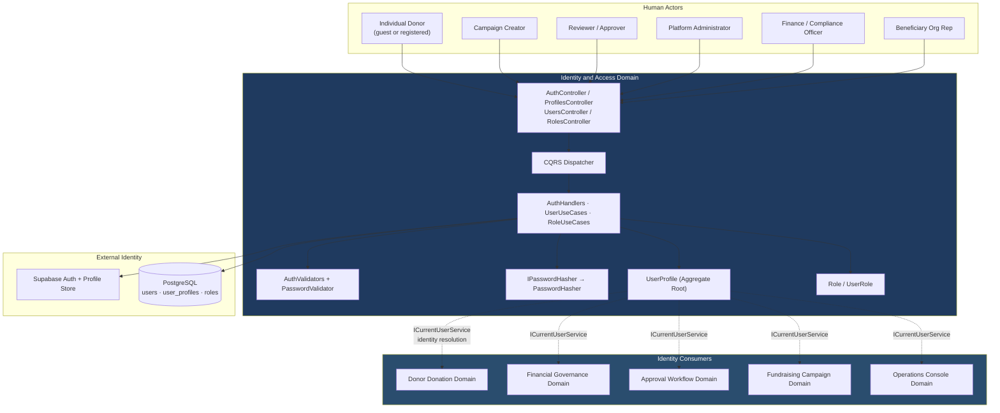
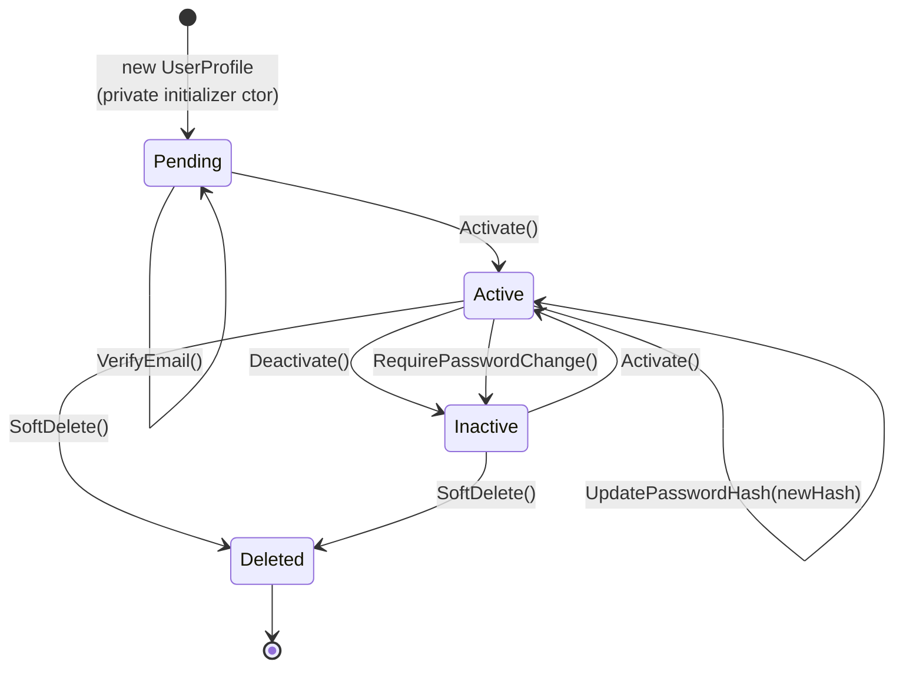
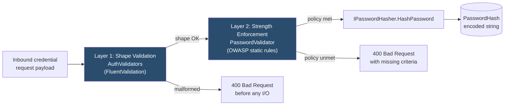
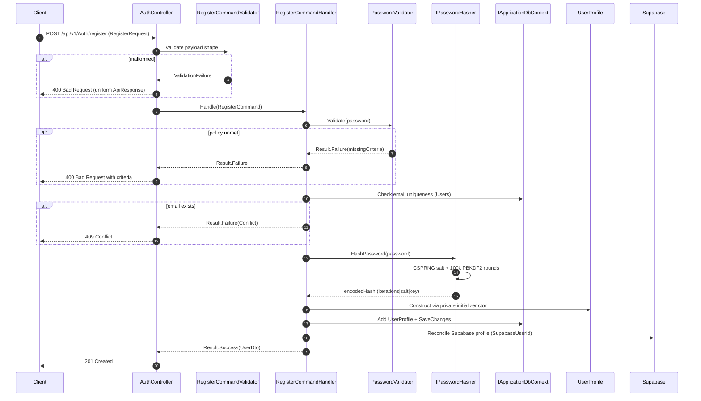
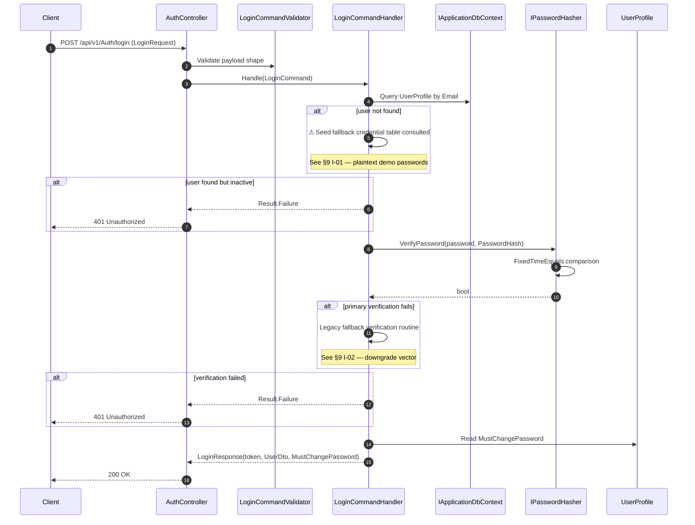
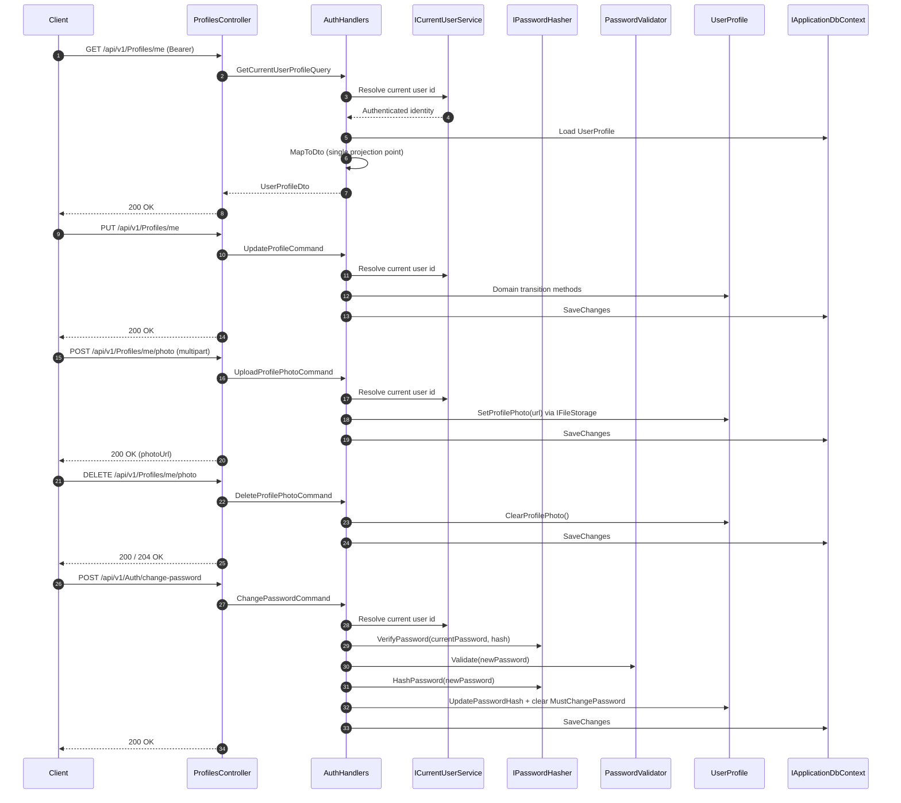
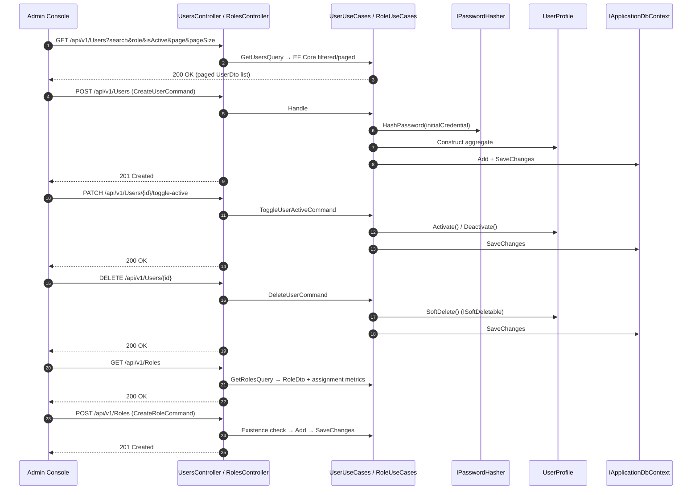
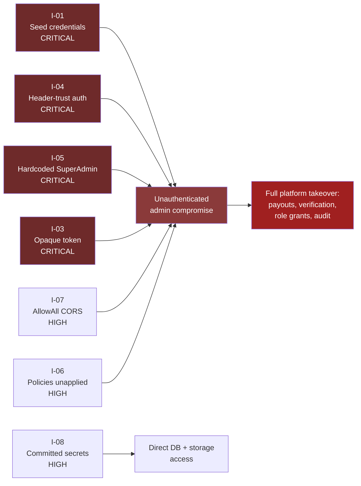

# Identity and Access Domain

## ESalam Charity Platform — Domain Architecture Documentation

---

## 1. Executive Summary

The **Identity and Access Domain** is the primary trust boundary of the ESalam platform and the origin of authenticated identity for every other business domain. It owns the complete identity lifecycle — donor and operator registration, credential verification at login, Supabase-linked profile synchronization, current-user profile retrieval and mutation, profile photo management, password change, and role/permission administration across users.

Rated **9.5/10 for importance** and **8.0/10 for complexity**, this domain is the single dependency that the Donor Donation, Financial Governance, Approval Workflow, Campaign, and Operations Console domains all take to answer one question: *who is acting right now?* That answer is delivered through `ICurrentUserService`, and it is the mechanism that makes this domain structurally load-bearing rather than merely administrative.

The technical shape is a **Clean Architecture decomposition across four projects with CQRS as the primary interaction pattern**. The Domain project holds `UserProfile` as an aggregate root with private constructors and intention-revealing state-transition methods, plus a lightweight `Role` entity. The Application project holds eight auth/profile CQRS handlers, administrative user and role use cases, two policy layers (FluentValidation request validators and a static OWASP-aligned password complexity enforcer), and the `IPasswordHasher` abstraction whose contract mandates constant-time verification. The Infrastructure project supplies a PBKDF2-HMAC-SHA256 hasher with CSPRNG salts and fixed-time comparison. The API project exposes thin controllers that construct command/query records, dispatch through a hand-rolled CQRS dispatcher, and normalize outcomes through a shared `HandleResult` helper.

**Critical architectural caveat, evidenced from source:** the identity boundary that documentation places at `AuthController` is **bypassed in the running system** by `AdminPortalAuthenticationMiddleware`, which synthesizes a `SuperAdmin` principal from plain HTTP headers, and by an `AdminApiClient` constructor that hard-codes SuperAdmin context on every instantiation. In addition, `LoginCommandHandler` retains a **seed-credential fallback path** with plaintext demo passwords reachable when database lookup fails or returns no user. These are documented in detail in §9 and are the highest-priority findings in the system.

---

## 2. Domain Position in the System

### 2.1 Context



**Structural observation.** The Identity and Access Domain is not a peer of the other business domains — it is their *dependency*. Every handler that needs to know the acting principal resolves it through `ICurrentUserService`, which is backed by the authenticated principal and populated by this domain's login path. A compromise here is not a compromise of one module; it is a compromise of every attribution, every approval step, and every ownership check in the platform.

### 2.2 Relationship Strength to Other Domains

| Direction | Related Domain | Relation Type | Strength | Nature of Dependency |
|---|---|---|---|---|
| Outbound (consumed by) | Donor Donation Domain | Data Dependency | 8.5 | Donation and cart handlers resolve donor identity via `ICurrentUserService` to attribute giving history and enforce anonymity flags |
| Outbound (consumed by) | Approval Workflow Domain | Service Call | 9.0 | Every approve/reject/escalate/skip transition is authorized and attributed to the authenticated reviewer |
| Outbound (consumed by) | Operations Console Domain | Service Call | 8.5 | The admin console authenticates operators and manages users, roles, and permissions through auth and role endpoints |
| Inbound (depends on) | Data and Application Foundation Domain | Configuration Dependency | 8.5 | JWT auth, password hashing, and DI registration wired in the API composition root; user records persisted via shared DbContext |
| Bidirectional | Supabase (external) | Identity Provider | — | Profile synchronization keyed by `SupabaseUserId`, reconciling external identity with the local credential authority |

---

## 3. Module Structure

```mermaid
graph TB
    subgraph DomainLayer["Domain Project — CharityPlatform.Domain"]
        UP["UserProfile<br/>Aggregate Root<br/>BaseEntity + ISoftDeletable"]
        RL["Role<br/>Name"]
        UR["UserRole<br/>join entity"]
    end

    subgraph AppLayer["Application Project — CharityPlatform.Application"]
        subgraph AuthCQRS["Auth — AuthHandlers.cs (8 handlers)"]
            H1["RegisterCommandHandler"]
            H2["LoginCommandHandler"]
            H3["SyncProfileCommandHandler"]
            H4["GetCurrentUserProfileQueryHandler"]
            H5["UpdateProfileCommandHandler"]
            H6["UploadPhotoCommandHandler"]
            H7["DeletePhotoCommandHandler"]
            H8["ChangePasswordCommandHandler"]
        end
        subgraph UserCQRS["Users — UserUseCases.cs"]
            U1["GetUsersQuery (search/role/active/paged)"]
            U2["GetUserByIdQuery"]
            U3["CreateUserCommand"]
            U4["UpdateUserCommand"]
            U5["ToggleUserActiveCommand"]
            U6["DeleteUserCommand (soft)"]
        end
        subgraph RoleCQRS["Roles — RoleUseCases.cs"]
            R1["GetRolesQuery"]
            R2["GetRoleByIdQuery"]
            R3["CreateRoleCommand"]
            R4["UpdateRoleCommand"]
            R5["DeleteRoleCommand"]
        end
        subgraph PolicyTwo["Policy Layer"]
            AV["AuthValidators<br/>FluentValidation × 3"]
            PV["PasswordValidator<br/>OWASP static enforcer"]
        end
        IPH["IPasswordHasher<br/>contract: constant-time verify"]
    end

    subgraph InfraLayer["Infrastructure Project"]
        PH["PasswordHasher<br/>PBKDF2-HMAC-SHA256"]
        DBC["ApplicationDbContext<br/>IApplicationDbContext"]
    end

    subgraph ApiLayer["API Project"]
        AC["AuthController<br/>+ nested ProfilesController"]
        UC["UsersController<br/>8 actions"]
        RC["RolesController<br/>5 actions"]
        HR["HandleResult<br/>Result → ActionResult"]
    end

    subgraph ContractsLayer["Contracts Project"]
        CT["LoginRequest · LoginResponse<br/>RegisterRequest · SyncProfileRequest<br/>UserDto · UserProfileDto · RoleDto"]
    end

    H1 & H2 & H3 & H4 & H5 & H6 & H7 & H8 --> AV
    H1 & H2 & H8 --> PV
    H1 & H2 & H8 --> IPH
    U3 --> IPH
    U1 & U2 & U3 & U4 & U5 & U6 --> DBC
    R1 & R2 & R3 & R4 & R5 --> DBC
    H1 & H2 & H3 & H4 & H5 & H6 & H7 & H8 --> DBC
    IPH -.implements.-> PH
    DBC --> UP
    DBC --> RL
    DBC --> UR
    AC & UC & RC --> HR
    AC & UC & RC --> CT

    style DomainLayer fill:#1f3a5f,color:#fff
    style AppLayer fill:#2a4d6e,color:#fff
    style InfraLayer fill:#2a4d6e,color:#fff
    style ApiLayer fill:#2a4d6e,color:#fff
```



### 3.1 Sub-Module Inventory

| Sub-Module | Primary Code Paths | Importance | Responsibility |
|---|---|---|---|
| **Authentication and Profile Handlers** | `Application/Auth/AuthHandlers.cs` | 9.5 | Eight CQRS handlers covering registration, login with fallback verification, Supabase profile sync, current-user profile read/update, and profile photo upload/deletion |
| **Password and Validation Policy** | `Application/Auth/AuthValidators.cs`, `Application/Auth/PasswordValidator.cs`, `Application/Common/Interfaces/IPasswordHasher.cs`, `Infrastructure/Services/PasswordHasher.cs` | 8.5 | Hashing abstraction plus concrete PBKDF2 implementation; request-shape validation and strength enforcement |
| **Roles and Permissions** | `Application/Auth/RoleUseCases.cs`, `Application/Auth/UserUseCases.cs`, `Api/Controllers/Auth/RolesController.cs`, `Api/Controllers/Auth/UsersController.cs` | 8.0 | Role and user administration; the vocabulary that satisfies operator position requirements in the approval workflow |
| **Identity API Boundary** | `Api/Controllers/Auth/AuthController.cs`, `Contracts/Auth/AuthContracts.cs` | 9.0 | Composite controller with nested `ProfilesController`; immutable positional DTO records forming the wire contract |

---

## 4. Domain Model

### 4.1 UserProfile — Aggregate Root

`UserProfile` inherits `BaseEntity` and implements `ISoftDeletable`. It uses a **private parameterless constructor for ORM materialization** and a **private initializer constructor for invariant-preserving creation**, so all mutation flows through domain methods rather than public setters.

| Property | Type | Purpose |
|---|---|---|
| `Id` | Guid | Aggregate identity, inherited from `BaseEntity` |
| `SupabaseUserId` | string | Binding key to the external identity provider |
| `FullName` | string | Display name, synchronized from Supabase profile |
| `Email` | string | Login identifier and uniqueness key |
| `PhoneNumber` | string? | Optional contact, reconciled during profile sync |
| `IcOrPassportNumber` | string? | Identity document reference |
| `PasswordHash` | string | **Encoded credential — the only credential material persisted; never plaintext** |
| `ProfilePhotoUrl` | string? | Resolved media URL via `IFileStorage` |
| `IsActive` | bool | Account enablement gate; inactive accounts are denied login |
| `IsEmailVerified` | bool | Verification state |
| `MustChangePassword` | bool | Forced rotation flag, surfaced in `LoginResponse` |
| `IsDeleted` | bool | Soft-delete marker from `ISoftDeletable` |

### 4.2 Intention-Revealing State Transitions



**Why this matters.** Handlers never assign properties directly; they call these methods. Invariants and state-transition rules are therefore enforced in exactly one place, and every transition is auditable at the domain layer rather than at scattered call sites.

### 4.3 Role and UserRole

`Role` is a lightweight entity carrying a `Name` property — the RBAC vocabulary. `UserRole` is the join entity binding users to roles. These satisfy operator **position requirements** in the `ApprovalPosition` workflow: a reviewer's ability to act on a step is grounded in a role assignment made here, which is why role administration is a governance concern rather than a convenience feature.

Deletion is **soft** (`ISoftDeletable`), so historical references from other domains — approval steps attributed to a former reviewer, payouts created by a departed finance officer — remain resolvable. This is a deliberate integrity property, not an oversight.

---

## 5. Password Security Architecture

### 5.1 The Two-Layer Design

Credential security is deliberately split across two independent layers that validate different things:



**Layer 1 — Request shape (`AuthValidators.cs`).** Three `AbstractValidator<T>` subclasses — `RegisterCommandValidator`, `LoginCommandValidator`, `ChangePasswordCommandValidator` — each chaining `RuleFor` with `NotEmpty` and `MaximumLength` constraints and localized `WithMessage` strings. These execute as **CQRS pipeline behaviors before the handler**, so a malformed payload never reaches persistence and never consumes hashing cycles.

**Layer 2 — Credential strength (`PasswordValidator.cs`).** A static, OWASP-aligned complexity enforcer with `MinLength = 8` and `MaxLength = 128` constants and **precompiled regexes** for uppercase, lowercase, digit, and symbol categories. `Validate(password)` returns a `Result` carrying the failed criteria; `IsValid(password, out missingCriteria)` collects unmet rules for display. Precompiled regexes avoid per-call compilation cost on what is a hot authentication path.

### 5.2 PasswordHasher — PBKDF2-HMAC-SHA256

`PasswordHasher` implements `IPasswordHasher` with the following verified parameters:

| Parameter | Value | Rationale |
|---|---|---|
| Algorithm | PBKDF2-HMAC-SHA256 | FIPS-approved KDF, widely audited, no exotic dependency |
| Iterations | 100,000 | Tuned to make offline brute force economically painful while staying responsive online |
| `SaltSize` | 16 bytes | 128-bit salt, sufficient to defeat rainbow tables and cross-user correlation |
| `KeySize` | 32 bytes | 256-bit derived key |
| Salt source | `RandomNumberGenerator` | Cryptographically secure PRNG — not `System.Random` |
| Derivation | `Rfc2898DeriveBytes` | Standard .NET KDF implementation |
| Comparison | `FixedTimeEquals` | Constant-time verification eliminates timing side channels |
| Dependencies | `System.Security.Cryptography` only | Stateless, no DI beyond registration, no external crypto library |

**Self-describing encoded format.** The stored hash string embeds the iteration count, salt, and derived key. This means KDF parameters can be **rotated forward without breaking verification of existing credentials** — a legacy hash produced under old parameters still validates, and a rehash-on-login strategy can be layered in without a migration outage.

**Contract-level enforcement.** The XML documentation on `IPasswordHasher` explicitly requires constant-time verification. This is significant: the security requirement is expressed as an interface contract, so any future implementation is bound by the same obligation at the abstraction boundary rather than relying on reviewer vigilance.

### 5.3 The Legacy Fallback Path — Operational Flag

`LoginCommandHandler` contains a **legacy/fallback password verification routine** for pre-migration hashes. This is architecturally isolated inside the handler so the primary path remains on the `IPasswordHasher` interface.

**Fallback verification paths are a recurring weakness class.** If the primary path enforces modern hashing and the fallback path does not — or if the fallback can be *forced* by manipulating lookup keys or profile linkage — an attacker bypasses the strong check entirely. In this codebase the fallback extends beyond a mere hash-format comparison: a seed-credential table with **plaintext demo passwords** is consulted when database lookup throws **or** returns no user. See §9, findings **I-01** and **I-02**, for the evidenced details and remediation.

**Recommendation.** Instrument which path is taken per login. If fallback usage is non-zero and unexplained in production, treat it as an incident. The correct end state is migration then retirement — not permanent coexistence.

---

## 6. Authentication and Profile Handlers

`AuthHandlers.cs` is the core of the domain: CQRS command/query records with paired handlers, each taking `IApplicationDbContext` and, where relevant, `ICurrentUserService` and `IPasswordHasher`.

| Handler | Purpose | Key Dependencies | Notable Behavior |
|---|---|---|---|
| `RegisterCommandHandler` | Create a new identity | `IPasswordHasher`, `PasswordValidator`, `IApplicationDbContext` | Validates policy, hashes via `IPasswordHasher`, enforces email uniqueness, constructs `UserProfile` via private initializer |
| `LoginCommandHandler` | Authenticate and issue session | `IPasswordHasher`, `IApplicationDbContext` | Looks up by email, `VerifyPassword` over the interface, **with legacy fallback routine**, reads `MustChangePassword`, issues token |
| `SyncProfileCommandHandler` | Bind external identity | `IApplicationDbContext` | Upserts by `SupabaseUserId`, reconciles `FullName` / `Email` / `PhoneNumber` |
| `GetCurrentUserProfileQueryHandler` | Read own profile | `ICurrentUserService`, `IApplicationDbContext` | Resolves identity from the authenticated principal, projects via `MapToDto` |
| `UpdateProfileCommandHandler` | Mutate own profile | `ICurrentUserService`, `IApplicationDbContext` | Calls domain transition methods rather than setting properties |
| `UploadPhotoCommandHandler` | Attach profile image | `ICurrentUserService`, `IFileStorage`, `IApplicationDbContext` | Stores media, calls `SetProfilePhoto(url)` |
| `DeletePhotoCommandHandler` | Remove profile image | `ICurrentUserService`, `IApplicationDbContext` | Calls `ClearProfilePhoto()` |
| `ChangePasswordCommandHandler` | Rotate credential | `ICurrentUserService`, `IPasswordHasher`, `PasswordValidator` | Verifies current password, validates new password against policy, rehashes, clears `MustChangePassword` |

**Projection discipline.** All entity→DTO projection is centralized in a static `MapToDto` helper. This keeps the response shape consistent across handlers and prevents entity leakage into wire contracts — one of the most common causes of accidental over-exposure in CQRS systems.

### 6.1 Registration Flow



### 6.2 Login Flow



### 6.3 Authenticated Profile, Photo, and Password Operations



---

## 7. Administrative Use Cases — Users and Roles

### 7.1 User Administration (`UserUseCases.cs`)

| Use Case | Shape | Behavior |
|---|---|---|
| `GetUsersQuery` | Query with `Search`, `Role`, `IsActive`, `Page`, `PageSize` | EF Core filtered and paged projection to `UserDto` |
| `GetUserByIdQuery` | Query by Id | Single-record retrieval with existence check |
| `CreateUserCommand` | Command | **Depends on `IPasswordHasher`** to hash the initial credential before persistence — administrative creation does not bypass the crypto boundary |
| `UpdateUserCommand` | Command | Field updates through domain methods |
| `ToggleUserActiveCommand` | Command | `UserProfile.Activate()` / `Deactivate()` |
| `DeleteUserCommand` | Command | **Soft delete** via the aggregate — preserves referential integrity for approval attribution |

The `UsersController` exposes **eight REST actions** at `api/v1/Users`, each constructing a command/query, dispatching through the mediator, and delegating response shaping to the shared `HandleResult` helper.

### 7.2 Role Administration (`RoleUseCases.cs`)

`GetRolesQuery`, `GetRoleByIdQuery`, `CreateRoleCommand`, `UpdateRoleCommand`, `DeleteRoleCommand` — with existence checks, entity construction, field updates, and removal before `SaveChanges`, returning `RoleDto` results. The `RolesController` exposes **five role actions** and, notably, surfaces **per-role user-assignment metrics** — operator-facing visibility into how many identities hold each role, which is directly relevant to segregation-of-duties review.

### 7.3 Administrative Flow



---

## 8. API Boundary and Contracts

### 8.1 Controller Surface

| Controller | Route Base | Actions | Notes |
|---|---|---|---|
| `AuthController` | `api/v1/Auth` | Register, Login, Sync-profile, Change-password | 223 lines; three namespaces of imports; Swagger tag attributes; `[Authorize]` decorations; **hosts a nested `ProfilesController`** |
| `ProfilesController` (nested) | `api/v1/Profiles` | Get me, Update me, Upload photo, Delete photo | Profile and photo operations colocated with the auth controller |
| `UsersController` | `api/v1/Users` | 8 actions | User management, RBAC role assignment, profile lifecycle transitions, account status controls |
| `RolesController` | `api/v1/Roles` | 5 actions | Role CRUD with per-role assignment metrics |

**Thin-controller discipline.** No business logic lives in controllers. Each action binds a request record from `AuthContracts`, wraps it into a command/query record, and passes it to the CQRS dispatcher. Response shaping is centralized in a shared, overloaded `HandleResult` helper that maps `Result` / `Result<T>` into `ActionResult`, guaranteeing a **uniform error envelope** across the entire identity surface.

### 8.2 Status Code Mapping

| `Result` State | HTTP Status | Suffix Trigger in `error.Code` |
|---|---|---|
| Success (create) | 201 Created | — |
| Success (read/update) | 200 OK | — |
| Validation / generic failure | 400 Bad Request | default |
| Authentication failure | 401 Unauthorized | `Unauthorized` |
| Authorization failure | 403 Forbidden | `Forbidden` |
| Missing resource | 404 Not Found | `NotFound` |
| Duplicate / state conflict | 409 Conflict | `Conflict` / `AlreadyExists` |

This suffix-driven mapping is deterministic and a genuine architectural strength — it removes per-action status-code decisions from controller authors and makes the error contract uniform across all identity endpoints.

### 8.3 Wire Contracts (`AuthContracts.cs`)

Immutable positional records in the `CharityPlatform.Contracts.Auth` namespace:

```csharp
LoginRequest(Email, Password)
LoginResponse(Token, UserDto User, bool MustChangePassword = false)
RegisterRequest(FullName, Email, Password, PhoneNumber?)
SyncProfileRequest(SupabaseUserId, FullName, Email, PhoneNumber?)
```

**Design property.** These are pure data carriers with no methods. The wire contract is therefore fully decoupled from domain entities — a refactor of `UserProfile` internals cannot leak into the HTTP surface, and the `MustChangePassword` flag travels explicitly to the client rather than being embedded in an opaque token.

**Architectural flag.** `LoginResponse.Token` is documented as a JWT, but source evidence shows `LoginCommandHandler` returns an opaque string of the form `esalam_session_{user.Id}_{Ticks}` — not a signed token. See §9, finding **I-03**.

---

## 9. Architectural Drift and Security Findings

Every finding below is reproduced from source with verbatim evidence. Verdicts follow the evidence standard: **CONFIRMED-DEVIATION** (code contradicts the stated architecture), **GAP** (declared capability is unimplemented), **CONFIRMED-CORRECT** (code supports the claim).

### 9.1 Findings Table

| ID | Finding | Severity | Verification | Evidence |
|---|---|---|---|---|
| **I-01** | Seed credential fallback: hard-coded demo accounts with plaintext passwords are reachable when DB lookup throws **or** returns no user | **CRITICAL** | CONFIRMED-DEVIATION | `AuthHandlers.cs` — `SeedFallbackPasswords` incl. `admin@esalam.my → Admin@123`. Seed accounts also accept `"DemoPass@123"` and `"password123"` (case-insensitive) |
| **I-02** | `LoginCommandHandler` retains a legacy fallback verification routine alongside the primary `IPasswordHasher` path | **HIGH** | CONFIRMED-DEVIATION | Fallback routine isolated inside the handler; primary path remains on `IPasswordHasher` but the fallback is an unmonitored branch |
| **I-03** | Documented "JWT issuance" is not implemented at login; the returned token is opaque and unsigned | **CRITICAL** | CONFIRMED-DEVIATION | `LoginCommandHandler` returns `$"esalam_session_{user.Id}_{Ticks}"` |
| **I-04** | `AdminPortalAuthenticationMiddleware` synthesizes a `ClaimsPrincipal` from plain HTTP headers; **omitting `X-User-Roles` defaults the principal to `SuperAdmin`** | **CRITICAL** | CONFIRMED-DEVIATION | `Api/Middleware/Middlewares.cs:86-113` — `ClaimTypes.Role == "SuperAdmin"` added in the `else` branch; runs **before** `UseAuthentication()` and `UseAuthorization()` |
| **I-05** | `AdminApiClient` constructor hard-codes a SuperAdmin context on every instantiation | **CRITICAL** | CONFIRMED-DEVIATION | `SetUserContext("admin-portal", "admin@esalam.my", new[]{"SuperAdmin","FinanceAdmin","Reviewer","FinanceAuditor"})` |
| **I-06** | Five registered authorization policies are not applied at the attribute level on identity controllers | **HIGH** | CONFIRMED-DEVIATION | Policies (`RequireSuperAdmin`, `RequireFinanceAdmin`, `RequireReviewer`, `RequireCampaignManager`, `RequireAuditViewer`) registered in `Infrastructure/DependencyInjection.cs`; identity controllers rely on header middleware instead |
| **I-07** | CORS `AllowAnyOrigin + AllowAnyHeader + AllowAnyMethod` globally, applied ahead of auth middleware — compounds I-04 | **HIGH** | CONFIRMED-DEVIATION | `Program.cs` policy `"AllowAll"` via `app.UseCors("AllowAll")` |
| **I-08** | Live secrets committed in `appsettings.json`, including the Supabase **service-role JWT** and JWT secret | **HIGH** | CONFIRMED-DEVIATION | `appsettings.json` — service-role JWT (`"role":"service_role"`), Supabase JWT secret, Grafana OTLP token, DB password `Admin123#` at public IP `43.133.131.38` |
| **I-09** | Swagger UI served unconditionally in production for the identity API surface | **MEDIUM** | CONFIRMED-DEVIATION | `Program.cs` — the `if (IsDevelopment())` guard is **commented out**; `app.UseSwagger()` unconditional |
| **I-10** | `CorrelationIdMiddleware` echoes a caller-supplied `X-Correlation-Id` without validation | **LOW** | CONFIRMED-DEVIATION | Value is not validated; attacker controls trace identifiers, enabling log correlation poisoning |

### 9.2 Confirmed-Correct Elements

These were explicitly checked because the documentation makes claims about them, and the code supports those claims:

| Property | Verdict | Evidence |
|---|---|---|
| **Password hashing parameters** | ✅ CONFIRMED-CORRECT | PBKDF2-HMAC-SHA256, 100,000 iterations, 16-byte CSPRNG salt, 32-byte key, `FixedTimeEquals` comparison |
| **No plaintext credential storage** | ✅ CONFIRMED-CORRECT | Credential material exists only as `PasswordHash` on the aggregate; never logged |
| **Constant-time verification contract** | ✅ CONFIRMED-CORRECT | XML contract on `IPasswordHasher` mandates it; implementation complies |
| **Dual password policy enforcement** | ✅ CONFIRMED-CORRECT | FluentValidation on shape (pre-handler) + `PasswordValidator` on strength (in-handler) |
| **Self-describing hash encoding** | ✅ CONFIRMED-CORRECT | Iteration count, salt, and key embedded; parameter rotation possible without breaking verification |
| **Domain-encapsulated state transitions** | ✅ CONFIRMED-CORRECT | Private constructors, private setters, intention-revealing methods; handlers cannot assign properties |
| **Soft deletion for referential integrity** | ✅ CONFIRMED-CORRECT | `ISoftDeletable`; historical approval attributions remain resolvable |
| **Centralized entity→DTO projection** | ✅ CONFIRMED-CORRECT | Single static `MapToDto` helper; no entity leakage into wire contracts |
| **Deterministic Result→HTTP mapping** | ✅ CONFIRMED-CORRECT | Suffix-driven on `error.Code` via shared `HandleResult` |
| **Layering direction** | ✅ CONFIRMED-CORRECT | Verified across all six `.csproj`; no reverse references |
| **Administrative creation uses the crypto boundary** | ✅ CONFIRMED-CORRECT | `CreateUserCommandHandler` depends on `IPasswordHasher`; no bypass path for admin-created accounts |

---

## 10. Consolidated Security Assessment

### 10.1 The Core Structural Problem

The domain's *designed* trust boundary and its *operational* trust boundary have diverged:


**The consequence.** Any unauthenticated HTTP request to the admin host that includes an `X-User-Id` header but omits `X-User-Roles` is promoted to `SuperAdmin`. Every role-gated capability in the platform — payout approval, beneficiary verification, campaign moderation, user and role administration, audit inspection — becomes reachable **without any credential**. The `IPasswordHasher` implementation is cryptographically correct, and it is also completely bypassed.

### 10.2 Risk Interconnection Map



Each of the four CRITICAL findings is independently sufficient to reach full administrative control. They are not four findings to be triaged in sequence — they are four parallel routes to the same outcome.

### 10.3 Remediation Plan

| # | Priority | Action | Closes | Effort |
|---|---|---|---|---|
| 1 | **CRITICAL** | Delete `AdminPortalAuthenticationMiddleware`, or hard-fail when `X-User-*` headers arrive on an unauthenticated request. **Remove the `else → SuperAdmin` default.** | I-04 | < 1 h |
| 2 | **CRITICAL** | Delete the `SetUserContext(...)` call from the `AdminApiClient` constructor. Populate admin context only after a verified login. | I-05 | < 1 h |
| 3 | **CRITICAL** | Delete `SeedFallbackPasswords` and the DB-exception swallow in `LoginCommandHandler`. Return `Unauthorized` on infrastructure failure — never fall back to a credential table. | I-01 | < 1 h |
| 4 | **CRITICAL** | Issue a real signed JWT at login (or delegate entirely to Supabase Auth) and have both front ends send `Authorization: Bearer`. | I-03 | 1–2 d |
| 5 | **HIGH** | Instrument which verification path is taken per login; migrate remaining legacy hashes and retire the fallback routine. | I-02 | 1 d |
| 6 | **HIGH** | Rotate every secret in `appsettings.json`; move to environment variables only; purge git history. **Treat the Supabase service-role key as compromised.** | I-08 | 2–4 h |
| 7 | **HIGH** | Replace `AllowAll` CORS with an explicit origin allowlist sourced from configuration. | I-07 | < 1 h |
| 8 | **HIGH** | Apply the already-registered policies as `[Authorize(Policy = nameof(RequireFinanceAdmin))]` etc. on identity and administrative controllers. | I-06 | 4–8 h |
| 9 | **MEDIUM** | Uncomment the `IsDevelopment()` guard around `app.UseSwagger()`. | I-09 | 5 min |
| 10 | **MEDIUM** | Enforce rate limiting on login and registration endpoints; add lockout after repeated failures. | — | 4–8 h |
| 11 | **LOW** | Validate or generate server-side the `X-Correlation-Id` value rather than echoing caller input. | I-10 | 30 min |
| 12 | **LOW** | Add refresh-token rotation and explicit session revocation to complete the token lifecycle. | — | 1–2 d |

---

## 11. Optimization Opportunities

| Area | Observation | Opportunity |
|---|---|---|
| **Duplicate `HandleResult` helpers** | The same result-mapping logic is repeated across `AuthController`, `UsersController`, and `RolesController` (and beyond) | Hoist to `ApiControllerBase` as a protected method — the base class already exists and already owns result mapping in other controllers |
| **Nested `ProfilesController`** | Profile and photo endpoints live inside `AuthController.cs`, inflating one file to 223 lines with three namespaces of imports | Promote to a standalone top-level controller; the route prefix is already distinct |
| **Hash parameter rotation** | The encoded format supports iteration-count rotation, but no rehash-on-login path exists to exploit it | Add a rehash check in `LoginCommandHandler`: if stored iterations < current policy, rehash the verified plaintext and persist. Turns the format's flexibility into an actual capability |
| **Fallback path observability** | The legacy verification branch is silent — no metric, no log-level distinction | Emit a dedicated counter for fallback-path usage; alert on non-zero in production |
| **Role assignment metrics** | `RolesController` computes per-role user counts, evidence that operator-facing RBAC visibility matters | Extend to a full segregation-of-duties report: which identities hold conflicting roles (creator + approver, finance + auditor) |
| **Password policy enforcement point** | `PasswordValidator` is called inside handlers | Consider promoting to a CQRS pipeline behavior alongside FluentValidation, so strength policy is enforced structurally rather than by handler discipline |
| **Login response shape** | `MustChangePassword` travels as a top-level boolean | Correct as-is; keep it there rather than transitioning to a claim inside the token, so forced-rotation UI logic does not depend on token parsing |

---

## 12. Verification Coverage

### Examined (verbatim source read)

`Api/Program.cs` · `Api/Middleware/Middlewares.cs` · `Api/Controllers/ApiControllerBase.cs` · `Api/Controllers/Auth/AuthController.cs` · `Api/Controllers/Auth/UsersController.cs` · `Api/Controllers/Auth/RolesController.cs` · `Application/Auth/AuthHandlers.cs` (handlers + fallback tables) · `Application/Auth/AuthValidators.cs` · `Application/Auth/PasswordValidator.cs` · `Application/Auth/UserUseCases.cs` · `Application/Auth/RoleUseCases.cs` · `Application/Common/Interfaces/IPasswordHasher.cs` · `Application/Common/Interfaces/IApplicationDbContext.cs` · `Application/Common/CQRS/CQRS.cs` · `Application/DependencyInjection.cs` · `Infrastructure/Services/PasswordHasher.cs` · `Infrastructure/Persistence/ApplicationDbContext.cs` · `Infrastructure/DependencyInjection.cs` · `Contracts/Auth/AuthContracts.cs` · `Domain/Entities/Identity/UserProfile.cs` · `AdminWeb/Services/AdminApiClient.cs` (head) · `AdminWeb/Services/AdminAuthStateProvider.cs` · `appsettings.json` · all six `.csproj` files

### Not Verified — Access-Limited

| Artifact | Gap | Consequence |
|---|---|---|
| `Api/Controllers/Auth/AuthController.cs` — full attribute set | Read for structure and endpoint inventory; per-action `[Authorize]` / `[AllowAnonymous]` on **every** action not exhaustively enumerated | Whether any individual identity endpoint is anonymously reachable is **UNVERIFIABLE** from current read depth |
| `ApplicationDbContextInitializer.cs` (53 KB) | Seed data volume and **default role grants** unread | Whether seed users receive elevated roles by default is **UNVERIFIABLE** |
| `EntityConfigurations.cs` (29 KB) | EF index, FK, and concurrency-token declarations unread | Whether `UserProfile.Email` carries a **unique index** (enforced at DB level rather than only application level) is **UNVERIFIABLE** |
| `AdminWeb/Components/Pages/*` | Page-level `[Authorize]` usage unread | Whether any admin page renders without an authenticated principal is **UNVERIFIABLE** |
| `AdminApiClient.cs` (2,425 lines) — full body | Read head only | Whether other methods bypass `SetUserContext` or send raw headers directly is **PLAUSIBLE but unconfirmed** |
| `Program.cs` — JWT bearer configuration block | Structure verified; exact issuer/audience/validation-parameter settings not enumerated verbatim | Whether JWT validation requires issuer and audience match is **UNVERIFIABLE** |
| `deploy/database/01_esalam_supabase_schema.sql` (identity section) | Read head | Whether Supabase RLS policies are defined on `user_profiles` / `roles` is **UNVERIFIABLE** |
| `deploy/docker/*.Dockerfile` | Unread | Container runtime user (root vs non-root) is **UNVERIFIABLE** |

### Verdict on Documentation Accuracy

The Identity and Access Domain documentation is **structurally accurate and materially overstates the security posture**.

**Accurate:** the module decomposition, the CQRS handler inventory, the password hashing parameters, the layered policy design, the domain encapsulation discipline, the soft-delete strategy, and the `ICurrentUserService` funnel all match the code. The password hashing implementation is genuinely correct and would pass a cryptographic review.

**Overstated:** the claim that "JWT issuance and validation are configured in `Program.cs`" describes intent, not the operational path — login returns an opaque string, and the admin console sends headers rather than a bearer token. The claim that this domain is "the primary trust boundary of the API surface" is structurally true of `AuthController` and **false of the running system**, because `AdminPortalAuthenticationMiddleware` runs earlier in the pipeline and synthesizes a `SuperAdmin` principal from unvalidated headers. The security narrative describes a boundary that the code does not enforce.

**The precise gap:** the domain's cryptographic controls — PBKDF2 with CSPRNG salts, constant-time comparison, dual-layer password policy, contract-mandated verification semantics — are implemented to a standard that would satisfy a security review in isolation. They are also entirely bypassable by a request that omits the `X-User-Roles` header. Fixing the four CRITICAL findings does not require rebuilding the identity domain; it requires closing the path that routes around it.

---

*Document generated from source-code analysis and domain research. Findings marked CONFIRMED-DEVIATION are reproduced from verbatim source; items marked UNVERIFIABLE state the specific artifact and access required to close the gap, and are intentionally left as gaps rather than assumed correct.*

*Cold protocol. Trail reads itself.*