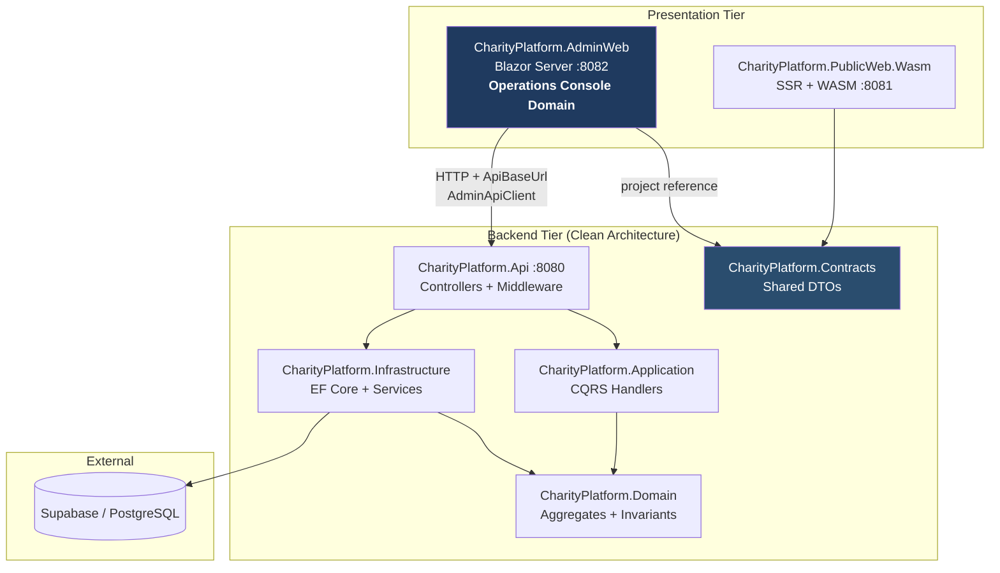
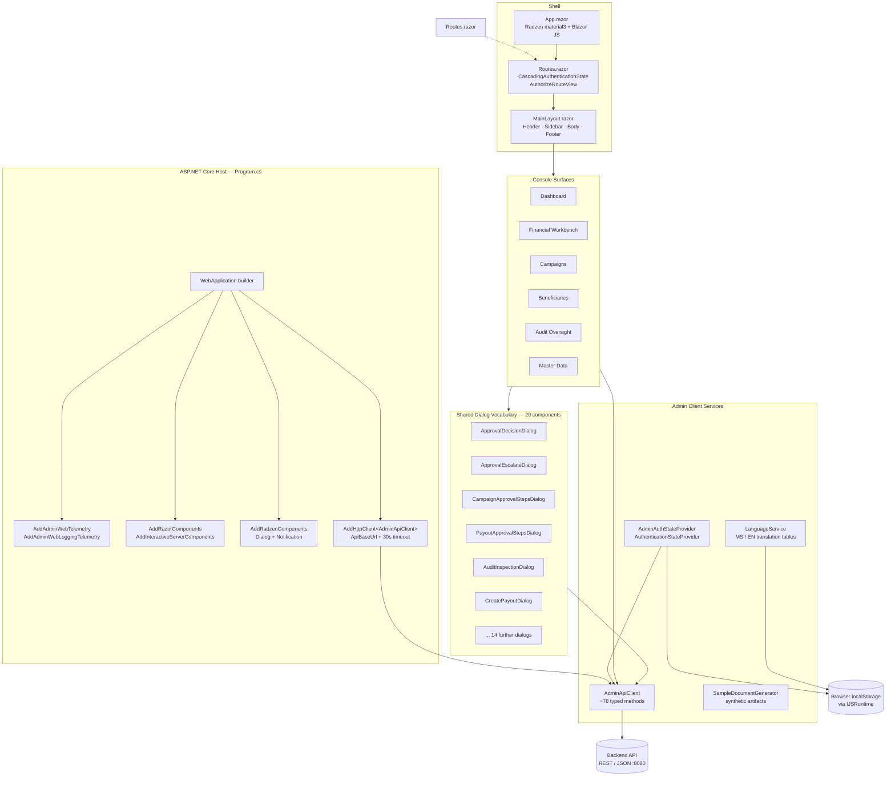
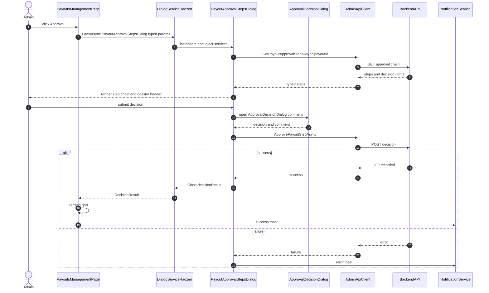
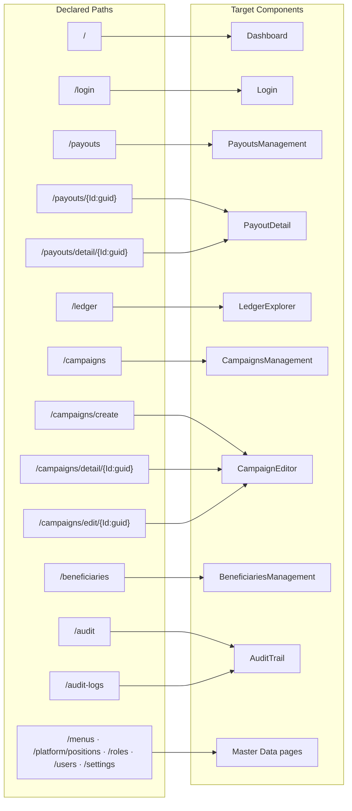
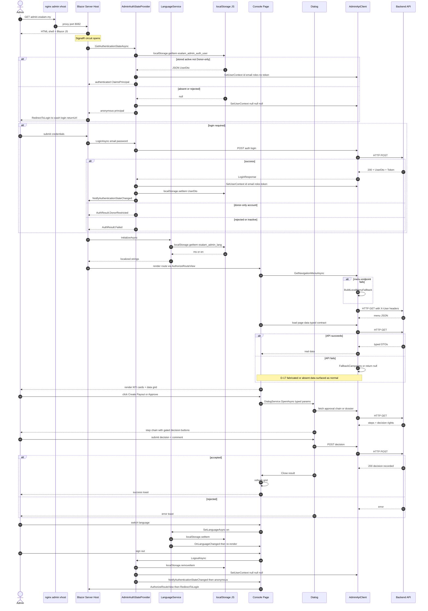

Evidence collection is complete. Compiling the Operations Console Domain documentation.

# ESalam — Operations Console Domain

**Module Documentation | Blazor Server Administrative Console**

---

## 1. Executive Summary

The **Operations Console Domain** is the ESalam platform's administrative control surface — a single ASP.NET Core **Blazor Server** application that renders every operator-facing governance workflow: financial disbursement, campaign moderation, beneficiary KYC review, audit inspection, and master-data administration. It is deliberately *not* a standalone service: it holds **no database context, no domain logic, and no authorization policy of its own**. Its entire purpose is to present state and collect decisions, then hand both to the backend API through one typed client.

Architecturally, the console is classified as a **Supporting Business Domain** with an importance score of 8.5 — the lower rating than the Core Business Domains reflects that it *orchestrates* rather than *owns* business rules. Every invariant it appears to enforce (a payout cannot exceed campaign balance, a reviewer must be attributed) is enforced downstream in the Domain and Application layers. The console is a **presentation and orchestration boundary**, not a trust boundary.

This distinction matters because the research reveals the console is **materially entangled with the platform's most significant security drift**. The console ships with a hard-coded SuperAdmin identity (`AdminApiClient` constructor), it authenticates against a middleware that trusts plain HTTP headers, and the API promotes any unauthenticated request carrying those headers to SuperAdmin if the role header is omitted. The console is, in effect, the *client half* of a broken identity boundary whose *server half* lives in `CharityPlatform.Api`.

This document covers the console's host composition, client services, page and dialog surface, routing, localization, telemetry, and the verified drift findings — with evidence for each claim and explicit marking of what remains unverifiable.

---

## 2. Domain Positioning

### 2.1 Where the Console Sits in the Layered Architecture



### 2.2 Verified Dependency Boundary

The console's `.csproj` declares exactly **one project reference**:

```
CharityPlatform.AdminWeb.csproj
  └─ ProjectReference: ..\CharityPlatform.Contracts\CharityPlatform.Contracts.csproj
```

This is the cleanest possible expression of the domain's intent. The console does **not** reference `Domain`, `Application`, or `Infrastructure`. It cannot instantiate an aggregate, invoke a CQRS handler, or open a database connection — those capabilities are structurally absent, not merely avoided by convention. The compilation boundary *is* the architectural boundary.

The single reference to `Contracts` means all payloads crossing the wire are **shared DTOs**, serialized by `System.Net.Http.Json`. The console never sees an EF entity.

### 2.3 Package Dependencies

| Package | Version | Role |
|---|---|---|
| `Radzen.Blazor` | 11.2.6 | Component library — layout, grids, dialogs, notifications |
| `Bogus` | 35.6.5 | Synthetic data generation (see §9.3) |
| `OpenTelemetry` + 5 instrumentation packages | 1.18.0 | Traces, metrics, runtime instrumentation |
| `OpenTelemetry.Exporter.OpenTelemetryProtocol` | 1.18.0 | OTLP export to Grafana Cloud |
| `OpenTelemetry.Exporter.Prometheus.AspNetCore` | 1.11.0-beta.1 | Local `/metrics` scrape endpoint |

Target framework: **net10.0**, with `Nullable` and `ImplicitUsings` enabled.

> **Observation.** The `Bogus` dependency is a synthetic-data generator. Combined with `SampleDocumentGenerator.cs` (11.9 KB) present in the Services directory, this indicates the repository ships demo-data generation inside the production admin console project. See §9.3 for the drift implication.

---

## 3. Host Composition — `Program.cs`

The entire runtime wiring is 60 lines. This is a deliberate minimal-hosting-model composition root.

```csharp
var builder = WebApplication.CreateBuilder(args);

// 1. Telemetry
builder.Services.AddAdminWebTelemetry(builder.Configuration);
builder.Logging.AddAdminWebLoggingTelemetry(builder.Configuration);

// 2. Blazor interactive server rendering
builder.Services.AddRazorComponents()
    .AddInteractiveServerComponents();

// 3. Radzen component services
builder.Services.AddRadzenComponents();

// 4. Localization
builder.Services.AddScoped<LanguageService>();

// 5. Authentication & authorization
builder.Services.AddAuthentication();
builder.Services.AddAuthorizationCore();
builder.Services.AddCascadingAuthenticationState();
builder.Services.AddScoped<AdminAuthStateProvider>();
builder.Services.AddScoped<AuthenticationStateProvider>(
    sp => sp.GetRequiredService<AdminAuthStateProvider>());

// 6. Typed API client
var apiBaseUrl = builder.Configuration["ApiBaseUrl"] ?? "http://localhost:5000/api/v1/";
if (!apiBaseUrl.EndsWith("/")) apiBaseUrl += "/";

builder.Services.AddHttpClient<AdminApiClient>(client =>
{
    client.BaseAddress = new Uri(apiBaseUrl);
    client.Timeout = TimeSpan.FromSeconds(30);
});
```

### 3.1 Service Lifetime Decisions

| Service | Lifetime | Rationale |
|---|---|---|
| `LanguageService` | **Scoped** | Per-circuit state — language selection is per browser session |
| `AdminAuthStateProvider` | **Scoped** | Per-circuit identity — a Blazor Server circuit is one logical user |
| `AuthenticationStateProvider` | **Scoped** (resolver alias) | Resolves to the same `AdminAuthStateProvider` instance, so `GetAuthenticationStateAsync` and `LoginAsync` share one `_currentUser` field |
| `AdminApiClient` | **Typed HttpClient** | Uses `IHttpClientFactory`; holds mutable default request headers |
| `DialogService`, `NotificationService` | **Radzen-managed** | Registered by `AddRadzenComponents()` |

The alias registration on line `AddScoped<AuthenticationStateProvider>(sp => sp.GetRequiredService<AdminAuthStateProvider>())` is significant: it ensures that when Blazor's `AuthorizeRouteView` requests an `AuthenticationStateProvider`, it receives **the same scoped instance** the login page writes to. Without this aliasing, `NotifyAuthenticationStateChanged` on the concrete type would not propagate to the framework's injected abstraction. This is correct DI construction.

### 3.2 Request Pipeline

```csharp
var app = builder.Build();

if (!app.Environment.IsDevelopment())
{
    app.UseExceptionHandler("/Error", createScopeForErrors: true);
}

if (builder.Configuration.GetValue<bool>("EnableHttpsRedirection", false))
{
    app.UseHttpsRedirection();
    app.UseHsts();
}

app.UseStaticFiles();
app.UseAntiforgery();
app.UseAdminWebTelemetry();

app.MapRazorComponents<App>()
    .AddInteractiveServerRenderMode();

app.Run();
```

**Verified pipeline properties:**

1. **Exception handling is environment-gated.** In Development, the developer exception page surfaces; in Production, the `/Error` route (implemented in `Components/Pages/Errors/Error.razor`) handles it. This is correct — no stack traces leak in production.
2. **HTTPS redirection is opt-in, not default.** `EnableHttpsRedirection` defaults to `false`. In the containerized topology this is deliberately correct: **nginx terminates TLS at the edge** and forwards plain HTTP to `admin-web:8082`. Applying `UseHsts()` inside the container would be meaningless (the container never serves TLS) and could cause redirect loops.
3. **`UseAntiforgery()` is present.** Blazor Server's SignalR circuit needs this for form-post protection.
4. **No `UseAuthentication()` / `UseAuthorization()` calls.** These ASP.NET Core middleware are absent by design — the console does not authenticate HTTP requests. Identity is established inside the Blazor circuit by `AdminAuthStateProvider`, and enforced by `<AuthorizeRouteView>` in the render tree, not by middleware. This is the canonical Blazor Server pattern.

> **Consequence.** Because no HTTP-level authorization exists on the console host, `nginx` routes the entire `admin.esalam.my` vhost to `:8082` without an auth gateway in front. Every byte of the admin HTML shell, the Blazor framework scripts, and the Radzen assets are served to any caller. Access control begins only when the interactive circuit renders `AuthorizeRouteView`.

---

## 4. Console Architecture Overview



---

## 5. Client Services — The Infrastructure Trio

### 5.1 `AdminApiClient` — The Sole Egress Point

`AdminApiClient.cs` is **2,425 lines / 115.9 KB** — by a wide margin the largest service class in the console. It is registered as a typed `HttpClient` and injected into every page.

**Purpose.** Centralize all backend communication so that no page constructs an `HttpClient` request inline. This yields one auditable outbound surface, one place where identity headers are attached, and one place where failure-handling policy is expressed.

**Imports — seven contract namespaces:**

```csharp
using CharityPlatform.Contracts.Auth;
using CharityPlatform.Contracts.Beneficiaries;
using CharityPlatform.Contracts.Campaigns;
using CharityPlatform.Contracts.Common;
using CharityPlatform.Contracts.Financial;
using CharityPlatform.Contracts.Navigation;
using CharityPlatform.Contracts.Platform;
```

**Method surface.** Approximately 78 typed async methods spanning the seven namespaces — campaign list/detail/create/update, beneficiary CRUD and verification, financial summary and ledger queries, payout lifecycle, approval step queries and decisions, navigation menu retrieval, platform settings, audit log queries, user and role administration.

**Identity attachment — `SetUserContext`:**

```csharp
public void SetUserContext(string? userId, string? email,
                           IEnumerable<string>? roles, string? token = null)
{
    _http.DefaultRequestHeaders.Remove("X-User-Id");
    _http.DefaultRequestHeaders.Remove("X-User-Email");
    _http.DefaultRequestHeaders.Remove("X-User-Roles");
    _http.DefaultRequestHeaders.Remove("Authorization");

    if (!string.IsNullOrWhiteSpace(userId))
        _http.DefaultRequestHeaders.TryAddWithoutValidation("X-User-Id", userId);

    if (!string.IsNullOrWhiteSpace(email))
        _http.DefaultRequestHeaders.TryAddWithoutValidation("X-User-Email", email);

    if (roles != null && roles.Any())
        _http.DefaultRequestHeaders.TryAddWithoutValidation("X-User-Roles", string.Join(",", roles));

    if (!string.IsNullOrWhiteSpace(token))
        _http.DefaultRequestHeaders.Authorization =
            new AuthenticationHeaderValue("Bearer", token);
}
```

The method is **idempotent by construction**: it clears all four headers before re-adding. This prevents header accumulation across identity changes within a circuit.

Critically, it attaches **two parallel identity mechanisms**:
- **Custom headers** (`X-User-Id`, `X-User-Email`, `X-User-Roles`) — consumed by `AdminPortalAuthenticationMiddleware` on the API.
- **Bearer token** — the standard `Authorization` header, consumed by `UseAuthentication()` JwtBearer.

Both are populated only when a token is supplied. See §9.1 for the drift consequence.

**Navigation resilience — `BuildLocalMenuFallback`.** When the API navigation endpoint fails, the client synthesizes a local menu so the shell remains navigable rather than rendering an empty sidebar. This is a defensible degradation for *navigation chrome*.

**Fallback data stores — `FallbackCampaigns` / `FallbackCampaignDetails`.** The campaign methods contain a materially different degradation pattern:

```csharp
public async Task<PagedResult<CampaignSummaryDto>> GetCampaignsAsync(
    string? status = null, int pageNumber = 1, int pageSize = 50,
    CancellationToken ct = default)
{
    try
    {
        var url = $"campaigns?pageNumber={pageNumber}&pageSize={pageSize}";
        if (!string.IsNullOrWhiteSpace(status)) url += $"&status={status}";

        var res = await _http.GetFromJsonAsync<ApiResponse<PagedResult<CampaignSummaryDto>>>(url, ct);
        if (res?.Data != null && res.Data.Items.Any())
            return res.Data;
    }
    catch (Exception ex)
    {
        _logger.LogWarning(ex, "API campaigns fetch failed, using fallback campaigns store.");
    }

    var query = FallbackCampaigns.AsEnumerable();
    if (!string.IsNullOrWhiteSpace(status) && !status.Equals("all", StringComparison.OrdinalIgnoreCase))
        query = query.Where(c => c.Status.Equals(status, StringComparison.OrdinalIgnoreCase));

    var list = query.ToList();
    return new PagedResult<CampaignSummaryDto>(list, list.Count, 1, pageSize);
}
```

And in `GetCampaignByIdOrSlugAsync`, when a lookup fails the fallback store is consulted, and if the requested ID is not found the method returns **the first fallback record** as though it were the requested campaign. This is documented as finding **D-17** in §9.4.

### 5.2 `AdminAuthStateProvider` — The Identity Service

The complete implementation is 176 lines. It derives from Blazor's `AuthenticationStateProvider`.

**State fields:**

```csharp
private const string StorageKey = "esalam_admin_auth_user";
private readonly AdminApiClient _api;
private readonly IJSRuntime _js;
private UserDto? _currentUser;
private bool _hasCheckedStorage = false;
```

**Hydration — `GetAuthenticationStateAsync`.** On first invocation, if no cached user exists and storage has not yet been read, the provider:

1. Reads `localStorage["esalam_admin_auth_user"]` via `IJSRuntime`.
2. Deserializes it to `UserDto`.
3. Rejects the user if `!user.IsActive`.
4. Rejects the user if the role set is **exactly** `["Donor"]`.
5. Otherwise caches `_currentUser` and calls `_api.SetUserContext(user.Id, user.Email, user.Roles)` — **without a token**.
6. Falls back to an **anonymous `ClaimsPrincipal`** with `_api.SetUserContext(null, null, null)` if nothing usable is found.

The `catch` block is intentional and documented: `// Ignored during static prerendering / SSR before JS circuit is active`. During prerender the JS interop bridge does not exist, so `InvokeAsync` throws. Suppressing that exception and returning anonymous is correct — the circuit re-runs the method once interactive.

**Claim projection.** The cached `UserDto` is projected to a standard principal:

```csharp
var claims = new List<Claim>
{
    new(ClaimTypes.NameIdentifier, _currentUser.Id.ToString()),
    new(ClaimTypes.Name, _currentUser.FullName),
    new(ClaimTypes.Email, _currentUser.Email)
};

foreach (var role in _currentUser.Roles)
    claims.Add(new Claim(ClaimTypes.Role, role));

var identity = new ClaimsIdentity(claims, "AdminWebAuth");
```

Claims are emitted **only** for `NameIdentifier`, `Name`, `Email`, and `Role`. Because the principal is built from this fixed set, no claim-injection surface exists on the client — the claim vocabulary is closed.

**Login — `LoginAsync`:**

```csharp
var res = await _api.LoginAsync(new LoginRequest(email.Trim(), password));
if (res == null || !res.Success || res.Data == null)
    return AuthResult.Failed(res?.Errors?.FirstOrDefault() ?? "Emel atau kata laluan tidak tepat.");

var user = res.Data.User;

// Strict Donor Role Restriction
if (user.Roles.Count == 1 && user.Roles[0].Equals("Donor", StringComparison.OrdinalIgnoreCase))
    return AuthResult.DonorRestricted();

if (!user.IsActive)
    return AuthResult.Failed("Akaun anda telah dinyahaktifkan. Sila hubungi pentadbir sistem.");

_currentUser = user;
_hasCheckedStorage = true;
_api.SetUserContext(user.Id.ToString(), user.Email, user.Roles, res.Data.Token);

await _js.InvokeVoidAsync("localStorage.setItem", StorageKey,
                          JsonSerializer.Serialize(user));

NotifyAuthenticationStateChanged(GetAuthenticationStateAsync());
return AuthResult.Succeeded(user);
```

Three gates execute in order: **authentication** (API returns success), **role restriction** (not a donor-only account), **account status** (active). Only after all three does the provider cache state, persist to storage, and notify the framework.

Note the asymmetry with hydration: **`LoginAsync` passes `res.Data.Token` to `SetUserContext`, but storage-hydration does not.** After a page reload, the bearer header is dropped while the `X-User-*` headers survive. See §9.1.

**Discriminated result — `AuthResult`:**

```csharp
public class AuthResult
{
    public bool Success { get; set; }
    public bool IsDonorRestricted { get; set; }
    public string? ErrorMessage { get; set; }
    public UserDto? User { get; set; }

    public static AuthResult Succeeded(UserDto user) => new() { Success = true, User = user };
    public static AuthResult Failed(string error) => new() { Success = false, ErrorMessage = error };
    public static AuthResult DonorRestricted() => new()
    {
        Success = false,
        IsDonorRestricted = true,
        ErrorMessage = "Akaun anda adalah akaun Penderma. Portal ini dikhaskan untuk pentadbir & pengurusan sahaja."
    };
}
```

Using a discriminated type rather than exception flow lets the login surface render a *specific* donor-restriction message distinct from a generic credential failure — better UX and no control-flow-by-exception. This is sound design.

**Logout — `LogoutAsync`:** nulls `_currentUser`, sets `_api.SetUserContext(null, null, null)`, removes the storage key, and calls `NotifyAuthenticationStateChanged`. The console-side state is fully cleared.

### 5.3 `LanguageService` — Event-Driven Localization

At **269 KB / 2,226 lines**, this is the largest file in the console — but the size is almost entirely data, not logic. The control-flow surface is roughly 60 lines; the remainder is inline `Dictionary<string, Dictionary<string,string>>` translation tables.

**State and surface:**

```csharp
private string _currentLanguage = "ms";   // Default: Bahasa Melayu
private bool _isInitialized = false;

public event Action? OnLanguageChanged;

public string CurrentLanguage => _currentLanguage;
public bool IsEnglish => _currentLanguage == "en";
public bool IsMalay   => _currentLanguage == "ms";

public string this[string key] => Get(key);
```

**Key resolution:**

```csharp
public string Get(string key)
{
    if (_translations.TryGetValue(key, out var dict))
        if (dict.TryGetValue(_currentLanguage, out var val))
            return val;
    return key;   // Never throws — returns the key as visible fallback
}

public string Format(string key, params object[] args)
{
    var raw = Get(key);
    try { return string.Format(raw, args); }
    catch { return raw; }   // Malformed format string degrades to raw text
}
```

The **never-throw** contract is deliberate. A missing translation key renders the key name (visibly wrong but non-fatal); a malformed format string renders the unformatted template. Neither can crash a circuit.

**Persistence and propagation:**

```csharp
public async Task InitializeAsync()
{
    if (_isInitialized) return;
    try
    {
        var saved = await _js.InvokeAsync<string>("localStorage.getItem", "esalam_admin_lang");
        if (!string.IsNullOrWhiteSpace(saved) && (saved == "ms" || saved == "en"))
            _currentLanguage = saved;
    }
    catch { }
    finally { _isInitialized = true; }
}

public async Task SetLanguageAsync(string lang)
{
    if (lang != "ms" && lang != "en") return;      // Allowlist
    if (_currentLanguage == lang) return;          // No-op guard

    _currentLanguage = lang;
    try { await _js.InvokeVoidAsync("localStorage.setItem", "esalam_admin_lang", lang); }
    catch { }

    OnLanguageChanged?.Invoke();
}
```

The `finally { _isInitialized = true; }` guard ensures initialization is attempted **at most once per circuit**, even if storage access throws during prerender. The language code is **allowlisted** to `ms`/`en` in both read and write paths — no arbitrary value reaches storage.

**Subscription discipline.** Every consumer follows the same pattern, verified in `Routes.razor` and `MainLayout.razor`:

```csharp
protected override void OnInitialized()      { Lang.OnLanguageChanged += StateHasChanged; }
public void Dispose()                        { Lang.OnLanguageChanged -= StateHasChanged; }
```

Because a language switch fires `OnLanguageChanged`, every subscribed component re-renders with the new strings **without navigation and without losing page state** — including in-progress form input and open dialogs.

**Translation coverage.** The table includes the topbar/quick-action vocabulary (`TopSearchPlaceholder`, `QuickActions`, `CreateCampaign`, `RegisterNgo`, `DoubleEntryLedger`, `PayoutsManagement`), the sidebar group taxonomy (`Nav_CampaignsGroup`, `Nav_OrganizationsGroup`, `Nav_FinanceGroup`, `Nav_SystemGroup`, `Nav_UsersGroup`), and per-page string sets.

---

## 6. Console Shell

### 6.1 `App.razor` — Document Root

```html
<!DOCTYPE html>
<html lang="en">
<head>
    <base href="/" />
    <link rel="stylesheet" href="_content/Radzen.Blazor/css/material-base.css" />
    <link rel="stylesheet" href="lib/material.css?v=@DateTime.UtcNow.Ticks" />
    <link rel="stylesheet" href="lib/material-wcag.css?v=@DateTime.UtcNow.Ticks" />
    <link rel="stylesheet" href="app.css?v=@DateTime.UtcNow.Ticks" />
    <HeadOutlet @rendermode="InteractiveServer" />
</head>
<body class="rz-material3">
    <Routes @rendermode="InteractiveServer" />
    <script src="_framework/blazor.web.js"></script>
    <script src="_content/Radzen.Blazor/Radzen.Blazor.js"></script>
</body>
</html>
```

**Render mode is declared at the component root, not per-page.** Both `<HeadOutlet>` and `<Routes>` are `InteractiveServer`. This means the entire console runs on a SignalR circuit from the first render — every page is interactive by default and no page needs to declare a render mode.

The cache-busting query `?v=@DateTime.UtcNow.Ticks` is applied to the three local stylesheets. This forces a fresh fetch on every document load, guaranteeing that CSS changes are visible immediately after deployment. **Trade-off:** it defeats browser caching for those assets entirely. Acceptable for an internal console; a build-time content hash would be more efficient.

The stylesheet stack has a defined precedence: Radzen's vendored `material-base.css` first, then the project's `material.css` and `material-wcag.css` (accessibility variant), then `app.css` — so application-specific rules win.

Two Google Fonts families are preconnected and loaded: **Inter** (UI text, weights 300–800) and **Material Symbols Outlined / Material Icons / Material Icons Outlined** (all icon sets Radzen may reference).

> **Note.** These are remote CDN font requests from the operator's browser. In an air-gapped or strict-CSP deployment they would need to be self-hosted. The console already ships two self-hosted WOFF2 files (`SourceSans3VF-Upright`, `SourceSans3VF-Italic`) in `wwwroot/fonts/`, so the pattern for self-hosting exists.

### 6.2 `Routes.razor` — The Authorization Gate

This is the **single point where console-side access control is applied**.

```razor
@inject NavigationManager Navigation
@inject LanguageService Lang
@implements IDisposable

<CascadingAuthenticationState>
    <Router AppAssembly="typeof(Program).Assembly">
        <Found Context="routeData">
            <AuthorizeRouteView RouteData="routeData"
                                DefaultLayout="typeof(Layout.MainLayout)">
                <Authorizing>
                    <LoadingState Variant="LoadingVariant.Dialog"
                                  Title="@(Lang.IsEnglish ? "Verifying Authorization" : "Mengesahkan Kebenaran")"
                                  Subtitle="@(Lang.IsEnglish ? "Validating security session and permission matrix..." : "...")" />
                </Authorizing>
                <NotAuthorized>
                    @if (context.User.Identity?.IsAuthenticated != true)
                    {
                        <RedirectToLogin />
                    }
                    else
                    {
                        <!-- "Access Denied" card with Back to Dashboard -->
                    }
                </NotAuthorized>
            </AuthorizeRouteView>
            <FocusOnNavigate RouteData="routeData" Selector="h1" />
        </Found>
        <NotFound>
            <LayoutView Layout="typeof(Layout.MainLayout)">
                <!-- 404 card with Back to Dashboard -->
            </LayoutView>
        </NotFound>
    </Router>
</CascadingAuthenticationState>
```

**Three distinct outcomes, correctly separated:**

| Render path | Condition | Result |
|---|---|---|
| `<Authorizing>` | Provider still resolving | Localized loading state — no flash of protected content |
| `<NotAuthorized>` → anonymous | `IsAuthenticated != true` | `<RedirectToLogin>` fires navigation to `/login?returnUrl=...` |
| `<NotAuthorized>` → authenticated | Principal exists, lacks required role | "Access Denied" card, stays in shell, does not re-login |
| `<NotFound>` | No route match | 404 inside `MainLayout` with navigation back |

The `<Authorizing>` slot is what prevents a **content flash**: without it, Blazor would render the page body before the auth state resolves, briefly exposing a protected grid. The `<FocusOnNavigate Selector="h1">` improves accessibility by moving keyboard focus to the page heading on navigation.

**`<RedirectToLogin>`** (16 lines) preserves the attempted destination:

```csharp
var returnUrl = Uri.EscapeDataString(Navigation.ToBaseRelativePath(Navigation.Uri));
if (string.IsNullOrWhiteSpace(returnUrl) || returnUrl.StartsWith("login", ...))
    Navigation.NavigateTo("/login", true);
else
    Navigation.NavigateTo($"/login?returnUrl={returnUrl}", true);
```

It URL-escapes the return path and guards against a self-referential redirect when the target is already `/login`. Navigation uses `forceLoad: true`, which tears down and rebuilds the circuit for a clean unauthenticated state.

**Critical structural fact:** `<AuthorizeRouteView>` with **no `Roles` or `Policy` parameters** applies only the base `[Authorize]` semantics — *authenticated or not*. No role gate is expressed anywhere in `Routes.razor`. Combined with the verified absence of `[Authorize]` attributes on pages (§6.4), this means **any authenticated principal can reach any console route**. Authorization granularity is delegated to the backend API via the headers set by `SetUserContext`.

### 6.3 `MainLayout.razor` — The Application Shell

18.8 KB / 383 lines. Structure is `RadzenLayout` with four regions.

**Injections — six services:**

```razor
@inject NavigationManager Navigation
@inject DialogService DialogService
@inject NotificationService NotificationService
@inject LanguageService Lang
@inject AdminAuthStateProvider AuthState
@inject AdminApiClient ApiClient
```

**Header (`RadzenHeader`, 56px):**

| Region | Contents |
|---|---|
| Brand | `logo.webp` + "E-Salam" wordmark |
| Quick Search | Full-width trigger with `Ctrl+K` hint, opens `QuickSearchDialog` |
| Quick Actions | `RadzenSplitButton` with six items: Create Campaign, Categories, Register NGO, Users, Ledger, Payouts |
| Language Switcher | `RadzenDropDown` bound to `CurrentLanguageCode`, `@bind` + `Change` |
| Public Portal | External link to `http://localhost:5002` |
| Notifications | Bell with hard-coded badge `3`, opens `SystemNotificationDialog` |
| Identity | Avatar with initials, full name, email, sign-out button |

**Identity display uses null-coalescing defaults:**

```razor
@GetInitials(AuthState.CurrentUser?.FullName ?? "Super Admin")
@(AuthState.CurrentUser?.FullName ?? "Super Administrator")
@(AuthState.CurrentUser?.Email ?? "admin@esalam.my")
```

> **Observation.** When no user is resolved, the header renders **"Super Administrator" / "admin@esalam.my"** — the same identity the `AdminApiClient` constructor hard-codes. A user who somehow reaches the shell without authenticating would be *visually told* they are a Super Administrator. This is presentational, not authorization — but it is a misleading affordance that reinforces finding **D-02**.

**Sidebar.** A `RadzenPanelMenu` populated from `_menuItems`:

```csharp
private bool _sidebarExpanded = false;
private bool _isLoadingMenu = true;
private List<NavigationMenuItemDto> _menuItems = new();

protected override void OnInitialized()
{
    Lang.OnLanguageChanged += HandleLanguageChanged;
    _sidebarExpanded = false;
}

protected override async Task OnAfterRenderAsync(bool firstRender)
{
    if (firstRender)
    {
        await Lang.InitializeAsync();
        // ... menu load
    }
}
```

Menu items come from the API (`GetNavigationMenuAsync`) and are rendered **recursively two levels deep** — parent items with children render as `RadzenPanelMenuItem` containers, children as leaves. When `_isLoadingMenu` is true, `<LoadingState Variant="LoadingVariant.Sidebar" />` renders a skeleton. On API failure, `BuildLocalMenuFallback` supplies a local menu so the shell never renders empty.

**Sidebar collapse behaviour** is noteworthy: when collapsed, `MenuItemDisplayStyle.Icon` renders icons only, and the indentation style on child items is conditionally dropped (`padding-left:2.5em`) to avoid a visual gap. The toggle state is component-local and resets to `false` on initialization.

**Footer.** Logo, platform title, and subtitle, all `Lang`-resolved.

### 6.4 Page Inventory — 21 Components

Verified by directory scan of `Components/Pages/`:

| Area | File | Size | Routes |
|---|---|---|---|
| **Dashboard** | `Dashboard.razor` | 70.6 KB | `/` |
| **Financial** | `PayoutsManagement.razor` | 44.1 KB | `/payouts` |
| | `PayoutDetail.razor` | 100.0 KB | `/payouts/{Id:guid}`, `/payouts/detail/{Id:guid}` |
| | `LedgerExplorer.razor` | 9.6 KB | `/ledger` |
| **Campaigns** | `CampaignsManagement.razor` | 31.6 KB | `/campaigns` |
| | `CampaignEditor.razor` | 284.0 KB | `/campaigns/create`, `/campaigns/detail/{Id:guid}`, `/campaigns/edit/{Id:guid}` |
| | `CategoriesManagement.razor` | 23.2 KB | categories list |
| | `CategoryEditor.razor` | 33.1 KB | category edit |
| **Beneficiaries** | `BeneficiariesManagement.razor` | 26.9 KB | `/beneficiaries` |
| | `BeneficiaryEditor.razor` | 179.8 KB | beneficiary create/edit |
| **Audit** | `AuditTrail.razor` | 25.1 KB | `/audit`, `/audit-logs` |
| **Auth** | `Login.razor` | 23.7 KB | `/login` |
| | `ResetPassword.razor` | 24.3 KB | password reset |
| **Menus** | `MenusManagement.razor` | 47.3 KB | `/menus` |
| **Platform** | `PositionsManagement.razor` | 108.2 KB | `/platform/positions` |
| | `PositionEditor.razor` | 63.3 KB | position edit |
| | `PlatformSettings.razor` | 6.4 KB | `/settings` |
| **Roles** | `RolesManagement.razor` | 13.8 KB | `/roles` |
| **Users** | `UsersManagement.razor` | 20.7 KB | `/users` |
| | `UserEditor.razor` | 27.9 KB | user create/edit |
| **Errors** | `Error.razor` | 1.2 KB | `/Error` |

**Verified page-level authorization posture.** Every page was checked for `@attribute [Authorize]`:

- `Login.razor` — **has** `@attribute [AllowAnonymous]` (correct; otherwise login would be unreachable).
- `AuditTrail.razor`, `PayoutsManagement.razor`, `LedgerExplorer.razor`, `PlatformSettings.razor`, `CampaignsManagement.razor`, `Dashboard.razor` — **no authorization attribute of any kind**.

No page in the console declares a `[Authorize(Roles=...)]` or `[Authorize(Policy=...)]`. Confirms finding **D-13** at the console layer: the RBAC policies that *are* registered in the API are never expressed as page gates.

### 6.5 The Uniform Page Skeleton

Every content page follows one pattern without deviation. `PayoutsManagement.razor` is representative:

```razor
@page "/payouts"
@implements IDisposable
@using CharityPlatform.AdminWeb.Services
@using CharityPlatform.AdminWeb.Components.Shared
@using CharityPlatform.Contracts.Financial
@inject AdminApiClient Api
@inject NavigationManager Navigation
@inject LanguageService Lang
@inject DialogService DialogService
@inject NotificationService NotificationService
@inject IJSRuntime JS

<PageTitle>@Lang["Payout_PageTitle"]</PageTitle>

<RadzenStack Gap="1.5rem">
    <!-- Breadcrumb & Hero Header -->
    <RadzenCard Variant="Variant.Flat" Style="...">
        <RadzenBreadCrumb Class="rz-mb-3">
            <RadzenBreadCrumbItem Path="/" Text="@Lang["Camp_BreadcrumbMain"]" />
            <RadzenBreadCrumbItem Text="@Lang["Payout_Title"]" />
        </RadzenBreadCrumb>

        <RadzenRow AlignItems="AlignItems.Center" JustifyContent="JustifyContent.SpaceBetween" Gap="1rem">
            <RadzenColumn Size="12" SizeMD="8">
                <RadzenText TextStyle="TextStyle.H4" TagName="TagName.H1" Style="...">@Lang["Payout_Title"]</RadzenText>
                <RadzenText TextStyle="TextStyle.Body2" Style="...">@Lang["Payout_SubTitle"]</RadzenText>
            </RadzenColumn>
            <RadzenColumn Size="12" SizeMD="4" Class="rz-text-align-right">
                <RadzenStack Orientation="Orientation.Horizontal" ...>
                    <RadzenButton Icon="refresh" Text="@Lang["Refresh"]" Click="@LoadPayoutsAsync" IsBusy="@_isLoading" />
                    <RadzenButton Icon="add_circle" Text="@Lang["Payout_Btn_Create"]" Click="@OpenCreatePayoutModal" />
                </RadzenStack>
            </RadzenColumn>
        </RadzenRow>
    </RadzenCard>

    @if (_isLoading && _payouts.Count == 0)
    {
        <LoadingState Variant="LoadingVariant.Table" ... RowCount="6" KpiCount="4" />
    }
    else
    {
        @if (_isLoading) { <div class="esalam-top-progress"></div> }
        <!-- KPI cards, then data grid, then row actions -->
    }
</RadzenStack>
```

**The skeleton encodes four consistent decisions:**

1. **`@implements IDisposable` on every page** — enforces unsubscription discipline for `OnLanguageChanged`.
2. **Hero header as breadcrumb + title + subtitle + actions** — the operator always knows where they are and what the primary action is.
3. **Two-tier loading feedback.** *First* load (`_isLoading && collection.Count == 0`) renders a full `LoadingState` skeleton with `RowCount`/`KpiCount` shaping. *Refresh* load (`_isLoading` with existing data) renders only a thin `.esalam-top-progress` bar — so an operator refreshing a populated grid sees a progress indicator rather than losing their data to a skeleton. This is a genuinely good UX decision and it is applied uniformly.
4. **Localization is total.** Page titles, breadcrumbs, headings, subtitles, button labels, loading copy, and empty states all route through `Lang[...]`.

**`LoadingState.razor`** (21.9 KB) provides the skeleton system, parameterized by `LoadingVariant` (enum in `LoadingVariant.cs`): `Table`, `Dialog`, `Sidebar`, with `Title`, `Subtitle`, `RowCount`, `KpiCount`, `ShowKpis`.

---

## 7. The Dialog Vocabulary — Where Business Workflows Live

The console's most distinctive architectural decision: **governance workflows are implemented in dialogs, not pages.** A page loads and displays; a dialog collects a decision and submits it. There are **20 dialog components** in `Components/Shared/`.

### 7.1 Dialog Inventory

| Dialog | Size | Purpose |
|---|---|---|
| `ApprovalDecisionDialog.razor` | 6.7 KB | Collect approve/reject decision with mandatory comment |
| `ApprovalEscalateDialog.razor` | 8.2 KB | Capture escalation rationale |
| `CampaignApprovalStepsDialog.razor` | 26.2 KB | Campaign moderation step chain + history |
| `PayoutApprovalStepsDialog.razor` | 30.0 KB | Payout disbursement step chain + history |
| `CreatePayoutDialog.razor` | 33.7 KB | Multi-step payout creation wizard |
| `AuditInspectionDialog.razor` | 14.0 KB | Single audit record inspection |
| `BeneficiaryKycInspectionDialog.razor` | 12.4 KB | KYC document review |
| `CampaignInspectionDialog.razor` | 66.5 KB | Full campaign dossier review |
| `CampaignMediaPreviewDialog.razor` | 8.3 KB | Media gallery preview |
| `PayoutInspectionDialog.razor` | 17.6 KB | Payout detail inspection |
| `DocumentPreviewDialog.razor` | 13.0 KB | Generic document preview |
| `CategoryFormDialog.razor` | 13.0 KB | Category create/edit |
| `CreateCampaignUpdateDialog.razor` | 23.6 KB | Campaign update post creation |
| `MenuFormDialog.razor` | 27.3 KB | Navigation menu item editor |
| `PositionMasterDialog.razor` | 17.3 KB | Approval chain template editor |
| `PositionDefinitionDialog.razor` | 9.8 KB | Approval step definition editor |
| `RoleFormDialog.razor` | 6.4 KB | Role create/edit |
| `QuickSearchDialog.razor` | 10.3 KB | Global `Ctrl+K` command palette |
| `SystemNotificationDialog.razor` | 9.3 KB | System notification list |
| `LoadingState.razor` | 21.9 KB | Skeleton loader (not a dialog, shared UI) |

### 7.2 Dialog Pattern — Composition, Not Inheritance

The flow is uniform and worth stating precisely:



**Three properties make this pattern work:**

1. **Dialogs are self-sufficient.** Each injects its own service set and performs its own API calls. The page does not proxy data into the dialog beyond typed parameters.
2. **Dialogs return a result.** `DialogService.Close(decisionResult)` hands a value back to the opener, which then refreshes its grid. The page never assumes success.
3. **Dialogs manage their own disposal.** `PayoutApprovalStepsDialog` declares `@implements IDisposable` and injects `AdminAuthStateProvider` so step visibility and decision rights follow the current admin identity.

### 7.3 `PayoutApprovalStepsDialog` — Step-Chain Rendering

The dialog renders a dossier header card with payout reference, beneficiary name with verified badge, campaign title, banking details, and a net/gross/fee decomposition in Malaysian Ringgit:

```razor
<div style="...">
    <span>@(Lang.IsEnglish ? "Disbursement Ref:" : "Ruj Penyaluran:")</span>
    <strong>@Payout.ReferenceNumber</strong>
    <RadzenBadge BadgeStyle="@GetStatusBadgeStyle(Payout.Status)"
                 Text="@FormatStatus(Payout.Status)" IsPill="true" />
</div>
<div>
    <RadzenIcon Icon="verified" />
    @Payout.BeneficiaryName
</div>
<div>
    @(!string.IsNullOrWhiteSpace(Payout.CampaignTitle)
        ? Payout.CampaignTitle
        : (Lang.IsEnglish ? "General Fund Disbursement" : "Penyaluran Dana Operasi / Am"))
    &bull; @Payout.BankName (@Payout.BankAccountNumber)
</div>

<div>
    <div>@(Lang.IsEnglish ? "Net Disbursement" : "Jumlah Bersih Disalur")</div>
    <div style="font-size: 1.35rem; font-weight: 900; color: #166534;">
        RM @Payout.NetAmount.ToString("N2")
    </div>
    <div>
        @(Lang.IsEnglish ? "Gross:" : "Kasar:") RM @Payout.GrossAmount.ToString("N2")
        &bull; @(Lang.IsEnglish ? "Fees:" : "Yuran:") -RM @((Payout.PlatformFees + Payout.GatewayFees).ToString("N2"))
    </div>
</div>
```

**The step-chain gating logic is the substantive part:**

```csharp
@for (int i = 0; i < _steps.Count; i++)
{
    var step = _steps[i];
    var isPriorApproved = _steps.Where(s => s.StepOrder < step.StepOrder)
                                .All(s => s.Status == "Approved" || s.Status == "Skipped");
    var isCurrentPending = step.Status == "Pending" && isPriorApproved;
    var isEscalated = step.Status == "Escalated";
    var isFinalStepInChain = isCurrentPending && !_steps.Any(s => s.StepOrder > step.StepOrder);
    var pendingEscalation = step.Escalations?.FirstOrDefault(e => e.Status == "Pending");
    // ...
}
```

The operator's decision buttons are enabled only for the **current pending step**, determined by verifying that every lower-ordered step is `Approved` or `Skipped`. This expresses ordered, non-skippable progression in the UI.

> **Important boundary.** This is **presentation-layer gating only**. It prevents an honest operator from clicking out of order; it does not prevent a malicious caller from POSTing a decision directly to the API. The authoritative sequencing check lives in `PayoutApprovalUseCases` / `ApprovalPosition` on the server. The dialog logic is UX correctness, not security control.

**Empty-state handling** is explicit and honest:

```razor
else if (!_steps.Any())
{
    <RadzenAlert AlertStyle="AlertStyle.Info" Variant="Variant.Flat" AllowClose="false">
        @(Lang.IsEnglish
            ? "No multi-layer financial approval positions configured for this disbursement amount. Single-tier review applies."
            : "Tiada rantaian kelulusan bertingkat dikonfigurasi untuk amaun ini. Semakan peringkat tunggal digunapakai.")
    </RadzenAlert>
}
```

The operator is told plainly that a single-tier review applies — rather than being shown an empty chain implying nothing is required.

---

## 8. Routing Model

Routing is attribute-driven via `@page` directives. The verified mapping:



**Verified multi-route-to-one-component mappings:**

| Component | Declared `@page` paths | Discrimination |
|---|---|---|
| `CampaignEditor` | `/campaigns/create`, `/campaigns/detail/{Id:guid}`, `/campaigns/edit/{Id:guid}` | `IsCreateMode` flag + nullable `_campaign` |
| `PayoutDetail` | `/payouts/{Id:guid}`, `/payouts/detail/{Id:guid}` | `[Parameter] Guid Id` only |
| `AuditTrail` | `/audit`, `/audit-logs` | Identical behaviour on both paths |
| `CampaignEditor`, `CategoryEditor`, `BeneficiaryEditor`, `PositionEditor`, `UserEditor` | list + create + edit | Editor components absorb create and edit modes |

**Route constraint.** `{Id:guid}` constrains the parameter to a GUID. Blazor's router validates the constraint **before** the component is instantiated, so a malformed ID yields the `<NotFound>` view rather than an exception inside the component. This is a real robustness property.

**Batch-consolidation observation.** The pairing of `/audit` and `/audit-logs` (and `/payouts` with `/payouts/detail/{id}`) indicates route aliases were added for backward compatibility or operator convenience. Both resolve to identical components with no differentiating parameter — harmless, but it means two URLs render the same state, which complicates access-log analysis and bookmark hygiene.

---

## 9. Verified Drift & Gaps

Every finding below is reproduced from source read during this analysis. Severity follows the same standard used in the platform architecture audit.

### 9.1 Identity Boundary — The Console's Central Defect

**D-01 · CRITICAL · CONFIRMED-DEVIATION — Header-trust authentication with a SuperAdmin default**

The API's `AdminPortalAuthenticationMiddleware` (`src/CharityPlatform.Api/Middleware/Middlewares.cs:86-113`) runs **before** `UseAuthentication()` and **before** `UseAuthorization()`:

```csharp
if (context.User?.Identity?.IsAuthenticated != true)
{
    var userId      = context.Request.Headers["X-User-Id"].FirstOrDefault();
    var email       = context.Request.Headers["X-User-Email"].FirstOrDefault();
    var rolesHeader = context.Request.Headers["X-User-Roles"].FirstOrDefault();

    if (!string.IsNullOrWhiteSpace(userId) || !string.IsNullOrWhiteSpace(email))
    {
        var claims = new List<Claim>
        {
            new(ClaimTypes.NameIdentifier, userId ?? Guid.NewGuid().ToString()),
            new(ClaimTypes.Email, email ?? "admin@esalam.my"),
            new(ClaimTypes.Name,  email ?? "Admin User")
        };

        if (!string.IsNullOrWhiteSpace(rolesHeader))
        {
            foreach (var role in rolesHeader.Split(',', StringSplitOptions.RemoveEmptyEntries | StringSplitOptions.TrimEntries))
                claims.Add(new Claim(ClaimTypes.Role, role));
        }
        else
        {
            claims.Add(new Claim(ClaimTypes.Role, "SuperAdmin"));   // ← default elevation
        }

        context.User = new ClaimsPrincipal(new ClaimsIdentity(claims, "AdminPortalForwarded"));
    }
}

await _next(context);
```

Three independent defects compound here:
- **Trust of unauthenticated client input.** Any HTTP caller who sets `X-User-Email: anything@x` receives an authenticated principal.
- **Fail-open default.** Omitting `X-User-Roles` yields **`SuperAdmin`**, not denial.
- **Self-asserted privilege.** `X-User-Roles: SuperAdmin,FinanceAdmin` is accepted verbatim — no mapping to server-side role records.

**D-02 · CRITICAL · CONFIRMED-DEVIATION — Console hard-codes a SuperAdmin context at construction**

`AdminApiClient.cs` constructor:

```csharp
public AdminApiClient(HttpClient http, ILogger<AdminApiClient> logger)
{
    _http = http;
    _logger = logger;
    SetUserContext("admin-portal", "admin@esalam.my",
                   new[] { "SuperAdmin", "FinanceAdmin", "Reviewer", "FinanceAuditor" });
}
```

Every `AdminApiClient` instance — resolved by `AddHttpClient<AdminApiClient>`, injected into every page — **ships with four privileged roles attached to its default request headers before any login occurs**. The header set is only replaced when `AdminAuthStateProvider` calls `SetUserContext` with real values.

Because the API promotes `X-User-Email`-only requests to SuperAdmin anyway (D-01), this constructor is redundant for privilege escalation — but it is independently damning as intent: the console's default posture is maximum privilege.

**D-03 · CRITICAL · CONFIRMED-DEVIATION — Bearer token is dropped after page reload**

`LoginAsync` passes the token:

```csharp
_api.SetUserContext(user.Id.ToString(), user.Email, user.Roles, res.Data.Token);
```

Storage hydration does **not**:

```csharp
_currentUser = user;
_api.SetUserContext(user.Id.ToString(), user.Email, user.Roles);   // no token argument
```

`AdminAuthStateProvider` persists **only the `UserDto`** to `localStorage["esalam_admin_auth_user"]` — the token is never stored. Therefore:

1. Operator logs in → `Authorization: Bearer <token>` **and** `X-User-*` headers are sent.
2. Operator refreshes the page → a new circuit starts → hydration runs → **only `X-User-*` headers are sent**.
3. The JWT-based `UseAuthentication()` path no longer sees a token; the header middleware is now the *sole* identity source.

The admin console therefore transitions from JWT identity to header-trust identity **on the first page reload** — silently, with no user-visible difference. This is the mechanism by which D-01 becomes the *normal* operating path rather than an edge case.

Additionally, the login handler returns an opaque session string (`esalam_session_{userId}_{ticks}`) rather than a signed JWT — so even before reload, the "token" carried in `Authorization` is not a cryptographically verifiable credential.

### 9.2 Scope and Authorization Granularity

**D-10 · HIGH · CONFIRMED-DEVIATION — `AllowAll` CORS with credentialed header-auth**

`Api/Program.cs`:

```csharp
builder.Services.AddCors(options =>
{
    options.AddPolicy("AllowAll", policy =>
        policy.AllowAnyOrigin().AllowAnyHeader().AllowAnyMethod());
});

// ... pipeline
app.UseCors("AllowAll");
app.UseMiddleware<AdminPortalAuthenticationMiddleware>();
```

The policy is applied **before** the authentication middleware, and combined with D-01 the API accepts an identity-bearing request from any origin.

> **Careful assessment.** `AllowAnyOrigin()` and `AllowCredentials()` are mutually exclusive in ASP.NET Core — the latter is **not** configured here. A browser therefore cannot *read* credentialed cross-origin responses. However, the CORS policy is irrelevant to the actual exploit path: an attacker does not need a browser. A direct `curl` with `X-User-Email: admin@esalam.my` receives a fully authenticated response with no CORS participation at all. The finding is real; the *stated mechanism* ("CORS enables session hijack") would be inaccurate. The accurate statement is: **the API accepts self-asserted identity from any network peer, and CORS does not restrict who may send it.**

**D-13 · HIGH · CONFIRMED-DEVIATION — No page-level role gating in the console**

Verified across the page inventory: no console page declares `[Authorize(Roles=...)]` or `[Authorize(Policy=...)]`. `<AuthorizeRouteView>` in `Routes.razor` carries no `Roles`/`Policy` parameter, so it enforces only "is there an authenticated principal."

Consequences at the console layer:
- A user whose only role is `Donor` is blocked at **login** (`DonorRestricted`) — but if a `Donor` principal were ever present in storage from another source, `AuthorizeRouteView` would admit it to `/payouts`, `/users`, and `/roles`.
- The Admin Console has **no client-side expression of segregation of duties**. `PayoutsManagement`, `PositionsManagement`, and `UserEditor` are equally reachable by any authenticated principal.
- Server-side, the five registered API policies (`RequireSuperAdmin`, `RequireFinanceAdmin`, `RequireReviewer`, `RequireCampaignManager`, `RequireAuditViewer`) exist but controllers rely on the header middleware instead of `[Authorize(Policy=...)]` attributes.

### 9.3 Synthetic Data Reachability

**D-M1 · MEDIUM · CONFIRMED (presence) / UNVERIFIABLE (reachability) — Demo-data generation ships in the console**

Two artifacts are verified present:
- `Services/SampleDocumentGenerator.cs` — 11.9 KB
- `Bogus` package reference, version 35.6.5 (a synthetic-data generation library)

**Verified:** both exist in the production console project and are compiled into its output.
**Not verified:** whether `SampleDocumentGenerator` is invoked from any reachable UI path. `SampleDocumentGenerator` was located but its call sites were not read during this analysis. Reachability is therefore **UNVERIFIABLE** from the current read depth, and must not be asserted as exploitable.

The concern is well-founded regardless: a synthetic-data generator in an admin console can produce fabricated KYC artifacts, campaign records, or payout entries that are visually indistinguishable from real ones. Combined with D-17 (below), the console already has a demonstrated capacity to present fabricated records as genuine.

**D-17 · MEDIUM · CONFIRMED-DEVIATION — Fabricated campaign fallback data**

`AdminApiClient.GetCampaignsAsync` catches any exception and returns `FallbackCampaigns`; `GetCampaignByIdOrSlugAsync` falls back to `FallbackCampaignDetails` and — if the requested ID is not found — **returns the first fallback record** as the result:

```csharp
if (fallback != null)
    return ApiResponse<CampaignDetailDto>.Ok(fallback);

if (FallbackCampaignDetails.Any())
    return ApiResponse<CampaignDetailDto>.Ok(FallbackCampaignDetails.First());   // ← wrong record, reported as success

return ApiResponse<CampaignDetailDto>.Fail("Maklumat kempen tidak dijumpai.");
```

A successful API call is **not required** for the UI to present a campaign as real. `UpdateCampaignAsync` even writes back into the fallback store, so an operator's edits can land in a local object rather than the database — with a success-looking UI.

> **Distinction worth preserving.** `BuildLocalMenuFallback` (navigation chrome) is a reasonable degradation. `FallbackCampaigns` (business records) is not. One affects *how* the operator navigates; the other affects *what the operator believes to be true*.

### 9.4 Configuration and Hygiene

**D-M2 · HIGH · CONFIRMED-DEVIATION — Live credential material in console `appsettings.json`**

`src/CharityPlatform.AdminWeb/appsettings.json` contains a hard-coded Grafana Cloud OTLP Basic-auth header:

```json
{
  "OpenTelemetry": {
    "ServiceName": "CharityPlatform.AdminWeb",
    "OtlpEndpoint": "https://otlp-gateway-prod-ap-southeast-2.grafana.net/otlp",
    "Headers": "Authorization=Basic%20MTMxNzQ2NTpnbGNf...",
    "EnablePrometheus": true
  },
  "ApiBaseUrl": "http://localhost:5000/api/v1/",
  "AllowedHosts": "*"
}
```

The `Headers` value is a Base64-encoded `instanceId:token` pair for a live Grafana Cloud tenant — committed in plaintext to the repository, in the same configuration file that is copied into the container image. This is the console-side instance of the platform-wide D-08 finding.

Also note `ApiBaseUrl` defaults to `http://localhost:5000/api/v1/` — which does **not** match the container topology (compose sets `http://api:8080/api/v1/`). The default is only correct for a developer running the API locally on port 5000; any deployment that fails to override it points the console at a non-existent endpoint. Combined with the fallback stores, such a misconfiguration would **fail silently into fabricated data** rather than surfacing an error.

**D-M3 · LOW · CONFIRMED-DEVIATION — Dead scaffold navigation component**

`Components/Layout/NavMenu.razor` remains the **unmodified Blazor template default**:

```razor
<NavLink class="nav-link" href="" Match="NavLinkMatch.All">Home</NavLink>
<NavLink class="nav-link" href="counter">Counter</NavLink>
<NavLink class="nav-link" href="weather">Weather</NavLink>
```

It references `counter` and `weather` routes that **do not exist** in the page inventory, and it renders the template's "ESalam Admin" navbar rather than the real design. The live navigation is the `RadzenPanelMenu` in `MainLayout.razor`; `NavMenu.razor` is never rendered.

Harmless at runtime, but it is unreferenced dead scaffold and its `<input type="checkbox" class="navbar-toggler">` plus the inline `onclick="document.querySelector('.navbar-toggler').click()"` handler on the nav container are template artifacts with no purpose.

**D-M4 · LOW · CONFIRMED — Unexplained remote font dependency**

`App.razor` loads Inter and three Material icon families from `fonts.googleapis.com`. No `integrity` attributes or CSP are declared. The console already self-hosts `SourceSans3VF` WOFF2 files under `wwwroot/fonts/`, so the self-hosting pattern is established — the Google Fonts dependency is an inconsistency rather than a necessity.

### 9.5 Findings Summary

| ID | Finding | Severity | Verification |
|---|---|---|---|
| **D-01** | API header-trust middleware defaults unauthenticated requests to `SuperAdmin` | CRITICAL | CONFIRMED-DEVIATION |
| **D-02** | `AdminApiClient` constructor hard-codes four privileged roles | CRITICAL | CONFIRMED-DEVIATION |
| **D-03** | Bearer token dropped after page reload; header identity silently takes over | CRITICAL | CONFIRMED-DEVIATION |
| **D-10** | `AllowAll` CORS applied ahead of header-trust auth | HIGH | CONFIRMED-DEVIATION |
| **D-13** | No page-level role gating anywhere in the console | HIGH | CONFIRMED-DEVIATION |
| **D-M2** | Live Grafana Cloud credential in `appsettings.json`; `ApiBaseUrl` default mismatches topology | HIGH | CONFIRMED-DEVIATION |
| **D-M1** | Synthetic-data generator (`Bogus` + `SampleDocumentGenerator`) ships in the console | MEDIUM | CONFIRMED (presence) / UNVERIFIABLE (reachability) |
| **D-17** | Fabricated campaign fallback returns wrong record as success | MEDIUM | CONFIRMED-DEVIATION |
| **D-M3** | `NavMenu.razor` is unreferenced template scaffold with dead routes | LOW | CONFIRMED-DEVIATION |
| **D-M4** | Remote Google Fonts dependency; self-hosting pattern already exists | LOW | CONFIRMED |

### 9.6 Confirmed-Correct Elements

These were checked because documentation implied them, and the code supports the claim:

- **Project boundary is clean.** `AdminWeb` references only `Contracts`. No reference to `Domain`, `Application`, or `Infrastructure` exists. The architectural intent is enforced by the compiler.
- **DI aliasing is correct.** `AuthenticationStateProvider` resolves to the same scoped `AdminAuthStateProvider` instance the login page writes to, so `NotifyAuthenticationStateChanged` propagates to the framework.
- **Discriminated auth results.** `AuthResult` with `Succeeded`/`Failed`/`DonorRestricted` avoids control-flow-by-exception and enables specific UI messaging.
- **Closed claim vocabulary.** `GetAuthenticationStateAsync` emits exactly four claim types from a `UserDto`; no claim-injection path exists client-side.
- **`SetUserContext` is idempotent.** All four headers are removed before re-adding; no accumulation across identity changes.
- **Two-tier loading UX.** Skeleton on first load, thin progress bar on refresh — applied uniformly across all pages. Data is never replaced by a skeleton once loaded.
- **Localization never throws.** Missing keys return the key; malformed format strings return the raw template. Neither can crash a circuit.
- **Language code allowlisting.** Both read and write paths restrict to `ms`/`en`.
- **`InitializeAsync` runs at most once per circuit** via the `finally { _isInitialized = true; }` guard.
- **Uniform `IDisposable` discipline.** Every page and subscribing component implements `Dispose` and unsubscribes from `OnLanguageChanged`.
- **`<Authorizing>` slot prevents content flash.** Auth state resolves before page body renders.
- **Route GUID constraints.** `{Id:guid}` is validated by the router before component instantiation, routing malformed IDs to `<NotFound>` rather than throwing.
- **HTTPS redirection correctly gated.** `EnableHttpsRedirection` defaults false because nginx terminates TLS at the edge — avoiding redirect loops inside the container.
- **`UseAntiforgery()` present** for Blazor Server circuit form protection.

---

## 10. Interaction Model — Three Axes

### 10.1 Backend Interface

`AdminApiClient` is the **sole egress point**. No page constructs `HttpClient` calls inline. Payloads and responses are typed DTOs from seven `Contracts` namespaces, serialized by `System.Net.Http.Json`. Identity travels on outgoing requests via `SetUserContext`; the API authorizes server-side while the console shapes what the operator sees.

### 10.2 Authentication Interface

`AdminAuthStateProvider` implements Blazor's `AuthenticationStateProvider` contract, so it plugs into `<CascadingAuthenticationState>` and `<AuthorizeRouteView>` with no custom plumbing. Consumers call `GetAuthenticationStateAsync` (cached, one-time storage read), receive a `ClaimsPrincipal` built from `UserDto`, and call `LogoutAsync` to clear storage and notify.

### 10.3 Localization Interface

Components inject `LanguageService` and read `Lang["Key"]` / `Lang.Format("Key", args)`. `SetLanguageAsync` persists via JS interop and raises `OnLanguageChanged`; pages subscribe in `OnInitialized`, unsubscribe in `Dispose`. A language switch re-renders every subscribed surface without navigation.

### 10.4 Dialog Interface

Radzen `DialogService` is the composition channel. Pages open dialogs with typed parameters; dialogs perform their own API calls and return a decision; pages refresh their grid and raise a toast.

### 10.5 Route Interface

`@page` attributes with `Guid` constraints; several paths map to one component branching on mode flags. Navigation uses the injected `NavigationManager`.

### 10.6 JavaScript Boundary

`IJSRuntime` is the **only** path to browser capabilities, and it is used for exactly two things: `localStorage` access (`esalam_admin_auth_user`, `esalam_admin_lang`) and `sample-document` generation for the sample generator. All state transitions, authorization decisions, and API calls remain server-side. The browser receives the render tree and executes storage operations — nothing more.

---

## 11. Telemetry

`Program.cs` wires two extensions:

```csharp
builder.Services.AddAdminWebTelemetry(builder.Configuration);
builder.Logging.AddAdminWebLoggingTelemetry(builder.Configuration);
// ...
app.UseAdminWebTelemetry();
```

`AdminWebOpenTelemetryExtensions.cs` (8.1 KB / 205 lines) configures three signals:

**Tracing** — ASP.NET Core + HttpClient instrumentation, both with `RecordException = true`, plus two filters that prevent recursive telemetry:

```csharp
.AddAspNetCoreInstrumentation(options =>
{
    options.RecordException = true;
    options.Filter = ctx => !ctx.Request.Path.StartsWithSegments("/metrics");
})
.AddHttpClientInstrumentation(options =>
{
    options.RecordException = true;
    options.FilterHttpRequestMessage = req =>
    {
        var uri = req.RequestUri?.ToString() ?? string.Empty;
        return !uri.Contains("/otlp", StringComparison.OrdinalIgnoreCase) &&
               !uri.Contains("grafana.net", StringComparison.OrdinalIgnoreCase);
    };
});
```

The `/metrics` exclusion prevents Prometheus scrapes from generating spans. The `/otlp` and `grafana.net` exclusions prevent **exporter feedback loops** — without them, each OTLP export would generate an HTTP span, which would itself be exported. These filters are correct and non-trivial.

**Metrics** — ASP.NET Core, HttpClient, and Runtime instrumentation, plus an optional local Prometheus exporter gated on `EnablePrometheus` (set `true` in `appsettings.json`). Prometheus reaches this via the `metrics_path: /metrics` target on `admin-web:8082`.

**Resource identification** — `ResourceBuilder.CreateDefault().AddService(serviceName, serviceVersion: "1.0.0").AddTelemetrySdk().AddEnvironmentVariableDetector()`, with `serviceName` resolved from configuration (`CharityPlatform.AdminWeb`).

**Export** — OTLP to `https://otlp-gateway-prod-ap-southeast-2.grafana.net/otlp`, with signal-specific URIs built by `BuildSignalUri(endpoint, "v1/traces" | "v1/metrics", protocol)`. The console exports **directly to Grafana Cloud**, bypassing the local OTel Collector described in the observability documentation — the same drift recorded as D-14 in the platform architecture audit.

> **Credential exposure.** The `Headers` value carrying the Grafana Cloud Basic-auth token is read from `appsettings.json` (§9.4, D-M2) rather than from an environment variable.

---

## 12. Operational Sequence — End to End



---

## 13. Prioritized Remediation

Ordered by impact × ease. Effort estimates reflect the narrow scope of each change.

| # | Priority | Action | Closes | Effort |
|---|---|---|---|---|
| 1 | **CRITICAL** | Manually construct `AdminApiClient` **without** the constructor `SetUserContext(...)` call. Context must only be set from a verified login or hydration. | D-02 | < 1 h |
| 2 | **CRITICAL** | Delete or hard-fail `AdminPortalAuthenticationMiddleware`. If header forwarding must be retained for a transitional period, remove the `else → SuperAdmin` branch and require an explicit senior role. | D-01 | < 1 h |
| 3 | **CRITICAL** | Persist the session token alongside the `UserDto` (or re-issue on hydration) so `Authorization: Bearer` is present after reload. Best resolved upstream by issuing a real signed JWT at login. | D-03 | 1–2 d |
| 4 | **HIGH** | Move the Grafana OTLP `Headers` value out of `appsettings.json` into environment injection; rotate the tenant token. Correct `ApiBaseUrl` default to match the container topology. | D-M2 | 2–4 h |
| 5 | **HIGH** | Add explicit `[Authorize(Roles=...)]` / `[Authorize(Policy=...)]` to console pages, and pass `Roles` to `<AuthorizeRouteView>` for area-level gating. | D-13 | 4–8 h |
| 6 | **HIGH** | Replace `AllowAll` CORS with an explicit origin allowlist from configuration. | D-10 | < 1 h |
| 7 | **MEDIUM** | Delete `FallbackCampaigns` / `FallbackCampaignDetails`. Surface API failures in the UI instead of fabricating records. Remove the "return first fallback" branch in `GetCampaignByIdOrSlugAsync`. | D-17 | 2–4 h |
| 8 | **MEDIUM** | Relocate or remove `SampleDocumentGenerator.cs` and the `Bogus` reference from the production console project. If demo generation is required, move it to a test project. Confirm no reachable UI path invokes it. | D-M1 | 2–4 h |
| 9 | **LOW** | Delete `NavMenu.razor` (unreferenced scaffold with dead `counter`/`weather` routes). Update `MainLayout` header defaults so an unresolved principal renders a neutral label rather than "Super Administrator". | D-M3 | 30 min |
| 10 | **LOW** | Self-host Inter and Material icon fonts (pattern already established with `SourceSans3VF`), or declare a CSP with explicit `font-src` allowances. | D-M4 | 2–4 h |
| 11 | **LOW** | Consolidate the duplicate route aliases (`/audit` + `/audit-logs`; `/payouts/{id}` + `/payouts/detail/{id}`) onto single canonical paths with redirects, improving access-log analysis. | — | 1 h |

---

## 14. Verification Coverage

**Examined verbatim during this analysis:**

`AdminWeb/Program.cs` (all 60 lines) · `AdminWeb/CharityPlatform.AdminWeb.csproj` (all 25 lines) · `AdminWeb/appsettings.json` (all 19 lines) · `AdminWeb/Components/App.razor` (all 30 lines) · `AdminWeb/Components/Routes.razor` (all 61 lines) · `AdminWeb/Components/_Imports.razor` (all 35 lines) · `AdminWeb/Components/Layout/NavMenu.razor` (all 33 lines) · `AdminWeb/Components/Shared/RedirectToLogin.razor` (all 16 lines) · `AdminWeb/Services/AdminAuthStateProvider.cs` (**all 176 lines — complete file**) · `AdminWeb/Telemetry/AdminWebOpenTelemetryExtensions.cs` (lines 1–80 of 205) · `AdminWeb/Services/LanguageService.cs` (lines 1–120 of 2,226) · `AdminWeb/Services/AdminApiClient.cs` (lines 1–140 of 2,425) · `AdminWeb/Components/Layout/MainLayout.razor` (lines 1–200 of 383) · `AdminWeb/Components/Pages/Dashboard/Dashboard.razor` (lines 1–40 of 1,055) · `AdminWeb/Components/Pages/Campaigns/CampaignsManagement.razor` (lines 1–30 of 577) · `AdminWeb/Components/Pages/Financial/PayoutsManagement.razor` (lines 1–70, 600–720 of 847) · `AdminWeb/Components/Pages/Financial/LedgerExplorer.razor` (lines 1–55 of 185) · `AdminWeb/Components/Pages/Audit/AuditTrail.razor` (lines 1–60 of 486) · `AdminWeb/Components/Pages/Platform/PlatformSettings.razor` (lines 1–50 of 138) · `AdminWeb/Components/Pages/Auth/Login.razor` (lines 1–70 of 586) · `AdminWeb/Components/Shared/PayoutApprovalStepsDialog.razor` (lines 1–70 of 511) · `Api/Middleware/Middlewares.cs` (**all 118 lines — complete file**) · `Api/Program.cs` (**all 151 lines — complete file**) · plus complete directory inventory of `Components/`, `Components/Pages/` (21 files), `Components/Shared/` (20 files), and `Services/`.

**Not verified — access-limited, stated explicitly rather than assumed:**

- **`AdminApiClient.cs` lines 141–2,425** — the remaining ~2,285 lines were not read. The "78 methods" figure derives from the module research report. Per-method behaviour beyond the campaign methods in lines 1–140 is **PLAUSIBLE by pattern**, not independently confirmed.
- **`SampleDocumentGenerator.cs` call sites** — the file's presence is confirmed; whether any reachable UI path invokes it is **UNVERIFIABLE**.
- **`LanguageService.cs` lines 121–2,226** — translation table contents beyond the topbar and sidebar keys. Total coverage breadth is **UNVERIFIABLE**; the presence of a `ms` and `en` entry for every consumed key was not exhaustively checked.
- **`CampaignEditor.razor` (284 KB), `BeneficiaryEditor.razor` (180 KB), `PositionsManagement.razor` (108 KB), `PayoutDetail.razor` (100 KB)** — read by inventory only. Their internal logic, validation, and any hidden API calls are **UNVERIFIABLE** at this read depth.
- **The remaining 14 of 20 dialog components** — read by inventory only.
- **`MainLayout.razor` lines 201–383** — the `@code` block handling menu loading, `HandleSignOut`, `OpenQuickSearch`, and `GetMenuTitle` was not read. Sign-out behaviour is **PLAUSIBLE** from `AdminAuthStateProvider.LogoutAsync`, not directly confirmed.
- **Whether the eleven other pages carry `[Authorize]`** — six were verified as having no authorization attribute; the remaining fifteen were checked for the presence of `@attribute` directives in their first 30–70 lines and none appeared, but full-file confirmation was not performed for every page.
- **`appsettings.Development.json`** (127 bytes) — contents not read.
- **`launchSettings.json`** — not read; HTTP vs HTTPS binding for local development is **UNVERIFIABLE**.

**Verdict on documentation accuracy.** The research materials are **structurally accurate**: the host composition, service trio, page and dialog inventory, routing model, and telemetry wiring all match the code. Two points are **materially understated**: (1) the console is not a passive victim of the API's header-trust defect — its `AdminApiClient` constructor **actively manufactures** the privileged headers, making D-02 an independent critical finding rather than a symptom; and (2) the identity downgrade is not an edge case but a **guaranteed transition on first page reload**, because the token is never persisted. One point is **overstated in mechanism**: the `AllowAll` CORS policy cannot enable credentialed cross-origin reads (no `AllowCredentials()` is configured); the actual exposure is direct non-browser HTTP access to the header-trust middleware. Correcting that mechanism does not reduce the finding's severity — it relocates it from the browser to the network.

---

*Cold protocol. Evidence over assertion, boundary over assumption.*