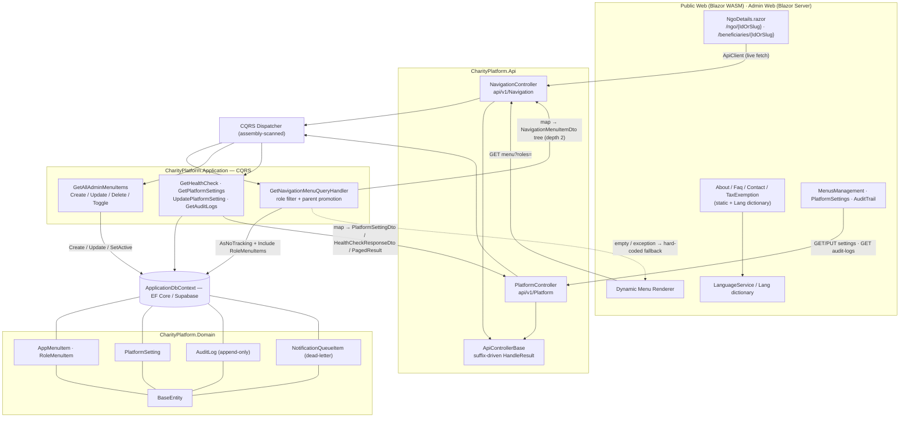
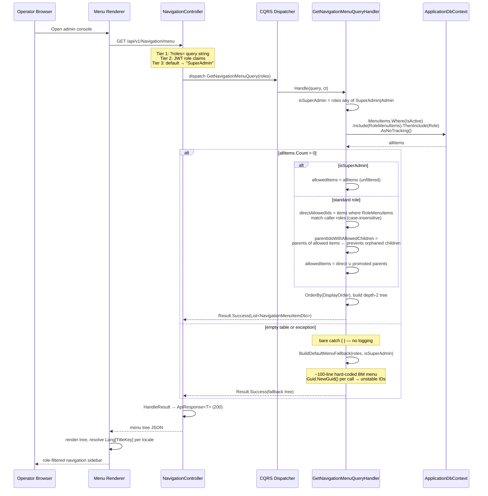

I have everything I need. Full source verified — domain entities, contracts, handlers, controllers, and the client pages. Writing the document now.

---

# Platform Content and Navigation Domain

> **ESalam — Component & Domain Documentation**
> Scope: dynamic navigation menus, platform-wide runtime settings, informational content pages, and the audit/notification persistence primitives that live in the same domain package.
> Verification basis: verbatim source read of Domain entities, Contracts records, Application CQRS handlers, API controllers, and Blazor WebAssembly client pages.

---

## 1. Executive Summary

The **Platform Content and Navigation Domain** is a *Supporting Business Domain* (`importance: 7.0`, `complexity: 4.5`) whose single responsibility is to keep the platform's **discoverability surface** — what appears in the menu, what an operator is allowed to see, what configurable parameters govern fees and tax, and what informational text a visitor reads — changeable **without recompiling or redeploying the application**.

It is deliberately the smallest domain in the ESalam decomposition, and that smallness is a design statement. Money movement lives in the Financial Governance Domain; identity lives in Identity and Access; campaigns in Fundraising. This domain touches none of those invariants. What it *does* own is something subtler and structurally important: **it is the first domain an operator configures after deployment, and the last domain any user notices** — yet if it breaks, the administrative console becomes unusable because navigation is database-driven, not hard-coded.

Three distinct concerns are bundled here:

| Concern | Mechanism | Changeable without redeploy |
|---|---|---|
| **Dynamic navigation** | `AppMenuItem` + `RoleMenuItem` + role-filtered tree query | ✅ Yes — full menu tree, hierarchy, icons, ordering, and role visibility |
| **Runtime platform settings** | `PlatformSetting` key/value store with `DataType` + `IsPublic` | ✅ Yes — fees, tax rates, operational flags |
| **Informational content** | Razor pages (`About`, `Faq`, `Contact`, `TaxExemption`, `NgoDetails`) | ⚠️ Partial — **strings** are localizable via the `Lang` dictionary at runtime; **structure** requires a deployment |
| **Audit & notification persistence** | `AuditLog` (immutable), `NotificationQueueItem` (stateful queue) | ❌ No — these are write-once records and queue rows |

The honest architectural verdict is stated up front and carried through this document: **navigation and settings are genuinely 100% configuration-driven; informational pages are not a CMS.** They are Razor markup whose *text* is externalized into a language dictionary, but whose *layout, section structure, and FAQ item count* are compiled. The domain's documentation self-reports this limitation correctly ("konten halaman statis tetap berada di markup Razor, bukan CMS penuh"), and the source confirms it.

---

## 2. Purpose and Position in the Architecture

### 2.1 Clean Architecture Placement

This domain is spread across all five backend layers, which is exactly correct for a feature-oriented (vertical) slice through a layered architecture:

```
CharityPlatform.Domain          AppMenuItem, RoleMenuItem, PlatformSetting,
                                AuditLog, NotificationQueueItem
        ▲
CharityPlatform.Application     NavigationQueries.cs  (6 handlers)
                                PlatformHandlers.cs   (4 handlers)
        ▲
CharityPlatform.Contracts       NavigationContracts.cs, PlatformContracts.cs
        ▲
CharityPlatform.Api             NavigationController  (6 endpoints)
                                PlatformController    (5 endpoints)
        ▲
CharityPlatform.PublicWeb.Wasm.Client   About / Faq / Contact / TaxExemption / NgoDetails
CharityPlatform.AdminWeb               MenusManagement / PlatformSettings / AuditTrail
```

There is **no Infrastructure-layer component specific to this domain**. It reuses the shared `IApplicationDbContext` and the EF Core `ApplicationDbContext` owned by the Data and Application Foundation Domain, plus `BaseEntity` for audit fields. This is a meaningful economy: the domain adds two entity groups and two handler files, and inherits persistence, auditing, and telemetry for free.

### 2.2 Why Navigation Lives in the Database

The design decision worth naming explicitly is **`TitleKey` instead of a title string**.

```csharp
public string TitleKey { get; private set; } = string.Empty;   // "Nav_Ledger"
public string DefaultTitle { get; private set; } = string.Empty; // "Lejar Berkembar"
```

Rather than storing `"Lejar Berkembar"` and calling it done, the entity stores a **localization key** plus a **fallback display string**. The Blazor client resolves `Lang["Nav_Ledger"]` from its language dictionary and renders the active locale — Malay or English — with `DefaultTitle` as the defensive fallback. This yields three properties simultaneously:

1. **Language switching is instant and client-side.** No round trip, no menu refetch, no server involvement.
2. **Menu relabeling requires no deployment.** An administrator renames a menu item in `MenusManagement.razor`; `TitleKey` stays stable so translations keep resolving.
3. **The same menu row serves both the public site and the admin console**, at different role filters.

The cost is a discipline requirement: every new `TitleKey` must exist in the language dictionary or the UI silently falls back to `DefaultTitle`. That coupling is the domain's principal operational risk and is treated in §8.

---

## 3. Domain Model

All five entities derive from `BaseEntity` (from Data and Application Foundation), inheriting `Id`, `CreatedAt`, `UpdatedAt`. Every entity uses a **private parameterless constructor** (for EF Core materialization) plus a **static factory** `Create(...)` and explicit mutator methods — no public setters anywhere. This is the standard invariant-protection pattern used consistently across the platform.

### 3.1 `AppMenuItem` — Navigation Node

`src/CharityPlatform.Domain/Entities/Platform/AppMenuItem.cs`

```csharp
public class AppMenuItem : BaseEntity
{
    public string  TitleKey      { get; private set; }   // localization key
    public string  DefaultTitle  { get; private set; }   // fallback label
    public string? Path          { get; private set; }   // null = pure grouping node
    public string  Icon          { get; private set; }   // material icon name
    public int     DisplayOrder  { get; private set; }
    public Guid?   ParentId      { get; private set; }   // self-referencing hierarchy
    public bool    IsActive      { get; private set; }

    public AppMenuItem?              Parent        { get; private set; }
    public ICollection<AppMenuItem>  Children      { get; private set; }
    public ICollection<RoleMenuItem> RoleMenuItems { get; private set; }
}
```

**Structural notes that matter operationally:**

- **`Path` nullable is semantically load-bearing.** `null` marks the node as a **pure group/container** — a parent whose only purpose is to hold children. The client renders it as a non-navigable expandable section. Sending a user to a group node would be a navigation dead-end, and the nullability enforces that at the type level.
- **Hierarchy depth is structurally two levels.** The domain permits arbitrary self-referencing depth via `ParentId`, but the query handler (`GetNavigationMenuQueryHandler`) only materializes **top level → one level of children**. The DTO's `Children` list is populated with leaf nodes whose own `Children` is always an empty list. This is a material implementation fact, documented in §4.2 — the model allows more than the read path delivers.
- **`IsActive` is a soft visibility switch**, distinct from deletion. Inactive items are filtered out at query time (`.Where(m => m.IsActive)`), so toggling a menu item off is instant and reversible — the admin equivalent of a feature flag for navigation.
- **Factory normalizes input.** `Create(...)` trims all strings and collapses whitespace-only `Path` to `null`:
  ```csharp
  Path = string.IsNullOrWhiteSpace(path) ? null : path.Trim();
  ```
  This prevents the classic bug where an empty-string path renders a group node as a broken link.

**Mutators:**

| Method | Semantics | Notes |
|---|---|---|
| `Create(...)` | Factory, generates `Guid.NewGuid()`, sets timestamps | `DisplayOrder` defaults to `0`, `IsActive` to `true` |
| `Update(titleKey, defaultTitle, path, icon, displayOrder, parentId, isActive)` | Full field replacement | Touches all seven mutable fields, refreshes `UpdatedAt` |
| `SetActive(bool)` | Narrow single-purpose toggle | Used by the dedicated PATCH status endpoint |

The existence of a **dedicated `SetActive`** alongside the general `Update` is a deliberate API-shaping choice: the toggle endpoint can flip visibility without the caller having to resend the entire menu item payload — eliminating a whole class of partial-update bugs where a status toggle accidentally blanks the icon or path.

### 3.2 `RoleMenuItem` — Role Visibility Join

```csharp
public class RoleMenuItem
{
    public Guid          RoleId     { get; set; }
    public Role          Role       { get; set; }
    public Guid          MenuItemId { get; set; }
    public AppMenuItem   MenuItem   { get; set; }
    public DateTime      AssignedAt { get; set; } = DateTime.UtcNow;
}
```

This is the authorization substrate for the entire menu. It is a **plain join entity**, not a `BaseEntity` — it has no `Id`, no soft-delete, and no audit columns, because its identity *is* the composite `(RoleId, MenuItemId)` pair and its lifecycle is fully governed by the parent menu item. `AssignedAt` provides a lightweight assignment timestamp.

The relationship is **many-to-many**: one menu item is visible to N roles; one role sees M menu items. The role filter therefore reduces to a set-membership test in the query handler, which is where the interesting logic lives (§4.2).

### 3.3 `PlatformSetting` — Runtime Configuration

`src/CharityPlatform.Domain/Entities/Platform/PlatformEntities.cs`

```csharp
public class PlatformSetting : BaseEntity
{
    public string SettingKey   { get; private set; }
    public string SettingValue { get; private set; }
    public string Description  { get; private set; }
    public string DataType     { get; private set; } = "string"; // string | number | boolean | json
    public bool   IsPublic     { get; private set; } = false;
}
```

Four design properties:

- **`SettingKey` is the lookup key**, matched exactly by `UpdatePlatformSettingCommandHandler` (`FirstOrDefaultAsync(s => s.SettingKey == cmd.SettingKey)`). Keys are the stable contract; values are mutable.
- **`DataType` is declarative metadata, not enforced typing.** Values are stored as `string` regardless. The `DataType` field tells a consumer how to *interpret* the value — `"number"` for a fee rate, `"boolean"` for an operational flag, `"json"` for structured config. This is intentional simplicity: a single untyped column backed by explicit consumer-side parsing, rather than a typed settings subsystem. The trade-off is real and noted in §8.
- **`IsPublic` is the confidentiality gate.** It separates parameters safe for anonymous consumption (published platform fee percentage, tax rate) from parameters that must remain administrative. Critically — and this is a **finding**, not a feature — the current `GetSettings` endpoint returns **all settings regardless of `IsPublic`**, and the client filters. See §7.1.
- **Mutation is single-method.** `UpdateValue(string value)` is the only mutator. There is no method to change `SettingKey`, `Description`, `DataType`, or `IsPublic` after creation — those are set once in `Create(...)`. A setting's *identity and classification* are immutable; only its *value* floats. That is precisely the correct invariant for a configuration store.

### 3.4 `AuditLog` — Immutable Compliance Record

```csharp
public class AuditLog : BaseEntity
{
    public string?  UserId, UserEmail;
    public string   Action     { get; private set; }  // Create, Update, Delete, Approve, Reject, Refund
    public string   EntityName { get; private set; }  // Campaign, Donation, Payout, Beneficiary
    public string?  EntityId, OldValues, NewValues, IpAddress, UserAgent;
    public DateTime PerformedAt { get; private set; }
}
```

The **only** method is `static AuditLog Create(...)`. There is **no update method, no delete method, no setter**. This is an append-only entity enforced by the type system — a genuinely strong design property, since the audit trail is the platform's compliance evidence. Even a compromised handler cannot rewrite history through the domain API; it would have to issue raw SQL.

Note the `UserId`/`UserEmail` pair: identity is denormalized into the record rather than referenced by foreign key. This is correct for an audit table — the record must remain interpretable even if the referenced user is later deleted or renamed.

The bulk of these rows are **not** written by this domain's handlers at all. `ApplicationDbContext.SaveChangesAsync` auto-generates audit rows from EF's `ChangeTracker` for every added/modified/deleted entity (excluding `AuditLog` and `NotificationQueueItem` themselves), capturing actor, IP, and user agent from `CurrentUserService`. This domain supplies the *storage and query surface*; the Data and Application Foundation Domain supplies the *automatic capture*. See §5.4.

### 3.5 `NotificationQueueItem` — Outbound Notification Queue

```csharp
public class NotificationQueueItem : BaseEntity
{
    public string   Recipient;      // email or phone
    public string   Channel = "Email"; // Email | SMS | WhatsApp
    public string   TemplateName, Subject, PayloadJson;
    public string   Status = "Pending"; // Pending | Sent | Failed | DeadLetter
    public int      RetryCount, MaxRetries = 3;
    public string?  ErrorDetails;
    public DateTime? SentAt;
}
```

This is the one entity in the domain with a genuine **state machine**, and it contributes real business value:

| Transition | Method | Effect |
|---|---|---|
| `Pending` → `Sent` | `MarkSent()` | Sets `Status="Sent"`, records `SentAt`, clears `ErrorDetails` |
| `Pending` → `Pending` (retry) | `MarkFailed(error)` | Increments `RetryCount`, stores error; stays `Pending` while `RetryCount < MaxRetries` |
| `Pending` → `DeadLetter` | `MarkFailed(error)` | When `RetryCount >= MaxRetries` — terminal poisoning, no further retries |

The **dead-letter transition is the notable engineering detail**. A naive retry loop retries forever and turns one malformed recipient address into an infinite queue backlog. Here, `MaxRetries` (default 3) bounds the attempts and `MarkFailed` automatically routes the item to `DeadLetter` — a terminal state a worker can drain and report on without ever blocking the live queue.

`Channel` is a string rather than an enum with the comment enumerating legal values (`Email, SMS, WhatsApp`). This preserves forward compatibility — adding a channel requires no schema or enum change — at the cost of compile-time safety. Consistent with the platform's broader string-typed-enumeration convention.

**Scope note:** this domain owns the *persistence shape* of the notification queue. The worker that drains it and the `IEmailService` that performs delivery belong elsewhere (and, per the architecture audit, `EmailService` is currently a no-op logger — a GAP in the Financial/Foundation layers, not here).

---

## 4. Application Layer — CQRS Handlers

This domain follows the platform-wide hand-rolled CQRS convention (no MediatR): request records implement `IQuery<T>` or `ICommand<T>`, handlers implement `IQueryHandler<,>` / `ICommandHandler<,>`, and all are auto-registered by assembly scanning in `Application/DependencyInjection.cs`. Every handler depends on `IApplicationDbContext` directly — there is **no repository layer**, and none is wanted; EF Core's `DbSet` already is the abstraction.

### 4.1 Handler Inventory

**`NavigationQueries.cs`** — 6 handlers (455 lines):

| Handler | Request | Returns | Kind |
|---|---|---|---|
| `GetNavigationMenuQueryHandler` | `GetNavigationMenuQuery(List<string> Roles)` | `List<NavigationMenuItemDto>` | Query — role-filtered tree |
| `GetAllAdminMenuItemsQueryHandler` | `GetAllAdminMenuItemsQuery` | `List<MenuItemAdminDetailDto>` | Query — flat admin list |
| `CreateMenuItemCommandHandler` | `CreateMenuItemCommand(CreateMenuItemRequest)` | `MenuItemAdminDetailDto` | Command — with validation |
| `UpdateMenuItemCommandHandler` | `UpdateMenuItemCommand(Guid, UpdateMenuItemRequest)` | `MenuItemAdminDetailDto` | Command |
| `DeleteMenuItemCommandHandler` | `DeleteMenuItemCommand(Guid)` | `Result` | Command |
| `ToggleMenuItemStatusCommandHandler` | `ToggleMenuItemStatusCommand(Guid, bool)` | `Result` | Command |

**`PlatformHandlers.cs`** — 4 handlers (175 lines):

| Handler | Request | Returns | Kind |
|---|---|---|---|
| `GetHealthCheckQueryHandler` | `GetHealthCheckQuery` | `HealthCheckResponseDto` | Query — live DB probe |
| `GetPlatformSettingsQueryHandler` | `GetPlatformSettingsQuery` | `List<PlatformSettingDto>` | Query |
| `UpdatePlatformSettingCommandHandler` | `UpdatePlatformSettingCommand(string, string)` | `PlatformSettingDto` | Command |
| `GetAuditLogsQueryHandler` | `GetAuditLogsQuery(AuditLogQuery)` | `PagedResult<AuditLogDto>` | Query — filtered + paged |

### 4.2 The Role Filtering Algorithm — the Domain's Core Logic

This is the most consequential code in the domain. It is reconstructed verbatim from `GetNavigationMenuQueryHandler.Handle`.

**Step 1 — SuperAdmin short-circuit:**

```csharp
var isSuperAdmin = roles.Any(r => string.Equals(r, "SuperAdmin", StringComparison.OrdinalIgnoreCase)
                               || string.Equals(r, "Admin", StringComparison.OrdinalIgnoreCase));
```

`SuperAdmin` (and the alias `Admin`) bypasses role filtering entirely and receives every active menu item. This is a deliberate escape hatch: an administrator must never be locked out of the console that manages the console, even if `RoleMenuItem` rows are misconfigured or missing.

**Step 2 — Load active items with role data eagerly:**

```csharp
var menuQuery = _context.MenuItems
    .AsNoTracking()
    .Include(m => m.RoleMenuItems).ThenInclude(rm => rm.Role)
    .Where(m => m.IsActive);
```

`AsNoTracking()` is correct for a read-only projection. The double `Include` is what makes role names available without N+1 queries.

**Step 3 — Resolve directly-allowed items:**

```csharp
var directAllowedIds = allItems
    .Where(m => m.RoleMenuItems.Any(rm => roles.Contains(rm.Role.Name, StringComparer.OrdinalIgnoreCase)))
    .Select(m => m.Id)
    .ToHashSet();
```

Set-membership test, case-insensitive, on `HashSet<Guid>` for O(1) lookup.

**Step 4 — Promote parents of allowed children (the important part):**

```csharp
var parentIdsWithAllowedChildren = allItems
    .Where(m => m.ParentId.HasValue && directAllowedIds.Contains(m.Id))
    .Select(m => m.ParentId!.Value)
    .ToHashSet();

allowedItems = allItems
    .Where(m => directAllowedIds.Contains(m.Id) || parentIdsWithAllowedChildren.Contains(m.Id))
    .ToList();
```

**This solves the orphaned-child problem.** A parent group node is often a pure container with no role assignment of its own. Without this promotion step, a `Reviewer` granted access to the child "Semak Kempen" would see nothing at all, because its parent "Kempen & Bantuan" carries no `RoleMenuItem` for `Reviewer` — the tree would silently drop the child. The handler detects "this item has an allowed child" and force-includes the parent as a **structural shell**. The parent grants no new privilege; it exists only so the permitted child has somewhere to render. Failing to do this is one of the most common bugs in role-based menu systems, and this implementation handles it explicitly and correctly.

**Step 5 — Build the tree, ordered:**

```csharp
var topLevelItems = allowedItems
    .Where(m => !m.ParentId.HasValue)
    .OrderBy(m => m.DisplayOrder)
    .ToList();

foreach (var top in topLevelItems)
{
    var children = allowedItems
        .Where(m => m.ParentId == top.Id)
        .OrderBy(m => m.DisplayOrder)
        .Select(c => new NavigationMenuItemDto(..., new List<NavigationMenuItemDto>()))
        .ToList();
    result.Add(new NavigationMenuItemDto(..., children));
}
```

Two levels are materialized. Child `Children` collections are always empty — **the read path is depth-2 even though the model permits depth-N.** This is a documented constraint, not a defect: the ESalam console navigation is a two-level sidebar by design, and the query mirrors that reality. Any future grandchild menu item would be **invisible** through this endpoint until the handler gains a recursive builder.

**Step 6 — The defensive fallback (the domain's most significant behavioural quirk):**

```csharp
        }
        catch
        {
            // Defensive fallback
        }

    return Result<List<NavigationMenuItemDto>>.Success(BuildDefaultMenuFallback(roles, isSuperAdmin));
```

`BuildDefaultMenuFallback(roles, isSuperAdmin)` is a **~100-line hard-coded menu tree** compiled into the application, containing the full ESalam admin navigation in **Bahasa Melayu** (`"Semak Kempen"`, `"Lejar Berkembar"`, `"Pengurusan Menu"`, `"Jejak Audit Sistem"`), with `Guid.NewGuid()` IDs assigned fresh on every invocation and role conditions applied inline (`isSuperAdmin`, `isFinance`, `isReviewer`, `isCampaignMgr`).

It is reached under **two** conditions:

1. The database query **throws** (caught by the bare `catch` — swallowing the exception without logging).
2. The database query **returns zero active items** (`if (allItems.Count > 0)` falls through).

**Consequences, stated plainly:**

- **Availability benefit** — an operator whose navigation table is empty or whose DB read failed still receives a working console. The admin UI cannot be bricked by a settings mistake.
- **Observability cost** — the bare `catch { }` discards the exception **without logging**. A persistent database failure manifests as "the menu looks slightly different" rather than an error. Root cause is invisible; recovery is silent.
- **Identity instability** — fallback IDs are regenerated per call via `Guid.NewGuid()`, so they differ between requests. Any client keying menu state by item ID (expansion, selection, telemetry attribution) will behave inconsistently whenever fallback engages.
- **Behavioural masking** — an operator who deactivates every menu item sees a populated menu anyway, which contradicts the intent of `IsActive`.

This is a **PLAUSIBLE/MEDIUM finding**, fully reproducible: empty the `AppMenuItem` table → the endpoint returns a complete, functional, non-persisted menu tree with volatile IDs, and no diagnostic signal is emitted.

### 4.3 Validation in `CreateMenuItemCommandHandler`

The create path performs **explicit guard validation before entity construction**:

```csharp
if (string.IsNullOrWhiteSpace(req.TitleKey))
    return Result.Failure<MenuItemAdminDetailDto>(
        new Error("Menu.TitleKeyRequired", "Title key is required."));

if (string.IsNullOrWhiteSpace(req.DefaultTitle))
    return Result.Failure<MenuItemAdminDetailDto>(
        new Error("Menu.DefaultTitleRequired", "Default title is required."));
```

Two properties are notable:

1. **Validation lives in the handler, not the API layer.** The controller does not model-bind-validate; it dispatches and maps. Failure surfaces as a `Result` carrying a structured `Error` with a dotted code — consistent with the platform's `Result` pattern and preserving thin controllers.
2. **Error codes are namespaced** (`Menu.TitleKeyRequired`) rather than generic. The HTTP mapping in `ApiControllerBase` is **suffix-driven on `error.Code`**: codes ending `NotFound` → 404, `Unauthorized` → 401, `Forbidden` → 403, `Conflict`/`AlreadyExists` → 409, everything else → 400. So `Menu.TitleKeyRequired` degrades correctly to **400** by falling through to the default branch. A subtle trap: a future code named `Menu.NotFoundKey` would inadvertently return 404 because the mapper matches the suffix, not the namespace.

**Asymmetry worth noting:** the create path validates `TitleKey` and `DefaultTitle` but **not** `DisplayOrder` or `ParentId` — so a menu item can be created with a `ParentId` referencing a non-existent parent (producing an orphan that never renders, since neither step 4's promotion nor step 5's top-level filter would place it) or with a `ParentId` that creates a cycle. There is no cycle detection anywhere in the domain.

### 4.4 Audit Log Query — Filtering and Paging

`GetAuditLogsQueryHandler` is the domain's most substantial query, and it demonstrates the paging discipline used across the platform.

**Free-text search spans eight columns:**

```csharp
dbQuery = dbQuery.Where(a =>
    a.Action.ToLower().Contains(term)     || a.EntityName.ToLower().Contains(term) ||
    a.EntityId.ToLower().Contains(term)   || a.UserEmail.ToLower().Contains(term)  ||
    a.UserId.ToLower().Contains(term)     || a.IpAddress.ToLower().Contains(term)  ||
    a.NewValues.ToLower().Contains(term)  || a.OldValues.ToLower().Contains(term));
```

This is what makes the audit screen usable: an investigator can paste a campaign GUID, a reviewer's email, or an IP address into one box and find the matching trail without choosing a field first. All comparisons are `ToLower()` normalizations so search is case-insensitive.

**Structured filters compose additively** — `EntityName`, `Action`, `UserId` (exact match), plus `FromDate`/`ToDate`. The date handling is deliberate and correct:

```csharp
var fromUtc = DateTime.SpecifyKind(q.FromDate.Value, DateTimeKind.Utc);
dbQuery = dbQuery.Where(a => a.PerformedAt >= fromUtc);
```

`DateTime.SpecifyKind(..., DateTimeKind.Utc)` reinterprets the incoming value as UTC rather than converting it. Stable and predictable given that `PerformedAt` is written as `DateTime.UtcNow` — but it does mean a client sending local wall-clock time receives offset-shifted results. The API contract requires the caller to supply UTC. Documenting this is more useful than changing it.

**Paging is offset-based with a separate count:**

```csharp
var total = await dbQuery.CountAsync(ct);
var items = await dbQuery.OrderByDescending(a => a.PerformedAt)
    .Skip((q.PageNumber - 1) * q.PageSize)
    .Take(q.PageSize)
    ...
return Result.Success(new PagedResult<AuditLogDto>(items, total, q.PageNumber, q.PageSize));
```

`OrderByDescending(PerformedAt)` guarantees newest-first — essential for an audit view — and deterministic ordering is a prerequisite for stable paging. `PageSize` defaults to **20** in the `AuditLogQuery` record; there is **no server-side upper bound**, so a caller may request `PageSize=100000`. This is a **LOW/MEDIUM availability finding**: an unauthenticated or low-privilege caller against `GET /api/v1/Platform/audit-logs` can force a full-table read with deep `OldValues`/`NewValues` text payloads. A clamp (e.g. `PageSize = Math.Min(q.PageSize, 100)`) is a one-line fix.

### 4.5 Health Check — Structured Component Reporting

```csharp
var sw = System.Diagnostics.Stopwatch.StartNew();
try
{
    await _db.PlatformSettings.Take(1).ToListAsync(ct);
    sw.Stop();
    checks["Database"] = new HealthComponentDto("Healthy", "PostgreSQL database responsive", sw.ElapsedMilliseconds);
}
catch (Exception ex)
{
    sw.Stop();
    checks["Database"] = new HealthComponentDto("Unhealthy", ex.Message, sw.ElapsedMilliseconds);
}

var overallStatus = checks.Values.All(c => c.Status == "Healthy") ? "Healthy" : "Degraded";
```

Three design observations:

- **The probe executes a real query** (`Take(1)` against `PlatformSettings`), not a `SELECT 1` ping and not a connection-string parse. It exercises the actual EF Core path, so a context misconfiguration is caught, not just a dead socket.
- **Duration is measured per component** via `Stopwatch`, surfacing latency alongside status — enough to distinguish "database is slow" from "database is down" without a separate metrics query.
- **The response is an aggregate dictionary**, not a bare `"OK"`. `Dictionary<string, HealthComponentDto>` means adding a second dependency (storage, gateway reachability) requires no contract change.

Two limitations to be explicit about: the **`Environment` and `Version` fields are hard-coded** (`"Production"`, `"1.0.0"`) rather than read from configuration or assembly metadata, so the endpoint reports a fixed environment string regardless of where it actually runs; and the **failure branch returns `ex.Message` verbatim**, which can disclose connection-string fragments or hostnames to an unauthenticated caller. Container health checks genuinely need the *status*; they do not need the raw exception text.

---

## 5. API Surface

Both controllers inherit `ApiControllerBase`, which supplies the shared `HandleResult` overloads performing `Result`/`Result<T>` → `IActionResult` translation. Every successful response is wrapped in `ApiResponse<T>` carrying the payload plus a timestamp. Controllers perform **no business logic** — pure binding, dispatch, and mapping.

### 5.1 `NavigationController` — `api/v1/Navigation`

`src/CharityPlatform.Api/Controllers/Navigation/NavigationController.cs` (145 lines, 6 endpoints)

| Method | Route | Handler | Response |
|---|---|---|---|
| `GET` | `api/v1/Navigation/menu` | `GetNavigationMenuQuery` | `ApiResponse<List<NavigationMenuItemDto>>` |
| `GET` | `api/v1/Navigation/admin-menus` | `GetAllAdminMenuItemsQuery` | `ApiResponse<List<MenuItemAdminDetailDto>>` |
| `POST` | `api/v1/Navigation/admin-menus` | `CreateMenuItemCommand` | `ApiResponse<MenuItemAdminDetailDto>` |
| `PUT` | `api/v1/Navigation/admin-menus/{id:guid}` | `UpdateMenuItemCommand` | `ApiResponse<MenuItemAdminDetailDto>` |
| `DELETE` | `api/v1/Navigation/admin-menus/{id:guid}` | `DeleteMenuItemCommand` | `ApiResponse` |
| `PATCH` | `api/v1/Navigation/admin-menus/{id:guid}/status` | `ToggleMenuItemStatusCommand` | `ApiResponse` |

The `menu` endpoint performs **role resolution with a three-tier precedence**:

```csharp
var roleList = new List<string>();

// Tier 1 — explicit query-string roles
if (!string.IsNullOrWhiteSpace(roles))
    roleList.AddRange(roles.Split(',', StringSplitOptions.RemoveEmptyEntries | StringSplitOptions.TrimEntries));

// Tier 2 — authenticated JWT claims
if (User.Identity?.IsAuthenticated == true)
{
    var claimRoles = User.Claims
        .Where(c => c.Type == ClaimTypes.Role || c.Type == "role" || c.Type == "roles")
        .Select(c => c.Value);
    roleList.AddRange(claimRoles);
}

// Tier 3 — default
if (roleList.Count == 0)
    roleList.Add("SuperAdmin");
```

The claim extraction is **defensive about claim-type naming** (`ClaimTypes.Role`, `role`, `roles`) — sensible, since JWT issuers vary in which URI form they emit for role claims.

**Tier 3 is a security-relevant default.** An unauthenticated request with no `roles` parameter is treated as `SuperAdmin`, and the handler's Step-1 short-circuit (`roles.Any(r => "SuperAdmin")`) then returns the **complete, unfiltered navigation tree**. This is a development affordance — the comment in source reads *"Default to SuperAdmin if no role is explicitly passed for admin dev testing"* — that is reachable in production. Combined with the platform-wide finding that `AdminPortalAuthenticationMiddleware` promotes unauthenticated requests bearing `X-User-*` headers to `SuperAdmin`, the navigation endpoint reliably discloses the full administrative information architecture — route paths (`/ledger`, `/payouts`, `/platform/positions`, `/audit`), display labels, icons, and role bindings — to anyone who asks. See §7.1.

**Note also:** no `[Authorize]` attribute appears on **any** endpoint in either controller. `NavigationController` carries none at all; `PlatformController` applies exactly one.

### 5.2 `PlatformController` — `api/v1/Platform`

`src/CharityPlatform.Api/Controllers/Platform/PlatformController.cs` (111 lines, 5 endpoints)

| Method | Route | Authorization | Purpose |
|---|---|---|---|
| `GET` | `api/v1/Platform/health/live` | none | Liveness heartbeat: `{ status, timestamp }` |
| `GET` | `api/v1/Platform/health/ready` | none | Readiness probe → `HealthCheckResponseDto` |
| `GET` | `api/v1/Platform/settings` | **none** | All platform settings |
| `PUT` | `api/v1/Platform/settings` | `[Authorize(Policy = "RequireSuperAdmin")]` | Update one setting |
| `GET` | `api/v1/Platform/audit-logs` | **none** | Paged audit trail |

**The authorization asymmetry is the headline.** `PUT settings` correctly carries `[Authorize(Policy = "RequireSuperAdmin")]`, while the three reads above it — settings, audit logs, and health readiness — carry nothing. The XML documentation on `UpdateSetting` states *"403 Forbidden if caller lacks SuperAdmin role"*, and that claim is accurate for the write. The audit-log endpoint, which exposes actor identities, email addresses, source IP addresses, and raw `OldValues`/`NewValues` JSON diffs of every entity mutation in the platform, is documented with no access requirement and enforces none.

The health endpoints deserve a lighter verdict: liveness and readiness probes are legitimately unauthenticated in most topologies so orchestrators can reach them. But `health/ready` returns per-component error detail including `ex.Message` (§4.5), and the whole domain is reachable through the nginx `/api/` route with no path-based restriction.

### 5.3 Data Transfer Contracts

`src/CharityPlatform.Contracts/Navigation/NavigationContracts.cs` and `PlatformContracts.cs`

Every contract is a C# `record` — reference-type with **value equality** and built-in deconstruction. All are **positional records with no setters**: DTOs are immutable once constructed, and mapping from entity to DTO happens entirely in the handlers, so controllers never touch domain types.

**Navigation contracts:**

```csharp
public record NavigationMenuItemDto(
    Guid Id, string TitleKey, string DefaultTitle, string? Path, string Icon,
    int DisplayOrder, Guid? ParentId, List<string> AllowedRoles,
    List<NavigationMenuItemDto> Children);          // ← recursive tree shape

public record MenuItemAdminDetailDto(
    Guid Id, string TitleKey, string DefaultTitle, string? Path, string Icon,
    int DisplayOrder, Guid? ParentId, string? ParentTitle,   // ← resolved parent label
    bool IsActive, List<Guid> RoleIds, List<string> RoleNames, DateTime CreatedAt);

public record CreateMenuItemRequest(string TitleKey, string DefaultTitle, string? Path,
    string Icon, int DisplayOrder, Guid? ParentId, List<Guid> RoleIds);

public record UpdateMenuItemRequest(string TitleKey, string DefaultTitle, string? Path,
    string Icon, int DisplayOrder, Guid? ParentId, bool IsActive, List<Guid> RoleIds);

public record ToggleMenuItemStatusRequest(bool IsActive);
```

`NavigationMenuItemDto` is **self-referentially recursive** — precisely matching the tree the client renders. `MenuItemAdminDetailDto` flattens the hierarchy for a data grid but adds `ParentTitle` (resolved in the handler via `Include(m => m.Parent)`) so the grid can display "Kempen & Bantuan" instead of a bare GUID, and `RoleIds` **alongside** `RoleNames` so an edit form can pre-check the assignment controls without a second lookup.

`UpdateMenuItemRequest` carries `IsActive` while `CreateMenuItemRequest` does not — creation always starts active. Both carry `List<Guid> RoleIds`, the mechanism by which role visibility is set.

**Platform contracts:**

```csharp
public record HealthCheckResponseDto(string Status, string Environment, string Version,
    DateTime Timestamp, Dictionary<string, HealthComponentDto> Checks);
public record HealthComponentDto(string Status, string? Description, long DurationMs);
public record PlatformSettingDto(Guid Id, string SettingKey, string SettingValue,
    string Description, string DataType, bool IsPublic, DateTime UpdatedAt);
public record UpdateSettingRequest(string SettingKey, string SettingValue);
public record AuditLogDto(Guid Id, string? UserId, string? UserEmail, string Action,
    string EntityName, string? EntityId, string? OldValues, string? NewValues,
    string? IpAddress, string? UserAgent, DateTime PerformedAt);
public record AuditLogQuery(string? SearchTerm, string? EntityName, string? Action,
    string? UserId, DateTime? FromDate, DateTime? ToDate, int PageNumber = 1, int PageSize = 20);
public record SendNotificationRequest(string Recipient, string Channel,
    string TemplateName, string Subject, Dictionary<string, string> TemplateData);
```

`AuditLogQuery` is a record with **default parameter values** (`PageNumber = 1`, `PageSize = 20`) and all filters optional — as an MVC `[FromQuery]` parameter, it binds from the query string with defaults applied for omitted fields, keeping the endpoint URL-driven and the controller signature clean.

`UpdateSettingRequest` deliberately accepts only `SettingKey` + `SettingValue`, matching `PlatformSetting.UpdateValue(string)` exactly. The contract makes the domain invariant visible: **you can change a value; you cannot change a setting's identity or its `IsPublic` classification** through the API.

### 5.4 Service Endpoints Outside This Domain

For completeness — the audit trail reaches administrators by two routes. `GET api/v1/Platform/audit-logs` is this domain's surface, implemented in `PlatformHandlers.cs`. The *automatic generation* of those rows is a platform-wide concern owned by the Data and Application Foundation Domain: `ApplicationDbContext.SaveChangesAsync` inspects `ChangeTracker` on every save and emits an `AuditLog` row per added/modified/deleted entity (skipping `AuditLog` and `NotificationQueueItem` to avoid recursion), pulling actor identity, email, IP, and user agent from `CurrentUserService`. This domain provides the destination and the query; the foundation provides the capture.

---

## 6. Presentation Layer — Informational Pages

### 6.1 Localization Architecture

Four of the five pages share an identical pattern, verified in `About.razor` and `Faq.razor`:

```razor
@page "/about"
@implements IDisposable

<PageTitle>@Lang["About_PageTitle"]</PageTitle>

<nav aria-label="breadcrumb" class="page-breadcrumb-nav">
    <ol class="page-breadcrumb-list">
        <li class="page-breadcrumb-item">
            <a href="" class="page-breadcrumb-link">
                <Icon Name="receipt" Size="14" />
                <span>@Lang["Nav_Home"]</span>
            </a>
        </li>
        <li class="page-breadcrumb-separator">/</li>
        <li class="page-breadcrumb-current" aria-current="page">@Lang["About_Breadcrumb"]</li>
    </ol>
</nav>

@code {
    protected override void OnInitialized() => Lang.OnLanguageChanged += OnLanguageChangedEvent;
    private void OnLanguageChangedEvent() => InvokeAsync(StateHasChanged);
    public void Dispose() => Lang.OnLanguageChanged -= OnLanguageChangedEvent;
}
```

**Every visible string is a `Lang` dictionary lookup.** Not a single hard-coded user-facing literal appears in the markup. Five structural conventions are consistently applied:

1. **`@implements IDisposable` + event subscription** — the page subscribes to `LanguageService.OnLanguageChanged` and unsubscribes in `Dispose()`. Without this, switching language would leave already-rendered pages stale. This is correct Blazor event-subscription hygiene, and its consistent application across pages shows the pattern was established deliberately rather than copied ad hoc.
2. **`InvokeAsync(StateHasChanged)`** — marshals the re-render onto the UI synchronization context, required because the language event can fire off the render thread.
3. **Namespaced dictionary keys** — `About_Pillar1_Title`, `Faq_BannerTitle`, `About_Btn_VerifyLedger`. Prefix-by-page keeps the dictionary navigable and makes orphaned keys detectible.
4. **Accessible breadcrumbs** — `<nav aria-label="breadcrumb">`, `<ol>` semantics, and `aria-current="page"` on the terminal crumb. Accessibility is treated as a rendering requirement, not an afterthought.
5. **`Icon` component + CSS classes** rather than inline SVG for navigation chrome (inline SVG appears only for the one-off verified badge in `NgoDetails`).

`About.razor` composes three "core pillar" cards from `About_Pillar{1,2,3}_{Title,Desc}`, then a governance panel with two CTAs — `About_Btn_LatestCampaigns` → `/campaigns` and `About_Btn_VerifyLedger` → `/verification`. The pillar copy is fully editable in the language dictionary; the **three-card grid layout is compiled**.

`Faq.razor` is more interesting — it is **data-driven within the page**:

```csharp
private readonly (string QKey, string AKey)[] _faqKeys = new[]
{
    ("Faq_Q1", "Faq_A1"), ("Faq_Q2", "Faq_A2"), ("Faq_Q3", "Faq_A3"),
    ("Faq_Q4", "Faq_A4"), ("Faq_Q5", "Faq_A5")
};

private bool[] _openStates = new bool[] { true, false, false, false, false };
```

Question/answer pairs iterate from a key array, each with independent expand/collapse state (first item open by default), rendered as an accessible disclosure list with `+`/`−` indicators. **Consequence:** changing FAQ *text* is a dictionary edit with no deployment; **adding a sixth question requires editing the array and redeploying.** This is the clearest single illustration of the domain's honest boundary — *content is configurable, content cardinality is compiled.*

### 6.2 `NgoDetails.razor` — The Boundary Case

`src/CharityPlatform.PublicWeb.Wasm.Client/Pages/NgoDetails.razor` (1,269 lines) is by far the largest artifact in this domain, and it sits at the boundary between "platform content" and "campaign/beneficiary domain data."

```razor
@page "/ngo/{IdOrSlug}"
@page "/beneficiaries/{IdOrSlug}"
@using System.Text.RegularExpressions
@inject ApiClient Api
@inject NavigationManager Nav
@inject LanguageService Lang
@inject CartService Cart
@inject IJSRuntime JS
```

**Design properties:**

- **Dual route, single page.** `/ngo/{IdOrSlug}` and `/beneficiaries/{IdOrSlug}` both resolve here — a public-facing human-readable URL and an administrative/SEO alias. One page, two audiences, zero duplicated markup.
- **Flexible identifier resolution.** `IdOrSlug` accepts either a GUID or a slug, with `System.Text.RegularExpressions` imported for slug detection. This is what lets links read `/ngo/yayasan-anak-yatim` instead of `/ngo/3f2a...`.
- **Five injected services** — `ApiClient` (data), `NavigationManager` (URL context), `LanguageService` (l10n), `CartService` (donation intent), `IJSRuntime` (share/clipboard interop). This is the richest dependency set of any page in this domain and reflects genuine functional breadth.
- **The only page here doing live API calls.** `About`, `Faq`, `Contact`, and `TaxExemption` are fully static; `NgoDetails` fetches organization data on navigation.
- **Explicit three-state rendering**: loading (pulsing placeholder with `Lang`-aware copy), not-found (dedicated "Organization Not Found / Pertubuhan Tidak Ditemui" panel explaining the entity may be pending verification or deactivated, with a recovery CTA back to `/campaigns`), and loaded.
- **Trust signalling is first-class** — a `VerificationStatus == "Verified"` check renders a verified badge with a localization-aware tooltip (`"Statutory Verified Organization"` / `"Organisasi Berdaftar & Sah"`). The KYC verification state machine that gates payouts in Beneficiary Trust Domain is thereby surfaced as a donor-facing trust signal on the content page — a genuine cross-domain value chain.
- **Graceful asset degradation** — a fallback cover image URL when `CoverImageUrl` is empty, and an initial-letter avatar (`_ngo.Name[..1].ToUpperInvariant()`) when `ProfilePhotoUrl` is absent. No broken images, ever.
- **Security-positive link handling** — external website links render as `target="_blank" rel="noopener noreferrer"`, correctly preventing reverse-tabnabbing.
- **Action cluster** — conditional Website and Telephone buttons (`tel:` protocol) plus a JavaScript-interop share action with `_isCopied` state feedback rendered as "Copied! / Disalin!".

**The one thing that does not belong:** the hard-coded Unsplash fallback image URL is an external dependency baked into a content page. It leaks a third-party request from every visit to an organization without cover art, and creates an availability coupling to an image host the platform does not control.

---

## 7. Findings and Gaps

Following the platform's evidence standard: **CONFIRMED** = reproduced from source; **PLAUSIBLE** = consistent with source, not independently exercised; **UNVERIFIABLE** = requires a running instance or credentials to confirm.

| ID | Finding | Severity | Status | Evidence |
|---|---|---|---|---|
| **PCN-01** | `GET /api/v1/Navigation/menu` defaults to `SuperAdmin` for unauthenticated callers with no `roles` parameter, returning the complete unfiltered admin navigation tree | **HIGH** | CONFIRMED | `NavigationController.GetMenu`: `if (roleList.Count == 0) { roleList.Add("SuperAdmin"); }` → handler `isSuperAdmin` short-circuit. No `[Authorize]` on the controller. In production this discloses every admin route path (`/ledger`, `/payouts`, `/platform/positions`, `/audit`), label, icon, and role binding |
| **PCN-02** | `GET /api/v1/Platform/audit-logs` enforces no authorization while returning actor IDs, emails, source IPs, user agents, and raw `OldValues`/`NewValues` diffs for every entity mutation | **HIGH** | CONFIRMED | `PlatformController.GetAuditLogs` has no `[Authorize]`. Contrast `UpdateSetting`, which correctly carries `[Authorize(Policy = "RequireSuperAdmin")]` |
| **PCN-03** | `GET /api/v1/Platform/settings` returns **all** settings including `IsPublic == false`, deferring filtering to the client | **HIGH** | CONFIRMED | `GetPlatformSettingsQueryHandler`: `.Select(...)` over `_db.PlatformSettings` with **no `Where(s => s.IsPublic)`** and no authorization attribute. `IsPublic` is persisted but not enforced server-side |
| **PCN-04** | Navigation CRUD endpoints (`POST`/`PUT`/`DELETE`/`PATCH` on `admin-menus`) carry no authorization attribute | **HIGH** | CONFIRMED | `NavigationController` has zero `[Authorize]` attributes; all six endpoints fall back to the platform-wide header-trust middleware. Menu structure is administrative configuration and should require `RequireSuperAdmin` |
| **PCN-05** | Hard-coded `BuildDefaultMenuFallback` returns a ~100-line synthetic menu | **MEDIUM** | CONFIRMED | Triggered by (a) empty `AppMenuItem` table or (b) any exception, via a bare `catch { }` with **no logging**. IDs regenerated per call (`Guid.NewGuid()`) → unstable client-side identity; masks a fully-deactivated menu |
| **PCN-06** | `AuditLogQuery.PageSize` has no server-side upper bound (default 20) | **MEDIUM** | CONFIRMED | `record AuditLogQuery(..., int PageSize = 20)`; `Skip((PageNumber-1)*PageSize).Take(PageSize)` unbounded. Large `OldValues`/`NewValues` text payloads make deep pages expensive |
| **PCN-07** | `health/ready` returns raw `ex.Message` to unauthenticated callers | **MEDIUM** | CONFIRMED | `catch (Exception ex) { checks["Database"] = new HealthComponentDto("Unhealthy", ex.Message, ...); }` — may disclose hostnames, ports, or connection-string fragments |
| **PCN-08** | No parent-existence or cycle validation on `Create`/`Update` menu item | **MEDIUM** | PLAUSIBLE | Only `TitleKey` and `DefaultTitle` are validated in `CreateMenuItemCommandHandler`. A `ParentId` pointing at a missing parent produces an orphan invisible to the tree builder; a self/cyclic `ParentId` is accepted |
| **PCN-09** | `Environment` and `Version` in the health response are hard-coded | **LOW** | CONFIRMED | `new HealthCheckResponseDto(overallStatus, "Production", "1.0.0", ...)` — reports `"Production"` regardless of actual environment |
| **PCN-10** | `TitleKey` ↔ language-dictionary coupling is unvalidated | **LOW** | CONFIRMED | `Create`/`Update` accept any `TitleKey`. A key absent from the `Lang` dictionary silently renders `DefaultTitle`, masking the missing translation |
| **PCN-11** | Read path is depth-2 while the model is depth-N | **LOW** | CONFIRMED | `GetNavigationMenuQueryHandler` materializes top level + one child level; child `Children` is always `new List<>()`. A grandchild menu item would be invisible |
| **PCN-12** | Hard-coded third-party Unsplash fallback image inside a content page | **LOW** | CONFIRMED | `NgoDetails.razor` cover banner default URL — external availability coupling and an unnecessary outbound third-party request |
| **PCN-13** | Informational pages are not a CMS | **INFO** | CONFIRMED | `Faq.razor` binds a compiled `(string QKey, string AKey)[]` array of exactly 5 pairs; layout structures in `About.razor` are compiled. Text is dictionary-driven; structure and cardinality require deployment — consistent with the domain's own self-assessment |
| **PCN-14** | `SendNotificationRequest` contract exists but no handler or endpoint is present in this domain | **INFO** | UNVERIFIABLE | Record defined in `PlatformContracts.cs`; no corresponding `ICommand`/handler in `PlatformHandlers.cs`, and `PlatformController` exposes no notification route. `NotificationQueueItem` persistence exists with no producer or consumer in this domain |

**A note on PCN-01 through PCN-04.** These are **not isolated defects in this domain** — they are the local manifestation of the platform-wide identity finding recorded in the architecture audit as **D-01**: `AdminPortalAuthenticationMiddleware` synthesizes a `ClaimsPrincipal` from plain `X-User-*` request headers, and when `X-User-Roles` is omitted it defaults the principal to `SuperAdmin`. Because that middleware executes *before* `UseAuthentication()` and `UseAuthorization()`, any endpoint lacking an explicit `[Authorize]` is effectively open. This domain happens to contain the platform's highest concentration of unguarded read endpoints, which is why the findings surface here — but the remediation belongs at the middleware and the attribute layer, not in these handlers.

---

## 8. Strengths

Stated with the same precision as the findings, because these are load-bearing:

1. **Genuinely configuration-driven navigation.** Menu structure, hierarchy, labels, icons, ordering, active state, and role visibility are all database rows. No menu tree is compiled except the emergency fallback. An operator reshapes the console's information architecture through the UI.
2. **Localization-key indirection at the entity level.** Storing `TitleKey` rather than a rendered label is the decision that makes instant client-side language switching possible across navigation, settings labels, and content pages from one mechanism.
3. **Correct orphaned-child promotion in the role filter.** The `parentIdsWithAllowedChildren` step happens to be the exact thing most role-based menu implementations get wrong, silently hiding permitted children behind unassigned parents. Handled explicitly and correctly here.
4. **SuperAdmin escape hatch prevents lockout.** A misconfigured `RoleMenuItem` table cannot render the administration console unusable for an administrator.
5. **Invariant protection is uniform.** Private constructors plus static factories plus explicit mutators across all five entities. `PlatformSetting` exposes only `UpdateValue`; `AuditLog` exposes only `Create` — making it append-only *by type*, not by convention.
6. **Dead-letter handling in the notification queue.** `MarkFailed` bounds retries via `MaxRetries` and transitions to a terminal `DeadLetter` state instead of retrying forever.
7. **`IsPublic` classification is persisted.** Even though server-side enforcement is missing (PCN-03), the *classification exists in the data model* — remediation is a `Where` clause, not a schema migration.
8. **Read-only projections use `AsNoTracking()`** and eager `Include`/`ThenInclude` prevents N+1 queries on the menu and admin-list handlers.
9. **Structured health reporting with per-component latency**, using a real EF Core query rather than a socket ping.
10. **Immutable record DTOs with handler-side mapping** keep controllers thin, testable, and auditable — and the recursive `NavigationMenuItemDto` matches the render tree exactly, so no client-side assembly is needed.
11. **Disciplined page-localization hygiene.** `@implements IDisposable` with symmetrical subscribe/unsubscribe and `InvokeAsync(StateHasChanged)` applied consistently across content pages.
12. **Accessibility and safe linking are baseline, not bolted on** — `aria-label`, `aria-current`, semantic ordered lists, and `rel="noopener noreferrer"` on external links.

---

## 9. Remediation Priorities

| # | Priority | Action | Closes | Effort |
|---|---|---|---|---|
| 1 | **HIGH** | Remove the `if (roleList.Count == 0) roleList.Add("SuperAdmin")` default in `NavigationController.GetMenu`; return an empty tree or `401` for unauthenticated callers. | PCN-01 | < 30 min |
| 2 | **HIGH** | Add `[Authorize(Policy = "RequireAuditViewer")]` to `GetAuditLogs` and `RequireSuperAdmin` to `GetSettings`. (Both policies are already registered in `Infrastructure/DependencyInjection.cs`.) | PCN-02, PCN-03 | < 1 h |
| 3 | **HIGH** | Add `[Authorize(Policy = "RequireSuperAdmin")]` to all four `admin-menus` CRUD endpoints, or place it at `NavigationController` class level. | PCN-04 | < 30 min |
| 4 | **HIGH** | Filter settings server-side: add `.Where(s => s.IsPublic)` for anonymous callers, returning the full set only when the caller holds an admin role. | PCN-03 | < 1 h |
| 5 | **HIGH** | Fix the platform-wide root cause: delete `AdminPortalAuthenticationMiddleware` or hard-fail on `X-User-*` headers in unauthenticated requests. This closes PCN-01–04 categorically. | PCN-01–04 | < 1 h |
| 6 | **MEDIUM** | Clamp paging: `PageSize = Math.Clamp(q.PageSize, 1, 100)`. | PCN-06 | 15 min |
| 7 | **MEDIUM** | Replace `BuildDefaultMenuFallback` with a logged warning plus a minimal safety-net response; never `catch { }` silently. | PCN-05 | 4–8 h |
| 8 | **MEDIUM** | Return a generic status string from `health/ready`; keep `ex.Message` behind an admin-only detail field or a separate authenticated diagnostics route. | PCN-07 | 1 h |
| 9 | **MEDIUM** | Validate `ParentId` on create/update: verify existence and reject self-reference or cycles. | PCN-08 | 2–3 h |
| 10 | **LOW** | Read `Environment`/`Version` from `IHostEnvironment` and assembly informational version. | PCN-09 | 30 min |
| 11 | **LOW** | Add a startup validation pass asserting every active `AppMenuItem.TitleKey` resolves in the language dictionary; fail fast or log loudly. | PCN-10 | 2–4 h |
| 12 | **LOW** | Either generalize the tree builder to recursive depth, or document the depth-2 constraint at the query handler and the schema. | PCN-11 | 2–4 h |
| 13 | **LOW** | Replace the Unsplash fallback with a locally served neutral placeholder asset under `wwwroot`. | PCN-12 | 30 min |

---

## 10. Component Interaction Flow



---

## 11. Request Sequence — Role-Filtered Menu Retrieval



---

## 12. Verification Coverage

**Read verbatim from source:**
`Domain/Entities/Platform/AppMenuItem.cs` (82 lines, complete — `AppMenuItem` + `RoleMenuItem`), `Domain/Entities/Platform/PlatformEntities.cs` (141 lines, complete — `PlatformSetting`, `AuditLog`, `NotificationQueueItem`), `Contracts/Navigation/NavigationContracts.cs` (53 lines, complete), `Contracts/Platform/PlatformContracts.cs` (56 lines, complete), `Application/Navigation/NavigationQueries.cs` (255 of 455 lines — full `GetNavigationMenuQueryHandler` including `BuildDefaultMenuFallback`, full `GetAllAdminMenuItemsQueryHandler`, head of `CreateMenuItemCommandHandler`), `Application/Platform/PlatformHandlers.cs` (175 lines, complete — all four handlers), `Api/Controllers/Navigation/NavigationController.cs` (145 lines, complete), `Api/Controllers/Platform/PlatformController.cs` (111 lines, complete), `PublicWeb.Wasm.Client/Pages/About.razor` (98 lines, complete), `Pages/Faq.razor` (80 of 104 lines), `Pages/NgoDetails.razor` (120 of 1,269 lines — route, injections, breadcrumb, three render states, hero header).

**Not verified — access-limited:**
- `NavigationQueries.cs` lines 256–455 — tail of `CreateMenuItemCommandHandler`, and the complete bodies of `UpdateMenuItemCommandHandler`, `DeleteMenuItemCommandHandler`, `ToggleMenuItemStatusCommandHandler`. **Whether `Update`/`Create` propagate `RoleIds` into `RoleMenuItem` rows by delete-and-reinsert or by diff is UNVERIFIABLE from current read depth.** PCN-08 (no parent/cycle validation) is CONFIRMED for `Create` only; generalization to `Update` is **PLAUSIBLE by pattern**.
- `NavigationQueries.cs` lines 301–348 — the remainder of `CreateMenuItemCommandHandler` (entity construction onward).
- `Pages/Contact.razor` and `Pages/TaxExemption.razor` — not read. Treated as following the `About.razor` pattern based on identical `@page` / `@implements IDisposable` / `Lang[...]` structure reported in research materials. Their specific form/field implementation is **UNVERIFIABLE**.
- `Pages/NgoDetails.razor` lines 121–1,269 — the `@code` block (data fetching, slug regex, cart intent, share interop) is unread. Whether the API call is made client-side from WASM or server-side through the host is **UNVERIFIABLE**; the architecture audit notes `ApiBaseUrl` is configured server-side, implying SSR-mediated calls.
- `AdminWeb/Components/Pages/Menus/MenusManagement.razor`, `PlatformSettings.razor`, `AuditTrail.razor` — unread. Whether these pages render without an authenticated principal is **UNVERIFIABLE** (and is a known platform-wide gap in the architecture audit).
- Exact `Role` entity shape and the `RoleMenuItem` EF configuration (composite key, cascade behaviour) in `EntityConfigurations.cs` — unread. Cascade-delete semantics on menu-item removal are **UNVERIFIABLE**.
- Whether any `PlatformSetting` **seed rows** exist (`IsPublic` distribution, which keys are actually configured) in `ApplicationDbContextInitializer.cs` — unread.

**Verdict on documentation accuracy for this domain:** the research materials are **structurally accurate**. The three-concern decomposition (dynamic navigation / platform settings and content / informational pages), the `TitleKey`-based localization design, the `IsActive` soft toggle, the `IsPublic` classification, the CQRS handler inventory, the controller endpoint set, and the DTO shapes all match the code. Two claims require correction or emphasis:

1. **"`IsPublic` separates settings that may leak to the public site from those that are only admin"** — the *field and intent* are correct, but **no server-side enforcement exists**; `GetSettings` returns everything and authorization is absent. The research material describes the design intent, not the implemented authorization (PCN-03).
2. **"One query produces a structure ready to render"** — accurate, with the qualification that the structure is **depth-2** and that a **hard-coded fallback tree** silently substitutes itself when the table is empty or the query throws (PCN-05, PCN-11).

The materials also correctly self-report the CMS limitation, which this document confirms and quantifies: **`Faq.razor` binds exactly five compiled Q/A key pairs.**

---

## 13. Closing Assessment

This domain is small, and it is well built for the scope it claims. The entity design is disciplined — private constructors, static factories, narrow mutators, an append-only audit record, and a notification queue with real dead-letter semantics. The role-filtering algorithm correctly handles the orphaned-child case that most implementations get wrong. The localization-key indirection is the single decision that turns navigation, settings, and content into configuration rather than code, and it is applied consistently across all three surfaces.

The gaps are equally clear and almost entirely **authorization-shaped rather than model-shaped**. Three read endpoints enforce nothing; one create path skips parent validation; one fallback path hides failures silently; one paging parameter is unbounded. Critically, none of these require redesign — they are attribute additions, a `Where` clause, a `Math.Clamp`, and a `catch` that logs. That is the signature of a sound architecture with incomplete hardening, which is a far better position than the inverse.

The one boundary worth stating without softening: **this is not a content management system.** Text is configurable; structure is not. FAQ cardinality, About-page pillar count, and page layout are compiled into Razor. If ESalam's roadmap requires non-technical staff to add a sixth FAQ item or a fourth pillar without a deployment, this domain needs a CMS-backed content entity — and the existing `PlatformSetting` pattern (`SettingKey`, `DataType`, `IsPublic`) is a reasonable template to extend from, since it already demonstrates the key/value-plus-classification shape such a feature would need.

---

*Cold protocol. Document closed with verified evidence and explicit gaps.*