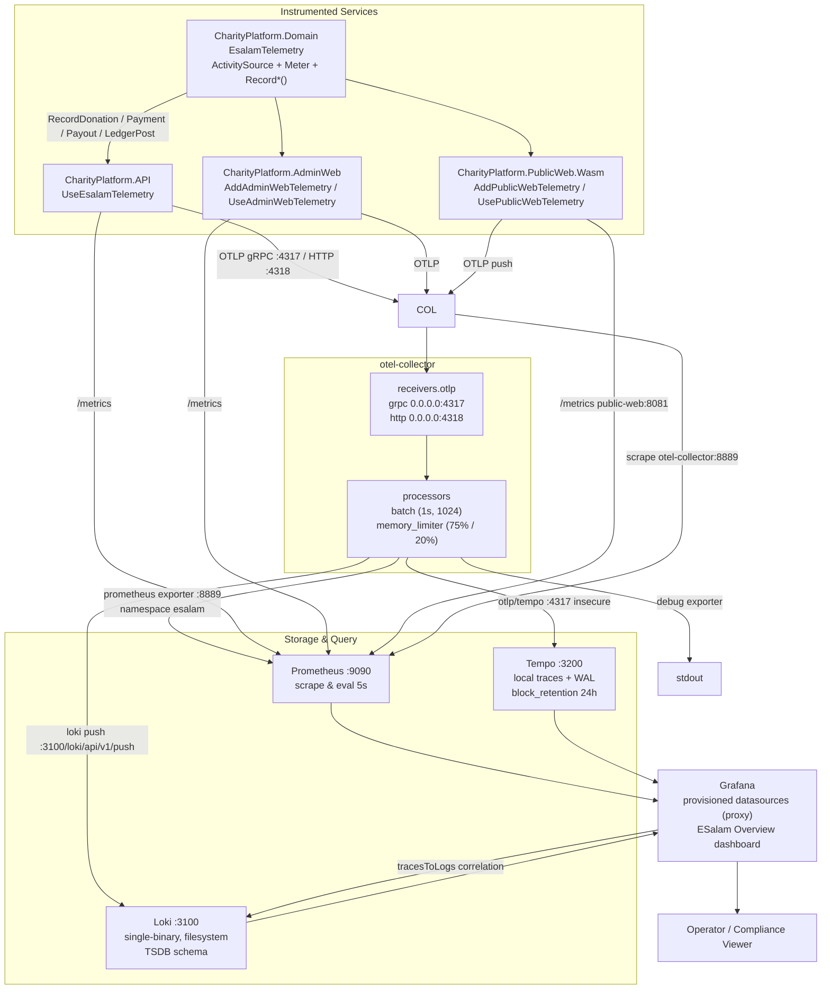
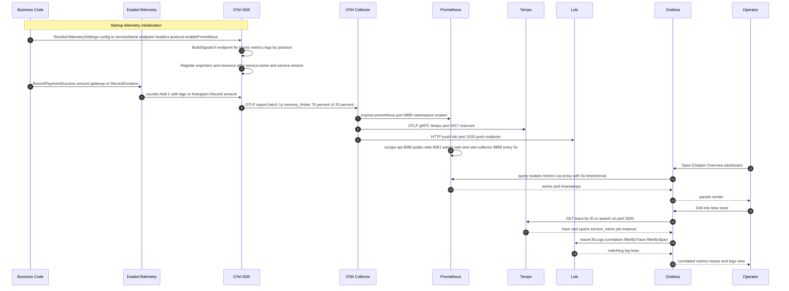

# Platform Observability Domain

**ESalam Charity Platform — Telemetry, Ingestion, and Visualization Subsystem**

---

## 1. Overview

The **Platform Observability Domain** is the cross-cutting infrastructure domain responsible for making the ESalam platform's runtime behavior **visible, measurable, and auditable** across all three deployable services. It is not a business domain in the sense that Donor Donation or Financial Governance are — it owns no money, enforces no business invariant — but it is the domain that makes every other domain *accountable* at runtime.

Architecturally, this domain spans two distinct planes:

| Plane | Responsibility | Primary Artifacts |
|---|---|---|
| **Instrumentation Plane** | In-process SDK wiring: which signals are emitted, from which service identity, to which endpoint, over which protocol | `OpenTelemetryExtensions.cs`, `AdminWebOpenTelemetryExtensions.cs`, `WebOpenTelemetryExtensions.cs`, `EsalamTelemetry.cs` |
| **Pipeline Plane** | Out-of-process collection, processing, fan-out, storage, and query | `otel-collector-config.yml`, `prometheus.yml`, `tempo.yml`, `loki.yml`, `grafana/provisioning/**` |

The design is deliberately **OpenTelemetry-native**: the three signals (traces, metrics, logs) share a single transport protocol, a single collector hop, and a single resource-identity model (`service.name` / `service.version`). An operator can therefore correlate a slow financial transaction end-to-end — from an HTTP span in the API, to a metric family in Prometheus, to the log line that explains it in Loki — without leaving Grafana.

**Domain metadata (as classified in the domain module research):**

| Attribute | Value |
|---|---|
| Domain type | Infrastructure Domain |
| Importance | 7.5 |
| Complexity | 6.0 |
| Code paths | 10 (3 instrumentation classes, 1 domain facade, 6 deployment configs) |

---

## 2. Position Within the Architecture

The Observability Domain sits *beside* the Clean Architecture layers rather than inside them. It is consumed by the presentation and host layers, and it is fed by the domain layer through a deliberately thin facade that leaks no OpenTelemetry types.

**Key structural property:** the Domain layer references `OpenTelemetry.Exporter.OpenTelemetryProtocol` but never references a backend, a collector, or a vendor. It defines *what* is measured (`ActivitySource` name, `Meter` name, instrument names). Every host decides *where* it goes. This is what allows the same domain instrumentation to serve an ASP.NET Core API, a Blazor Server console, and a Blazor WASM client without modification.

---

## 3. Application Instrumentation

### 3.1 The Uniform Extension Pattern

Three parallel extension classes implement near-identical registration logic for three structurally different hosts. The duplication is intentional and idiomatically correct — a Blazor WASM client cannot share a `WebApplication` extension with an ASP.NET Core host, because they do not share a startup model.

| Extension class | Public API | Target host |
|---|---|---|
| `Infrastructure/Telemetry/OpenTelemetryExtensions.cs` | `UseEsalamTelemetry(WebApplication)` | ASP.NET Core API |
| `AdminWeb/Telemetry/AdminWebOpenTelemetryExtensions.cs` | `AddAdminWebTelemetry(IServiceCollection, IConfiguration)` + `UseAdminWebTelemetry(WebApplication)` | Blazor Server admin console |
| `PublicWeb.Wasm/Telemetry/WebOpenTelemetryExtensions.cs` | `AddPublicWebTelemetry(...)` + `UsePublicWebTelemetry(...)` | Blazor WASM client |

All three converge on the same internal sequence:

1. **Resolve settings.** `ResolveTelemetrySettings` / `ResolveTelemetry` returns a tuple of `(serviceName, endpoint, headers, protocol, enablePrometheus)` bound from configuration. This is what makes the same binary switchable between OTLP/gRPC and OTLP/http-protobuf by configuration alone.
2. **Compose per-signal URIs.** `BuildSignalUri(baseEndpoint, signalPath, protocol)` appends `/v1/traces`, `/v1/metrics`, `/v1/logs` for `http/protobuf`, or returns the bare endpoint for `OtlpExportProtocol.Grpc`. This single helper is the main complexity driver and the main source of protocol-related defects.
3. **Register providers.** Trace, Metric, and Log providers are registered against the same resource so all three signals share `service.name` and `service.version` derived from `EsalamTelemetry.ServiceName` / `EsalamTelemetry.ServiceVersion`.
4. **Attach logging.** For the API, logging is routed through Serilog with the OTel log exporter attached — structured logs travel over the same OTLP channel as traces and metrics rather than through a separate pipeline.

### 3.2 WASM-Specific Constraint

The `enablePrometheus` toggle exists on all three extensions for symmetry, but it is only *meaningful* in server-side / SSR contexts. A Blazor WASM client runs in the browser; it cannot expose an HTTP `/metrics` endpoint for Prometheus to scrape. Its practical export path is therefore **OTLP push only**. This is a genuine architectural constraint, not a configuration oversight, and it has a downstream consequence discussed in §6.

### 3.3 The Domain Telemetry Facade

`src/CharityPlatform.Domain/Common/EsalamTelemetry.cs` is a static facade over `System.Diagnostics.ActivitySource` and `System.Diagnostics.Metrics.Meter`. It exposes eight typed `Record*` methods:

| Method | Instrument type | Purpose |
|---|---|---|
| `RecordDonation` | Counter + histogram | Donation count and monetary amount |
| `RecordReservation` | Counter | Capacity reservation created |
| `RecordExpiredReservation` | Counter | Reservation expired / reaped by sweeper |
| `RecordPaymentSuccess` | Counter + histogram | Settled payment count and value |
| `RecordPaymentFailure` | Counter | Failed payment count |
| `RecordPayout` | Counter + histogram | Disbursement count and value |
| `RecordLedgerPost` | Counter + histogram | Ledger entry posted and amount |

Dimensions are attached as tags — most importantly the **gateway name**, so dashboards can slice payment success rate by provider (`toyyibpay`, `chip`, `stripe`).

**Why this matters architecturally:** the `ActivitySource` and `Meter` names are compile-time constants. Services subscribe by name. No domain code depends on the OpenTelemetry SDK, on an exporter, or on a backend. If the entire observability stack were replaced tomorrow, only the extension classes would change — zero domain files would be touched.

### 3.4 Instrumentation Sequence

---

## 4. Telemetry Ingestion Pipeline

### 4.1 Collector Configuration

`deploy/observability/otel-collector-config.yml` defines a single-hop, fan-out pipeline.

**Receivers**

| Receiver | Bind | Protocol |
|---|---|---|
| `otlp/grpc` | `0.0.0.0:4317` | gRPC |
| `otlp/http` | `0.0.0.0:4318` | HTTP/protobuf |

Both protocols are accepted identically, which means a service can switch transport without any collector-side change — a useful property given the WASM client's push-only constraint.

**Processors**

| Processor | Setting | Rationale |
|---|---|---|
| `batch` | `timeout: 1s`, `send_batch_size: 1024` | Aggressive flush window for near-real-time dashboard feedback. A default 5–10s window would make a demo environment feel laggy. |
| `memory_limiter` | `check_interval: 1s`, `limit_percentage: 75`, `spike_limit_percentage: 20` | Protects the collector from OOM under burst. Without it, a traffic spike on the donation path could convert a telemetry problem into an availability problem. |

The pairing is the correct trade-off for the deployment context: **low latency is preserved, and the collector cannot be the thing that falls over.**

**Exporters**

| Exporter | Destination | Notes |
|---|---|---|
| `prometheus` | `0.0.0.0:8889` | Metrics exposed in namespace `esalam`; pull-based |
| `otlp/tempo` | `tempo:4317` | Traces, `tls.insecure` for the local network |
| `loki` | `http://loki:3100/loki/api/v1/push` | Logs, HTTP push |
| `debug` | stdout | Truncated verbosity; console mirror for troubleshooting |

Note the asymmetry — **metrics are pulled, traces and logs are pushed.** This matters for a failure analysis: if the collector dies, metrics stop updating at the scrape boundary (visible as a scrape gap), while traces and logs stop at the push boundary (visible as a silent truncation). Observing the collector's own `:8889` scrape target is how an operator distinguishes "the application stopped emitting" from "the pipeline stopped delivering."

### 4.2 Scrape Topology

`deploy/observability/prometheus.yml` sets both `scrape_interval` and `evaluation_interval` to **5 seconds** — six times the conventional 30s — and declares four jobs:

| Job | Targets | Purpose |
|---|---|---|
| `otel-collector` | `otel-collector:8889` | Pipeline health; collector-derived `esalam_*` metrics |
| `esalam-api` | `api:8080/metrics`, `host.docker.internal:5000/metrics` | Dual target: containerized and host-dev-run process |
| `esalam-public-web` | `public-web:8081/metrics`, `host.docker.internal:5002/metrics` | Dual target |
| `esalam-admin-web` | same dual-target `static_configs` pattern | Dual target |

Two observations:

- **The 5s interval** yields sub-10s dashboard latency at the cost of substantially higher cardinality and I/O. This is calibrated for a single-node demo topology, not a production fleet. At scale, the correct move is to split high-value financial metrics (ledger write latency, settlement success rate) onto the tight interval while demoting generic HTTP metrics to 15–30s.
- **The dual-target pattern** (`container:port` + `host.docker.internal:port`) means Prometheus is configured to observe both the containerized deployment and a locally-run development process simultaneously. During development this is useful; in production it produces permanently-down targets that pollute the `up` metric and every dashboard built on it.

### 4.3 Trace and Log Backends

**Tempo** (`tempo.yml`): `stream_over_http_enabled`, `http_listen_port: 3200`, OTLP receivers on 4317/4318, `ingester.max_block_duration: 5m`, `compactor.block_retention: 24h`, local trace storage at `/var/tempo/traces` with WAL at `/var/tempo/wal`.

The **24-hour block retention** is the single most consequential configuration value in this domain. It is tuned for ephemeral/dev operation. It is emphatically **not** a compliance retention policy — which is worth stating explicitly, because the ESalam platform's stated value proposition is a tamper-evident audit record, and traces are not that record. The audit obligation is discharged by the double-entry ledger plus `AuditLog` rows in PostgreSQL; Tempo is operational visibility only. Conflating the two would be a serious compliance misunderstanding.

**Loki** (`loki.yml`): single-binary mode, `auth_enabled: false`, HTTP 3100 / gRPC 9096, `/var/loki` path prefix with filesystem `chunks_directory` and `rules_directory`, `replication_factor: 1`, in-memory ring bound to `127.0.0.1`, `query_range.results_cache` with embedded cache at `max_size_mb: 100`, TSDB schema from `2020-10-24`.

Single-binary with filesystem storage means **no durability guarantee beyond the volume** — no replication, no object-store backing. Appropriate for the deployment context; unsuitable as the sole log store if logs are ever treated as evidence.

### 4.4 Dashboard Provisioning

`grafana/provisioning/datasources/datasources.yml` declares three datasources, all with `access: proxy`:

| Datasource | Endpoint | Configuration |
|---|---|---|
| Prometheus | `http://prometheus:9090` | `isDefault: true`, `httpMethod: POST`, `timeInterval: 5s` |
| Tempo | `http://tempo:3200` | `httpMethod: GET`, `tracesToLogs` → `datasourceUid: 'loki'` |
| Loki | `http://loki:3100` | — |

Two details carry real weight:

1. **`access: proxy`** means Grafana's *backend* issues the queries, not the browser. The datastores are never exposed to the operator's browser, so there is no CORS surface and no risk of a datasource endpoint being reachable from outside the compose network. This is the correct default and materially better than `access: direct`.
2. **Tempo → Loki correlation** is configured with tag mapping on `job`, `instance`, and `service_name`, plus `filterByTrace: true` and `filterBySpan: true`. This is what turns "a slow span" into "the exact log lines for that service instance during that span." Correlation is not automatic; it works because both Tempo spans and Loki streams carry the same resource attributes, which is a direct payoff from the shared-resource-identity design in §3.1.

`grafana/dashboards/esalam-overview.json` is a Grafana 8+ model dashboard, `editable: true`, `graphTooltip: 1`, `liveNow: true`, `id: null` (importable/provisioned), empty annotations/links, and a `panel[]` array opening with a row panel (`id: 100`, 24×1 at 0,0) as a section header. Row panels separate business/financial sections. Panels bind to the provisioned Prometheus datasource and query the `esalam_*` metric families emitted by `EsalamTelemetry`.

Because the dashboard is provisioned from the repository, **dashboards are versioned code, not UI state.** This is a meaningful operational property: a dashboard change is reviewable in a pull request, and a fresh deployment reproduces the operator's view exactly.

---

## 5. Interaction Model

The domain's interfaces fall into six interaction paths.

### (a) Service → SDK (in-process)

Services call `UseEsalamTelemetry` / `AddAdminWebTelemetry` / `AddPublicWebTelemetry` at startup, after configuration binding. Configuration keys drive `ResolveTelemetrySettings`, so **one binary switches between OTLP/gRPC and OTLP/http-protobuf by configuration only**. Business code interacts with telemetry exclusively through the static `EsalamTelemetry.Record*` API and standard `System.Diagnostics` types.

### (b) Service → Collector (OTLP)

Exporters POST OTLP/http-protobuf to `<endpoint>/v1/{traces,metrics,logs}`, or stream OTLP/gRPC to `:4317`, optionally attaching configured headers for authentication or tenant routing.

### (c) Collector → Backends (fan-out)

Metrics are exposed by the Prometheus exporter on `:8889` in the `esalam` namespace and pulled by Prometheus. Traces are pushed OTLP/gRPC to `tempo:4317` with insecure TLS for the local network. Logs are pushed over HTTP to `loki:3100/loki/api/v1/push`. The debug exporter mirrors everything to console for troubleshooting.

### (d) Prometheus → Services (pull)

Pull-based scraping of `/metrics` on `api:8080`, `public-web:8081`, `admin-web`, plus the `host.docker.internal` dev-process targets, all at 5s. Prometheus also scrapes the collector itself at `otel-collector:8889`, so pipeline health is observable.

### (e) Grafana → Backends (proxy query)

Grafana's backend queries Prometheus at `:9090` with `timeInterval: 5s`, Tempo at `:3200` for trace search and trace-by-ID, and Loki for logs. Datasource correlation links let an operator click from a slow span directly into the matching log stream.

### (f) Operator → Grafana (visualization)

The `ESalam Overview` dashboard is provisioned from the repository. Row panels separate business and financial sections; panels query the `esalam_*` metric families — donation counts, payment success/failure by gateway, reservation expiry, payout and ledger-posting amounts.

### 5.1 Known Interaction Constraints

These are not defects; they are boundaries an operator must understand before diagnosing anything through this pipeline.

| Constraint | Consequence |
|---|---|
| Prometheus is pull-only | WASM client metrics are **only** observable via the OTLP-pushed collector exporter path and server-side proxies. A browser-side metric can never appear as a direct scrape target. |
| Tempo `block_retention: 24h` | Traces older than a day are gone. Not a compliance record. |
| Loki single-node filesystem | No replication, no object-store durability. Not an evidence store. |
| Fixed service-name DNS | Datasource hostnames (`prometheus`, `tempo`, `loki`, `otel-collector`) assume the docker-compose service-name topology. Any out-of-compose deployment must revisit these URIs. |
| Dual-target scrape jobs | In a non-dev deployment, `host.docker.internal` targets are permanently down and will distort any dashboard panel built on `up`. |

---

## 6. Architectural Drift — Verified

The observability domain is documented as a Collector-mediated fan-out. Source evidence shows a **material divergence** for the API service specifically. This is reported here as it affects this domain's documented contract.

| ID | Finding | Severity | Verification | Evidence |
|---|---|---|---|---|
| **D-14** | Observability documentation claims Collector fan-out, but the API exports **directly to Grafana Cloud**, while Prometheus *also* scrapes the app `/metrics` directly | LOW | CONFIRMED-DEVIATION | `appsettings.json` — `OtlpEndpoint: https://otlp-gateway-prod-ap-southeast-2.grafana.net/otlp`; `prometheus.yml` targets `api:8080`, `public-web:8081`, `admin-web:8082` with `metrics_path: /metrics` |

**Interpretation.** Two telemetry egress paths coexist for the API:

- **Path A (documented):** API → `otel-collector` → Prometheus/Tempo/Loki → Grafana.
- **Path B (actual for the API):** API → Grafana Cloud OTLP gateway, bypassing the local collector entirely.

The practical consequences are that (i) API traces and logs are not queryable in the local Tempo/Loki instances, which breaks the documented `tracesToLogs` correlation for API-originated spans; (ii) API metrics arrive in Grafana through two independent routes with potentially divergent sampling and timing, which can produce confusing double-counting or disagreement between panels; and (iii) the local collector's `esalam` namespace metrics are complete for public-web and admin-web but incomplete for the API.

**Remediation options.** Either (a) point the API's `OtlpEndpoint` at the local collector and let the collector fan out — restoring the single documented path; or (b) accept direct-export as the design and document it explicitly, removing the API from `prometheus.yml` to eliminate the duplicate metric path. Option (a) is preferred because it preserves correlation.

---

## 7. Improvement Opportunities

| Area | Observation | Opportunity | Effort |
|---|---|---|---|
| **Telemetry egress convergence** | API exports direct to Grafana Cloud while public-web and admin-web route through the collector (D-14) | Point all three services at the collector; restore single-path fan-out and working cross-signal correlation | 1–2 h |
| **Scrape interval stratification** | 5s applied uniformly to all metric families | Split financial metrics (ledger latency, settlement rate) onto the tight interval; demote generic HTTP metrics to 15–30s | 4 h |
| **Dev-target pollution** | `host.docker.internal:5000` / `:5002` targets configured unconditionally | Move dev targets behind a separate Prometheus config file selected by environment | 1 h |
| **Retention honesty** | Tempo 24h / Loki filesystem could be mistaken for audit retention | Document explicitly that audit obligations are discharged by the ledger + `AuditLog`, not by traces/logs; align any compliance claim accordingly | documentation only |
| **WASM metric visibility** | Browser-side metrics have no pull path | Add an SSR/server-side relay for critical client metrics, or route them through a collector-side ingest gateway | 1–2 d |
| **Alerting gap** | No `alerting` block in `prometheus.yml`; no Grafana alert rules provisioned | Add recording rules for payment-failure rate and ledger-post latency; provision alert rules alongside dashboards | 4–8 h |
| **Collector HA** | Single collector instance is a single point of telemetry failure | Add queue/retry or a second collector behind a service alias if telemetry continuity becomes an operational requirement | 4–8 h |
| **Duplicated registration logic** | Three near-identical extension classes | Extract the shared settings-resolution and URI-composition logic into a common internal helper referenced by all three hosts | 4 h |

---

## 8. Domain Relations

The Platform Observability Domain participates in the wider system through the following documented relations:

| From | Relation | To | Strength | Nature |
|---|---|---|---|---|
| Platform Observability | Tool Support | Data and Application Foundation | 7.5 | Telemetry extensions instrument the API host and Infrastructure services; domain-level helpers emit metrics from aggregate operations |
| Deployment and Edge | Configuration Dependency | Platform Observability | 7.0 | Compose manifests define the observability stack alongside application services; the collector receives telemetry from all three front ends |

**Upstream dependencies (what this domain consumes):**

- **Identity and resource context** — `service.name` / `service.version` constants, plus the correlation identifiers that make cross-signal joins possible.
- **Business event emission points** — the `Record*` calls in Donation, Payment, Payout, and Ledger paths. If those call sites are not instrumented, no amount of pipeline configuration produces a metric.
- **Container DNS topology** — every datasource and exporter URI is resolved by compose service name.

**Downstream dependents (who consumes this domain):**

- **Operations Console / Platform Administrator** — dashboards and the `ESalam Overview` view.
- **Finance / Compliance Officer** — operational visibility into payment success rates, payout status, ledger-posting activity.
- **Transactional and Compliance Audit Flow** — observability runs as a *parallel obligation* alongside audit emission. This is an important structural point: audit records and telemetry are separate commitments on the same write path. If `IAuditService` emission is not transactionally coupled to the ledger write, a crash between the two produces an unaudited money movement; conversely, if telemetry emission fails, the business transaction is unaffected. **Telemetry is best-effort; audit is not.** The two must never be conflated in a compliance argument.

---

## 9. Summary

The Platform Observability Domain delivers a complete, self-hosted, OpenTelemetry-native telemetry pipeline: three instrumented services sharing a resource-identity model, a single collector accepting OTLP over both gRPC and HTTP with batching and memory limiting, and a three-way fan-out to Prometheus (pull, 5s), Tempo (push, 24h retention), and Loki (push, filesystem). Grafana is provisioned declaratively with proxy-access datasources, cross-signal trace-to-log correlation, and a versioned dashboard.

Its strongest architectural property is that **the Domain layer defines what is measured while hosts define where it goes** — a clean separation enforced by a static facade over `System.Diagnostics` primitives that leaks no vendor types into business code. Its sharpest documented divergence is that the API service bypasses the local collector and exports directly to Grafana Cloud while also being scraped directly by Prometheus, which breaks the documented correlation path and should be resolved in favor of the single collector-mediated route.

Its most important limitation to state plainly: **the pipeline's 24-hour Tempo retention and single-node Loki storage make it an operational-visibility system, not an audit-retention system.** The ESalam platform's tamper-evidence guarantee is discharged by the double-entry ledger's chained SHA-256 hashes and the auto-generated `AuditLog` rows — not by anything in this domain. Operators and compliance reviewers must keep that distinction sharp.

---

*Document compiled from source code inspection, deployment configuration review, and domain research. Findings are marked with verification status; items requiring direct access to confirm are deliberately left as gaps rather than assumed correct.*