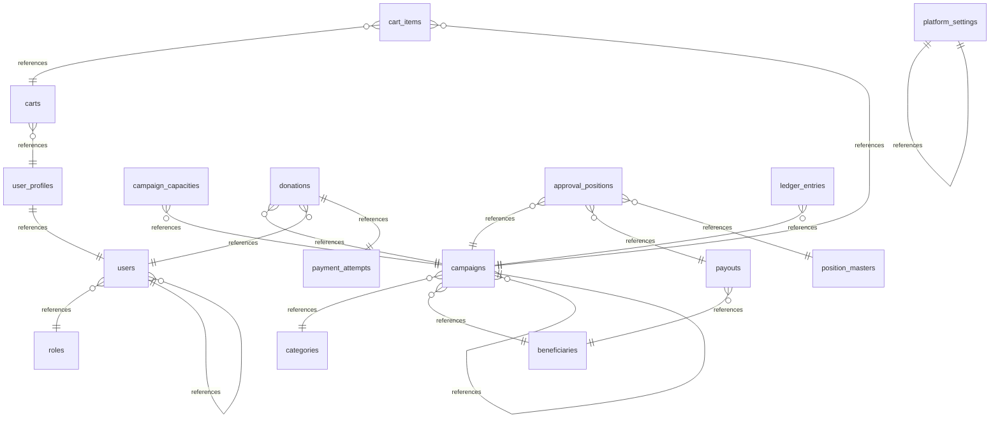

## Database Overview

### Summary

| Metric | Count |
|--------|-------|
| Database Projects | 0 |
| Tables | 19 |
| Views | 0 |
| Stored Procedures | 0 |
| Functions | 0 |
| Relationships | 20 |

### Tables

#### public.users

Identity table for platform users, bridging Supabase Auth identities (SupabaseUserId) to application-level accounts with RBAC role binding, credential hash, contact data and soft-delete/activation flags.

**Source:** `./deploy/database/01_esalam_supabase_schema.sql`

| Column | Type | Nullable | Identity |
|--------|------|----------|----------|
| Id | UUID | No | No |
| SupabaseUserId | UUID | Yes | No |
| Email | TEXT | No | No |
| PasswordHash | TEXT | Yes | No |
| FullName | TEXT | Yes | No |
| PhoneNumber | TEXT | Yes | No |
| RoleId | UUID | Yes | No |
| IsActive | BOOLEAN | No | No |
| IsDeleted | BOOLEAN | No | No |
| CreatedAt | TIMESTAMPTZ | No | No |
| UpdatedAt | TIMESTAMPTZ | Yes | No |

**Primary Key:** Id

#### public.user_profiles

Extended donor profile data linked one-to-one with users, holding display name, avatar, biography and Malaysian address fields used for receipt and personalisation.

**Source:** `./deploy/database/01_esalam_supabase_schema.sql`

| Column | Type | Nullable | Identity |
|--------|------|----------|----------|
| Id | UUID | No | No |
| UserId | UUID | No | No |
| FullName | TEXT | Yes | No |
| AvatarUrl | TEXT | Yes | No |
| Bio | TEXT | Yes | No |
| Address | TEXT | Yes | No |
| State | TEXT | Yes | No |
| Postcode | TEXT | Yes | No |
| CreatedAt | TIMESTAMPTZ | No | No |
| UpdatedAt | TIMESTAMPTZ | Yes | No |

**Primary Key:** Id

#### public.roles

RBAC role catalogue (e.g. Admin, Reviewer, Finance, Donor) used to bind users to permission sets across the admin and public surfaces.

**Source:** `./deploy/database/01_esalam_supabase_schema.sql`

| Column | Type | Nullable | Identity |
|--------|------|----------|----------|
| Id | UUID | No | No |
| Name | TEXT | No | No |
| Code | TEXT | Yes | No |
| Description | TEXT | Yes | No |
| IsActive | BOOLEAN | No | No |
| CreatedAt | TIMESTAMPTZ | No | No |
| UpdatedAt | TIMESTAMPTZ | Yes | No |

**Primary Key:** Id

#### public.categories

Campaign taxonomy lookup table (category values such as Qurban, Aqiqah, Waqf, Medical) mirroring the Domain Category entity with slug and display ordering.

**Source:** `./deploy/database/01_esalam_supabase_schema.sql`

| Column | Type | Nullable | Identity |
|--------|------|----------|----------|
| Id | UUID | No | No |
| Name | TEXT | No | No |
| Slug | TEXT | No | No |
| DisplayOrder | INTEGER | No | No |
| IsActive | BOOLEAN | No | No |
| CreatedAt | TIMESTAMPTZ | No | No |

**Primary Key:** Id

#### public.beneficiaries

Charity beneficiary/NGO aggregate storing identity, contact, Malaysian address, banking details for payouts, and a verification lifecycle status (pending/verified/rejected/suspended).

**Source:** `./deploy/database/01_esalam_supabase_schema.sql`

| Column | Type | Nullable | Identity |
|--------|------|----------|----------|
| Id | UUID | No | No |
| Name | TEXT | No | No |
| Slug | TEXT | No | No |
| RegistrationNumber | TEXT | Yes | No |
| BeneficiaryType | TEXT | Yes | No |
| VerificationStatus | TEXT | No | No |
| ContactPersonName | TEXT | Yes | No |
| Email | TEXT | Yes | No |
| PhoneNumber | TEXT | Yes | No |
| Address | TEXT | Yes | No |
| State | TEXT | Yes | No |
| Postcode | TEXT | Yes | No |
| BankName | TEXT | Yes | No |
| BankAccountNumber | TEXT | Yes | No |
| BankAccountHolder | TEXT | Yes | No |
| IsDeleted | BOOLEAN | No | No |
| CreatedAt | TIMESTAMPTZ | No | No |
| UpdatedAt | TIMESTAMPTZ | Yes | No |

**Primary Key:** Id

#### public.campaigns

Central fundraising campaign table with beneficiary/category foreign keys, self-referencing parent campaign for child campaigns, target vs collected amounts in MYR, story content, publication status and scheduling window.

**Source:** `./deploy/database/01_esalam_supabase_schema.sql`

| Column | Type | Nullable | Identity |
|--------|------|----------|----------|
| Id | UUID | No | No |
| BeneficiaryId | UUID | No | No |
| CategoryId | UUID | Yes | No |
| ParentCampaignId | UUID | Yes | No |
| Title | TEXT | No | No |
| Slug | TEXT | No | No |
| ShortDescription | TEXT | Yes | No |
| Story | TEXT | Yes | No |
| TargetAmount | NUMERIC(18,2) | No | No |
| CollectedAmount | NUMERIC(18,2) | No | No |
| Currency | TEXT | No | No |
| Status | TEXT | No | No |
| StartDate | TIMESTAMPTZ | Yes | No |
| EndDate | TIMESTAMPTZ | Yes | No |
| CreatedAt | TIMESTAMPTZ | No | No |
| UpdatedAt | TIMESTAMPTZ | Yes | No |

**Primary Key:** Id

#### public.campaign_capacities

Capacity tier table tracking share-based campaign types (Qurban animal shares, Aqiqah portions, Waqf units) with total and consumed capacity counters per campaign.

**Source:** `./deploy/database/01_esalam_supabase_schema.sql`

| Column | Type | Nullable | Identity |
|--------|------|----------|----------|
| Id | UUID | No | No |
| CampaignId | UUID | No | No |
| CapacityType | TEXT | No | No |
| TotalCapacity | INTEGER | No | No |
| UsedCapacity | INTEGER | No | No |
| PricePerShare | NUMERIC(18,2) | Yes | No |
| CreatedAt | TIMESTAMPTZ | No | No |

**Primary Key:** Id

#### public.donations

Core monetary transaction record mirroring the Donation aggregate: campaign and donor linkage, full financial breakdown (amount, tip, platform fee, gateway fee, net beneficiary amount), anonymity, payment method, tax-exemption claim and lifecycle status.

**Source:** `./deploy/database/01_esalam_supabase_schema.sql`

| Column | Type | Nullable | Identity |
|--------|------|----------|----------|
| Id | UUID | No | No |
| CampaignId | UUID | No | No |
| DonorUserId | UUID | Yes | No |
| DonorName | TEXT | Yes | No |
| DonorEmail | TEXT | Yes | No |
| Amount | NUMERIC(18,2) | No | No |
| TipAmount | NUMERIC(18,2) | No | No |
| PlatformFeeAmount | NUMERIC(18,2) | No | No |
| GatewayFeeAmount | NUMERIC(18,2) | No | No |
| NetBeneficiaryAmount | NUMERIC(18,2) | No | No |
| Currency | TEXT | No | No |
| Status | TEXT | No | No |
| IsAnonymous | BOOLEAN | No | No |
| PaymentMethod | TEXT | Yes | No |
| ClaimTaxExemption | BOOLEAN | No | No |
| FailureReason | TEXT | Yes | No |
| CreatedAt | TIMESTAMPTZ | No | No |
| UpdatedAt | TIMESTAMPTZ | Yes | No |

**Primary Key:** Id

#### public.payment_attempts

Payment gateway attempt/audit table capturing provider code (ToyyibPay, Chip, Stripe), provider reference, amount, status transitions and the raw webhook payload for reconciliation and dispute handling. Altered by the schema script after initial creation.

**Source:** `./deploy/database/01_esalam_supabase_schema.sql`

| Column | Type | Nullable | Identity |
|--------|------|----------|----------|
| Id | UUID | No | No |
| DonationId | UUID | Yes | No |
| ProviderCode | TEXT | No | No |
| ProviderReference | TEXT | Yes | No |
| Amount | NUMERIC(18,2) | Yes | No |
| Status | TEXT | No | No |
| RawPayload | JSONB | Yes | No |
| FailureReason | TEXT | Yes | No |
| CreatedAt | TIMESTAMPTZ | No | No |
| UpdatedAt | TIMESTAMPTZ | Yes | No |

**Primary Key:** Id

#### public.platform_settings

Key/value configuration store for platform-wide settings (fee percentages, feature toggles, payment gateway credentials flags) read by application and infrastructure services.

**Source:** `./deploy/database/01_esalam_supabase_schema.sql`

| Column | Type | Nullable | Identity |
|--------|------|----------|----------|
| Id | UUID | No | No |
| SettingKey | TEXT | No | No |
| SettingValue | TEXT | Yes | No |
| Description | TEXT | Yes | No |
| CreatedAt | TIMESTAMPTZ | No | No |
| UpdatedAt | TIMESTAMPTZ | Yes | No |

**Primary Key:** Id

#### public.carts

Pre-donation cart aggregate supporting dual persistence modes: authenticated carts keyed by UserId and pre-login guest carts keyed by AnonymousId, later merged on authentication.

**Source:** `./deploy/database/07_esalam_cart_schema.sql`

| Column | Type | Nullable | Identity |
|--------|------|----------|----------|
| Id | UUID | No | No |
| UserId | UUID | Yes | No |
| AnonymousId | TEXT | Yes | No |
| CreatedAt | TIMESTAMPTZ | No | No |
| UpdatedAt | TIMESTAMPTZ | Yes | No |

**Primary Key:** Id

#### public.cart_items

Line items belonging to a cart, each referencing a saved campaign and optionally a pledge amount and quantity (used for share-based Qurban/Aqiqah capacity tiers).

**Source:** `./deploy/database/07_esalam_cart_schema.sql`

| Column | Type | Nullable | Identity |
|--------|------|----------|----------|
| Id | UUID | No | No |
| CartId | UUID | No | No |
| CampaignId | UUID | No | No |
| Amount | NUMERIC(18,2) | Yes | No |
| Quantity | INTEGER | No | No |
| CreatedAt | TIMESTAMPTZ | No | No |

**Primary Key:** Id

#### public.position_masters

Master template for approval positions (Campaign or Payout workflow), defining hierarchy order and minimum target amount thresholds used to decide which approval steps are required for a given campaign or payout size. Mirrors the Domain PositionMaster entity.

**Source:** `./deploy/database/01_esalam_supabase_schema.sql`

| Column | Type | Nullable | Identity |
|--------|------|----------|----------|
| Id | UUID | No | No |
| Name | TEXT | No | No |
| Code | TEXT | No | No |
| Description | TEXT | Yes | No |
| WorkflowType | TEXT | No | No |
| HierarchyOrder | INTEGER | No | No |
| MinTargetAmount | NUMERIC(18,2) | No | No |
| IsActive | BOOLEAN | No | No |
| CreatedAt | TIMESTAMPTZ | No | No |

**Primary Key:** Id

#### public.approval_positions

Approval workflow execution instances for either a campaign or a payout, carrying step order, approval cycle, reviewer identity, escalation flag and audit comments. Governs when funds may be released.

**Source:** `./deploy/database/01_esalam_supabase_schema.sql`

| Column | Type | Nullable | Identity |
|--------|------|----------|----------|
| Id | UUID | No | No |
| CampaignId | UUID | Yes | No |
| PayoutId | UUID | Yes | No |
| PositionMasterId | UUID | No | No |
| StepOrder | INTEGER | No | No |
| Cycle | INTEGER | No | No |
| Status | TEXT | No | No |
| IsEscalation | BOOLEAN | No | No |
| ReviewerUserId | UUID | Yes | No |
| Comments | TEXT | Yes | No |
| CreatedAt | TIMESTAMPTZ | No | No |
| UpdatedAt | TIMESTAMPTZ | Yes | No |

**Primary Key:** Id

#### public.payouts

Outbound fund disbursement records to a beneficiary for collected campaign funds, with amount, currency, lifecycle status and requester/approver traceability wired into the approval_positions workflow.

**Source:** `./deploy/database/01_esalam_supabase_schema.sql`

| Column | Type | Nullable | Identity |
|--------|------|----------|----------|
| Id | UUID | No | No |
| CampaignId | UUID | Yes | No |
| BeneficiaryId | UUID | Yes | No |
| Amount | NUMERIC(18,2) | No | No |
| Currency | TEXT | No | No |
| Status | TEXT | No | No |
| RequestedByUserId | UUID | Yes | No |
| ApprovedAt | TIMESTAMPTZ | Yes | No |
| CreatedAt | TIMESTAMPTZ | No | No |
| UpdatedAt | TIMESTAMPTZ | Yes | No |

**Primary Key:** Id

#### public.ledger_entries

Double-entry accounting ledger backing IDoubleEntryLedgerService: balanced debit/credit rows per campaign/donation with chained SHA-256 hash columns (PreviousHash, EntryHash) providing tamper-evident financial immutability.

**Source:** `./deploy/database/01_esalam_supabase_schema.sql`

| Column | Type | Nullable | Identity |
|--------|------|----------|----------|
| Id | UUID | No | No |
| CampaignId | UUID | Yes | No |
| DonationId | UUID | Yes | No |
| EntryType | TEXT | No | No |
| Debit | NUMERIC(18,2) | No | No |
| Credit | NUMERIC(18,2) | No | No |
| Currency | TEXT | No | No |
| PreviousHash | TEXT | Yes | No |
| EntryHash | TEXT | Yes | No |
| CreatedAt | TIMESTAMPTZ | No | No |

**Primary Key:** Id

#### public.campaign_media

Campaign media gallery storage references (pictures and videos) with type discrimination and display ordering, consumed by the campaign picture/video gallery endpoints in CampaignsController.

**Source:** `./deploy/database/01_esalam_supabase_schema.sql`

| Column | Type | Nullable | Identity |
|--------|------|----------|----------|
| Id | UUID | No | No |
| CampaignId | UUID | No | No |
| MediaType | TEXT | No | No |
| Url | TEXT | No | No |
| DisplayOrder | INTEGER | No | No |
| CreatedAt | TIMESTAMPTZ | No | No |

**Primary Key:** Id

#### public.audit_logs

Compliance and audit trail table written by IAuditService, recording actor, action, affected entity, JSON detail payload and source IP for financial and moderation operations surfaced in the AdminWeb Audit pages.

**Source:** `./deploy/database/01_esalam_supabase_schema.sql`

| Column | Type | Nullable | Identity |
|--------|------|----------|----------|
| Id | UUID | No | No |
| UserId | UUID | Yes | No |
| CampaignId | UUID | Yes | No |
| Action | TEXT | No | No |
| EntityType | TEXT | Yes | No |
| Details | JSONB | Yes | No |
| IpAddress | INET | Yes | No |
| CreatedAt | TIMESTAMPTZ | No | No |

**Primary Key:** Id

#### public.recurring_donations

Scheduled recurring giving plans (weekly/monthly/yearly) linked to a donor and campaign, drained by the Application.Recurring slice exposed through RecurringDonationsController.

**Source:** `./deploy/database/01_esalam_supabase_schema.sql`

| Column | Type | Nullable | Identity |
|--------|------|----------|----------|
| Id | UUID | No | No |
| UserId | UUID | No | No |
| CampaignId | UUID | No | No |
| Frequency | TEXT | No | No |
| Amount | NUMERIC(18,2) | No | No |
| Status | TEXT | No | No |
| NextRunDate | DATE | Yes | No |
| CreatedAt | TIMESTAMPTZ | No | No |
| UpdatedAt | TIMESTAMPTZ | Yes | No |

**Primary Key:** Id

### Table Relationships

| From Table | From Columns | To Table | To Columns | Type |
|------------|--------------|----------|------------|------|
| public.carts | UserId | public.user_profiles | Id | Implicit |
| public.users | RoleId | public.roles | Id | ForeignKey |
| public.campaigns | CategoryId | public.categories | Id | ForeignKey |
| public.campaigns | BeneficiaryId | public.beneficiaries | Id | ForeignKey |
| public.campaigns | ParentCampaignId | public.campaigns | Id | ForeignKey |
| public.campaign_capacities | CampaignId | public.campaigns | Id | ForeignKey |
| public.platform_settings | SettingKey | public.platform_settings | Key | Reference |
| public.donations | CampaignId | public.campaigns | Id | Implicit |
| public.donations | DonorUserId | public.users | Id | Implicit |
| public.donations | PaymentAttemptId | public.payment_attempts | Id | Implicit |
| public.payment_attempts | DonationId | public.donations | Id | Implicit |
| public.cart_items | CartId | public.carts | Id | Implicit |
| public.cart_items | CampaignId | public.campaigns | Id | Implicit |
| public.approval_positions | CampaignId | public.campaigns | Id | Implicit |
| public.approval_positions | PayoutId | public.payouts | Id | Implicit |
| public.approval_positions | PositionMasterId | public.position_masters | Id | Implicit |
| public.ledger_entries | CampaignId | public.campaigns | Id | Implicit |
| public.payouts | BeneficiaryId | public.beneficiaries | Id | Implicit |
| public.user_profiles | UserId | public.users | Id | Implicit |
| public.users | SupabaseUserId | auth.users | Id | Implicit |

### Data Flows

#### Donation creation -> financial breakdown persistence

- **Source:** API Client / DonationsController
- **Destination:** donations
- **Operations:** INSERT

#### Payment webhook -> payment_attempts status transition

- **Source:** Payment provider callback (ToyyibPay/Chip/Stripe)
- **Destination:** payment_attempts
- **Operations:** INSERT, UPDATE

#### Cart to donation conversion

- **Source:** carts
- **Destination:** donations
- **Operations:** SELECT, DELETE, INSERT

#### Campaign fundraising progress update

- **Source:** donations
- **Destination:** campaigns
- **Operations:** UPDATE

#### Approval workflow progression (campaign/payout)

- **Source:** approval_positions
- **Destination:** approval_positions
- **Operations:** UPDATE

#### Double-entry ledger posting from donation/payout

- **Source:** donations
- **Destination:** ledger_entries
- **Operations:** INSERT

#### Anonymous cart association on login merge

- **Source:** carts (AnonymousId)
- **Destination:** carts (UserId)
- **Operations:** UPDATE

#### User identity creation and profile binding via Supabase sync

- **Source:** Supabase Auth
- **Destination:** users
- **Operations:** INSERT, UPDATE

#### RBAC role assignment to user

- **Source:** roles
- **Destination:** user_roles
- **Operations:** INSERT, DELETE

#### Payout creation and approval against campaign ledger

- **Source:** campaigns / ledger_entries
- **Destination:** payouts
- **Operations:** INSERT, UPDATE

#### Campaign capacity tier consumption (Qurban/Aqiqah/Waqf)

- **Source:** campaigns
- **Destination:** campaign_capacities
- **Operations:** UPDATE

